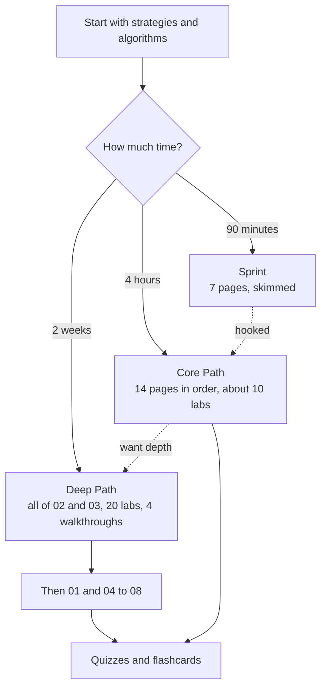

# Learning paths

> **TL;DR**
>
> - **Start with strategies & algorithms.** Modules 02 and 03 carry this KB. Read market structure only as far as a strategy page needs it; firms, infrastructure and regulation come later.
> - Three paths: a **90-minute sprint** (7 pages, skimmed), the **4-hour Core Path** (14 pages, ~24.7k words, ~85% from modules 02–03) and a **2-week Deep Path** (all of 02 and 03 with labs and walkthroughs, then the support modules, quizzes and flashcards).
> - Times assume ~100–110 words a minute. That is under half the 238 words a minute adults average on non-fiction `[Verified]`, because these pages are dense with tables, formulas and diagrams `[Estimate]`.
> - Labs are optional on the sprint, recommended on the Core Path and part of the Deep Path. Each runs in about a minute on a laptop.

**Level:** Core · **Read time:** ~5 min · **Last verified:** 2026-11

## Pick a path

## The 90-minute sprint

Goal: one business from each end of the horizon axis and enough vocabulary to follow a quant. On each dossier read the TL;DR, header table, worked example and diagram; skip the collapsed math.

- [ ] [The big picture](the-big-picture.md): firm types, horizons and who pays (10 min)
- [ ] [Strategies: the map](../02-strategies/index.md): both maps and the "who pays you" table (10 min)
- [ ] [There is no single algorithm](../03-algorithms/there-is-no-single-algorithm.md): "The short answer" and "The five pipelines side by side" (15 min)
- [ ] [Equity market making](../02-strategies/a-liquidity-provision/equity-market-making.md): the market-maker dossier, including its P&L decomposition (15 min)
- [ ] [Stat arb: overview and history](../02-strategies/c-statistical-arbitrage/stat-arb-overview-and-history.md): the stat-arb dossier (15 min)
- [ ] [Walkthrough: a mid-frequency stat-arb book](../03-algorithms/h-end-to-end-walkthroughs/walkthrough-mid-frequency-stat-arb.md): skim stages 1–9 and the attribution table (12 min)
- [ ] [One-page cheat sheet](one-page-cheat-sheet.md): formulas, numbers and terms (8 min)

That is 85 minutes, with five to spare.

## The 4-hour Core Path

These are the 14 pages listed in `scripts/core_path.txt`, in order. They total ~24.7k prose words, ~85% of them from modules 02–03, and carry no open verification items. The order runs from the maps and the evaluation lens to market making (microseconds), then stat arb and cross-sectional alpha (days), then the portfolio and execution stages that turn a forecast into P&L. Labs are synthetic-data scripts: run one with `python labs/NN-name/lab.py` and read its README's "What this toy misses vs the real world".

- [ ] 1. [The big picture](the-big-picture.md) (12 min)
- [ ] 2. [Life of a stock order](../01-market-structure/life-of-a-stock-order.md) (10 min). Optional lab: [18 smart order router](https://github.com/FrankHuang94/quant_trading_claude/tree/main/labs/18-smart-order-router)
- [ ] 3. [The limit order book](../01-market-structure/the-limit-order-book.md) (12 min). Lab: [01 matching engine](https://github.com/FrankHuang94/quant_trading_claude/tree/main/labs/01-matching-engine-order-book)
- [ ] 4. [Strategies: the map](../02-strategies/index.md) (14 min)
- [ ] 5. [How quants evaluate a strategy](../02-strategies/how-quants-evaluate-a-strategy.md) (22 min). Lab: [13 backtest overfitting](https://github.com/FrankHuang94/quant_trading_claude/tree/main/labs/13-backtest-overfitting-dsr-pbo)
- [ ] 6. [There is no single algorithm](../03-algorithms/there-is-no-single-algorithm.md) (28 min)
- [ ] 7. [Equity market making](../02-strategies/a-liquidity-provision/equity-market-making.md) (20 min). Labs: [02 microprice](https://github.com/FrankHuang94/quant_trading_claude/tree/main/labs/02-microprice-fair-value), [04 markouts](https://github.com/FrankHuang94/quant_trading_claude/tree/main/labs/04-markout-analysis)
- [ ] 8. [Quoting and inventory control](../03-algorithms/f-market-making-and-hft-algorithms/quoting-and-inventory-control.md) (16 min). Lab: [05 Avellaneda-Stoikov and GLFT](https://github.com/FrankHuang94/quant_trading_claude/tree/main/labs/05-avellaneda-stoikov-glft-quoting)
- [ ] 9. [Stat arb: overview and history](../02-strategies/c-statistical-arbitrage/stat-arb-overview-and-history.md) (20 min). Lab: [09 PCA residual stat arb](https://github.com/FrankHuang94/quant_trading_claude/tree/main/labs/09-pca-residual-stat-arb)
- [ ] 10. [Cross-sectional alpha and neutralization](../02-strategies/d-mid-frequency-alpha/cross-sectional-alpha-and-neutralization.md) (18 min). Lab: [11 signal transforms and IC](https://github.com/FrankHuang94/quant_trading_claude/tree/main/labs/11-signal-transforms-ic)
- [ ] 11. [Evaluating signals](../03-algorithms/a-data-and-signals/evaluating-signals.md) (12 min). Lab: re-read Lab 11's IC and decay output
- [ ] 12. [Mean-variance optimization](../03-algorithms/d-portfolio-construction/mean-variance-optimization.md) (16 min). Lab: [14 risk model and MVO](https://github.com/FrankHuang94/quant_trading_claude/tree/main/labs/14-risk-model-mvo)
- [ ] 13. [Implementation shortfall and Almgren-Chriss](../03-algorithms/e-execution-algorithms/implementation-shortfall-and-almgren-chriss.md) (12 min). Lab: [16 Almgren-Chriss frontier](https://github.com/FrankHuang94/quant_trading_claude/tree/main/labs/16-almgren-chriss-frontier)
- [ ] 14. [Walkthrough: a mid-frequency stat-arb book](../03-algorithms/h-end-to-end-walkthroughs/walkthrough-mid-frequency-stat-arb.md) (24 min). Script: [`mid-frequency-stat-arb.py`](https://github.com/FrankHuang94/quant_trading_claude/tree/main/labs/walkthroughs), which reuses labs 11, 12, 14 and 17

Reading time is 236 minutes; each lab adds 5–10. Finish with the [strategies quiz](../10-self-test/quiz-02-strategies.md) and the [algorithms quiz](../10-self-test/quiz-03-algorithms.md).

## The 2-week Deep Path

Fourteen sessions of 2–2.5 hours, ~30 hours in all. Days 1–12 cover every page of modules 02 and 03, grouped by business so each strategy sits next to its algorithms; days 13–14 add the context modules. Budget ~10 minutes per lab: run it, read the plot, read the "toy misses" list.

- [ ] **Day 1 · Orientation (~1 h 45 min).** [Big picture](the-big-picture.md), [cheat sheet](one-page-cheat-sheet.md), [strategy map](../02-strategies/index.md), [how quants evaluate](../02-strategies/how-quants-evaluate-a-strategy.md), [algorithms overview](../03-algorithms/index.md), [no single algorithm](../03-algorithms/there-is-no-single-algorithm.md), [algorithm map](../03-algorithms/algorithm-map.md). New to microstructure? Add [life of an order](../01-market-structure/life-of-a-stock-order.md) and [the order book](../01-market-structure/the-limit-order-book.md) (+25 min).
- [ ] **Day 2 · Liquidity provision (~1 h 50 min).** The five [A dossiers](../02-strategies/a-liquidity-provision/equity-market-making.md) and [M1, the HFT loop](../03-algorithms/f-market-making-and-hft-algorithms/anatomy-of-an-hft-trading-loop.md). Lab 01.
- [ ] **Day 3 · Market-making algorithms (~2 h 25 min).** [M2 fair value](../03-algorithms/f-market-making-and-hft-algorithms/fair-value-and-microprice.md) through [M9 risk controls](../03-algorithms/f-market-making-and-hft-algorithms/algorithmic-risk-controls.md). Labs 02–06.
- [ ] **Day 4 · Speed and structure (~2 h).** The four [B dossiers](../02-strategies/b-speed-and-structural/latency-arbitrage.md); walkthroughs of an [ETF market maker](../03-algorithms/h-end-to-end-walkthroughs/walkthrough-etf-market-maker.md) and an [options market maker](../03-algorithms/h-end-to-end-walkthroughs/walkthrough-options-market-maker.md). Lab 07.
- [ ] **Day 5 · Stat arb (~2 h 15 min).** The six [C dossiers](../02-strategies/c-statistical-arbitrage/stat-arb-overview-and-history.md). Labs 08–10.
- [ ] **Day 6 · Signals and forecasts (~1 h 55 min).** [D1–D4](../03-algorithms/a-data-and-signals/point-in-time-data-and-cleaning.md), [F1–F3](../03-algorithms/b-forecasting-models/linear-models-and-regularization.md), [F5 alpha combination](../03-algorithms/b-forecasting-models/alpha-combination-and-ensembling.md). Labs 11–12.
- [ ] **Day 7 · Validation and live trading (~1 h 55 min).** [V1–V4](../03-algorithms/c-validation-and-backtesting/time-series-cross-validation.md), [F4 LLMs](../03-algorithms/b-forecasting-models/llms-and-foundation-models-in-quant.md), [F6 regimes](../03-algorithms/b-forecasting-models/regime-detection.md), [L1–L3](../03-algorithms/g-live-trading/live-monitoring-and-pnl-attribution.md). Lab 13.
- [ ] **Day 8 · Mid-frequency alpha (~1 h 55 min).** The seven [D dossiers](../02-strategies/d-mid-frequency-alpha/cross-sectional-alpha-and-neutralization.md). Lab 20.
- [ ] **Day 9 · Portfolio construction (~2 h 15 min).** [P1–P7](../03-algorithms/d-portfolio-construction/risk-models.md), then the [stat-arb walkthrough](../03-algorithms/h-end-to-end-walkthroughs/walkthrough-mid-frequency-stat-arb.md). Labs 14–15.
- [ ] **Day 10 · Execution (~2 h 10 min).** [E1–E6](../03-algorithms/e-execution-algorithms/execution-algorithms-overview.md), then the [\$500M order walkthrough](../03-algorithms/h-end-to-end-walkthroughs/walkthrough-institutional-execution.md). Labs 16–18.
- [ ] **Day 11 · Factors, volatility, futures (~2 h 10 min).** The [E](../02-strategies/e-risk-premia-and-factors/factor-investing-fundamentals.md), [F](../02-strategies/f-volatility-and-derivatives/volatility-risk-premium-and-vol-arb.md) and [G](../02-strategies/g-futures-and-macro-context/trend-following-and-ctas.md) dossiers. Lab 19.
- [ ] **Day 12 · Cross-cutting (~2 h 30 min).** The five [H pages](../02-strategies/h-cross-cutting/strategy-comparison-matrix.md), led by the [failure gallery](../02-strategies/h-cross-cutting/strategy-failure-gallery.md); then quizzes [02](../10-self-test/quiz-02-strategies.md) and [03](../10-self-test/quiz-03-algorithms.md).
- [ ] **Day 13 · Plumbing and rules (~2 h 30 min).** The rest of [module 01](../01-market-structure/order-types-and-auctions.md), [05 infrastructure](../05-infrastructure/how-infrastructure-constrains-algorithms.md) and [06 risk and regulation](../06-risk-and-regulation/risk-management-at-quant-firms.md).
- [ ] **Day 14 · People and judgment (~2 h 45 min).** [04 industry and firms](../04-industry-and-firms/taxonomy-of-quant-firms.md) (skim the profiles), [07 conversation playbook](../07-conversation-playbook/how-to-talk-to-a-quant.md) and [08 calibration](../08-calibration/myths-vs-reality.md); the remaining quizzes and a first pass through the flashcards ([self-test](../10-self-test/index.md)).

## Related pages

- [The big picture](the-big-picture.md)
- [One-page cheat sheet](one-page-cheat-sheet.md)
- [Strategies: the map](../02-strategies/index.md)
- [Algorithms: overview](../03-algorithms/index.md)
- [There is no single algorithm](../03-algorithms/there-is-no-single-algorithm.md)
- [Labs](../labs.md)
- [Self-test](../10-self-test/index.md)

## Sources

- [Verified] Brysbaert, M. (2019). "How many words do we read per minute? A review and meta-analysis of reading rate." *Journal of Memory and Language* 109, 104047. <https://doi.org/10.1016/j.jml.2019.104047> (accessed 2026-11)
- [Verified] Grinold, R. C. (1989). "The fundamental law of active management." *Journal of Portfolio Management* 15(3), 30–37. <https://doi.org/10.3905/jpm.1989.409211> (accessed 2026-11)
- [Verified] Avellaneda, M. & Stoikov, S. (2008). "High-frequency trading in a limit order book." *Quantitative Finance* 8(3), 217–224. <https://doi.org/10.1080/14697680701381228> (accessed 2026-11)
- [Verified] Avellaneda, M. & Lee, J.-H. (2010). "Statistical arbitrage in the US equities market." *Quantitative Finance* 10(7), 761–782. <https://doi.org/10.1080/14697680903124632> (accessed 2026-11)
- [Verified] Almgren, R. & Chriss, N. (2000). "Optimal execution of portfolio transactions." *Journal of Risk* 3(2), 5–39. <https://doi.org/10.21314/JOR.2001.041> (accessed 2026-11)
- [Verified] Isichenko, M. (2021). *Quantitative Portfolio Management: The Art and Science of Statistical Arbitrage*. Wiley. <https://www.oreilly.com/library/view/-/9781119821328/> (accessed 2026-11)
