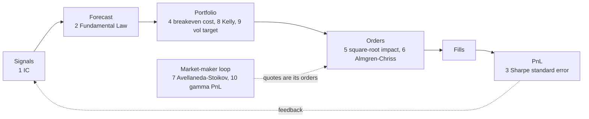

# One-page cheat sheet

> **TL;DR**
>
> - One pipeline, many clock speeds: data → signals → forecast → portfolio → orders → fills → P&L, run in microseconds by a market maker and monthly by a factor manager.
> - Ask of any strategy: who pays, and why do they accept it? Of any Sharpe ratio: gross or net, over what period, backtest or live?
> - Below: ten formulas, twelve numbers (as of 2026-11) and ten misused terms, each linked to its explaining page.

**Level:** Core · **Read time:** ~8 min · **Last verified:** 2026-11

## The pipeline in one line

**Data → signals → forecast → portfolio → orders → fills → P&L → feedback to signals.** A market maker closes the loop in microseconds, with "portfolio" shrunk to inventory skew; a factor manager closes it monthly ([There is no single algorithm](../03-algorithms/there-is-no-single-algorithm.md)). Where the formulas attach:

## Firm types × horizon × edge

| Firm type | Horizon | Main edge | Who pays | Start with |
|---|---|---|---|---|
| Electronic market makers | µs to minutes | liquidity provision · speed | traders paying the half-spread | [Equity MM](../02-strategies/a-liquidity-provision/equity-market-making.md) |
| HFT prop (aggressive) | µs to seconds | speed · structural | stale quoters | [Latency arbitrage](../02-strategies/b-speed-and-structural/latency-arbitrage.md) |
| Quant hedge funds | minutes to weeks | informational · behavioral | slower or constrained investors | [Stat arb](../02-strategies/c-statistical-arbitrage/stat-arb-overview-and-history.md) |
| Multi-manager [pods](../09-reference/glossary.md#pod) | hours to weeks | informational · behavioral | the same, market-neutral, under tight drawdown limits | [Factor-residual reversion](../02-strategies/c-statistical-arbitrage/factor-residual-mean-reversion.md) |
| Factor managers | months | risk premium · behavioral | investors shedding disliked risks | [Factor investing](../02-strategies/e-risk-premia-and-factors/factor-investing-fundamentals.md) |
| CTAs | weeks to months | behavioral · risk premium | under-reacting traders and hedgers | [Trend following](../02-strategies/g-futures-and-macro-context/trend-following-and-ctas.md) |
| Agency execution | an order's life | none sought | commissions | [Execution algorithms](../03-algorithms/e-execution-algorithms/execution-algorithms-overview.md) |

Named firms: [the big picture](the-big-picture.md).

## Ten formulas

| # | Formula | What it says | Page |
|---|---|---|---|
| 1 | [IC](../09-reference/glossary.md#information-coefficient-ic): $IC_t = \mathrm{corr}_{\mathrm{rank}}(s_{i,t},\ r_{i,t+h})$ | Daily cross-sectional score of signal vs forward return; noise ≈ $1/\sqrt{N}$ (0.045 at 500 names). Mean ÷ sd × √252 ≈ annual IR | [D4](../03-algorithms/a-data-and-signals/evaluating-signals.md) |
| 2 | [Fundamental Law](../09-reference/glossary.md#fundamental-law-of-active-management): $IR \approx TC \cdot IC \cdot \sqrt{BR}$ | Skill × √(independent bets a year) × what constraints let through (TC 0.3–0.8). IC 0.01 on 50,000 bets: IR ≈ 2.2 before costs | [Evaluating a strategy](../02-strategies/how-quants-evaluate-a-strategy.md) |
| 3 | Sharpe SE: $SE(\widehat{SR}) \approx \sqrt{(1 + SR^2/2)/T}$ | Per-period units (Lo 2002). From daily data, t ≈ SR × √years: a true 0.75 needs ~7 years to reach t = 2 | [V4](../03-algorithms/c-validation-and-backtesting/overfitting-and-multiple-testing.md) |
| 4 | Breakeven cost: $c^* = \alpha/T$, $\alpha_{net} = \alpha - Tc$ | 12% gross alpha at 60× [turnover](../09-reference/glossary.md#turnover) breaks even at 20 bp per dollar traded; each extra bp of cost costs 0.6% a year | [Evaluating a strategy](../02-strategies/how-quants-evaluate-a-strategy.md) |
| 5 | [Square-root impact](../09-reference/glossary.md#square-root-law): $I \approx Y \sigma \sqrt{Q/V}$ | Y ≈ 0.5–1, σ daily. 5% of ADV in a 2%-vol stock: 22–45 bp; double the order, +41% per share | [P5](../03-algorithms/d-portfolio-construction/transaction-cost-and-impact-models.md) |
| 6 | [Almgren-Chriss](../09-reference/glossary.md#almgren-chriss-model): $\min\ E[IS] + \lambda \mathrm{Var}[IS]$; $x(t) = X \frac{\sinh \kappa (T-t)}{\sinh \kappa T}$, $\kappa \approx \sqrt{\lambda \sigma^2/\eta}$ | Impact punishes speed, risk punishes waiting; λ = 0 is TWAP | [E3](../03-algorithms/e-execution-algorithms/implementation-shortfall-and-almgren-chriss.md) |
| 7 | [Avellaneda-Stoikov](../09-reference/glossary.md#avellaneda-stoikov-model): $r = s - q\gamma\sigma^2(T-t)$; spread $\gamma\sigma^2(T-t) + \frac{2}{\gamma}\ln(1 + \frac{\gamma}{k})$ | The [reservation price](../09-reference/glossary.md#reservation-price) leans against inventory: long (q > 0) shades both quotes down | [M4](../03-algorithms/f-market-making-and-hft-algorithms/quoting-and-inventory-control.md) |
| 8 | [Kelly](../09-reference/glossary.md#kelly-criterion): $f^* = \mu/\sigma^2$; growth $f\mu - f^2\sigma^2/2$ | 7% excess return at 10% vol: 7× leverage. Half Kelly: 75% of the growth at half the vol | [P7](../03-algorithms/d-portfolio-construction/position-sizing-and-risk-budgeting.md) |
| 9 | [Vol targeting](../09-reference/glossary.md#volatility-targeting): $w_t = \sigma^{*}/\hat{\sigma}_t$ | Scale exposure by target ÷ forecast vol (EWMA); 10% a year is a common target `[Lore]` | [P7](../03-algorithms/d-portfolio-construction/position-sizing-and-risk-budgeting.md) |
| 10 | Gamma P&L: $d\Pi \approx \frac{1}{2}\Gamma S^2(\sigma^2_{impl} - \sigma^2_{real})\,dt$ | A [delta-hedged](../09-reference/glossary.md#delta-hedging) short option earns theta, pays gamma: a bet that implied variance exceeds realized. Long side: flip the sign | [M7](../03-algorithms/f-market-making-and-hft-algorithms/hedging-algorithms.md) |

## Twelve numbers to remember

| Number | What | Tag | Read more |
|---|---|---|---|
| 17.6B shares | US equity average daily volume, 2025 (record) | `[Reported]` | [Equity MM](../02-strategies/a-liquidity-provision/equity-market-making.md) |
| 50.6% | Off-exchange share of US equity volume, 2025: first year above half; ~81% of it principal dealers | `[Verified]` | [Venues](../01-market-structure/venues-and-retail-flow.md) |
| 18 and ~33 | Registered equity exchanges (Oct 2026) and NMS-stock ATSs | `[Reported]` | [Venues](../01-market-structure/venues-and-retail-flow.md) |
| ~7–10% | [Closing-auction](../09-reference/glossary.md#closing-auction) share of daily volume; record 9.44% of notional (Q2 2024); ~20% on rebalance days | `[Reported]` | [Auctions](../01-market-structure/order-types-and-auctions.md) |
| \$0.0030/share | [Access-fee](../09-reference/glossary.md#access-fee) cap; the cut to \$0.0010 (and a \$0.005 tick for tick-constrained stocks) is delayed to November 2027 | `[Verified]` | [Fees and ticks](../01-market-structure/fees-rebates-and-ticks.md) |
| T+1 | [US equity settlement](../09-reference/glossary.md#t1-settlement) since 2024-05-28 | `[Verified]` | [Settlement](../01-market-structure/shorting-financing-and-settlement.md) |
| 20 | US options exchanges (Q3 2026) | `[Verified]` | [Options MM](../02-strategies/a-liquidity-provision/options-market-making.md) |
| 66.2% | 0DTE share of SPX options volume, a record, July 2026 | `[Verified]` | [Recent changes](../01-market-structure/recent-changes.md) |
| ~\$5B a year | Global equity [latency-arbitrage](../09-reference/glossary.md#latency-arbitrage) "tax", ~0.5 bp of traded value (Aquilina, Budish and O'Neill) | `[Verified]` | [Latency arbitrage](../02-strategies/b-speed-and-structural/latency-arbitrage.md) |
| 0.005–0.03 | Daily rank IC of one real signal; 0.05 is exceptional, above 0.1 usually a bug | `[Lore]` | [D4](../03-algorithms/a-data-and-signals/evaluating-signals.md) |
| −26% / −58% | Anomaly returns out of sample / after publication, 97 predictors (McLean and Pontiff) | `[Verified]` | [Evolution](../02-strategies/h-cross-cutting/evolution-of-quant-strategies.md) |
| 1.0 → 0.44 | Harvey–Liu haircut of a 10-year Sharpe of 1.0 picked from 100 tests | `[Verified]` | [V3](../03-algorithms/c-validation-and-backtesting/backtest-pitfalls.md) |

## Ten terms people misuse

| Term | Common misuse | What a quant means |
|---|---|---|
| [Alpha](../09-reference/glossary.md#alpha) | Any outperformance | A forecast of residual return; "an alpha" is one signal |
| [Statistical arbitrage](../09-reference/glossary.md#statistical-arbitrage) | Riskless profit | A diversified bet on relative mispricing; it can lose badly ([2007 quant quake](../09-reference/glossary.md#quant-quake)) |
| [HFT](../09-reference/glossary.md#high-frequency-trading-hft) | One strategy, usually front-running | A speed regime: the SEC sorts HFT into passive market making, arbitrage, structural and directional `[Verified]` |
| [Front-running](../09-reference/glossary.md#front-running) | Trading ahead of public, predictable flows | Trading ahead of a known client order (FINRA Rule 5270 covers imminent blocks) `[Verified]`; trading announced index changes is not |
| [Sharpe ratio](../09-reference/glossary.md#sharpe-ratio) | One comparable number | Meaningless without gross or net, period and backtest or live |
| Out-of-sample | Any data not used to fit | Data never used to fit or choose the model; a peeked-at holdout is in-sample |
| Liquidity | Volume | The cost of trading your size now: spread, depth and how fast the book refills |
| [Dark pool](../09-reference/glossary.md#dark-pool) | Shady, or all off-exchange trading | An ATS without displayed quotes: ~19% of off-exchange volume; wholesalers do most of the rest `[Reported]` |
| [PFOF](../09-reference/glossary.md#payment-for-order-flow-pfof) | Paying to trade against customers | Wholesalers pay for uninformed retail flow and fill it inside the NBBO; legal in the US, banned in the EU (exemptions ended 2026-06-30) `[Reported]` |
| Market neutral | Dollar neutral | [Beta-neutral](../09-reference/glossary.md#beta-neutral) and factor-neutral too; dollar-neutral books can hide factor bets |

## Where to go next

- **Four hours:** the [Core Path](learning-paths.md#the-4-hour-core-path).
- **The two priority modules:** [Strategies: the map](../02-strategies/index.md) and [Algorithms: overview](../03-algorithms/index.md).
- **See the formulas run:** [Labs](../labs.md).
- **Before a meeting:** [How to talk to a quant](../07-conversation-playbook/how-to-talk-to-a-quant.md), [questions to ask](../07-conversation-playbook/questions-to-ask.md) and [myths vs reality](../08-calibration/myths-vs-reality.md).
- **Any term:** the [glossary](../09-reference/glossary.md) and [acronyms](../09-reference/acronyms.md).

## Related pages

- [The big picture](the-big-picture.md)
- [Learning paths](learning-paths.md)
- [How quants evaluate a strategy](../02-strategies/how-quants-evaluate-a-strategy.md)
- [There is no single algorithm](../03-algorithms/there-is-no-single-algorithm.md)
- [Strategy comparison matrix](../02-strategies/h-cross-cutting/strategy-comparison-matrix.md)
- [Recent changes (as of 2026-11)](../01-market-structure/recent-changes.md)

## Sources

- [Verified] Grinold, R. C. (1989). "The fundamental law of active management." *Journal of Portfolio Management* 15(3), 30–37. <https://doi.org/10.3905/jpm.1989.409211> (accessed 2026-11)
- [Verified] Clarke, R., de Silva, H. & Thorley, S. (2002). "Portfolio Constraints and the Fundamental Law of Active Management." *Financial Analysts Journal* 58(5), 48–66. <https://doi.org/10.2469/faj.v58.n5.2468> (accessed 2026-11)
- [Verified] Lo, A. W. (2002). "The Statistics of Sharpe Ratios." *Financial Analysts Journal* 58(4), 36–52. <https://doi.org/10.2469/faj.v58.n4.2453> (accessed 2026-11)
- [Verified] Tóth, B., Lempérière, Y., Deremble, C., de Lataillade, J., Kockelkoren, J. & Bouchaud, J.-P. (2011). "Anomalous price impact and the critical nature of liquidity in financial markets." *Physical Review X* 1, 021006. <https://doi.org/10.1103/PhysRevX.1.021006> (accessed 2026-11)
- [Verified] Almgren, R. & Chriss, N. (2000). "Optimal execution of portfolio transactions." *Journal of Risk* 3(2), 5–39. <https://doi.org/10.21314/JOR.2001.041> (accessed 2026-11)
- [Verified] Avellaneda, M. & Stoikov, S. (2008). "High-frequency trading in a limit order book." *Quantitative Finance* 8(3), 217–224. <https://doi.org/10.1080/14697680701381228> (accessed 2026-11)
- [Verified] Kelly, J. L. (1956). "A New Interpretation of Information Rate." *Bell System Technical Journal* 35(4), 917–926. <https://doi.org/10.1002/j.1538-7305.1956.tb03809.x> (accessed 2026-11)
- [Verified] Harvey, C. R., Hoyle, E., Korgaonkar, R., Rattray, S., Sargaison, M. & Van Hemert, O. (2018). "The Impact of Volatility Targeting." *The Journal of Portfolio Management* 45(1), 14–33. <https://doi.org/10.3905/jpm.2018.45.1.014> (accessed 2026-11)
- [Verified] Bakshi, G. & Kapadia, N. (2003). "Delta-hedged gains and the negative market volatility risk premium." *Review of Financial Studies* 16(2), 527–566. <https://doi.org/10.1093/rfs/hhg002> (accessed 2026-11)
- [Verified] McLean, R. D. & Pontiff, J. (2016). "Does Academic Research Destroy Stock Return Predictability?" *Journal of Finance* 71(1), 5–32. <https://doi.org/10.1111/jofi.12365> (accessed 2026-11)
- [Verified] Harvey, C. R. & Liu, Y. (2015). "Backtesting." *Journal of Portfolio Management* 42(1), 13–28. <https://doi.org/10.3905/jpm.2015.42.1.013> (accessed 2026-11)
- [Verified] Aquilina, M., Budish, E. & O'Neill, P. (2022). "Quantifying the High-Frequency Trading 'Arms Race'." *Quarterly Journal of Economics* 137(1), 493–564. <https://doi.org/10.1093/qje/qjab032> (accessed 2026-11)
- [Verified] Cboe Global Markets (2026). "2025 U.S. Equities Year in Review." <https://www.cboe.com/insights/posts/2025-u-s-equities-year-in-review> (accessed 2026-11)
- [Reported] Rosenblatt Securities (2026-01). "US Securities Volumes: 2025 Year in Review." <https://www.rblt.com/market-structure-reports/us-securities-volumes-2025-year-in-review> (accessed 2026-11)
- [Verified] Federal Register (2026-06-17). "The Trade-Through Rule and Locked and Crossed Markets Provisions of Regulation NMS" (counts of exchanges and NMS-stock ATSs). <https://www.federalregister.gov/documents/2026/06/17/2026-12163/the-trade-through-rule-and-locked-and-crossed-markets-provisions-of-regulation-nms> (accessed 2026-11)
- [Reported] NYSE Research (2024-08-29). "NYSE Closing Auction: price discovery opportunities reach new highs." <https://nyse.com/data-insights/nyse-closing-auction-price-discovery-opportunities-reach-new-highs> (accessed 2026-11)
- [Verified] SEC (2026). Order extending compliance dates for Rules 612 and 610(c) to November 2027, Release No. 34-105656. <https://www.sec.gov/files/rules/exorders/2026/34-105656.pdf> (accessed 2026-11)
- [Verified] DTCC (2024-05-13). "DTCC Comments on Industry's Affirmation Progress with T+1 Implementation Two Weeks Away." <https://www.dtcc.com/news/2024/may/13/dtcc-comments-on-industrys-affirmation-progress> (accessed 2026-11)
- [Verified] Cboe (2026-10-19). "State of the Options Industry Q3 2026: Volume Growth Concentrated in Index and ETF Options." <https://www.cboe.com/insights/posts/state-of-the-options-industry-q-3-2026-volume-growth-concentrated-in-index-and-etf-options> (accessed 2026-11)
- [Verified] Cboe (2026-08). "Market Metrics That Matter: Derivatives July 2026 Volume Highlights." <https://www.cboe.com/insights/posts/market-metrics-that-matter-derivatives-july-2026-volume-highlights> (accessed 2026-11)
- [Verified] FINRA. Rule 5270, "Front Running of Block Transactions" (effective 2013-06-01; Regulatory Notice 12-52). <https://www.finra.org/rules-guidance/rulebooks/finra-rules/5270> (accessed 2026-11)
- [Verified] SEC (2010-01-14). "Concept Release on Equity Market Structure," Release No. 34-61358, 75 FR 3594 (HFT strategy types). <https://www.govinfo.gov/content/pkg/FR-2010-01-21/html/2010-1045.htm> (accessed 2026-11)
- [Reported] PwC Legal (2024). "MiFIR/MiFID II review: making sense of the key amendments" (PFOF ban; exemptions end 30 June 2026). <https://legal.pwc.de/en/news/articles/mifir-mifid-ii-review-making-sense-of-the-key-amendments> (accessed 2026-11)
