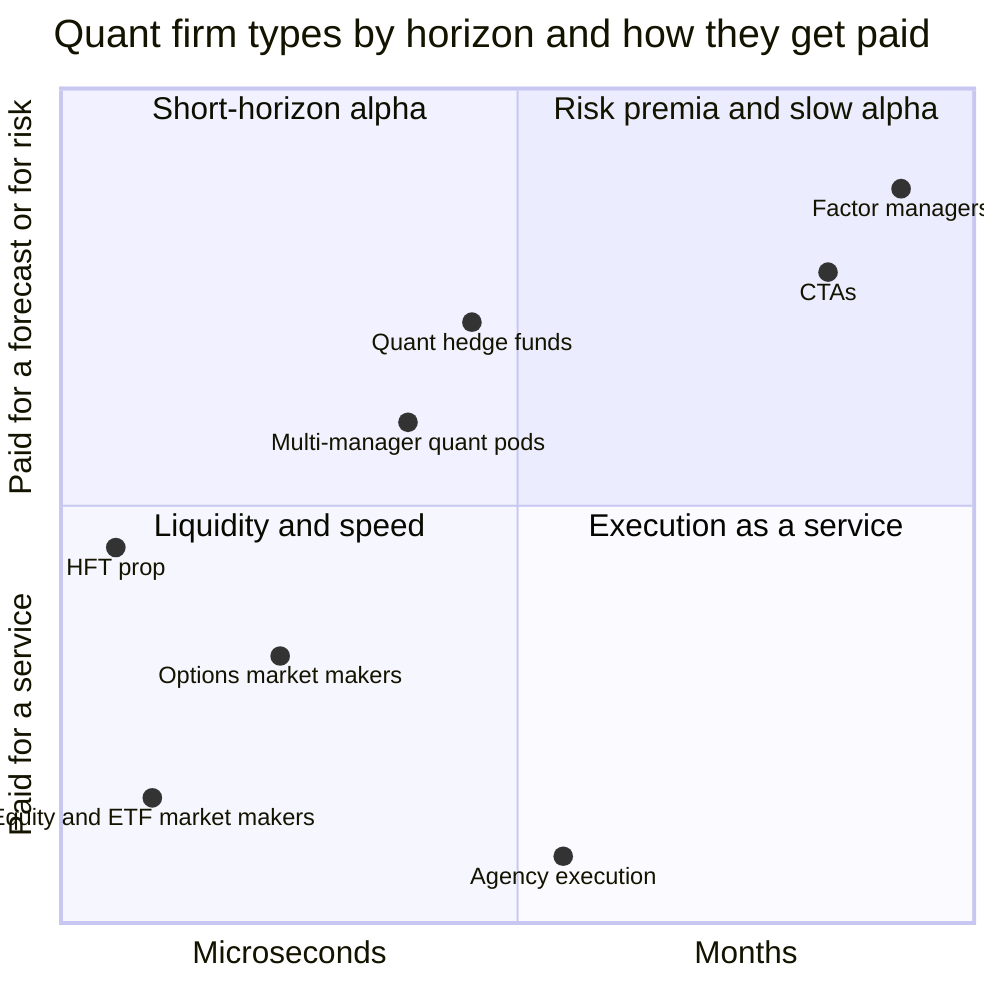
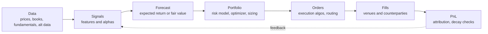

# The big picture

> **TL;DR**
>
> - "Quant trading" in US equities is at least seven different businesses that share one toolkit: electronic market makers, HFT prop shops, quant hedge funds, multi-manager quant pods, systematic factor managers, CTAs and agency execution desks.
> - Two coordinates place any of them: **holding horizon** (microseconds to months) and **edge source** (speed, liquidity provision, structural/regulatory, informational, behavioral, risk premium). Those two coordinates predict capital source, capacity, Sharpe ratio and how the strategy dies.
> - Every strategy runs the same pipeline (signal → forecast → portfolio → orders → fills → P&L); only the clock speed changes.
> - The economics are lopsided: short-horizon firms earn very large revenue on modest capital (Jane Street reportedly made \$39.6B of 2025 net trading revenue `[Reported]`), while slow strategies run hundreds of billions at single-digit returns.
> - The question that matters most: **who pays you, and why do they accept it?**

**Level:** Core · **Read time:** ~8 min · **Last verified:** 2026-11

## Three ways to slice the industry

A quant firm is defined less by its math than by **who is on the other side of its trades**. The same ridge regression can power a market maker's 50-millisecond fair value and a factor manager's monthly rebalance. So this KB sorts everything on three axes.

1. **Firm type**: business model and capital source. A [principal trading firm (PTF)](../09-reference/glossary.md#principal-trading-firm-ptf) risks only its own capital. A hedge fund risks investors' money for fees. An agency desk risks almost nothing and charges commissions.
2. **Holding horizon**: how long a position lives. Rough bands: microseconds to seconds ([HFT](../09-reference/glossary.md#high-frequency-trading-hft) and [market making](../09-reference/glossary.md#market-making)), minutes to days ([statistical arbitrage](../09-reference/glossary.md#statistical-arbitrage)), days to weeks (mid-frequency alpha), weeks to months (factors, trend).
3. **Edge source**: why the trade should make money at all. The six-way taxonomy (speed · liquidity provision · structural/regulatory · informational · behavioral · [risk premium](../09-reference/glossary.md#risk-premium)) is explained in [How quants evaluate a strategy](../02-strategies/how-quants-evaluate-a-strategy.md).

The chart below places firm types on horizon (log scale, left to right) against how they get paid: for a service (immediacy, execution), or for being right (a forecast) and bearing risk (a premium).

Read it as a map, not a law. Large firms straddle quadrants: several market makers also run directional prop books, and multi-strategy hedge funds run everything from stat arb to trend.

## Firm types at a glance

| Firm type | Horizon | Main edge | Capital source | Typical strategies | Examples (see profiles) |
|---|---|---|---|---|---|
| Electronic market makers / PTFs | µs to minutes; inventory usually small by the close | liquidity provision · speed · structural | partners' and retained capital; Virtu is public `[Verified]` | [Equity MM](../02-strategies/a-liquidity-provision/equity-market-making.md), [ETF MM](../02-strategies/a-liquidity-provision/etf-market-making.md), [options MM](../02-strategies/a-liquidity-provision/options-market-making.md), [retail internalization](../02-strategies/a-liquidity-provision/retail-flow-internalization.md), [auctions](../02-strategies/a-liquidity-provision/auctions-and-closing-liquidity.md) | [Citadel Securities](../04-industry-and-firms/firm-profiles/citadel-securities.md), [Virtu](../04-industry-and-firms/firm-profiles/virtu-financial.md), [Jane Street](../04-industry-and-firms/firm-profiles/jane-street.md), [Optiver](../04-industry-and-firms/firm-profiles/optiver.md) |
| HFT prop (aggressive) | µs to seconds | speed · structural | own capital | [Latency arbitrage](../02-strategies/b-speed-and-structural/latency-arbitrage.md), [lead-lag](../02-strategies/b-speed-and-structural/lead-lag-and-cross-asset-arbitrage.md), [ETF/index arb](../02-strategies/b-speed-and-structural/etf-and-index-arbitrage.md), [fee/microstructure](../02-strategies/b-speed-and-structural/fee-and-microstructure-driven-strategies.md) | [HRT](../04-industry-and-firms/firm-profiles/hudson-river-trading.md), [Jump](../04-industry-and-firms/firm-profiles/jump-trading.md), [Tower](../04-industry-and-firms/firm-profiles/tower-research-capital.md) |
| Quant hedge funds (centralized) | minutes to weeks | informational · behavioral | outside investors plus employee capital; fees | [Stat arb](../02-strategies/c-statistical-arbitrage/stat-arb-overview-and-history.md), [ML short-horizon alpha](../02-strategies/c-statistical-arbitrage/ml-driven-short-horizon-alpha.md), [cross-sectional alpha](../02-strategies/d-mid-frequency-alpha/cross-sectional-alpha-and-neutralization.md), [alt data](../02-strategies/d-mid-frequency-alpha/alternative-data.md) | [Renaissance](../04-industry-and-firms/firm-profiles/renaissance-technologies.md), [D. E. Shaw](../04-industry-and-firms/firm-profiles/de-shaw.md), [Two Sigma](../04-industry-and-firms/firm-profiles/two-sigma.md) |
| Multi-manager quant [pods](../09-reference/glossary.md#pod) | hours to weeks | informational · behavioral, strictly market-neutral | outside investors, often with pass-through expenses; capital allocated to PMs under tight drawdown limits | [Factor-residual reversion](../02-strategies/c-statistical-arbitrage/factor-residual-mean-reversion.md), [event-driven](../02-strategies/d-mid-frequency-alpha/earnings-and-event-driven.md), [revisions](../02-strategies/d-mid-frequency-alpha/analyst-revisions-and-sentiment.md), [flow-driven](../02-strategies/d-mid-frequency-alpha/flow-driven-strategies.md) | [Millennium](../04-industry-and-firms/firm-profiles/millennium.md), [Cubist](../04-industry-and-firms/firm-profiles/cubist.md) |
| Systematic asset / factor managers | weeks to months | risk premium · behavioral | institutional mandates, mutual funds, ETFs; management fees | [Factor investing](../02-strategies/e-risk-premia-and-factors/factor-investing-fundamentals.md), [momentum](../02-strategies/e-risk-premia-and-factors/momentum.md), [value/quality/low vol](../02-strategies/e-risk-premia-and-factors/value-quality-low-vol.md) | [AQR](../04-industry-and-firms/firm-profiles/aqr.md), [Man Group](../04-industry-and-firms/firm-profiles/man-group.md) |
| [CTAs](../09-reference/glossary.md#commodity-trading-advisor-cta) / managed futures | weeks to months | behavioral · risk premium | outside investors; fees | [Trend following](../02-strategies/g-futures-and-macro-context/trend-following-and-ctas.md), [carry](../02-strategies/g-futures-and-macro-context/carry-and-cross-asset-risk-premia.md) | [Man Group (AHL)](../04-industry-and-firms/firm-profiles/man-group.md) |
| Agency execution (bank and broker algos) | minutes to days (an order's life) | none sought; paid to minimize cost | commissions | [Execution algorithms](../03-algorithms/e-execution-algorithms/execution-algorithms-overview.md), [closing auctions](../02-strategies/a-liquidity-provision/auctions-and-closing-liquidity.md) | bank and broker desks |

Examples are classifications from public descriptions `[Reported]`; each profile carries its own sources and confidence tags. Volatility strategies ([VRP](../02-strategies/f-volatility-and-derivatives/volatility-risk-premium-and-vol-arb.md), [dispersion](../02-strategies/f-volatility-and-derivatives/dispersion-and-correlation-trading.md)) sit with options market makers and multi-strategy funds. The [taxonomy page](../04-industry-and-firms/taxonomy-of-quant-firms.md) goes deeper on incentives.

## One pipeline, many clock speeds

Ask a quant "what's your algorithm?" and you will get a polite sigh: there is no single algorithm. Every firm runs the same chain of stages, each with its own algorithms. That chain is the backbone of [module 03](../03-algorithms/there-is-no-single-algorithm.md).

| Stage | What happens | Where to read |
|---|---|---|
| Signal | Clean point-in-time data, build features, rank and neutralize | [D1](../03-algorithms/a-data-and-signals/point-in-time-data-and-cleaning.md) · [D3](../03-algorithms/a-data-and-signals/signal-transforms.md) · [D4](../03-algorithms/a-data-and-signals/evaluating-signals.md) |
| Forecast | Combine signals into an expected return (or a fair value) | [F1](../03-algorithms/b-forecasting-models/linear-models-and-regularization.md) · [F5](../03-algorithms/b-forecasting-models/alpha-combination-and-ensembling.md) · [M2](../03-algorithms/f-market-making-and-hft-algorithms/fair-value-and-microprice.md) |
| Portfolio | Trade forecasts off against risk and cost | [P1](../03-algorithms/d-portfolio-construction/risk-models.md) · [P3](../03-algorithms/d-portfolio-construction/mean-variance-optimization.md) · [P5](../03-algorithms/d-portfolio-construction/transaction-cost-and-impact-models.md) |
| Orders and fills | Slice, schedule and route; quote and hedge for market makers | [E1](../03-algorithms/e-execution-algorithms/execution-algorithms-overview.md) · [E4](../03-algorithms/e-execution-algorithms/smart-order-routing.md) · [M4](../03-algorithms/f-market-making-and-hft-algorithms/quoting-and-inventory-control.md) |
| P&L | Attribute, monitor, retire decaying models | [L1](../03-algorithms/g-live-trading/live-monitoring-and-pnl-attribution.md) · [L2](../03-algorithms/g-live-trading/alpha-decay-detection-and-model-retirement.md) |

For a market maker the whole loop runs in microseconds and "portfolio" collapses into inventory skew ([M1](../03-algorithms/f-market-making-and-hft-algorithms/anatomy-of-an-hft-trading-loop.md)). For a factor manager it runs monthly and the optimizer dominates. The [algorithm map](../03-algorithms/algorithm-map.md) places all 39 cards on this chain.

## Where the money comes from

Every dollar of quant P&L is somebody's cost or somebody's risk premium. Grossman and Miller's classic model frames the first case: impatient traders pay liquidity providers for immediacy `[Verified]`. The pools below are rough, mixed in scope and dated; treat them as orders of magnitude.

| Pool | Who pays, and why they accept it | Who earns it | Rough scale |
|---|---|---|---|
| Spread and immediacy | Retail, institutions and other algos pay half-spreads and impact to trade now | Market makers, PTFs | Non-bank liquidity providers earned ~\$25.6B of market-making revenue in 2024, global and all asset classes `[Reported]`; their total revenue pool hit ~\$114B in 2025, of which pure market making was only ~30% `[Reported]` |
| Speed races | Slow quoters whose stale quotes get sniped, and ultimately investors through wider spreads | HFT | ~\$5B a year in global equities, roughly a 0.5 bp tax on trading (academic estimate from UK exchange data) `[Reported]` |
| Retail flow access | Wholesalers pay brokers for low-toxicity retail orders, then improve on the NBBO | Wholesalers, net of payments | Citadel Securities paid ~\$943M for retail equity and options flow, Apr–Dec 2024 (Rule 606 data) `[Reported]` |
| Execution service | Institutions pay commissions to have orders worked | Agency brokers | US equity commission wallet just under \$7B in 2025, up from a \$5.4B low in 2023 (survey) `[Reported]` |
| Forecasting alpha | Slower or constrained investors trade at predictably wrong prices | Quant hedge funds, pods | Hedge fund industry capital ~\$5.15T at end-2025 `[Reported]`; the largest quant managers ran ~\$46–78B each in mid-2025, depending on AUM definition `[Reported]` |
| Risk premia | Investors pay to shed risks they dislike (crashes, distress, leverage constraints) | Factor managers, CTAs, vol sellers | Managed-futures assets ~\$365B in Q4 2025 `[Reported]` |

Firm-level anchors for 2025: Jane Street ~\$39.6B of net trading revenue (helped by gains on private stakes), Hudson River Trading ~\$12.3B and Citadel Securities ~\$12.2B, all from unnamed sources `[Reported]`. Virtu's adjusted net trading income was \$2.15B, of which market making was \$1.67B `[Verified]`. These are global, multi-asset figures; none of these firms discloses a US-equities-only number. History shows how fast a pool can compress: Tabb Group estimated US-equity HFT revenue fell from \$7.2B in 2009 to ~\$1.1B in 2016 `[Reported]`. Options volume, by contrast, set a sixth straight record in 2025: 15.26B contracts cleared, up 24% `[Verified]`.

The structural lesson `[Estimate]` (reasoning: the pools above): liquidity and speed businesses earn tens of billions on balance sheets of a few billion each, because they recycle capital many times a day. Forecasting and premia businesses earn single-digit to low-teens percent on hundreds of billions. That asymmetry explains a lot: why the biggest market makers rarely take outside money, why factor managers compete on fees, and why pods pay up for PMs with genuine short-horizon alpha.

## How to use this KB

- **Pick a path.** [Learning paths](learning-paths.md) offers a 90-minute sprint, a 4-hour Core Path and a 2-week deep path. The [cheat sheet](one-page-cheat-sheet.md) fits on one page.
- **Spend most of your time in the two priority modules.** [Strategies](../02-strategies/index.md) has 30 dossiers on one map; start with [How quants evaluate a strategy](../02-strategies/how-quants-evaluate-a-strategy.md). [Algorithms](../03-algorithms/index.md) has 39 cards and four end-to-end walkthroughs; start with [There is no single algorithm](../03-algorithms/there-is-no-single-algorithm.md).
- **Run a lab** when a page links one ([labs index](../labs.md)); each uses synthetic data and runs in about a minute.
- **Before a meeting**, read the [conversation playbook](../07-conversation-playbook/how-to-talk-to-a-quant.md) and [myths vs reality](../08-calibration/myths-vs-reality.md).
- **Read the tags.** `[Verified]` means a primary source; `[Reported]` credible press or survey; `[Estimate]` our derivation, with reasoning; `[Lore]` widely repeated, unverified. Market-structure prerequisites are in [module 01](../01-market-structure/life-of-a-stock-order.md).

## Related pages

- [Strategies: the map](../02-strategies/index.md)
- [How quants evaluate a strategy](../02-strategies/how-quants-evaluate-a-strategy.md)
- [There is no single algorithm](../03-algorithms/there-is-no-single-algorithm.md)
- [Taxonomy of quant firms](../04-industry-and-firms/taxonomy-of-quant-firms.md)
- [Economics and revenue pools](../04-industry-and-firms/economics-and-revenue-pools.md)
- [Learning paths](learning-paths.md)

## Sources

- [Verified] Virtu Financial, Inc. (2026-02). Form 10-K for fiscal year 2025 (adjusted net trading income by segment). *SEC EDGAR*. <https://www.sec.gov/Archives/edgar/data/1592386/000159238626000009/virt-20251231.htm> (accessed 2026-11)
- [Reported] Reuters via MarketScreener (2026-04-24). "Jane Street's \$40 billion trading haul tops rivals, sources say." <https://www.marketscreener.com/news/jane-street-s-40-billion-trading-haul-tops-rivals-sources-say-ce7f59dfdf8ff52d> (accessed 2026-11)
- [Reported] Bloomberg (2026-03-24). "Citadel Securities Nets Record \$12 Billion Trading Haul in 2025." <https://www.bloomberg.com/news/articles/2026-03-24/citadel-securities-nets-record-12-billion-trading-haul-in-2025> (accessed 2026-11)
- [Reported] Coalition Greenwich (2025). Executive summary on non-bank liquidity provider market-making revenue, 2024. <https://www.greenwich.com/node/155746> (accessed 2026-11)
- [Reported] The TRADE (2026). "NBLPs knock on the door, banks still own the house." <https://www.thetradenews.com/nblps-knock-on-the-door-banks-still-own-the-house/> (accessed 2026-11)
- [Verified] Aquilina, M., Budish, E. & O'Neill, P. (2022). "Quantifying the High-Frequency Trading 'Arms Race'." *Quarterly Journal of Economics* 137(1), 493–564. <https://doi.org/10.1093/qje/qjab032> (accessed 2026-11)
- [Reported] Global Trading (2025). "Citadel Securities paid US$943m for retail US equity, options order flow in nine months." <https://www.globaltrading.net/?p=37640> (accessed 2026-11)
- [Reported] Markets Media (2025). "U.S. equity trading commissions rebounded in 2024" (Coalition Greenwich data). <https://marketsmedia.com/u-s-equity-trading-commissions-rebounded-in-2024> (accessed 2026-11)
- [Reported] Coalition Greenwich (2025). "U.S. Equity Market Trends 2025: Don't Call It a Comeback." <https://www.greenwich.com/node/158259> (accessed 2026-11)
- [Reported] Hedgeweek (2026). "Global hedge fund assets surpass \$5tn for the first time, says HFR." <https://www.hedgeweek.com/global-hedge-fund-assets-surpass-5tn-for-the-first-time-says-hfr/> (accessed 2026-11)
- [Reported] With Intelligence (2025). "Billion Dollar Club Report H1 2025: Top 20 hedge funds." <https://www.withintelligence.com/insights/billion-dollar-club-h1-2025/> (accessed 2026-11)
- [Reported] BarclayHedge (2026). CTA industry assets under management (quarterly table). <https://ionanalytics.com/barclayhedge/solutions/assets-under-management/cta-industry-assets-under-management/> (accessed 2026-11)
- [Verified] OCC (2026-01-05). "OCC Annual 2025 and December 2025 Volume." <https://www.theocc.com/newsroom/views/2026/01-05-occ-annual-2025-and-december-2025-volume> (accessed 2026-11)
- [Reported] Rosenblatt Securities news repost (2018). "How high-frequency trading hit a speed bump" (Tabb Group revenue estimates). <https://rblt.com/news/how-high-frequency-trading-hit-a-speed-bump> (accessed 2026-11)
- [Verified] Grossman, S. J. & Miller, M. H. (1988). "Liquidity and Market Structure." *Journal of Finance* 43(3), 617–633. <https://doi.org/10.1111/j.1540-6261.1988.tb04594.x> (accessed 2026-11)
