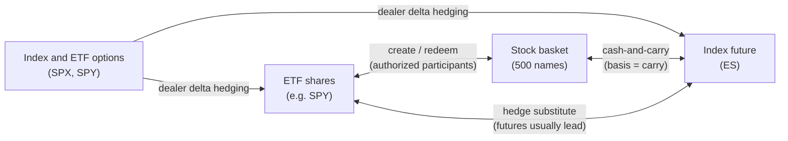
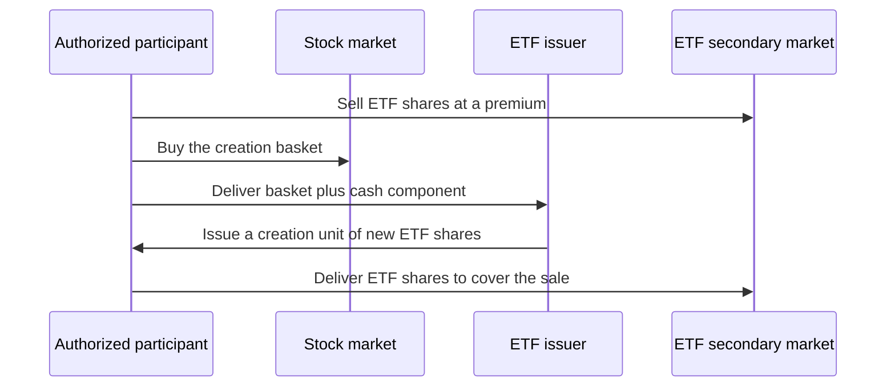

# ETF, futures and options linkages

> **TL;DR**
>
> - An ETF, its stock basket, the index future and index options are different wrappers on one exposure. Arbitrage keeps them within a few basis points of each other and passes flow from one to the next.
> - ETF ↔ basket: authorized participants create and redeem shares in kind. The no-arbitrage band is the cost of trading the basket plus creation fees.
> - Futures ↔ cash: fair value is spot times carry (financing minus dividends). The E-mini usually leads price discovery.
> - Options ↔ stock: put-call parity ties calls to puts, and dealers' delta hedging pushes options flow into the underlying. 0DTE reached a record 66.2% of SPX options volume in July 2026 `[Verified]`. Whether its hedging amplifies or dampens intraday moves is still contested.

**Level:** Core · **Read time:** ~7 min · **Last verified:** 2026-11

## One exposure, four wrappers

The S&P 500 can be held as 500 stocks, as an ETF such as SPY, as an E-mini future (ES), or synthetically through SPX or SPY options. Each wrapper has its own venue, costs, hours and investors. All four pay off on the same index, so a gap between them wider than trading costs is a near-riskless trade, and the fastest, cheapest firms close it. A large buy in one wrapper is quickly felt in the other three.

## ETFs: creation, redemption and the arbitrage band

An [authorized participant](../09-reference/glossary.md#authorized-participant) (AP) is a broker-dealer with a contract with the fund. To **create**, it delivers the fund's published basket plus a small cash component and receives a [creation unit](../09-reference/glossary.md#creation-unit) of new ETF shares. To **redeem**, it does the reverse. US equity ETFs mostly work **in kind**, which lets the fund shed low-basis shares without realizing capital gains. **Cash creations**, common for hard-to-trade assets, make the fund trade the securities itself and pass the cost back through a variable fee. SEC Rule 6c-11 (2019) allows custom baskets. It requires daily publication of holdings and disclosure of any premium or discount above 2% that lasts more than seven consecutive trading days `[Verified]`.

**NAV** is struck once a day from closing prices. The intraday indicative value (**iNAV**) is a slow public estimate, and Rule 6c-11 itself does not require it `[Verified]`. Professional desks compute their own fair value in real time from the basket, futures and correlated ETFs (see [fair value and microprice](../03-algorithms/f-market-making-and-hft-algorithms/fair-value-and-microprice.md)).

**Worked example (illustrative).** The basket is worth $100.00 per ETF share. One creation unit is 50,000 shares, or $5.0M. Trading the basket costs about 3 bp and the creation fee is $500, about 1 bp. Arbitrage therefore starts once the premium or discount exceeds about ±4 bp. Suppose the ETF bid is $100.06, a 6 bp premium. The AP sells 50,000 ETF shares for $5,003,000, buys the basket for $5,000,000, pays $1,500 in trading costs and $500 to create, and delivers. Profit is $1,000, or 2 bp. In practice an ETF market maker rarely creates per trade. It hedges with futures or the basket, nets inventory through the day and creates or redeems at the close.

## Index futures: fair value and basis

The E-mini S&P 500 pays $50 times the index, expires quarterly and settles in cash. It trades nearly 23 hours a day on CME Globex `[Verified]`. Holding the basket costs financing and earns dividends, so the no-arbitrage futures price is

$$
F = S \, e^{(r - q)T},
$$

and the [basis](../09-reference/glossary.md#basis) $F - S$ is the net carry. With $S$ = 6,000, financing $r$ = 4.30%, dividend yield $q$ = 1.30% and $T$ = 0.25, fair value is 6,045.2 (illustrative). Suppose ES trades at 6,052. Desks restate that gap as the **implied financing rate**: about 4.75%, or 45 bp over the 4.30% financing rate `[Estimate]`. The futures are rich. An arbitrageur sells futures and buys the basket. Ten contracts capture 6.8 points × $50 × 10 = $3,400, before roughly $600–$1,200 of basket trading costs. The implied financing spread moves with demand for leveraged long exposure and with dealers' balance-sheet costs. That makes it a traded quantity in its own right, not a constant `[Lore]`.

## Who leads: price discovery between futures and cash

Futures usually move first. One contract carries the whole index, needs low margin and has no short-sale restrictions. Hasbrouck (2003) found that the E-mini dominated price discovery for the S&P 500 `[Reported]`. At the millisecond scale, Budish, Cramton and Shim (2015) showed that the ES-SPY correlation breaks down. They also found that the median life of an ES-SPY arbitrage opportunity fell from 97 ms in 2005 to 7 ms in 2011 `[Reported]`. That race is what [latency arbitrage](../02-strategies/b-speed-and-structural/latency-arbitrage.md) competes in.

Leadership is not absolute. On stock-specific news, the stock leads and the index follows. In the closing auction, the cash market sets the print. Overnight, futures are the only liquid venue, so the cash open catches up to them. That last asymmetry would shrink if 23-hour exchange trading in stocks launches as planned on Dec 6, 2026 (see [recent changes](recent-changes.md)).

## Options: parity, delta hedging and the 0DTE debate

**[Put-call parity](../09-reference/glossary.md#put-call-parity)** for European options (such as SPX) is

$$
C - P = S e^{-qT} - K e^{-rT}.
$$

Violations are arbitraged through the stock or the future. In single stocks, a persistent violation usually means the shares are expensive to borrow. A synthetic short (long put, short call) becomes the cheaper way to be short, so puts trade rich. Option prices therefore reveal the borrow fee (see [shorting, financing and settlement](shorting-financing-and-settlement.md)).

**[Delta hedging](../09-reference/glossary.md#delta-hedging)** is the second channel. Market makers neutralize delta in the underlying or the future, and [gamma](../09-reference/glossary.md#gamma) makes that hedge trade along with the market. A dealer who is net short gamma buys as prices rise and sells as they fall, which amplifies moves. A dealer who is net long gamma does the opposite, which dampens them.

Here is a first-order illustrative example. With 3 hours left, an at-the-money SPX 0DTE option at 15% volatility has a gamma of about 0.0104 per index point. Take a dealer net short 2,000 contracts. After a 1% move of 60 points, it must trade about $750M of index exposure, roughly 2,500 ES contracts.

[0DTE](../09-reference/glossary.md#0dte) options were a record 66.2% of SPX volume in July 2026 `[Verified]`. Same-day index options averaged about 3.4M contracts a day in Q3 2026 `[Reported]`. The evidence on their effect cuts both ways:

| View | Evidence |
|---|---|
| 0DTE amplifies volatility | Brogaard, Han and Won estimate that a one-standard-deviation rise in 0DTE volume goes with about 14% higher daily S&P 500 volatility `[Reported]` |
| 0DTE dampens or is neutral | Dim, Eraker and Vilkov (2024) find that higher dealer open-interest gamma goes with *lower* intraday realized volatility, with no spillover to later periods `[Reported]`. Adams et al. argue that dealer hedging is mostly dampening `[Reported]` |

The sign depends on net dealer positioning, which nobody observes directly. Neither view has won.

## Why this matters for strategies & algorithms

- [ETF and index arbitrage](../02-strategies/b-speed-and-structural/etf-and-index-arbitrage.md) and [ETF market making](../02-strategies/a-liquidity-provision/etf-market-making.md) are the creation band and the basis turned into businesses.
- [Lead-lag and cross-asset arbitrage](../02-strategies/b-speed-and-structural/lead-lag-and-cross-asset-arbitrage.md) and [latency arbitrage](../02-strategies/b-speed-and-structural/latency-arbitrage.md) trade the futures-lead structure.
- [Options market making](../02-strategies/a-liquidity-provision/options-market-making.md), [the volatility risk premium and vol arb](../02-strategies/f-volatility-and-derivatives/volatility-risk-premium-and-vol-arb.md), and [dispersion and correlation trading](../02-strategies/f-volatility-and-derivatives/dispersion-and-correlation-trading.md) depend on parity and hedging flows.
- [Flow-driven strategies](../02-strategies/d-mid-frequency-alpha/flow-driven-strategies.md) trade around predictable ETF and index flows.
- Algorithms:
    - [Fair value and microprice](../03-algorithms/f-market-making-and-hft-algorithms/fair-value-and-microprice.md) builds the real-time basket value.
    - [Hedging algorithms](../03-algorithms/f-market-making-and-hft-algorithms/hedging-algorithms.md) choose between futures, ETF and basket.
    - [Options pricing and vol surfaces](../03-algorithms/f-market-making-and-hft-algorithms/options-pricing-and-vol-surfaces-for-mm.md) uses parity-implied forwards and borrow.
    - [Order-book and trade-flow signals](../03-algorithms/f-market-making-and-hft-algorithms/order-book-and-trade-flow-signals.md) uses futures moves as a leading feature.

## Related pages

- [Fees, rebates and ticks](fees-rebates-and-ticks.md)
- [Order types and auctions](order-types-and-auctions.md)
- [Shorting, financing and settlement](shorting-financing-and-settlement.md)
- [Colocation, networks and the speed of light](../05-infrastructure/colocation-networks-and-the-speed-of-light.md)
- [Walkthrough: a day at an ETF market maker](../03-algorithms/h-end-to-end-walkthroughs/walkthrough-etf-market-maker.md)

## Sources

- [Verified] SEC (2019-09-25). "Exchange-Traded Funds." Final rule, Release No. 33-10695 (Rule 6c-11). <https://www.sec.gov/rules/final/2019/33-10695.pdf> (accessed 2026-11)
- [Verified] CME Group. "E-mini S&P 500 Futures: Contract Specifications." <https://www.cmegroup.com/markets/equities/sp/e-mini-sandp500.contractSpecs.html> (accessed 2026-11)
- [Verified] Cboe (2026-08). "Market Metrics That Matter: Derivatives July 2026 Volume Highlights." <https://www.cboe.com/insights/posts/market-metrics-that-matter-derivatives-july-2026-volume-highlights> (accessed 2026-11)
- [Reported] Cboe (2026-10). "State of the Options Industry Q3 2026: Volume Growth Concentrated in Index and ETF Options." <https://www.cboe.com/insights/posts/state-of-the-options-industry-q-3-2026-volume-growth-concentrated-in-index-and-etf-options> (accessed 2026-11)
- [Reported] Hasbrouck, J. (2003). "Intraday Price Formation in U.S. Equity Index Markets." *Journal of Finance* 58(6), 2375–2400. <https://doi.org/10.1046/j.1540-6261.2003.00609.x> (accessed 2026-11)
- [Reported] Budish, E., Cramton, P. & Shim, J. (2015). "The High-Frequency Trading Arms Race: Frequent Batch Auctions as a Market Design Response." *Quarterly Journal of Economics* 130(4), 1547–1621. <https://doi.org/10.1093/qje/qjv027> (accessed 2026-11)
- [Reported] Dim, C., Eraker, B. & Vilkov, G. (2024). "0DTEs: Trading, Gamma Risk and Volatility Propagation." SSRN Working Paper 4692190. <https://papers.ssrn.com/sol3/papers.cfm?abstract_id=4692190> (accessed 2026-11)
- [Reported] BNN Bloomberg (2023). "Zero-day options are reordering the way the stock market behaves" (coverage of Brogaard, Han & Won). <https://www.bnnbloomberg.ca/zero-day-options-are-reordering-the-way-the-stock-market-behaves-1.1921930> (accessed 2026-11)
- [Reported] Quantpedia. "Do S&P500 0DTEs Options Increase Market Volatility?" (summary of Adams et al.). <https://quantpedia.com/do-sp500-0dtes-options-increase-market-volatility/> (accessed 2026-11)
- [Reported] Jones Day (2026-09). "NYSE and Nasdaq Move to 23-Hour Trading Day: Overnight Session Is an Evolution, But Not Yet a Revolution." <https://www.jonesday.com/en/insights/2026/09/nyse-and-nasdaq-move-to-23hour-trading-day-overnight-session-is-an-evolution-but-not-yet-a-revolution> (accessed 2026-11)
