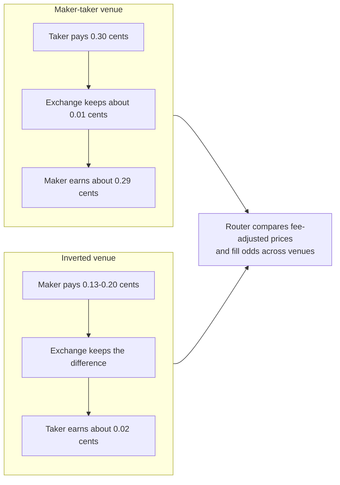
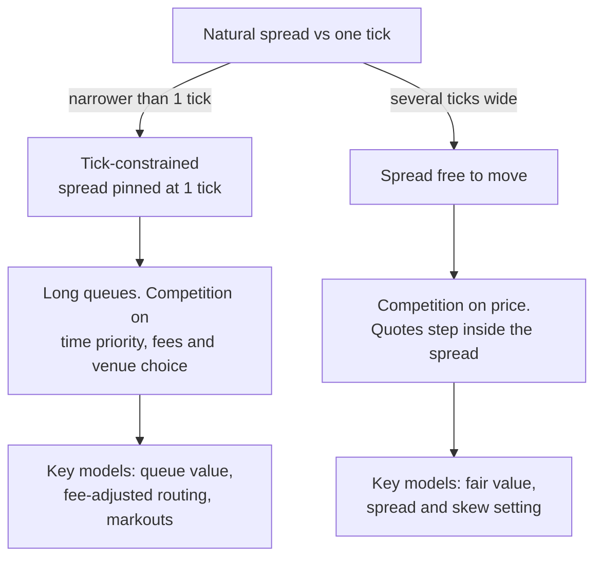

# Fees, rebates and ticks

> **TL;DR**
>
> - Maker-taker exchanges pay the resting order up to about 0.29¢ a share and charge the taker up to the 0.30¢ cap. Inverted venues do the reverse. Fee-adjusted, the real price grid is finer than the penny.
> - In tick-constrained stocks, liquidity competes on queue position, not price. There the rebate can be a third or more of a market maker's gross margin.
> - The SEC's 2024 package (half-penny tick, 0.10¢ fee cap, round lots by price tier) is only partly live. Round lots took effect Nov 3, 2025. The tick and fee-cap changes are deferred to Nov 1, 2027 and under review (as of 2026-11).
> - Rule 612 bans sub-penny *quotes* at \$1 and above, not sub-penny *executions*.

**Level:** Core · **Read time:** ~6 min · **Last verified:** 2026-11

## Why exchanges pay you to trade

A **maker** posts a resting limit order. A **taker** removes it with a marketable order. Under [maker-taker](../09-reference/glossary.md#maker-taker) pricing, the exchange charges the taker an [access fee](../09-reference/glossary.md#access-fee), passes most of it to the maker as a rebate and keeps the rest. [Inverted](../09-reference/glossary.md#inverted-venue) (taker-maker) venues charge the maker and pay the taker.

| Model | Maker | Taker | Published example (stocks ≥ \$1) |
|---|---|---|---|
| Maker-taker | earns tiered rebate | pays fee, capped at \$0.0030 | Nasdaq: top displayed-add rebates \$0.0029–\$0.00295; remove fee \$0.0030 `[Verified]` |
| Inverted | pays fee | earns small rebate | Cboe BYX: add fee \$0.0020 (tiers to \$0.0013); remove rebate \$0.0002 `[Verified]` |
| Flat / most ATSs | small fee or none | small fee | varies by venue |

**The economic price is the quoted price adjusted for the fee.** Lifting a \$50.00 offer costs \$50.0030 all-in on a maker-taker venue. On an inverted venue it costs about $49.9998. A bid resting at \$49.99 on the inverted venue really pays \$49.992, which is 0.2¢ better than its quote without any sub-penny quoting. So takers sweep inverted venues first, and makers who pay to post there are buying a place at the front of the queue. A [smart order router](../03-algorithms/e-execution-algorithms/smart-order-routing.md) therefore ranks venues by fee-adjusted price and fill probability, not by the displayed price.

## Ticks, tick-constrained stocks and queues

Rule 612, the **sub-penny rule**, bars displaying, ranking or accepting orders in increments finer than \$0.01 for stocks priced at \$1.00 or more. Below \$1 the increment is \$0.0001 `[Verified]`. Executions are not covered: midpoint pegs fill at half-pennies, and wholesalers give retail orders fractions of a cent of improvement (see [venues and retail flow](venues-and-retail-flow.md)).

What matters is the [tick size](../09-reference/glossary.md#tick-size) relative to price. One cent is 10 bp of a \$10 stock and 0.2 bp of a \$500 stock. A stock is **[tick-constrained](../09-reference/glossary.md#tick-constrained-stock)** when the spread market makers would quote if they could is narrower than one tick. These are usually low-priced, low-volatility, heavily traded names. In them:

1. **The spread stays pinned at one tick.** Improving the price would cross the other side.
2. **Displayed depth piles up.** With 400,000 shares at the bid and 25,000 shares a minute trading there, a newly joined order waits about 16 minutes (illustrative).
3. **Time priority becomes the asset.** Orders at the front fill on ordinary flow. Orders at the back fill mainly when an informed trader clears the whole level, so they bear more [adverse selection](../09-reference/glossary.md#adverse-selection). That is why [queue position](../03-algorithms/f-market-making-and-hft-algorithms/queue-position-and-order-placement.md) has a measurable value.

**Round and odd lots.** Only [round lots](../09-reference/glossary.md#round-lot) count toward the protected NBBO. At 100 shares for every stock, a round lot of a \$900 stock was \$90,000, so better-priced [odd-lot](../09-reference/glossary.md#odd-lot) orders often sat invisibly inside the NBBO. Since Nov 3, 2025, the round lot depends on the stock's average closing price in the prior evaluation month, with reassignment twice a year `[Verified]`:

| Average closing price | Round lot |
|---|---|
| up to \$250.00 | 100 shares |
| \$250.01–\$1,000.00 | 40 shares |
| \$1,000.01–\$10,000.00 | 10 shares |
| above \$10,000 | 1 share |

Since late April 2026 the SIPs have also disseminated the best odd-lot order. Odd-lot depth between that order and the NBBO is deferred to May 2028 `[Verified]`. Details are in [NBBO and market data](nbbo-and-market-data.md).

## The 2024 amendments (status as of 2026-11)

The SEC adopted the package on Sep 18, 2024 `[Verified]`. It had two parts that change unit economics:

- **Half-penny tick.** Stocks priced at \$1 or more with a time-weighted average quoted spread of \$0.015 or less over an evaluation period would quote in \$0.005 increments. All others keep \$0.01 `[Verified]`.
- **Access-fee cap.** The cap falls from \$0.0030 to \$0.0010 per share for stocks priced at \$1 or more `[Verified]`. Rebates are funded by take fees, so they must fall too.

Compliance was first due Nov 3, 2025. An Oct 31, 2025 order moved it to Nov 2, 2026. A June 2026 order moved it to Nov 1, 2027 and came alongside a staff review of both rules `[Reported]`. Treat both parts as unsettled. [Recent changes](recent-changes.md) tracks the dates.

## Worked example: a market maker's per-share P&L

Take a passive market maker quoting both sides of a tick-constrained \$40 stock with a 1¢ spread. It earns top-tier rebates and exits 20% of its inventory aggressively. All figures are per share filled and illustrative.

| P&L line (per share) | Today: 1¢ tick, \$0.0030 cap | If the 2024 rules applied |
|---|---|---|
| Half-spread captured | +\$0.0050 | +\$0.0025 |
| Maker rebate | +\$0.0029 | +\$0.0008 `[Estimate]`, the cap minus exchange margin |
| Adverse selection (markout to mid) | −\$0.0045 | −\$0.0030 `[Estimate]`, falls less than the spread |
| Aggressive exits: 20% × (half-spread + take fee) | −\$0.0016 | −\$0.0007 |
| Clearing and regulatory fees | −\$0.0002 | −\$0.0002 |
| **Net** | **+$0.0016** | **−$0.0006** |

Read it as an income statement. The rebate is 37% of today's \$0.0079 gross revenue, and without it the book loses \$0.0013 a share. If the 2024 rules took effect, both the tick rent and the rebate would shrink. Survival would then depend on better [markouts](../09-reference/glossary.md#markout), which means better short-horizon prediction, or on more volume per quote `[Estimate]`.

## Rebate capture: the logic and its limits

**Rebate capture** means routing and timing trades so you collect rebates instead of paying fees. Moving one share from taking (−0.30¢) to making (+0.29¢) is worth about 0.6¢. For a stat-arb book trading 5 million shares a day, that is about \$30,000 a day, or \$7.5M a year (illustrative). Three limits:

- **Selection and non-fills.** Passive orders fill most often just before the price moves through them. Orders that never fill need a costlier catch-up trade later. Rebate capture only pays when the alpha horizon is long relative to the queue wait.
- **Tiers reward scale.** Top rebates need a set share of consolidated volume each month, so large firms concentrate flow to hit the tier. A 2023 SEC proposal to curb volume tiers was withdrawn on Jun 12, 2025 `[Reported]`.
- **Agency conflict.** Brokers that route client limit orders to the venue with the highest rebate keep the rebate, and their clients get worse fills. Battalio, Corwin and Jennings (2016) documented this `[Reported]`.

## Why this matters for strategies & algorithms

- **Market making.** [Equity market making](../02-strategies/a-liquidity-provision/equity-market-making.md) and [ETF market making](../02-strategies/a-liquidity-provision/etf-market-making.md) earn half-spread plus rebate minus markout. The table above is their P&L skeleton.
- **Fee-driven strategies.** [Fee- and microstructure-driven strategies](../02-strategies/b-speed-and-structural/fee-and-microstructure-driven-strategies.md) trade on fee-adjusted prices and queue dynamics directly.
- **High-turnover books.** For [short-term reversal](../02-strategies/c-statistical-arbitrage/short-term-cross-sectional-reversal.md), the 0.6¢ make-or-take swing decides whether the strategy is profitable.
- **Algorithms.** Fees and ticks are explicit inputs to:
    - [queue position and order placement](../03-algorithms/f-market-making-and-hft-algorithms/queue-position-and-order-placement.md);
    - [quoting and inventory control](../03-algorithms/f-market-making-and-hft-algorithms/quoting-and-inventory-control.md);
    - [adverse selection and markouts](../03-algorithms/f-market-making-and-hft-algorithms/adverse-selection-and-markouts.md);
    - [smart order routing](../03-algorithms/e-execution-algorithms/smart-order-routing.md);
    - [transaction cost and impact models](../03-algorithms/d-portfolio-construction/transaction-cost-and-impact-models.md).

## Related pages

- [The limit order book](the-limit-order-book.md)
- [Venues and retail flow](venues-and-retail-flow.md)
- [NBBO and market data](nbbo-and-market-data.md)
- [Recent changes (as of 2026-11)](recent-changes.md)
- [Rules that shape strategies](../06-risk-and-regulation/rules-that-shape-strategies.md)

## Sources

- [Verified] SEC (2024-09-18). "Regulation NMS: Minimum Pricing Increments, Access Fees, and Transparency of Better Priced Orders." Release No. 34-101070. <https://www.sec.gov/files/rules/final/2024/34-101070.pdf> (accessed 2026-11)
- [Verified] SEC (2024-09-18). "Fact Sheet: Tick Sizes, Access Fees, and Transparency of Better Priced Orders." <https://www.sec.gov/files/34-101070-fact-sheet.pdf> (accessed 2026-11)
- [Reported] TradeInformer (2026-06). "SEC extends NMS relief to November 2027, proposes scrapping trade-through rule." <https://tradeinformer.com/regulations/sec-extends-nms-relief-rule-611-repeal-2027> (accessed 2026-11)
- [Reported] FlexTrade (2025-11). "Round-Lots, Odd-Lots Push Forward, while SEC Delays Tick Size and Access Fees." <https://flextrade.com/resources/round-lots-odd-lots-push-forward-while-sec-delays-tick-size-and-access-fees/> (accessed 2026-11)
- [Verified] SEC Division of Economic and Risk Analysis. "Market Activity Report: Methodology" (round-lot tiers and reassignment schedule). <https://www.sec.gov/featured-topics/market-structure-analytics/market-activity-report-methodology> (accessed 2026-11)
- [Verified] Cboe (2025-10-28). "Regulation NMS Round Lots Enhancements FAQ." <https://cdn.cboe.com/resources/membership/Round_Lots_Enhancements_FAQ.pdf> (accessed 2026-11)
- [Verified] Federal Register (2026-04-21). "Investors Exchange LLC; rule change to conform with amendments to Rules 600 and 603 concerning odd-lot information." <https://www.federalregister.gov/documents/2026/04/21/2026-07692/self-regulatory-organizations-investors-exchange-llc-notice-of-filing-and-immediate-effectiveness-of> (accessed 2026-11)
- [Verified] Nasdaq. "Price List: Trading Connectivity" (equity rebates and fees). <https://www.nasdaqtrader.com/Trader.aspx?id=PriceListTrading2> (accessed 2026-11)
- [Verified] Cboe. "BYX U.S. Equities Fee Schedule." <https://www.cboe.com/us/equities/membership/fee_schedule/byx/> (accessed 2026-11)
- [Verified] 17 CFR 242.612, "Minimum pricing increment." eCFR. <https://www.ecfr.gov/current/title-17/section-242.612> (accessed 2026-11)
- [Reported] Proskauer (2025-06). "SEC Withdraws Fourteen Rule Proposals." <https://www.proskauer.com/alert/sec-withdraws-fourteen-rule-proposals> (accessed 2026-11)
- [Reported] Battalio, R., Corwin, S. A. & Jennings, R. (2016). "Can Brokers Have It All? On the Relation between Make-Take Fees and Limit Order Execution Quality." *Journal of Finance* 71(5), 2193–2238. <https://doi.org/10.1111/jofi.12422> (accessed 2026-11)
