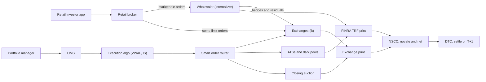
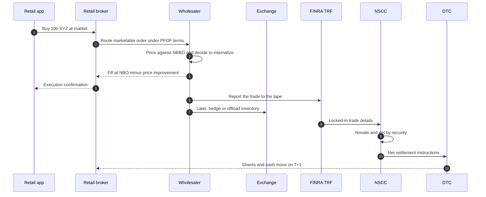

# Life of a stock order

> **TL;DR**
>
> - A US stock order travels one of two very different pipes. Retail marketable orders mostly go from the broker to a handful of wholesalers that fill them off-exchange. Institutional orders go to an execution algorithm whose smart order router slices them across 18 exchanges, 33 ATSs and the closing auction.
> - Every hop gets paid: payment for order flow, spread capture, access fees and rebates, commissions, clearing fees. Follow the money and you find the strategies in module 02.
> - After the fill, the trade prints to the tape (exchange or FINRA TRF). NSCC becomes the central counterparty and nets it, and DTC settles it one business day later (T+1).
> - Latency spans about ten orders of magnitude: microseconds for colocated hops, milliseconds for a retail app, hours for an algo's schedule, a day for settlement.

**Level:** Core · **Read time:** ~6 min · **Last verified:** 2026-11

## Two pipes, one tape

A retail investor's 50-share market order and a pension fund's 2-million-share [parent order](../09-reference/glossary.md#parent-order) both end up as prints on the consolidated tape and positions at DTC. In between, they touch different intermediaries, at different speeds, with different people on the other side.

## The retail pipe

1. **Broker.** The investor taps "buy". After risk checks, the broker's routing table sends marketable orders (market orders, and limits priced at or through the far side of the [NBBO](../09-reference/glossary.md#nbbo)) to [wholesalers](../09-reference/glossary.md#wholesaler). When the SEC proposed its Order Competition Rule in December 2022, it found that brokers routed more than 90% of individual investors' marketable orders to six off-exchange dealers `[Verified]`. Zero-commission brokers earn [payment for order flow (PFOF)](../09-reference/glossary.md#payment-for-order-flow-pfof), interest on client cash and margin-lending spread instead.
2. **Wholesaler.** The wholesaler fills the order as principal at or better than the NBBO. It usually hands back part of the spread as [price improvement](../09-reference/glossary.md#price-improvement). This is [internalization](../09-reference/glossary.md#internalization). Robinhood's 2025 Rule 606 reports list Citadel Securities, Virtu and Jane Street among its paying venues `[Verified]`. It can improve the price and still pay the broker because retail flow carries little short-term information ([Venues and retail flow](venues-and-retail-flow.md) explains why). Unwanted orders and accumulated inventory go to exchanges.
3. **Print.** The fill is reported to a FINRA [trade reporting facility (TRF)](../09-reference/glossary.md#trade-reporting-facility-trf) and appears on the tape as an off-exchange trade. Off-exchange volume reached 50.6% of consolidated volume in 2025, the first year above half. Principal dealers, mostly wholesalers, accounted for 81% of that `[Verified]`.

## The institutional pipe

1. **Decision to order.** A portfolio manager's rebalance becomes an order in the OMS, for example "buy 2M XYZ today, implementation-shortfall benchmark".
2. **Algo.** An in-house or broker algorithm (VWAP, POV, [implementation shortfall](../09-reference/glossary.md#implementation-shortfall)) cuts the parent into thousands of [child orders](../09-reference/glossary.md#child-order) over minutes to the full session. The point is to limit market impact.
3. **Router.** For each child, the [smart order router](../09-reference/glossary.md#smart-order-router-sor) picks a venue and an order type. It can post passively on an exchange and wait in the queue, or ping [dark pools](../09-reference/glossary.md#dark-pool) with midpoint IOCs. It can sweep several lit venues at once with ISOs, or send market-on-close orders to the auction.
4. **Feedback.** Fills stream back, the algo re-plans, and transaction cost analysis (TCA) scores the result afterwards.

The other side of those child orders is whoever is resting in the book: market makers, other algos, and occasionally another institution in a block-crossing ATS.

## Clearing and settlement

Once a trade is matched, the exchange or TRF sends locked-in trade details to NSCC, a DTCC subsidiary. NSCC is the [central counterparty](../09-reference/glossary.md#central-counterparty-ccp): through novation it becomes buyer to every seller and seller to every buyer. If a member defaults, NSCC stands behind the trade. Its [continuous net settlement](../09-reference/glossary.md#continuous-net-settlement-cns) system nets each member's buys and sells in each security down to one delivery or receipt. Members post clearing-fund margin sized to their unsettled exposure. On settlement date, DTC moves the shares against cash. US equities settle [T+1](../09-reference/glossary.md#t1-settlement), one business day after trade date, the standard since May 2024 `[Reported]`. Most funds face NSCC through a clearing or prime broker, which charges fees and sets margin and stock-loan terms.

## Who gets paid

| Intermediary | What it does | How it is paid | Order of magnitude |
|---|---|---|---|
| Retail broker | App, custody, routing | PFOF, interest on cash and margin; commission usually zero | Tens of cents to about $1 per 100 shares in 2025 Rule 606 reports `[Reported]` |
| Wholesaler | Fills retail as principal | Spread captured, minus price improvement, minus PFOF | Citadel Securities paid about $341M for US retail equity and options flow in Q2 2025 `[Reported]` |
| Institutional broker | Algos, router, capital | Commission per share | Roughly 0.5–2 cents/share for execution-only algos `[Lore]` |
| Exchange | Matching, protected quotes | Taker (access) fees, market data and connectivity; pays maker rebates | Access-fee cap 30 mils ($0.0030/share), 10 mils once the 2024 amendment takes effect `[Verified]` |
| ATS / dark pool | Non-displayed matching | Per-share fees | About 19% of TRF volume in 2025 `[Verified]` |
| NSCC and DTC | Clearing, netting, settlement | Per-trade fees; clearing-fund margin | Fees tiny; margin is the real cost `[Lore]` |
| Clearing broker | Access to NSCC, financing | Clearing fees, financing spread, stock-loan fees | See [shorting and settlement](shorting-financing-and-settlement.md) |

## The latency scale

| Hop | Typical latency | Tag and reasoning |
|---|---|---|
| Retail app to broker over the internet | 10–100 ms | `[Estimate]` consumer-internet round trip |
| Broker to wholesaler and back | about 1 ms or less | `[Estimate]` dedicated lines between New Jersey data centers |
| Wholesaler pricing decision | microseconds to about 1 ms | `[Lore]` |
| Portfolio manager decision to first child order | minutes to hours | `[Lore]` human workflow |
| Life of an algo parent order | minutes to a full session | `[Lore]` slow on purpose, to cut impact |
| Router to an exchange, [colocated](../09-reference/glossary.md#colocation) | about 5–50 μs one way | `[Estimate]` tens of meters of fiber plus switch and gateway |
| Between data centers in Mahwah, Carteret and Secaucus | about 90–190 μs one way | `[Estimate]` 27–56 km at 3.34 μs/km by microwave; about 1.5× slower over fiber |
| Trade to settlement | 1 business day | T+1 `[Reported]` |

From about 10 μs to one day (roughly 1011 μs) is ten orders of magnitude `[Estimate]`; each band supports its own kind of strategy.

## Why this matters for strategies & algorithms

- **The retail pipe is a business.** Wholesalers run [retail flow internalization](../02-strategies/a-liquidity-provision/retail-flow-internalization.md). Its edge is the low toxicity of the flow, measured with [markouts](../03-algorithms/f-market-making-and-hft-algorithms/adverse-selection-and-markouts.md).
- **The institutional pipe is the execution stack.** The parent-to-child cascade is covered in [Execution algorithms overview](../03-algorithms/e-execution-algorithms/execution-algorithms-overview.md), [VWAP, TWAP and POV](../03-algorithms/e-execution-algorithms/vwap-twap-pov.md), [Smart order routing](../03-algorithms/e-execution-algorithms/smart-order-routing.md) and [Transaction cost analysis](../03-algorithms/e-execution-algorithms/transaction-cost-analysis.md). [Walkthrough: executing a $500M buy order](../03-algorithms/h-end-to-end-walkthroughs/walkthrough-institutional-execution.md) tells the whole story with numbers.
- **The child orders are someone's revenue.** [Equity market making](../02-strategies/a-liquidity-provision/equity-market-making.md) quotes against them. [Auctions and closing liquidity](../02-strategies/a-liquidity-provision/auctions-and-closing-liquidity.md) is about the end-of-day share of them.
- **The latency table is a cost structure.** [Latency arbitrage](../02-strategies/b-speed-and-structural/latency-arbitrage.md) and the [HFT trading loop](../03-algorithms/f-market-making-and-hft-algorithms/anatomy-of-an-hft-trading-loop.md) live in the microsecond rows. Mid-frequency books such as [factor-residual mean reversion](../02-strategies/c-statistical-arbitrage/factor-residual-mean-reversion.md) live in the minutes-to-hours rows and pay for settlement, borrow and financing.

## Related pages

- [The limit order book](the-limit-order-book.md)
- [Venues and retail flow](venues-and-retail-flow.md)
- [NBBO and market data](nbbo-and-market-data.md)
- [Fees, rebates and ticks](fees-rebates-and-ticks.md)
- [Shorting, financing and settlement](shorting-financing-and-settlement.md)
- [Colocation, networks and the speed of light](../05-infrastructure/colocation-networks-and-the-speed-of-light.md)

## Sources

- [Verified] SEC (2022-12-14). "SEC Proposes Rule to Enhance Competition for Individual Investor Order Execution" (press release, republished). <https://www.newsfilecorp.com/release/148085/SEC-Proposes-Rule-to-Enhance-Competition-for-Individual-Investor-Order-Execution> (accessed 2026-11)
- [Verified] Cboe Global Markets (2026). "2025 U.S. Equities Year in Review." <https://www.cboe.com/insights/posts/2025-u-s-equities-year-in-review> (accessed 2026-11)
- [Verified] Robinhood Securities (2025). "SEC Rule 606 and 607 Disclosure" (quarterly order-routing reports). <https://cdn.robinhood.com/assets/robinhood/legal/RHS%20SEC%20Rule%20606%20and%20607%20Disclosure.pdf> (accessed 2026-11)
- [Reported] Global Trading (2025). "Payments for US retail flow reach record high, led by Citadel Securities and IMC." <https://www.globaltrading.net/?p=38554> (accessed 2026-11)
- [Verified] U.S. Court of Appeals for the D.C. Circuit (2025-10-14). *Cboe Global Markets, Inc. v. SEC*, No. 24-1350 (access-fee cap of 30 mils lowered to 10 mils). <https://media.cadc.uscourts.gov/opinions/docs/2025/10/24-1350-2139991.pdf> (accessed 2026-11)
- [Reported] SEC (2023-02-15). "Shortening the Securities Transaction Settlement Cycle," Release No. 34-96930 (T+1). <https://www.sec.gov/files/rules/final/2023/34-96930.pdf> (accessed 2026-11)
- [Reported] Sidley Austin (2022-12). "SEC Proposes Rule to Enhance Competition for Certain Individual Investor Orders." <https://www.sidley.com/en/insights/newsupdates/2022/12/sec-proposes-rule-to-enhance-competition-for-certain-individual-investor-orders> (accessed 2026-11)
