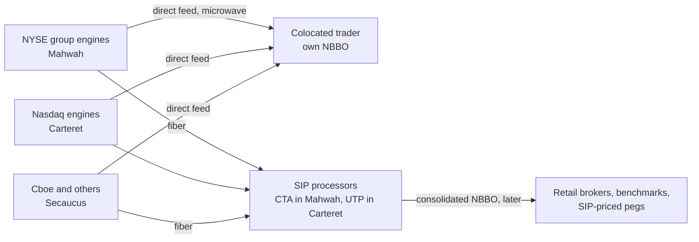
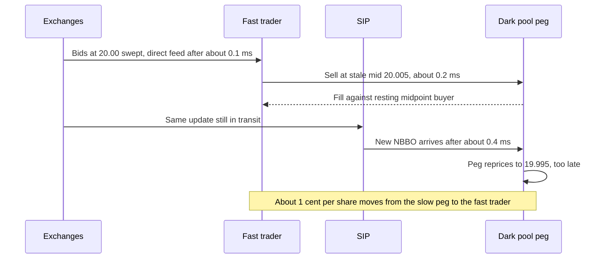
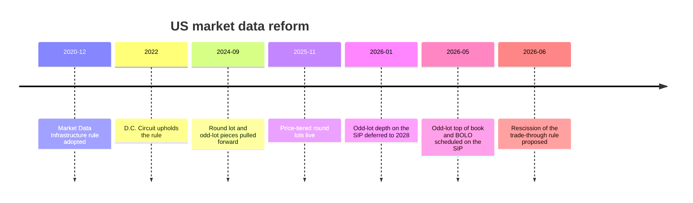

# NBBO and market data

> **TL;DR**
>
> - The NBBO is the best displayed round-lot bid and offer across all exchanges. The SIPs compute it centrally, and every serious trader also computes it themselves from direct exchange feeds.
> - Direct feeds beat the SIP by roughly 0.2–0.5 ms, mostly because of geography and an extra hop, not slow processing. That gap is the raw material of latency arbitrage.
> - The SIP carries top-of-book and trades. Direct feeds carry full depth, often order by order, which you need to track queue position.
> - The 2020 Market Data Infrastructure rule is only partly in force: price-tiered round lots went live on November 3, 2025 and odd-lot top-of-book was scheduled for the SIP from May 2026. Odd-lot depth is deferred to May 2028, and competing consolidators are not yet operating.

**Level:** Core · **Read time:** ~6 min · **Last verified:** 2026-11

## Intuition: one price, many copies

Eighteen exchanges each publish their own best bid and offer. The **[NBBO](../09-reference/glossary.md#nbbo)** (national best bid and offer) is the highest bid and lowest offer among them, as computed by whoever is looking, from whatever data has reached them. Two traders can see different NBBOs at the same instant; the slower one is trading on a stale price.

## What counts, and what the NBBO is used for

Only **[protected quotes](../09-reference/glossary.md#protected-quote)** count: automated, displayed, [round-lot](../09-reference/glossary.md#round-lot) quotes on exchanges. Hidden orders, [odd lots](../09-reference/glossary.md#odd-lot) and off-exchange liquidity do not set the NBBO, even when they offer better prices. The NBBO then serves as the yardstick for:

- the trade-through rule (Rule 611), which bars executions at prices worse than a protected quote. Its rescission was proposed in June 2026 `[Verified]`.
- price improvement and Rule 605 statistics.
- midpoint pegs and most dark-pool pricing.
- wholesaler fills to retail.

**Round lots changed on November 3, 2025.** The round lot is now 100 shares for stocks up to \$250, 40 shares from \$250.01 to \$1,000, 10 shares from \$1,000.01 to \$10,000, and 1 share above that `[Verified]`. Nasdaq estimated that over 200 stocks were affected `[Reported]`. Illustration: in a \$900 stock, the best 100-share quotes might be \$899.80 × \$900.20 while 40-share orders sit at \$899.95 × \$900.05, so the official NBBO narrows from 40 cents to 10.

**Odd-lot data comes next.** The SIPs were scheduled to begin carrying each exchange's best odd-lot quote at or better than the NBBO, plus a consolidated best odd-lot order (BOLO), from late April and May 2026 `[Verified]`. TODO(verify): confirm the go-live happened as scheduled. Odd-lot quotes are not protected and can lock or cross the NBBO `[Verified]`. A January 2026 SEC exemptive order deferred odd-lot depth of book to May 2028 `[Verified]`.

## SIP vs direct feeds

| | [SIP](../09-reference/glossary.md#securities-information-processor-sip) (consolidated tape) | [Direct feeds](../09-reference/glossary.md#direct-feed) (proprietary) |
|---|---|---|
| Who runs it | CTA/CQ plans for NYSE- and other-listed stocks (processor in Mahwah); UTP plan for Nasdaq-listed stocks (processor in Carteret) `[Reported]` | Each exchange, for its own book |
| Content | [Top of book](../09-reference/glossary.md#top-of-book) per exchange, NBBO, trades (including TRF prints), limit-up/limit-down bands, odd-lot top of book from 2026 | Full [depth of book](../09-reference/glossary.md#depth-of-book), often order by order, plus auction imbalance feeds |
| Processing latency | Fell from milliseconds (0.38 ms for Tape A/B quotes in 4Q2013) to microseconds today `[Verified]`; about tens of μs on average `[Lore]` | Generated inside the exchange's data center |
| End-to-end disadvantage | About 0.2–0.5 ms behind a colocated direct-feed reader `[Estimate]`, derived below | — |
| Users | Retail displays, best-execution benchmarks, many buy-side systems | Market makers, HFT, broker routers, sophisticated dark pools |

**Why the SIP is slower: a numeric sketch** `[Estimate]`. Suppose an NYSE Arca quote changes in Mahwah for a Nasdaq-listed stock, and a trader is colocated in Carteret, about 56 km away.

- **Direct:** the Arca feed goes over microwave at about 3.34 μs/km, so it arrives in about 190 μs.
- **SIP:** the same quote travels by fiber to the UTP processor in Carteret. Assume a route 1.3× the straight line at about 4.9 μs/km, so about 360 μs. Add tens of μs of processing, and the update arrives about 400 μs after the event.

The gap is about 200 μs; for a trader in Secaucus, who must wait for the SIP output to travel back from Carteret, it is closer to 400–450 μs. A faster SIP computer would not close it: geography and the extra hop dominate.

## Why "the SIP is slower" matters: stale quotes

Here is an illustrative race. The NBBO is \$20.00 × \$20.01 everywhere. A large seller sweeps every \$20.00 bid, so the true market is now about \$19.99 × \$20.00. A dark pool that prices its [midpoint pegs](../09-reference/glossary.md#midpoint-peg) off the SIP still shows \$20.005 for a few hundred microseconds. A trader on direct feeds sells to the resting midpoint buyer at \$20.005 and buys back around \$19.995 once market makers re-quote. That is about 1 cent per share, paid by the slow peg. This is [latency arbitrage](../09-reference/glossary.md#latency-arbitrage) in its purest form.

How big is it? Using exchange message data for London's FTSE 100 stocks, Aquilina, Budish and O'Neill (2022) found latency-arbitrage races in about 20% of trading volume. They work out a cost equal to roughly a 0.5 bp tax on trading, about \$5B a year across global equity markets `[Verified]`. Bartlett and McCrary, by contrast, argued that arbitrage against the US SIP specifically was too small after 2015 to explain the arms race `[Reported]`, and many venues now price off direct feeds `[Lore]`. The evidence is mixed.

## The Market Data Infrastructure rule: status

Adopted in December 2020, the MDI rule had two parts `[Verified]`:

1. It expands "core data" to include some depth of book, auction information, odd-lot quotes and a price-based round lot.
2. It replaces the exclusive SIPs with competing private consolidators and self-aggregators.

The D.C. Circuit upheld it in 2022 `[Reported]`. Progress since:

- The round-lot and odd-lot pieces were pulled forward by the September 2024 Regulation NMS amendments and are now live or scheduled `[Verified]`.
- The consolidator half has stalled. A new consolidated-data (CT) Plan is meant to replace the three legacy plans. As of April 2026 its fee schedule was still in SEC proceedings, and the CTA, CQ and UTP plans still governed SIP data `[Verified]`.
- TODO(verify): confirm that no competing consolidator has begun operating.

## Why this matters for strategies & algorithms

- **The gap is a strategy.** [Latency arbitrage](../02-strategies/b-speed-and-structural/latency-arbitrage.md) and [lead-lag and cross-asset arbitrage](../02-strategies/b-speed-and-structural/lead-lag-and-cross-asset-arbitrage.md) monetize it. The [HFT trading loop](../03-algorithms/f-market-making-and-hft-algorithms/anatomy-of-an-hft-trading-loop.md) is built to stay on the right side of it.
- **Market makers need direct, deep data.** [Equity market making](../02-strategies/a-liquidity-provision/equity-market-making.md) and [ETF market making](../02-strategies/a-liquidity-provision/etf-market-making.md) quote from their own NBBO. They use depth for the [microprice](../03-algorithms/f-market-making-and-hft-algorithms/fair-value-and-microprice.md) and [order-book signals](../03-algorithms/f-market-making-and-hft-algorithms/order-book-and-trade-flow-signals.md), and order-by-order data for [queue position](../03-algorithms/f-market-making-and-hft-algorithms/queue-position-and-order-placement.md).
- **Benchmarks depend on the feed.** Price improvement in [retail flow internalization](../02-strategies/a-liquidity-provision/retail-flow-internalization.md) and slippage in [transaction cost analysis](../03-algorithms/e-execution-algorithms/transaction-cost-analysis.md) are measured against an NBBO. Which NBBO, and at which timestamp, changes the answer.
- **Backtests inherit the feed's flaws.** SIP-timestamped data understates how stale quotes were. See [point-in-time data and cleaning](../03-algorithms/a-data-and-signals/point-in-time-data-and-cleaning.md) and [backtesting engines](../03-algorithms/c-validation-and-backtesting/backtesting-engines.md).

## Related pages

- [Life of a stock order](life-of-a-stock-order.md)
- [The limit order book](the-limit-order-book.md)
- [Venues and retail flow](venues-and-retail-flow.md)
- [Recent changes (as of 2026-11)](recent-changes.md)
- [Colocation, networks and the speed of light](../05-infrastructure/colocation-networks-and-the-speed-of-light.md)

## Sources

- [Verified] Nasdaq Trader (2025-05-07). "UTP Trader News UTP2025-10: round lot changes" (price-tiered round lots). <https://www.nasdaqtrader.com/TraderNews.aspx?id=UTP2025-10> (accessed 2026-11)
- [Verified] CTA Plan (2025). "CTA Round Lot Changes FAQ." <https://www.ctaplan.com/publicdocs/ctaplan/CTA_Round_Lot_Changes_FAQ.pdf> (accessed 2026-11)
- [Reported] FlexTrade (2025-11-04). Note on the November 2025 round-lot implementation and tick-size delay. <https://flextrade.com/?p=16366> (accessed 2026-11)
- [Verified] CTA Plan (2026). "Odd lots" (SIP odd-lot quotes and BOLO). <https://www.ctaplan.com/odd-lots> (accessed 2026-11)
- [Verified] UTP Plan (2026). "Nasdaq UTP SIP Odd Lot Quotes FAQ." <https://www.utpplan.com/DOC/Nasdaq%20UTP%20SIP%20Odd%20Lot%20Quotes%20FAQ%20Finalized%20Version.pdf> (accessed 2026-11)
- [Verified] SEC (2026-01). Order granting temporary exemptive relief on odd-lot information, Release No. 34-104612. <https://sec.gov/files/rules/exorders/2026/34-104612.pdf> (accessed 2026-11)
- [Verified] CTA Plan (2014). "CTA Operating Metrics, Q4 2013" (SIP quote latency). <https://ctaplan.com/publicdocs/CTA_Operating_Metrics_Q42013.pdf> (accessed 2026-11)
- [Verified] CTA Plan (2026). "CTAPLAN Processor Metrics 1Q2026." <https://www.ctaplan.com/publicdocs/ctaplan/CTAPLAN_Processor_Metrics_1Q2026.pdf> (accessed 2026-11)
- [Verified] SEC (2020-12). "Market Data Infrastructure" (final rule). <https://www.sec.gov/rules-regulations/2020/12/market-data-infrastructure> (accessed 2026-11)
- [Reported] Sidley Austin (2022-06). "D.C. Circuit Upholds SEC's Market Data Infrastructure Rules, Paving the Way for Competing Consolidators." <https://www.sidley.com/en/insights/newsupdates/2022/06/dc-circuit-upholds-secs-market-data-infrastructure-rules-paving-the-way-for-competing-consolidators> (accessed 2026-11)
- [Verified] Federal Register (2026-04-03). CT Plan fee schedule: notice of Amendment No. 1 and order instituting proceedings. <https://www.federalregister.gov/documents/2026/04/03/2026-06463/joint-industry-plan-notice-of-filing-of-amendment-no-1-and-order-instituting-proceedings-to> (accessed 2026-11)
- [Reported] IEX (n.d.). "The long and winding road to market data reform." <https://iex.io/article/the-long-and-winding-road-to-market-data-reform> (accessed 2026-11)
- [Verified] Federal Register (2026-06-17). "The Trade-Through Rule and Locked and Crossed Markets Provisions of Regulation NMS." <https://www.federalregister.gov/documents/2026/06/17/2026-12163/the-trade-through-rule-and-locked-and-crossed-markets-provisions-of-regulation-nms> (accessed 2026-11)
- [Verified] Aquilina, M., Budish, E. & O'Neill, P. (2022). "Quantifying the high-frequency trading 'arms race'." *Quarterly Journal of Economics* 137(1), 493–564. <https://doi.org/10.1093/qje/qjab032> (accessed 2026-11)
- [Verified] Bartlett, R. P. & McCrary, J. (2016). "How Rigged Are Stock Markets? Evidence from Microsecond Timestamps." NBER Working Paper 22551. <https://www.nber.org/system/files/working_papers/w22551/w22551.pdf> (accessed 2026-11)
- [Reported] Nasdaq (n.d.). "How trades speed between venues" (data-center geography). <https://www.nasdaq.com/articles/how-trades-speed-between-venues> (accessed 2026-11)
