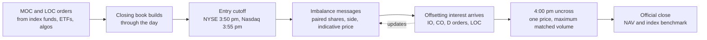
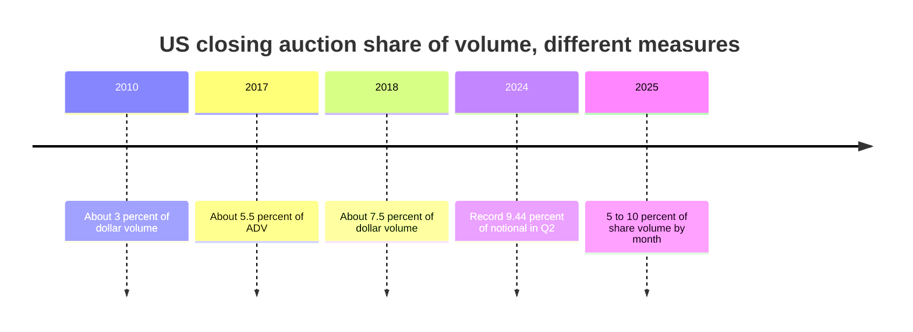

# Order types and auctions

> **TL;DR**
>
> - An order type is a contract with the matching engine: which price, how long, whether you may take liquidity, and what happens to the rest. Quants use only a handful of them: limit, IOC, ISO, post-only, midpoint peg and the on-close family.
> - ISOs let a router hit several venues at once without waiting for each venue's order-protection checks. Post-only guarantees you are the maker. Midpoint pegs buy price improvement at the risk of being picked off when the NBBO goes stale.
> - The close is a call auction. NYSE stops new MOC/LOC orders at 3:50 p.m. and Nasdaq at 3:55 p.m. Imbalance messages then invite offsetting liquidity until the 4:00 p.m. uncross.
> - The closing auction grew from about 3% of US dollar volume in 2010 to a record 9.44% of notional in Q2 2024, and about 20% on index-rebalance and expiry days.

**Level:** Core · **Read time:** ~6 min · **Last verified:** 2026-11

## Intuition: an order type is a contract

Every order answers four questions: at what price (limit, market, pegged), for how long (day, IOC, on-close), may it take liquidity, and is it displayed? Exchanges list dozens of variants; most quant flow uses the few below.

## The order types that matter

| Order type | What it does | Who uses it, and why |
|---|---|---|
| Limit | Trades at the limit or better; the rest rests in the [book](the-limit-order-book.md) | Market makers' quotes; passive child orders |
| Market | Takes whatever is there, within price collars | Mostly retail; professionals use marketable limits |
| [IOC](../09-reference/glossary.md#immediate-or-cancel-ioc) (immediate-or-cancel) | Fills what is available now, cancels the rest | Router probes of dark pools; taking strategies |
| [ISO](../09-reference/glossary.md#intermarket-sweep-order-iso) (intermarket sweep) | Sender certifies it is also taking out better-priced protected quotes elsewhere, so the venue may fill at once without checking away markets | Routers sweeping several venues in the same microseconds; latency-sensitive takers |
| [Post-only](../09-reference/glossary.md#post-only-order) | Rejected or repriced if it would take liquidity | Market makers guaranteeing the maker rebate and avoiding the taker fee |
| [Midpoint peg](../09-reference/glossary.md#midpoint-peg) | Non-displayed, priced at the NBBO midpoint | Dark pools and exchanges; both sides save half the spread |
| Discretionary | Shown at one price, willing to trade up to a hidden worse price | Institutions hiding urgency; IEX's discretionary peg also avoids stale quotes `[Reported]` |
| [MOC](../09-reference/glossary.md#market-on-close-moc) / [LOC](../09-reference/glossary.md#limit-on-close-loc) | Execute only in the closing auction; LOC only at its limit or better | Index funds, ETF flows, VWAP-to-close and rebalance trades |
| MOO / LOO | Same, for the opening auction | Overnight-news trades, opening rebalances |
| Imbalance-only (Nasdaq IO) and closing offset (NYSE CO) | Execute only in the auction and only against the published imbalance | Liquidity providers at the close |

The ISO exists because of the trade-through rule (Rule 611 of [Regulation NMS](../09-reference/glossary.md#regulation-nms)). On June 11, 2026 the SEC proposed rescinding that rule and the locked/crossed-market ban. Comments closed August 17, 2026, and the proposal was still pending at last check `[Verified]`. If it is adopted, routers' reliance on ISOs would change. Midpoint pegs are priced off someone's view of the NBBO. If that view lags, a faster trader can trade against the peg at a stale midpoint (see [NBBO and market data](nbbo-and-market-data.md)).

## How a closing auction works

During the day, MOC and LOC orders build a separate closing book. At the cutoff, new entry stops, except for orders that offset the imbalance. The exchange then publishes imbalance messages: paired shares, imbalance size and side, and indicative clearing prices. Traders who can absorb the imbalance send offsetting interest. At 4:00 p.m. the auction uncrosses at one price. That price maximizes matched volume, with tie-breaks on residual imbalance and distance from a reference price, within collars `[Reported]`. On the NYSE a designated market maker (DMM) runs the process. The print is the official close used for NAVs and index tracking.

**Key times (Eastern), as of 2026-11:**

| Step | NYSE | Nasdaq |
|---|---|---|
| Opening imbalance messages | From 8:00 a.m., about every second `[Verified]` | 9:25–9:30 a.m. `[Verified]` |
| Opening order cutoff | MOO/LOO cancels rejected from 9:29 a.m. `[Verified]` | — |
| MOC entry cutoff | 3:50 p.m.; afterwards only offsetting MOC/LOC and CO `[Verified]` | MOC before 3:55 p.m. `[Verified]` |
| Closing imbalance messages | From 3:50 p.m. `[Verified]`; floor-broker D orders included from 3:50 since August 2024 `[Verified]` | From 3:55 p.m. (moved from 3:50 in 2018) `[Verified]`, updated about every second `[Reported]` |
| Late cutoffs | No MOC/LOC cancels after 3:58 p.m. D orders accepted until 3:59:50 `[Verified]`; a 2026 change rejects D-order cancels from one minute before the close `[Reported]` TODO(verify): effective date | LOC entry until 3:58 p.m. `[Verified]` |
| Uncross | 4:00 p.m. | 4:00 p.m. |

## Worked example: an imbalance moves the close

Illustrative numbers. XYZ last traded at $50.00. At the cutoff the closing book has 1.2M shares of MOC buys and 0.9M of MOC sells, a 300,000-share **buy imbalance**. Sell-side limit interest (LOC, IO and continuous-book orders) is 100,000 at \$50.02, 150,000 at \$50.05 and 200,000 at $50.10.

| Candidate price | Buy volume | Sell volume | Matched |
|---|---|---|---|
| 50.00 | 1.20M | 0.90M | 0.90M |
| 50.02 | 1.20M | 1.00M | 1.00M |
| 50.05 | 1.20M | 1.15M | 1.15M |
| 50.10 | 1.20M | 1.35M | **1.20M** |

The close prints at \$50.10, 20 bps above the last trade: MOC buyers pay about \$120,000 more than at \$50.00, and sellers who offered at \$50.02 get 8 cents better than their limit. That price concession is what [auction liquidity providers](../02-strategies/a-liquidity-provision/auctions-and-closing-liquidity.md) compete for. In reality the published imbalance would attract more sellers before 4:00 p.m. and shrink the move.

## How big the close is

Measures differ (share vs dollar volume, NYSE-listed vs all stocks), but the trend is clear:

| Period | Closing auction share | Measure and source |
|---|---|---|
| 2010 | about 3.1% | Daily dollar volume; academic estimate `[Reported]` |
| 2011 → 2017 | 3.6% → 5.5% | Average daily volume; Greenwich Associates `[Reported]` |
| 2018 | about 7.5% | Daily dollar volume; academic estimate `[Reported]` |
| Q2 2024 | 9.44% (record), \$55.5B/day | Notional, all US equities; NYSE Research `[Reported]` |
| 2024 typical day | about 9%; about 20% on rebalance and expiry days | Notional; BMLL `[Reported]` |
| 2025, monthly | 5.2%–9.7% (December 9.74%) | Share volume; Rosenblatt `[Reported]` |
| December 2025 | about 15% (Europe about 35%) | Instinet data via SSGA; broader definition, quarter-end month `[Reported]` |

The driver is passive investing: index funds and ETFs are benchmarked to closing prices, and studies link closing volume to ETF and passive ownership rather than active ownership `[Reported]`. Share-volume measures run lower because cheap, retail-heavy stocks inflate daytime share counts.

## Why this matters for strategies & algorithms

- **The close is a strategy venue.** [Auctions and closing liquidity](../02-strategies/a-liquidity-provision/auctions-and-closing-liquidity.md) is about supplying the imbalance. [Flow-driven strategies](../02-strategies/d-mid-frequency-alpha/flow-driven-strategies.md) and [ETF and index arbitrage](../02-strategies/b-speed-and-structural/etf-and-index-arbitrage.md) trade around rebalance prints.
- **Execution algos are built from these order types.** [Auction, close and dark-liquidity algos](../03-algorithms/e-execution-algorithms/auction-close-and-dark-liquidity-algos.md) decide what to send to the close. [VWAP, TWAP and POV](../03-algorithms/e-execution-algorithms/vwap-twap-pov.md) must forecast the close's slice of the volume curve. [Smart order routing](../03-algorithms/e-execution-algorithms/smart-order-routing.md) chooses between IOC, ISO and midpoint pegs.
- **Order types are where fees and adverse selection meet.** Post-only rebate capture is the base of [equity market making](../02-strategies/a-liquidity-provision/equity-market-making.md) and [fee- and microstructure-driven strategies](../02-strategies/b-speed-and-structural/fee-and-microstructure-driven-strategies.md). Stale midpoint pegs are prey for [latency arbitrage](../02-strategies/b-speed-and-structural/latency-arbitrage.md). [Queue position and order placement](../03-algorithms/f-market-making-and-hft-algorithms/queue-position-and-order-placement.md) treats the choice of order type as part of the placement decision.

## Related pages

- [The limit order book](the-limit-order-book.md)
- [Venues and retail flow](venues-and-retail-flow.md)
- [Fees, rebates and ticks](fees-rebates-and-ticks.md)
- [Recent changes (as of 2026-11)](recent-changes.md)
- [Walkthrough: executing a \$500M buy order](../03-algorithms/h-end-to-end-walkthroughs/walkthrough-institutional-execution.md)

## Sources

- [Verified] NYSE (n.d.). "NYSE Auctions: Closing Process Fact Sheet." <https://www.nyse.com/publicdocs/nyse/NYSE_Auctions_Closing_Process_Fact_Sheet.pdf> (accessed 2026-11)
- [Verified] NYSE (n.d.). "Functional Differences: NYSE Pillar" (opening auction timeline). <https://www.nyse.com/publicdocs/nyse/markets/nyse/Functional_Differences_NYSE_Pillar.pdf> (accessed 2026-11)
- [Verified] NYSE (n.d.). "Getting to know D Orders: a unique execution tool for NYSE floor brokers." <https://www.nyse.com/data-insights/getting-to-know-d-orders-a-unique-execution-tool-for-nyse-floor-brokers> (accessed 2026-11)
- [Verified] Nasdaq (n.d.). "Opening and Closing Cross Quick Guide." <https://www.nasdaqtrader.com/content/technicalsupport/specifications/TradingProducts/openclosequickguide.pdf> (accessed 2026-11)
- [Verified] Federal Register (2019-03-18). Nasdaq rule filing describing the October 2018 move of the Closing Cross cutoff and NOII start to 3:55 p.m. <https://www.federalregister.gov/documents/2019/03/18/2019-04945/self-regulatory-organizations-the-nasdaq-stock-market-llc-notice-of-filing-and-immediate> (accessed 2026-11)
- [Reported] Policy Risk (2026). "NYSE Smooths Out Auction Imbalances with Quick Rule Tweaks" (summary of Federal Register doc. 2026-16783). <https://policyrisk.com/federal-register/2026-16783> (accessed 2026-11)
- [Reported] NYSE Research (2024-08-29). "NYSE Closing Auction: price discovery opportunities reach new highs." <https://nyse.com/data-insights/nyse-closing-auction-price-discovery-opportunities-reach-new-highs> (accessed 2026-11)
- [Reported] BMLL (2024). "Into the Close: Unpacking U.S. Closing Auction Dynamics and the Impact of the Russell Reconstitution." <https://www.bmlltech.com/news/market-insight/into-the-close-unpacking-u-s-closing-auction-dynamics-and-the-impact-of-the-russell-reconstitution> (accessed 2026-11)
- [Reported] Greenwich Associates (2017). "Stock Trading Volumes Gravitate to Open and Closing Auctions." <https://www.greenwich.com/press-release/stock-trading-volumes-gravitate-open-and-closing-auctions> (accessed 2026-11)
- [Verified] Bogousslavsky, V. & Muravyev, D. (2023). "Who trades at the close? Implications for price discovery and liquidity." *Journal of Financial Markets*. <https://www.sciencedirect.com/science/article/abs/pii/S1386418123000502> (accessed 2026-11)
- [Reported] *Journal of Banking & Finance* (2022). "The shift from active to passive and its effect on intraday stock dynamics." <https://www.sciencedirect.com/science/article/abs/pii/S0378426622001911> (accessed 2026-11)
- [Reported] Rosenblatt Securities (2026-01). "US Securities Volumes: 2025 Year in Review." <https://www.rblt.com/market-structure-reports/us-securities-volumes-2025-year-in-review> (accessed 2026-11)
- [Reported] State Street Global Advisors (2026). "How passive investing is reshaping market microstructure." <https://www.ssga.com/us/en/intermediary/insights/how-passive-investing-reshaping-microstructure> (accessed 2026-11)
- [Verified] Federal Register (2026-06-17). "The Trade-Through Rule and Locked and Crossed Markets Provisions of Regulation NMS" (proposed rescission). <https://www.federalregister.gov/documents/2026/06/17/2026-12163/the-trade-through-rule-and-locked-and-crossed-markets-provisions-of-regulation-nms> (accessed 2026-11)
