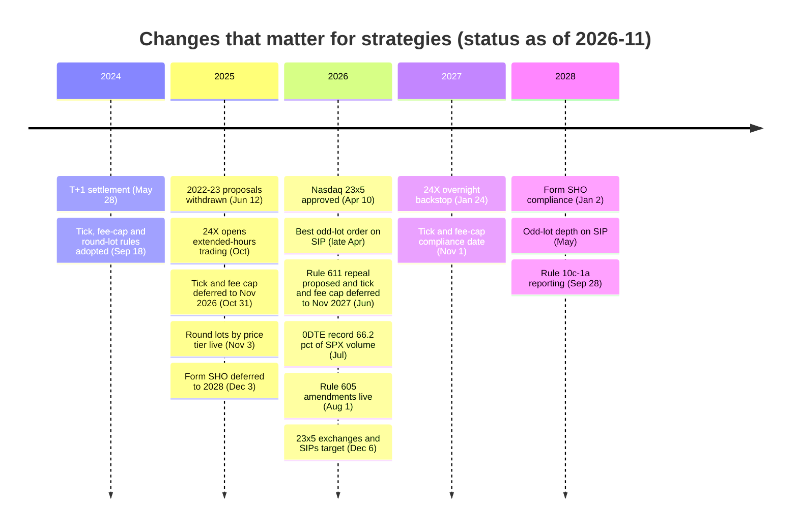
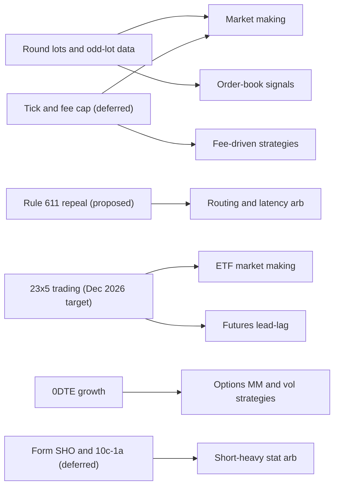

# Recent changes (as of 2026-11)

> **TL;DR**
>
> - **Live:** price-tiered round lots (Nov 3, 2025), best odd-lot orders on the SIP (late April 2026), amended Rule 605 execution-quality reports (Aug 1, 2026) and T+1 settlement (May 28, 2024).
> - **Deferred:** the half-penny tick and the 0.10¢ access-fee cap are pushed to Nov 1, 2027 and back under review. Form SHO and securities-lending reporting are pushed to 2028–2029.
> - **Coming:** 23-hour weekday stock trading on Nasdaq, NYSE Arca and the SIPs, targeted for Dec 6, 2026. A proposal to repeal the trade-through rule (June 2026) is pending.
> - **Growing:** 0DTE options set a record 66.2% of SPX volume in July 2026.

**Level:** Core · **Read time:** ~6 min · **Last verified:** 2026-11

This page keeps only changes that alter a strategy's P&L, data or risk. Each item was checked in November 2026 against regulators' releases, exchange notices or law-firm and trade-press summaries. The tag on each row says which. Dates and statuses move, so re-check before relying on any row.

## The table

| Change | Status as of 2026-11 | Key dates | Strategies most affected | Confidence |
|---|---|---|---|---|
| [Round lots](../09-reference/glossary.md#round-lot) by price tier (100 / 40 / 10 / 1 shares) | **Live** | adopted Sep 18, 2024; live Nov 3, 2025; reassigned twice a year | market making in high-priced names, routing, NBBO-based signals and TCA | `[Verified]` |
| Best [odd-lot](../09-reference/glossary.md#odd-lot) order on the [SIP](../09-reference/glossary.md#sip) | **Live**; odd-lot depth deferred | late Apr 2026; depth May 2028 | microprice and order-book signals, SIP-based market makers | `[Verified]` |
| \$0.005 [tick](../09-reference/glossary.md#tick-size) for tick-constrained stocks | **Deferred**, under staff review | due Nov 3, 2025 → Nov 2, 2026 → Nov 1, 2027 | equity and ETF market making, queue strategies, high-turnover stat arb | `[Reported]` |
| [Access-fee](../09-reference/glossary.md#access-fee) cap \$0.0030 → \$0.0010 | **Deferred**, under staff review | same as tick | fee-driven strategies, market-maker rebates, routing | `[Reported]` |
| [Rule 605](../09-reference/glossary.md#rule-605) execution-quality amendments | **Live** | Aug 1, 2026 (first reports cover Aug 2026) | retail internalization, TCA | `[Verified]` |
| Repeal of the [trade-through rule](../09-reference/glossary.md#trade-through-rule) (Rule 611) and the locked/crossed rule (610(e)) | **Proposed** | Jun 11, 2026; comment period closed | routing, latency arbitrage, market making | `[Verified]` |
| 2022–23 proposals: Order Competition Rule, Reg Best Execution, volume-based exchange pricing | **Withdrawn** | Jun 12, 2025 | wholesalers, fee tiers | `[Reported]` |
| 23-hour weekday trading (exchanges and SIPs) | **Approved, not yet live** | Nasdaq approved Apr 10, 2026; launch targeted Dec 6, 2026 | ETF market making, futures lead-lag, event-driven, risk | `[Reported]` |
| [0DTE](../09-reference/glossary.md#0dte) index options | **Growing** | record 66.2% of SPX volume, Jul 2026 | options market making, vol risk premium, intraday stat arb | `[Verified]` |
| [T+1 settlement](../09-reference/glossary.md#t1-settlement) | **Live** | May 28, 2024 | short sellers, ETF creation, corporate-action trades | `[Verified]` |
| Form SHO (Rule 13f-2) and lending reports (Rule 10c-1a) | **Deferred** after court remand | Jan 2, 2028; Sep 28, 2028; public data Mar 29, 2029 | short-heavy books, crowding signals | `[Reported]` |
| [Consolidated Audit Trail](../09-reference/glossary.md#consolidated-audit-trail-cat) overhaul | **Under review** | concept release Apr 16, 2026 | compliance cost for all; little direct strategy effect | `[Verified]` |
| Tokenized-stock "innovation exemption" | **Granted**, five-year conditional | Sep 17, 2026 | watch item: a possible new venue and arbitrage leg | `[Reported]` |

## What each change means

**The pricing grid: ticks, fees and lots.** The round-lot change is live and it matters. In stocks priced above \$250, the NBBO is now set by 40-, 10- or 1-share orders, so the protected quote is tighter and thinner. Signals built on NBBO size or on the spread shifted level on Nov 3, 2025, so treat that date as a break in any history. Half-penny ticks and the lower fee cap would rewrite market-maker unit economics (worked example in [fees, rebates and ticks](fees-rebates-and-ticks.md)). Compliance moved from Nov 2025 to Nov 2026 by an Oct 31, 2025 order, then to Nov 1, 2027 by a June 2026 order. The Chairman has also asked staff to review both rules `[Reported]`. Treat the 2027 date as provisional.

**Market data and disclosure.** Since late April 2026, SIP subscribers can see the best odd-lot order, which narrows the information gap between SIP and direct feeds a little. The full odd-lot depth between that order and the NBBO waits until May 2028 `[Verified]`. The amended Rule 605 applies from Aug 1, 2026. It brings in large brokers and single-dealer platforms, adds millisecond time-to-execution, and measures price improvement against the best displayed price including odd lots `[Verified]`. That gives better public data for judging wholesaler execution quality and for TCA.

**Routing rules.** On Jun 11, 2026 the SEC proposed rescinding Rule 611 (trade-through) and Rule 610(e) (locked and crossed markets) `[Verified]`. One sell-side analyst expects a final rule in early 2027 `[Reported]`. If adopted, routers would no longer be forced to honor the best protected quote at every venue, and the case for fee-, fill- and markout-weighted routing would get stronger. The Gensler-era retail auction (Order Competition Rule) and the Reg Best Execution proposal were withdrawn on Jun 12, 2025 `[Reported]`, so the wholesaler model described in [venues and retail flow](venues-and-retail-flow.md) stands.

**Trading hours.** The SEC approved Nasdaq's 23-hour weekday schedule on Apr 10, 2026. Other exchanges followed, and the SIP plans approved matching hours `[Reported]`. The target is Dec 6, 2026. The schedule runs from 9 p.m. ET Sunday to 8 p.m. ET Friday, with a one-hour pause each weekday evening, and opens with static 20% overnight price bands `[Reported]`. 24X National Exchange has traded 4 a.m.–8 p.m. ET since October 2025 `[Reported]`. An Aug 7, 2026 SEC order lets 24X run overnight without SIP coverage from Jan 24, 2027, but only if the SIPs miss their date `[Verified]`. For strategies, overnight cash trading would weaken futures' monopoly on overnight price discovery. It would create new ETF market-making and event-driven windows, and risk systems would have to treat the "close" differently. Expect thin liquidity early on.

**Options.** 0DTE share keeps rising: a 66.2% record in July 2026 `[Verified]`, and about 3.4M contracts a day in Q3 2026 `[Reported]`. Intraday hedging flow and the volatility debate are covered in [ETF, futures and options linkages](etf-futures-options-linkages.md).

**Settlement and shorting.** T+1 is settled practice. After the Fifth Circuit's August 2025 remand, the SEC pushed the short-sale and securities-lending transparency rules to 2028–2029 `[Reported]`. Short-side crowding data therefore still comes from vendors and FINRA short interest (see [shorting, financing and settlement](shorting-financing-and-settlement.md)).

**Watch list.** The SEC's Sep 17, 2026 innovation exemption allows capped on-chain trading of tokenized US-listed stocks for five years `[Reported]`. On Nov 3, 2026, the CFTC Chairman said single-stock perpetual futures may trade on venues also registered with the SEC `[Reported]`. Neither affects mainstream strategies yet. Both could become new hedging or arbitrage legs. On the CAT, the 2023 funding model was vacated by the Eleventh Circuit in 2025, a revised funding order followed in March 2026, and an April 2026 concept release opened a wider review `[Reported]`.

## Why this matters for strategies & algorithms

- **The pricing grid.** [Equity market making](../02-strategies/a-liquidity-provision/equity-market-making.md) and [fee- and microstructure-driven strategies](../02-strategies/b-speed-and-structural/fee-and-microstructure-driven-strategies.md) need scenario P&L for the 2027 tick and fee change, and they must re-baseline features at the Nov 2025 round-lot break. Their tools are [quoting and inventory control](../03-algorithms/f-market-making-and-hft-algorithms/quoting-and-inventory-control.md) and [queue position](../03-algorithms/f-market-making-and-hft-algorithms/queue-position-and-order-placement.md).
- **Market data.** [Order-book and trade-flow signals](../03-algorithms/f-market-making-and-hft-algorithms/order-book-and-trade-flow-signals.md) and [fair value and microprice](../03-algorithms/f-market-making-and-hft-algorithms/fair-value-and-microprice.md) change their inputs with odd-lot data. [Point-in-time data](../03-algorithms/a-data-and-signals/point-in-time-data-and-cleaning.md) must record the rule-change dates.
- **Routing.** [Smart order routing](../03-algorithms/e-execution-algorithms/smart-order-routing.md), [latency arbitrage](../02-strategies/b-speed-and-structural/latency-arbitrage.md) and [retail flow internalization](../02-strategies/a-liquidity-provision/retail-flow-internalization.md) depend on how Rule 611 and Rule 605 turn out.
- **Trading hours.** 23-hour trading affects [ETF market making](../02-strategies/a-liquidity-provision/etf-market-making.md), [lead-lag arbitrage](../02-strategies/b-speed-and-structural/lead-lag-and-cross-asset-arbitrage.md), [earnings and event-driven](../02-strategies/d-mid-frequency-alpha/earnings-and-event-driven.md) trading and [algorithmic risk controls](../03-algorithms/f-market-making-and-hft-algorithms/algorithmic-risk-controls.md).
- **Options.** 0DTE growth reshapes [options market making](../02-strategies/a-liquidity-provision/options-market-making.md) and the [volatility risk premium](../02-strategies/f-volatility-and-derivatives/volatility-risk-premium-and-vol-arb.md), and it changes the inputs to [hedging algorithms](../03-algorithms/f-market-making-and-hft-algorithms/hedging-algorithms.md).

## Related pages

- [Fees, rebates and ticks](fees-rebates-and-ticks.md)
- [NBBO and market data](nbbo-and-market-data.md)
- [Shorting, financing and settlement](shorting-financing-and-settlement.md)
- [Rules that shape strategies](../06-risk-and-regulation/rules-that-shape-strategies.md)
- [Evolution of quant strategies](../02-strategies/h-cross-cutting/evolution-of-quant-strategies.md)

## Sources

- [Verified] SEC (2024-09-18). "Regulation NMS: Minimum Pricing Increments, Access Fees, and Transparency of Better Priced Orders." Release No. 34-101070. <https://www.federalregister.gov/documents/2024/10/08/2024-21867/regulation-nms-minimum-pricing-increments-access-fees-and-transparency-of-better-priced-orders> (accessed 2026-11)
- [Reported] TradeInformer (2026-06). "SEC extends NMS relief to November 2027, proposes scrapping trade-through rule." <https://tradeinformer.com/regulations/sec-extends-nms-relief-rule-611-repeal-2027> (accessed 2026-11)
- [Reported] Morrison Foerster (2026-06-12). "SEC Proposes Landmark Rollback of Core Regulation NMS Requirements and Delays Implementation of 2024 Market Structure Reforms." <https://www.mofo.com/resources/insights/260612-sec-proposes-landmark-rollback-of-core-regulation> (accessed 2026-11)
- [Verified] Federal Register (2026-06-17). "The Trade-Through Rule and Locked and Crossed Markets Provisions of Regulation NMS." <https://www.federalregister.gov/documents/2026/06/17/2026-12163/the-trade-through-rule-and-locked-and-crossed-markets-provisions-of-regulation-nms> (accessed 2026-11)
- [Verified] Cboe (2025-10-28). "Regulation NMS Round Lots Enhancements FAQ." <https://cdn.cboe.com/resources/membership/Round_Lots_Enhancements_FAQ.pdf> (accessed 2026-11)
- [Reported] FlexTrade (2025-11). "Round-Lots, Odd-Lots Push Forward, while SEC Delays Tick Size and Access Fees." <https://flextrade.com/resources/round-lots-odd-lots-push-forward-while-sec-delays-tick-size-and-access-fees/> (accessed 2026-11)
- [Verified] Federal Register (2025-10-02). "Extension of Compliance Date for Disclosure of Order Execution Information." <https://www.federalregister.gov/documents/2025/10/02/2025-19316/extension-of-compliance-date-for-disclosure-of-order-execution-information> (accessed 2026-11)
- [Verified] FINRA (2026-06-17). "Information Notice: Amended Rule 605 Reporting." <https://www.finra.org/rules-guidance/notices/information-notice-20260617> (accessed 2026-11)
- [Reported] Proskauer (2025-06). "SEC Withdraws Fourteen Rule Proposals." <https://www.proskauer.com/alert/sec-withdraws-fourteen-rule-proposals> (accessed 2026-11)
- [Reported] Simpson Thacher (2026-04-29). "SEC Approves Nasdaq's 23/5 Trading Proposal." <https://www.stblaw.com/docs/default-source/memos/firmmemo_04_29_26> (accessed 2026-11)
- [Reported] Jones Day (2026-09). "NYSE and Nasdaq Move to 23-Hour Trading Day: Overnight Session Is an Evolution, But Not Yet a Revolution." <https://www.jonesday.com/en/insights/2026/09/nyse-and-nasdaq-move-to-23hour-trading-day-overnight-session-is-an-evolution-but-not-yet-a-revolution> (accessed 2026-11)
- [Reported] Sidley Austin (2026-09). "SEC Roundtable Highlights Key Considerations for 24-Hour Trading." <https://www.sidley.com/en/insights/newsupdates/2026/09/sec-roundtable-highlights-key-considerations-for-24-hour-trading> (accessed 2026-11)
- [Verified] Federal Register (2026-08-14). SEC order granting 24X National Exchange temporary conditional exemptive relief (Release No. 34-106061). <https://www.govinfo.gov/content/pkg/FR-2026-08-14/html/2026-16572.htm> (accessed 2026-11)
- [Reported] Mondo Visione (2025-10-15). "24X National Exchange Opens for Trading as First SEC-Approved 23/5 Stock Exchange." <https://mondovisione.com/media-and-resources/news/24x-national-exchange-opens-for-trading-as-first-sec-approved-235-stock-exchang-20251015/> (accessed 2026-11)
- [Verified] Cboe (2026-08). "Market Metrics That Matter: Derivatives July 2026 Volume Highlights." <https://www.cboe.com/insights/posts/market-metrics-that-matter-derivatives-july-2026-volume-highlights> (accessed 2026-11)
- [Verified] DTCC (2024-05-13). "DTCC Comments on Industry's Affirmation Progress with T+1 Implementation Two Weeks Away." <https://www.dtcc.com/news/2024/may/13/dtcc-comments-on-industrys-affirmation-progress> (accessed 2026-11)
- [Reported] Morgan Lewis (2025-12). "Short Sale Reporting on Form SHO: Compliance Date Further Extended to 2028." <https://www.morganlewis.com/pubs/2025/12/short-sale-reporting-on-form-sho-compliance-date-further-extended-to-2028> (accessed 2026-11)
- [Verified] SEC (2026-04-16). "Concept Release on the Consolidated Audit Trail and Other Audit Trails and Data Sources." Release No. 34-105251. <https://www.govinfo.gov/content/pkg/FR-2026-04-20/html/2026-07651.htm> (accessed 2026-11)
- [Reported] Pensions & Investments (2025). "Court strikes down funding model for SEC's consolidated audit trail." <https://www.pionline.com/rules-regulations/government-politics/pi-court-strikes-down-sec-consolidated-audit-trail-fee-model/> (accessed 2026-11)
- [Reported] Sidley Austin (2026-09). "SEC Issues Innovation Exemption for On-chain Trading of Tokenized U.S.-Listed Stocks." <https://www.sidley.com/en/insights/newsupdates/2026/09/sec-issues-innovation-exemption-for-onchain-trading-of-tokenized-us-listed-stocks> (accessed 2026-11)
- [Reported] The Block (2026-11-03). "CFTC approves individual stock perpetual futures trading in US for the first time." <https://www.theblock.co/news/regulation/2026-11-03-cftc-approves-individual-stock-perpetual-futures-trading-in-us-for-first-time-432422> (accessed 2026-11)
