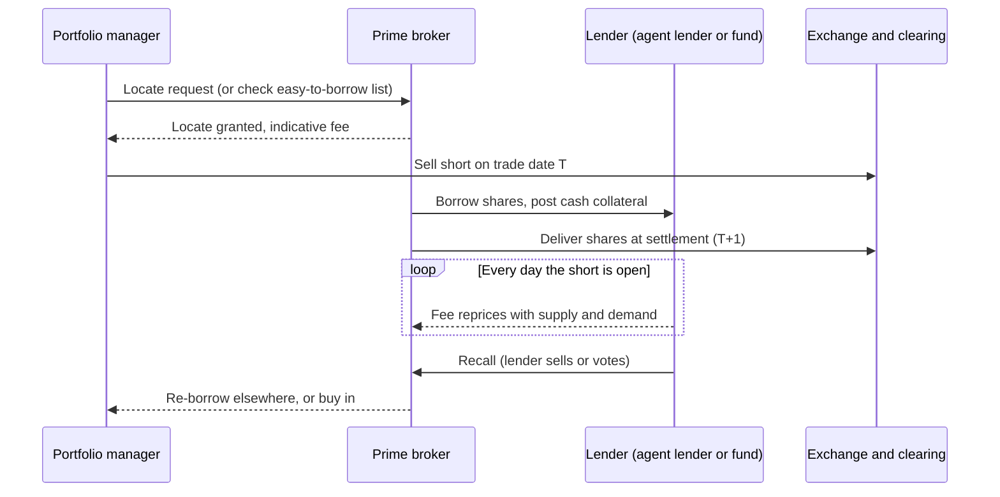
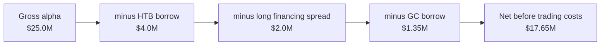

# Shorting, financing and settlement

> **TL;DR**
>
> - A short sale needs three things. The broker needs a locate before the order (Reg SHO Rule 203). Someone has to lend the shares, at a floating fee. And you carry recall risk for as long as the position is open.
> - Borrow cost is skewed. Most large caps are general collateral at a fraction of a percent a year. A thin tail of hard-to-borrow names costs 5% to 50% or more, and that tail is often where the "alpha" in short signals sits.
> - Rule 201 forces passive shorting after a 10% drop. Rule 204 forces the close-out of failed deliveries. T+1 settlement (since May 28, 2024) shortens every step.
> - Prime-broker financing spreads plus borrow fees can take a quarter or more of a long-short book's gross alpha.
> - The new short-position (Form SHO) and securities-lending (Rule 10c-1a) transparency rules are deferred to 2028–2029 (as of 2026-11).

**Level:** Core · **Read time:** ~7 min · **Last verified:** 2026-11

## The life of a short

To a portfolio manager a short is one order. To the plumbing it is a chain of obligations that runs from the trade until the shares are returned.

## Locates and borrow fees

**The [locate](../09-reference/glossary.md#locate).** Under Rule 203(b)(1), a broker-dealer may not accept or effect a short sale unless it has borrowed the shares, has arranged to borrow them, or has reasonable grounds to believe they can be borrowed for delivery when due. The locate has to be documented. **Bona fide market makers** are exempt `[Verified]`. That exemption is what lets an [equity market maker](../02-strategies/a-liquidity-provision/equity-market-making.md) sell to a buyer before it owns the stock. In practice, prime brokers publish a daily easy-to-borrow list, and every other name needs an explicit locate against limited supply `[Lore]`.

**The fee.** Shares come from lenders such as index funds, pensions and insurers, usually through agent lenders. The borrower posts cash collateral, conventionally about 102% of the loan's value `[Lore]`. The lender pays interest back on that cash, called the **rebate rate**: the benchmark rate minus the [borrow fee](../09-reference/glossary.md#borrow-fee). When a name is scarce, the rebate goes negative, which means the borrower pays on top of giving up interest.

| Bucket | Typical fee (annualized) | Where you find it |
|---|---|---|
| [General collateral](../09-reference/glossary.md#general-collateral) (GC) | about 0.25–0.50% `[Lore]` | most large and mid caps |
| Warm | about 0.5–5% `[Lore]` | small caps, crowded shorts |
| [Hard-to-borrow](../09-reference/glossary.md#hard-to-borrow) / special | 5–50%+, occasionally triple digits `[Lore]` | squeezes, recent IPOs, heavily shorted names |

The academic evidence agrees on the shape. In D'Avolio's 2000–2001 data, about nine in ten stocks lent at under 1% a year, and a small set of "specials" carried most of the cost `[Reported]`.

**The fee is a floating rate on an open-ended loan.** Lenders can recall at any time. The fee reprices daily, so a name that costs 1% today can cost 30% in a squeeze. Engelberg, Reed and Ringgenberg (2018) show that this short-selling risk deters arbitrage and goes with more mispricing `[Reported]`. Drechsler and Drechsler (2014) find that much of the return to well-known anomalies is concentrated in high-fee stocks `[Reported]`. In other words, the "alpha" on many short signals is partly a fee you would have to pay to collect it.

## Rule 201, Rule 204 and T+1

- **Rule 201 (short-sale circuit breaker).** When a stock falls 10% or more from the prior day's close, short sales for the rest of that day and all of the next day may only be priced *above* the current national best bid. A few narrow exemptions are marked "short exempt" `[Verified]`. In effect, a short seller can no longer hit the bid. The short leg of a mean-reversion trade after a crash has to rest passively, and it may not fill.
- **Rule 204 (close-out).** A fail to deliver from a short sale must be closed out by the market open on the day after settlement, which is T+2 under T+1. Fails from long sales and from bona fide market making get until the third settlement day after settlement, T+4 `[Verified]`. A broker that misses the deadline is barred from further shorts in that stock until it pre-borrows. Traders call this the "penalty box".
- **[T+1](../09-reference/glossary.md#t1-settlement) settlement.** US equities moved from T+2 to T+1 on May 28, 2024 `[Verified]`. Trades must also be affirmed on trade date. For short sellers this means less time to source a borrow, faster buy-ins after a recall, and a tighter calendar around corporate actions and ETF creations.

## Financing through a prime broker

A [prime broker](../09-reference/glossary.md#prime-broker) finances longs and lends shorts:

- **Long side.** The debit balance is charged at a benchmark rate (SOFR, OBFR or Fed funds) plus a spread, about 30–75 bp for a large fund `[Lore]`.
- **Short side.** Short proceeds earn the benchmark minus a spread. That spread is effectively the GC fee. HTB fees come on top.
- **Leverage.** Reg T sets a 50% initial margin and FINRA Rule 4210 a 25% long maintenance margin `[Verified]`. Hedge funds mostly use risk-based house or portfolio margin instead. Under it, equity market-neutral books typically run about 4–8x gross leverage `[Lore]`.
- **Swaps.** Total return swaps carry the same economics but sit on the dealer's balance sheet, so pricing moves with the dealer's capital costs.

## Worked example: borrow and financing drag

Take an illustrative dollar-neutral book with \$250M of capital, \$500M long and \$500M short (4x gross). In a dollar-neutral book the benchmark interest roughly nets out. What is left are the spreads and fees.

| Cost line | Calculation | Annual cost |
|---|---|---|
| Long financing spread | 0.40% × \$500M | \$2.00M |
| GC borrow on 90% of shorts | 0.30% × \$450M | \$1.35M |
| HTB borrow on 10% of shorts | 8% average × \$50M | \$4.00M |
| **Total drag** | | **\$7.35M = 2.9% of capital** |

If the gross alpha is 10% on capital (\$25M), carrying the book eats about 29% of it. The 10% of shorts that are hard to borrow cost more than the whole GC book and the long financing combined. That is why production systems treat borrow cost as a per-name negative expected return, cap or exclude HTB names, and build recall risk into sizing. A backtest that ignores this overstates short-side returns exactly where the signal looks strongest.

## Disclosure rules in limbo (as of 2026-11)

- **Rule 13f-2 / Form SHO.** Institutional managers above set thresholds (\$10M, or a 2.5% monthly average of shares outstanding, for reporting issuers) would report gross short positions monthly `[Reported]`. The SEC would publish aggregates.
- **Rule 10c-1a.** Lenders would report loan terms, including fees, to FINRA for publication.
- **Status.** In August 2025 the Fifth Circuit remanded both rules to the SEC without vacating them. On Dec 3, 2025, the SEC deferred compliance to Jan 2, 2028 for Form SHO (first filings due Feb 14, 2028), and to Sep 28, 2028 for 10c-1a reporting, with public dissemination from Mar 29, 2029 `[Reported]`.

Until then, borrow data comes from commercial securities-finance vendors and FINRA's twice-monthly short-interest reports.

## Why this matters for strategies & algorithms

- **Short-heavy books.** [Factor-residual mean reversion](../02-strategies/c-statistical-arbitrage/factor-residual-mean-reversion.md), [pairs trading](../02-strategies/c-statistical-arbitrage/pairs-trading-and-cointegration.md), [cross-sectional alpha](../02-strategies/d-mid-frequency-alpha/cross-sectional-alpha-and-neutralization.md) and [value, quality and low vol](../02-strategies/e-risk-premia-and-factors/value-quality-low-vol.md) all carry the drag above. Their short legs are where borrow constraints bind.
- **Rule 201 and recalls.** These bite [short-term reversal](../02-strategies/c-statistical-arbitrage/short-term-cross-sectional-reversal.md) and [earnings and event-driven](../02-strategies/d-mid-frequency-alpha/earnings-and-event-driven.md) trades when they matter most.
- **Market makers.** [ETF and index arbitrage](../02-strategies/b-speed-and-structural/etf-and-index-arbitrage.md) and [options market making](../02-strategies/a-liquidity-provision/options-market-making.md) rely on the market-maker locate exception and price borrow into parity.
- **Algorithms.**
    - [Mean-variance optimization](../03-algorithms/d-portfolio-construction/mean-variance-optimization.md) and [transaction cost and impact models](../03-algorithms/d-portfolio-construction/transaction-cost-and-impact-models.md) take borrow as a cost or constraint.
    - [Position sizing and risk budgeting](../03-algorithms/d-portfolio-construction/position-sizing-and-risk-budgeting.md) handles recall risk.
    - [Backtest pitfalls](../03-algorithms/c-validation-and-backtesting/backtest-pitfalls.md) covers the cost of ignoring borrow.
    - [Live monitoring and P&L attribution](../03-algorithms/g-live-trading/live-monitoring-and-pnl-attribution.md) reports financing as its own P&L line.

## Related pages

- [ETF, futures and options linkages](etf-futures-options-linkages.md)
- [Recent changes (as of 2026-11)](recent-changes.md)
- [Rules that shape strategies](../06-risk-and-regulation/rules-that-shape-strategies.md)
- [Risk management at quant firms](../06-risk-and-regulation/risk-management-at-quant-firms.md)
- [Life of a stock order](life-of-a-stock-order.md)

## Sources

- [Verified] 17 CFR 242.203, "Borrowing and delivery requirements" (Reg SHO locate rule). eCFR. <https://www.ecfr.gov/current/title-17/section-242.203> (accessed 2026-11)
- [Verified] 17 CFR 242.201, "Circuit breaker" (Reg SHO short-sale price test). eCFR. <https://www.ecfr.gov/current/title-17/section-242.201> (accessed 2026-11)
- [Verified] 17 CFR 242.204, "Close-out requirement." eCFR. <https://www.ecfr.gov/current/title-17/section-242.204> (accessed 2026-11)
- [Verified] DTCC (2024-05-13). "DTCC Comments on Industry's Affirmation Progress with T+1 Implementation Two Weeks Away." <https://www.dtcc.com/news/2024/may/13/dtcc-comments-on-industrys-affirmation-progress> (accessed 2026-11)
- [Verified] 12 CFR Part 220, "Credit by Brokers and Dealers (Regulation T)." eCFR. <https://www.ecfr.gov/current/title-12/chapter-II/subchapter-A/part-220> (accessed 2026-11)
- [Verified] FINRA. "Rule 4210: Margin Requirements." <https://www.finra.org/rules-guidance/rulebooks/finra-rules/4210> (accessed 2026-11)
- [Reported] Morgan Lewis (2025-12). "Short Sale Reporting on Form SHO: Compliance Date Further Extended to 2028." <https://www.morganlewis.com/pubs/2025/12/short-sale-reporting-on-form-sho-compliance-date-further-extended-to-2028> (accessed 2026-11)
- [Reported] Securities Finance Times (2025-12). "SEC confirms new implementation dates for Rules 10c-1a and 13f-2." <https://www.securitiesfinancetimes.com/securitieslendingnews/regulationarticle.php?article_id=228341> (accessed 2026-11)
- [Reported] Akin Gump (2025-12). "SEC Extends Compliance Date for Short Sale Reporting Rule to 2028." <https://www.akingump.com/en/insights/alerts/sec-extends-compliance-date-for-short-sale-reporting-rule-to-2028> (accessed 2026-11)
- [Reported] D'Avolio, G. (2002). "The Market for Borrowing Stock." *Journal of Financial Economics* 66(2–3), 271–306. <https://doi.org/10.1016/S0304-405X(02)00206-4> (accessed 2026-11)
- [Reported] Engelberg, J. E., Reed, A. V. & Ringgenberg, M. C. (2018). "Short-Selling Risk." *Journal of Finance* 73(2), 755–786. <https://doi.org/10.1111/jofi.12601> (accessed 2026-11)
- [Reported] Drechsler, I. & Drechsler, Q. F. (2014). "The Shorting Premium and Asset Pricing Anomalies." NBER Working Paper 20282. <https://www.nber.org/papers/w20282> (accessed 2026-11)
