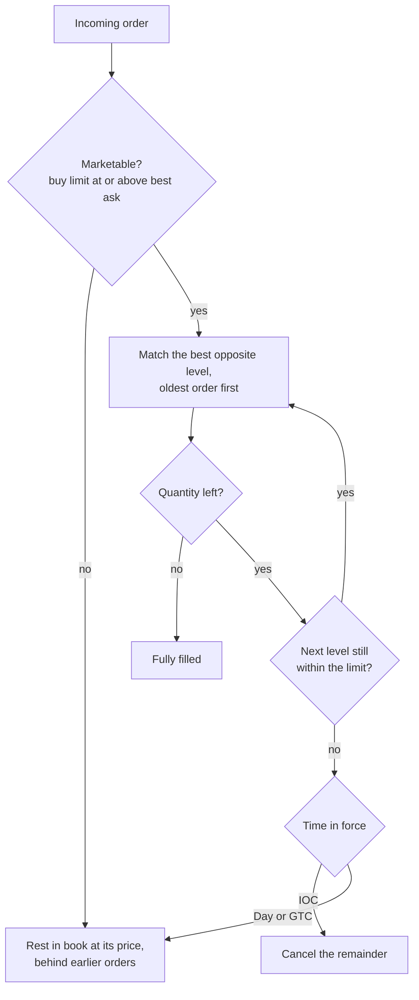
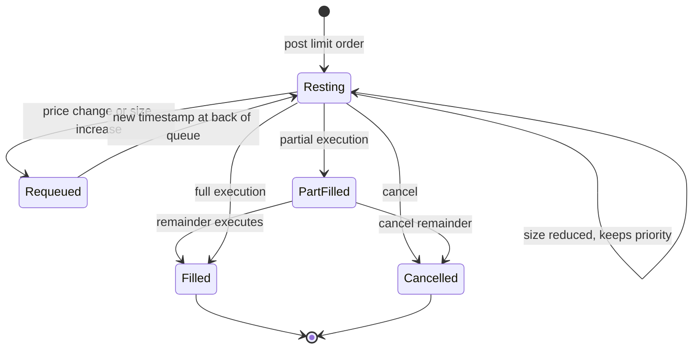

# The limit order book

> **TL;DR**
>
> - A limit order book (LOB) is the list of resting buy and sell limit orders on one venue, sorted by price and, within each price, by arrival time. Marketable orders consume it from the best price outward.
> - Price-time priority makes your place in the queue an asset. An early order gets more fills, and its fills are less adversely selected, than an identical order at the back.
> - Hidden and iceberg orders trade visibility for priority: they hide size but queue behind displayed orders at the same price.
> - What execution algos and market makers care about is depth (how much trades near the touch) and resilience (how fast the book refills after a sweep), not just the spread.

**Level:** Core · **Read time:** ~6 min · **Last verified:** 2026-11

## Intuition: a queue at every price

Picture a row of ticket windows, one per price, with buyers (or sellers) lined up at each in arrival order. A seller who wants to trade now goes to the highest bid window and serves the line from the front. The [limit order book](../09-reference/glossary.md#limit-order-book) is exactly this, kept by each exchange's matching engine.

Three events change the book:

- **Add:** a non-marketable limit order joins the back of the queue at its price.
- **Cancel:** a resting order leaves. Most US equity orders are cancelled, not filled.
- **Execute:** a marketable order matches against the front of the best opposite queue.

On US exchanges the minimum quoting increment ([tick size](../09-reference/glossary.md#tick-size)) is $0.01 for stocks priced at $1 or more. The SEC's 2024 amendments add a $0.005 tick for stocks whose spread is pinned at one tick, but compliance has been pushed to the first business day of November 2027 `[Verified]`. See [fees, rebates and ticks](fees-rebates-and-ticks.md).

## Price-time priority

Matching follows [price-time priority](../09-reference/glossary.md#price-time-priority): better price first, then earlier arrival (FIFO) within a price. Most US equity venues use strict FIFO; some options markets allocate pro rata by size instead `[Lore]`. Priority is fragile: reducing size usually keeps your place, while changing price or increasing size sends you to the back with a new timestamp.

## Worked example: a market order walks the book

An illustrative book for stock XYZ on one exchange (sizes in shares, order IDs in brackets):

| Bid size | Bid | Ask | Ask size |
|---|---|---|---|
| 600 [G 600] | 100.00 | 100.01 | 400 [E 100, F 300] |
| 800 | 99.99 | 100.02 | 500 [C 200, D 300] |
| 1,500 | 99.98 | 100.03 | 300 [A 100, B 200] |

The mid is 100.005 and the spread is one tick. A market buy for 1,000 shares arrives:

- 400 at 100.01 (E first, then F, by time)
- 500 at 100.02 (C, then D)
- 100 at 100.03 (A; B is untouched)

Average price = (400 × 100.01 + 500 × 100.02 + 100 × 100.03) / 1,000 = **100.017**. That is 1.2 cents, or about 1.2 bps, above the pre-trade mid: $12 of cost on a $100k order. The book after the trade shows 100.00 bid and 100.03 ask, a 3-cent spread. How fast market makers re-quote 100.01 and 100.02 is the book's **resilience**; in liquid names it is often milliseconds `[Lore]`. In practice a router would sweep several venues at once with ISOs rather than walk one book (see [order types and auctions](order-types-and-auctions.md)). [Lab 01](https://github.com/FrankHuang94/quant_trading_claude/tree/main/labs/01-matching-engine-order-book) implements a price-time matching engine you can replay this on.

## Queue value: why being early is worth money

Take a large-tick stock where the spread is almost always one cent and 10,000 shares sit on the best bid. Compare joining that bid as the first 500 shares in line with joining as the last 500.

1. **Fill probability.** The front gets filled by ordinary small sell orders. The back is filled only if enough selling arrives to chew through 9,500 shares ahead of it.
2. **[Adverse selection](../09-reference/glossary.md#adverse-selection).** When the back does get filled, it is usually because a large or informed seller is sweeping the level, and the price then ticks down. A back-of-queue fill is a signal that you just bought before a drop.

Illustrative numbers, per share, for a resting bid that gets filled. The [markout](../09-reference/glossary.md#markout) is the mid's move against you shortly after the fill.

| | Front of queue | Back of queue |
|---|---|---|
| Half-spread earned vs mid | +0.50¢ | +0.50¢ |
| Maker rebate | +0.20¢ | +0.20¢ |
| Markout (adverse selection) | −0.20¢ | −0.90¢ |
| Net if filled | **+0.50¢** | **−0.20¢** |
| Fill probability over the next minute | 90% | 30% |
| Expected value per share posted | **+0.45¢** | **−0.06¢** |

The front is worth about half a cent a share more than the back, roughly the half-spread, a common rule of thumb for large-tick names `[Lore]`. Most of the gap is adverse selection, not fill rate. That is why HFT market makers race to the front when a new price level opens, and why the [queue-position card](../03-algorithms/f-market-making-and-hft-algorithms/queue-position-and-order-placement.md) models the two together. Academic queue models include Cont, Stoikov and Talreja (2010) and Huang, Lehalle and Rosenbaum's queue-reactive model (2015).

## Hidden and iceberg orders

- **Non-displayed (hidden) orders** rest in the book but are not shown on market data. On most venues they rank behind displayed orders at the same price, so hiding costs priority. Midpoint pegs are usually non-displayed.
- **[Iceberg](../09-reference/glossary.md#iceberg-order) (reserve) orders** show a small tip, for example 100 shares, and refill from a hidden reserve. Each refill normally gets a new timestamp, so the visible part keeps going to the back of the line.
- **Detection.** Prints larger than the visible size, or a level that keeps refilling after being hit, reveal hidden interest.

## Depth and resilience

**[Depth](../09-reference/glossary.md#market-depth)** is how much you can trade within *k* ticks of the mid. It differs by stock type:

- **Large-tick stocks** (low price, high volume) have a spread stuck at one tick and long queues. Cost is mostly waiting time and queue position.
- **Small-tick stocks** (high price) have spreads of many ticks and thin levels. Cost is mostly walking the book.

Displayed depth understates true liquidity (hidden, off-exchange and reactive interest is missing) and overstates it (quotes vanish when price starts to move). **Resilience** is the speed at which spread and depth recover after a sweep. Part of a trade's price impact is transient (the book refills) and part is permanent (information). That split is the core of [transaction cost and impact models](../03-algorithms/d-portfolio-construction/transaction-cost-and-impact-models.md). Kyle (1985) formalized depth as the price move per unit of order flow, Kyle's lambda.

## Why this matters for strategies & algorithms

- **Market making is queue management.** [Equity market making](../02-strategies/a-liquidity-provision/equity-market-making.md) and [fee- and microstructure-driven strategies](../02-strategies/b-speed-and-structural/fee-and-microstructure-driven-strategies.md) earn the spread and rebate only from positions near the front. See [queue position and order placement](../03-algorithms/f-market-making-and-hft-algorithms/queue-position-and-order-placement.md), [quoting and inventory control](../03-algorithms/f-market-making-and-hft-algorithms/quoting-and-inventory-control.md) and [adverse selection and markouts](../03-algorithms/f-market-making-and-hft-algorithms/adverse-selection-and-markouts.md).
- **The book is a signal.** Queue sizes at the touch feed the [microprice](../03-algorithms/f-market-making-and-hft-algorithms/fair-value-and-microprice.md) and [order-flow imbalance](../03-algorithms/f-market-making-and-hft-algorithms/order-book-and-trade-flow-signals.md). Short-horizon forecasts in [ML-driven short-horizon alpha](../02-strategies/c-statistical-arbitrage/ml-driven-short-horizon-alpha.md) start from these features.
- **Walking the book is a cost.** The worked example is the micro version of what [impact models](../03-algorithms/d-portfolio-construction/transaction-cost-and-impact-models.md) estimate and what [VWAP, TWAP and POV](../03-algorithms/e-execution-algorithms/vwap-twap-pov.md) and [smart order routing](../03-algorithms/e-execution-algorithms/smart-order-routing.md) try to avoid.
- **Stale queues get picked off.** [Latency arbitrage](../02-strategies/b-speed-and-structural/latency-arbitrage.md) races to hit resting orders before they are cancelled.

## Related pages

- [Order types and auctions](order-types-and-auctions.md)
- [NBBO and market data](nbbo-and-market-data.md)
- [Fees, rebates and ticks](fees-rebates-and-ticks.md)
- [Life of a stock order](life-of-a-stock-order.md)
- [Lab 01: matching engine and order book](https://github.com/FrankHuang94/quant_trading_claude/tree/main/labs/01-matching-engine-order-book)

## Sources

- [Verified] Gould, M. D., Porter, M. A., Williams, S., McDonald, M., Fenn, D. J. & Howison, S. D. (2013). "Limit order books." *Quantitative Finance* 13(11), 1709–1742. <https://doi.org/10.1080/14697688.2013.803148> (accessed 2026-11)
- [Verified] Cont, R., Stoikov, S. & Talreja, R. (2010). "A stochastic model for order book dynamics." *Operations Research* 58(3), 549–563. <https://doi.org/10.1287/opre.1090.0780> (accessed 2026-11)
- [Verified] Huang, W., Lehalle, C.-A. & Rosenbaum, M. (2015). "Simulating and analyzing order book data: The queue-reactive model." *Journal of the American Statistical Association* 110(509), 107–122. <https://doi.org/10.1080/01621459.2014.982278> (accessed 2026-11)
- [Verified] Glosten, L. R. & Milgrom, P. R. (1985). "Bid, ask and transaction prices in a specialist market with heterogeneously informed traders." *Journal of Financial Economics* 14(1), 71–100. <https://doi.org/10.1016/0304-405X(85)90044-3> (accessed 2026-11)
- [Verified] Kyle, A. S. (1985). "Continuous auctions and insider trading." *Econometrica* 53(6), 1315–1335. <https://doi.org/10.2307/1913210> (accessed 2026-11)
- [Verified] SEC (2024-09-18). "Regulation NMS: Minimum Pricing Increments, Access Fees, and Transparency of Better Priced Orders," Release No. 34-101070. <https://www.sec.gov/rules/final/2024/34-101070.pdf> (accessed 2026-11)
- [Verified] SEC (2026). Order extending compliance dates for Rules 612 and 610(c) to November 2027, Release No. 34-105656. <https://www.sec.gov/files/rules/exorders/2026/34-105656.pdf> (accessed 2026-11)
- [Reported] Bouchaud, J.-P., Bonart, J., Donier, J. & Gould, M. (2018). *Trades, Quotes and Prices: Financial Markets Under the Microscope.* Cambridge University Press. <https://doi.org/10.1017/9781316659335> (accessed 2026-11)
