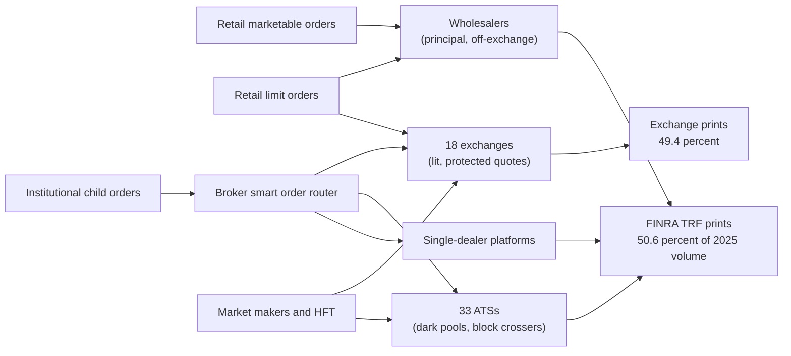
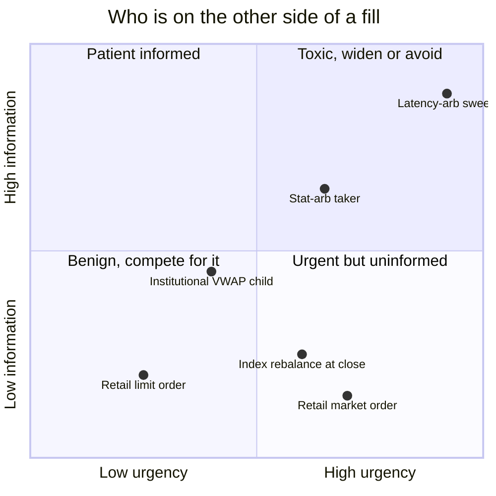
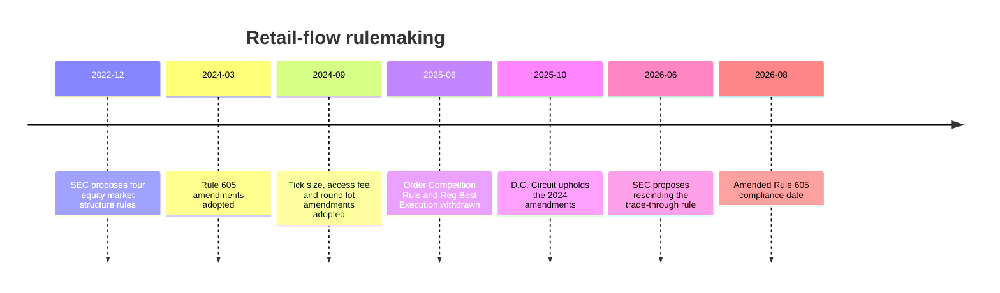

# Venues and retail flow

> **TL;DR**
>
> - US stocks trade on 18 exchanges (as of October 2026), 33 NMS-stock ATSs and over 200 other off-exchange dealers. In 2025 off-exchange volume was 50.6% of the total, the first annual majority, and about four-fifths of it went through principal dealers such as wholesalers.
> - Wholesalers pay retail brokers for marketable orders (PFOF) because retail flow is "less toxic": it rarely predicts the next price move. They can give price improvement and still earn a spread.
> - Flow toxicity is measured by markouts: how far the price moves against the liquidity provider after the fill.
> - Of the SEC's four December 2022 proposals, two were adopted (Rule 605 disclosure; ticks, access fees and round lots) and two were withdrawn in June 2025 (the Order Competition Rule and Regulation Best Execution).

**Level:** Core · **Read time:** ~6 min · **Last verified:** 2026-11

## The venue map

| Venue type | Count | What it is | Share of 2025 volume |
|---|---|---|---|
| Exchanges | 18 as of 2026-10 `[Reported]` (SEC, June 2026: 17 trading NMS stocks plus 3 approved, not yet live `[Verified]`) | Lit order books with [protected quotes](../09-reference/glossary.md#protected-quote): NYSE, Nasdaq and Cboe families, IEX, MEMX, MIAX Pearl, plus 24X (live September 2025) and the Texas Stock Exchange (live July 2026) `[Reported]` | 49.4% `[Verified]` |
| [ATSs](../09-reference/glossary.md#alternative-trading-system-ats) and [dark pools](../09-reference/glossary.md#dark-pool) | 33 NMS-stock ATSs `[Verified]` | Broker-run non-displayed books, block crossers, conditional-order venues | 18.7% of TRF volume, about 9.5% of the total `[Estimate]` (0.187 × 50.6%) |
| Wholesalers and other dealers | 220+ other FINRA members traded off-exchange in Q1 2023 `[Verified]` | Principal trading against client flow: retail wholesalers, single-dealer platforms, block desks | 81.3% of TRF volume, about 41% of the total `[Estimate]` (0.813 × 50.6%) |

Off-exchange (TRF) share rose 361 bps in 2025 to 50.6% `[Verified]`, so 2024 was about 47.0% `[Estimate]`. Liquidnet reports some swing back toward lit venues in 2026 on its own measure `[Reported]`. Full-year 2026 TRF figures were not yet published at the build date (2026-11).

The market is this fragmented because Regulation NMS (2005) obliges every venue to respect the best protected quote anywhere. That makes a new exchange instantly reachable, and fee competition does the rest (see [fees, rebates and ticks](fees-rebates-and-ticks.md)).

## Wholesalers and payment for order flow

When the SEC proposed its Order Competition Rule in December 2022, it found that brokers sent more than 90% of individual investors' marketable orders to six wholesalers `[Verified]`. Academic work using 2019–2022 data finds that two of them, Citadel Securities and Virtu, handled over 70% of US retail flow `[Reported]`. Wholesalers fill those orders as principal at or better than the [NBBO](../09-reference/glossary.md#nbbo), usually with [price improvement](../09-reference/glossary.md#price-improvement), and pay the broker [PFOF](../09-reference/glossary.md#payment-for-order-flow-pfof). Robinhood's 2025 Rule 606 reports show payments from tens of cents to about a dollar per 100 shares, depending on wholesaler, order type and stock group `[Reported]`. Citadel Securities paid about \$341M for US retail equity and options flow in Q2 2025 alone `[Reported]`.

A wholesaler's per-share income statement for a 100-share retail buy (illustrative: \$50 stock, NBBO \$49.99 × \$50.01):

| Line | ¢ per share |
|---|---|
| Sell at \$50.006 (0.4¢ price improvement); spread captured vs mid \$50.00 | +0.60 |
| Adverse selection: mid drifts 0.10¢ up over the next minute | −0.10 |
| PFOF to the broker | −0.15 |
| Hedging, exchange fees, clearing, technology | −0.10 |
| **Net** | **+0.25** |

Run the same fill against an informed taker whose one-minute markout is 1.5¢ and the result is −1.15¢. The whole business rests on being able to tell those two counterparties apart.

## Flow toxicity: why retail is "less toxic"

**[Flow toxicity](../09-reference/glossary.md#flow-toxicity)** is the probability-weighted damage a counterparty does to a liquidity provider. It is the expected price move against you after you trade with them. Glosten and Milgrom (1985) showed that a dealer facing some informed traders must widen the spread to everyone. VPIN (Easley, López de Prado and O'Hara, 2012) estimates toxicity from volume imbalance. Practitioners mostly measure it directly with [markouts](../09-reference/glossary.md#markout). The [realized spread](../09-reference/glossary.md#realized-spread) is the effective spread minus the subsequent price move.

Retail marketable orders are small, uncorrelated across accounts and rarely timed on information that matters over the next seconds to minutes, so their markouts are small. The key difference is **segmentation**. A wholesaler knows which broker sent the order, so it knows the flow is retail. An exchange sees anonymous orders and must price for the average counterparty. The two sides of the debate:

- **For the current model:** retail gets better-than-NBBO fills and zero commissions, paid for by the low cost of serving uninformed flow.
- **Against:** the SEC estimated a \$1.5B-a-year "competitive shortfall" versus order-by-order auctions `[Verified]`. Critics also argue that taking benign flow off exchanges leaves lit quotes facing more toxic flow, so lit spreads are wider for everyone.

The evidence is mixed. This KB takes no side.

## Disclosure: Rules 605 and 606

- **[Rule 605](../09-reference/glossary.md#rule-605)** requires monthly execution-quality statistics: effective spreads, price improvement and speed. The March 6, 2024 amendments extend it to brokers with 100,000 or more customer accounts, add a summary report, and add realized spreads at several horizons from 50 ms to 5 minutes `[Reported]`. Compliance moved from December 14, 2025 to August 1, 2026 `[Verified]`. Short-horizon realized spreads are, in effect, standardized public markouts.
- **[Rule 606](../09-reference/glossary.md#rule-606)** requires quarterly broker routing reports: where orders went and the PFOF received per 100 shares.

## The 2022 package and where it landed

| December 2022 proposal | What it would do | Status as of 2026-11 |
|---|---|---|
| Rule 605 amendments | Modernize execution-quality disclosure | Adopted 2024-03-06; compliance 2026-08-01 `[Verified]` |
| Regulation NMS: ticks, access fees, round lots | \$0.005 tick for stocks pinned at one tick; access-fee cap 30 → 10 mils; price-tiered round lots; odd-lot data | Adopted 2024-09-18; upheld by the D.C. Circuit 2025-10-14; round lots live 2025-11-03; tick and fee compliance pushed to the first business day of November 2027 `[Verified]` |
| Order Competition Rule (proposed Rule 615) | Expose retail marketable orders to open auctions before internalization | Withdrawn 2025-06-12 `[Verified]` |
| Regulation Best Execution | SEC-level best-execution rule | Withdrawn 2025-06-12 `[Verified]` |

A withdrawn rule can return only through a new proposal and comment period `[Reported]`.

## Why this matters for strategies & algorithms

- **Retail flow is a strategy.** [Retail flow internalization](../02-strategies/a-liquidity-provision/retail-flow-internalization.md) is the wholesaler business above. Its risk model is [adverse selection and markouts](../03-algorithms/f-market-making-and-hft-algorithms/adverse-selection-and-markouts.md), and its pricing engine is [fair value and microprice](../03-algorithms/f-market-making-and-hft-algorithms/fair-value-and-microprice.md).
- **Toxicity sets the quote.** [Equity market making](../02-strategies/a-liquidity-provision/equity-market-making.md) and [quoting and inventory control](../03-algorithms/f-market-making-and-hft-algorithms/quoting-and-inventory-control.md) widen or skew quotes on toxicity estimates. [Latency arbitrage](../02-strategies/b-speed-and-structural/latency-arbitrage.md) is the most toxic flow there is.
- **Venue choice is an algorithm.** [Smart order routing](../03-algorithms/e-execution-algorithms/smart-order-routing.md) ranks venues by fill rate and post-fill markout. [Auction, close and dark-liquidity algos](../03-algorithms/e-execution-algorithms/auction-close-and-dark-liquidity-algos.md) handle the dark pools. [Transaction cost analysis](../03-algorithms/e-execution-algorithms/transaction-cost-analysis.md) audits the result.

## Related pages

- [Life of a stock order](life-of-a-stock-order.md)
- [NBBO and market data](nbbo-and-market-data.md)
- [Fees, rebates and ticks](fees-rebates-and-ticks.md)
- [Recent changes (as of 2026-11)](recent-changes.md)
- [Rules that shape strategies](../06-risk-and-regulation/rules-that-shape-strategies.md)

## Sources

- [Verified] Cboe Global Markets (2026). "2025 U.S. Equities Year in Review." <https://www.cboe.com/insights/posts/2025-u-s-equities-year-in-review> (accessed 2026-11)
- [Reported] Rosenblatt Securities (2026-01). "US Securities Volumes: 2025 Year in Review." <https://www.rblt.com/market-structure-reports/us-securities-volumes-2025-year-in-review> (accessed 2026-11)
- [Verified] Federal Register (2026-06-17). "The Trade-Through Rule and Locked and Crossed Markets Provisions of Regulation NMS" (counts of exchanges and NMS-stock ATSs). <https://www.federalregister.gov/documents/2026/06/17/2026-12163/the-trade-through-rule-and-locked-and-crossed-markets-provisions-of-regulation-nms> (accessed 2026-11)
- [Verified] SEC (2024). Rule 605 adopting release, Release No. 34-99679 (off-exchange trading at 33 NMS-stock ATSs and 220+ other FINRA members in Q1 2023). <https://www.sec.gov/files/rules/final/2024/34-99679.pdf> (accessed 2026-11)
- [Reported] Markets Media (2026-10). "IEX is 'Fastest Growing' Equities Exchange" (citing Bloomberg's count of 18 US equity exchanges). <https://www.marketsmedia.com/iex-is-fastest-growing-equities-exchange/> (accessed 2026-11)
- [Reported] Texas Stock Exchange (2026-07). "Texas Stock Exchange celebrates successful launch of trading." <https://www.txse.com/press/texas-stock-exchange-celebrates-successful-launch-of-trading> (accessed 2026-11)
- [Reported] Markets Media (2025). "24X exchange to launch on 29 September." <https://www.marketsmedia.com/24x-exchange-to-launch-on-29-september> (accessed 2026-11)
- [Reported] Liquidnet (2026). "Liquidity Landscape (US edition): Q2 2026 market structure outlook." <https://www.liquidnet.com/expert-insights/iliquidity-landscape-us-edition-q2-2026-market-structure-outlook> (accessed 2026-11)
- [Verified] SEC (2022-12-14). "SEC Proposes Rule to Enhance Competition for Individual Investor Order Execution" (press release, republished). <https://www.newsfilecorp.com/release/148085/SEC-Proposes-Rule-to-Enhance-Competition-for-Individual-Investor-Order-Execution> (accessed 2026-11)
- [Verified] SEC (2025-06-12). "Withdrawal of Proposed Rules," Release No. 33-11377. <https://www.sec.gov/files/rules/final/2025/33-11377.pdf> (accessed 2026-11)
- [Verified] SEC (2024-03-06). "SEC Adopts Amendments to Enhance Disclosure of Order Execution Information," press release 2024-32. <https://www.sec.gov/news/press-release/2024-32> (accessed 2026-11)
- [Verified] Federal Register (2025-10-02). "Disclosure of Order Execution Information; Extension of Compliance Date" (to August 1, 2026), doc. 2025-19316. <https://public-inspection.federalregister.gov/2025-19316.pdf> (accessed 2026-11)
- [Verified] SEC (2024-09-18). "Regulation NMS: Minimum Pricing Increments, Access Fees, and Transparency of Better Priced Orders," Release No. 34-101070. <https://www.sec.gov/rules/final/2024/34-101070.pdf> (accessed 2026-11)
- [Verified] SEC (2026). Order extending compliance dates for Rules 612 and 610(c) to November 2027, Release No. 34-105656. <https://www.sec.gov/files/rules/exorders/2026/34-105656.pdf> (accessed 2026-11)
- [Verified] U.S. Court of Appeals for the D.C. Circuit (2025-10-14). *Cboe Global Markets, Inc. v. SEC*, No. 24-1350. <https://media.cadc.uscourts.gov/opinions/docs/2025/10/24-1350-2139991.pdf> (accessed 2026-11)
- [Verified] Easley, D., López de Prado, M. M. & O'Hara, M. (2012). "Flow toxicity and liquidity in a high-frequency world." *Review of Financial Studies* 25(5), 1457–1493. <https://doi.org/10.1093/rfs/hhs053> (accessed 2026-11)
- [Verified] Glosten, L. R. & Milgrom, P. R. (1985). "Bid, ask and transaction prices in a specialist market with heterogeneously informed traders." *Journal of Financial Economics* 14(1), 71–100. <https://doi.org/10.1016/0304-405X(85)90044-3> (accessed 2026-11)
- [Reported] Global Trading (2025). "Payments for US retail flow reach record high, led by Citadel Securities and IMC." <https://www.globaltrading.net/?p=38554> (accessed 2026-11)
- [Reported] NBER conference paper (2023), study of US retail wholesaler concentration using 2019–2022 data. <https://conference.nber.org/conf_papers/f187847/f187847.pdf> (accessed 2026-11)
- [Verified] Robinhood Securities (2025). "SEC Rule 606 and 607 Disclosure." <https://cdn.robinhood.com/assets/robinhood/legal/RHS%20SEC%20Rule%20606%20and%20607%20Disclosure.pdf> (accessed 2026-11)
