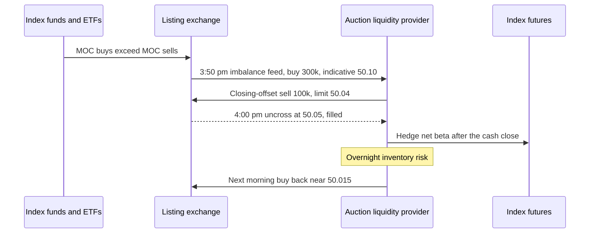

# Auctions and closing liquidity

> **TL;DR**
>
> - In the [closing auction](../../09-reference/glossary.md#closing-auction), index funds, ETFs and benchmarked managers trade at whatever price clears. When their orders don't balance, someone with balance sheet takes the other side.
> - Auction liquidity providers read the published imbalance, offer the other side and earn the price concession, which reverts "quickly and almost completely" on average (Bogousslavsky & Muravyev 2023) `[Verified]`.
> - The close keeps growing: about 3.1% of dollar volume in 2010, a record 9.4% of notional in Q2 2024, about 20% on rebalance days `[Reported]`. Nasdaq's cross printed a record $334B on the June 2026 Russell reconstitution `[Reported]`.
> - Edge per share is small; the risk is overnight inventory and informed imbalances. Trading to move the close is manipulation.

**Level:** Core · **Read time:** ~7 min · **Last verified:** 2026-11

| Field | Value |
|---|---|
| Family | liquidity provision |
| Edge source | liquidity provision · structural/regulatory |
| Holding period | overnight to a few days |
| Counterparty: who pays and why they accept it | Index funds, ETFs and benchmarked managers that must trade at the official close: tracking error costs them more than a few bps of price, so they concede price to whoever absorbs the imbalance. |
| Universe & instruments | US-listed stocks and ETFs, heaviest on index events; futures as hedges |
| Data required | real-time imbalance feeds; index event calendars; auction and next-day price history |
| Core algorithms used | [E5 Auction, close and dark-liquidity algos](../../03-algorithms/e-execution-algorithms/auction-close-and-dark-liquidity-algos.md) · [M4 Quoting and inventory control](../../03-algorithms/f-market-making-and-hft-algorithms/quoting-and-inventory-control.md) · [M5 Adverse selection and markouts](../../03-algorithms/f-market-making-and-hft-algorithms/adverse-selection-and-markouts.md) · [P5 Transaction cost and impact models](../../03-algorithms/d-portfolio-construction/transaction-cost-and-impact-models.md) |
| Infra intensity | moderate: one-second imbalance updates, hard cutoffs, an overnight risk model |
| Capacity (rough $ range) | $50M to $500M of overnight inventory per large provider per day, more on event days `[Estimate]` (imbalances are a few percent of $50B+ of daily closing notional) |
| Typical Sharpe (gross vs net) | no public figures; positive on most event days with a fat left tail from news after the cutoff `[Lore]` |
| Turnover | about 100% of inventory per day |
| Main risks / failure modes | overnight gaps, informed imbalances, crowded event days, manipulation exposure |
| Crowding risk | high on known index events: everyone sees the same feed |
| Firm types that run it | electronic market makers, NYSE designated market makers, bank facilitation desks, stat-arb funds trading index events |
| Lab | — |

## Intuition (the story in plain English)

At 3:50 p.m. NYSE publishes: "XYZ, 300,000 shares to buy at the close, indicative $50.10." The buyers are mostly index funds that must own XYZ at the 4:00 print, whatever it is. Someone has to sell 300,000 shares they may not own and carry the short overnight. That someone sets the closing price, and is paid by selling a few cents above where XYZ will trade tomorrow morning.

## Economic rationale: why should this make money at all?

Grossman and Miller (1988): liquidity providers earn a price concession for carrying inventory until the offsetting trader arrives. Closing demand is the cleanest case: mechanical, scheduled, price-insensitive. US equity index funds passed active funds in assets in August 2019 `[Reported]`, and closing volume tracks indexing and ETFs, spiking on S&P 500 additions `[Verified]`.

Leveraged ETFs add mechanical flow: they buy after up days and sell after down days near the close (math below).

The concession is small: closing prices typically match pre-close bid or ask prices `[Verified]`. Profit comes from scale and selection.

## The trade, step by step

1. **Forecast:** estimate imbalances from index changes and passive assets before publication.
2. **Read:** after the cutoff (NYSE 3:50, Nasdaq 3:55), track paired shares, [imbalance](../../09-reference/glossary.md#auction-imbalance) and indicative price every second.
3. **Size and price:** expected reversion against overnight risk; send Nasdaq imbalance-only or NYSE closing-offset orders, or [LOC](../../09-reference/glossary.md#limit-on-close-loc) orders.
4. **Hedge** the book's net beta and sectors with futures, which trade after 4:00 p.m.
5. **Unwind** next morning or over days; record close-to-open [markouts](../../09-reference/glossary.md#markout) ([M5](../../03-algorithms/f-market-making-and-hft-algorithms/adverse-selection-and-markouts.md)).

## Worked example with numbers

Illustrative, extending the example in [order types and auctions](../../01-market-structure/order-types-and-auctions.md). XYZ last $50.00; [MOC](../../09-reference/glossary.md#market-on-close-moc) buys 1.2M, MOC sells 0.9M; other sell limits: 100k at $50.02, 150k at $50.05, 200k at $50.10. Alone, the close would print $50.10. We add a 100k sell at limit $50.04.

| Price | Buys | Sells | Matched |
|---|---|---|---|
| 50.04 | 1.20M | 1.10M | 1.10M |
| 50.05 | 1.20M | 1.25M | **1.20M** |
| 50.10 | 1.20M | 1.45M | 1.20M |

The close is $50.05 (maximum volume, smallest surplus); MOC buyers pay $60,000 less. Next morning we buy back at $50.015.

| Line | $ |
|---|---|
| Gross: 100,000 × (50.05 − 50.015) | +3,500 |
| Auction and take fees | −400 |
| Borrow, one night | −35 |
| Futures hedge slippage | −100 |
| **Expected net** | **+2,965** |

One overnight standard deviation of residual risk (1% of $5M) is $50,000, seventeen times the expected profit: the trade works only across hundreds of hedged names.

## Signals and algorithms under the hood

The concession forecast is an [impact model](../../03-algorithms/d-portfolio-construction/transaction-cost-and-impact-models.md); size comes from [inventory control](../../03-algorithms/f-market-making-and-hft-algorithms/quoting-and-inventory-control.md); order mechanics mirror the agency [auction algos](../../03-algorithms/e-execution-algorithms/auction-close-and-dark-liquidity-algos.md).

```python
# How much of a published closing imbalance to absorb (simplified, one stock).
# d = +1 for a buy imbalance (we sell), -1 for a sell imbalance (we buy).
K_IMPACT = 0.8       # P5: square-root impact coefficient, in units of daily vol
REVERT = 0.6         # share of the concession expected to revert by the next open
GAMMA = 2e-6         # risk aversion per $^2 of overnight variance
MAX_PCT_IMB = 0.5    # never absorb more than half the imbalance

def size_auction_offer(msg, s):
    d, imb, px = msg.imb_side, msg.imbalance_shares, msg.ref_price
    concession = K_IMPACT * s.daily_vol[msg.sym] * np.sqrt(imb / s.adv[msg.sym])  # fraction
    edge = REVERT * concession * px - s.fees_per_share                              # $/share
    var = (s.overnight_resid_vol[msg.sym] * px) ** 2           # $^2/share after the beta hedge
    q = edge / (2 * GAMMA * var)                               # mean-variance optimal shares
    q = int(np.clip(q, 0, min(MAX_PCT_IMB * imb, s.risk_room(msg.sym))))   # M4/M9 limits
    limit = px * (1 + d * 0.5 * concession)                    # demand at least half the concession
    order_type = "IO" if msg.listing == "NASDAQ" else "CO"     # imbalance-only / closing offset
    return order_type, -d, q, round(limit, 2)
```

## Implementation choices that matter

- **Timing:** early offsets get priority; late ones see a clearer imbalance. NYSE floor D orders are accepted until 3:59:50 `[Verified]`.
- **Which events:** Russell reconstitution, S&P and MSCI rebalances and expiries; continuation (permanent index effect) differs from reversion by event type `[Lore]`.
- **Hedging:** many names net against each other; futures hedge the rest.
- **Conduct:** sizing must follow from forecast reversion, never from a desire to move the print.

## P&L decomposition

Illustrative provider absorbing $300M of imbalances a day, $75B a year.

| Line | bps | $M/yr |
|---|---|---|
| Concession captured (fill vs exit) | +6.0 | +45.0 |
| Informed or continuing imbalances | −2.4 | −18.0 |
| Fees | −0.8 | −6.0 |
| Hedge slippage | −0.4 | −3.0 |
| Borrow and financing | −0.2 | −1.5 |
| Tail events, amortized | −0.6 | −4.5 |
| **Net** | **+1.6** | **+12.0** |

## Evidence

- **Size of the close:** about 3.1% of dollar volume (2010) → 7.5% (2018) → record 9.4% of notional in Q2 2024; 2025 monthly 5–10% of share volume `[Reported]`.
- **Reversion:** auction price deviations revert quickly and almost completely, on average (Bogousslavsky & Muravyev 2023, *JFM*) `[Verified]`.
- **Events:** Nasdaq's June 26, 2026 Russell cross executed 4.59B shares, $334.0B `[Reported]`. Russell went semi-annual in 2026; the next reconstitution takes effect after the close on 2026-12-11 `[Verified]`.
- **Manipulation detection:** Comerton-Forde & Putniņš (2011) build an index of closing-price manipulation from prosecuted cases `[Verified]`.

## Capacity, crowding and decay

Capacity scales with imbalances, so it grows with passive assets and peaks on a few event days a year, which is also when every provider is present and concessions shrink. Semi-annual Russell reconstitution adds an event but may split the flow.

## How it fails

- **Informed imbalance:** news after the cutoff makes the concession permanent.
- **Crowded events:** too many offsets flip the imbalance and the close prints against providers.
- **Manipulation:** in 2009 Athena Capital Research traded so heavily in the last two seconds (over 70% of Nasdaq volume in the affected stocks) that it moved closing prices in favor of its imbalance orders; it settled with the SEC in October 2014 for $1M `[Verified]`. In 2015 the D.C. Circuit upheld marking-the-close findings against an adviser (*Koch v. SEC*) `[Verified]`.

## Textbook vs how it's done today

- **Textbook:** an auction is a single uncross. **Practice:** the last ten minutes are a continuous game played on one-second imbalance updates ([order types and auctions](../../01-market-structure/order-types-and-auctions.md)).
- **Textbook:** price-insensitive demand earns providers big concessions. **Practice:** competition keeps closing prices near the pre-close quotes `[Verified]`; profit is thin per share.

## Variants and neighbours

Opening-auction liquidity on overnight news; [flow-driven strategies](../d-mid-frequency-alpha/flow-driven-strategies.md) that pre-position for index events; [ETF and index arbitrage](../b-speed-and-structural/etf-and-index-arbitrage.md); bank guaranteed-close risk trades; [intraday patterns](../c-statistical-arbitrage/intraday-patterns-and-seasonality.md).

## Diagram



## How practitioners talk about it

- "The imbalance is 4% of ADV and growing." → Big concession likely; size up.
- "Russell day, everyone's in the cross." → Crowded; concessions shrink.
- "That paired-off by 3:58." → Offsetting interest arrived; the trade vanished.
- "We hold the residual overnight." → Idiosyncratic risk after the futures hedge.
- "Close-to-open markouts were negative this week." → Imbalances were informed or continued.
- "Never trade to the print." → Compliance's warning about marking the close.

## Myths vs reality

- **Myth:** imbalance traders manipulate the close. **Reality:** offsetting imbalances moves the close toward fair value; trading to move it is illegal.
- **Myth:** it's riskless because index flow is predictable. **Reality:** overnight gaps dwarf per-name edge.

## Questions you could ask a quant about this

- *Basic:* What share of your closing fills come on index event days?
- *Informed:* How do you separate mechanical imbalances from informed ones?
- *Informed:* What is your close-to-open markout by event type?
- *Sharp:* How do you show compliance your late orders don't target the print?
- *Sharp:* 🔒 Your imbalance forecast error before publication?

## Go deeper

<details markdown="1">
<summary>Math: the uncross, optimal absorption, and leveraged-ETF rebalancing</summary>

**Uncross.** $p^* = \arg\max_p \min\{B(p), S(p)\}$; ties go to the smallest surplus $|B(p) - S(p)|$.

**Absorption.** Expected concession $c = k\,\sigma_d\sqrt{Q/\text{ADV}}$; edge per share $e = \rho\,c\,p - f$; residual overnight variance $v = (\sigma_{on}\,p)^2$. Maximizing $q e - \gamma q^2 v$ gives

$$
q^* = \frac{e}{2\gamma v}.
$$

**Leveraged ETFs.** A fund with assets $A$ holds $LA$. After return $r$ it holds $LA(1+r)$ but needs $LA(1+Lr)$, so it trades

$$
\Delta = A\,L\,(L-1)\,r .
$$

Illustrative: $10B of 3× funds on a +2% day buy 10 × 3 × 2 × 0.02 = $1.2B into the close `[Estimate]`.

</details>

## Related pages

- [Order types and auctions](../../01-market-structure/order-types-and-auctions.md)
- [E5 Auction, close and dark-liquidity algos](../../03-algorithms/e-execution-algorithms/auction-close-and-dark-liquidity-algos.md)
- [Flow-driven strategies](../d-mid-frequency-alpha/flow-driven-strategies.md)
- [Walkthrough: executing a $500M buy order](../../03-algorithms/h-end-to-end-walkthroughs/walkthrough-institutional-execution.md)
- [Rules that shape strategies](../../06-risk-and-regulation/rules-that-shape-strategies.md)

## Sources

- [Verified] Bogousslavsky, V. & Muravyev, D. (2023). "Who trades at the close? Implications for price discovery and liquidity." *Journal of Financial Markets* 66, 100852. <https://doi.org/10.1016/j.finmar.2023.100852> (accessed 2026-11)
- [Verified] Grossman, S. J. & Miller, M. H. (1988). "Liquidity and Market Structure." *Journal of Finance* 43(3), 617–633. <https://doi.org/10.1111/j.1540-6261.1988.tb04594.x> (accessed 2026-11)
- [Verified] Comerton-Forde, C. & Putniņš, T. J. (2011). "Measuring closing price manipulation." *Journal of Financial Intermediation* 20(2), 135–158. <https://doi.org/10.1016/j.jfi.2010.03.003> (accessed 2026-11)
- [Verified] SEC (2014-10-16). "SEC Charges New York-Based High Frequency Trading Firm With Fraudulent Trading to Manipulate Closing Prices," press release 2014-229. <https://www.sec.gov/news/press-release/2014-229> (accessed 2026-11)
- [Verified] U.S. Court of Appeals for the D.C. Circuit (2015-07-14). *Koch v. SEC*, No. 14-1134. <https://law.justia.com/cases/federal/appellate-courts/cadc/14-1134/14-1134-2015-07-14.html> (accessed 2026-11)
- [Verified] FTSE Russell (2026-09-01). "FTSE Russell announces December 2026 Russell US Indexes Reconstitution schedule." <https://www.lseg.com/en/media-centre/press-releases/ftse-russell/2026/ftse-russell-announces-december-2026-russell-us-indexes-reconstitution-schedule> (accessed 2026-11)
- [Reported] Nasdaq (2026-06-26). "Record Trading Volume on the Nasdaq Closing Cross During the June 2026 Russell US Indexes Reconstitution" (republished). <https://mondovisione.com/news/record-trading-volume-on-the-nasdaq-closing-cross-during-the-june-2026-russell-u-2026626/> (accessed 2026-11)
- [Reported] NYSE Research (2024-08-29). "NYSE Closing Auction: price discovery opportunities reach new highs." <https://nyse.com/data-insights/nyse-closing-auction-price-discovery-opportunities-reach-new-highs> (accessed 2026-11)
- [Reported] BMLL (2024). "Into the Close: Unpacking U.S. Closing Auction Dynamics and the Impact of the Russell Reconstitution." <https://www.bmlltech.com/news/market-insight/into-the-close-unpacking-u-s-closing-auction-dynamics-and-the-impact-of-the-russell-reconstitution> (accessed 2026-11)
- [Reported] Rosenblatt Securities (2026-01). "US Securities Volumes: 2025 Year in Review." <https://www.rblt.com/market-structure-reports/us-securities-volumes-2025-year-in-review> (accessed 2026-11)
- [Reported] ThinkAdvisor (2019-09-20). "Passive Overtakes Active in US Stock-Fund Assets: Morningstar." <https://www.thinkadvisor.com/2019/09/20/passive-overtakes-active-in-us-stock-fund-assets-morningstar/> (accessed 2026-11)
- [Verified] NYSE (n.d.). "NYSE Auctions: Closing Process Fact Sheet." <https://www.nyse.com/publicdocs/nyse/NYSE_Auctions_Closing_Process_Fact_Sheet.pdf> (accessed 2026-11)
