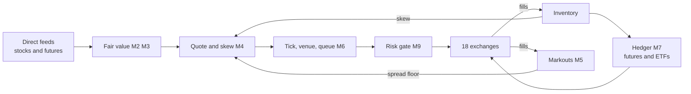
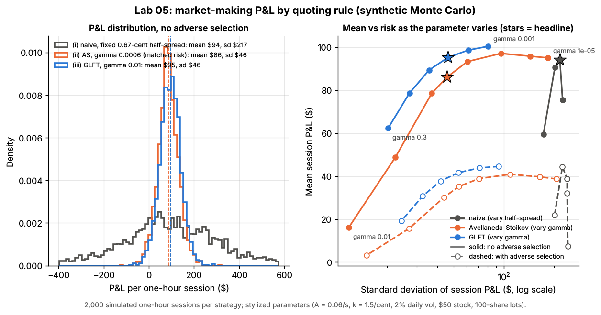
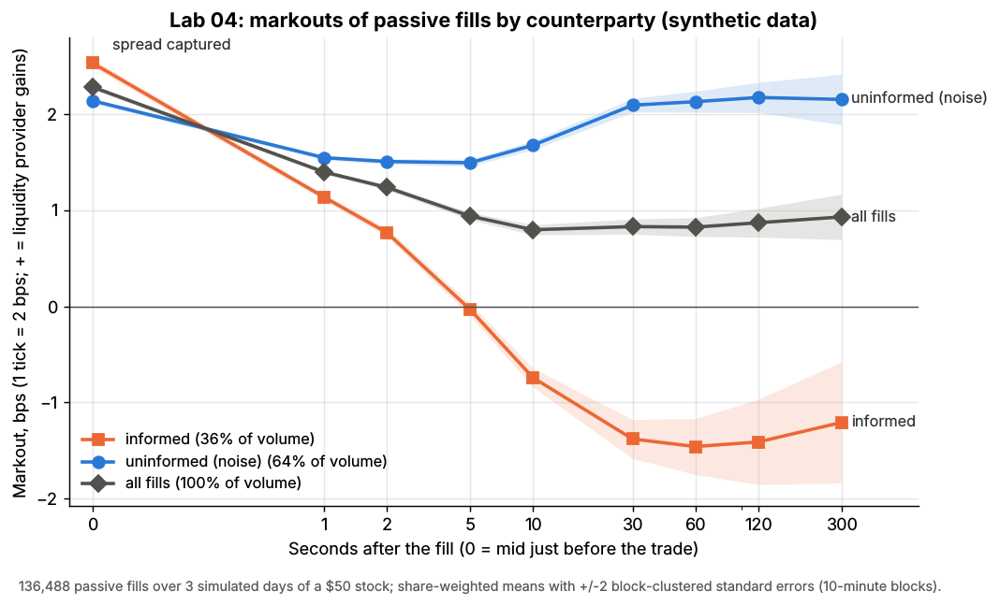
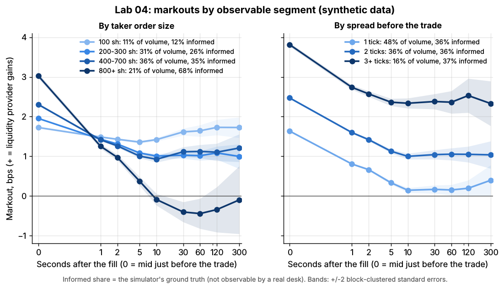
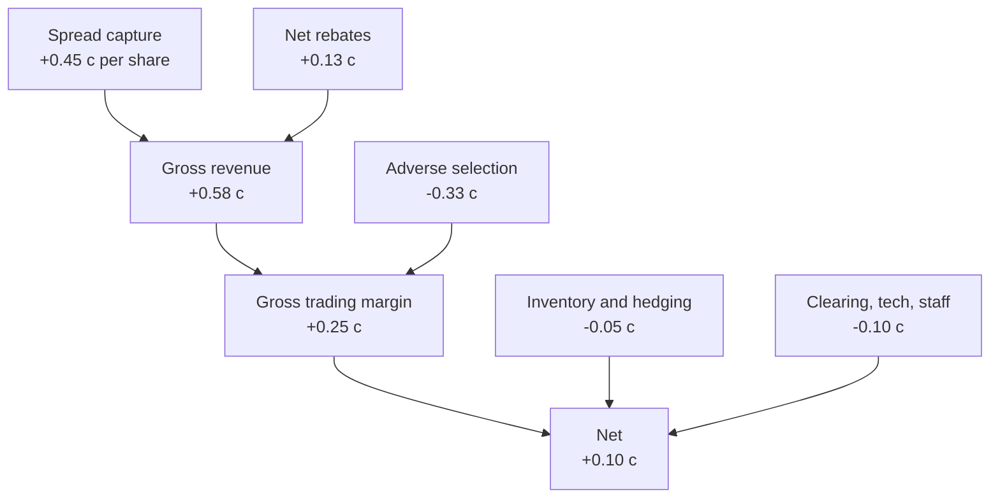

# Equity market making

> **TL;DR**
>
> - Electronic market makers quote both sides of thousands of US stocks, earn the half-spread plus rebates, and pay [adverse selection](../../09-reference/glossary.md#adverse-selection) to informed traders. Net margin is about a tenth of a cent per share `[Estimate]`.
> - Menkveld (2013): one HFT market maker earned €0.88 gross per trade, a €1.55 net spread less a €0.68 loss on positions; gross Sharpe 9.35 `[Verified]`.
> - The edge is fair value, speed (cancelling stale quotes in time) and cost per share, more than the quoting formula. Lab 05 (synthetic): adverse selection cuts an optimal quoter from \$95 to \$42 an hour; faster cancels recover \$68.
> - It fails through adverse-selection spikes, technology errors (Knight Capital, over \$460M in 45 minutes, 2012 `[Verified]`) and volatility events. The half-penny tick and 10-mil fee cap, delayed to November 2027 `[Verified]`, would reprice it.

**Level:** Core · **Read time:** ~12 min · **Last verified:** 2026-11

| Field | Value |
|---|---|
| Family | liquidity provision |
| Edge source | liquidity provision · speed |
| Holding period | seconds to minutes; mostly flat or hedged overnight `[Lore]` |
| Counterparty: who pays and why they accept it | Impatient liquidity demanders (execution algos, rebalancers, routed retail orders) pay the half-spread for immediacy, because waiting costs them more in drift and leakage. Informed traders and latency arbitrageurs also trade against the market maker and win; uninformed flow pays for them. |
| Universe & instruments | NMS stocks and ETFs on 18 exchanges `[Reported]`; index futures and ETFs as hedges |
| Data required | order-by-order feeds from every exchange and CME; own fills with hardware timestamps; fee tiers; borrow lists |
| Core algorithms used | [M2 Fair value and microprice](../../03-algorithms/f-market-making-and-hft-algorithms/fair-value-and-microprice.md) · [M4 Quoting and inventory control](../../03-algorithms/f-market-making-and-hft-algorithms/quoting-and-inventory-control.md) · [M5 Adverse selection and markouts](../../03-algorithms/f-market-making-and-hft-algorithms/adverse-selection-and-markouts.md) · [M6 Queue position and order placement](../../03-algorithms/f-market-making-and-hft-algorithms/queue-position-and-order-placement.md) · [M7 Hedging algorithms](../../03-algorithms/f-market-making-and-hft-algorithms/hedging-algorithms.md) · [M9 Algorithmic risk controls](../../03-algorithms/f-market-making-and-hft-algorithms/algorithmic-risk-controls.md) |
| Infra intensity | extreme: New Jersey colocation, FPGAs or kernel-bypass software, microwave to Chicago |
| Capacity (rough $ range) | P&L-limited, not capital-limited: US equity market making nets roughly \$1–3B a year industry-wide `[Estimate]` (17.6B shares/day × 50–70% with a market maker on one side × 0.05–0.10¢ net per share × 250 days) |
| Typical Sharpe (gross vs net) | Not meaningful on capital. Menkveld's market maker: gross 9.35 annualized on maximum capital, 5.88 charging a 6% premium (Dutch stocks 2007–2008, academic case study) `[Verified]`. Virtu's 2014 IPO filing: one losing day in 1,238 `[Reported]`. Net of technology lower; margins compressed since `[Lore]` |
| Turnover | extreme: Menkveld's market maker traded 1,397 times per stock per day `[Verified]` |
| Main risks / failure modes | adverse-selection spikes, technology failure, volatility events, factor exposure, tick and fee rules |
| Crowding risk | high: a few firms race for the same queue spots |
| Firm types that run it | [principal trading firms](../../09-reference/glossary.md#proprietary-trading-firm) and electronic market makers (Virtu, a listed company `[Reported]`); NYSE [designated market makers](../../09-reference/glossary.md#designated-market-maker-dmm); exchange-registered market makers; [wholesalers](../../09-reference/glossary.md#wholesaler) off-exchange |
| Lab | [Lab 05](https://github.com/FrankHuang94/quant_trading_claude/tree/main/labs/05-avellaneda-stoikov-glft-quoting) · [Lab 04](https://github.com/FrankHuang94/quant_trading_claude/tree/main/labs/04-markout-analysis) |

## Intuition (the story in plain English)

A [market maker](../../09-reference/glossary.md#market-making) is a shop that buys at the bid and sells at the offer all day, aiming to hold nothing for long. Most customers are in a hurry and know nothing special; a few know the price is about to move. The job is to earn more from the first group than you lose to the second. Today it runs across thousands of stocks and 18 exchanges in microseconds, and fees of a fraction of a cent decide whether a trade made money.

## Economic rationale: why should this make money at all?

Three costs set the spread. **Adverse selection:** Glosten & Milgrom (1985) show a dealer facing some informed traders must quote wide enough that uninformed flow covers losses to the informed `[Verified]`. **Inventory risk:** a dealer who must hold positions demands compensation (Ho & Stoll 1981) `[Verified]`. **Processing:** technology, fees, clearing. With competition the spread settles at the marginal market maker's cost, so profit goes to the firms with the lowest costs: the best [fair value](../../09-reference/glossary.md#fair-value) (fewer pick-offs), the fastest cancels and the most scale. Speed improves HFT performance partly through better risk management, not just sniping (Baron et al. 2019) `[Verified]`.

## The trade, step by step

1. **Fair value** per stock: [microprice](../../09-reference/glossary.md#microprice) plus signals from futures, ETFs and sector peers ([M2](../../03-algorithms/f-market-making-and-hft-algorithms/fair-value-and-microprice.md), [M3](../../03-algorithms/f-market-making-and-hft-algorithms/order-book-and-trade-flow-signals.md)).
2. **Quotes:** center at fair value minus an inventory skew; width at least expected markout plus fees ([M4](../../03-algorithms/f-market-making-and-hft-algorithms/quoting-and-inventory-control.md)). Snap to the tick and choose venue and queue ([M6](../../03-algorithms/f-market-making-and-hft-algorithms/queue-position-and-order-placement.md)).
3. **Risk gate** ([M9](../../03-algorithms/f-market-making-and-hft-algorithms/algorithmic-risk-controls.md)), then orders out.
4. **Fills:** update inventory; log [markouts](../../09-reference/glossary.md#markout) at 1–300 seconds ([M5](../../03-algorithms/f-market-making-and-hft-algorithms/adverse-selection-and-markouts.md)).
5. **Hedge:** net the book's beta and sector exposure and offset it with index futures or ETFs ([M7](../../03-algorithms/f-market-making-and-hft-algorithms/hedging-algorithms.md)).
6. **Inventory:** stock-specific residuals are worked off through skew; by the close the book is flat or hedged, sometimes via the [closing auction](auctions-and-closing-liquidity.md).



## Worked example with numbers

Illustrative: a \$40 [tick-constrained](../../09-reference/glossary.md#tick-constrained-stock) stock quoted \$39.99 × \$40.00 (mid \$39.995), maker rebate 0.25¢, take fee 0.30¢. The market maker's 300-share bid is hit by a seller who knows something; the market drops two ticks to \$39.97 × \$39.98. It skews: pulls its bid, sells 200 shares passively at \$39.98, then 100 aggressively at \$39.97.

| Line | Calculation | \$ |
|---|---|---|
| Spread capture | 300 × 0.5¢ + 200 × 0.5¢ − 100 × 0.5¢ (each fill vs mid) | +2.00 |
| Rebates and fees | (300 + 200) × 0.25¢ − 100 × 0.30¢ | +0.95 |
| Mid move on inventory | 300 × (39.975 − 39.995) | −6.00 |
| **Round trip** | cash −\$4.00 plus fees \$0.95 | **−3.05** |

A benign round trip (buy 300 at \$39.99, sell 300 at \$40.00, mid unchanged) earns \$3.00 of spread plus \$1.50 of rebates: +\$4.50. If 40% of round trips are toxic like the first, the expectation is 0.6 × 4.50 − 0.4 × 3.05 = \$1.48 per 600 shares, 0.25¢ a share before hedging, clearing and technology.

## Signals and algorithms under the hood

The loop is [M1](../../03-algorithms/f-market-making-and-hft-algorithms/anatomy-of-an-hft-trading-loop.md). The requote below calls Lab 05's `glft_quotes`, floored by markouts as computed in Lab 04.

```python
# One requote for one stock (simplified). Units as in Lab 05: cents/share, 100-share lots.
def requote(stock, s, p):
    fair = s.microprice(stock) + s.signals.predict_cents(stock)     # M2/M3: fair value, not the mid
    q = s.inventory[stock] - s.hedged_lots(stock)                    # M7: factor part already hedged
    d_bid, d_ask = glft_quotes(q, p.gamma, s.sigma[stock], p.A, p.k, p.q_max)   # M4, Lab 05
    floor = s.exp_markout[stock] + s.fee_net_of_rebate(stock)        # M5: e.g. 60 s markout, cents
    bid = floor_to_tick(fair - max(d_bid, floor))                     # M6: 1-cent grid
    ask = ceil_to_tick(fair + max(d_ask, floor))
    if s.risk.ok(stock, bid, ask):                                    # M9: limits, collars, kill switch
        s.gateway.replace(stock, bid, ask, size=p.clip)

def on_fill(fill, s):
    s.inventory[fill.stock] += fill.signed_lots
    s.fills.append(fill)        # Lab 04 markouts(): side * (mid(t + h) - price) / price, h = 0..300 s
    s.hedger.update(s.inventory)                                      # M7: beta-weighted net -> futures
```



*Lab 05, synthetic. GLFT and naive quoting have similar means but naive's outcomes are far wider; with informed traders (dashed) every rule earns about half.*

Synthetic lab result: GLFT earns \$95 an hour (sd \$46) against naive's \$94 (sd \$217). With sniping, GLFT's spread capture *rises* to \$120 while adverse selection costs \$79, leaving \$42; cancelling half of stale quotes lifts it to \$68. With no rivals, fees or ticks, levels are meaningless; the ranking is the lesson.



*Lab 04, synthetic. Informed fills turn negative after about 5 seconds and settle near −1.5 bps; uninformed fills stay above +2 bps.*

In Lab 04 (synthetic lab result) liquidity providers capture \$77,818 a day of spread, lose \$49,723 to adverse selection at 60 seconds and keep 36%.

## Implementation choices that matter

- **Tick regime.** In one-tick names the game is queue position and rebates; in wide-spread names, price and fair value ([fees, rebates and ticks](../../01-market-structure/fees-rebates-and-ticks.md)).
- **Venue and fee tier.** Maker-taker rebates against inverted venues' paid priority; tiers reward volume concentration.
- **Hedging granularity.** Hedge the book's factors with futures; skew only residuals.
- **Markout horizon and segments.** 1 second misses informed flow; 60 seconds catches it. Size is a toxicity proxy:



*Lab 04, synthetic. 800+ share orders are 68% informed and mark out at −0.45 bps at 60 seconds; 100-share orders keep +1.64 bps.*

- **Short sales.** Bona fide market making is exempt from the Reg SHO [locate](../../09-reference/glossary.md#locate) requirement `[Verified]`, which lets a market maker sell before it owns the stock ([shorting and settlement](../../01-market-structure/shorting-financing-and-settlement.md)).

## P&L decomposition

Illustrative mid-sized lit market maker: 300M shares a day (about 1.7% of 2025 volume), 250 days.

| Line | ¢/share | \$M/yr |
|---|---|---|
| Spread capture (fill vs mid) | +0.45 | +337.5 |
| Exchange rebates net of take fees | +0.13 | +97.5 |
| **Gross revenue** | **+0.58** | **+435.0** |
| Adverse selection (60-second markout) | −0.33 | −247.5 |
| **Gross trading margin** | **+0.25** | **+187.5** |
| Residual inventory P&L | −0.02 | −15.0 |
| Hedging (futures, ETFs) | −0.03 | −22.5 |
| Clearing, regulatory and CAT fees | −0.02 | −15.0 |
| Technology, colocation, data, staff | −0.08 | −60.0 |
| **Net** | **+0.10** | **+75.0** |

Adverse selection, the cost of goods sold, eats 57% of gross revenue. Rebates exceed the net margin, which is why the 10-mil access-fee cap matters.

## Evidence

- **Menkveld (2013):** one HFT market maker in Dutch stocks, 2007–2008. Gross €0.88 per trade = €1.55 net spread − €0.68 positioning loss; positions under five seconds made €0.45, longer ones lost €1.13. About 78% of trades were passive; the passive exchange fee averaged −€0.31 (a rebate) on Chi-X but +€0.68 on Euronext `[Verified]`.
- **Virtu FY2025:** Market Making adjusted net trading income \$1,666M, all asset classes and regions; total adjusted net trading income \$2,145M, up 34% `[Reported]`. That is about \$6.7M per trading day `[Estimate]`.
- **Inventory bites:** NYSE specialist spreads widened when specialists held large positions or lost money (Comerton-Forde et al. 2010) `[Verified]`.

## Capacity, crowding and decay

Capacity is set by volume and spread, not capital. 2025 US volume averaged a record 17.6B shares a day, up 44.6% `[Reported]`; Virtu's 2025 jump came with it. Fixed technology costs and fee tiers favor scale, so a few firms take most of the flow. A half-penny tick would halve the tick rent in the tightest names; the [fees page](../../01-market-structure/fees-rebates-and-ticks.md) works the per-share arithmetic.

## How it fails

- **Adverse-selection spikes.** News or a large informed order turns the markout curve negative across the book; skew lags.
- **Technology failure.** On 2012-08-01 Knight Capital's router turned retail orders into about 397M shares traded in 45 minutes, leaving \$3.5B long and \$3.15B short and a loss over \$460M `[Verified]` ([risk controls](../../03-algorithms/f-market-making-and-hft-algorithms/algorithmic-risk-controls.md)).
- **Volatility events.** On 2010-05-06 many trades executed more than 60% from pre-decline prices, a significant share against stub quotes, and were broken `[Verified]`. On 2015-08-24 there were 1,278 [LULD](../../09-reference/glossary.md#limit-up-limit-down-luld) halts `[Verified]`. See the [failure gallery](../h-cross-cutting/strategy-failure-gallery.md).
- **Correlated inventory.** In a sell-off every name fills on the bid at once; per-name limits look fine while the book is one large long.

## Textbook vs how it's done today

- **Textbook:** a monopolist specialist with obligations. **Today:** competing firms quote voluntarily. Exchange market makers must keep continuous two-sided quotes no further than 8% from the [NBBO](../../09-reference/glossary.md#nbbo) for S&P 500 and Russell 1000 stocks, 20% before 9:45 a.m. and after 3:35 p.m., 30% for others (rules approved in 2010, effective 2010-12-06) `[Verified]`. NYSE DMMs must hold a bid or offer at the NBBO for at least 10% (active stocks) or 15% of the day `[Verified]`.
- **Textbook:** the quoting formula is the strategy. **Practice:** fair value and speed decide P&L `[Lore]`.
- **Textbook:** single-stock inventory. **Practice:** book-level factor hedging `[Lore]`; Menkveld's firm offloaded positions on a second venue `[Verified]`.
- **Rules that bind:** the [Market Access Rule](../../09-reference/glossary.md#market-access-rule) (15c3-5) requires automated pre-trade limits `[Verified]`. The 2024 half-penny tick and 10-mil fee cap are delayed to the first business day of November 2027, and the SEC has proposed repealing the Rule 611 order-protection rule `[Verified]`.

## Variants and neighbours

| Role | Obligation | Page |
|---|---|---|
| NYSE DMM | NBBO presence, runs open and close | [auctions and closing liquidity](auctions-and-closing-liquidity.md) |
| Registered market maker | two-sided quotes within bands | this page |
| Unregistered PTF | none beyond market-access controls | this page; [fee-driven strategies](../b-speed-and-structural/fee-and-microstructure-driven-strategies.md) |
| Wholesaler | best execution off-exchange | [retail flow internalization](retail-flow-internalization.md) |

Also [ETF](etf-market-making.md) and [options market making](options-market-making.md); the opposite side of the race is [latency arbitrage](../b-speed-and-structural/latency-arbitrage.md).

## Diagram



## How practitioners talk about it

- "We're giving it back at 10 seconds." → markouts turn negative within 10 s of fills.
- "We're the back of the queue on Arca." → late in line, so its fills are more often toxic.
- "Rebates are our margin." → net P&L roughly equals rebates; spread minus markout is near zero.
- "Pull everything on an ES move." → cancel quotes when futures jump, before snipers arrive.
- "We're long the market through 400 names." → small per-name inventories add up to one factor bet.
- "What's our p99 to cancel?" → tail latency of pulling quotes, the defense against pick-offs.

## Myths vs reality

- **Myth:** HFT market makers front-run orders. **Reality:** they trade against public orders and lose to the informed ones; Menkveld's firm lost money on its positions `[Verified]`.
- **Myth:** market makers must provide liquidity in crises. **Reality:** obligations are loose bands, not a duty to buy `[Verified]`.

## Questions you could ask a quant about this

- *Basic:* What share of your volume is passive?
- *Basic:* Do you carry inventory overnight?
- *Informed:* At what horizon do you measure markouts, and by which segments?
- *Informed:* How much of net P&L is rebates?
- *Informed:* What would the half-penny tick do to your queue strategy?
- *Sharp:* 🔒 How often do your cancels lose the race in your top 100 names?
- *Sharp:* 🔒 What is your adverse selection as a share of spread capture?

## Go deeper

<details markdown="1">
<summary>Math: break-even spread and the market maker's P&L identity</summary>

If a fraction $\pi$ of takers know the next move $\pm\Delta$, a competitive quoter breaks even at

$$
\frac{s}{2} = \pi\,\Delta + c ,
$$

with $c$ the processing cost per share. For fills at prices $p_i$, signed $d_i$ (+1 bought), with mid $m$:

$$
\text{P\&L} = \underbrace{\sum_i d_i\,(m_{t_i} - p_i)}_{\text{spread capture}} + \text{rebates} + \underbrace{\int q_t\,dm_t}_{\text{inventory and adverse selection}} - \text{costs},
$$

the identity behind Lab 05's income statement and Menkveld's split.

</details>

## Related pages

- [M4 Quoting and inventory control](../../03-algorithms/f-market-making-and-hft-algorithms/quoting-and-inventory-control.md)
- [M5 Adverse selection and markouts](../../03-algorithms/f-market-making-and-hft-algorithms/adverse-selection-and-markouts.md)
- [Retail flow internalization](retail-flow-internalization.md)
- [Fees, rebates and ticks](../../01-market-structure/fees-rebates-and-ticks.md)
- [The limit order book](../../01-market-structure/the-limit-order-book.md)
- [Virtu Financial](../../04-industry-and-firms/firm-profiles/virtu-financial.md)
- [Walkthrough: a day at an ETF market maker](../../03-algorithms/h-end-to-end-walkthroughs/walkthrough-etf-market-maker.md)

## Sources

- [Verified] Menkveld, A. J. (2013). "High frequency trading and the new market makers." *Journal of Financial Markets* 16(4), 712–740. <https://doi.org/10.1016/j.finmar.2013.06.006> (accessed 2026-11)
- [Verified] Menkveld, A. J. (2012-02-06 version). "High Frequency Trading and the New-Market Makers." Tinbergen Institute Discussion Paper 11-076/2 (per-trade, fee and Sharpe figures). <https://papers.tinbergen.nl/11076.pdf> (accessed 2026-11)
- [Reported] Virtu Financial (2026). Fourth quarter and full year 2025 results release. <https://ir.virtu.com/static-files/9eb593ae-ae7d-42bb-baa3-e0cbaa179c6b> (accessed 2026-11)
- [Reported] Business Insider (2014). Coverage of Virtu Financial's S-1: one losing trading day in 1,238. <https://businessinsider.in/everyones-talking-about-the-high-frequency-trading-firm-that-just-had-1-day-of-trading-losses-in-1238-days/amp_articleshow/31849923.cms> (accessed 2026-11)
- [Verified] Baron, M., Brogaard, J., Hagströmer, B. & Kirilenko, A. (2019). "Risk and Return in High-Frequency Trading." *Journal of Financial and Quantitative Analysis* 54(3), 993–1024. <https://doi.org/10.1017/S0022109018001096> (accessed 2026-11)
- [Verified] Glosten, L. R. & Milgrom, P. R. (1985). "Bid, ask and transaction prices in a specialist market with heterogeneously informed traders." *Journal of Financial Economics* 14(1), 71–100. <https://doi.org/10.1016/0304-405X(85)90044-3> (accessed 2026-11)
- [Verified] Ho, T. & Stoll, H. R. (1981). "Optimal dealer pricing under transactions and return uncertainty." *Journal of Financial Economics* 9(1), 47–73. <https://doi.org/10.1016/0304-405X(81)90020-9> (accessed 2026-11)
- [Verified] Comerton-Forde, C., Hendershott, T., Jones, C. M., Moulton, P. C. & Seasholes, M. S. (2010). "Time Variation in Liquidity: The Role of Market-Maker Inventories and Revenues." *Journal of Finance* 65(1), 295–331. <https://doi.org/10.1111/j.1540-6261.2009.01530.x> (accessed 2026-11)
- [Verified] SEC (2010-11-12). Order granting accelerated approval to proposed rule changes to enhance the quotation standards for market makers, 75 FR 69484. <https://www.govinfo.gov/content/pkg/FR-2010-11-12/pdf/2010-28443.pdf> (accessed 2026-11)
- [Verified] SEC (2023-11-13). NYSE notice of filing of proposed enhancements to its DMM program (describes Rule 104(a)(1) quoting requirements), 2023-24868. <https://www.govinfo.gov/content/pkg/FR-2023-11-13/pdf/2023-24868.pdf> (accessed 2026-11)
- [Verified] 17 CFR 240.15c3-5, "Risk management controls for brokers or dealers with market access." Legal Information Institute. <https://www.law.cornell.edu/cfr/text/17/240.15c3-5> (accessed 2026-11)
- [Verified] 17 CFR 242.203, "Borrowing and delivery requirements" (Reg SHO locate rule). eCFR. <https://www.ecfr.gov/current/title-17/section-242.203> (accessed 2026-11)
- [Verified] SEC (2013-10-16). In the Matter of Knight Capital Americas LLC, Release No. 34-70694. <https://www.sec.gov/litigation/admin/2013/34-70694.pdf> (accessed 2026-11)
- [Verified] SEC (2026-06-11). Order granting temporary exemptive relief (Rules 610(c) and 612 compliance to November 2027), Release No. 34-105656. <https://www.sec.gov/files/rules/exorders/2026/34-105656.pdf> (accessed 2026-11)
- [Reported] Morrison Foerster (2026-06-12). "SEC Proposes Landmark Rollback of Core Regulation NMS Requirements and Delays Implementation of 2024 Market Structure Reforms." <https://www.mofo.com/resources/insights/260612-sec-proposes-landmark-rollback-of-core-regulation> (accessed 2026-11)
- [Verified] Cboe Global Markets (2026). "2025 U.S. Equities Year in Review." <https://www.cboe.com/insights/posts/2025-u-s-equities-year-in-review> (accessed 2026-11)
