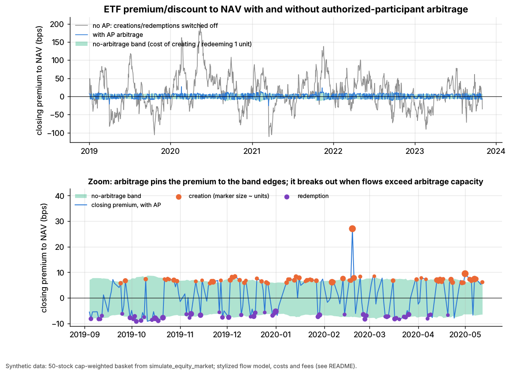
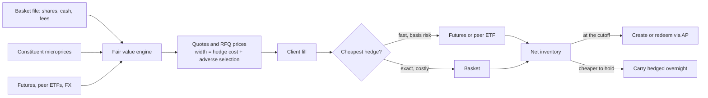
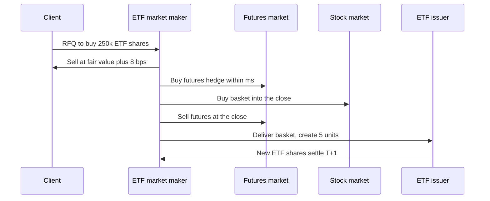

# ETF market making

> **TL;DR**
>
> - ETF market makers quote off their own **fair value**, built from the basket, futures and correlated ETFs: hedge cost plus a small margin.
> - Inventory is hedged at once and netted at the close by creation or redemption: spread capture minus hedge, creation and financing costs.
> - Margins are thin, scale concentrated: Flow Traders made €485.8M of net trading income on €1,940bn of ETP value traded in 2025, ~2.5 bps `[Reported]`; Jane Street reportedly did 24% of US ETF primary-market activity in 2024 `[Reported]`.
> - When the basket is stale or shut (bond ETFs in 2020, Greece in 2015), the ETF becomes the price; the market maker prices the fund, not its NAV.
> - It fails when hedges cannot be priced: 24 August 2015 saw 1,058 LULD halts in 327 ETPs `[Verified]`.

**Level:** Core · **Read time:** ~11 min · **Last verified:** 2026-11

| Field | Value |
|---|---|
| Family | liquidity provision |
| Edge source | liquidity provision · structural/regulatory |
| Holding period | seconds to hours (hedged at once); the net residual is created or redeemed at the close |
| Counterparty: who pays and why they accept it | Investors wanting a basket in one ticket (advisers, retail, institutions, hedgers) and block traders buying immediate risk transfer: the spread is cheaper than trading hundreds of stocks or OTC bonds. |
| Universe & instruments | US-listed equity, bond and commodity ETFs and their baskets; ES, NQ, RTY and Treasury futures; peer ETFs; FX |
| Data required | daily basket files; constituent, futures and FX feeds; bond prices and TRACE |
| Core algorithms used | [M2 Fair value and microprice](../../03-algorithms/f-market-making-and-hft-algorithms/fair-value-and-microprice.md) · [M4 Quoting and inventory control](../../03-algorithms/f-market-making-and-hft-algorithms/quoting-and-inventory-control.md) · [M7 Hedging algorithms](../../03-algorithms/f-market-making-and-hft-algorithms/hedging-algorithms.md) · [P5 Transaction cost and impact models](../../03-algorithms/d-portfolio-construction/transaction-cost-and-impact-models.md) |
| Infra intensity | high: low-latency quoting on thousands of tickers, heavy reference data, RFQ systems |
| Capacity (rough $ range) | P&L-limited: hundreds of \$M to ~\$2B a year for a top US book `[Estimate]` (2.5 bps on Jane Street's reported ~\$8.5T 2024 ETF volume, an upper bound) |
| Typical Sharpe (gross vs net) | No strategy disclosure. Annualized gross Sharpe said to exceed 3 for diversified books `[Lore]`. Net, firm level: Flow Traders' 2025 EBITDA margin 41%, Q4 NTI −20% year on year `[Reported]`. Margins compressed, not gone. |
| Turnover | very high: inventory turns many times a day |
| Main risks / failure modes | unpriceable baskets (halts, closed markets), hedge basis breaks, informed flow, balance-sheet limits, basket-file errors |
| Crowding risk | high in the largest funds (one-tick spreads); lower in bond, international and niche ETFs |
| Firm types that run it | electronic market makers acting as lead market makers and APs; bank APs. Sourced: Flow Traders, Jane Street; Virtu, Citadel Securities, HRT gaining AP share `[Reported]` |
| Lab | [Lab 07](https://github.com/FrankHuang94/quant_trading_claude/tree/main/labs/07-etf-nav-arbitrage) |

## Intuition (the story in plain English)

At 10:30 a pension fund asks for a price on \$20M of a small-cap ETF. No seller is needed. The market maker sells shares it doesn't own, a few basis points above [fair value](../../09-reference/glossary.md#fair-value), and hedges within milliseconds with index futures, a correlated ETF or the stocks. By the close it holds the basket and [creates](../../09-reference/glossary.md#creation-and-redemption) the ETF shares it owes.

It is a wholesaler: it buys in bulk through the primary market and sells retail as ETF shares. Competition pushes the quote down to the cheapest hedge's cost.

## Economic rationale: why should this make money at all?

Investors pay for immediacy and packaging. Each quote prices the hedge, expected [adverse selection](../../09-reference/glossary.md#adverse-selection), [inventory risk](../../09-reference/glossary.md#inventory-risk) until hedged, and a margin. Creation and redemption cap the premium at the all-in cost of the primary market, the no-arbitrage band ([ETF and index arbitrage](../b-speed-and-structural/etf-and-index-arbitrage.md)). Market making happens inside that band.

The structural edge is access. Only an [authorized participant](../../09-reference/glossary.md#authorized-participant) (AP) can create and redeem. Exchanges pay [lead market makers](../../09-reference/glossary.md#lead-market-maker-lmm) credits tied to quoting obligations; FINRA Rule 5250 generally bars issuers from paying market makers directly `[Reported]`.

## The trade, step by step

1. **Pre-open:** load basket files (shares per [creation unit](../../09-reference/glossary.md#creation-unit), cash, fees, cutoffs).
2. **Fair value:** recompute from constituent microprices; roll stale, closed or OTC constituents forward with futures, peer ETFs and FX ([M2](../../03-algorithms/f-market-making-and-hft-algorithms/fair-value-and-microprice.md)).
3. **Quote:** width = hedge cost + adverse selection; center skewed by inventory ([M4](../../03-algorithms/f-market-making-and-hft-algorithms/quoting-and-inventory-control.md)). Answer RFQs.
4. **Hedge each fill** in the cheapest instrument, given its basis risk ([M7](../../03-algorithms/f-market-making-and-hft-algorithms/hedging-algorithms.md)).
5. **Net and roll:** offsetting flow cancels; futures hedges become basket in the [closing auction](../../09-reference/glossary.md#closing-auction).
6. **Primary market:** create or redeem the net residual in whole units, or carry it hedged overnight.

## Worked example with numbers

Illustrative. Small-cap index ETF, fair value \$80.00, creation unit 50,000 shares (\$4M). A client buys 250,000 shares (\$20M, five units) on an RFQ.

| Step | Calculation | P&L |
|---|---|---|
| Sell ETF at fair value + 8 bps | 250,000 × (\$80.064 − \$80.000) | +\$16,000 |
| Buy ~170 E-mini Russell 2000 futures at once (\$120,000 each) | 0.5 bp on \$20M | −\$1,000 |
| Buy the 2,000-stock basket into the close | half-spreads + impact ≈ 4 bps on \$20M | −\$8,000 |
| Sell the futures back at the close | 0.5 bp on \$20M | −\$1,000 |
| Create five units | fixed fee, illustrative | −\$1,500 |
| **Net** | | **+\$4,500 ≈ 2.25 bps** |

The quote was hedge cost (5.75 bps) plus 2.25 bps of margin. A 100,000-share seller at 14:00 would net two units internally and save their basket cost. SPY's fee is the lower of \$3,000 or 10 bps of a unit, per participant per day `[Verified]`.

## Signals and algorithms under the hood

[Fair value](../../03-algorithms/f-market-making-and-hft-algorithms/fair-value-and-microprice.md) feeds [quoting](../../03-algorithms/f-market-making-and-hft-algorithms/quoting-and-inventory-control.md) inside an [HFT loop](../../03-algorithms/f-market-making-and-hft-algorithms/anatomy-of-an-hft-trading-loop.md); [hedging](../../03-algorithms/f-market-making-and-hft-algorithms/hedging-algorithms.md) routes offsets, [cost models](../../03-algorithms/d-portfolio-construction/transaction-cost-and-impact-models.md) price the band, [markouts](../../03-algorithms/f-market-making-and-hft-algorithms/adverse-selection-and-markouts.md) police flow and [risk controls](../../03-algorithms/f-market-making-and-hft-algorithms/algorithmic-risk-controls.md) cap exposure.

```python
import numpy as np
# nav() and the band follow Lab 07's CORE ALGORITHM (same names; +units = create).
# Stale-price roll-forward, quote width and skew are simplified additions.

def nav(prices, basket_shares, cash_per_unit, cu_size=50_000):
    return (np.asarray(prices) @ np.asarray(basket_shares) + cash_per_unit) / cu_size

def fair_value(last_px, basket_shares, cash, stale, proxy_ret, beta):
    # Roll stale or closed constituents forward by their proxy-implied move (futures, ETFs, FX)
    px = np.where(stale, last_px * (1.0 + beta * proxy_ret), last_px)
    return nav(px, basket_shares, cash)

def etf_quotes(fv, hedge_cost_bps, create_cost_bps, redeem_cost_bps, inv_units,
               adverse_bps=0.5, skew_bps_per_unit=0.4):
    half = hedge_cost_bps + adverse_bps             # cost of laying off the risk now
    center = -skew_bps_per_unit * inv_units         # short ETF -> lift both quotes
    bid_bps = max(center - half, -redeem_cost_bps)  # arbitrage bounds the quote: beyond
    ask_bps = min(center + half, create_cost_bps)   # the band an AP would undercut us
    return fv * (1 + bid_bps / 1e4), fv * (1 + ask_bps / 1e4)

def end_of_day_units(inv_units):
    # Net ETF inventory at the cutoff goes to the primary market in whole units
    return -int(np.round(inv_units))                # short 5 units -> create +5
```



*Synthetic data. Without creations and redemptions (grey) the premium wanders by ±100 bps; arbitrage (blue) pins it to the band edges. The lab has only end-of-day arbitrage; intraday market makers pull real liquid ETFs well inside the band.*

In Lab 07, arbitrage cuts the premium's standard deviation from 45.7 to 6.7 bps and its half-life from 10.8 to 0.7 days (synthetic lab result). Real liquid funds, with intraday market making, are tighter still.

## Implementation choices that matter

Fair value depends on what the basket is doing during US hours:

| ETF type | Basket during US hours | Fair-value inputs | Usual hedge |
|---|---|---|---|
| US large-cap, sector | live | microprices, ES, NQ | futures, SPY, basket |
| US small-cap | live, wide spreads | RTY, correlated ETFs, basket | futures, basket at close |
| International | closed (Asia), or closes 11:30 ET (Europe) | futures, ADRs, FX, peer ETFs | futures plus FX |
| Corporate bond | OTC, stale evaluated prices | Treasury futures, TRACE, peer ETFs | futures, peer ETFs |

- **Hedge-cost-aware fair value.** A desk hedging in futures marks the ETF partly to futures: fair value is where risk can be laid off, not NAV `[Lore]`.
- **Carry or create.** Carrying overnight costs financing and basis risk but may net against tomorrow's flow.
- **Custom baskets.** SEC Rule 6c-11 (2019) allows negotiated baskets under written policies `[Verified]`. Bond ETFs use cash plus a subset of bonds to steer AP activity (Koont, Ma, Pástor & Zeng 2025) `[Verified]`.

## P&L decomposition

Illustrative, in bps of ETF value traded, calibrated so the EBITDA margin matches Flow Traders' 41% `[Estimate]`.

| Line | bps |
|---|---|
| Spread capture (gross, vs fair value) | +4.0 |
| Exchange rebates and lead-market-maker credits | +0.3 |
| Adverse selection ([markout](../../09-reference/glossary.md#markout) losses) | −1.0 |
| Hedge execution (futures, basket, ETF) | −0.8 |
| Exchange and clearing fees | −0.2 |
| Financing, borrow, overnight carry | −0.2 |
| Creation and redemption fees | −0.1 |
| **Net trading income** | **+2.0** |
| Staff, technology, market data | −1.2 |
| **EBITDA** | **+0.8** |

## Evidence

- **Flow Traders, FY2025:** net trading income €485.8M (+4%), EBITDA €198.9M (41% margin), net profit €133.6M; ETP value traded €1,940bn, up 26% `[Reported]`. NTI over value traded ≈ 2.5 bps `[Estimate]` (NTI includes non-ETP lines). The Americas were only €40.9M of €283.6M NTI in H1 2025 `[Reported]`.
- **Jane Street:** \$527bn a month of ETF volume in 2023, about 14% of US and 20% of European ETF trading (FT, 2024) `[Reported]`; \$707bn a month in 2024, with 24% of US primary and 16% of secondary activity (Global Trading, 2025) `[Reported]`; a self-estimated 41% of bond-ETF creations and redemptions `[Reported]`.
- **Academic:** across 1,813 ETFs (2007–2014) the average premium was 6 bps with 49 bps volatility, larger for international and illiquid holdings (Petajisto 2017) `[Verified]`; much apparent premium is stale NAV (Engle & Sarkar 2006) `[Verified]`.

## Capacity, crowding and decay

US ETF assets hit a record \$16.36T at the end of August 2026, with record year-to-date inflows of \$1.41T `[Reported]`. The largest funds trade at one tick, so margin moves to bond, international, active and new funds and block RFQs. In November 2025 the SEC granted Dimensional relief for ETF share classes of mutual funds; the first launched in March 2026, with more than 50 managers applying `[Reported]`. Crowding shows up as concentration in a handful of firms.

## How it fails

Always the same mechanism: fair value cannot be computed, or the hedge cannot be traded.

- **24 August 2015.** Many constituents opened late, so desks could not price baskets and widened or withdrew `[Reported]`. There were 1,278 [LULD](../../09-reference/glossary.md#limit-up-limit-down-luld) halts, 1,058 in 327 ETPs, though 80% of ETPs had none `[Verified]`.
- **March 2020, bond ETFs.** LQD closed at a 5.0% discount in the week to 20 March, after never closing beyond 1% in 2018–2019 `[Reported]`. After the Fed said on 23 March it could buy bond ETFs, LQD closed at a 3.2% premium that Thursday `[Reported]`. Issuers such as Invesco read the discount as stale bond NAV, with the ETF as the true price `[Reported]`; Haddad, Moreira & Muir (2021) see a real dislocation, larger for safer bonds, driven by forced selling and erased by the Fed `[Verified]`.
- **Greece, 2015.** While Athens was shut (late June to 3 August), GREK traded in New York and fell about 16.5%; Athens fell 16–23% on reopening `[Reported]`.

More in the [strategy failure gallery](../h-cross-cutting/strategy-failure-gallery.md).

## Textbook vs how it's done today

- **Textbook:** APs arbitrage each mispricing. **Practice:** market makers hedge intraday and create or redeem the net at the close ([ETF linkages](../../01-market-structure/etf-futures-options-linkages.md)) `[Lore]`.
- **Textbook:** quote around the public iNAV. **Practice:** iNAV is slow and Rule 6c-11 does not require it; desks build their own fair value `[Verified]`.
- **Textbook:** NAV is the truth. **Practice:** for bonds and closed markets the ETF price is often the better estimate (Engle & Sarkar 2006) `[Verified]`.

## Variants and neighbours

Block RFQ liquidity; bond and international ETFs; leveraged ETFs, whose rebalancing hits the [close](auctions-and-closing-liquidity.md); [options on ETFs](options-market-making.md). Neighbours: [equity market making](equity-market-making.md), [ETF and index arbitrage](../b-speed-and-structural/etf-and-index-arbitrage.md) (the band itself), [lead-lag](../b-speed-and-structural/lead-lag-and-cross-asset-arbitrage.md) (fair-value inputs), [flow-driven strategies](../d-mid-frequency-alpha/flow-driven-strategies.md).

## Diagram





## How practitioners talk about it

- "Tokyo's shut, so the fair is futures plus FX." → Asia ETFs are priced off proxies in US hours.
- "The basket is the hedge of last resort." → Futures and peer ETFs come first; the stocks are bought only to hold risk or to create.
- "We're short three units; create at the cutoff." → Net inventory goes to the primary market.
- "LQD is the price; the NAV is an opinion." → In stress, bond ETFs lead their stale NAVs.
- "We live inside the band; it only bites at four." → Intraday quoting rarely touches the creation bound.
- "Markouts on that block were ugly: informed sector flow." → The client knew something.

## Myths vs reality

- **Myth:** an ETF is only as liquid as its own volume. **Reality:** through creation, the basket's liquidity sets the limit `[Lore]`.
- **Myth:** a discount means the ETF broke. **Reality:** in March 2020 it was partly stale bond NAV, partly a real bond-market dislocation `[Reported]`.
- **Myth:** APs must keep prices in line. **Reality:** an AP has a contract, not a duty, and steps away when balance sheet is scarce `[Lore]`.

## Questions you could ask a quant about this

- *Basic:* What do you hedge a small-cap ETF fill with first, and why?
- *Informed:* How do you price an Asia ETF while Asia is closed?
- *Informed:* How much volume nets internally before you touch the basket?
- *Sharp:* How much of your quote width is adverse selection versus hedge cost?
- *Sharp:* 🔒 How do you blend futures, peer ETFs and stale constituents into one fair value?
- *Sharp:* 🔒 What balance-sheet limit binds first in a March 2020-style week?

## Go deeper

<details markdown="1">
<summary>Math: stale-basket fair value, hedge choice and the quote bounds</summary>

NAV is `nav()` in the code above. If constituent $i$ last traded at $t_i$, roll it forward with proxy returns (futures, peer ETFs, FX) and betas $\beta_i$:

$$
\widehat{P}_{i,t} = P_{i,t_i}\left(1 + \beta_i^\top r^{\text{proxy}}_{t_i \to t}\right)
$$

Hedge $h$ costs $c_h$ per dollar and leaves basis variance $\sigma^2_{b,h}$ per unit time over holding time $\tau_h$; with risk aversion $\gamma$:

$$
h^* = \arg\min_h \; c_h |q| + \frac{\gamma}{2}\, q^2 \sigma^2_{b,h}\, \tau_h
$$

Futures win short holds, the basket long ones. Quotes (bps around fair value, half-width $\delta$, skew $\kappa$):

$$
\text{bid} = \max(-\kappa q - \delta, \, -c_{\text{redeem}}), \qquad \text{ask} = \min(-\kappa q + \delta, \, c_{\text{create}})
$$

</details>

## Related pages

- [ETF and index arbitrage](../b-speed-and-structural/etf-and-index-arbitrage.md) · [Equity market making](equity-market-making.md) · [Auctions and closing liquidity](auctions-and-closing-liquidity.md)
- [ETF, futures and options linkages](../../01-market-structure/etf-futures-options-linkages.md) · [Walkthrough: a day at an ETF market maker](../../03-algorithms/h-end-to-end-walkthroughs/walkthrough-etf-market-maker.md)
- [M2 Fair value and microprice](../../03-algorithms/f-market-making-and-hft-algorithms/fair-value-and-microprice.md) · [M7 Hedging algorithms](../../03-algorithms/f-market-making-and-hft-algorithms/hedging-algorithms.md)
- [Jane Street](../../04-industry-and-firms/firm-profiles/jane-street.md) · [Virtu Financial](../../04-industry-and-firms/firm-profiles/virtu-financial.md)

## Sources

- [Reported] Flow Traders (2026-02-12). "Flow Traders 4Q and FY 2025 Results." Company release; figures via press coverage. <https://flowtraders.com/news/flow-traders-4q-fy-2025-results/> (accessed 2026-11)
- [Reported] Flow Traders (2025). "Half Year Report 2025" (net trading income by region). <https://flowtraders.com/media/nyriadrq/half-year-report-2025_flow-traders.pdf> (accessed 2026-11)
- [Reported] Schmitt, W. & Wigglesworth, R. (2024). "Jane Street is big. Like, really, really big." *Financial Times*. <https://www.ft.com/content/54671865-4c7f-4692-a879-867ef68f0bde> (accessed 2026-11)
- [Reported] Global Trading (2025). "Jane Street took 10% of US equity market in 2024." <https://www.globaltrading.net/?p=38181> (accessed 2026-11)
- [Reported] Bloomberg via Financial Advisor (2023). "Almost entire \$8 trillion ETF market hinges on a few key firms." <https://www.fa-mag.com/news/almost-entire--8-trillion-etf-market-hinges-on-a-few-key-firms-75795.html> (accessed 2026-11)
- [Verified] SEC (2019-09-25). "Exchange-Traded Funds." Final rule, Release No. 33-10695 (Rule 6c-11). <https://www.sec.gov/rules/final/2019/33-10695.pdf> (accessed 2026-11)
- [Verified] SPDR S&P 500 ETF Trust (2024). Form N-30D annual report (creation unit size and transaction fee). <https://www.sec.gov/Archives/edgar/data/884394/000119312524266771/d814670dn30d.htm> (accessed 2026-11)
- [Verified] SEC Staff (2015-12). "Research Note: Equity Market Volatility on August 24, 2015." <https://www.sec.gov/marketstructure/research/equity_market_volatility.pdf> (accessed 2026-11)
- [Verified] SEC Division of Economic and Risk Analysis (2016-02). "The Determinants of ETF Trading Pauses on August 24th, 2015." White paper. <https://www.sec.gov/marketstructure/research/determinants_eft_trading_pauses.pdf> (accessed 2026-11)
- [Reported] Bloomberg via WealthManagement.com (2020-03). "Under Market Stress, Fixed Income ETFs Trade With Wide Discount." <https://www.wealthmanagement.com/etfs/under-market-stress-fixed-income-etfs-trade-with-wide-discount> (accessed 2026-11)
- [Reported] Bloomberg via BNN Bloomberg (2020-03-28). "Fed lifeline shields bond funds teetering on brink of ETF hell." <https://www.bnnbloomberg.ca/fed-lifeline-shields-bond-funds-teetering-on-brink-of-etf-hell-1.1413784> (accessed 2026-11)
- [Reported] Invesco (2020). "How the ETF market structure holds up during extreme volatility: Part 3." <https://www.invesco.com/apac/en/institutional/insights/etf/how-the-etf-market-structure-holds-up-during-extreme-volatility-part3.html> (accessed 2026-11)
- [Verified] Haddad, V., Moreira, A. & Muir, T. (2021). "When selling becomes viral: disruptions in debt markets in the COVID-19 crisis and the Fed's response." *Review of Financial Studies* 34(11), 5309–5351. <https://doi.org/10.1093/rfs/hhaa145> (accessed 2026-11)
- [Verified] Koont, N., Ma, Y., Pástor, Ľ. & Zeng, Y. (2025). "Steering a Ship in Illiquid Waters: Active Management of Passive Funds." *Review of Financial Studies* 38, 2887–2935. <https://doi.org/10.1093/rfs/hhaf034> (accessed 2026-11)
- [Verified] Petajisto, A. (2017). "Inefficiencies in the pricing of exchange-traded funds." *Financial Analysts Journal* 73(1), 24–54. <https://doi.org/10.2469/faj.v73.n1.7> (accessed 2026-11)
- [Verified] Engle, R. & Sarkar, D. (2006). "Premiums-discounts and exchange traded funds." *Journal of Derivatives* 13(4), 27–45. <https://doi.org/10.3905/jod.2006.635418> (accessed 2026-11)
- [Verified] Ben-David, I., Franzoni, F. & Moussawi, R. (2018). "Do ETFs increase volatility?" *Journal of Finance* 73(6), 2471–2535. <https://doi.org/10.1111/jofi.12727> (accessed 2026-11)
- [Reported] etf.com (2015-08). "GREK Holds Up Even As Greek Market Plunges." <https://www.etf.com/sections/news/grek-holds-even-greek-market-plunges> (accessed 2026-11)
- [Reported] ETFGI via Mondo Visione (2026-09). "ETF industry in the United States reports record assets of US\$16.36 trillion." <https://mondovisione.com/news/etfgi-etf-industry-in-the-united-states-reports-record-assets-of-us1636-trill-2026914/> (accessed 2026-11)
- [Reported] ETF Database (2025-11-20). "Dimensional widens bridge between mutual funds and ETFs." <https://etfdb.com/news/2025/11/20/dimensional-widens-bridge-between-mutual-funds-etfs/> (accessed 2026-11)
- [Reported] SIFMA (n.d.). Comment letter on FINRA Rule 5250 (issuer payments to market makers). <https://www.sifma.org/advocacy/letters/finra-rule-5250> (accessed 2026-11)
