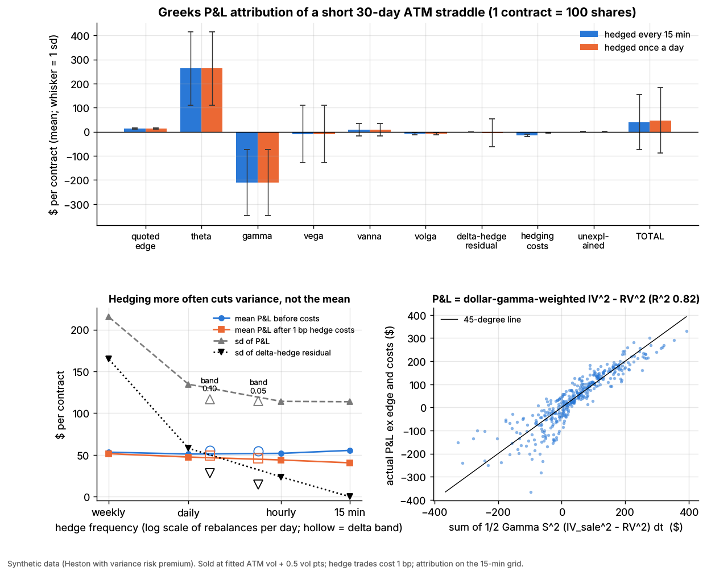
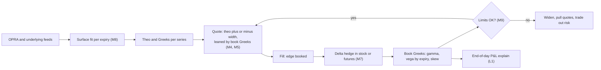
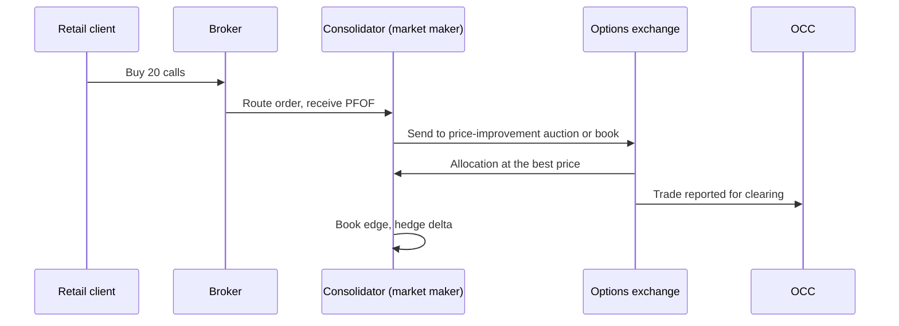

# Options market making

> **TL;DR**
>
> - Quote two-sided prices on thousands of series per underlying, all read off one fitted [volatility surface](../../09-reference/glossary.md#volatility-surface); 4.87 million US option series traded in 2025 `[Verified]`.
> - Revenue is edge (price minus theoretical value). Inventory is held as Greeks: delta hedged within seconds, gamma and vega warehoused and shaded away through quotes.
> - As an income statement: edge is revenue; theta minus gamma is realized-vs-implied volatility; vega is a mark; hedging, fees and [payment for order flow](../../09-reference/glossary.md#payment-for-order-flow-pfof) are costs.
> - Retail drives the flow: over 60% of volume (Bryzgalova et al. 2023) `[Verified]`, and options PFOF is two-thirds of all PFOF `[Verified]`. 0DTE was 66.2% of SPX volume in July 2026 `[Verified]`. All trades execute on 20 exchanges `[Verified]`.
> - It fails on gaps and volatility spikes: one session can erase weeks of theta.

**Level:** Core · **Read time:** ~10 min · **Last verified:** 2026-11

| Field | Value |
|---|---|
| Family | liquidity provision |
| Edge source | liquidity provision · speed |
| Holding period | delta: milliseconds to minutes; options: hours (0DTE) to weeks |
| Counterparty: who pays and why they accept it | Retail buyers of short-dated options pay wide percentage spreads for leverage (brokers are paid PFOF); institutions buying index puts and structured-product desks hedging notes pay for immediacy and size; covered-call and put-write funds sell volatility cheaply for income. Nobody else stands ready in millions of series. |
| Universe & instruments | US single-stock, ETF and index options (SPX, SPY, QQQ, VIX); hedges in stock, ETFs, E-mini futures |
| Data required | OPRA (median 131 billion messages a day, December 2025 `[Verified]`), underlying feeds, dividends, borrow, rates, earnings dates, own markouts |
| Core algorithms used | [M8 Options pricing and vol surfaces](../../03-algorithms/f-market-making-and-hft-algorithms/options-pricing-and-vol-surfaces-for-mm.md) · [M4 Quoting and inventory control](../../03-algorithms/f-market-making-and-hft-algorithms/quoting-and-inventory-control.md) · [M7 Hedging algorithms](../../03-algorithms/f-market-making-and-hft-algorithms/hedging-algorithms.md) · [M9 Algorithmic risk controls](../../03-algorithms/f-market-making-and-hft-algorithms/algorithmic-risk-controls.md) |
| Infra intensity | very high: microsecond requoting of millions of series, continuous surface refits |
| Capacity (rough $ range) | flow-limited: industry gross trading revenue \$3B–\$9B a year `[Estimate]` (15.2B contracts in 2025 `[Verified]` × ~60% market-maker share × \$0.30–\$1.00 net capture per contract); Optiver's 2025 net trading income, all products, was €4.556B `[Verified]` |
| Typical Sharpe (gross vs net) | no public figures; practitioner lore puts annualized net Sharpe at 3–10 for diversified flow books and 1–3 for books that warehouse vega `[Lore]`, with edge thinning in index options |
| Turnover | options turn over in days; hundreds to thousands of hedge trades per underlying a day `[Lore]` |
| Main risks / failure modes | gaps on short gamma, vol and skew spikes, informed flow, pin and assignment, wing model error, runaway quoting |
| Crowding risk | moderate: top three firms pay up to ~90% of options PFOF `[Verified]`; dealers positioned alike |
| Firm types that run it | electronic market makers, wholesalers ("consolidators"), floor specialists; e.g. Citadel Securities, Susquehanna, Optiver, IMC, Jane Street, Wolverine `[Reported]` |
| Lab | [Lab 06](https://github.com/FrankHuang94/quant_trading_claude/tree/main/labs/06-options-mm-delta-hedging) |

## Intuition (the story in plain English)

An options [market maker](../../09-reference/glossary.md#market-making) is a bookmaker and an insurer at once. It prices everything, keeps a small margin on each trade and hedges stock direction away within seconds. What it cannot lay off is volatility: how much the stock actually moves against what option prices assumed. [Theta](../../09-reference/glossary.md#theta) is premium earned daily, [gamma](../../09-reference/glossary.md#gamma) losses are claims paid when the stock moves, and the quoted edge is the loading on top.

## Economic rationale: why should this make money at all?

1. **Immediacy across a huge product set.** Traded series rose more than sevenfold since 2012, to 4.87 million on 8,439 underliers in 2025 `[Verified]` (SEC staff). Only surface-based pricing can cover them all.
2. **Mostly uninformed flow.** Retail favors cheap weekly options, pays an average bid-ask spread of 12.6% and loses money on average (Bryzgalova, Pavlova & Sikorskaya 2023) `[Verified]`.
3. **Structural access.** Listed options must execute on an exchange. Exchanges court flow with guaranteed allocations to "directed" market makers (for example 40%), entitlements to orders of five contracts or fewer, price-improvement auctions and "marketing fees" passed to brokers `[Verified]` (SEC staff, April 2026).
4. **A small, unreliable premium.** End users are net long index options, so dealers are paid to warehouse them (Gârleanu, Pedersen & Poteshman 2009) `[Verified]`. Since about 2010, though, delta-hedged index options earn near-zero CAPM alpha and dealers' net SPX gamma is zero or positive (Dew-Becker & Giglio 2025) `[Verified]`. The money is mostly spread (premium: see the [volatility risk premium dossier](../f-volatility-and-derivatives/volatility-risk-premium-and-vol-arb.md)).

## The trade, step by step

1. Imply the forward from put-call parity; fit one smile per expiry into an arbitrage-free surface ([M8](../../03-algorithms/f-market-making-and-hft-algorithms/options-pricing-and-vol-surfaces-for-mm.md)).
2. Compute theo and Greeks for every series.
3. Quote theo ± a half-width that grows with vega × surface uncertainty, expected adverse selection ([M5](../../03-algorithms/f-market-making-and-hft-algorithms/adverse-selection-and-markouts.md)) and fees; lean both sides against book Greeks ([M4](../../03-algorithms/f-market-making-and-hft-algorithms/quoting-and-inventory-control.md)).
4. On a fill, book edge = (price − theo) × 100 × contracts.
5. Hedge delta in stock, ETF or futures, at once or when net delta leaves a band ([M7](../../03-algorithms/f-market-making-and-hft-algorithms/hedging-algorithms.md)).
6. Manage vega by expiry, gamma and skew; offload concentrations through quote skew, [complex orders](../../09-reference/glossary.md#complex-order) or other dealers.
7. Enforce limits and kill switches ([M9](../../03-algorithms/f-market-making-and-hft-algorithms/algorithmic-risk-controls.md)); manage [pin risk](../../09-reference/glossary.md#pin-risk) and early assignment (calls before ex-dividend); explain P&L daily ([L1](../../03-algorithms/g-live-trading/live-monitoring-and-pnl-attribution.md)).

## Worked example with numbers

*Illustrative.* Stock at \$100; a 21-trading-day at-the-money call has theo \$2.88 at 25% implied vol. A retail order buys 20 calls at \$2.93. Short 20 contracts, the book has delta −1,029 shares, gamma −110.5 shares per \$1, vega −\$230 per vol point and theta +\$137 a day.

| Line | Calculation | \$ |
|---|---|---|
| Edge at the fill | (2.93 − 2.88) × 100 × 20 | +100 |
| Exchange fee (illustrative \$0.30 a contract) | 0.30 × 20 | −6 |
| PFOF (illustrative \$0.40 a contract) | 0.40 × 20 | −8 |
| Delta hedge: buy 1,029 shares, 1¢ half-spread | 1,029 × 0.01 | −10 |
| **Net at the fill** | | **+76** |
| Quiet next day: stock +1%, IV flat | theta +137, gamma ½ × (−110.5) × 1² = −55 | +82 |
| Breakeven move | ½ × 110.5 × ΔS² = 137 gives ΔS = \$1.57 = 25%/√252 | 0 |
| Gap: stock +5%, IV +3 points | gamma −1,381, vega −691, theta +137 | −1,935 (−1,743 fully repriced) |

One gap costs about 13 days of theta. The \$192 between the Greek estimate and full repricing is what a P&L explain books as "unexplained".

## Signals and algorithms under the hood

Surface: [M8](../../03-algorithms/f-market-making-and-hft-algorithms/options-pricing-and-vol-surfaces-for-mm.md). Width and lean: [M4](../../03-algorithms/f-market-making-and-hft-algorithms/quoting-and-inventory-control.md), [M5](../../03-algorithms/f-market-making-and-hft-algorithms/adverse-selection-and-markouts.md). Hedging: [M7](../../03-algorithms/f-market-making-and-hft-algorithms/hedging-algorithms.md). Limits: [M9](../../03-algorithms/f-market-making-and-hft-algorithms/algorithmic-risk-controls.md). Daily explain: [L1](../../03-algorithms/g-live-trading/live-monitoring-and-pnl-attribution.md).

```python
# One quoting-and-hedging cycle for one underlying (simplified). fit_smile, delta_hedge_pnl
# and greeks_attribution are Lab 06's CORE ALGORITHM functions; position Greeks are negative when short.
smiles = {T: fit_smile(np.log(K / F), iv_mid, T, method="svi")      # M8: one raw-SVI fit per expiry
          for T, (K, iv_mid) in chain_by_expiry.items()}
for opt in series:                                                  # thousands of strikes x expiries
    vol = smiles[opt.T](np.log(opt.K / F))
    theo, g = bs_price_and_greeks(F, opt.K, opt.T, vol)             # per share: delta, gamma, vega
    half = max(min_tick, vol_unc * g["vega"] + tox[opt] + fee)       # M5: wider where flow is toxic
    lean = -k_vega * book["vega"] * g["vega"]                        # M4: short vega -> raise both prices
    quote(opt, bid=theo - half + lean, ask=theo + half + lean)

# On a fill, premium > 0 if we sold; position value at theo is < 0 when short.
quoted_edge = premium + position_value_at_theo                      # = (fill - theo) x 100 x qty on a sale
# Lab 06 bands are per share of one straddle; a real book sets the band in shares or $ delta.
h = delta_hedge_pnl(spot_path, book_delta_path, band=delta_band, cost_bps=1.0)       # M7
pnl = greeks_attribution(book_value, spot_path, iv_path, book_greeks, h["shares"],   # L1
                         dt, premium, h["costs"])
# keys: quoted_edge, theta, gamma, vega, vanna, volga, delta_hedge_residual, hedging_costs, unexplained
```



*Lab 06, synthetic data. Notice that the quoted edge is a sliver next to theta and gamma, that hedging more often cuts the variance of P&L but not its mean, and that trade P&L tracks dollar-gamma-weighted implied minus realized variance.*

Synthetic lab results (398 short 30-day straddles sold at fitted vol + 0.5 points): mean edge \$13.1 a straddle against theta +\$262.6 and gamma −\$210.8. Hedging every 15 minutes costs \$14.9, more than the edge; a ±0.10 delta band matches hourly hedging's P&L standard deviation (\$117 vs \$114) with a quarter of the rebalances.

## Implementation choices that matter

- **Surface model.** SVI-type fits extrapolate sanely into the wings, where retail lottery tickets trade; in Lab 06 a quadratic missed the wings by 1.25 vol points, SVI by 0.12 (synthetic). Many desks use smile-adjusted deltas `[Lore]`.
- **Where to quote tightly.** Quoted spreads widened from 2012 to 2025 in nearly all but the top-10 underliers `[Verified]`.
- **Flow.** Consolidator or screen-only. Single-leg auctions gave retail marketable orders price improvement 22–89% of the time, the electronic book 0–13% `[Verified]`.
- **Complex orders.** Multi-leg orders were the second and fourth most common retail execution types in December 2025 `[Verified]`.

## P&L decomposition

*Illustrative income statement, mid-size book: 500,000 contracts a day, 126 million a year* `[Estimate]`.

| Line (accounting analogue) | \$ per contract | \$M per year |
|---|---|---|
| Revenue: edge vs theo at the fill | +1.60 | +201.6 |
| Cost of revenue: adverse selection (5-minute [markout](../../09-reference/glossary.md#markout)) | −0.55 | −69.3 |
| Inventory gain: theta minus gamma | +0.10 | +12.6 |
| Fair-value marks: vega and skew | 0 on average | ±40 |
| Hedging costs | −0.15 | −18.9 |
| Exchange fees net of rebates | −0.25 | −31.5 |
| PFOF paid to brokers | −0.20 | −25.2 |
| Clearing and regulatory fees | −0.04 | −5.0 |
| Technology, OPRA data, people | −0.12 | −15.1 |
| Loss reserve: gap days, amortized | −0.10 | −12.6 |
| **Net** | **+0.29** | **+36.5** |

Most gross edge leaks to informed flow, venues and brokers. The vega line does not move the mean, but it decides the quarter.

## Evidence

- **Growth.** 15.2 billion contracts in 2025, +26%, a sixth straight record `[Verified]`. Q3 2026 averaged 70.6 million a day; 0DTE was ~36% of all volume `[Verified]` (Cboe).
- **PFOF.** SEC staff (April 2026): consolidators handle virtually all retail options orders; options PFOF is two-thirds of all PFOF; the top three providers pay up to ~90% `[Verified]`. Options PFOF remains legal; the SEC withdrew its 2022 order-auction proposal in June 2025 `[Reported]`. Q3 2025 retail-flow payments rose 40% year on year, led by Citadel Securities and IMC `[Reported]`.
- **Firms.** Citadel Securities says it holds about 30% of US listed options `[Reported]` (self-reported). Rule 606 analyses name Dash/IMC, Susquehanna, Jane Street and Wolverine as major liquidity providers `[Reported]`; Optiver is hiring to compete in US single-stock options `[Reported]` (Bloomberg).
- **Spreads.** Median effective spread 1.9% for equity options, 1.4% for ETF options, in 2025 `[Verified]`.

## Capacity, crowding and decay

Capacity is set by flow, so firms compete with PFOF, exchange incentives and tighter quotes. The business concentrated: from 2015 to 2021 the number of broker-dealers reporting options market-making revenue fell, mostly among small-capital firms `[Verified]`. Fragmentation raises fixed costs: 18 exchanges each held more than 1% in 2025, and two more launched in Q3 2026 `[Verified]`. Edge is thinnest in index and top-ETF options.

## How it fails

- **Gaps.** Short gamma loses with the square of the move (worked example).
- **Vol and skew spikes.** Short vega is marked down at once; put skew steepens as customers buy puts.
- **Informed flow** before news; markouts catch it late ([M5](../../03-algorithms/f-market-making-and-hft-algorithms/adverse-selection-and-markouts.md)).
- **Pin and assignment.** Unknown exercise near the strike can leave an unhedged position over a weekend.

Episodes: **2018-02-05**, VIX +115.6% in a day `[Verified]` ([failure gallery](../h-cross-cutting/strategy-failure-gallery.md)). **2024-08-05**, bid-ask spreads on deep out-of-the-money puts exceeded 80% of mid before the open as market makers widened; the quote-based VIX touched ~66 `[Verified]` (BIS). **2025-04-03 to 04-09**, the S&P 500 moved −4.8%, −6.0%, then +9.5%; the VIX closed at 52.33 on 8 April `[Verified]` (Cboe data), and options volume first topped 100 million contracts on 4 April `[Verified]`.

## Textbook vs how it's done today

- **Textbook:** continuous hedging removes risk. **Practice:** discrete, band-based hedging, because costs scale with frequency (Leland 1985; Whalley & Wilmott 1997) `[Verified]`.
- **Textbook:** price each option with a model. **Practice:** price off a fitted surface and skew by inventory (Stoikov & Sağlam 2009) `[Verified]`.
- **Textbook:** spread from noise traders. **Practice:** flow bought via PFOF and exchange allocations `[Verified]`.
- **Textbook:** dealers earn a volatility premium. **Practice:** near zero since ~2010 (Dew-Becker & Giglio 2025) `[Verified]`.

Practitioner references: Natenberg (2015) on pricing and Greeks; Sinclair (2013) on volatility trading.

## Variants and neighbours

Variants: index and 0DTE books, single-stock earnings books, VIX options, floor specialists, wholesalers. Neighbours: [equity market making](equity-market-making.md), [retail flow internalization](retail-flow-internalization.md), [dispersion](../f-volatility-and-derivatives/dispersion-and-correlation-trading.md), [ETF, futures and options linkages](../../01-market-structure/etf-futures-options-linkages.md).

## Diagram





## How practitioners talk about it

- "We're short gamma into the print." → Loses if earnings move the stock more than implied.
- "Theta paid for the gamma this week." → Realized came in below implied.
- "Lean the vega." → Skew quotes so customers take risk off the book.
- "Markouts on that broker went negative." → The flow became informed.
- "We hedge on a 10-delta band." → Rebalance only past a threshold.
- "Model risk lives in the wings." → Far strikes are extrapolated.

## Myths vs reality

- **Myth:** they bet on direction. **Reality:** delta is hedged in seconds; they bet on flow and realized vs implied vol.
- **Myth:** PFOF obviously harms retail. **Reality:** contested: auctions improve prices far more than the book; one study links higher PFOF to less improvement, and critics dispute its method `[Verified]` (SEC staff summary).
- **Myth:** 0DTE is a retail casino. **Reality:** market makers have the largest 0DTE footprint, above 190 million contracts a month `[Verified]`.

## Questions you could ask a quant about this

- *Basic:* How many underliers do you quote, and what do you hedge with?
- *Informed:* How do you split P&L between edge, theta-gamma and vega?
- *Informed:* How do markouts differ between auction and screen flow?
- *Sharp:* How do your deltas account for the smile?
- *Sharp:* Was 2025-04-04 a gamma or a vega loss?
- *Sharp:* 🔒 Vega limits per expiry, and PFOF paid per contract?

## Go deeper

<details markdown="1">
<summary>Math: theta-gamma identity, hedging error and the Leland band</summary>

With $r = 0$, $\Theta = -\tfrac12 \Gamma S^2 \sigma_i^2$, so a delta-hedged **short** option earns per step

$$
dP = \tfrac12 \Gamma S^2 \left(\sigma_i^2\,dt - \left(\tfrac{dS}{S}\right)^2\right),
\qquad
P \approx \sum_t \tfrac12 \Gamma_t S_t^2 \left(\sigma_i^2 - \sigma_{r,t}^2\right) dt .
$$

P&L is dollar-gamma-weighted implied minus realized variance, so it is path-dependent (Lab 06: R² 0.82). Hedging error falls roughly as $1/\sqrt{N}$ in rebalances (Boyle & Emanuel 1980). Leland (1985): a writer hedging every $\Delta t$ at round-trip cost $k$ should price at

$$
\hat\sigma^2 = \sigma^2\left(1 + \sqrt{\tfrac{2}{\pi}}\;\frac{k}{\sigma\sqrt{\Delta t}}\right).
$$

At $\sigma = 20\%$ and $k = 2$ bp, 15-minute hedging needs ~0.6 vol points of extra edge and daily hedging ~0.13. Lab 06 quoted 0.5, so at 15-minute hedging the costs (\$14.9) exceeded the quoted edge (\$13.1).

</details>

## Related pages

- [M8 Options pricing and vol surfaces for market making](../../03-algorithms/f-market-making-and-hft-algorithms/options-pricing-and-vol-surfaces-for-mm.md)
- [M7 Hedging algorithms](../../03-algorithms/f-market-making-and-hft-algorithms/hedging-algorithms.md)
- [M4 Quoting and inventory control](../../03-algorithms/f-market-making-and-hft-algorithms/quoting-and-inventory-control.md)
- [M9 Algorithmic risk controls](../../03-algorithms/f-market-making-and-hft-algorithms/algorithmic-risk-controls.md)
- [Walkthrough: an options market maker](../../03-algorithms/h-end-to-end-walkthroughs/walkthrough-options-market-maker.md)
- [Volatility risk premium and vol arb](../f-volatility-and-derivatives/volatility-risk-premium-and-vol-arb.md)
- [Retail flow internalization](retail-flow-internalization.md)
- [Venues and retail flow](../../01-market-structure/venues-and-retail-flow.md)
- Firm profiles: [Citadel Securities](../../04-industry-and-firms/firm-profiles/citadel-securities.md) · [Susquehanna](../../04-industry-and-firms/firm-profiles/susquehanna-sig.md) · [Optiver](../../04-industry-and-firms/firm-profiles/optiver.md) · [IMC](../../04-industry-and-firms/firm-profiles/imc.md)

## Sources

- [Verified] SEC Division of Trading and Markets, Office of Analytics and Research (2026-04-09). "Roundtable on Options Market Structure: Supporting Data." <https://www.sec.gov/files/roundtable-options-market-structure.pdf> (accessed 2026-11)
- [Verified] Cboe (2026-01-22). "The State of the Options Industry: 2025." <https://www.cboe.com/insights/posts/the-state-of-the-options-industry-2025> (accessed 2026-11)
- [Verified] Cboe (2026-10-19). "State of the Options Industry Q3 2026: Volume Growth Concentrated in Index and ETF Options." <https://www.cboe.com/insights/posts/state-of-the-options-industry-q-3-2026-volume-growth-concentrated-in-index-and-etf-options> (accessed 2026-11)
- [Verified] Cboe (2026-08). "Market Metrics That Matter: Derivatives July 2026 Volume Highlights." <https://www.cboe.com/insights/posts/market-metrics-that-matter-derivatives-july-2026-volume-highlights> (accessed 2026-11)
- [Verified] Cboe Global Markets. VIX and SPX daily history files (2025 values are our reading of the data). <https://cdn.cboe.com/api/global/us_indices/daily_prices/VIX_History.csv> (accessed 2026-11)
- [Verified] Bryzgalova, S., Pavlova, A. & Sikorskaya, T. (2023). "Retail Trading in Options and the Rise of the Big Three Wholesalers." *Journal of Finance* 78(6), 3465–3514. <https://doi.org/10.1111/jofi.13285> (accessed 2026-11)
- [Verified] Gârleanu, N., Pedersen, L. H. & Poteshman, A. M. (2009). "Demand-Based Option Pricing." *Review of Financial Studies* 22(10), 4259–4299. <https://doi.org/10.1093/rfs/hhp005> (accessed 2026-11)
- [Verified] Dew-Becker, I. & Giglio, S. (2025). "The Decline of the Variance Risk Premium: Evidence from Traded and Synthetic Options." Federal Reserve Bank of Chicago WP 2025-17. <https://doi.org/10.21033/wp-2025-17> (accessed 2026-11)
- [Verified] Stoikov, S. & Sağlam, M. (2009). "Option market making under inventory risk." *Review of Derivatives Research* 12(1), 55–79. <https://doi.org/10.1007/s11147-009-9036-3> (accessed 2026-11)
- [Verified] Leland, H. E. (1985). "Option pricing and replication with transactions costs." *Journal of Finance* 40(5), 1283–1301. <https://doi.org/10.1111/j.1540-6261.1985.tb02383.x> (accessed 2026-11)
- [Verified] Whalley, A. E. & Wilmott, P. (1997). "An asymptotic analysis of an optimal hedging model for option pricing with transaction costs." *Mathematical Finance* 7(3), 307–324. <https://doi.org/10.1111/1467-9965.00034> (accessed 2026-11)
- [Verified] Boyle, P. P. & Emanuel, D. (1980). "Discretely adjusted option hedges." *Journal of Financial Economics* 8(3), 259–282. <https://doi.org/10.1016/0304-405X(80)90003-3> (accessed 2026-11)
- [Verified] Todorov, K. & Vilkov, G. (2024-10-29). "Anatomy of the VIX spike in August 2024." *BIS Bulletin* 95. <https://www.bis.org/publ/bisbull95.htm> (accessed 2026-11)
- [Verified] Optiver (2026). "Optiver reports robust financial results for 2025." <https://optiver.com/optiver-reports-robust-financial-results-for-2025> (accessed 2026-11)
- [Reported] Citadel Securities. "Options" (firm page; self-reported market share). <https://www.citadelsecurities.com/what-we-do/options/> (accessed 2026-11)
- [Reported] Global Trading (2025-11-11). "Citadel Securities, IMC paid US\$420m for retail flows as options surged." <https://www.globaltrading.net/?p=40423> (accessed 2026-11)
- [Reported] Bloomberg Government (2026-05). "Optiver Boosts Stock Option Competition for Citadel, Susquehanna." <https://news.bgov.com/capital-markets/optiver-boosts-stock-option-competition-for-citadel-susquehanna> (accessed 2026-11)
- [Verified] Natenberg, S. (2015). *Option Volatility and Pricing: Advanced Trading Strategies and Techniques*, 2nd ed. McGraw-Hill Education. ISBN 9780071818773. <https://openlibrary.org/search?q=9780071818773> (accessed 2026-11)
- [Verified] Sinclair, E. (2013). *Volatility Trading*, 2nd ed. Wiley. <https://doi.org/10.1002/9781118662724> (accessed 2026-11)
