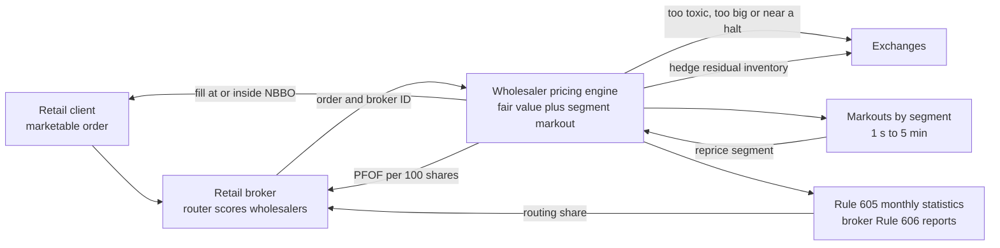

# Retail flow internalization

> **TL;DR**
>
> - Wholesalers pay brokers for retail marketable orders ([PFOF](../../09-reference/glossary.md#payment-for-order-flow-pfof)), fill them as principal at or inside the [NBBO](../../09-reference/glossary.md#nbbo) and keep a fraction of a cent per share.
> - The edge is **segmentation**: an exchange prices for its average counterparty; a wholesaler knows the broker and prices that flow. Round-trip costs for identical orders ranged from 0.07% to 0.46% across six brokerage accounts `[Verified]`.
> - Concentrated: six wholesalers received over 90% of individual investors' marketable orders `[Verified]`; Citadel Securities claims about 35% of US-listed retail volume `[Reported]`.
> - It fails when retail turns correlated: GameStop's off-exchange share of dollar volume fell from 62.6% to 32.8% in a week of January 2021, consistent with wholesalers internalizing less `[Verified]`.

**Level:** Core · **Read time:** ~7 min · **Last verified:** 2026-11

| Field | Value |
|---|---|
| Family | liquidity provision |
| Edge source | liquidity provision · structural/regulatory |
| Holding period | seconds to minutes |
| Counterparty: who pays and why they accept it | Retail investors via their brokers: they pay less than the quoted spread and no commission, and value convenience over a tenth of a cent; brokers are paid PFOF. Critics say lit quoters also pay, left with more toxic flow (contested). |
| Universe & instruments | all NMS stocks and ETFs; retail options flow is the sister business |
| Data required | direct feeds; markout history per broker segment; competitors' Rule 605 statistics |
| Core algorithms used | [M5 Adverse selection and markouts](../../03-algorithms/f-market-making-and-hft-algorithms/adverse-selection-and-markouts.md) · [M2 Fair value and microprice](../../03-algorithms/f-market-making-and-hft-algorithms/fair-value-and-microprice.md) · [M4 Quoting and inventory control](../../03-algorithms/f-market-making-and-hft-algorithms/quoting-and-inventory-control.md) · [M9 Algorithmic risk controls](../../03-algorithms/f-market-making-and-hft-algorithms/algorithmic-risk-controls.md) |
| Infra intensity | high: microsecond pricing of millions of orders a day, but no queue race |
| Capacity (rough $ range) | set by retail volume, not capital: industry gross capture several \$B/yr `[Estimate]` (it must exceed the \$4.9B+/yr of equity and options PFOF in 2025 Rule 606 data `[Reported]`) |
| Typical Sharpe (gross vs net) | not meaningful on capital; thin margin, few losing days `[Lore]`. No segment disclosure; Virtu's FY2025 Market Making adjusted net trading income was \$1,666M, all asset classes `[Reported]` |
| Turnover | shares held seconds to minutes `[Lore]` |
| Main risks / failure modes | correlated retail surges, mis-segmented flow, code errors, margin calls, PFOF bans |
| Crowding risk | moderate: competition is for broker routing, not queue position |
| Firm types that run it | wholesalers; Citadel Securities and Virtu had over 70% of retail flow in 2019–2022 data `[Reported]`; Susquehanna, HRT and Jane Street compete `[Reported]` |
| Lab | [Lab 04](https://github.com/FrankHuang94/quant_trading_claude/tree/main/labs/04-markout-analysis) |

## Intuition (the story in plain English)

A customer taps "buy 200 shares." The broker's router sends the order to a [wholesaler](../../09-reference/glossary.md#wholesaler), which sells from its own book at \$40.0076 when the best offer is \$40.01: a quarter-cent of [price improvement](../../09-reference/glossary.md#price-improvement). No queue, no race. The order arrived because of who sent it, and the only question is what that broker's flow is worth, judged by its [markout](../../09-reference/glossary.md#markout).

## Economic rationale: why should this make money at all?

Glosten and Milgrom (1985): a dealer facing some informed traders widens the spread for everyone. An exchange cannot tell retail from a latency arbitrageur, so its spread prices the mix. A wholesaler sees the broker, prices a segment with little [adverse selection](../../09-reference/glossary.md#adverse-selection), and still beats the NBBO: [internalization](../../09-reference/glossary.md#internalization) of benign flow.

Wholesalers may also fill in sub-pennies, which exchanges cannot for displayed orders (Rule 612) `[Verified]`, and brokers may choose how the surplus splits between price improvement and PFOF `[Verified]`. Retail is benign only short-term: net retail buying predicts about 10 bps of outperformance over the next week (Boehmer et al. 2021) `[Verified]`, irrelevant to a desk holding for seconds.

## The trade, step by step

1. Order arrives with broker, type, size, symbol.
2. Look up the segment's expected markout ([M5](../../03-algorithms/f-market-making-and-hft-algorithms/adverse-selection-and-markouts.md)).
3. Price off [fair value](../../03-algorithms/f-market-making-and-hft-algorithms/fair-value-and-microprice.md) plus costs; share the remaining room as price improvement.
4. Fill as principal, or route out if too big, toxic or near a halt.
5. Net against opposite retail orders; hedge the residual ([M4](../../03-algorithms/f-market-making-and-hft-algorithms/quoting-and-inventory-control.md)).
6. Report: TRF prints, monthly [Rule 605](../../09-reference/glossary.md#rule-605) statistics, brokers' [Rule 606](../../09-reference/glossary.md#rule-606) PFOF disclosures.

## Worked example with numbers

Illustrative: NBBO \$39.99 × \$40.01, microprice \$40.002, client buys 200 shares.

| Cost item | \$/share |
|---|---|
| Expected 60-second markout | 0.0012 |
| PFOF (\$0.10 per 100 shares) | 0.0010 |
| Hedge, fees, clearing | 0.0005 |
| Minimum margin | 0.0005 |
| **Floor edge** | **0.0032** |

Lowest acceptable sale price: 40.002 + 0.0032 = \$40.0052, leaving 0.48¢ to the offer. Giving the client half: fill at \$40.0076, 0.24¢ improvement. Expected profit: 0.56 − 0.12 − 0.10 − 0.05 = 0.29¢/share; on 50M shares a day from this broker, about \$145,000 a day. A segment marking out at 0.9¢ needs a \$40.013 floor, above the offer, so it is routed to an exchange.

## Signals and algorithms under the hood

Fair value ([M2](../../03-algorithms/f-market-making-and-hft-algorithms/fair-value-and-microprice.md)), segment markouts ([M5](../../03-algorithms/f-market-making-and-hft-algorithms/adverse-selection-and-markouts.md); [Lab 04](https://github.com/FrankHuang94/quant_trading_claude/tree/main/labs/04-markout-analysis) measures them), inventory ([M4](../../03-algorithms/f-market-making-and-hft-algorithms/quoting-and-inventory-control.md)), collars and auto-route rules ([M9](../../03-algorithms/f-market-making-and-hft-algorithms/algorithmic-risk-controls.md)).

```python
# Price one marketable retail order (simplified). d = +1 client buys, -1 client sells.
# Markout cost = expected move against the wholesaler, $/share (> 0 is bad for us).
MIN_MARGIN, HEDGE_COST = 0.0005, 0.0005   # $/share
MAX_AUTO_SHARES = 5_000                   # larger orders go to the street

def price_retail_order(order, book, stats, contract):
    d = +1 if order.side == "BUY" else -1
    nbbo_px = book.best_ask if d > 0 else book.best_bid       # what the client gets on exchange
    fair = book.microprice()                                   # M2: fair value from direct feeds
    seg = (order.broker, order.order_type, size_bucket(order.qty), symbol_bucket(order.symbol))
    exp_adverse = stats.shrunk_markout(seg, horizon_s=60)      # M5: shrunk toward the pooled estimate
    floor_edge = exp_adverse + contract.pfof_per_share(seg) + HEDGE_COST + MIN_MARGIN
    best_px = fair + d * floor_edge                            # most generous price that still pays
    if d * (best_px - nbbo_px) > 0 or order.qty > MAX_AUTO_SHARES or book.near_luld_band():
        return route_to_exchange(order)                        # cannot beat the NBBO profitably
    room = d * (nbbo_px - best_px)                             # $/share between our floor and the NBBO
    px = nbbo_px - d * contract.pi_share * room                # give the contracted share as improvement
    return fill_as_principal(order, round_subpenny(px, d))     # off-exchange, sub-penny allowed
```


*Lab 04, synthetic. Uninformed fills keep about +2 bps at 60 seconds; informed fills lose about 1.5 bps. Broker segments proxy for this split.*

## Implementation choices that matter

- **Segments:** finer ones price better but have noisy markouts; thin ones are shrunk toward pooled estimates `[Lore]`.
- **Horizon:** one second catches latency-driven flow, minutes catch informed retail. Amended Rule 605 publishes [realized spreads](../../09-reference/glossary.md#realized-spread) from 50 ms to 5 minutes since August 2026 `[Reported]`.
- **Improvement policy:** brokers rank wholesalers on price improvement and effective-over-quoted (E/Q) spread `[Reported]`.

## P&L decomposition

Illustrative wholesaler, 1 billion shares a day, 250 days; averages include routed-out and volatile orders.

| Line | ¢/share | \$M/yr |
|---|---|---|
| Capture versus fair value | +0.50 | +1,250 |
| Adverse selection (60 s) | −0.15 | −375 |
| PFOF | −0.12 | −300 |
| Hedging, exchange fees | −0.06 | −150 |
| Clearing, regulatory, CAT | −0.02 | −50 |
| Technology and people | −0.03 | −75 |
| Stress days, amortized | −0.02 | −50 |
| **Net** | **+0.10** | **+250** |

## Evidence

- SEC (December 2022): over 90% of marketable individual-investor orders went to six wholesalers; auctions would save an estimated \$1.5B a year `[Verified]`. The Order Competition Rule was withdrawn on 2025-06-12 `[Verified]`.
- Schwarz et al. (2025, *JF*): 85,000 simultaneous orders across six accounts; wholesalers priced the same trade differently by broker, and PFOF did not explain the gap `[Verified]`.
- Over \$4.9B a year was paid for equity and options flow in 2025 `[Reported]`; Robinhood's Q4 2025 revenue included \$314M from options and \$94M from equities `[Reported]`.
- December 2020: Robinhood paid a \$65M SEC penalty for misleading customers about PFOF and for execution that cost them \$34.1M `[Verified]`.

## Capacity, crowding and decay

Fixed costs favor scale, hence concentration. Margins face amended Rule 605 comparisons, a \$0.005 tick for tick-constrained stocks due by November 2027 `[Verified]`, and the EU PFOF ban, whose national exemptions ended 30 June 2026 `[Reported]`.

## How it fails

- **Correlated retail.** Netting fails and hedges move prices. On 2021-01-27 NSCC called \$6.9B of intraday margin from 36 members; brokers then restricted buying, and GameStop volume moved on-exchange `[Verified]`.
- **Code errors.** On 2012-08-01 Knight Capital, a leading wholesaler, deployed code for NYSE's Retail Liquidity Program; 212 small retail orders became 4 million executions in 45 minutes and a loss over \$460M `[Verified]`.
- **Mis-segmentation:** professionals hiding in retail flow.

## Textbook vs how it's done today

- **Textbook:** PFOF harms clients. **Practice:** fills beat the NBBO, but how much depends on the broker (Schwarz et al. 2025) `[Verified]`; whether auctions would beat wholesalers is contested.
- **Textbook:** retail is noise. **Practice:** noise over seconds, mildly informed over a week `[Verified]`.
- **Textbook:** hedge every fill. **Practice:** net opposite flow first `[Lore]`.

## Variants and neighbours

Lit [equity market making](equity-market-making.md); [options market making](options-market-making.md) (retail options must execute on exchange); exchange retail liquidity programs ([fee-driven strategies](../b-speed-and-structural/fee-and-microstructure-driven-strategies.md)).

## Diagram



## How practitioners talk about it

- "That broker marks out at a tenth of a cent." → Benign flow, worth paying for.
- "We run 30% E/Q there." → Effective spread is 30% of quoted.
- "Their flow got sharper." → Markouts worsened; reprice.
- "Meme names go to the street today." → Correlated flow is routed out.
- "PFOF is our COGS." → The cost of acquiring inventory.
- "We lost share on the 606." → The broker moved flow to a rival.

## Myths vs reality

- **Myth:** wholesalers front-run retail. **Reality:** they trade against the order as principal; trading ahead of customers is barred by FINRA Rule 5320.
- **Myth:** retail flow is valuable because it is dumb. **Reality:** because it is uncorrelated; correlated retail is the dangerous kind.

## Questions you could ask a quant about this

- *Basic:* What share of retail flow do you internalize?
- *Informed:* Which markout horizon do you price off?
- *Informed:* What did amended Rule 605 change in broker scorecards?
- *Informed:* How much capture would a half-penny tick remove?
- *Sharp:* At what retail order-imbalance correlation do you stop internalizing?
- *Sharp:* 🔒 Your markouts by broker, and the PFOF-versus-improvement split?

## Go deeper

<details markdown="1">
<summary>Math: segmentation in Glosten-Milgrom, and markout accounting</summary>

If a share $\pi$ of takers know the next move $\Delta$, an exchange quoter breaks even at $s_{\text{ex}}/2 = \pi\,\mathbb{E}|\Delta|$. A wholesaler with informed share $\pi_r \ll \pi$, PFOF $f$ and costs $c$ breaks even at

$$
\frac{s_r}{2} = \pi_r\,\mathbb{E}|\Delta| + f + c ,
$$

leaving up to $(s_{\text{ex}} - s_r)/2$ for price improvement. For a fill at $p$, client side $d$, mid $m_t$:

$$
\text{PnL}_h = -d\,(m_t - p) - d\,(m_{t+h} - m_t),
$$

capture minus adverse selection; Rule 605's realized spread is $2\,\text{PnL}_h$.

</details>

## Related pages

- [Venues and retail flow](../../01-market-structure/venues-and-retail-flow.md)
- [Equity market making](equity-market-making.md)
- [M5 Adverse selection and markouts](../../03-algorithms/f-market-making-and-hft-algorithms/adverse-selection-and-markouts.md)
- [Rules that shape strategies](../../06-risk-and-regulation/rules-that-shape-strategies.md)
- [Citadel Securities](../../04-industry-and-firms/firm-profiles/citadel-securities.md) · [Virtu Financial](../../04-industry-and-firms/firm-profiles/virtu-financial.md)
- [Strategy failure gallery](../h-cross-cutting/strategy-failure-gallery.md)

## Sources

- [Verified] SEC (2022-12-14). "SEC Proposes Rule to Enhance Competition for Individual Investor Order Execution" (press release, republished). <https://www.newsfilecorp.com/release/148085/SEC-Proposes-Rule-to-Enhance-Competition-for-Individual-Investor-Order-Execution> (accessed 2026-11)
- [Verified] SEC (2025-06-12). "Withdrawal of Proposed Rules," Release No. 33-11377. <https://www.sec.gov/files/rules/final/2025/33-11377.pdf> (accessed 2026-11)
- [Verified] SEC Staff (2021-10-14; released 2021-10-18). "Staff Report on Equity and Options Market Structure Conditions in Early 2021." <https://www.sec.gov/files/staff-report-equity-options-market-struction-conditions-early-2021.pdf> (accessed 2026-11)
- [Verified] SEC (2020-12-17). "SEC Charges Robinhood Financial With Misleading Customers About Revenue Sources and Failing to Satisfy Duty of Best Execution," press release 2020-321. <https://www.sec.gov/news/press-release/2020-321> (accessed 2026-11)
- [Verified] SEC (2013-10-16). In the Matter of Knight Capital Americas LLC, Release No. 34-70694. <https://www.sec.gov/litigation/admin/2013/34-70694.pdf> (accessed 2026-11)
- [Verified] Boehmer, E., Jones, C. M., Zhang, X. & Zhang, X. (2021). "Tracking Retail Investor Activity." *Journal of Finance* 76(5), 2249–2305. <https://doi.org/10.1111/jofi.13033> (accessed 2026-11)
- [Verified] Schwarz, C., Barber, B. M., Huang, X., Jorion, P. & Odean, T. (2025). "The 'Actual Retail Price' of Equity Trades." *Journal of Finance* 80(5), 2507–2541. <https://doi.org/10.1111/jofi.13467> (accessed 2026-11)
- [Verified] Glosten, L. R. & Milgrom, P. R. (1985). "Bid, ask and transaction prices in a specialist market with heterogeneously informed traders." *Journal of Financial Economics* 14(1), 71–100. <https://doi.org/10.1016/0304-405X(85)90044-3> (accessed 2026-11)
- [Reported] Robinhood Markets (2026-02). "Robinhood Reports Fourth Quarter and Full Year 2025 Results" (republished). <https://mondovisione.com/media-and-resources/news/robinhood-reports-fourth-quarter-and-full-year-2025-results-2026210/> (accessed 2026-11)
- [Reported] Virtu Financial (2026). Fourth quarter and full year 2025 results release. <https://ir.virtu.com/static-files/9eb593ae-ae7d-42bb-baa3-e0cbaa179c6b> (accessed 2026-11)
- [Reported] Global Trading (2025-05-27). "Payments for US retail flow reach record high, led by Citadel Securities and IMC." <https://www.globaltrading.net/?p=38554> (accessed 2026-11)
- [Reported] Global Trading (2025-09-11). "SIG and HRT lead 2025 retail volume and execution-quality gains." <https://www.globaltrading.net/?p=39575> (accessed 2026-11)
- [Reported] Citadel Securities (2026). "Global Market Intelligence: 1H 2026 Market Structure and Flows" (retail share claim). <https://www.citadelsecurities.com/news-and-insights/global-market-intelligence/1h-2026-market-structure-flows/> (accessed 2026-11)
- [Reported] NBER conference paper (2023), study of US retail wholesaler concentration using 2019–2022 data. <https://conference.nber.org/conf_papers/f187847/f187847.pdf> (accessed 2026-11)
- [Reported] PwC Legal (2024). "MiFIR/MiFID II review: making sense of the key amendments" (PFOF ban; exemptions end 30 June 2026). <https://legal.pwc.de/en/news/articles/mifir-mifid-ii-review-making-sense-of-the-key-amendments> (accessed 2026-11)
