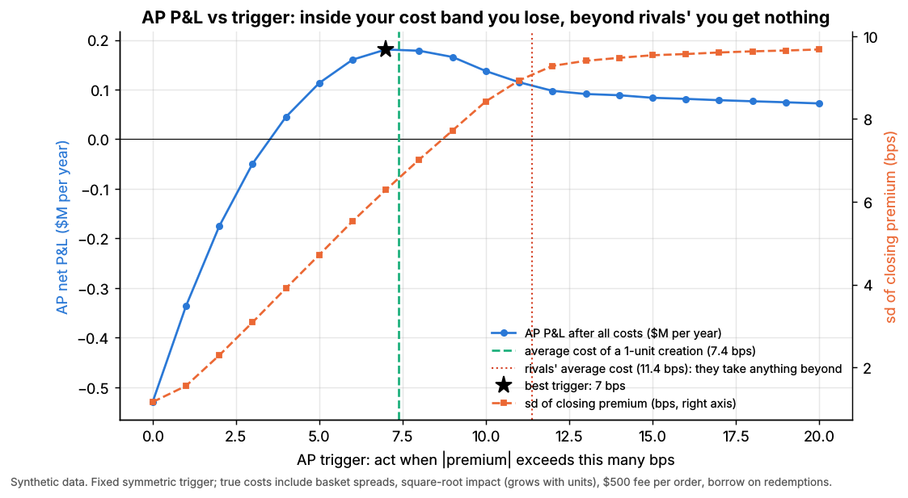
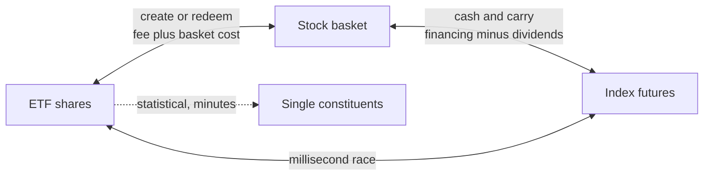
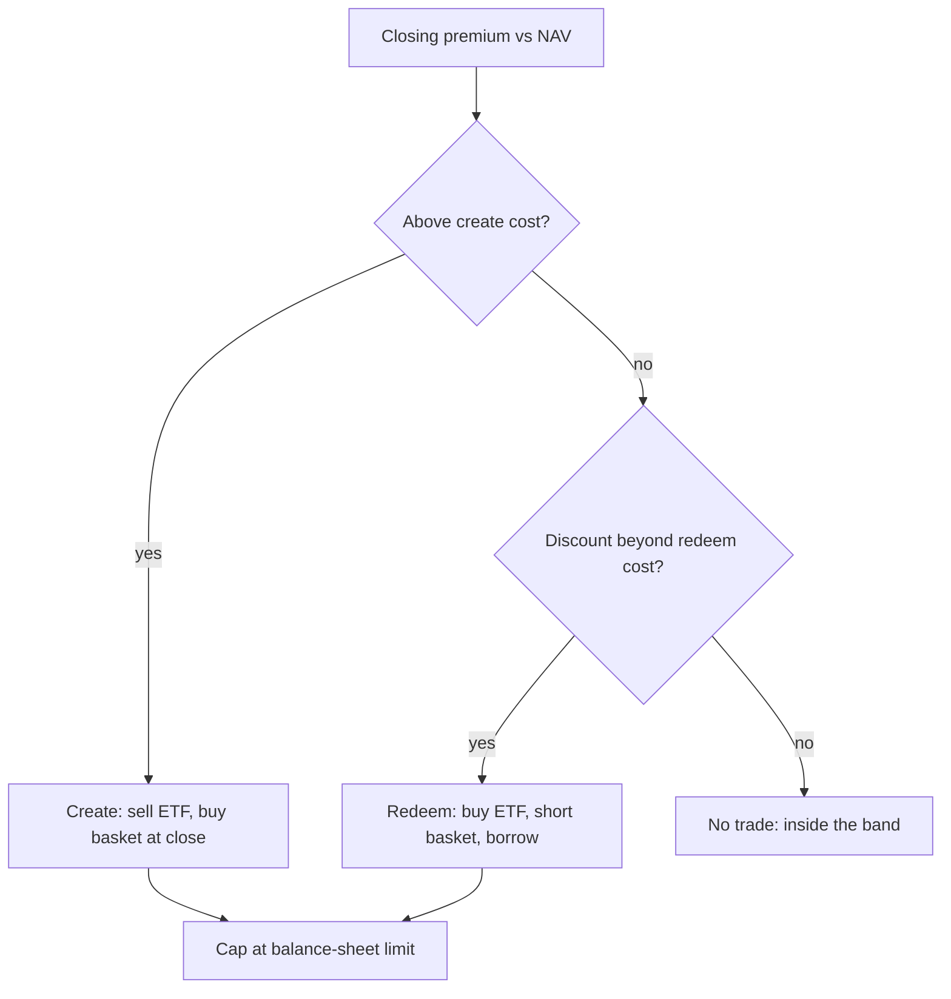

# ETF and index arbitrage

> **TL;DR**
>
> - Three trades tie one index exposure together: ETF vs basket (creation and redemption), futures vs basket (carry), ETF vs constituents (statistical).
> - Each lives inside a **no-arbitrage band**, the cheapest arbitrageur's all-in cost: ±7.4 bps on average in Lab 07, up to 14.9 bps in stress (synthetic lab result). Trade inside your band and you lose.
> - Competition turned pure index arbitrage into a speed race and a financing market, with the basis quoted in bps `[Verified]`.
> - It fails when the basket cannot be traded: halts, closed markets, capacity limits.

**Level:** Core · **Read time:** ~7 min · **Last verified:** 2026-11

| Field | Value |
|---|---|
| Family | speed & structural |
| Edge source | structural/regulatory · speed |
| Holding period | milliseconds (ETF vs futures) to a day (creation); basis trades to expiry |
| Counterparty: who pays and why they accept it | Hurried ETF buyers and sellers, and leveraged longs paying implied financing in futures: one ticket, leverage and no borrow are worth a few bps. |
| Universe & instruments | index and sector baskets; ES, NQ, RTY futures; SPY, IVV, QQQ, IWM, sector ETFs |
| Data required | basket files, constituent and futures feeds, dividends, financing and borrow rates |
| Core algorithms used | [P5 Transaction cost and impact models](../../03-algorithms/d-portfolio-construction/transaction-cost-and-impact-models.md) · [M2 Fair value and microprice](../../03-algorithms/f-market-making-and-hft-algorithms/fair-value-and-microprice.md) · [M7 Hedging algorithms](../../03-algorithms/f-market-making-and-hft-algorithms/hedging-algorithms.md) · [E5 Auction, close and dark-liquidity algos](../../03-algorithms/e-execution-algorithms/auction-close-and-dark-liquidity-algos.md) |
| Infra intensity | extreme for ETF vs futures; moderate, balance-sheet heavy otherwise |
| Capacity (rough $ range) | ~\$0.3B–\$2B a year of US industry P&L `[Estimate]`: perhaps \$3–6T of gross primary flow (1.5–3× 2026's ~\$2T annualized net inflow) at 1–3 bps |
| Typical Sharpe (gross vs net) | No disclosures. ETF premium strategies: ~7% abnormal return gross of costs (Petajisto 2017, 2007–2014 backtest) `[Verified]`. ES–SPY racing: high for the fastest only `[Lore]`. |
| Turnover | very high |
| Main risks / failure modes | leg risk, halts, illiquid baskets, borrow recalls, dividend surprises |
| Crowding risk | extreme in SPY and ES; moderate in niche, international and bond funds |
| Firm types that run it | ETF market makers and APs; bank delta-one desks; HFT firms |
| Lab | [Lab 07](https://github.com/FrankHuang94/quant_trading_claude/tree/main/labs/07-etf-nav-arbitrage) |

## Intuition (the story in plain English)

The S&P 500 exists as 500 stocks, SPY and the ES future ([linkages](../../01-market-structure/etf-futures-options-linkages.md)). When one wrapper gets cheaper than the others by more than the cost of trading the gap, arbitrageurs buy it and sell the rest ([ETF arbitrage](../../09-reference/glossary.md#etf-arbitrage)). [ETF market makers](../a-liquidity-provision/etf-market-making.md) keep prices inside the gap; this page covers its edges.

## Economic rationale: why should this make money at all?

The arbitrageur manufactures wrappers. When ETF demand outruns supply, it builds shares from the basket ([creation and redemption](../../09-reference/glossary.md#creation-and-redemption)); when futures buyers want leverage, it carries the basket against short futures, lending its balance sheet. Whoever demands the wrapper pays: the ETF buyer through the premium, the futures buyer through financing above the arbitrageur's funding. Competition squeezes the margin toward the marginal arbitrageur's cost.

## The trade, step by step

1. **Premium:** ETF price vs your real-time NAV ([M2](../../03-algorithms/f-market-making-and-hft-algorithms/fair-value-and-microprice.md)).
2. **Create** above the create cost (sell ETF, buy basket); **redeem** below the redeem cost (buy ETF, short and borrow the basket).
3. **Strike the basket at the close** ([MOC](../../09-reference/glossary.md#market-on-close-moc)), the prices NAV uses.
4. **[Basis](../../09-reference/glossary.md#basis):** if futures are rich against $S e^{(r-q)T}$ at your funding rate, sell them and hold the basket.
5. **Statistical:** trade ETF vs constituents when the gap beats costs.

## Worked example with numbers

**Creation (Lab 07 parameters, illustrative).** Unit \$2.5M; create cost: ETF half-spread 1.53 + basket half-spreads 1.77 + [square-root](../../09-reference/glossary.md#square-root-law) impact 1.69 + \$500 fee 2.00 = 7.0 bps. Closing premium 10 bps; each unit sold lowers it 2 bps.

| Step | Calculation | Result |
|---|---|---|
| Units | floor((10 − 7) / 2 + 0.5) | 2 |
| Captured minus costs | 2 × 10 − 2 × 2² / 2 − 2 × 7.0 | 2 bp-units |
| Net | 2 bps × \$2.5M | **+\$500** |

A third unit would average a 5 bp premium, below cost.

**Index basis (illustrative).** Index 6,000, 60 days, funding 4.00%, dividend yield 1.30%.

| Step | Calculation | Result |
|---|---|---|
| Fair futures; ES trades 6,030.0 | 6,000 × e^(0.027 × 60/365) | 6,026.7; implied financing 4.33% |
| Sell 100 ES, buy \$30M basket | 3.31 × \$50 × 100 | +\$16,553 |
| Basket in and out, futures fees | 4 bps × \$30M + \$200 | −\$12,200 |
| **Net, 60 days** | | **≈ +\$4,350 (1.5 bps)** |

A desk funding at 4.33% earns nothing: the trade belongs to the cheapest balance sheet.

## Signals and algorithms under the hood

The band is a [cost model](../../03-algorithms/d-portfolio-construction/transaction-cost-and-impact-models.md); NAV is [fair value](../../03-algorithms/f-market-making-and-hft-algorithms/fair-value-and-microprice.md); legs use [hedging](../../03-algorithms/f-market-making-and-hft-algorithms/hedging-algorithms.md) and [closing algos](../../03-algorithms/e-execution-algorithms/auction-close-and-dark-liquidity-algos.md).

```python
import numpy as np
# Lab 07 CORE ALGORITHM (labs/07-etf-nav-arbitrage/lab.py), same names and signs.

def no_arbitrage_band(weights, half_spread_bps, daily_vol, adv_usd, unit_value, n_units=1,
                      etf_half_spread_bps=1.5, fee_usd=500.0, borrow_bps_per_year=25.0,
                      settle_days=1, impact_coef=0.5):
    w = np.asarray(weights)
    order_usd = w * unit_value * n_units                                 # dollars traded per stock
    impact_bps = impact_coef * np.asarray(daily_vol) * np.sqrt(order_usd / np.asarray(adv_usd)) * 1e4
    basket_bps = np.sum(w * (np.asarray(half_spread_bps) + impact_bps))
    fee_bps = fee_usd / (unit_value * n_units) * 1e4                     # fixed fee per order
    create = etf_half_spread_bps + basket_bps + fee_bps
    borrow_bps = borrow_bps_per_year * settle_days / 360.0               # redeem: short basket until delivery
    return create, create + borrow_bps                                   # band = [-redeem, +create]

def arb_decision(premium_bps, create_cost_bps, redeem_cost_bps, impact_bps_per_unit,
                 max_units=10, buffer_bps=0.0):
    p = np.asarray(premium_bps, float)
    up = np.asarray(create_cost_bps) + buffer_bps                        # create trigger (ETF rich)
    dn = np.asarray(redeem_cost_bps) + buffer_bps                        # redeem trigger (ETF cheap)
    n_create = np.floor((p - up) / impact_bps_per_unit + 0.5)            # units whose AVERAGE premium
    n_redeem = np.floor((-p - dn) / impact_bps_per_unit + 0.5)           # still beats the trigger
    units = np.where(n_create > 0, n_create, np.where(n_redeem > 0, -n_redeem, 0.0))
    return np.clip(units, -max_units, max_units)                         # +create, -redeem, 0 = none
```



*Synthetic data. P&L is negative for triggers inside the cost band, peaks near the average one-unit cost and flattens beyond the rivals' cost.*

Synthetic lab result: a 0 bps trigger loses \$0.53M a year, the best fixed trigger (7 bps) earns \$0.18M and the cost-aware rule \$0.21M, 2.8 bps per unit. Both legs strike at one closing price in the toy; real P&L is noisier.

## Implementation choices that matter

- **Band width:** spreads jump in stress; impact grows with √(order / ADV); the fixed fee amortizes over units (SPY: at most \$3,000 per participant per day) `[Verified]`; borrow bites in [hard-to-borrow](../../09-reference/glossary.md#hard-to-borrow) names; funding and capital set the basis band.
- **Statistical leg:** ETF minus live NAV mean-reverts within minutes; since the ETF usually leads, constituents do most of the catching up `[Lore]`.
- **Custom baskets** (Rule 6c-11, 2019) let APs drop illiquid or hard-to-borrow names `[Verified]`.
- **Futures tools:** BTIC trades futures at a spread to the index close; AIR total return futures quote the financing spread in bps `[Verified]`.

## P&L decomposition

Illustrative, per creation unit, from Lab 07 averages (synthetic lab result).

| Line | bps of unit value |
|---|---|
| Premium captured (average) | +10.2 |
| ETF half-spread | −1.5 |
| Basket half-spreads and impact | −3.8 |
| Creation or redemption fee | −2.0 |
| Borrow (redemptions) | −0.1 |
| **Net per unit** | **+2.8** |

Real books add leg slippage, financing and capital charges.

## Evidence

- **Basis:** futures mispricing grows with maturity and is path-dependent (MacKinlay & Ramaswamy 1988) `[Verified]`; basis and liquidity Granger-cause each other (Roll, Schwartz & Subrahmanyam 2007) `[Verified]`.
- **Speed:** median ES–SPY windows fell from 97 ms (2005) to 7 ms (2011); profit per opportunity stayed flat (Budish, Cramton & Shim 2015) `[Verified]`.
- **ETF vs ETF:** SPY–IVV mispricings follow spread widening (Marshall, Nguyen & Visaltanachoti 2013) `[Verified]`.
- **Spillover:** arbitrage carries ETF flow shocks into stocks (Ben-David, Franzoni & Moussawi 2018) `[Verified]`.

## Capacity, crowding and decay

Pure [index arbitrage](../../09-reference/glossary.md#index-arbitrage) is decades old and competed down to cost `[Lore]`; the race moved to speed, not lower profit per trade (Budish, Cramton & Shim 2015), and the basis became a financing market. Capacity is premium episodes times balance sheet, and it binds when flows peak (8 of 1,260 days in Lab 07, synthetic). Edge remains in niche baskets.

## How it fails

- **Illiquid basket:** stress widens the band (up to 14.9 vs 7.4 bps on average in Lab 07).
- **Halts:** 24 August 2015 brought 1,278 [LULD](../../09-reference/glossary.md#limit-up-limit-down-luld) halts, 1,058 in 327 ETPs `[Verified]`.
- **Capacity:** LQD closed at a 5.0% discount in the week to 20 March 2020 `[Reported]`; bond-ETF discounts disappeared once the Fed announced bond purchases (Haddad, Moreira & Muir 2021) `[Verified]`.
- **Legs:** borrow recalls, dividend surprises, financing spikes; a discount to stale NAV is no arbitrage.

See also the [failure gallery](../h-cross-cutting/strategy-failure-gallery.md).

## Textbook vs how it's done today

- **Textbook:** any gap from $S e^{(r-q)T}$ is free money. **Practice:** funding differs by firm, so the basis trades as a financing rate (CME AIR futures) `[Verified]`.
- **Textbook:** APs create on any premium. **Practice:** only beyond the band; market makers hold prices inside it `[Lore]`.
- **Textbook:** stocks lead. **Practice:** futures and ETFs often lead ([lead-lag](lead-lag-and-cross-asset-arbitrage.md)) `[Verified]`.

## Variants and neighbours

ETF vs ETF (SPY, IVV, VOO); futures rolls; leveraged-ETF rebalancing; [index reconstitution](../d-mid-frequency-alpha/flow-driven-strategies.md); ADRs; total return swaps; at the millisecond end, [latency arbitrage](latency-arbitrage.md).

## Diagram





## How practitioners talk about it

- "SPY's six over; not enough to create." → A 6 bp premium sits inside the band.
- "Futures are 30 over financing." → Implied financing is 30 bps above funding.
- "Do it on BTIC." → Trade futures at a spread to the index close.
- "Ask for a custom basket without the hard borrows." → Avoid shorting expensive names.
- "We're capped today." → The balance-sheet limit binds.
- "The roll is rich." → The calendar spread implies high financing.

## Myths vs reality

- **Myth:** index arbitrage is riskless. **Reality:** legs, dividends, financing and halts bite.
- **Myth:** a premium means arbitrage failed. **Reality:** inside the band, it is arbitrage working.

## Questions you could ask a quant about this

- *Basic:* What does one creation unit cost you, all in?
- *Basic:* Do you strike the basket in the closing auction?
- *Informed:* What implied-financing hurdle does a basis trade need?
- *Informed:* When do you ask for a custom basket?
- *Sharp:* How far does your band widen when VIX doubles?
- *Sharp:* 🔒 What binds first in stress: balance sheet, borrow or risk limits?

## Go deeper

<details markdown="1">
<summary>Math: optimal creation units</summary>

With premium $p$, unit cost $c$ and impact $\lambda$ per unit (bps), unit $k$ sells at average premium $p - \lambda(k - \tfrac12)$, so

$$
\Pi(n) = n p - \frac{\lambda n^2}{2} - n c .
$$

The lab trades every unit whose average premium beats $c$: $n = \lfloor (p - c)/\lambda + \tfrac12 \rfloor$, capped by balance sheet.

</details>

## Related pages

- [ETF market making](../a-liquidity-provision/etf-market-making.md) · [Lead-lag and cross-asset arbitrage](lead-lag-and-cross-asset-arbitrage.md) · [Latency arbitrage](latency-arbitrage.md)
- [ETF, futures and options linkages](../../01-market-structure/etf-futures-options-linkages.md) · [Shorting, financing and settlement](../../01-market-structure/shorting-financing-and-settlement.md)
- [P5 Transaction cost and impact models](../../03-algorithms/d-portfolio-construction/transaction-cost-and-impact-models.md) · [Auctions and closing liquidity](../a-liquidity-provision/auctions-and-closing-liquidity.md)

## Sources

- [Verified] MacKinlay, A. C. & Ramaswamy, K. (1988). "Index-Futures Arbitrage and the Behavior of Stock Index Futures Prices." *Review of Financial Studies* 1(2), 137–158. <https://doi.org/10.1093/rfs/1.2.137> (accessed 2026-11)
- [Verified] Roll, R., Schwartz, E. & Subrahmanyam, A. (2007). "Liquidity and the Law of One Price: The Case of the Futures-Cash Basis." *Journal of Finance* 62(5), 2201–2234. <https://doi.org/10.1111/j.1540-6261.2007.01273.x> (accessed 2026-11)
- [Verified] Budish, E., Cramton, P. & Shim, J. (2015). "The High-Frequency Trading Arms Race: Frequent Batch Auctions as a Market Design Response." *Quarterly Journal of Economics* 130(4), 1547–1621. <https://doi.org/10.1093/qje/qjv027> (accessed 2026-11)
- [Verified] Marshall, B. R., Nguyen, N. H. & Visaltanachoti, N. (2013). "ETF arbitrage: Intraday evidence." *Journal of Banking & Finance* 37(9), 3486–3498. <https://doi.org/10.1016/j.jbankfin.2013.05.014> (accessed 2026-11)
- [Verified] Petajisto, A. (2017). "Inefficiencies in the pricing of exchange-traded funds." *Financial Analysts Journal* 73(1), 24–54. <https://doi.org/10.2469/faj.v73.n1.7> (accessed 2026-11)
- [Verified] Ben-David, I., Franzoni, F. & Moussawi, R. (2018). "Do ETFs increase volatility?" *Journal of Finance* 73(6), 2471–2535. <https://doi.org/10.1111/jofi.12727> (accessed 2026-11)
- [Verified] Haddad, V., Moreira, A. & Muir, T. (2021). "When selling becomes viral: disruptions in debt markets in the COVID-19 crisis and the Fed's response." *Review of Financial Studies* 34(11), 5309–5351. <https://doi.org/10.1093/rfs/hhaa145> (accessed 2026-11)
- [Verified] CME Group. "Adjusted Interest Rate (AIR) Total Return Futures on U.S. Indices" (traded via BTIC; financing spread quoted in bps). <https://www.cmegroup.com/markets/equities/us-index/adjusted-interest-rate-total-return-index-futures.html> (accessed 2026-11)
- [Verified] SEC (2019-09-25). "Exchange-Traded Funds." Final rule, Release No. 33-10695 (Rule 6c-11). <https://www.sec.gov/rules/final/2019/33-10695.pdf> (accessed 2026-11)
- [Verified] SPDR S&P 500 ETF Trust (2024). Form N-30D annual report (creation unit and transaction fee). <https://www.sec.gov/Archives/edgar/data/884394/000119312524266771/d814670dn30d.htm> (accessed 2026-11)
- [Verified] SEC Staff (2015-12). "Research Note: Equity Market Volatility on August 24, 2015." <https://www.sec.gov/marketstructure/research/equity_market_volatility.pdf> (accessed 2026-11)
- [Reported] Bloomberg via WealthManagement.com (2020-03). "Under Market Stress, Fixed Income ETFs Trade With Wide Discount." <https://www.wealthmanagement.com/etfs/under-market-stress-fixed-income-etfs-trade-with-wide-discount> (accessed 2026-11)
- [Reported] ETFGI via Mondo Visione (2026-09). "ETF industry in the United States reports record assets of US\$16.36 trillion" (2026 year-to-date inflows). <https://mondovisione.com/news/etfgi-etf-industry-in-the-united-states-reports-record-assets-of-us1636-trill-2026914/> (accessed 2026-11)
