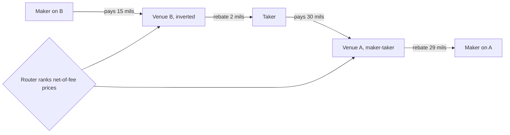

# Fee- and microstructure-driven strategies

> **TL;DR**
>
> - Under [maker-taker](../../09-reference/glossary.md#maker-taker) pricing, takers pay up to the 30-mil access-fee cap and makers earn a rebate; in one-cent-spread stocks the rebate can be most of a market maker's edge.
> - [Inverted venues](../../09-reference/glossary.md#inverted-venue) flip the signs: makers pay to jump the queue at the same displayed price. Routers rank net-of-fee prices.
> - Odd-lot, midpoint and order-type mechanics add smaller edges.
> - The SEC's 2024 10-mil cap and half-penny tick would compress this, but are delayed to the first business day of November 2027 `[Verified]`; price-tiered round lots are live since 2025-11-03 `[Reported]`.
> - Fee and queue optimization is legal; spoofing, layering and wash trades are not.

**Level:** Core · **Read time:** ~8 min · **Last verified:** 2026-11

| Field | Value |
|---|---|
| Family | speed & structural |
| Edge source | structural/regulatory · liquidity provision |
| Holding period | seconds to minutes (rebate capture); milliseconds for order-type and odd-lot edges |
| Counterparty: who pays and why they accept it | Takers paying access fees, and naive routers that rest at queue backs or chase rebates, filling mostly before adverse moves. They accept because the cost is a fraction of a cent per share, buried in commissions; exchange fee schedules do the redistributing. |
| Universe & instruments | tick-constrained stocks; high-priced stocks that trade in odd lots; ETFs; all lit venues and midpoint ATSs |
| Data required | fee schedules and tier status; direct feeds with odd lots; queue estimates; venue-level markouts |
| Core algorithms used | [E4 Smart order routing](../../03-algorithms/e-execution-algorithms/smart-order-routing.md) · [M6 Queue position and order placement](../../03-algorithms/f-market-making-and-hft-algorithms/queue-position-and-order-placement.md) · [M4 Quoting and inventory control](../../03-algorithms/f-market-making-and-hft-algorithms/quoting-and-inventory-control.md) · [M5 Adverse selection and markouts](../../03-algorithms/f-market-making-and-hft-algorithms/adverse-selection-and-markouts.md) |
| Infra intensity | medium-high: colocation and direct feeds to manage queues; microwave not required |
| Capacity (rough $ range) | $10–100M/yr net for a large market maker `[Estimate]` (a fraction of a mil to a few mils per share on 100–500M shares/day) |
| Typical Sharpe (gross vs net) | rarely standalone; part of very stable market-making P&L `[Lore]`; net near zero for sub-scale players `[Estimate]`; no disclosures; would shrink under the 2027 rules |
| Turnover | very high; flat by the close |
| Main risks / failure modes | fee and tier changes; rule changes; adverse selection outrunning rebates; enforcement |
| Crowding risk | high: rebates are competed away through longer queues |
| Firm types that run it | electronic market makers and HFT prop firms; agency routers on the cost side |
| Lab | — |

## Intuition (the story in plain English)

A one-cent spread in a $10 stock is a hard floor: no exchange can display $10.005. Fee schedules let traders deal in fractions of a cent anyway: the same $10.00 bid nets a passive buyer less than $10.00 on a rebate-paying venue and more on an inverted one. The displayed price is not the price; the net-of-fee price is. Strategies live in that gap: earning rebates, buying priority, posting [odd lots](../../09-reference/glossary.md#odd-lot) inside the spread, and exploiting order-type behavior ([Fees, rebates and ticks](../../01-market-structure/fees-rebates-and-ticks.md)).

## Economic rationale: why should this make money at all?

Reg NMS caps take fees at 30 mils ($0.0030) and fixes a one-cent tick above $1, but leaves rebates and tiers to exchanges. In [tick-constrained](../../09-reference/glossary.md#tick-constrained-stock) names competition moves from spread to queue position and fees. Rebates attract displayed size, which attracts fee-paying takers. Firms that model net economics venue by venue collect what slower routers leave behind.

## The trade, step by step

1. **Net prices** per venue and side ([E4](../../03-algorithms/e-execution-algorithms/smart-order-routing.md)).
2. **Queues:** estimate [queue position](../../09-reference/glossary.md#queue-position) and fill probability ([M6](../../03-algorithms/f-market-making-and-hft-algorithms/queue-position-and-order-placement.md)).
3. **Post** where expected value is highest, post-only to guarantee maker status.
4. **Skew inventory** ([M4](../../03-algorithms/f-market-making-and-hft-algorithms/quoting-and-inventory-control.md)); scratch out passively to collect a second rebate.
5. **Audit** markouts by venue and order type ([M5](../../03-algorithms/f-market-making-and-hft-algorithms/adverse-selection-and-markouts.md)) and tier progress.

## Worked example with numbers

Illustrative schedules, close to Nasdaq's top tier and Cboe BYX's inverted schedule `[Verified]`: venue A charges takers 30 mils and pays makers 29; venue B charges makers 15 mils and pays takers 2. Stock quoted $10.00 × $10.01.

| At the $10.00 bid | Venue A | Venue B |
|---|---|---|
| Passive buyer's net price | $9.9971 | $10.0015 |
| Taking seller's net price | $9.9970 | $10.0002 |
| Shares queued ahead | 80,000 | 3,000 |

Sellers hit B first (0.32¢ more), so 0.44¢ buys the front of the line.

Rebate capture: buy 1,000 shares passively at $10.00 on A ($ per 1,000 shares).

| Outcome (probability) | Today: 1¢ tick, 29-mil rebate | Under 2024 rules: ½¢ tick, 9-mil rebate |
|---|---|---|
| Sell passively one tick up (40%) | 10.00 + 5.80 = +15.80 | 5.00 + 1.80 = +6.80 |
| Scratch passively at $10.00 (35%) | +5.80 | +1.80 |
| Stop out, take one tick down (25%) | −10.00 + 2.90 − 3.00 = −10.10 | −5.00 + 0.90 − 1.00 = −5.10 |
| **Expected value** | **+5.83** | **+2.08** |

Without rebates today's EV is +0.75 (0.40 × 10 − 0.25 × 13): rebates supply ~87% of it.

## Signals and algorithms under the hood

The router ([E4](../../03-algorithms/e-execution-algorithms/smart-order-routing.md)) and queue model ([M6](../../03-algorithms/f-market-making-and-hft-algorithms/queue-position-and-order-placement.md)) do the work; [TCA](../../03-algorithms/e-execution-algorithms/transaction-cost-analysis.md) shows the client side of the same economics.

```python
# Where to post a passive buy at the NBBO bid (simplified; queue models in M6)
def passive_venue_value(v, half_spread, horizon_s, urgency_cost):
    p_fill = v.fill_prob(queue_ahead=v.queue_ahead, horizon=horizon_s)  # queue model
    markout = v.expected_markout_if_filled     # $/share, negative = adverse (M5)
    rebate = -v.maker_fee                      # > 0 on maker-taker, < 0 on inverted venues
    return p_fill * (half_spread + rebate + markout) - (1 - p_fill) * urgency_cost

def choose_post_venue(venues, half_spread=0.005, horizon_s=2.0, urgency_cost=0.002):
    scores = {v.name: passive_venue_value(v, half_spread, horizon_s, urgency_cost)
              for v in venues}
    return max(scores, key=scores.get), scores

def net_take_price(price, side, v):
    # Net-of-fee price a taker really pays or receives: what routers actually rank
    fee = v.take_fee     # > 0 on maker-taker (cap 30 mils today), < 0 (a rebate) on inverted
    return price + fee if side == "BUY" else price - fee
```

## Implementation choices that matter

- **Tiers.** Near a monthly volume threshold the marginal share is worth far more than the average; trading with yourself to get there is illegal wash trading.
- **Odd lots.** Odd-lot quotes inside the NBBO were invisible on the SIP; price-tiered round lots (2025-11-03) and the SIP odd-lot best quote (late April 2026) shrink that edge, with depth deferred to May 2028 `[Reported]`.
- **Midpoint.** Pegs save half the spread but get picked off before NBBO moves; IEX's crumbling-quote indicator guards against this `[Verified]`.
- **Locked markets.** Post-only orders that would lock are repriced; a pending June 2026 proposal would repeal that ban with Rule 611 `[Verified]`.

## P&L decomposition

Illustrative, per 1M shares of passive volume, from the "today" column above.

| Line | $ |
|---|---|
| Spread captured | +4,000 |
| Maker rebates | +5,075 |
| Stop-out losses | −2,500 |
| Take fees on stop-outs | −750 |
| **Trading margin** | **+5,825** (0.58¢/share) |
| Clearing, regulatory and data costs | −1,000 |
| **Net** | **+4,825** |

## Evidence

- **SEC 2024 amendments** (adopted 2024-09-18): $0.005 tick for tick-constrained stocks, 10-mil access-fee cap, price-tiered round lots and odd-lot data in the SIP `[Verified]`. Compliance moved from 2025-11-03 to 2026-11-02, then to the first business day of November 2027 (order of 2026-06-11), with staff told to review Rules 610(c) and 612 `[Verified]`.
- **Industry:** MEMX asked for a 15-mil cap in half-penny names; SIFMA sought delay pending the Rule 611 review `[Reported]`.
- **Routing conflicts:** Battalio, Corwin & Jennings (2016, *JF*) link rebate-maximizing limit-order routing to worse execution quality `[Reported]`.

## Capacity, crowding and decay

Fee schedules set the pool; queues lengthen until rebate ≈ adverse selection plus waiting cost. A 10-mil cap would cut the maximum rebate by about two-thirds `[Estimate]` (30 → 10 mils), and half-penny ticks would shorten queues, eroding inverted venues' priority premium.

## How it fails

- **Schedule risk:** a missed tier reprices a whole month.
- **Adverse selection:** a long queue fills you mainly when the level is about to break.
- **Rule risk:** firms ready for 2025-11-03 faced two delays; the rules may yet change `[Verified]`.
- **Enforcement:** spoofing and layering are illegal. Regulators charged Navinder Sarao with E-mini spoofing in 2015 `[Reported]` and Avalon FA and Lek Securities with layering US stocks in 2017 (alleged profits ~$21M) `[Verified]`. See [rules that shape strategies](../../06-risk-and-regulation/rules-that-shape-strategies.md).

## Textbook vs how it's done today

- **Textbook:** a price is a price. **Practice:** routers rank net price times fill probability `[Lore]`.
- **Textbook:** rebates subsidize liquidity. **Practice:** in tick-constrained names they mostly lengthen queues, and inverted venues sell priority `[Lore]`.
- **Legal line:** high cancel rates are normal for market makers; spoofing turns on intent to cancel before execution `[Reported]`.

## Variants and neighbours

Rebate capture, queue jumping, odd-lot posting, midpoint pegs, retail liquidity programs. Neighbours: [equity market making](../a-liquidity-provision/equity-market-making.md), [retail flow internalization](../a-liquidity-provision/retail-flow-internalization.md), [latency arbitrage](latency-arbitrage.md).

## Diagram



## How practitioners talk about it

- "We're scratching for rebates." → Exiting at the entry price; the rebate is the profit.
- "Post on BYX to get to the front." → Pay the inverted venue's maker fee for priority `[Lore]`.
- "We're 2M shares short of the top tier." → Month-end volume decides the rebate rate.
- "Back-of-queue fills are toxic." → Those fills come just before the price drops.
- "Odd lots are the real inside in that name." → In a high-priced stock, the best prices sit in odd lots.
- "Net capture is half a mil after markouts." → Spread plus rebate minus adverse selection, per share.

## Myths vs reality

- **Myth:** rebates are free money. **Reality:** they are competed into queue length and offset by adverse selection.
- **Myth:** cancelling most orders is spoofing. **Reality:** intent to deceive is the line.

## Questions you could ask a quant about this

- *Basic:* What share of your market-making P&L is rebates?
- *Basic:* Which venues do you post on first, and why?
- *Informed:* How did price-tiered round lots change your high-priced names?
- *Informed:* How do you value queue position on inverted versus maker-taker venues?
- *Sharp:* If the 10-mil cap and half-penny tick arrive in 2027, which names stop being worth quoting?
- *Sharp:* 🔒 How do your markouts differ by venue and order type?

## Go deeper

<details markdown="1">
<summary>Math: net prices and the value of a passive order</summary>

Taker's net buy price: $P + f$; maker's: $P - r$ ($f$, $r$ negative on inverted venues). A resting order with fill probability $p$, half-spread $h$, markout $m$ and waiting cost $c$ is worth:

$$
V = p \,(h + r + m) - (1-p)\,c
$$

</details>

## Related pages

- [Fees, rebates and ticks](../../01-market-structure/fees-rebates-and-ticks.md) · [Recent changes](../../01-market-structure/recent-changes.md) · [Order types and auctions](../../01-market-structure/order-types-and-auctions.md)
- [E4 Smart order routing](../../03-algorithms/e-execution-algorithms/smart-order-routing.md) · [M6 Queue position and order placement](../../03-algorithms/f-market-making-and-hft-algorithms/queue-position-and-order-placement.md)
- [Equity market making](../a-liquidity-provision/equity-market-making.md) · [Latency arbitrage](latency-arbitrage.md)

## Sources

- [Verified] U.S. SEC (2017-03-10). "SEC Charges Firms Involved in Layering, Manipulation Schemes." Press release 2017-63. <https://www.sec.gov/news/press-release/2017-63> (accessed 2026-11)
- [Reported] U.S. CFTC (2015-04-21). "CFTC Charges U.K. Resident Navinder Singh Sarao and His Company Nav Sarao Futures Limited PLC with Price Manipulation and Spoofing." Press release 7156-15. <https://www.cftc.gov/PressRoom/PressReleases/7156-15> (accessed 2026-11)
- [Verified] SEC (2024). Release 34-101070, "Regulation NMS: Minimum Pricing Increments, Access Fees, and Transparency of Better Priced Orders." <https://www.sec.gov/files/rules/final/2024/34-101070.pdf> (accessed 2026-11)
- [Verified] Federal Register (2024-10-08). Doc. 2024-21867, same title. <https://www.federalregister.gov/documents/2024/10/08/2024-21867/regulation-nms-minimum-pricing-increments-access-fees-and-transparency-of-better-priced-orders> (accessed 2026-11)
- [Verified] SEC (2026-06-11). Release 34-105656, order granting temporary exemptive relief from Rules 610(c) and 612. <https://www.sec.gov/files/rules/exorders/2026/34-105656.pdf> (accessed 2026-11)
- [Verified] Federal Register (2026-06-15). Doc. 2026-11997, same order. <https://public-inspection.federalregister.gov/2026-11997.pdf> (accessed 2026-11)
- [Verified] Morrison Foerster (2026-06-12). "SEC Proposes Landmark Rollback of Core Regulation NMS Requirements." <https://www.mofo.com/resources/insights/260612-sec-proposes-landmark-rollback-of-core-regulation> (accessed 2026-11)
- [Reported] SEC (2026). Release 34-104612, exemptive order on SIP odd-lot information. <https://www.sec.gov/files/rules/exorders/2026/34-104612.pdf> (accessed 2026-11)
- [Reported] Davis Polk (2024). "Reg NMS resized: SEC adjusts tick sizes, lowers access fees and accelerates lot size amendments." <https://www.davispolk.com/insights/client-update/reg-nms-resized-sec-adjusts-tick-sizes-lowers-access-fees-and-accelerates> (accessed 2026-11)
- [Reported] SIFMA (2026). "Supplemental Request for Immediate Extension of Tick Size and Access Fee Compliance Dates." <https://www.sifma.org/advocacy/letters/supplemental-request-for-immediate-extension-of-tick-size-and-access-fee-compliance-dates> (accessed 2026-11)
- [Reported] Comment letter on File S7-2026-10 (2026-03-31) supporting MEMX's 15-mil request. <https://www.sec.gov/comments/s7-2026-10/s7202610-737867-2293954.pdf> (accessed 2026-11)
- [Reported] CTA Plan. "Odd lots." <https://www.ctaplan.com/odd-lots> (accessed 2026-11)
- [Reported] Battalio, R., Corwin, S. A. & Jennings, R. (2016). "Can Brokers Have It All? On the Relation between Make-Take Fees and Limit Order Execution Quality." *Journal of Finance* 71(5), 2193–2238. <https://doi.org/10.1111/jofi.12422> (accessed 2026-11)
- [Verified] Cboe. "BYX U.S. Equities Fee Schedule." <https://www.cboe.com/us/equities/membership/fee_schedule/byx/> (accessed 2026-11)
- [Verified] Nasdaq. "Price List: Trading Connectivity" (equity rebates and fees). <https://www.nasdaqtrader.com/Trader.aspx?id=PriceListTrading2> (accessed 2026-11)
- [Verified] SEC (2020-09-01). Order approving IEX D-Limit, Federal Register 2020-19204. <https://www.govinfo.gov/content/pkg/FR-2020-09-01/pdf/2020-19204.pdf> (accessed 2026-11)
