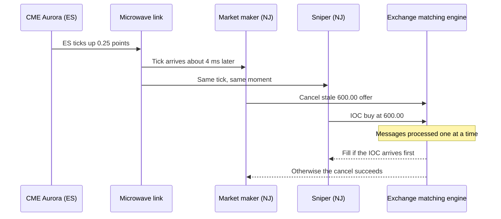

# Latency arbitrage

> **TL;DR**
>
> - Latency arbitrage trades against quotes left stale for microseconds after public news (a futures tick, a sweep on another venue) moved fair value. Whoever reaches the matching engine first wins.
> - It is a race, not a forecast: in London Stock Exchange data the winner beat the first loser by a modal 5–10 µs, and races were about 22% of FTSE 100 volume `[Verified]`.
> - Sniped quoters pay first and investors pay last, through wider spreads: a "tax" of roughly 0.5 bp of trading volume, about $5B a year globally `[Verified]`.
> - The edge is rank, not capital. Speed bumps (IEX) blunt it on one venue only.

**Level:** Deep dive · **Read time:** ~8 min · **Last verified:** 2026-11

| Field | Value |
|---|---|
| Family | speed & structural |
| Edge source | speed · structural/regulatory |
| Holding period | microseconds to seconds |
| Counterparty: who pays and why they accept it | Quoters whose cancels lose the race. They keep quoting because uninformed flow still pays on average, and pass the pick-off cost to investors as wider spreads. |
| Universe & instruments | liquid US stocks and ETFs quoted on many venues; ES/NQ futures as triggers |
| Data required | direct feeds from every venue and CME; synchronized hardware timestamps |
| Core algorithms used | [M1 Anatomy of an HFT trading loop](../../03-algorithms/f-market-making-and-hft-algorithms/anatomy-of-an-hft-trading-loop.md) · [M2 Fair value and microprice](../../03-algorithms/f-market-making-and-hft-algorithms/fair-value-and-microprice.md) · [M3 Order-book and trade-flow signals](../../03-algorithms/f-market-making-and-hft-algorithms/order-book-and-trade-flow-signals.md) · [M9 Algorithmic risk controls](../../03-algorithms/f-market-making-and-hft-algorithms/algorithmic-risk-controls.md) |
| Infra intensity | extreme: colocation, FPGA tick-to-trade, microwave or millimeter-wave links |
| Capacity (rough $ range) | P&L-limited, not capital-limited: US pool roughly $1–3B/yr, a top firm tens to low hundreds of $M `[Estimate]` (from ABO's ~$5B global figure and top-6 concentration) |
| Typical Sharpe (gross vs net) | Not meaningful on capital. Fastest firm: gross daily Sharpe far above 5; runner-up near zero `[Lore]`. No fund disclosures. Profits track latency rank (Baron et al. 2019, academic) `[Verified]`; per-race profit held flat 2005–2011 (BCS) `[Verified]` |
| Turnover | extreme: about one race per minute per FTSE 100 stock `[Verified]` |
| Main risks / failure modes | rank loss, false triggers, hedge-leg slippage, rain fade, runaway code, venue redesign |
| Crowding risk | extreme: winner-take-most among a handful of firms |
| Firm types that run it | HFT prop firms and electronic market makers (unnamed in academic data) |
| Lab | — |

## Intuition (the story in plain English)

E-mini S&P 500 futures (ES) trade in CME's data center in Aurora, Illinois; SPY trades in New Jersey. When ES ticks up, every SPY offer in New Jersey is suddenly too cheap, but New Jersey learns it only about 4 ms later, by microwave. Market makers' cancels and snipers' [immediate-or-cancel](../../09-reference/glossary.md#immediate-or-cancel-ioc) buys then race; the exchange processes them one at a time, and if the buy lands first, the sniper buys below the new [fair value](../../09-reference/glossary.md#fair-value). Nothing was predicted. The same race runs inside New Jersey when a sweep hits one venue, or when a [direct feed](../../09-reference/glossary.md#direct-feed) shows an [NBBO](../../09-reference/glossary.md#nbbo) change before the [SIP](../../09-reference/glossary.md#sip) does ([NBBO and market data](../../01-market-structure/nbbo-and-market-data.md)).

## Economic rationale: why should this make money at all?

Budish, Cramton & Shim (2015) call it a design flaw. A continuous [limit order book](../../09-reference/glossary.md#limit-order-book) serializes messages, so each public jump is a race the quoter usually loses (with N equally fast firms, its cancel wins one time in N). Quoters widen spreads to cover it; speed spending raises the entry price, not the rent. [Reg NMS](../../09-reference/glossary.md#regulation-nms) fragmentation multiplies the triggers.

## The trade, step by step

1. **Trigger:** an ES print, a sweep on one venue, or a direct-feed NBBO change.
2. **Reprice** follower fair value; require edge above take fee plus exit cost.
3. **Fire** IOCs at all stale venues at once, as [intermarket sweep orders](../../09-reference/glossary.md#intermarket-sweep-order-iso).
4. **Exit:** hedge in the leader or pass inventory to the market-making book, behind hardware risk limits.

## Worked example with numbers

Illustrative. Index 6,000, SPY ≈ $600. ES ticks up 0.25 points (4.2 bps); SPY fair value rises ≈ $0.025, from a 599.995 mid to ≈ 600.02. Three venues still offer 2,000 shares at 600.00.

| Step | Calculation | $ |
|---|---|---|
| Win 2 of 3 venues | 1,200 shares at 600.00 | 720,000 notional |
| Stale-quote edge | 1,200 × 0.02 | +24.00 |
| Take fee | 1,200 × 0.0030 | −3.60 |
| Exit slippage | 1,200 × 0.005 | −6.00 |
| **Net** | | **+14.40** (≈ 0.2 bps) |

The market maker who sold lost $24.00, less a ~$2.40 rebate. About a penny a share: only volume and win rate matter.

## Signals and algorithms under the hood

A stripped-down [HFT loop](../../03-algorithms/f-market-making-and-hft-algorithms/anatomy-of-an-hft-trading-loop.md): triggers from [order-book signals](../../03-algorithms/f-market-making-and-hft-algorithms/order-book-and-trade-flow-signals.md), a leader-implied [fair value](../../03-algorithms/f-market-making-and-hft-algorithms/fair-value-and-microprice.md), [risk controls](../../03-algorithms/f-market-making-and-hft-algorithms/algorithmic-risk-controls.md) in the path. Victims measure it with [markouts](../../03-algorithms/f-market-making-and-hft-algorithms/adverse-selection-and-markouts.md).

```python
# Event-driven stale-quote loop (simplified; production runs in FPGA/C++ in well under 1 µs)
TAKE_FEE = 0.0030        # $/share, today's Rule 610(c) access-fee cap (30 mils)
EDGE_TICKS = 0.6         # required edge after fees, in ticks (covers exit cost + false triggers)

def on_leader_update(leader_mid, st):
    # Follower fair value implied by the leader (beta-weighted move since last sync)
    fv = st.follower_anchor + st.beta * (leader_mid - st.leader_anchor)
    orders = []
    for venue, book in st.books.items():                  # one direct feed per venue
        if fv - book.best_ask - TAKE_FEE > EDGE_TICKS * st.tick:
            orders.append(("BUY", venue, book.best_ask, book.ask_size, "IOC_ISO"))
        elif book.best_bid - fv - TAKE_FEE > EDGE_TICKS * st.tick:
            orders.append(("SELL", venue, book.best_bid, book.bid_size, "IOC_ISO"))
    orders = st.risk.check(orders)                         # position, rate, notional caps
    st.gateway.send_all(orders)                            # all venues at once
    # Defensive half of the same race: pull our own quotes that fv just made stale
    st.gateway.cancel_if_stale(fv, st.my_quotes)
```

## Implementation choices that matter

- **Path.** The 2013 CME–Nasdaq microwave service promised under 4.25 ms one way versus 6.65 ms for the fastest fiber `[Reported]`; a 2016 report cited 3.982 ms rack to rack `[Reported]`.
- **Threshold.** Winner's curse: you fill most easily when faster rivals knew the trigger was false.
- **Venues.** IEX delays every inbound message 350 µs, and its D-Limit orders reprice when its crumbling-quote indicator fires `[Verified]`.

## P&L decomposition

Illustrative: 8M shares/day of race fills, 250 days.

| Line | ¢/share | $M/yr |
|---|---|---|
| Stale-quote capture | +1.20 | +24.0 |
| Take fees | −0.30 | −6.0 |
| Exit and hedge slippage | −0.40 | −8.0 |
| False triggers | −0.15 | −3.0 |
| **Trading margin** | **+0.35** | **+7.0** |
| Links, colocation, FPGA team | | −5.0 |
| **Net** | | **+2.0** |

Double the wins and net rises to $9M: rank is operating leverage.

## Evidence

- **Budish, Cramton & Shim (2015, *QJE*):** the median ES–SPY opportunity shrank from 97 ms (2005) to 7 ms (2011), with profit per opportunity roughly flat `[Verified]`.
- **Aquilina, Budish & O'Neill (2022, *QJE*):** about 20% of FTSE 100 trading volume in races, a latency-arbitrage tax of roughly 0.5 bp of trading volume, top 6 firms in over 80% of race wins and losses; removing races would cut the cost of liquidity ~17% `[Verified]`.
- **Wah (2016):** over $3B of potential 2014 profit in S&P 500 stocks, an upper bound `[Reported]`.
- **Shkilko & Sokolov (2020, *JF*):** when rain disables microwave links, adverse selection falls and liquidity improves `[Verified]`.
- **Counterpoint:** Bartlett & McCrary (2016) find US SIP-based arbitrage too small to explain the arms race `[Reported]`; Menkveld (2013) and Baron et al. (2019) show speed also serving market making `[Verified]`. Net welfare is contested.

## Capacity, crowding and decay

The pool scales with public price jumps times stale size, not capital. Per BCS the rent moved into towers and FPGA engineers rather than vanishing. Microwave now sits within ~2% of the light-speed bound `[Estimate]`, so the contest is over the last microseconds.

## How it fails

- **Rank loss:** a shorter rival path turns a winner into a payer overnight (Baron et al.) `[Verified]`.
- **False triggers and leg risk:** a flickering ES quote or failed hedge leaves bad inventory.
- **Episodes:** from April 2010 to August 2012 one-way Chicago–New York times fell ~3 ms (Laughlin, Aguirre & Grundfest 2014), stranding firms on old routes `[Verified]`; IEX launched D-Limit (October 2020) to shield quotes from this trade `[Verified]`. For runaway code, see Knight Capital in the [failure gallery](../h-cross-cutting/strategy-failure-gallery.md).

## Textbook vs how it's done today

- **Textbook:** identical snipers. **Practice:** racers are mostly market makers too, sniping one name while cancelling in another `[Lore]`.
- **Textbook:** frequent batch auctions end the race. **Practice:** no US equity exchange runs them; the SEC accepted IEX's symmetric delay in 2016 `[Reported]` but in February 2020 rejected Cboe EDGA's asymmetric 4 ms delay as unfairly discriminatory `[Reported]`. Infrastructure: [colocation and the speed of light](../../05-infrastructure/colocation-networks-and-the-speed-of-light.md).

## Variants and neighbours

Same-stock cross-venue races; futures to cash ([lead-lag](lead-lag-and-cross-asset-arbitrage.md)); ETF vs basket ([ETF arbitrage](etf-and-index-arbitrage.md)); the defensive cancel in [equity market making](../a-liquidity-provision/equity-market-making.md); stale option quotes.

## Diagram



## How practitioners talk about it

- "We got picked off on the ES tick." → A faster firm hit our stale quote.
- "We're third on the Chicago link." → Third earns close to nothing.
- "Rain fade killed our hit rate." → Microwave was down.
- "Our cancel lost by two micros." → The rival's take arrived 2 µs earlier.
- "The SIP is a lagging indicator." → We trade on direct feeds.
- "That's a pick-off venue." → We quote thinner there.

## Myths vs reality

- **Myth:** it is front-running. **Reality:** it reacts to public prints, not client orders, though quoters and investors still pay.
- **Myth:** it is risk-free. **Reality:** false triggers and rank loss produce losing days.

## Questions you could ask a quant about this

- *Basic:* What triggers most races: futures, other venues or the SIP?
- *Basic:* When you lose, is it a missed fill or a cancel-back?
- *Informed:* How do you separate pick-off losses from ordinary adverse selection in markouts?
- *Informed:* How does your win rate move on rainy days?
- *Sharp:* Under one-second batch auctions, which P&L lines vanish?
- *Sharp:* 🔒 What is your tick-to-trade, and your rank on each route?

## Go deeper

<details markdown="1">
<summary>Math: the BCS race and the speed-of-light bound</summary>

**BCS zero-profit spread.** Investors arrive at rate $\lambda_I$, public jumps $J$ at rate $\lambda_J$; the quoter loses each race with probability $(N-1)/N$:

$$
\lambda_I \frac{s}{2} = \lambda_J \Pr(J > \tfrac{s}{2}) \, \mathbb{E}[J - \tfrac{s}{2} \mid J > \tfrac{s}{2}] \, \frac{N-1}{N}
$$

Faster technology for all leaves the right side unchanged.

**Light-speed bound** `[Estimate]`. Route ≈ 1,175 km (730 miles): vacuum $1175/299792 \approx 3.92$ ms; straight fiber (index ≈ 1.47) ≈ 5.76 ms. The 3.982 ms microwave figure is ~1.6% above the vacuum bound.

</details>

## Related pages

- [Lead-lag and cross-asset arbitrage](lead-lag-and-cross-asset-arbitrage.md) · [Fee- and microstructure-driven strategies](fee-and-microstructure-driven-strategies.md)
- [Equity market making](../a-liquidity-provision/equity-market-making.md) · [M5 Adverse selection and markouts](../../03-algorithms/f-market-making-and-hft-algorithms/adverse-selection-and-markouts.md)
- [Rules that shape strategies](../../06-risk-and-regulation/rules-that-shape-strategies.md)

## Sources

- [Verified] Budish, E., Cramton, P. & Shim, J. (2015). "The High-Frequency Trading Arms Race: Frequent Batch Auctions as a Market Design Response." *Quarterly Journal of Economics* 130(4), 1547–1621. <https://econpapers.repec.org/RePEc:oup:qjecon:v:130:y:2015:i:4:p:1547-1621> (accessed 2026-11)
- [Verified] Aquilina, M., Budish, E. & O'Neill, P. (2022). "Quantifying the High-Frequency Trading 'Arms Race'." *Quarterly Journal of Economics* 137(1), 493–564 (NBER WP 29011). <https://www.nber.org/system/files/working_papers/w29011/w29011.pdf> (accessed 2026-11)
- [Verified] Aquilina, M., Budish, E. & O'Neill, P. (2021). BIS Working Paper No. 955, same title. <https://www.bis.org/publ/work955.htm> (accessed 2026-11)
- [Reported] Harvard Law School Forum on Corporate Governance (2021-11-05). "Quantifying the High-Frequency Trading 'Arms Race'." <https://corpgov.law.harvard.edu/2021/11/05/quantifying-the-high-frequency-trading-arms-race> (accessed 2026-11)
- [Verified] Shkilko, A. & Sokolov, K. (2020). "Every Cloud Has a Silver Lining: Fast Trading, Microwave Connectivity, and Trading Costs." *Journal of Finance* 75(6), 2899–2927. <https://doi.org/10.1111/jofi.12969> (accessed 2026-11)
- [Verified] Baron, M., Brogaard, J., Hagströmer, B. & Kirilenko, A. (2019). "Risk and Return in High-Frequency Trading." *Journal of Financial and Quantitative Analysis* 54(3), 993–1024. <https://ideas.repec.org/a/cup/jfinqa/v54y2019i03p993-1024_00.html> (accessed 2026-11)
- [Verified] Menkveld, A. J. (2013). "High frequency trading and the new market makers." *Journal of Financial Markets* 16(4), 712–740. <https://econpapers.repec.org/RePEc:eee:finmar:v:16:y:2013:i:4:p:712-740> (accessed 2026-11)
- [Reported] Dewhurst, D. R. et al. (2019). "Scaling of inefficiencies in the U.S. equity markets: Evidence from three market indices and more than 2900 securities." arXiv:1902.04691 (summarizes Wah 2016). <https://arxiv.org/abs/1902.04691v1> (accessed 2026-11)
- [Verified] Bartlett, R. P. & McCrary, J. (2016). "How Rigged Are Stock Markets? Evidence from Microsecond Timestamps." NBER Working Paper 22551. <https://www.nber.org/system/files/working_papers/w22551/w22551.pdf> (accessed 2026-11)
- [Verified] Laughlin, G., Aguirre, A. & Grundfest, J. (2014). "Information Transmission between Financial Markets in Chicago and New York." *Financial Review* 49(2), 283–312. <https://ideas.repec.org/a/bla/finrev/v49y2014i2p283-312.html> (accessed 2026-11)
- [Verified] SEC (2020-09-01). Order approving IEX D-Limit order type, Federal Register 2020-19204. <https://www.govinfo.gov/content/pkg/FR-2020-09-01/pdf/2020-19204.pdf> (accessed 2026-11)
- [Verified] IEX (2020). "IEX D-Limit: a new innovation for displayed trading." <https://www.iex.io/article/iex-d-limit-a-new-innovation-for-displayed-trading> (accessed 2026-11)
- [Reported] The TRADE (2020-02). "SEC denies Cboe stock exchange speed bump proposal." <https://www.thetradenews.com/sec-denies-cboe-stock-exchange-speed-bump-proposal> (accessed 2026-11)
- [Reported] National Law Review (2016). "SEC approves IEX national securities exchange and issues interpretation to allow IEX." <https://natlawreview.com/article/sec-approves-iex-national-securities-exchange-and-issues-interpretation-to-allow-iex> (accessed 2026-11)
- [Reported] McKay Brothers / WatersTechnology (2016). "Quincy: Latency Reductions 'Nearing Perfection' on Aurora-NJ Data Network." <https://mckay-brothers.com/quincy-latency-reductions-nearing-perfection-on-aurora-nj-data-network> (accessed 2026-11)
- [Reported] Markets Media (2013). "CME and Nasdaq launch microwave link." <https://www.marketsmedia.com/cme-and-nasdaq-launch-microwave-link> (accessed 2026-11)
