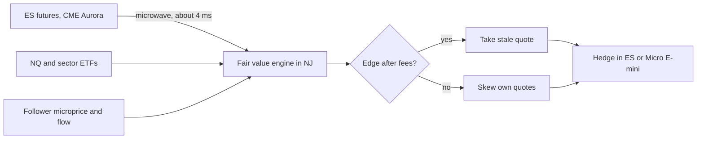
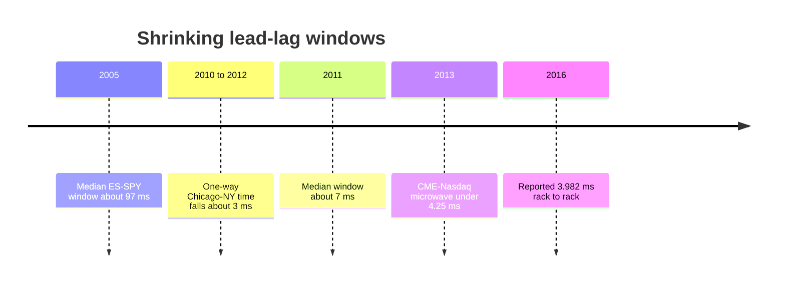

# Lead-lag and cross-asset arbitrage

> **TL;DR**
>
> - Prices are discovered first in the cheapest, most levered instrument (for US large caps, E-mini futures) and propagate to ETFs, constituents and ADRs (Hasbrouck 2003) `[Verified]`.
> - The trade: price each follower from beta-weighted leader moves, take stale quotes or skew your own, and hedge in the leader.
> - The fast end is latency arbitrage over a Chicago–New Jersey path within ~2% of light speed `[Estimate]`; at seconds to minutes it is a statistical forecast with more capacity.
> - Slow quoters and resting orders in the follower pay. Windows shrank from ~100 ms (2005) to single-digit ms (2011) `[Verified]`.

**Level:** Core · **Read time:** ~8 min · **Last verified:** 2026-11

| Field | Value |
|---|---|
| Family | speed & structural |
| Edge source | speed · informational |
| Holding period | milliseconds (futures to ETF) to minutes (ETF to constituents); hours for ADRs across time zones |
| Counterparty: who pays and why they accept it | Stale quoters and resting limit orders in the follower. Market makers accept because spread income covers the misses; passive institutional orders accept pick-offs in exchange for not paying the spread. |
| Universe & instruments | ES, NQ and RTY futures; SPY, QQQ, IWM and sector ETFs; large-cap constituents; ADRs vs home-market shares |
| Data required | CME and equity direct feeds with synchronized clocks; ETF holdings; FX for ADRs |
| Core algorithms used | [M2 Fair value and microprice](../../03-algorithms/f-market-making-and-hft-algorithms/fair-value-and-microprice.md) · [F1 Linear models and regularization](../../03-algorithms/b-forecasting-models/linear-models-and-regularization.md) · [M3 Order-book and trade-flow signals](../../03-algorithms/f-market-making-and-hft-algorithms/order-book-and-trade-flow-signals.md) · [M7 Hedging algorithms](../../03-algorithms/f-market-making-and-hft-algorithms/hedging-algorithms.md) |
| Infra intensity | extreme for sub-ms futures to cash; moderate at seconds; low for ADRs |
| Capacity (rough $ range) | fast end: tens of \$M/yr P&L for a top firm; slow end: a few hundred \$M of gross intraday positions `[Estimate]` (fast end shares the latency-arbitrage pool; slow end is capped by follower liquidity) |
| Typical Sharpe (gross vs net) | fast end: very high for the fastest, near zero for the rest `[Lore]`; seconds-to-minutes books: gross 2–4, net 1–2 `[Estimate]` (practitioner estimate: many small bets, low R²); no disclosures; fast windows decayed 2005–2011 |
| Turnover | very high; inventory flattened intraday |
| Main risks / failure modes | beta breaks on stock news, leader noise, coarse hedges, rank loss, halts |
| Crowding risk | high at the fast end; moderate at the statistical end |
| Firm types that run it | HFT prop firms, electronic and ETF market makers; stat-arb funds at the slower end |
| Lab | — |

## Intuition (the story in plain English)

When news hits the S&P 500, the cheapest way to act is one E-mini contract: high leverage, tiny fees, no short-sale friction. So futures move first, in Aurora, Illinois. SPY, sector ETFs and stocks in New Jersey follow once the news arrives and their market makers react. Knowing how much each follower moves per point of ES lets you price it before its own book does. The same logic links an ETF to its holdings, a sector ETF to its members, and an [ADR](../../09-reference/glossary.md#adr) to its home-market share ([ETF, futures and options linkages](../../01-market-structure/etf-futures-options-linkages.md)).

## Economic rationale: why should this make money at all?

Informed traders concentrate in the leader, so it carries most of the [information share](../../09-reference/glossary.md#information-share). Followers lag by transmission plus reaction time, and stale quotes in that window fund the trade. The fast end is pure speed; at seconds to minutes it is slow diffusion of factor news into thinly watched names, a genuine forecast of [fair value](../../09-reference/glossary.md#fair-value).

## The trade, step by step

1. **Estimate offline:** each follower's betas and lag profile by regularized regression ([F1](../../03-algorithms/b-forecasting-models/linear-models-and-regularization.md)).
2. **Reprice live:** on every leader update, shift the follower's fair value by the beta-weighted leader return ([M2](../../03-algorithms/f-market-making-and-hft-algorithms/fair-value-and-microprice.md)).
3. **Combine:** blend with the follower's own [microprice](../../09-reference/glossary.md#microprice) and order flow ([M3](../../03-algorithms/f-market-making-and-hft-algorithms/order-book-and-trade-flow-signals.md)).
4. **Act:** usually skew quotes; take only when edge beats fees.
5. **Hedge and unwind:** offset in the leader, then flatten when the follower catches up ([M7](../../03-algorithms/f-market-making-and-hft-algorithms/hedging-algorithms.md)).

## Worked example with numbers

**Speed** `[Estimate]`: Aurora to New Jersey is ~1,175 km, 3.92 ms at vacuum light speed; microwave reached 3.982 ms (2016) and the best fiber took 6.65 ms (2013) `[Reported]`. Fiber users arrive ~2.7 ms after the race ends.

**Fair value** (illustrative): ES at 6,000 jumps 2.5 points (10 ticks) on a headline; a \$200 stock has 100 ms beta 1.3, shrunk by 0.5.

| Step | Calculation | Result |
|---|---|---|
| Leader return | 2.5 / 6,000 | +4.17 bps |
| Implied follower move | 0.5 × 1.3 × 4.17 bps × \$200 | +\$0.054 |
| New fair value | mid 199.99 + 0.054 | 200.044 |
| Edge on stale 200.00 ask after 0.3¢ fee | 4.4¢ − 0.3¢ | 4.1¢/share |
| Expected P&L, 500 shares | 500 × \$0.041 | +\$20.50 |
| Hedge | 500 × \$200 × 1.3 ÷ \$30,000 per Micro E-mini | sell ≈ 4 contracts |

## Signals and algorithms under the hood

Betas come from [regularized linear models](../../03-algorithms/b-forecasting-models/linear-models-and-regularization.md); the live [fair value](../../03-algorithms/f-market-making-and-hft-algorithms/fair-value-and-microprice.md) runs inside the [HFT trading loop](../../03-algorithms/f-market-making-and-hft-algorithms/anatomy-of-an-hft-trading-loop.md); offsets use [hedging algorithms](../../03-algorithms/f-market-making-and-hft-algorithms/hedging-algorithms.md).

```python
import numpy as np

def fit_betas(X_lead, y_follow, lam=1e-3):
    # Offline ridge: X_lead (n_events, k) leader log-returns over the last L ms,
    # y_follow (n_events,) follower log-return over the next H ms, in event time
    k = X_lead.shape[1]
    return np.linalg.solve(X_lead.T @ X_lead + lam * np.eye(k), X_lead.T @ y_follow)

def lead_lag_fair_value(follower_micro, leader_ret_since_sync, betas, shrink=0.5):
    # Shrink toward zero: out-of-sample R^2 at ms horizons is low
    implied_ret = shrink * float(np.dot(betas, leader_ret_since_sync))
    return follower_micro * (1.0 + implied_ret)

def decide(fv, best_bid, best_ask, take_fee=0.003, edge_ticks=0.5, tick=0.01):
    if fv - best_ask - take_fee > edge_ticks * tick:
        return "TAKE_ASK"        # lift the stale offer, then hedge in the leader
    if best_bid - fv - take_fee > edge_ticks * tick:
        return "HIT_BID"
    return "SKEW_QUOTES"         # usual case: move our own quotes toward fv
```

## Implementation choices that matter

- **Event time, not clock time.** Asynchronous trading depresses measured correlation at short horizons (the [Epps effect](../../09-reference/glossary.md#epps-effect)); sample on leader updates.
- **Timestamps.** Estimate lags with exchange timestamps, not your receive times.
- **Leader set.** ES, NQ, the sector ETF and top holdings; ridge keeps them from fighting.
- **Hedge size.** ES is \$50 × index; Micro E-minis (\$5 × index) hedge finer at higher cost.

## P&L decomposition

Illustrative seconds-scale taking book, 3M shares/day.

| Line | ¢/share | \$k/day |
|---|---|---|
| Predicted move captured | +0.80 | +24.0 |
| Take fees | −0.30 | −9.0 |
| Hedge slippage and futures fees | −0.15 | −4.5 |
| Misses on stock-specific news | −0.15 | −4.5 |
| **Trading margin** | **+0.20** | **+6.0** |

The bigger payoff is often defensive: less adverse selection on market-making quotes `[Lore]`.

## Evidence

- **Hasbrouck (2003, *JF*):** E-mini futures dominate price discovery for the S&P 500 and Nasdaq-100; for the S&P 400, without an E-mini, discovery is shared between regular futures and the ETF `[Verified]`. Method: information shares (Hasbrouck 1995).
- **Ates & Wang (2005):** since September 1998, E-minis out-contribute floor-traded futures `[Verified]`.
- **Budish, Cramton & Shim (2015):** ES–SPY correlation collapses at millisecond horizons; median arbitrage windows fell from 97 ms (2005) to 7 ms (2011) `[Verified]`.
- **Laughlin, Aguirre & Grundfest (2014):** one-way Chicago–New York time fell ~3 ms between 2010 and 2012 `[Verified]`.
- **Cross-market HFT:** Menkveld (2013) and Baron et al. (2019) show speed paying off across markets `[Verified]`.

## Capacity, crowding and decay

Physics saturates the futures-to-cash leg, so edge migrated to better models (more leaders, intraday betas) and slower horizons with more capacity but lower R² `[Estimate]`. As ETF trading grows, the ETF can lead its own constituents `[Lore]`.

## How it fails

- **Beta breaks:** on single-stock news the follower leads, and leader-based fair value is badly wrong.
- **Leader noise and halts:** a flickering ES quote triggers trades that reverse; a halted follower cannot be traded.
- **Episodes:** on 6 May 2010, per the CFTC-SEC report, E-mini selling was transmitted to equities through cross-market arbitrage `[Reported]`; on 24 August 2015 many stocks opened late and ETFs traded far from their constituents (see [ETF and index arbitrage](etf-and-index-arbitrage.md)) `[Reported]`.

## Textbook vs how it's done today

- **Textbook:** a cointegrated futures-cash VECM in clock time (Hasbrouck) `[Verified]`. **Practice:** event-time models keyed to leader updates, re-estimated intraday and shrunk `[Lore]`.
- **Textbook:** ADR parity arbitrage. **Practice:** conversion fees, FX, borrow and non-overlapping hours make it a statistical trade during the overlap `[Lore]`.
- **Textbook:** a standalone strategy. **Practice:** mostly an input to [equity](../a-liquidity-provision/equity-market-making.md) and [ETF market making](../a-liquidity-provision/etf-market-making.md) `[Lore]`.

## Variants and neighbours

Futures to ETFs; ETF to constituents; sector ETF to members; ADRs; options-implied prices to stock; Treasury futures to rate-sensitive stocks. Neighbours: [latency arbitrage](latency-arbitrage.md) (mechanical end), [ETF and index arbitrage](etf-and-index-arbitrage.md) (creation-anchored), [pairs trading](../c-statistical-arbitrage/pairs-trading-and-cointegration.md) (days-scale cousin).

## Diagram





## How practitioners talk about it

- "Shrink the beta, the R² is garbage at 50 ms." → Use partial adjustments at short horizons.
- "The stock decoupled on the headline." → Single-stock news broke the beta.
- "It's in our fair value, not a strategy." → Lead-lag is an input to quoting.
- "NQ led on that print, not ES." → Tech news hit Nasdaq futures first.
- "We're flat deltas, long the lag." → Hedged in futures, waiting for the follower.
- "ADRs are dead until London opens." → No overlap means no hedge.

## Myths vs reality

- **Myth:** futures always lead. **Reality:** information shares vary; on single-stock news the cash market leads.
- **Myth:** cointegration means riskless arbitrage. **Reality:** conversion costs, borrow and halts limit enforcement.

## Questions you could ask a quant about this

- *Basic:* Which instruments lead your names, and how do you know?
- *Basic:* Do you mostly take on these signals or quote on them?
- *Informed:* Do you estimate lags in event time or clock time?
- *Informed:* How fast do betas recover after a single-stock headline?
- *Sharp:* What share of your lead-lag value shows up as lower adverse selection rather than taking P&L?
- *Sharp:* 🔒 How many leaders feed each fair value, and how do you shrink them?

## Go deeper

<details markdown="1">
<summary>Math: information share and lag estimation</summary>

Prices of one asset in $n$ markets follow a VECM with error covariance $\Omega$ and efficient-price innovation $\psi e_t$. With $F$ the Cholesky factor of $\Omega$, market $j$'s information share is

$$
IS_j = \frac{([\psi F]_j)^2}{\psi \Omega \psi'}
$$

Ordering changes $F$, so studies report bounds. A simple lag estimate:

$$
\ell^* = \arg\max_{\ell} \operatorname{corr}\left(r^{\text{lead}}_t, \, r^{\text{follow}}_{t+\ell}\right)
$$

</details>

## Related pages

- [Latency arbitrage](latency-arbitrage.md) · [ETF and index arbitrage](etf-and-index-arbitrage.md) · [ETF market making](../a-liquidity-provision/etf-market-making.md)
- [M2 Fair value and microprice](../../03-algorithms/f-market-making-and-hft-algorithms/fair-value-and-microprice.md) · [M7 Hedging algorithms](../../03-algorithms/f-market-making-and-hft-algorithms/hedging-algorithms.md)
- [Colocation, networks and the speed of light](../../05-infrastructure/colocation-networks-and-the-speed-of-light.md)

## Sources

- [Verified] Hasbrouck, J. (2003). "Intraday Price Formation in U.S. Equity Index Markets." *Journal of Finance* 58(6), 2375–2400. <https://ideas.repec.org/a/bla/jfinan/v58y2003i6p2375-2400.html> (accessed 2026-11)
- [Verified] Hasbrouck, J. (2000). "Intraday Price Formation in US Equity Index Markets." NYU Stern working paper FIN-00-046. <https://archive.nyu.edu/handle/2451/27374> (accessed 2026-11)
- [Verified] Ates, A. & Wang, G. H. K. (2005). "Information transmission in electronic versus open-outcry trading systems: An analysis of U.S. equity index futures markets." *Journal of Futures Markets* 25(7), 679–715. <https://econpapers.repec.org/RePEc:wly:jfutmk:v:25:y:2005:i:7:p:679-715> (accessed 2026-11)
- [Verified] Budish, E., Cramton, P. & Shim, J. (2015). "The High-Frequency Trading Arms Race: Frequent Batch Auctions as a Market Design Response." *Quarterly Journal of Economics* 130(4), 1547–1621. <https://econpapers.repec.org/RePEc:oup:qjecon:v:130:y:2015:i:4:p:1547-1621> (accessed 2026-11)
- [Verified] Laughlin, G., Aguirre, A. & Grundfest, J. (2014). "Information Transmission between Financial Markets in Chicago and New York." *Financial Review* 49(2), 283–312. <https://arxiv.org/abs/1302.5966v1> (accessed 2026-11)
- [Verified] Nasdaq (n.d.). "CME-Nasdaq microwave connectivity" product sheet. <https://www.nasdaqtrader.com/content/Productsservices/trading/CoLo/microwave.pdf> (accessed 2026-11)
- [Reported] Markets Media (2013). "CME and Nasdaq launch microwave link." <https://www.marketsmedia.com/cme-and-nasdaq-launch-microwave-link> (accessed 2026-11)
- [Reported] McKay Brothers / WatersTechnology (2016). "Quincy: Latency Reductions 'Nearing Perfection' on Aurora-NJ Data Network." <https://mckay-brothers.com/quincy-latency-reductions-nearing-perfection-on-aurora-nj-data-network> (accessed 2026-11)
- [Verified] Menkveld, A. J. (2013). "High frequency trading and the new market makers." *Journal of Financial Markets* 16(4), 712–740. <https://econpapers.repec.org/RePEc:eee:finmar:v:16:y:2013:i:4:p:712-740> (accessed 2026-11)
- [Verified] Baron, M., Brogaard, J., Hagströmer, B. & Kirilenko, A. (2019). "Risk and Return in High-Frequency Trading." *Journal of Financial and Quantitative Analysis* 54(3), 993–1024. <https://ideas.repec.org/a/cup/jfinqa/v54y2019i03p993-1024_00.html> (accessed 2026-11)
- [Verified] CFTC and SEC (2010-09-30). "Findings Regarding the Market Events of May 6, 2010." <https://www.sec.gov/news/studies/2010/marketevents-report.pdf> (accessed 2026-11)
