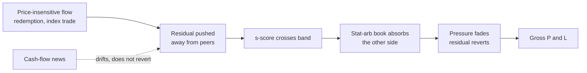
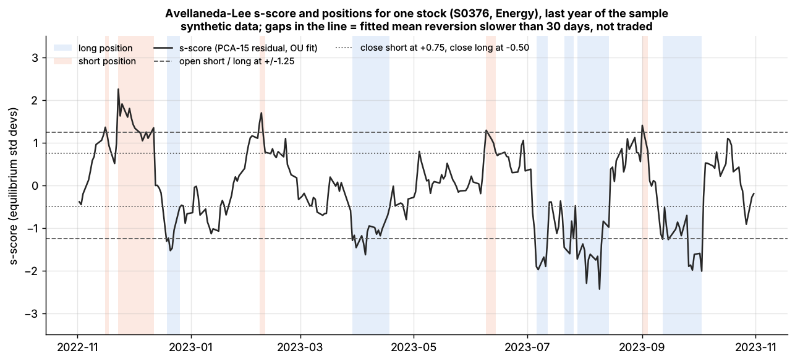
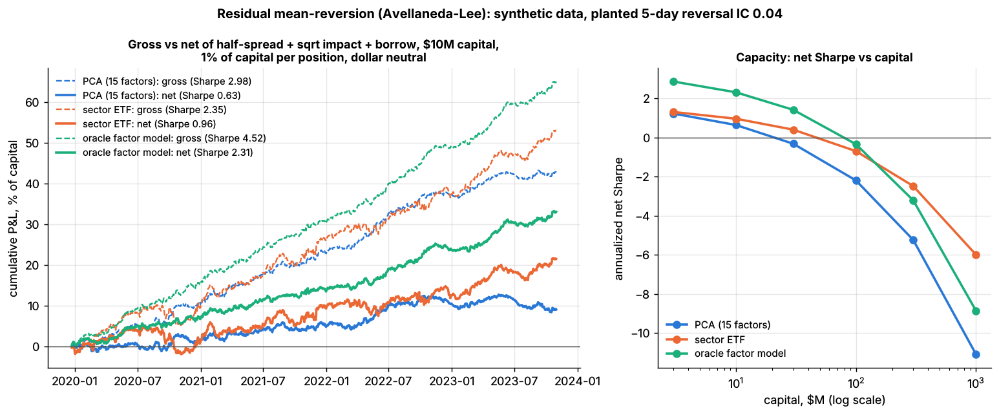
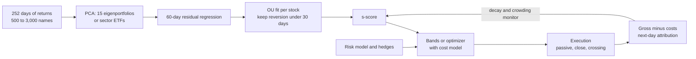

# Factor-residual mean reversion

> **TL;DR**
>
> - Strip each stock's return of what its factors (market, sector, statistical components) explain. The leftover [residual](../../09-reference/glossary.md#residual-return) tends to reverse over days: buy stocks whose cumulative residual is unusually low, short the unusually high, hedge the factors.
> - Avellaneda & Lee (2010): 15 PCA eigenportfolios, residuals fitted as an [Ornstein–Uhlenbeck process](../../09-reference/glossary.md#ornstein-uhlenbeck-process), trade at |s| > 1.25. Net of 10 bps round-trip costs: Sharpe 1.44 over 1997–2007 but 0.9 in 2003–07; sector-ETF version 1.1 `[Verified]`.
> - You are paid for absorbing price-insensitive flows; typical NYSE pricing errors have a 3.2-point standard deviation and a 6.2-week half-life `[Verified]`.
> - It is a turnover machine. Lab 09 turns its gross book 57× a year: gross Sharpe 3.0 becomes 0.63 net at \$10M and −2.20 at \$100M, with a break-even cost of 9.7 bps per dollar traded (synthetic lab result).
> - It is crowded: in August 2007 Avellaneda–Lee backtests lost 5% (PCA) and 10% (ETF) in days, then recovered `[Verified]`.

**Level:** Core · **Read time:** ~12 min · **Last verified:** 2026-11

| Field | Value |
|---|---|
| Family | stat arb |
| Edge source | liquidity provision · behavioral |
| Holding period | 1–15 days (A&L: average expected reversion ~7 days `[Verified]`; Lab 09: 9.3 days) |
| Counterparty: who pays and why they accept it | Price-insensitive liquidity demanders: funds rebalancing or meeting redemptions, index and ETF flows, liquidations. Their motive is a mandate or a deadline, so a few bps of slippage is acceptable. Traders who overreact to moves without news also pay. |
| Universe & instruments | 500–3,000 liquid US stocks (A&L: market cap above \$1B) `[Verified]`; sector ETFs and index futures as hedges |
| Data required | point-in-time daily (or intraday) returns and volume, sector maps or ETF holdings, a risk model, borrow, event calendars |
| Core algorithms used | [P1 Risk models](../../03-algorithms/d-portfolio-construction/risk-models.md) · [P2 Covariance estimation and shrinkage](../../03-algorithms/d-portfolio-construction/covariance-estimation-and-shrinkage.md) · [D3 Signal transforms](../../03-algorithms/a-data-and-signals/signal-transforms.md) · [P3 Mean-variance optimization](../../03-algorithms/d-portfolio-construction/mean-variance-optimization.md) · [P5 Transaction cost and impact models](../../03-algorithms/d-portfolio-construction/transaction-cost-and-impact-models.md) |
| Infra intensity | moderate: daily or intraday batch; execution quality matters more than compute |
| Capacity (rough $ range) | \$100M–\$1B GMV for the plain signal `[Estimate]` (at ~50× turnover a \$1B book trades ~\$200M a day; spread plus impact nears the ~10 bps break-even around that size); more as one input to a multi-signal book. Lab 09: net Sharpe 0.63 at \$10M, −2.20 at \$100M (synthetic) |
| Typical Sharpe (gross vs net) | A&L, net of 10 bps round trip: PCA 1.44 (1997–2007), 0.9 (2003–07); ETF in trading time 1.51 (2003–07) (academic backtest, decayed after 2002) `[Verified]`; practitioner net 1–2 as one signal in a diversified book `[Lore]` |
| Turnover | 40–60× gross a year `[Estimate]` (holds of 5–10 days); Lab 09: 57× |
| Main risks / failure modes | crowded unwinds, cost overruns, factor leakage, news-driven residuals that drift instead of reverting |
| Crowding risk | high: a published recipe run on shared data and factor models |
| Firm types that run it | quant hedge funds, multi-manager stat-arb pods, proprietary trading firms `[Lore]` |
| Lab | [Lab 09](https://github.com/FrankHuang94/quant_trading_claude/tree/main/labs/09-pca-residual-stat-arb) |

## Intuition (the story in plain English)

If a chipmaker falls 3% on a day semiconductors fall 3%, there is nothing to trade. If it falls 3% while its sector rises 1% and there is no news, its residual is −4%, and on average part of that comes back.

[Pairs trading](pairs-trading-and-cointegration.md) hedges with one twin. Here every stock gets a synthetic twin built from factors: 15 statistical components, a sector ETF, or a commercial [risk model](../../09-reference/glossary.md#risk-model). That gives a residual for every name, not only the few with a natural partner, so the book holds hundreds of small bets.

## Economic rationale: why should this make money at all?

1. **Liquidity provision.** The same fee that pays [short-term reversal](short-term-cross-sectional-reversal.md): it rises with the VIX (Nagel 2012) `[Verified]`, and moves on heavy volume reverse more (Campbell, Grossman & Wang 1993) `[Reported]`, which is why A&L also scale returns by volume ("trading time").
2. **Measured pricing errors.** In a structural model of NYSE inventories and retail flow, the typical stock's pricing error has a standard deviation of 3.2 percentage points and a 6.2-week half-life, 9.4% of daily idiosyncratic variance (Hendershott, Menkveld, Praz & Seasholes 2022) `[Verified]`.
3. **Overreaction, but only to non-news.** Residuals not explained by cash-flow news reverse more; removing news quadruples the risk-adjusted reversal return. Liquidity shocks drive the long side, sentiment the short side (Da, Liu & Schaumburg 2014) `[Verified]`. News-driven residuals drift instead ([earnings](../d-mid-frequency-alpha/earnings-and-event-driven.md)).



## The trade, step by step

1. **Factors.** Take the 252-day correlation matrix (Lab 09 refits it weekly) and its top 15 eigenvectors; eigenportfolio weights are $Q_{ij} = v_{ij}/\sigma_i$ ([PCA](../../09-reference/glossary.md#principal-component-analysis-pca)). Or use sector ETFs.
2. **Residuals.** Regress each stock's last 60 daily returns (about one earnings cycle) on the factor returns, with an intercept.
3. **OU fit.** Fit the cumulative residual as an AR(1); keep stocks whose mean-reversion time is under 30 days.
4. **[s-score](../../09-reference/glossary.md#s-score)** = distance from equilibrium in equilibrium standard deviations, with equilibrium levels centered across stocks.
5. **Bands (A&L).** Open long below −1.25, short above +1.25; close longs above −0.50, shorts below +0.75.
6. **Hedge.** A&L hedge each \$1 of stock with β dollars of its ETF (SPY for the PCA book); Lab 09 hedges net dollars with an equal-weight basket.

## Worked example with numbers

Illustrative stock XYZ, \$10M book, 1% per position.

| Quantity | Calculation | Value |
|---|---|---|
| AR(1) fit on 60 days | X[t+1] = a + b X[t] + ζ | b = 0.90, sd(ζ) = 1.2% |
| Mean-reversion time | 1 / (−ln 0.90) | 9.5 days (under 30: tradeable) |
| Equilibrium sd | 1.2% / √(1 − 0.81) | 2.75% |
| s-score, with X = −3.6%, centered m = +0.4% | (−3.6% − 0.4%) / 2.75% | −1.45 → buy \$100k, hedge factors |
| OU-implied gain in 7 days | 4.0% × (1 − 0.9⁷) | 2.1%, \$2,100 |
| Lab 09 realized gross per round trip | \$1.07M ÷ ~5,000 round trips | ~\$210 (21 bps) `[Estimate]` |
| Costs per round trip | \$0.81M ÷ ~5,000 | ~\$160 (16 bps) |

The model expects 210 bps; the market pays about a tenth of that, because a 60-day OU fit mostly fits noise (the s-score's IC is 0.013). Costs then eat three-quarters of what is left.

## Signals and algorithms under the hood

Factors come from [P1](../../03-algorithms/d-portfolio-construction/risk-models.md) and [P2](../../03-algorithms/d-portfolio-construction/covariance-estimation-and-shrinkage.md); the s-score is a [D3](../../03-algorithms/a-data-and-signals/signal-transforms.md) transform. Production books feed −s into an optimizer ([P3](../../03-algorithms/d-portfolio-construction/mean-variance-optimization.md), [P6](../../03-algorithms/d-portfolio-construction/multi-period-and-trading-toward-aim.md)) with a cost model ([P5](../../03-algorithms/d-portfolio-construction/transaction-cost-and-impact-models.md)).

```python
# Mirrors Lab 09's core (labs/09-pca-residual-stat-arb/lab.py); days x stocks, last row = today.
def pca_residuals(returns, n_factors=15, resid_window=60):     # returns: last 252 days
    sigma = returns.std(axis=0, ddof=1)
    Y = (returns - returns.mean(axis=0)) / sigma
    eigval, U = np.linalg.eigh(Y @ Y.T)                        # days x days Gram trick
    top = np.argsort(eigval)[::-1][:n_factors]
    Q = (Y.T @ U[:, top] / np.sqrt(eigval[top])) / sigma[:, None]   # eigenportfolios v / sigma
    R = returns[-resid_window:]
    X = np.column_stack([np.ones(resid_window), R @ Q])        # drift + factor returns
    return R - X @ np.linalg.solve(X.T @ X, X.T @ R)           # residuals

def ou_sscore(residuals, max_reversion_days=30.0):
    X = np.cumsum(residuals, axis=0)                           # cumulative residual: OU level
    x0, x1 = X[:-1], X[1:]
    d0, d1 = x0 - x0.mean(0), x1 - x1.mean(0)
    b = (d0 * d1).sum(0) / (d0 ** 2).sum(0);  a = x1.mean(0) - b * x0.mean(0)  # AR(1) per stock
    m = a / (1 - b);  m = m - m.mean()                         # equilibrium, centered across stocks
    sigma_eq = np.sqrt((x1 - a - b * x0).var(0, ddof=1) / (1 - b**2))
    ok = (b > 0) & (b < 1) & (-1 / np.log(b) < max_reversion_days)  # 1/kappa in days
    return np.where(ok, (X[-1] - m) / sigma_eq, np.nan)        # (lab guards invalid b first)

def sscore_positions(s, prev, s_open=1.25, s_close_long=0.50, s_close_short=0.75):
    pos = prev.copy()
    pos[(prev == 0) & (s < -s_open)] = 1;  pos[(prev == 0) & (s > s_open)] = -1
    pos[((prev == 1) & (s > -s_close_long)) | ((prev == -1) & (s < s_close_short))] = 0
    pos[np.isnan(s)] = 0                                       # no valid fit: close
    return pos
```

[Lab 09](https://github.com/FrankHuang94/quant_trading_claude/tree/main/labs/09-pca-residual-stat-arb) runs this on 500 synthetic stocks with a planted 5-day residual reversal (daily IC 0.04, strong and stationary by design), and compares PCA, sector-ETF and oracle residuals.



*One stock's s-score over a year with the ±1.25 entry bands. Notice how many band crossings there are: each is a round trip that pays costs. Synthetic data.*



*Left: gross (dashed) vs net (solid) P&L, \$10M book; costs take most of the gross. Right: net Sharpe falls below zero between \$10M and \$30M for PCA. Synthetic data.*

Synthetic lab result: PCA residuals correlate 0.86 with the true specific returns, but the s-score recovers an IC of only 0.013 of the planted 0.04. Gross Sharpe 2.98, net 0.63 at \$10M. With a flat cost per dollar traded, net Sharpe is 2.89 at 0 bps, 1.40 at 5 bps and −0.10 at 10 bps. These Sharpes are far above A&L's real 0.9–1.44 because the planted effect is clean and constant.

## Implementation choices that matter

- **Factor set.** In Lab 09 the oracle fundamental model beats PCA and ETF on every seed, while PCA vs ETF flips by seed. A&L found 15-PCA beat actual ETFs after 2002, but volume-scaled ETF signals did best in 2003–07 `[Verified]`.
- **Number of factors.** Too many overfits the 60-day regression: Lab 09 net Sharpe −0.38 with 30 factors vs 0.63 with 15. A&L also tried a variable count explaining 55% of variance `[Verified]`.
- **News filters.** Skip residuals on earnings and news days (Da et al. logic).
- **From bands to optimizer.** Treat −s as an alpha, net it against other signals, and trade toward the target with a turnover penalty `[Lore]`.
- **Execution.** Break-even near 10 bps per dollar traded means all-in costs of a few bps: passive orders, the close, internal crossing ([execution algorithms](../../03-algorithms/e-execution-algorithms/execution-algorithms-overview.md)).

## P&L decomposition

| Line, per year | Lab 09 PCA book, \$10M (% of capital, synthetic) | Illustrative \$1B GMV book (% of GMV) |
|---|---|---|
| Gross residual alpha | +10.7 | +7.0 |
| Passive fills and crossing savings | — | +0.5 |
| Spread and impact | −8.1 | −4.0 |
| Commissions and fees | — | −0.2 |
| Borrow | −0.33 | −0.4 |
| Financing | — | −0.3 |
| **Net** | **+2.3** | **+2.6** |

In both, costs consume over half of gross alpha. At 2.5% volatility on GMV the illustrative book's Sharpe is about 1.0; at 4× leverage, about 10% on equity before fees.

## Evidence

- **Avellaneda & Lee (2010).** Stocks above \$1B market cap; 60-day window; 5 bps per trade; 2+2 leverage targeting about 10% volatility. Typical residuals had about 300 bps of equilibrium volatility and 7-day reversion. Best PCA years (Sharpe above 2) were 2000–2002 and 2004 `[Verified]`.
- **Decay.** A simple contrarian rule fell from 1.38% a day (1995) to 0.13% (2007) (Khandani & Lo) `[Verified]`.
- **ML residuals.** Deep-learning residual portfolios reach Sharpe above 4 before costs (Guijarro-Ordonez, Pelger & Zanotti 2026, academic backtest) `[Verified]`.

## Capacity, crowding and decay

Lab 09 net Sharpe by capital (1% of capital per position, synthetic):

| Capital | \$3M | \$10M | \$30M | \$100M | \$1B |
|---|---|---|---|---|---|
| PCA, 15 factors | 1.22 | 0.63 | −0.32 | −2.20 | −11.09 |
| Sector ETF | 1.30 | 0.96 | 0.40 | −0.70 | −6.00 |

The toy executes every position in one day against about \$56M of ADV, so real capacity is far larger; the shape is the lesson. [Square-root impact](../../09-reference/glossary.md#square-root-law) makes cost per dollar rise with size while alpha per dollar is fixed. Crowding is structural: shared factor models produce the same residuals, hence the same trades.

## How it fails

- **Crowded unwind, August 2007.** All of A&L's mean-reversion strategies fell sharply in early August and recovered in about 10 days: −5% for PCA, −10% for ETF, at 2+2 leverage. Technology and consumer discretionary moved more than financials, consistent with forced unwinding `[Verified]`. See the [failure gallery](../h-cross-cutting/strategy-failure-gallery.md).
- **Correlation spikes.** In summer 2007 the top 15 eigenvectors explained more variance (A&L) `[Verified]`; when one factor dominates, residuals carry market risk.
- **News residuals** drift against the position.
- **Cost overrun.** In Lab 09, 10 bps per dollar instead of 5 turns net Sharpe 1.40 into −0.10.

## Textbook vs how it's done today

| Textbook (A&L 2010) | Practice today |
|---|---|
| 15 PCA factors or sector ETFs | fundamental risk model plus statistical factors for transient themes `[Lore]` |
| Per-stock bands | −s as one alpha in a cost-aware optimizer `[Lore]` |
| Daily closes, 60-day OU | intraday residuals at several horizons `[Lore]` |
| Per-stock OU parameters | pooled ML residual forecasts (Guijarro-Ordonez et al. 2026) `[Verified]` |
| Flat 10 bps round trip | measured TCA, passive fills, internal crossing `[Lore]` |

## Variants and neighbours

[Pairs trading](pairs-trading-and-cointegration.md) (one partner) · [short-term reversal](short-term-cross-sectional-reversal.md) (raw or industry-adjusted returns) · [ML-driven short-horizon alpha](ml-driven-short-horizon-alpha.md) · [ETF and index arbitrage](../b-speed-and-structural/etf-and-index-arbitrage.md) · slower [cross-sectional alpha](../d-mid-frequency-alpha/cross-sectional-alpha-and-neutralization.md).

## Diagram



## How practitioners talk about it

- "Fifteen PCs, sixty days, 1.25 in, a half out." → The A&L recipe.
- "We turn the book fifty times a year; execution is the strategy." → Break-even sits near 10 bps.
- "Don't fade earnings residuals." → News residuals drift.
- "The first eigenvector ate half the variance that week." → Correlation spike; residuals carry market risk.
- "We're the other side of the redemption flow." → Liquidity provision.
- "Our residual alpha is mostly crossed against the momentum book." → Internal netting saves the spread.

## Myths vs reality

- **Myth:** a gross Sharpe of 3 means a great strategy. **Reality:** at 57× turnover, 10 bps per dollar erases it.
- **Myth:** more factors give cleaner residuals. **Reality:** they overfit short windows (Lab 09).
- **Myth:** every residual reverts. **Reality:** news-driven residuals drift.

## Questions you could ask a quant about this

- *Basic:* Statistical factors, ETFs or a fundamental risk model for residuals?
- *Informed:* What is your break-even cost per dollar traded, and what do you pay?
- *Informed:* How do you treat residuals on earnings and news days?
- *Sharp:* How did the book behave in August 2007 or March 2020, and how fast did you de-gross?
- *Sharp:* 🔒 How much residual alpha is crossed internally versus executed on the street?
- *Sharp:* 🔒 Where does your capacity curve cross zero?

## Go deeper

<details markdown="1">
<summary>Math: eigenportfolios, the OU fit and the s-score</summary>

**Factors.** With standardized returns $Y$, take the top eigenvectors $v_j$ of the correlation matrix. Eigenportfolio $j$ holds $Q_{ij} = v_{ij}/\sigma_i$, so $F_{jt} = \sum_i Q_{ij} R_{it}$. Residuals come from

$$
R_{it} = \beta_{i0} + \sum_{j=1}^{k} \beta_{ij} F_{jt} + \epsilon_{it} .
$$

**OU fit.** The cumulative residual $X_i(t) = \sum_{s \le t} \epsilon_{is}$ follows $dX = \kappa(m - X)\,dt + \sigma\,dW$. Daily, $X_{t+1} = a + b X_t + \zeta$ with $b = e^{-\kappa/252}$ and $a = m(1-b)$, so

$$
\kappa = -252 \ln b, \qquad m = \frac{a}{1-b}, \qquad \sigma_{eq} = \frac{\sigma}{\sqrt{2\kappa}} = \sqrt{\frac{\operatorname{Var}(\zeta)}{1-b^2}}, \qquad s = \frac{X - m}{\sigma_{eq}} .
$$

A&L require $\kappa > 252/30 \approx 8.4$. With a residual drift $\alpha$, they define $s_{mod} = s - \alpha/(\kappa\,\sigma_{eq})$ and found it changed little.

**Break-even cost.** Gross return $g$ per year and dollars traded $T$ per dollar of capital give break-even cost $c^* \approx g/T$. Lab 09: $10.7\% / 107 \approx 10$ bps.

</details>

## Related pages

- [Stat arb: overview and history](stat-arb-overview-and-history.md) · [Pairs trading and cointegration](pairs-trading-and-cointegration.md) · [Short-term cross-sectional reversal](short-term-cross-sectional-reversal.md)
- [P1 Risk models](../../03-algorithms/d-portfolio-construction/risk-models.md) · [P5 Transaction cost and impact models](../../03-algorithms/d-portfolio-construction/transaction-cost-and-impact-models.md)
- [Strategy failure gallery](../h-cross-cutting/strategy-failure-gallery.md) · [Walkthrough: a mid-frequency stat-arb book](../../03-algorithms/h-end-to-end-walkthroughs/walkthrough-mid-frequency-stat-arb.md)

## Sources

- [Verified] Avellaneda, M. & Lee, J.-H. (2010). "Statistical arbitrage in the US equities market." *Quantitative Finance* 10(7), 761–782 (figures from the June 2009 author version). <https://doi.org/10.1080/14697680903124632> (accessed 2026-11)
- [Verified] Avellaneda, M. & Lee, J.-H. (2009). Author version of the above. <https://math.nyu.edu/~avellane/AvellanedaLeeStatArb20090616.pdf> (accessed 2026-11)
- [Verified] Nagel, S. (2012). "Evaporating Liquidity." *Review of Financial Studies* 25(7), 2005–2039. <https://doi.org/10.1093/rfs/hhs066> (accessed 2026-11)
- [Reported] Campbell, J. Y., Grossman, S. J. & Wang, J. (1993). "Trading Volume and Serial Correlation in Stock Returns." *Quarterly Journal of Economics* 108(4), 905–939. <https://doi.org/10.2307/2118454> (accessed 2026-11)
- [Verified] Hendershott, T., Menkveld, A. J., Praz, R. & Seasholes, M. (2022). "Asset Price Dynamics with Limited Attention." *Review of Financial Studies* 35(2), 962–1008. <https://doi.org/10.1093/rfs/hhab045> (accessed 2026-11)
- [Verified] Da, Z., Liu, Q. & Schaumburg, E. (2014). "A Closer Look at the Short-Term Return Reversal." *Management Science* 60(3), 658–674. <https://doi.org/10.1287/mnsc.2013.1766> (accessed 2026-11)
- [Verified] Khandani, A. E. & Lo, A. W. (2011). "What happened to the quants in August 2007? Evidence from factors and transactions data." *Journal of Financial Markets* 14(1), 1–46. <https://doi.org/10.1016/j.finmar.2010.07.005> (accessed 2026-11)
- [Verified] Guijarro-Ordonez, J., Pelger, M. & Zanotti, G. (2026). "Deep Learning Statistical Arbitrage." *Management Science* 72(9), 7502–7549 (arXiv 2106.04028). <https://doi.org/10.1287/mnsc.2022.03132> (accessed 2026-11)
