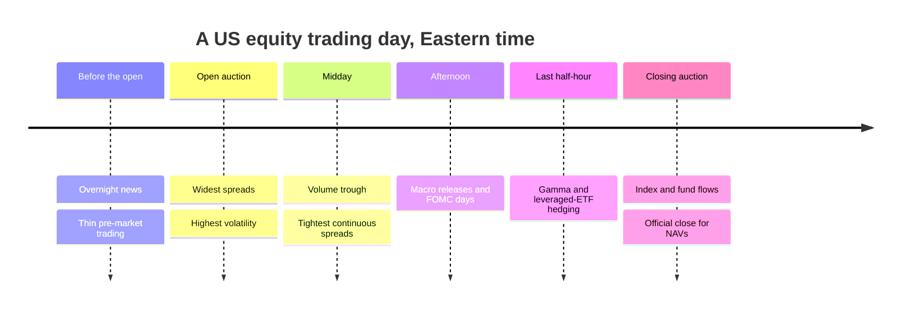
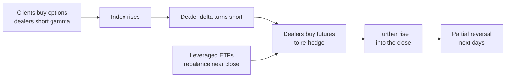

# Intraday patterns and seasonality

> **TL;DR**
>
> - Activity is U-shaped: volume and volatility peak at the open and close; spreads are widest at the open. The closing auction alone prints roughly 5–10% of volume (2025) `[Reported]`.
> - Market intraday momentum: the day's return to 3:30 p.m. predicts the last half-hour in 60+ futures markets (1974–2020), tied to dealers' and leveraged ETFs' gamma hedging.
> - Returns split into night and day: momentum and reversal profits accrue overnight, other strategies' intraday ("tug of war", Lou, Polk & Skouras 2019).
> - Calendar effects (turn of month, same-month seasonality, pre-FOMC drift) are small, and some have faded.
> - Firms mostly monetize these patterns as execution timing and ML features, not standalone bets.

**Level:** Core · **Read time:** ~8 min · **Last verified:** 2026-11

| Field | Value |
|---|---|
| Family | stat arb |
| Edge source | structural · behavioral |
| Holding period | Minutes to hours (intraday), overnight, days (turn of month), a month (seasonality) |
| Counterparty: who pays and why they accept it | Option dealers and leveraged ETFs re-hedging into the close; funds trading on fixed schedules or month-end cash needs. They trade for contractual reasons and care about timing, not a few bps |
| Universe & instruments | Index futures (E-mini S&P 500), SPY, QQQ and sector ETFs; liquid large caps |
| Data required | Intraday bars, auction imbalance feeds, option open interest by strike (for gamma estimates), event calendars |
| Core algorithms used | [D2 Feature engineering](../../03-algorithms/a-data-and-signals/feature-engineering.md) · [E5 Auction, close and dark-liquidity algos](../../03-algorithms/e-execution-algorithms/auction-close-and-dark-liquidity-algos.md) · [M3 Order-book and trade-flow signals](../../03-algorithms/f-market-making-and-hft-algorithms/order-book-and-trade-flow-signals.md) · [V3 Backtest pitfalls](../../03-algorithms/c-validation-and-backtesting/backtest-pitfalls.md) |
| Infra intensity | Moderate: minute data and a real-time imbalance feed; sub-second speed matters only near the close |
| Capacity (rough $ range) | Futures intraday momentum \$100M–\$1B `[Estimate]` (deep market, one trade a day at a few bps); single-stock patterns \$50M–\$300M `[Estimate]`; as execution timing, the whole book |
| Typical Sharpe (gross vs net) | SPY intraday momentum timing: ~6–7% a year gross, 1993–2013 academic backtest `[Reported]`. Pre-FOMC: +49 bps per meeting, 1994–2011, weaker since 2016 `[Reported]`. Standalone net 0.3–0.8 now `[Lore]` |
| Turnover | One round trip a day for intraday sleeves; monthly for calendar tilts |
| Main risks / failure modes | Hedging-regime flips, event days, crowded closes, calendar data snooping |
| Crowding risk | High at the close; moderate for intraday momentum since publication |
| Firm types that run it | Proprietary and HFT firms, CTAs, execution-research teams at quant funds, bank delta-one desks |
| Lab | — |

## Intuition (the story in plain English)

Overnight news is priced at the open; midday is quiet; at the close, index funds, option hedgers and everyone benchmarked to the close trade. These flows are predictable in timing, sometimes in direction, and whoever takes the other side earns a small premium.



## Economic rationale: why should this make money at all?

- **Clustering.** Discretionary traders bunch to cut costs and informed traders follow: U-shapes (Admati & Pfleiderer 1988) `[Verified]`.
- **Hedging demand.** A dealer short [gamma](../../09-reference/glossary.md#gamma) must buy after rises and sell after falls, pushing prices the same way into the close `[Verified]`.
- **Periodic institutions.** Funds trade at the same time daily, so half-hour returns repeat on later days (Heston, Korajczyk & Sadka 2010) `[Verified]`.
- **Clienteles and cash.** Different investors dominate night and day `[Verified]`; month-end payment needs move prices (Etula et al. 2020) `[Verified]`.

## The trade, step by step

| Pattern | Signal | Trade | Origin |
|---|---|---|---|
| Market intraday momentum | First half-hour (Gao) or prior close to 15:30 (Baltussen) | Futures 15:30 → 16:00 | Gao et al. (2018); Baltussen et al. (2021) |
| Half-hour periodicity | Same slot's return on prior days | Stocks, or timing of orders | Heston, Korajczyk & Sadka (2010) |
| Night versus day | Factor returns split at the open | Hold momentum overnight | Lou, Polk & Skouras (2019) |
| Turn of month | Last day to day 3 | Index long tilt | Ariel (1987); Etula et al. (2020) |
| Same-month seasonality | Stock's past returns in this calendar month | Monthly long-short | Heston & Sadka (2008) |
| Close imbalance | Published imbalance and indicative price | Offset, unwind next morning | Bogousslavsky & Muravyev (2023) |

## Worked example with numbers

Illustrative E-mini S&P 500 trade (\$50 per index point, 0.25-point tick):

| Step | Value |
|---|---|
| Prior close → 15:30 | 5,000.00 → 5,060.00: +1.20% |
| Base forecast, β = 0.04 | +0.048% = 2.4 points |
| Dealers estimated short gamma: scale × 1.5 | +0.072% = 3.6 points |
| Position | Buy 100 contracts = 100 × \$50 × 5,060 = \$25.3M |
| Expected gain | 3.6 × \$50 × 100 = **\$18,000** |
| Costs: 1 tick round trip (\$1,250) + fees ~\$4 per contract round trip (\$400) | **−\$1,650** |
| Net expected | **\$16,350** |

Last-half-hour volatility of ~0.25% (\$63,000) gives one day a mean-to-risk ratio near 0.26: the edge needs hundreds of days and a stable regime.

## Signals and algorithms under the hood

Time-of-day normalization and calendar features: [D2](../../03-algorithms/a-data-and-signals/feature-engineering.md). Trading the close and reading imbalances: [E5](../../03-algorithms/e-execution-algorithms/auction-close-and-dark-liquidity-algos.md), [M3](../../03-algorithms/f-market-making-and-hft-algorithms/order-book-and-trade-flow-signals.md). Volume curves: [VWAP, TWAP and POV](../../03-algorithms/e-execution-algorithms/vwap-twap-pov.md). Calendar snooping and timestamps: [V3](../../03-algorithms/c-validation-and-backtesting/backtest-pitfalls.md), [V4](../../03-algorithms/c-validation-and-backtesting/overfitting-and-multiple-testing.md). Gamma regimes: [F6](../../03-algorithms/b-forecasting-models/regime-detection.md).

```python
import numpy as np
import pandas as pd

def intraday_momentum_forecast(bars, prev_close, dealer_gamma, beta=0.04, boost=0.5):
    """bars: 1-minute futures bars for today, indexed by Eastern time, column 'close'.
    dealer_gamma: estimated net dealer gamma ($ per 1% move); negative = short gamma.
    Returns the predicted 15:30-16:00 return (decimal)."""
    px_1530 = bars.loc[bars.index.time <= pd.Timestamp("15:30").time(), "close"].iloc[-1]
    r_rest = px_1530 / prev_close - 1                 # prior 16:00 close -> 15:30
    scale = 1 + boost * (dealer_gamma < 0)            # hedgers chase moves when short gamma
    return beta * scale * r_rest

def contracts(pred, price, multiplier=50, risk_notional=25e6, min_edge=1.5e-4):
    if abs(pred) < min_edge:                          # skip below ~1.5 bps: costs dominate
        return 0
    return int(np.sign(pred) * risk_notional / (price * multiplier))
    # exit at 16:00 via trade-at-settlement (futures) or market-on-close (ETF)
```

## Implementation choices that matter

- **Clocks.** Store Eastern time; handle daylight saving and 13:00 half-day closes.
- **Open and close prices.** Use auction prints, not the first or last trade ([order types and auctions](../../01-market-structure/order-types-and-auctions.md)).
- **Events and gamma.** Model FOMC days, expiries and month-ends separately; open-interest guesses at dealer positioning are noisy `[Lore]`.
- **Execution.** MOC entry stops at 15:50 (NYSE) and 15:55 (Nasdaq) `[Verified]`; later trades must offset the imbalance.

## P&L decomposition

Illustrative \$200M-capital sleeve, % a year:

| Line | % |
|---|---|
| Futures intraday momentum | +2.0 |
| Close-imbalance provision and reversal | +1.2 |
| Calendar tilts | +0.6 |
| Spread and impact | −1.3 |
| Fees and clearing | −0.4 |
| Margin and financing | −0.2 |
| **Net** | **+1.9** |

At 3% volatility, net Sharpe ≈ 0.6 `[Estimate]`. Execution is often bigger: a \$5B book trading 20% a day that saves 1 bp by timing gains \$5B × 0.2 × 252 × 0.0001 = \$25.2M a year `[Estimate]`.

## Evidence

- **Spreads:** minute-by-minute NYSE spreads trace a reverse J, high at the open (McInish & Wood 1992) `[Verified]`.
- **Periodicity:** half-hour returns continue at daily multiples for 40+ days; timing saves about the effective spread (Heston et al. 2010) `[Verified]`.
- **Intraday momentum:** SPY 1993–2013, stronger on volatile and macro-news days (Gao, Han, Li & Zhou 2018) `[Verified]`, R² about 1–2% `[Reported]`; in 60+ futures, 1974–2020, it reverts over later days and tracks gamma hedging (Baltussen et al. 2021) `[Verified]`.
- **Night and day:** reversal and momentum profits accrue overnight, others intraday (Lou, Polk & Skouras 2019) `[Verified]`.
- **Seasonality:** same-calendar-month outperformance repeats for up to 20 years, 1963–2002 (Heston & Sadka 2008) `[Reported]`.
- **FOMC:** +49 bps in the 24 hours before announcements, 1994–2011 (Lucca & Moench 2015) `[Reported]`; weaker since January 2016 (Kurov, Wolfe & Gilbert 2021) `[Reported]`.
- **Expiry:** optionable stocks cluster at strike prices on expiration days (Ni, Pearson & Poteshman 2005) `[Reported]`.

## Capacity, crowding and decay

The close is crowded: auction share rose from ~3% of dollar volume in 2010 to a record ~9.4% of notional in Q2 2024 `[Reported]`. Zero-day options reached ~66% of SPX volume in July 2026 `[Reported]`, moving dealer gamma inside the day. Planned 23-hour weekday trading (target launch December 6, 2026) `[Reported]` will blur the night-and-day split.

## How it fails

- **Regime flips.** Long-gamma dealers dampen moves; mislabel the regime and the bet reverses `[Estimate]`.
- **Broken opens (August 24, 2015).** 1,278 limit-up/limit-down halts (1,058 in 327 ETPs) and many late NYSE openings made "open" prices meaningless that day `[Verified]`.
- **Data snooping.** Calendar effects are easy to mine and hard to kill ([V4](../../03-algorithms/c-validation-and-backtesting/overfitting-and-multiple-testing.md)); several faded after publication.

## Textbook vs how it's done today

| Textbook | Practice today |
|---|---|
| The U-shape as a stylized fact | Daily per-stock volume-curve forecasts for VWAP algos `[Lore]` |
| First half-hour predicts the last (Gao et al.) `[Verified]` | Rest-of-day return conditioned on gamma (Baltussen et al.) `[Verified]` and on vendor gamma estimates `[Lore]` |
| Calendar anomalies as strategies | Features in ML models and timing inputs for execution `[Lore]` |

## Variants and neighbours

[Auctions and closing liquidity](../a-liquidity-provision/auctions-and-closing-liquidity.md), [flow-driven strategies](../d-mid-frequency-alpha/flow-driven-strategies.md), [ETF and index arbitrage](../b-speed-and-structural/etf-and-index-arbitrage.md), [short-term reversal](short-term-cross-sectional-reversal.md), [ML-driven short-horizon alpha](ml-driven-short-horizon-alpha.md).

## Diagram

The gamma-hedging loop behind late-day momentum:



## How practitioners talk about it

- "Dealers are short gamma, so the tape will chase." → Hedging amplifies moves.
- "It's a pin day." → Prices stick near big strikes at expiry.
- "Most of our momentum P&L is overnight." → The tug-of-war decomposition.
- "We trade the imbalance, not the stock." → Close-liquidity provision.
- "Pre-FOMC drift faded after 2016." → Post-publication decay.
- "Turn of month is a cash trade, not a calendar trade." → Month-end payment needs drive it.

## Myths vs reality

| Myth | Reality |
|---|---|
| Calendar anomalies are free money | Small, decaying, and easy to data-mine |
| Gamma flows always push one way | The sign depends on dealer positioning |

## Questions you could ask a quant about this

**Basic**

- How much of your volume goes through the close?

**Informed**

- How do you estimate dealer gamma, and how wrong is it?
- Did 0DTE growth change your last-hour signals?

**Sharp**

- How much does timing save per trade versus a flat VWAP? 🔒
- How will 23-hour trading change your overnight models? 🔒

## Go deeper

<details markdown="1">
<summary>Math: gamma-driven hedge flow and the intraday momentum regression</summary>

A dealer with net gamma $\Gamma_D$ (shares per \$1) who stays delta-hedged trades

$$
dq = -\Gamma_D \, dS ,
$$

so a short-gamma dealer buys after rises. Regression:

$$
r_{last,t} = \alpha + \beta\, r_{rest,t} + \gamma\, r_{rest,t}\,\mathbf 1\{\Gamma_{D,t} < 0\} + \varepsilon_t , \qquad \gamma > 0 .
$$

Periodicity (Heston–Korajczyk–Sadka): for half-hour slot $k$, $\operatorname{corr}(r_{t,k}, r_{t-d,k}) > 0$ at daily lags $d$ up to about 40.

</details>

## Related pages

- [Auctions and closing liquidity](../a-liquidity-provision/auctions-and-closing-liquidity.md)
- [Order types and auctions](../../01-market-structure/order-types-and-auctions.md)
- [Auction, close and dark-liquidity algos (E5)](../../03-algorithms/e-execution-algorithms/auction-close-and-dark-liquidity-algos.md)
- [Options market making](../a-liquidity-provision/options-market-making.md)
- [Backtest pitfalls (V3)](../../03-algorithms/c-validation-and-backtesting/backtest-pitfalls.md)

## Sources

- [Verified] Gao, L., Han, Y., Li, S. Z. & Zhou, G. (2018). "Market intraday momentum." *Journal of Financial Economics* 129(2), 394–414. <https://doi.org/10.1016/j.jfineco.2018.05.009> (accessed 2026-11)
- [Verified] Baltussen, G., Da, Z., Lammers, S. & Martens, M. (2021). "Hedging demand and market intraday momentum." *Journal of Financial Economics* 142(1), 377–403. <https://doi.org/10.1016/j.jfineco.2021.04.029> (accessed 2026-11)
- [Verified] Lou, D., Polk, C. & Skouras, S. (2019). "A tug of war: Overnight versus intraday expected returns." *Journal of Financial Economics* 134(1), 192–213. <https://doi.org/10.1016/j.jfineco.2019.03.011> (accessed 2026-11)
- [Verified] Heston, S. L., Korajczyk, R. A. & Sadka, R. (2010). "Intraday Patterns in the Cross-section of Stock Returns." *Journal of Finance* 65(4), 1369–1407. <https://doi.org/10.1111/j.1540-6261.2010.01573.x> (accessed 2026-11)
- [Reported] Heston, S. L. & Sadka, R. (2008). "Seasonality in the cross-section of stock returns." *Journal of Financial Economics* 87(2), 418–445. <https://doi.org/10.1016/j.jfineco.2007.02.003> (accessed 2026-11)
- [Verified] Etula, E., Rinne, K., Suominen, M. & Vaittinen, L. (2020). "Dash for Cash: Monthly Market Impact of Institutional Liquidity Needs." *Review of Financial Studies* 33(1), 75–111. <https://doi.org/10.1093/rfs/hhz054> (accessed 2026-11)
- [Verified] Admati, A. R. & Pfleiderer, P. (1988). "A Theory of Intraday Patterns: Volume and Price Variability." *Review of Financial Studies* 1(1), 3–40. <https://doi.org/10.1093/rfs/1.1.3> (accessed 2026-11)
- [Verified] McInish, T. H. & Wood, R. A. (1992). "An Analysis of Intraday Patterns in Bid/Ask Spreads for NYSE Stocks." *Journal of Finance* 47(2), 753–764. <https://doi.org/10.1111/j.1540-6261.1992.tb04408.x> (accessed 2026-11)
- [Reported] Lucca, D. O. & Moench, E. (2015). "The Pre-FOMC Announcement Drift." *Journal of Finance* 70(1), 329–371. <https://doi.org/10.1111/jofi.12196> (accessed 2026-11)
- [Reported] Kurov, A., Wolfe, M. H. & Gilbert, T. (2021). "The disappearing pre-FOMC announcement drift." *Finance Research Letters* 40, 101781. <https://doi.org/10.1016/j.frl.2020.101781> (accessed 2026-11)
- [Reported] Ni, S. X., Pearson, N. D. & Poteshman, A. M. (2005). "Stock price clustering on option expiration dates." *Journal of Financial Economics* 78(1), 49–87. <https://doi.org/10.1016/j.jfineco.2004.08.005> (accessed 2026-11)
- [Reported] Bogousslavsky, V. & Muravyev, D. (2023). "Who trades at the close? Implications for price discovery and liquidity." *Journal of Financial Markets* 66, 100852. <https://doi.org/10.1016/j.finmar.2023.100852> (accessed 2026-11)
- [Reported] Ariel, R. A. (1987). "A monthly effect in stock returns." *Journal of Financial Economics* 18(1), 161–174. <https://doi.org/10.1016/0304-405X(87)90066-3> (accessed 2026-11)
- [Verified] U.S. SEC Staff (2015-12). "Research Note: Equity Market Volatility on August 24, 2015." <https://www.sec.gov/marketstructure/research/equity_market_volatility.pdf> (accessed 2026-11)
- [Verified] CME Group. "E-mini S&P 500 futures contract specs." <https://www.cmegroup.com/markets/equities/sp/e-mini-sandp500.contractSpecs.html> (accessed 2026-11)
