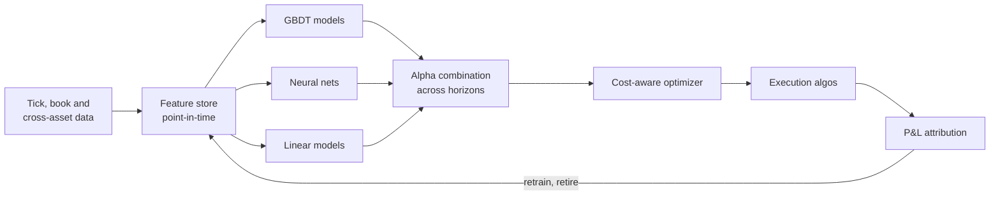
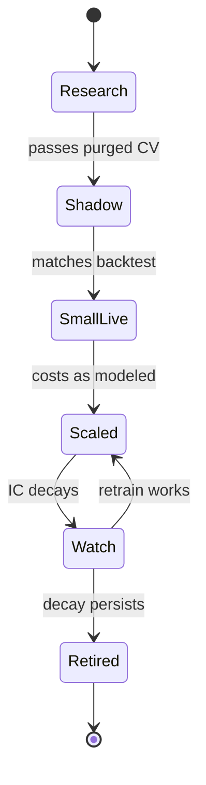

# ML-driven short-horizon alpha

> **TL;DR**
>
> - Large teams forecast residual returns 5 minutes to 1 day ahead for thousands of stocks from hundreds to thousands of features, with boosted trees and neural nets; a cost-aware optimizer turns forecasts into trades.
> - Each prediction barely beats a coin flip (rank IC 0.01–0.05). Breadth makes the money; costs take most of it, so they belong in the objective.
> - The hard parts are labels, purged validation, retraining and resisting overfitting, more than model choice.
> - Academic ML stat arb on the S&P 500 earned over 0.45% a day before costs (1992–2015), shrinking over time. Industry runs on large GPU clusters.
> - Capacity is capped by market impact. Failures come from regime breaks, crowded unwinds (August 2007) and backtests that learned noise.

**Level:** Deep dive · **Read time:** ~8 min · **Last verified:** 2026-11

| Field | Value |
|---|---|
| Family | stat arb |
| Edge source | informational · liquidity provision |
| Holding period | Minutes to 1–2 days; forecast half-lives of 30 minutes to a day |
| Counterparty: who pays and why they accept it | Institutions whose executions leave footprints, late reactors to sector moves, impatient traders paying for immediacy: on their longer horizons a few bps of slippage is small |
| Universe & instruments | 2,000–5,000 liquid US stocks; ETFs and futures as hedges and features |
| Data required | Years of tick and depth-of-book history, cross-asset prices, corporate events, borrow |
| Core algorithms used | [F2 Tree ensembles](../../03-algorithms/b-forecasting-models/tree-ensembles.md) · [F3 Neural nets and sequence models](../../03-algorithms/b-forecasting-models/neural-nets-and-sequence-models.md) · [F5 Alpha combination and ensembling](../../03-algorithms/b-forecasting-models/alpha-combination-and-ensembling.md) · [V1 Time-series cross-validation](../../03-algorithms/c-validation-and-backtesting/time-series-cross-validation.md) · [P5 Transaction cost and impact models](../../03-algorithms/d-portfolio-construction/transaction-cost-and-impact-models.md) · [D2 Feature engineering](../../03-algorithms/a-data-and-signals/feature-engineering.md) |
| Infra intensity | High: GPU and CPU research clusters, intraday feature pipelines, fast in-house execution |
| Capacity (rough $ range) | \$200M–\$2B GMV per book `[Estimate]` (participation capped at ~1–3% of ADV across ~3,000 names; edges of 2–5 bps per trade; square-root impact) |
| Typical Sharpe (gross vs net) | Academic daily ML stat arb, S&P 500: >0.45% a day before costs, 1992–2015, shrinking later `[Reported]`; an LSTM variant, same period: Sharpe 5.8 gross `[Reported]`. Practitioner net: 2–6 for small intraday books, 1–2 at scale `[Lore]` |
| Turnover | 50–200% of GMV a day `[Estimate]` |
| Main risks / failure modes | Overfitting, leakage, regime breaks, crowded deleveraging, cost-model error, outages |
| Crowding risk | High: similar features on the same data lead to correlated de-risking |
| Firm types that run it | Quant hedge funds, multi-manager quant pods, proprietary trading firms |
| Lab | — |

## Intuition (the story in plain English)

Instead of one theory ("losers bounce back"), a model learns from thousands of weak regularities which stocks will beat their peers over the next hour. Like credit scoring: millions of decisions, each barely better than chance, profitable in aggregate, with trading costs as loss given default.

## Economic rationale: why should this make money at all?

- **Predictable flows.** Large orders are sliced over hours, so their pressure persists and shows in volume and imbalance ([execution algorithms](../../03-algorithms/e-execution-algorithms/execution-algorithms-overview.md)).
- **Liquidity provision.** Temporary price moves revert, paying whoever absorbs them ([short-term reversal](short-term-cross-sectional-reversal.md)).
- **Slow diffusion.** News spreads across related stocks with lags: LASSO on the whole cross-section of 1-minute returns found sparse, short-lived, news-linked predictors (Chinco, Clark-Joseph & Ye 2019) `[Verified]`.
- **Breadth.** Information ratio ≈ IC × √(independent bets), so a tiny IC across thousands of names compounds.

## The trade, step by step

1. Every 1–5 minutes, compute features: residual returns at many lags, volume and volatility versus time-of-day norms, book imbalance, futures and sector-ETF moves, events.
2. Targets: forward [residual returns](../../09-reference/glossary.md#residual-return) at several horizons (5, 30, 60 minutes, to close, next day), ranked or clipped.
3. Train GBDT, MLP and ridge models on rolling windows with purged validation.
4. Combine models and horizons into one expected-return curve per stock.
5. The optimizer trades toward a target net of impact, risk and borrow ([trading toward the aim](../../03-algorithms/d-portfolio-construction/multi-period-and-trading-toward-aim.md)).
6. Execute with in-house algos; attribute P&L back to signals.

## Worked example with numbers

Illustrative. Forecasts are z-scored; expected residual return = IC × σ × z, and the top quintile averages z ≈ 1.4.

| | 30-minute horizon | 1-day horizon |
|---|---|---|
| Rank IC | 0.03 | 0.02 |
| Cross-sectional σ of residual return | 0.40% | 1.50% |
| Expected return per leg: IC × σ × 1.4 | **1.7 bps** | **4.2 bps** |
| Round-trip cost, aggressive (2 × (1.5 spread + 1.0 impact + 0.2 fees)) | 5.4 bps | 5.4 bps |
| Round-trip cost, passive fills and crossing | 2.5 bps | 2.5 bps |
| Net per leg, best case | **−0.8 bps** | **+1.7 bps** |

The faster forecast is more accurate but loses alone; it earns its keep by timing slower forecasts' trades. A \$500M GMV book at 100% daily turnover nets \$500M × 1.7 bps = \$85,000 a day, \$21.4M a year (4.3%). At ~4% volatility, Sharpe ≈ 1.1 `[Estimate]`.

## Signals and algorithms under the hood

Features: [D2](../../03-algorithms/a-data-and-signals/feature-engineering.md), [M3](../../03-algorithms/f-market-making-and-hft-algorithms/order-book-and-trade-flow-signals.md). Models: [F2](../../03-algorithms/b-forecasting-models/tree-ensembles.md), [F3](../../03-algorithms/b-forecasting-models/neural-nets-and-sequence-models.md), [F1](../../03-algorithms/b-forecasting-models/linear-models-and-regularization.md). Blending: [F5](../../03-algorithms/b-forecasting-models/alpha-combination-and-ensembling.md). Validation: [V1](../../03-algorithms/c-validation-and-backtesting/time-series-cross-validation.md), [V4](../../03-algorithms/c-validation-and-backtesting/overfitting-and-multiple-testing.md). Costs: [P5](../../03-algorithms/d-portfolio-construction/transaction-cost-and-impact-models.md). Decay: [L2](../../03-algorithms/g-live-trading/alpha-decay-detection-and-model-retirement.md).

```python
import numpy as np
import pandas as pd

def make_target(resid_index, h):
    """resid_index: cumulative residual-return index (bars x stocks) after removing
    market and sector moves. Target: forward h-bar residual return, ranked per bar."""
    fwd = resid_index.shift(-h) / resid_index - 1
    return fwd.rank(axis=1, pct=True) - 0.5            # ranks tame fat tails

def walk_forward(X, y, day, fit, train_days=250, test_days=20, embargo_days=1):
    """Purged walk-forward: labels look h bars ahead, so drop training days whose
    labels could overlap the test block (an embargo of whole days)."""
    days, preds = np.unique(day), []
    for s in range(train_days, len(days) - test_days + 1, test_days):
        tr = np.isin(day, days[s - train_days:s - embargo_days])
        te = np.isin(day, days[s:s + test_days])
        model = fit(X[tr], y[tr])                      # e.g. LightGBM plus an MLP seed ensemble
        preds.append(pd.Series(model.predict(X[te]), index=np.flatnonzero(te)))
    return pd.concat(preds)

def cost_gated_trades(alpha_bps, cost_bps, w_now, w_target):
    """Move toward the target only where expected alpha beats the round-trip cost."""
    worth_it = alpha_bps.abs() > 2 * cost_bps          # round trip ~ 2 x one-way cost
    return (w_target - w_now).where(worth_it, 0.0)
```

## Implementation choices that matter

- **Labels.** Overlapping forward returns make neighbouring rows near-duplicates: purge, embargo, weight by uniqueness ([López de Prado 2018](https://www.wiley.com/en-us/Advances+in+Financial+Machine+Learning-p-9781119482086)).
- **Normalization.** Scale volume and volatility by time-of-day norms ([intraday patterns](intraday-patterns-and-seasonality.md)); residualize returns first.
- **Retraining and costs.** Daily refits on rolling 1–3 years `[Lore]`; penalize turnover in the optimizer, or train on net-of-cost targets.
- **Teams.** Signal researchers feed a combination team, then the optimizer and execution `[Lore]`.
- **Compute.** XTX Markets reports over 25,000 GPUs for research; Hudson River Trading calls ML on GPU clusters central to its research and signed a multi-year cloud deal for NVIDIA Vera Rubin systems in 2026 `[Verified]`. Live Sharpe and capacity are undisclosed.

## P&L decomposition

Illustrative \$1B GMV book, % of GMV a year:

| Line | % |
|---|---|
| Gross alpha capture | +14.0 |
| Passive fills and rebates | +1.0 |
| Spread paid | −4.5 |
| Market impact | −3.5 |
| Fees and clearing | −0.8 |
| Borrow and financing | −0.7 |
| Compute and data (fixed) | −0.5 |
| **Net** | **+5.0** |

At 3% volatility, net Sharpe ≈ 1.7 `[Estimate]`. Costs consume about two-thirds of gross alpha, so a 10% cost-model error moves net P&L by about 20%.

## Evidence

- **Monthly ML:** in Gu, Kelly & Xiu (2020), trees and neural nets more than doubled the monthly out-of-sample R² of a three-characteristic linear model; details in [F2](../../03-algorithms/b-forecasting-models/tree-ensembles.md) `[Verified]`.
- **Daily ML stat arb:** Krauss, Do & Huck (2017): a DNN, boosted-tree and random-forest ensemble on lagged S&P 500 returns earned >0.45% a day before costs, 1992–2015, declining in later years `[Reported]`. Fischer & Krauss (2018): LSTM, 0.46% a day and Sharpe 5.8 before costs `[Reported]`.
- **Minute-level:** that LASSO improved out-of-sample fit and forecast-implied Sharpe ratios (Chinco et al. 2019) `[Verified]`.

## Capacity, crowding and decay

Impact grows with the square root of size ([P5](../../03-algorithms/d-portfolio-construction/transaction-cost-and-impact-models.md)) while edges are a few bps, so doubling capital cuts net bps sharply. Shared data and features make forecasts correlate across firms; ICs decay within months without retraining `[Lore]`.

## How it fails

- **Crowded unwind (August 2007).** A simple contrarian strategy lost sharply over a few days, consistent with forced liquidation of similar quant books (Khandani & Lo 2011) `[Reported]`.
- **Regime break (2020).** Pandemic volatility broke relationships learned on calmer data; a quant hedge fund index ended 2020 down about 5% `[Reported]`.
- **Overfitting and leakage.** Thousands of settings guarantee an in-sample winner ([V4](../../03-algorithms/c-validation-and-backtesting/overfitting-and-multiple-testing.md)); one feature using not-yet-public data makes it perfect ([V3](../../03-algorithms/c-validation-and-backtesting/backtest-pitfalls.md)).

## Textbook vs how it's done today

| Textbook | Practice today |
|---|---|
| Monthly cross-section, 94 characteristics (GKX) `[Verified]` | Minute-to-daily panels, many horizons, far more features `[Lore]` |
| Random k-fold CV | Purged, embargoed walk-forward `[Verified]` |
| Maximize R² or accuracy | Rank IC net of costs, cost-gated trading `[Lore]` |
| One best model | GBDT, neural and linear ensembles, seed-averaged `[Lore]` |

## Variants and neighbours

[Factor-residual mean reversion](factor-residual-mean-reversion.md), [short-term reversal](short-term-cross-sectional-reversal.md), [stat arb overview](stat-arb-overview-and-history.md), [lead-lag arbitrage](../b-speed-and-structural/lead-lag-and-cross-asset-arbitrage.md) (faster), [cross-sectional alpha](../d-mid-frequency-alpha/cross-sectional-alpha-and-neutralization.md) (slower), [equity market making](../a-liquidity-provision/equity-market-making.md).

## Diagram





## How practitioners talk about it

- "What's the IC net of cost at that horizon?" → Is it tradable?
- "The 5-minute model is a timing signal." → Too fast to pay its own costs.
- "Did you purge and embargo?" → Overlapping labels inflate validation.
- "Seed-average it before you believe it." → Single nets vary by random seed.
- "We're all looking at the same book." → Crowded features.
- "Retrain it or it rots." → ICs decay within months.

## Myths vs reality

| Myth | Reality |
|---|---|
| Bigger models always win | Contested: more complex models improved out-of-sample market timing (Kelly, Malamud & Zhou 2024) `[Reported]`; practitioners stress data, labels and costs `[Lore]` |
| High accuracy means profit | 51% hit rates profit only if costs are lower |
| ML strategies need no economics | Durable features trace to flows, liquidity or diffusion |

## Questions you could ask a quant about this

**Basic**

- What horizons do you forecast, and why those?

**Informed**

- How do you purge overlapping labels?
- How often do you retrain, and how do you detect decay?
- Do costs enter training or only the optimizer?

**Sharp**

- What share of gross alpha do costs consume? 🔒
- How did your models behave in March 2020? 🔒

## Go deeper

<details markdown="1">
<summary>Math: fundamental law, cost hurdle, purging</summary>

Expected residual return given a z-scored forecast, and the fundamental law:

$$
E[r_i \mid z_i] = IC \cdot \sigma \cdot z_i, \qquad IR \approx IC \cdot \sqrt{N_{\text{eff}}} .
$$

Trade only when the edge clears the round trip, with square-root impact:

$$
|E[r_i]| > 2\left(\tfrac{s_i}{2} + f_i + Y\sigma_i\sqrt{q_i/V_i}\right) .
$$

Purging drops training rows whose label window $[t_j, t_j + h]$ overlaps the test block.

</details>

## Related pages

- [Tree ensembles (F2)](../../03-algorithms/b-forecasting-models/tree-ensembles.md)
- [Neural nets and sequence models (F3)](../../03-algorithms/b-forecasting-models/neural-nets-and-sequence-models.md)
- [Short-term cross-sectional reversal](short-term-cross-sectional-reversal.md)
- [Stat arb: overview and history](stat-arb-overview-and-history.md)
- [Strategy failure gallery](../h-cross-cutting/strategy-failure-gallery.md)

## Sources

- [Verified] Gu, S., Kelly, B. & Xiu, D. (2020). "Empirical Asset Pricing via Machine Learning." *Review of Financial Studies* 33(5), 2223–2273. <https://doi.org/10.1093/rfs/hhaa009> (accessed 2026-11)
- [Reported] Krauss, C., Do, X. A. & Huck, N. (2017). "Deep neural networks, gradient-boosted trees, random forests: Statistical arbitrage on the S&P 500." *European Journal of Operational Research* 259(2), 689–702. <https://doi.org/10.1016/j.ejor.2016.10.031> (accessed 2026-11)
- [Reported] Fischer, T. & Krauss, C. (2018). "Deep learning with long short-term memory networks for financial market predictions." *European Journal of Operational Research* 270(2), 654–669. <https://doi.org/10.1016/j.ejor.2017.11.054> (accessed 2026-11)
- [Verified] Chinco, A., Clark-Joseph, A. D. & Ye, M. (2019). "Sparse Signals in the Cross-Section of Returns." *Journal of Finance* 74(1), 449–492. <https://doi.org/10.1111/jofi.12733> (accessed 2026-11)
- [Reported] Kelly, B., Malamud, S. & Zhou, K. (2024). "The Virtue of Complexity in Return Prediction." *Journal of Finance* 79(1), 459–503. <https://doi.org/10.1111/jofi.13298> (accessed 2026-11)
- [Reported] Khandani, A. E. & Lo, A. W. (2011). "What happened to the quants in August 2007? Evidence from factors and transactions data." *Journal of Financial Markets* 14(1), 1–46. <https://doi.org/10.1016/j.finmar.2010.07.005> (accessed 2026-11)
- [Verified] López de Prado, M. (2018). *Advances in Financial Machine Learning*, Wiley (ch. 7, purged and embargoed cross-validation). <https://www.wiley.com/en-us/Advances+in+Financial+Machine+Learning-p-9781119482086> (accessed 2026-11)
- [Verified] XTX Markets (n.d.). Company website (research cluster of over 25,000 GPUs). <https://www.xtxmarkets.com/> (accessed 2026-11)
- [Verified] Hudson River Trading (n.d.). "Machine Learning at HRT." <https://www.hudsonrivertrading.com/machine-learning/> (accessed 2026-11)
- [Verified] CoreWeave (2026). "Hudson River Trading to Build Next-Gen Research Platform Powered by NVIDIA Vera Rubin NVL72 on CoreWeave Cloud." <https://coreweave.com/news/hudson-river-trading-to-build-next-gen-research-platform-powered-by-nvidia-vera-rubin-nvl72-on-coreweave-cloud> (accessed 2026-11)
- [Reported] Hedgeweek (n.d.). "How COVID-19 shocks revealed machine-based hedge funds' Achilles heel." <https://www.hedgeweek.com/how-covid-19-shocks-revealed-machine-based-hedge-funds-achilles-heel/> (accessed 2026-11)
