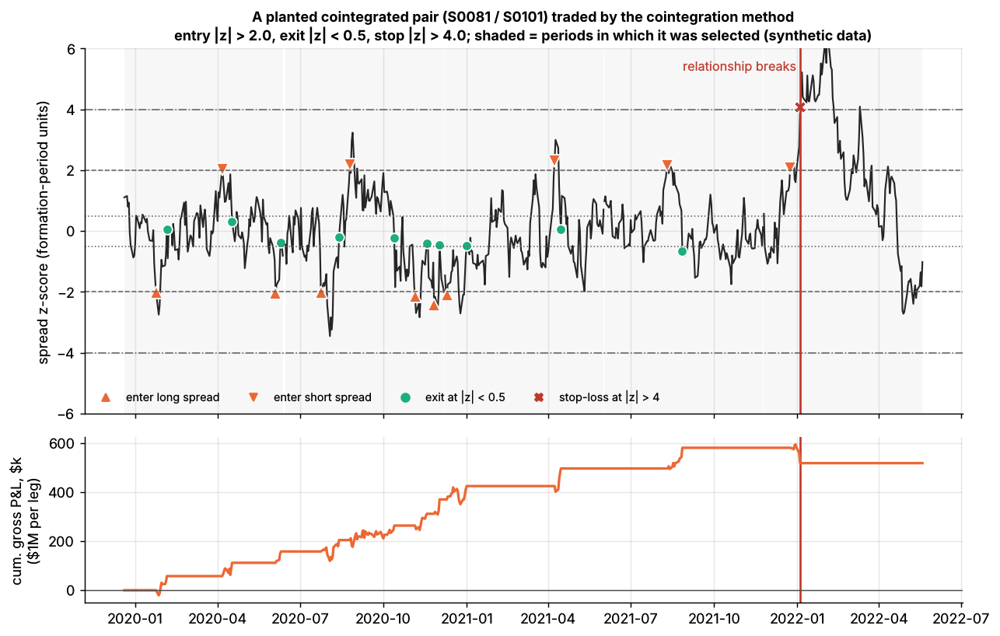
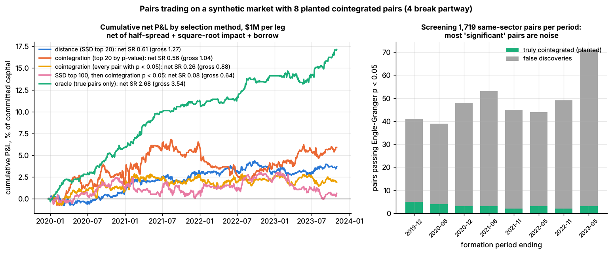
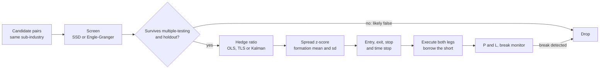
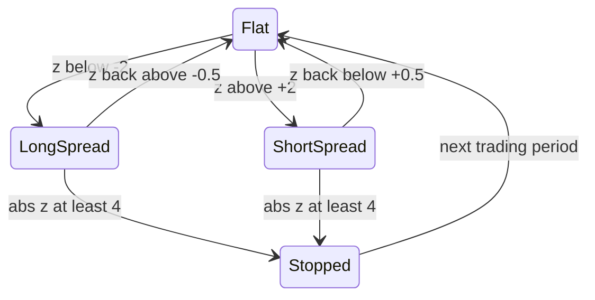

# Pairs trading and cointegration

> **TL;DR**
>
> - Buy the laggard, short the leader of two stocks whose prices move together, and bet the gap closes: the two-stock case of [statistical arbitrage](../../09-reference/glossary.md#statistical-arbitrage), paid for absorbing temporary price pressure.
> - Pairs are chosen by distance (Gatev, Goetzmann & Rouwenhorst 2006) or by [cointegration](../../09-reference/glossary.md#cointegration) tests (Engle–Granger, Johansen). GGR found up to 11% a year before costs over 1962–2002, with top-20 returns falling from 118 to 38 bps a month after 1988 `[Verified]`.
> - After realistic costs the simple version has been largely unprofitable since 2002 `[Verified]`.
> - Selection is the hard part: of the same-sector pairs passing a 5% cointegration test, about 94% are false; Benjamini–Hochberg keeps none (Lab 08, synthetic lab result).
> - A broken relationship costs about a period's profit. Stops are insurance, not alpha.

**Level:** Core · **Read time:** ~12 min · **Last verified:** 2026-11

| Field | Value |
|---|---|
| Family | stat arb |
| Edge source | liquidity provision · behavioral |
| Holding period | days to weeks (Lab 08: 16–22 days per round trip) |
| Counterparty: who pays and why they accept it | Investors trading one stock for reasons unrelated to its twin (a liquidation, an index deletion, a block sale) who want execution, not relative value. When the gap is news, the counterparty is informed and the pairs trader pays. |
| Universe & instruments | liquid same-sub-industry US stocks; share classes, dual listings; stock vs sector ETF |
| Data required | total-return prices, corporate actions, industry codes, borrow, earnings and M&A calendars |
| Core algorithms used | [D3 Signal transforms](../../03-algorithms/a-data-and-signals/signal-transforms.md) · [V4 Overfitting and multiple testing](../../03-algorithms/c-validation-and-backtesting/overfitting-and-multiple-testing.md) · [F6 Regime detection](../../03-algorithms/b-forecasting-models/regime-detection.md) · [P5 Transaction cost and impact models](../../03-algorithms/d-portfolio-construction/transaction-cost-and-impact-models.md) |
| Infra intensity | low: overnight batch; intraday pairs need simultaneous leg execution |
| Capacity (rough $ range) | \$50M–\$500M gross per firm `[Estimate]` (tens of pairs, legs near 1% of ADV in \$100M–\$1B ADV names); Lab 08 net Sharpe 0.61 at \$1M per leg, −0.93 at \$16M (synthetic) |
| Typical Sharpe (gross vs net) | GGR top 20, one-day wait, before costs: ≈ 2.0 over 1962–2002, ≈ 1.3 after 1988 (academic backtest) `[Estimate]` (from their tables); after costs 30–38 bps a month, largely gone after 2002 `[Verified]`; standalone practitioner net 0–1 `[Lore]` |
| Turnover | committed capital traded ~7× a year (Lab 08) |
| Main risks / failure modes | false discoveries, breaks, short squeezes, leg risk, crowded unwinds |
| Crowding risk | medium to high: public screens pick the same pairs |
| Firm types that run it | historically bank proprietary desks (Morgan Stanley, 1980s) `[Reported]`; today mostly inside multi-name stat-arb books `[Lore]` |
| Lab | [Lab 08](https://github.com/FrankHuang94/quant_trading_claude/tree/main/labs/08-pairs-cointegration) |

## Intuition (the story in plain English)

Two regional banks share a deposit base and a regulator. A large holder dumps one; it falls 4% while its twin is flat, with no news. Buy the laggard, short the leader in a ratio that cancels their shared driver, and wait.

The key word is *tethered*. In Murray's image of a drunk walking her dog, each wanders, but the leash stops them drifting apart. Correlated daily returns are not a leash: two stocks can correlate at 0.9 and diverge forever. Cointegration means a weighted difference of the log prices, the spread, is stationary and keeps returning to its mean ([mean reversion](../../09-reference/glossary.md#mean-reversion)).

## Economic rationale: why should this make money at all?

1. **Liquidity provision.** Uninformed flow pushes one of two close substitutes away from the law of one price; the pairs trader is paid as the pressure fades. GGR tie profits to temporary mispricing and a latent common factor `[Verified]`.
2. **Limits to arbitrage.** Even Royal Dutch and Shell, twins with pooled cash flows, drifted with their home markets for years (Froot & Dabora 1999) `[Verified]`. Persistence is why the trade pays and why it hurts.
3. **Arbitrage risk.** Do & Faff (2010) attribute much of the decline to rising fundamental, noise-trader and synchronization risk, not only efficiency `[Reported]`.

## The trade, step by step

1. **Formation (GGR: 12 months).** Rank pairs by the sum of squared differences (SSD) of normalized prices, or test same-industry pairs for cointegration.
2. **Hedge ratio.** Regress log P_A on log P_B: spread = log P_A − α − β log P_B ([hedge ratio](../../09-reference/glossary.md#hedge-ratio) β). Distance pairs hold \$1 long, \$1 short.
3. **Signal.** In the trading window (GGR: 6 months), [z-score](../../09-reference/glossary.md#z-score) the spread using formation mean and standard deviation.
4. **Rules (Lab 08).** Enter at |z| > 2, exit at |z| < 0.5, stop at |z| > 4 and sit out the period. GGR close when prices cross.
5. **Other exits:** a time stop at 2–3 [half-lives](../../09-reference/glossary.md#half-life), or news `[Lore]`.

## Worked example with numbers

Illustrative. Legs of \$1M; formation spread standard deviation 2.5%; hedge ratio 1.

| Step | Calculation | P&L |
|---|---|---|
| Entry: A lags B by 5.5% | z = −5.5 / 2.5 = −2.2 → buy \$1M A, short \$1M B | |
| Exit 12 days later at a 1.0% gap | z = −0.4 | +\$45,000 |
| Trading costs | 4 trades × \$1M × 15 bps (Lab 08's cost per \$ traded) | −\$6,000 |
| Borrow on the short | \$1M × 0.35% × 12/252 | −\$167 |
| **Winning trade, net** | | **+\$38,833** |
| Losing trade: gap runs to 10% | stop at z = −4: −4.5% of a leg, plus costs | **−\$51,000** |

Break-even win rate = 51,000 / (38,833 + 51,000) ≈ 57%. For a spread with no leash (a random walk), the chance of reaching z = −0.5 before z = −4, starting from −2.2, is (4 − 2.2) / (4 − 0.5) ≈ 51% `[Estimate]` (gambler's-ruin odds). A false pair is a coin flip that pays less than it costs.

## Signals and algorithms under the hood

Cards: z-score ([D3](../../03-algorithms/a-data-and-signals/signal-transforms.md)), OLS or minimum-variance hedge ratio ([F1](../../03-algorithms/b-forecasting-models/linear-models-and-regularization.md), [M7](../../03-algorithms/f-market-making-and-hft-algorithms/hedging-algorithms.md)), [multiple testing](../../09-reference/glossary.md#multiple-testing) ([V4](../../03-algorithms/c-validation-and-backtesting/overfitting-and-multiple-testing.md)), breaks ([F6](../../03-algorithms/b-forecasting-models/regime-detection.md)), costs ([P5](../../03-algorithms/d-portfolio-construction/transaction-cost-and-impact-models.md)).

```python
# Mirrors Lab 08's core (labs/08-pairs-cointegration/lab.py). Prices are days x stocks.
def ssd_distance(norm_prices):                     # GGR distance; each column starts at 1
    sq = (norm_prices ** 2).sum(axis=0)
    ssd = sq[:, None] + sq[None, :] - 2.0 * norm_prices.T @ norm_prices
    np.fill_diagonal(ssd, np.inf)
    return ssd                                     # trade the 20 smallest entries

def hedge_ratio(log_a, log_b):                     # Engle-Granger step 1: OLS of A on B
    X = np.column_stack([np.ones_like(log_b), log_b])
    (alpha, beta), *_ = np.linalg.lstsq(X, log_a, rcond=None)
    return beta, alpha, log_a - alpha - beta * log_b   # step 2: unit-root test on this spread

def zscore_signals(z, entry=2.0, exit=0.5, stop=4.0):  # +1 long spread (long A), -1 short, 0 flat
    pos, state, stopped = np.zeros(len(z), int), 0, False
    for t, zt in enumerate(z):                     # z uses formation mean and sd
        if state == 0 and not stopped and entry < abs(zt) < stop:
            state = -1 if zt > 0 else 1            # bet on convergence
        elif state != 0 and abs(zt) >= stop:
            state, stopped = 0, True               # stop-loss: sit out the rest of the period
        elif (state == 1 and zt > -exit) or (state == -1 and zt < exit):
            state = 0                              # converged: take profit
        pos[t] = state
    pos[-1] = 0                                    # flat at period end
    return pos
```

[Lab 08](https://github.com/FrankHuang94/quant_trading_claude/tree/main/labs/08-pairs-cointegration) plants 8 cointegrated pairs (4 later break) among 200 synthetic stocks and compares five selection methods.



*A planted pair (half-life 4.9 days). Notice the clean convergence trades, then the break (red line): the spread runs through the stop at |z| = 4 and the pair is never selected again. Synthetic data.*



*Left: net P&L by method; only the oracle (true pairs) is clearly profitable. Right: pairs passing Engle–Granger at p < 0.05 each period, mostly false. Synthetic data.*

Synthetic lab result (seed 7): each period 48.8 of 1,719 same-sector pairs pass p < 0.05, only 3.1 of them real. Net Sharpe is 0.61 (distance) and 0.56 (cointegration top 20), against 2.68 for the oracle. **Seed 7 is lucky:** across 8 seeds the median net Sharpe is about −0.1 and −0.4, while the oracle ranges from +1.0 to +2.7. Caveat: the toy has no natural cointegration, so distance looks worse than in GGR's data.

## Implementation choices that matter

- **Candidate set.** Testing all 19,900 pairs guarantees false positives; restrict by economics (sub-industry, share classes, supply chains). SSD-then-test double-dips: Lab 08's SSD top 100 pass at 29%, yet about 3 are real.
- **Power.** A year of daily data detects only half of Lab 08's true pairs.
- **Hedge ratio.** OLS of A on B is not the inverse of B on A; total least squares or Johansen are symmetric. Desks update betas with rolling or [Kalman-filter](../../09-reference/glossary.md#kalman-filter) estimates (Elliott, van der Hoek & Malcolm 2005; Chan 2013) `[Verified]`.
- **Thresholds.** Fit an [Ornstein–Uhlenbeck](../../09-reference/glossary.md#ornstein-uhlenbeck-process) process; set entry from costs and exit after 2–3 half-lives `[Lore]`. Flatten before earnings; drop pairs with pending M&A.
- **Execution.** Trade both legs together; borrow and recalls bind on the short leg ([shorting and financing](../../01-market-structure/shorting-financing-and-settlement.md)).

## P&L decomposition

Illustrative \$100M gross book (40 pairs), one year:

| Line | \$M | % of gross |
|---|---|---|
| Convergence gains on pairs that revert | +6.0 | +6.0 |
| Losses on stops, breaks and period-end closes | −3.0 | −3.0 |
| Spread and impact (\$700M traded × 12 bps) | −0.84 | −0.84 |
| Commissions and fees | −0.07 | −0.07 |
| Borrow (\$50M short × 30 bps) | −0.15 | −0.15 |
| Financing spread on longs | −0.25 | −0.25 |
| **Net** | **+1.69** | **+1.7** |

At 3% volatility on gross, Sharpe ≈ 0.55. Idle capital is the hidden cost: GGR's returns on committed capital run about 40% below fully invested ones `[Verified]`.

## Evidence

- **GGR (2006).** Distance pairs, 1962–2002: top 20 earned 1.44% a month fully invested (0.81% on committed capital), 0.90% when trading a day late. The gap implies ~162 bps round-trip cost per pair, leaving 113–225 bps net per six months. A 1999–2002 holdout earned 10.4% a year at 3.8% volatility. After 1988, returns fell from 118 to 38 bps a month; risk-adjusted, from 67 to 42 `[Verified]`.
- **Do & Faff (2010).** Decline continued to 2009, but pairs did well in prolonged turbulence, such as 2007–09 `[Verified]`.
- **Do & Faff (2012).** Net of commissions, impact and short fees: about 30 bps a month risk-adjusted, largely unprofitable after 2002 `[Verified]`.
- **Rad, Low & Faff (2016).** 1962–2014: distance, cointegration and copula earned 91, 85 and 43 bps a month before costs, 38, 33 and 5 after; opportunities thinned after 2009 `[Verified]`.

## Capacity, crowding and decay

Lab 08's capacity curve (net Sharpe by \$ per leg, synthetic):

| \$ per leg | \$0.25M | \$1M | \$4M | \$16M |
|---|---|---|---|---|
| Distance | 0.86 | 0.61 | 0.09 | −0.93 |
| Cointegration, top 20 | 0.75 | 0.56 | 0.17 | −0.60 |

The toy trades each leg in one day against \$63M of ADV; real desks work orders in larger names, so capacity is higher `[Estimate]`, but capped by the few good pairs and the smaller leg's liquidity.

## How it fails

- **The pair never existed** (most screened pairs; see above).
- **The relationship breaks.** Lab 08's four breaks cost −2.2%, −4.0%, −0.5% and −7.2% of a leg, against +6.5% for an intact pair-period; without the stop, −11.3%, +20.8%, −0.4% and −7.2% (synthetic lab result). The stop capped the worst loss and cut a winner.
- **Crowded unwind, August 2007.** A model contrarian strategy lost 6.85% over 7–9 August, then regained 5.92% on 10 August (Khandani & Lo) `[Verified]`; see the [failure gallery](../h-cross-cutting/strategy-failure-gallery.md).
- **Squeeze, October 2008.** After Porsche's 26 October disclosure, VW ordinaries went from €211 to above €1,005 on 28 October; shorts of the "overvalued" ordinaries lost an estimated €20B+ (Allen et al. 2021) `[Reported]`.

## Textbook vs how it's done today

- **Textbook:** rank all pairs by distance. **Practice:** economically linked candidates, multiple-testing control, out-of-sample survival `[Lore]`.
- **Textbook:** static OLS beta. **Practice:** Kalman or rolling betas (Elliott et al. 2005; Chan 2013) `[Verified]`.
- **Textbook:** fixed 2-sigma entry. **Practice:** half-life- and cost-based thresholds, time stops `[Lore]`.
- **Textbook:** a standalone book. **Practice:** one input to a factor-neutral residual book ([stat-arb overview](stat-arb-overview-and-history.md)) `[Lore]`.

## Variants and neighbours

- **Baskets:** Johansen handles several stocks; cointegrated triplets earned less than pairs (Do & Faff 2016) `[Verified]`.
- **Stock vs ETF:** the single-partner form of [factor-residual mean reversion](factor-residual-mean-reversion.md).
- **Copulas:** model the joint distribution, not a linear spread (Rad et al. 2016).
- **Contractual leashes:** share classes, dual listings, [ETF and index arbitrage](../b-speed-and-structural/etf-and-index-arbitrage.md), merger arbitrage ([event-driven](../d-mid-frequency-alpha/earnings-and-event-driven.md)).

## Diagram





## How practitioners talk about it

- "Half-life is eight days; if it hasn't come in by week three, we're out." → A time stop.
- "It passed at 1%, but so did 40 others out of 2,000." → Multiple testing.
- "The beta went from 0.9 to 1.3 after the acquisition." → A structural break.
- "It stopped out at four sigma and came back the next week." → Stops are insurance; insurance costs premium.
- "Distance pairs are half a reversal factor." → GGR's pre-1989 pairs loaded on short-term reversal, yet earned alpha beyond it `[Verified]`.

## Myths vs reality

- **Myth:** high correlation makes a good pair. **Reality:** correlated returns do not tie prices together.
- **Myth:** passing a 5% test proves the relationship. **Reality:** 1,719 tests yield dozens of chance passes.
- **Myth:** market neutral means safe. **Reality:** breaks, squeezes and crowding.

## Questions you could ask a quant about this

- *Basic:* How many candidate pairs do you test, and how are they chosen?
- *Informed:* How do you correct for multiple testing, and how many pairs survive out of sample?
- *Informed:* OLS, total least squares or Kalman for the hedge ratio?
- *Sharp:* What share of losses come from pairs that broke versus pairs that never were?
- *Sharp:* How correlated is pairs P&L with the reversal factor?
- *Sharp:* 🔒 Which pair families still pay after costs, and at what size?

## Go deeper

<details markdown="1">
<summary>Math: cointegration tests, the OU spread, and false discoveries</summary>

**Cointegration.** Log prices $p_A, p_B$ are each I(1). They are cointegrated if some $\beta$ makes $s_t = p_{A,t} - \alpha - \beta\, p_{B,t}$ stationary. **Engle–Granger:** estimate $\alpha, \beta$ by OLS, then run an ADF regression

$$
\Delta s_t = \gamma\, s_{t-1} + \sum_i \phi_i\, \Delta s_{t-i} + e_t
$$

and reject a unit root if $\gamma$ is significantly negative; critical values are more negative than standard ADF tables because $\beta$ was fitted. **Johansen** tests the rank of $\Pi$ in $\Delta Y_t = \Pi Y_{t-1} + \sum_i \Gamma_i \Delta Y_{t-i} + \varepsilon_t$ (the number of cointegrating vectors).

**OU spread.** $ds = \theta(\mu - s)\,dt + \sigma\,dW$; as a daily AR(1), $s_{t+1} = a + b\,s_t + \zeta$ with $b = e^{-\theta}$:

$$
\text{half-life} = -\frac{\ln 2}{\ln b}, \qquad \sigma_{eq} = \sqrt{\frac{\operatorname{Var}(\zeta)}{1-b^2}} .
$$

A 10-day half-life gives $b \approx 0.933$: hard to tell from 1 with a year of data.

**False discoveries.** Benjamini–Hochberg sorts p-values $p_{(1)} \le \dots \le p_{(m)}$ and rejects the $k$ smallest, with $k$ the largest index satisfying

$$
p_{(k)} \le \frac{k}{m}\, q .
$$

At $m = 1{,}719$, $q = 0.05$, any discovery needs a p-value below $2.9 \times 10^{-5}$.

</details>

## Related pages

- [Stat arb: overview and history](stat-arb-overview-and-history.md) · [Factor-residual mean reversion](factor-residual-mean-reversion.md) · [Short-term cross-sectional reversal](short-term-cross-sectional-reversal.md)
- [V4 Overfitting and multiple testing](../../03-algorithms/c-validation-and-backtesting/overfitting-and-multiple-testing.md) · [P5 Transaction cost and impact models](../../03-algorithms/d-portfolio-construction/transaction-cost-and-impact-models.md) · [M7 Hedging algorithms](../../03-algorithms/f-market-making-and-hft-algorithms/hedging-algorithms.md)
- [Strategy failure gallery](../h-cross-cutting/strategy-failure-gallery.md) · [Shorting, financing and settlement](../../01-market-structure/shorting-financing-and-settlement.md)

## Sources

- [Verified] Gatev, E., Goetzmann, W. N. & Rouwenhorst, K. G. (2006). "Pairs Trading: Performance of a Relative-Value Arbitrage Rule." *Review of Financial Studies* 19(3), 797–827 (figures from the February 2006 author version, Tables 1, 2 and 8). <https://doi.org/10.1093/rfs/hhj020> (accessed 2026-11)
- [Verified] Engle, R. F. & Granger, C. W. J. (1987). "Co-Integration and Error Correction: Representation, Estimation, and Testing." *Econometrica* 55(2), 251–276. <https://doi.org/10.2307/1913236> (accessed 2026-11)
- [Verified] Johansen, S. (1988). "Statistical analysis of cointegration vectors." *Journal of Economic Dynamics and Control* 12(2–3), 231–254. <https://doi.org/10.1016/0165-1889(88)90041-3> (accessed 2026-11)
- [Verified] Murray, M. P. (1994). "A Drunk and Her Dog: An Illustration of Cointegration and Error Correction." *The American Statistician* 48(1), 37–39. <https://doi.org/10.1080/00031305.1994.10476017> (accessed 2026-11)
- [Verified] Do, B. & Faff, R. (2010). "Does Simple Pairs Trading Still Work?" *Financial Analysts Journal* 66(4), 83–95. <https://doi.org/10.2469/faj.v66.n4.1> (accessed 2026-11)
- [Verified] Do, B. & Faff, R. (2012). "Are Pairs Trading Profits Robust to Trading Costs?" *Journal of Financial Research* 35(2), 261–287. <https://doi.org/10.1111/j.1475-6803.2012.01317.x> (accessed 2026-11)
- [Verified] Do, B. & Faff, R. (2016). "Cointegration and Relative Value Arbitrage." SSRN working paper. <https://doi.org/10.2139/ssrn.2785045> (accessed 2026-11)
- [Verified] Rad, H., Low, R. K. Y. & Faff, R. (2016). "The profitability of pairs trading strategies: distance, cointegration and copula methods." *Quantitative Finance* 16(10), 1541–1558. <https://doi.org/10.1080/14697688.2016.1164337> (accessed 2026-11)
- [Verified] Elliott, R. J., van der Hoek, J. & Malcolm, W. P. (2005). "Pairs trading." *Quantitative Finance* 5(3), 271–276. <https://doi.org/10.1080/14697680500149370> (accessed 2026-11)
- [Reported] Chan, E. P. (2013). *Algorithmic Trading: Winning Strategies and Their Rationale.* Wiley (Kalman-filter hedge ratios). <https://doi.org/10.1002/9781118676998> (accessed 2026-11)
- [Verified] Froot, K. A. & Dabora, E. M. (1999). "How are stock prices affected by the location of trade?" *Journal of Financial Economics* 53(2), 189–216. <https://doi.org/10.1016/S0304-405X(99)00020-3> (accessed 2026-11)
- [Verified] Benjamini, Y. & Hochberg, Y. (1995). "Controlling the False Discovery Rate: A Practical and Powerful Approach to Multiple Testing." *Journal of the Royal Statistical Society B* 57(1), 289–300. <https://doi.org/10.1111/j.2517-6161.1995.tb02031.x> (accessed 2026-11)
- [Verified] Khandani, A. E. & Lo, A. W. (2011). "What happened to the quants in August 2007? Evidence from factors and transactions data." *Journal of Financial Markets* 14(1), 1–46. <https://doi.org/10.1016/j.finmar.2010.07.005> (accessed 2026-11)
- [Reported] Allen, F., Haas, M., Nowak, E. & Tengulov, A. (2021). "Market efficiency and limits to arbitrage: Evidence from the Volkswagen short squeeze." *Journal of Financial Economics* 142(1), 166–194; summary on the Harvard Law School Forum on Corporate Governance. <https://corpgov.law.harvard.edu/2021/09/15/market-efficiency-and-limits-to-arbitrage-evidence-from-the-volkswagen-short-squeeze/> (accessed 2026-11)
