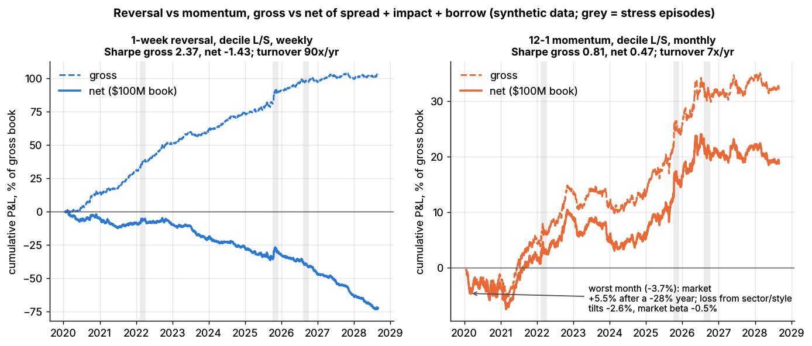
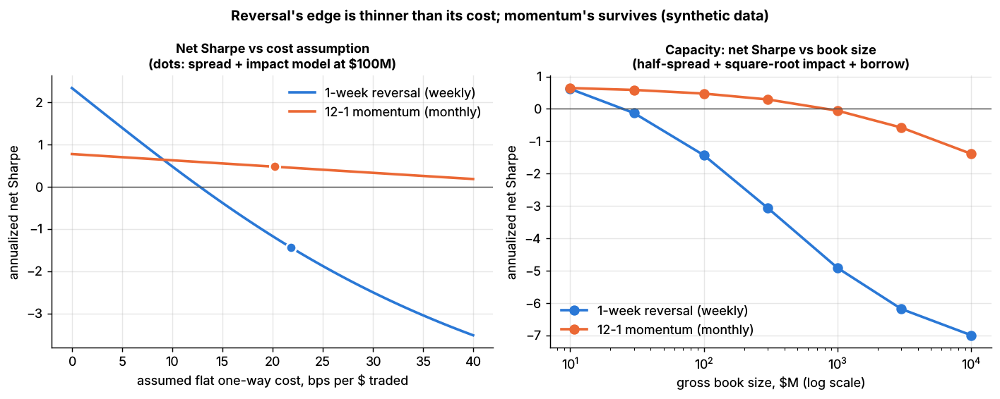
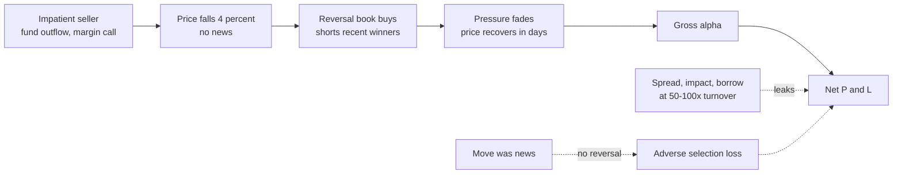

# Short-term cross-sectional reversal

> **TL;DR**
>
> - Last week's losers beat last week's winners next week (Lehmann 1990; Jegadeesh 1990; Lo & MacKinlay 1990).
> - It is a fee for absorbing temporary price pressure; expected returns rise with the VIX (Nagel 2012).
> - Highest gross Sharpe of the classic anomalies, thinnest net: 50–100× annual [turnover](../../09-reference/glossary.md#turnover) means costs decide everything.
> - The plain version has decayed to about zero (Sharpe 0.92 in 1963–1991, 0.01 in 2010–2026; −18% in 2025). It survives residualized, news-filtered and inside multi-signal books.
> - It fails when liquidity providers all need liquidity at once: August 2007, March 2020.

**Level:** Core · **Read time:** ~8 min · **Last verified:** 2026-11

| Field | Value |
|---|---|
| Family | stat arb |
| Edge source | liquidity provision · behavioral |
| Holding period | 1 day to 1 month (classically 1 week) |
| Counterparty: who pays and why they accept it | Impatient traders (large institutional orders, redemptions, margin calls, chasers of last week's winners) who pay a temporary concession because finishing now matters more than a few bps |
| Universe & instruments | 500–3,000 liquid US stocks, cash or swaps; ETF and futures hedges |
| Data required | Point-in-time returns, volume, spreads; risk model; news flags; borrow |
| Core algorithms used | [D3 Signal transforms](../../03-algorithms/a-data-and-signals/signal-transforms.md) · [P1 Risk models](../../03-algorithms/d-portfolio-construction/risk-models.md) · [P5 Transaction cost and impact models](../../03-algorithms/d-portfolio-construction/transaction-cost-and-impact-models.md) · [P6 Multi-period optimization and trading toward the aim](../../03-algorithms/d-portfolio-construction/multi-period-and-trading-toward-aim.md) |
| Infra intensity | Moderate: daily or intraday rebalancing; execution matters more than latency |
| Capacity (rough $ range) | Break-even \$9B US, \$13B global (1998–2011 cost data, AQR-affiliated authors) `[Verified]`; profitable standalone books \$100M–\$1B `[Estimate]` (profit peaks near 4/9 of break-even; see Go deeper) |
| Typical Sharpe (gross vs net) | French 1-month reversal factor, gross: 0.92 (1963–1991), 0.15 (1992–2026), 0.01 (2010–2026) `[Verified]` (our computation); standalone net ≤ 0 `[Estimate]`; residual versions about 2× in backtests `[Verified]` |
| Turnover | 50–100× gross a year, weekly rebalancing (Lab 10: 90×) `[Estimate]` |
| Main risks / failure modes | Cost-model error, news moves, liquidity crises, momentum regimes |
| Crowding risk | High: nearly every stat-arb book holds some version |
| Firm types that run it | Stat-arb funds, pods, principal desks; Morgan Stanley in the 1980s ([history](stat-arb-overview-and-history.md)) `[Reported]` |
| Lab | [Lab 10](https://github.com/FrankHuang94/quant_trading_claude/tree/main/labs/10-reversal-momentum-costs) |

## Intuition (the story in plain English)

A fund dumps 3% of a mid-cap's float; the price falls 4% on no news and drifts back next week. The buyer was a one-week wholesaler. [Short-term reversal](../../09-reference/glossary.md#short-term-reversal) does this across 1,000 names, long losers and short winners, earning a few bps per trade while replacing most of the book weekly.

## Economic rationale: why should this make money at all?

- **Liquidity provision.** Market makers are paid by the reversal of non-informational selling (Campbell, Grossman & Wang 1993) `[Reported]`; reversal returns proxy that payment and are predictable with the VIX (Nagel 2012) `[Verified]`. Intra-industry reversals follow order imbalances and strengthen after market declines (Hameed & Mian 2015) `[Verified]`.
- **Overreaction.** Lehmann (1990) read weekly reversals as fads `[Verified]`; Da, Liu & Schaumburg (2014) tie the short side to sentiment plus short-sale constraints `[Verified]`.
- **Noise.** [Bid-ask bounce](../../09-reference/glossary.md#bid-ask-bounce) and cross-stock [lead-lag](../../09-reference/glossary.md#lead-lag) (Lo & MacKinlay 1990) `[Verified]` inflate backtests but cannot be harvested.

The edge exists only where the move carried no information.

## The trade, step by step

1. **Universe:** liquid names, minus those with earnings or major news.
2. **Signal:** minus the past 5-day market-relative return (Lab 10), or better the [residual return](../../09-reference/glossary.md#residual-return) ([P1](../../03-algorithms/d-portfolio-construction/risk-models.md)).
3. **Transform** ([D3](../../03-algorithms/a-data-and-signals/signal-transforms.md)): winsorize, z-score within industry.
4. **Portfolio:** cost-aware optimizer ([P5](../../03-algorithms/d-portfolio-construction/transaction-cost-and-impact-models.md)) with no-trade buffers ([P6](../../03-algorithms/d-portfolio-construction/multi-period-and-trading-toward-aim.md)), factor-neutral.
5. **Execute** through the day and at the close ([E2](../../03-algorithms/e-execution-algorithms/vwap-twap-pov.md), [E5](../../03-algorithms/e-execution-algorithms/auction-close-and-dark-liquidity-algos.md)); hold about a week.

## Worked example with numbers

Illustrative: \$500M gross, 400 names, \$100M ADV and 2% daily volatility each, square-root [market impact](../../09-reference/glossary.md#market-impact) coefficient 0.5.

| Step | Calculation | Per week |
|---|---|---|
| Gross alpha, naive rebalance | \$500M × 20 bps | +\$1.00M |
| Traded | 1.5 × \$500M (about \$1.9M per name) | \$750M |
| Cost per \$ traded | 2.5 bps half-spread + 0.5 × 200 bps × √(1.9/100) | 16.3 bps |
| Trading cost | \$750M × 16.3 bps | −\$1.22M |
| **Net, naive** | | **−\$0.22M** |
| Buffered: keep 70% of alpha | 0.7 × \$1.00M | +\$0.70M |
| Trade 0.8×, patiently, at 9 bps | \$400M × 9 bps | −\$0.36M |
| **Net, buffered** | | **+\$0.34M** |

That is \$17.7M a year; with weekly volatility of \$2.5M (0.5% of gross), Sharpe ≈ 0.34 / 2.5 × √52 ≈ 0.98. Only the trading changed.

## Signals and algorithms under the hood

Signals are scored by [information coefficient](../../09-reference/glossary.md#information-coefficient-ic) ([D4](../../03-algorithms/a-data-and-signals/evaluating-signals.md)); costs follow the [square-root law](../../09-reference/glossary.md#square-root-law) ([P5](../../03-algorithms/d-portfolio-construction/transaction-cost-and-impact-models.md)).

```python
# Mirrors the CORE ALGORITHM of Lab 10 (labs/10-reversal-momentum-costs/lab.py).
# Weights are fractions of the gross book; signals use returns known at the close of day t.
def reversal_signal(returns, lookback=5):
    """Positive score = past-week loser vs the equal-weighted market = BUY (Lo-MacKinlay)."""
    past = returns.rolling(lookback).sum()
    return -past.sub(past.mean(axis=1), axis=0)

def residual_reversal_signal(resid_returns, lookback=5):
    """Practitioner variant, not in the lab: the same rule on factor-model residuals (P1),
    so the book stops betting against industry and style moves."""
    past = resid_returns.rolling(lookback).sum()
    return -past.sub(past.mean(axis=1), axis=0).div(past.std(axis=1), axis=0)

def apply_costs(weights, returns, book_usd, spread_bps, adv_usd, daily_vol,
                impact_coef=0.5, borrow_bps_per_year=35.0):
    traded = weights.diff().abs()                       # fraction of the book traded at t
    cost_rate = spread_bps / 2e4 + impact_coef * daily_vol * np.sqrt(traded * book_usd / adv_usd)
    trading_cost = (traded * cost_rate).sum(axis=1)     # half-spread + square-root impact
    borrow = weights.shift(1).clip(upper=0).abs().sum(axis=1) * borrow_bps_per_year / 1e4 / 252
    gross = (weights.shift(1) * returns).sum(axis=1)    # weights set at t-1 earn day t
    return gross - trading_cost - borrow                # the lab returns every column
```



*Left panel: reversal's gross P&L (dashed) climbs while net (solid) falls, at \$100M. Synthetic data.*



*Reversal (blue) turns negative above 12.7 bps per dollar traded, and between a \$10M and a \$30M book. Synthetic data.*

Synthetic lab result: the weekly decile book's Sharpe is 2.37 gross and −1.43 net, with 90× turnover and costs of 19.5% of the book a year; daily rebalancing gives 3.84 gross, −5.30 net. The planted IC of 0.03 is clean, stationary and uncontested; the real frictionless daily factor has managed 0.26–0.67 gross since 2010 `[Verified]`.

## Implementation choices that matter

- **Residualize.** Residual reversal doubles the risk-adjusted return and survives costs in post-1990 large caps (Blitz et al. 2013) `[Verified]`. The plain version has "vanished entirely in most regions"; hedging out industry and factor short-term momentum revives it (Blitz, van der Grient & Honarvar 2023) `[Verified]`.
- **Filter informed moves.** Removing moves explained by analyst revisions quadruples the risk-adjusted return (Da et al. 2014) `[Verified]`. High-turnover stocks show short-term *momentum*; reversal lives in low-turnover ones (Medhat & Schmeling 2022) `[Verified]`.
- **Universe and construction.** Large caps plus lower turnover give 30–50 bps a week net (de Groot, Huij & Zhou 2012) `[Verified]`; in illiquid names profits trail likely costs (Avramov, Chordia & Goyal 2006) `[Verified]`.
- **Combine.** Rarely run alone: one input to an [alpha combination](../../03-algorithms/b-forecasting-models/alpha-combination-and-ensembling.md) `[Lore]`, as Blitz et al. (2023) recommend `[Verified]`.

## P&L decomposition

Illustrative: the buffered book, one year.

| Line | \$M | bps of gross |
|---|---|---|
| Gross alpha | +36.4 | +728 |
| Half-spread (\$20.8B traded × 2.5 bps) | −5.2 | −104 |
| Market impact (6.5 bps) | −13.5 | −270 |
| Commissions and fees | −0.6 | −12 |
| Borrow (35 bps on \$250M short) | −0.9 | −18 |
| **Net, before financing and fees** | **+16.2** | **+324** |

## Evidence

Gross Sharpe ratios of the Fama-French reversal factors, our computation `[Verified]`:

| Period | 1-month reversal, monthly | 20-day reversal, rebalanced daily |
|---|---|---|
| 1963–1989 | 1.05 | 3.62 |
| 1990–1999 | 0.16 | 4.57 |
| 2000–2009 | 0.25 | 0.90 |
| 2010–2019 | 0.42 | 0.67 |
| 2020–2026-09 | −0.39 | 0.26 |

The daily column is frictionless and, before 2001's decimal ticks, partly bid-ask bounce. Khandani & Lo's daily contrarian rule fell from 1.38% a day (1995) to 0.13% (2007) `[Verified]`. The monthly factor fell 40% from January 2020 to May 2026, including −18.0% in 2025 (monthly returns compounded) `[Verified]`.

## Capacity, crowding and decay

Frazzini, Israel & Moskowitz (2012) put the US break-even at \$9B versus \$52B for momentum; optimized global reversal reaches only \$17B `[Verified]`. Decay came from competition, decimalization and cheaper execution ([evolution](../h-cross-cutting/evolution-of-quant-strategies.md)); since most stat-arb books hold reversal, [crowding](../../09-reference/glossary.md#crowding) is the tail risk.

## How it fails

- **Information, not pressure.** News moves keep going; the book is adversely selected, like a market maker.
- **August 2007.** A crowded unwind; the daily factor lost 3.5% from 1 to 9 August, then made 4.58% on 10 August `[Verified]` ([failure gallery](../h-cross-cutting/strategy-failure-gallery.md)).
- **March 2020.** The daily factor lost 18.4% from 20 February to 23 March, then made 31.7% to 30 April `[Verified]` (our computation). Nagel's high expected return came only after the drawdown.
- **Momentum regimes.** In 2024–2026 recent winners kept winning (the factor losses above).

## Textbook vs how it's done today

| Textbook | Practice today |
|---|---|
| Deciles on raw 1-week returns (Lehmann 1990) `[Verified]` | Residual, news-filtered scores (Blitz et al. 2013; Da et al. 2014) `[Verified]` |
| A standalone anomaly | One ML feature among many ([ML short-horizon alpha](ml-driven-short-horizon-alpha.md)) `[Lore]` |
| Trade at the close | Intraday execution, internal crossing `[Lore]` |

## Variants and neighbours

[Factor-residual mean reversion](factor-residual-mean-reversion.md) (s-scores), [pairs trading](pairs-trading-and-cointegration.md), [intraday patterns](intraday-patterns-and-seasonality.md), [momentum](../e-risk-premia-and-factors/momentum.md) (opposite sign at 3–12 months), [equity market making](../a-liquidity-provision/equity-market-making.md) (same service, in seconds).

## Diagram



## How practitioners talk about it

- "Reversal is a cost trade." → Net P&L depends on execution.
- "We only fade residuals." → Reversal on factor-model residuals.
- "Strip the news days." → Exclude earnings and revisions.
- "High-turnover names momentum." → Medhat–Schmeling.
- "VIX at 40 is when reversal pays." → Nagel's result.
- "Our break-even is 12 bps." → Cost at which net alpha is zero.

## Myths vs reality

| Myth | Reality |
|---|---|
| Highest gross Sharpe wins | Lab 10: gross 2.37, net −1.43 (synthetic) |
| Reversal is dead | The plain version is; residual versions survive in backtests |
| It is arbitrage | It warehouses risk that crashes in liquidity crises |

## Questions you could ask a quant about this

**Basic**

- What are your signal's half-life and weekly turnover?
- Do you fade raw or residual returns?

**Informed**

- What share of gross alpha goes to impact?
- Do you condition on turnover or news?

**Sharp**

- Realized versus backtest break-even cost? 🔒
- Your sleeve's February–April 2020 path? 🔒

## Go deeper

<details markdown="1">
<summary>Math: break-even cost and optimal size</summary>

Break-even one-way cost per dollar traded:

$$
c^{*} = \frac{\mu_{\text{gross}}}{\text{turnover}} .
$$

Lab 10's weekly book: 11.4% after borrow / 90 ≈ 12.7 bps.

With square-root impact, cost grows as $S^{3/2}$ in book size $S$: $\pi(S) = aS - kS^{3/2}$, break-even $S_{be} = (a/k)^2$, and profit peaks at

$$
S^{*} = \left(\frac{2a}{3k}\right)^2 = \tfrac{4}{9}\, S_{be} .
$$

</details>

## Related pages

- [Stat arb: overview and history](stat-arb-overview-and-history.md)
- [Factor-residual mean reversion](factor-residual-mean-reversion.md)
- [Momentum](../e-risk-premia-and-factors/momentum.md)
- [Transaction cost and impact models (P5)](../../03-algorithms/d-portfolio-construction/transaction-cost-and-impact-models.md)
- [Walkthrough: a mid-frequency stat-arb book](../../03-algorithms/h-end-to-end-walkthroughs/walkthrough-mid-frequency-stat-arb.md)

## Sources

- [Verified] Lehmann, B. N. (1990). "Fads, Martingales, and Market Efficiency." *Quarterly Journal of Economics* 105(1), 1–28. <https://doi.org/10.2307/2937816> (accessed 2026-11)
- [Verified] Jegadeesh, N. (1990). "Evidence of Predictable Behavior of Security Returns." *Journal of Finance* 45(3), 881–898. <https://doi.org/10.1111/j.1540-6261.1990.tb05110.x> (accessed 2026-11)
- [Verified] Lo, A. W. & MacKinlay, A. C. (1990). "When Are Contrarian Profits Due to Stock Market Overreaction?" *Review of Financial Studies* 3(2), 175–205. <https://doi.org/10.1093/rfs/3.2.175> (accessed 2026-11)
- [Reported] Campbell, J. Y., Grossman, S. J. & Wang, J. (1993). "Trading Volume and Serial Correlation in Stock Returns." *Quarterly Journal of Economics* 108(4), 905–939. <https://doi.org/10.2307/2118454> (accessed 2026-11)
- [Verified] Nagel, S. (2012). "Evaporating Liquidity." *Review of Financial Studies* 25(7), 2005–2039. <https://doi.org/10.1093/rfs/hhs066> (accessed 2026-11)
- [Verified] Hameed, A. & Mian, G. M. (2015). "Industries and Stock Return Reversals." *Journal of Financial and Quantitative Analysis* 50(1–2), 89–117. <https://doi.org/10.1017/S0022109014000404> (accessed 2026-11)
- [Verified] Da, Z., Liu, Q. & Schaumburg, E. (2014). "A Closer Look at the Short-Term Return Reversal." *Management Science* 60(3), 658–674. <https://doi.org/10.1287/mnsc.2013.1766> (accessed 2026-11)
- [Verified] Blitz, D., Huij, J., Lansdorp, S. & Verbeek, M. (2013). "Short-term residual reversal." *Journal of Financial Markets* 16(3), 477–504. <https://doi.org/10.1016/j.finmar.2012.10.005> (accessed 2026-11)
- [Verified] Blitz, D., van der Grient, B. & Honarvar, I. (2023). "Reversing the Trend of Short-Term Reversal." SSRN working paper 4575689. <https://doi.org/10.2139/ssrn.4575689> (accessed 2026-11)
- [Verified] Medhat, M. & Schmeling, M. (2022). "Short-term Momentum." *Review of Financial Studies* 35(3), 1480–1526. <https://doi.org/10.1093/rfs/hhab055> (accessed 2026-11)
- [Verified] de Groot, W., Huij, J. & Zhou, W. (2012). "Another look at trading costs and short-term reversal profits." *Journal of Banking & Finance* 36(2), 371–382. <https://doi.org/10.1016/j.jbankfin.2011.07.015> (accessed 2026-11)
- [Verified] Avramov, D., Chordia, T. & Goyal, A. (2006). "Liquidity and Autocorrelations in Individual Stock Returns." *Journal of Finance* 61(5), 2365–2394. <https://doi.org/10.1111/j.1540-6261.2006.01060.x> (accessed 2026-11)
- [Verified] Frazzini, A., Israel, R. & Moskowitz, T. J. (2012). "Trading Costs of Asset Pricing Anomalies." Working paper, draft of 2012-12-05 (authors affiliated with AQR). <https://conference.nber.org/conf_papers/f68262/f68262.pdf> (accessed 2026-11)
- [Verified] Khandani, A. E. & Lo, A. W. (2011). "What happened to the quants in August 2007? Evidence from factors and transactions data." *Journal of Financial Markets* 14(1), 1–46. <https://doi.org/10.1016/j.finmar.2010.07.005> (accessed 2026-11)
- [Verified] French, K. R. "Data Library: Short-Term Reversal Factor (monthly and daily)," through 2026-09 (Sharpe ratios, drawdowns and episode returns are our computations). <https://mba.tuck.dartmouth.edu/pages/faculty/ken.french/data_library.html> (accessed 2026-11)
