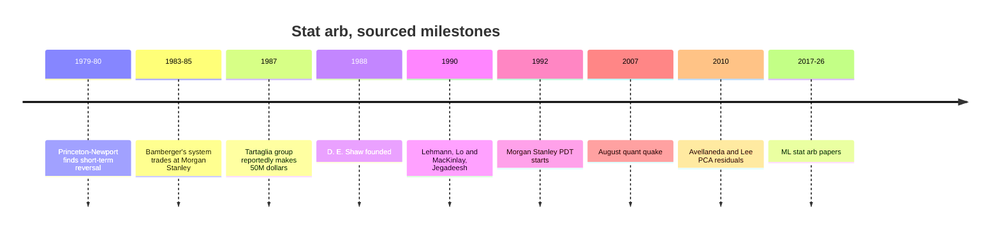
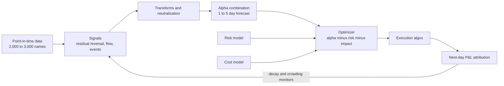

# Stat arb: overview and history

> **TL;DR**
>
> - [Statistical arbitrage](../../09-reference/glossary.md#statistical-arbitrage) holds thousands of small long and short bets on short-horizon relative mispricings, neutral to market, sectors and styles. Mostly it is paid for absorbing other investors' temporary price pressure.
> - It began at Morgan Stanley in the early-to-mid 1980s (Gerry Bamberger's industry-group reversal system, scaled by Nunzio Tartaglia's group) and at Princeton-Newport Partners; D. E. Shaw, founded in 1988, carried it into the hedge-fund era `[Reported]`.
> - The academic record (Lehmann 1990 to Avellaneda & Lee 2010) shows real but decaying profits `[Verified]`.
> - Crowding is the signature risk: a simple contrarian strategy's average daily return fell from 1.38% (1995) to 0.13% (2007), so it needed about 9:1 leverage to match 1998 returns, and it lost 6.85% unlevered in three days of August 2007 `[Verified]`.
> - Today: 1,000–3,000 names, factor-neutral, 1–10 day holds, many signals, cost-aware optimizers.

**Level:** Core · **Read time:** ~10 min · **Last verified:** 2026-11

| Field | Value |
|---|---|
| Family | stat arb |
| Edge source | liquidity provision · behavioral |
| Holding period | hours to about 10 days (classically 1–5 days) |
| Counterparty: who pays and why they accept it | Liquidity demanders who push prices away from relative value: institutions working large orders, index flows, herding retail, forced sellers. Finishing the trade matters more to them than a few bps. |
| Universe & instruments | 1,000–3,000 liquid US stocks, in cash or swaps; futures and ETFs as hedges |
| Data required | point-in-time prices, volumes, corporate actions; sector codes; a factor risk model; borrow rates |
| Core algorithms used | [D3 Signal transforms](../../03-algorithms/a-data-and-signals/signal-transforms.md) · [F5 Alpha combination and ensembling](../../03-algorithms/b-forecasting-models/alpha-combination-and-ensembling.md) · [P1 Risk models](../../03-algorithms/d-portfolio-construction/risk-models.md) · [P3 Mean-variance optimization](../../03-algorithms/d-portfolio-construction/mean-variance-optimization.md) · [P5 Transaction cost and impact models](../../03-algorithms/d-portfolio-construction/transaction-cost-and-impact-models.md) |
| Infra intensity | moderate: daily to intraday rebalances, optimizer solves in seconds; not microsecond-sensitive |
| Capacity (rough $ range) | \$0.5B to \$5B gross market value per book `[Estimate]` (with square-root impact, costs overtake alpha within a few multiples of optimal size; see below) |
| Typical Sharpe (gross vs net) | academic: PCA residual strategy 1.44 net of 10 bps round-trip costs, 1997–2007, falling to 0.9 in 2003–2007 `[Verified]`; practitioner: diversified books net 1–3 `[Lore]`; simple reversal decayed sharply after 1995 `[Verified]` |
| Turnover | 20–60% of gross market value per day `[Lore]` (roughly one over the holding period) |
| Main risks / failure modes | crowded deleveraging, factor leakage, cost-model error, alpha decay, short squeezes |
| Crowding risk | high: shared signals, data and commercial risk models |
| Firm types that run it | quant hedge funds, multi-manager pods, market makers' and banks' principal desks; historically Morgan Stanley, Princeton-Newport and D. E. Shaw `[Reported]` |
| Lab | [Lab 09](https://github.com/FrankHuang94/quant_trading_claude/tree/main/labs/09-pca-residual-stat-arb) |

## Intuition (the story in plain English)

A pension fund sells two million shares of a regional bank in a morning. The bank drops 3% while peers are flat; nothing changed in the business, and the gap tends to close within days. Buy the bank, short its peers, wait.

Do that daily across 2,000 stocks, stripping out market, sector and style moves so each position bets on one stock's [residual](../../09-reference/glossary.md#residual-return). Each bet wins perhaps 51–53% of the time; the law of large numbers does the rest. Stat arb is a market maker on a slower clock, quoting through an optimizer.

## Economic rationale: why should this make money at all?

1. **Liquidity provision.** Uninformed demand moves prices temporarily; the provider is paid to warehouse it. Nagel (2012) shows short-term reversal returns behave like returns to liquidity provision, predictable with VIX and highest in turmoil `[Verified]`. Khandani and Lo note that most quant market-neutral strategies have a significant market-making component `[Verified]`.
2. **Overreaction.** Lehmann (1990) read weekly reversals as fads `[Verified]`.
3. **Lead-lag.** Lo and MacKinlay (1990) found that much of contrarian profit comes from cross-stock lead-lag, not overreaction `[Verified]`.

The first explanation dominates practitioner thinking `[Lore]`, and it predicts the failure mode: when providers all need liquidity at once, the trade reverses violently.

## The trade, step by step

1. **Universe:** liquid names with borrow; drop stocks with pending corporate events.
2. **Signals:** residual reversal ([s-scores](../../09-reference/glossary.md#s-score)) plus volume, flow, earnings and analyst features.
3. **Transform** ([D3](../../03-algorithms/a-data-and-signals/signal-transforms.md)): winsorize, z-score, [neutralize](../../09-reference/glossary.md#neutralization) by sector.
4. **Combine** ([F5](../../03-algorithms/b-forecasting-models/alpha-combination-and-ensembling.md)): weighted by IC, or an ML model, into a 1–5 day forecast.
5. **Risk** ([P1](../../03-algorithms/d-portfolio-construction/risk-models.md)): factor covariance plus specific risk.
6. **Optimize** ([P3](../../03-algorithms/d-portfolio-construction/mean-variance-optimization.md)) with [costs](../../03-algorithms/d-portfolio-construction/transaction-cost-and-impact-models.md): alpha minus risk minus impact, subject to neutrality and position caps.
7. **Execute** with VWAP or IS algos, some at the close; attribute P&L next morning.

## Worked example with numbers

Illustrative book: \$1B gross market value (GMV), 2,000 names, 30% traded per day, 5 bps one-way cost per dollar traded, annual volatility 3% of GMV.

| Item | Calculation | Per day |
|---|---|---|
| Gross alpha | \$1B × 3 bps | +\$300,000 |
| Trading cost | \$300M × 5 bps | −\$150,000 |
| **Net** | | **+\$150,000** |
| P&L volatility | \$1B × 3% / √250 | \$1.90M |

Net: \$37.5M a year, 3.75% on GMV before borrow, financing and fees. Annualized Sharpe = 150,000 / 1,900,000 × √250 ≈ 1.25. At 5× leverage (GMV over equity) that is about 19% on \$200M of capital.

The [Fundamental Law](../../09-reference/glossary.md#fundamental-law-of-active-management) shows why breadth is everything: an IC of 0.01 across 2,000 names and about 50 independent rebalances a year gives IR ≈ 0.01 × √100,000 ≈ 3.2 before costs and constraints. The example's gross Sharpe is 2.5 (300,000 / 1,900,000 × √250), implying a transfer coefficient (the share of the forecast that survives constraints) near 0.8; costs then halve it to 1.25.

## Signals and algorithms under the hood

The classic residual signal follows Avellaneda and Lee (2010): 15 PCA eigenportfolios from a 252-day correlation matrix as factors, 60-day residuals modeled as an [Ornstein-Uhlenbeck process](../../09-reference/glossary.md#ornstein-uhlenbeck-process), entries at |s| > 1.25. [Lab 09](https://github.com/FrankHuang94/quant_trading_claude/tree/main/labs/09-pca-residual-stat-arb) runs this recipe on 500 synthetic stocks with a planted residual reversal: gross Sharpe 2.98, but 0.63 net for a \$10M book, with break-even near 10 bps per dollar traded (synthetic lab result; the clean, constant planted effect flatters it, against A&L's real 0.9–1.44 net). [Factor-residual mean reversion](factor-residual-mean-reversion.md) walks through it. Production books feed such scores into [F5](../../03-algorithms/b-forecasting-models/alpha-combination-and-ensembling.md) and an optimizer rather than trading them directly.

```python
# PCA-residual s-scores and trading rule, condensed from Lab 09 (pca_residuals, ou_sscore).
CORR_WINDOW, RESID_WINDOW, N_FACTORS = 252, 60, 15        # correlation days, residual days, factors
S_OPEN, S_CLOSE_LONG, S_CLOSE_SHORT = 1.25, 0.50, 0.75    # bands from the paper
MAX_REVERSION_DAYS = 30             # trade only if 1/kappa < 30 days (about half the window)

def s_scores(R):                    # R: CORR_WINDOW x N daily returns, last row = today
    _, eigvec = np.linalg.eigh(np.corrcoef(R, rowvar=False))
    Q = eigvec[:, -N_FACTORS:] / R.std(0)[:, None]       # eigenportfolio weights v / sigma
    r = R[-RESID_WINDOW:]
    X = np.column_stack([np.ones(RESID_WINDOW), r @ Q])  # drift + factor returns
    cum = np.cumsum(r - X @ np.linalg.lstsq(X, r, rcond=None)[0], axis=0)  # OU level
    a, b, var_zeta = ar1_fit(cum)                        # cum[t+1] = a + b cum[t] + zeta
    m = a / (1 - b);  m = m - m.mean()                   # equilibrium, centered across stocks
    s = (cum[-1] - m) / np.sqrt(var_zeta / (1 - b**2))   # cum[-1] = 0, so s = -m / sigma_eq
    ok = (b > 0) & (b < 1) & (-1 / np.log(b) < MAX_REVERSION_DAYS)
    return np.where(ok, s, np.nan)

def target_side(s, current):        # one stock: +1 long, -1 short, 0 flat (factors hedged)
    if np.isnan(s): return 0
    if current == 0: return +1 if s < -S_OPEN else (-1 if s > S_OPEN else 0)
    if (current == +1 and s > -S_CLOSE_LONG) or (current == -1 and s < S_CLOSE_SHORT):
        return 0                    # converged: close
    return current
```

## Implementation choices that matter

- **Neutrality:** dollar-neutral is not enough; books neutralize beta, sectors and styles (size, value, momentum) with a [risk model](../../03-algorithms/d-portfolio-construction/risk-models.md) `[Lore]`.
- **Horizon versus cost:** a signal with a 2-day half-life can afford about half the cost per trade of a 4-day one; the optimizer's cost term decides how much alpha to chase.
- **Execution:** participation caps of a few percent of ADV; [internal crossing](../h-cross-cutting/how-firms-combine-strategies.md) between signals saves spread `[Lore]`.
- **Shorts:** hard-to-borrow names carry fees and recall risk; many books exclude them.
- **Leverage:** 4–8× GMV over equity is typical for market-neutral books `[Lore]`.

## P&L decomposition

Illustrative, \$1B GMV, one year:

| Line | $M | % of GMV |
|---|---|---|
| Gross alpha | +75.0 | +7.5 |
| Spread and impact | −37.5 | −3.75 |
| Commissions and exchange fees | −2.5 | −0.25 |
| Borrow fees | −5.0 | −0.5 |
| Financing spread | −4.0 | −0.4 |
| **Net, before management and performance fees** | **+26.0** | **+2.6** |

On \$200M of equity, 13% before fees. Costs take about two-thirds of gross alpha: stat arb is an execution business.

## Evidence

### Where it came from

- **1979–80:** Ed Thorp's Princeton-Newport "indicators project" found short-term reversal, then shelved it `[Reported]`.
- **1982–85:** Gerry Bamberger at Morgan Stanley traded reversal live from about 1983, dollar-neutral within industry groups of 2–13 stocks; by 1985 it was a significant profit center. His boss Nunzio Tartaglia expanded it, and Bamberger left, joining Princeton-Newport in 1985 (Thorp's account) `[Reported]`. Princeton-Newport later replaced industry groups with factor analysis, and BARRA found its returns essentially factor-neutral `[Reported]`.
- **1987–89:** Tartaglia's group reportedly made \$50M in 1987 and disbanded in 1989 after bad years (Gatev et al., citing a 1989 *Institutional Investor* article) `[Reported]`. Thorp relays a rumor of a 1988 expansion to about \$900M a side and losses of 6–12% `[Lore]`.
- **1988:** David E. Shaw, described by Gatev et al. as an early Tartaglia protégé, left Morgan Stanley `[Reported]` and founded D. E. Shaw with six employees and \$28M `[Verified]`.
- **1992:** Peter Muller started Morgan Stanley's Process Driven Trading, which made most of its money from stat arb, former employees say `[Reported]`.

### What the papers show

- **Lehmann (1990, *QJE*):** one week's winners and losers reverse the next week, with apparent arbitrage profits after spreads and plausible costs `[Verified]`.
- **Jegadeesh (1990, *JF*):** predictable monthly return reversals `[Verified]`.
- **Gatev, Goetzmann & Rouwenhorst (2006, *RFS*):** pairs trading on 1962–2002 data earned up to 11% a year on self-financing portfolios, above conservative cost estimates `[Verified]`.
- **Avellaneda & Lee (2010):** the Sharpe ratios in the table above; ETF-factor version 1.1 `[Verified]`.
- **Krauss, Do & Huck (2017):** an ensemble of a deep net, boosted trees and a random forest earned over 0.45% a day before costs on S&P 500 stocks (1992–2015), declining in later years `[Verified]`.
- **Guijarro-Ordonez, Pelger & Zanotti (2026, *Management Science*):** deep-learning residual portfolios with an annual Sharpe above 4 before costs (academic backtest) `[Verified]`.

## Capacity, crowding and decay

Khandani and Lo applied the Lo-MacKinlay contrarian rule to US stocks: average daily return fell from 1.38% (1995) to 0.44% (2000) and 0.13% (2007), so almost 9:1 leverage was needed in 2007 to match 1998 expected returns `[Verified]`. They cite competition, market structure, technology, more assets and lower volatility; 1995 figures are not achievable (eighth-dollar ticks) `[Verified]`.

Capacity, with the example's costs scaling as the square root of size `[Estimate]`:

| GMV | Traded per day | Cost per $ | Net per day |
|---|---|---|---|
| \$1B | \$300M | 5.0 bps | +\$150k |
| \$2B | \$600M | 7.1 bps | +\$176k |
| \$4B | \$1.2B | 10.0 bps | \$0 |

Doubling capital adds 17% to P&L; quadrupling erases it. As daily reversal decayed, firms moved to intraday horizons, more signals and ML combination `[Lore]`.

## How it fails

- **Crowded unwind:** on 2007-08-07/08/09 the contrarian rule lost 1.16%, 2.83% and 2.86% (12 daily standard deviations), then gained 5.92% on August 10; at 8:1 leverage the three days cost over 25% `[Verified]`. Losses reported by the *Wall Street Journal* (quoted by Khandani and Lo): Goldman Sachs Global Equity Opportunities over 30% in a week; Highbridge Statistical Opportunities 18% in the first eight days of August `[Reported]`. Khandani and Lo blame a forced liquidation of similar portfolios.
- **Liquidity spirals:** losses force deleveraging, which moves prices against everyone holding the same book (Brunnermeier & Pedersen 2009) `[Verified]`.
- **Factor leakage:** an unhedged style bet (momentum, crowded shorts) dominates P&L on a factor reversal.

See the [failure gallery](../h-cross-cutting/strategy-failure-gallery.md) and [quant winters](../e-risk-premia-and-factors/factor-timing-crowding-and-quant-winters.md).

## Textbook vs how it's done today

- **Textbook:** find cointegrated pairs. **Practice:** one optimizer across thousands of residuals; Bamberger already used industry groups, and Princeton-Newport moved to factor analysis `[Reported]`. Pairs are a special case.
- **Textbook:** one reversal signal. **Practice:** dozens to hundreds of signals combined, often with ML (Krauss et al.; Guijarro-Ordonez et al.) `[Lore]`.
- **Textbook:** close-to-close daily trading. **Practice:** intraday rebalancing and execution-aware alpha `[Lore]`.
- **Textbook:** arbitrage. **Practice:** risky liquidity provision whose Sharpe depends on everyone else's leverage.

## Variants and neighbours

[Pairs trading](pairs-trading-and-cointegration.md) · [factor-residual mean reversion](factor-residual-mean-reversion.md) · [short-term reversal](short-term-cross-sectional-reversal.md) · [intraday patterns](intraday-patterns-and-seasonality.md) · [ML-driven short-horizon alpha](ml-driven-short-horizon-alpha.md) · slower [cross-sectional alpha](../d-mid-frequency-alpha/cross-sectional-alpha-and-neutralization.md).

## Diagram





## How practitioners talk about it

- "We're paid to warehouse other people's urgency." → Stat arb as liquidity provision.
- "Residual reversal is a crowded factor now." → Many books hold it; unwinds correlate.
- "Half our gross goes to impact." → Costs are the binding constraint.
- "We're flat beta, sector and the Barra styles." → The P&L should be idiosyncratic.
- "Our half-life is two days." → Hold short; trade often.
- "August '07 was a liquidity event, not a model failure." → Khandani-Lo's unwind story.

## Myths vs reality

- **Myth:** stat arb is riskless arbitrage. **Reality:** it is statistical: positive expectation, fat-tailed crowding risk.
- **Myth:** stat arb means pairs trading. **Reality:** pairs are the textbook special case.
- **Myth:** market neutral means low risk. **Reality:** August 2007 hit market-neutral books hardest.

## Questions you could ask a quant about this

- *Basic:* What is your typical holding period and daily turnover?
- *Basic:* Which factors do you neutralize?
- *Informed:* How much of gross alpha do costs consume?
- *Informed:* How do you detect crowding in your own signals?
- *Sharp:* How did your book behave in August 2007 or March 2020, and what changed?
- *Sharp:* 🔒 Your capacity curve, and where alpha decay shows first?

## Go deeper

<details markdown="1">
<summary>Math: residuals, s-scores, contrarian profits and the Fundamental Law</summary>

**Factor residual and OU.** $r_{i,t} = \sum_k \beta_{ik} F_{k,t} + \epsilon_{i,t}$; cumulative residual $X_i$ follows $dX = \kappa(m - X)\,dt + \sigma\,dW$, half-life $\ln 2/\kappa$, equilibrium sigma $\sigma_{eq} = \sigma/\sqrt{2\kappa}$, and

$$
s_i = \frac{X_i - m_i}{\sigma_{eq,i}} .
$$

**Lo-MacKinlay contrarian profit.** With weights $w_{i,t} = -\tfrac{1}{N}(r_{i,t-1} - \bar r_{t-1})$ and lag-1 autocovariance matrix $\Gamma$ (elements $\gamma_{ij}$):

$$
\mathbb{E}[\pi_t] = -\frac{N-1}{N^2}\sum_i \gamma_{ii} + \frac{1}{N^2}\sum_{i\ne j}\gamma_{ij} - \sigma^2(\mu),
$$

so negative own-autocovariance (overreaction) and positive cross-autocovariance (lead-lag) both pay; $\sigma^2(\mu)$ is the cross-sectional variance of mean returns.

**Fundamental Law.** $\text{IR} \approx \text{TC} \cdot \text{IC} \cdot \sqrt{\text{BR}}$.

</details>

## Related pages

- [Factor-residual mean reversion](factor-residual-mean-reversion.md) · [Pairs trading and cointegration](pairs-trading-and-cointegration.md)
- [Cross-sectional alpha and neutralization](../d-mid-frequency-alpha/cross-sectional-alpha-and-neutralization.md)
- [Walkthrough: a mid-frequency stat-arb book](../../03-algorithms/h-end-to-end-walkthroughs/walkthrough-mid-frequency-stat-arb.md)
- [Evolution of quant strategies](../h-cross-cutting/evolution-of-quant-strategies.md)
- [D. E. Shaw](../../04-industry-and-firms/firm-profiles/de-shaw.md)

## Sources

- [Reported] Thorp, E. O. (2004–2005). "Statistical Arbitrage – Part II." *Wilmott* magazine (copy hosted by a third party). <https://c.mql5.com/forextsd/forum/70/statistical_arbitrage_-_part_ii.pdf> (accessed 2026-11)
- [Reported] Thorp, E. O. (2004–2005). "Statistical Arbitrage – Part III." *Wilmott* magazine. <https://c.mql5.com/forextsd/forum/70/statistical_arbitrage_-_part_iii.pdf> (accessed 2026-11)
- [Verified] Gatev, E., Goetzmann, W. N. & Rouwenhorst, K. G. (2006). "Pairs Trading: Performance of a Relative-Value Arbitrage Rule." *Review of Financial Studies* 19(3), 797–827 (history section in NBER WP 7032). <https://doi.org/10.1093/rfs/hhj020> (accessed 2026-11)
- [Verified] D. E. Shaw & Co. (n.d.). "Who We Are" (founded 1988; six employees; \$28M). <https://www.deshaw.com/who-we-are> (accessed 2026-11)
- [Reported] CNBC (2010). "Morgan Stanley May Ax Quantitative Trading Unit." <https://www.cnbc.com/id/40147765> (accessed 2026-11)
- [Verified] Lehmann, B. N. (1990). "Fads, Martingales, and Market Efficiency." *Quarterly Journal of Economics* 105(1), 1–28. <https://doi.org/10.2307/2937816> (accessed 2026-11)
- [Verified] Lo, A. W. & MacKinlay, A. C. (1990). "When Are Contrarian Profits Due to Stock Market Overreaction?" *Review of Financial Studies* 3(2), 175–205. <https://doi.org/10.1093/rfs/3.2.175> (accessed 2026-11)
- [Verified] Jegadeesh, N. (1990). "Evidence of Predictable Behavior of Security Returns." *Journal of Finance* 45(3), 881–898. <https://doi.org/10.1111/j.1540-6261.1990.tb05110.x> (accessed 2026-11)
- [Verified] Khandani, A. E. & Lo, A. W. (2007). "What Happened To The Quants In August 2007?" SSRN 1015987. <https://web.mit.edu/Alo/www/Papers/august07.pdf> (accessed 2026-11)
- [Verified] Khandani, A. E. & Lo, A. W. (2011). "What happened to the quants in August 2007? Evidence from factors and transactions data." *Journal of Financial Markets* 14(1), 1–46. <https://doi.org/10.1016/j.finmar.2010.07.005> (accessed 2026-11)
- [Verified] Avellaneda, M. & Lee, J.-H. (2010). "Statistical arbitrage in the US equities market." *Quantitative Finance* 10(7), 761–782. <https://doi.org/10.1080/14697680903124632> (accessed 2026-11)
- [Verified] Nagel, S. (2012). "Evaporating Liquidity." *Review of Financial Studies* 25(7), 2005–2039. <https://doi.org/10.1093/rfs/hhs066> (accessed 2026-11)
- [Verified] Krauss, C., Do, X. A. & Huck, N. (2017). "Deep neural networks, gradient-boosted trees, random forests: Statistical arbitrage on the S&P 500." *European Journal of Operational Research* 259(2), 689–702. <https://doi.org/10.1016/j.ejor.2016.10.031> (accessed 2026-11)
- [Verified] Guijarro-Ordonez, J., Pelger, M. & Zanotti, G. (2026). "Deep Learning Statistical Arbitrage." *Management Science* 72(9), 7502–7549 (arXiv 2106.04028). <https://doi.org/10.1287/mnsc.2022.03132> (accessed 2026-11)
- [Verified] Brunnermeier, M. K. & Pedersen, L. H. (2009). "Market Liquidity and Funding Liquidity." *Review of Financial Studies* 22(6), 2201–2238. <https://doi.org/10.1093/rfs/hhn098> (accessed 2026-11)
