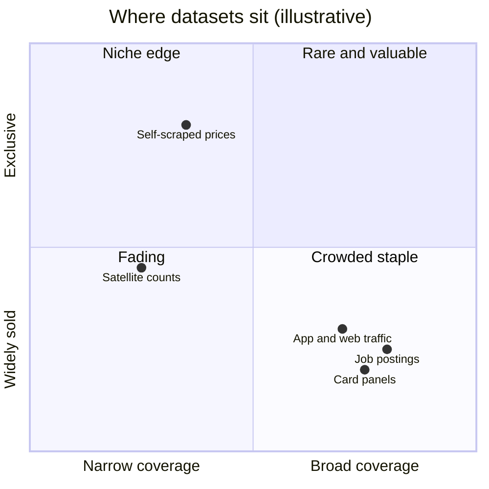
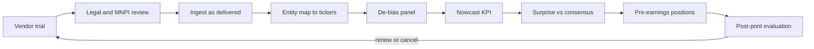

# Alternative data

> **TL;DR**
>
> - Alternative data (card transactions, app and web traffic, satellite and location counts, job postings, supply-chain links, scraped prices, text) estimates a company's numbers before it reports: mostly a revenue nowcast ahead of earnings.
> - The edge is in the plumbing: panel-bias correction, ticker mapping, as-delivered history, backfill detection.
> - Evidence is real but narrow: satellite parking-lot counts earned ~4–5% in the three days around retailer earnings (2011–2017) `[Reported]`. Edges shrink as vendors add clients.
> - Legal review binds first: MNPI and provenance (App Annie's \$10M SEC penalty, 2021), scraping law, privacy.
> - Most buyers spend \$0.5–2.5M a year on data `[Reported]`, a fixed cost against small capacity, so each dataset has a break-even size.

**Level:** Core · **Read time:** ~8 min · **Last verified:** 2026-11

| Field | Value |
|---|---|
| Family | mid-freq alpha |
| Edge source | informational |
| Holding period | Days to weeks, mostly the 1–3 weeks before earnings |
| Counterparty: who pays and why they accept it | Investors who learn sales only at the official print (long-only managers, retail, quants without the dataset): for them the data would cost more than it earns |
| Universe & instruments | US consumer-facing stocks (retail, restaurants, internet, travel), 100–1,000 covered names; sector-ETF hedges |
| Data required | Vendor panels with as-delivered history; merchant-to-ticker maps; point-in-time consensus; reported KPIs |
| Core algorithms used | [D1 Point-in-time data and cleaning](../../03-algorithms/a-data-and-signals/point-in-time-data-and-cleaning.md) · [D2 Feature engineering](../../03-algorithms/a-data-and-signals/feature-engineering.md) · [D4 Evaluating signals](../../03-algorithms/a-data-and-signals/evaluating-signals.md) · [F2 Tree ensembles](../../03-algorithms/b-forecasting-models/tree-ensembles.md) |
| Infra intensity | Low latency sensitivity; heavy data engineering (entity resolution, terabyte-scale location data) |
| Capacity (rough $ range) | \$50M–\$500M GMV per dataset sleeve `[Estimate]` (100–500 names, edge concentrated before earnings, mid-cap impact) |
| Typical Sharpe (gross vs net) | Satellite lots: ~4–5% gross over three event days, 2011–2017, academic study via author interview `[Reported]`. Customer-supplier links: >150 bps a month gross alpha, pre-2008 academic backtest `[Verified]`. Single-dataset sleeves: net 0.3–1.0 `[Lore]`, falling as vendors add clients |
| Turnover | 200–600% a year, lumpy around reporting seasons `[Estimate]` |
| Main risks / failure modes | Panel drift, backfilled history, vendor shutdown, MNPI exposure, earnings-day gaps |
| Crowding risk | High for mainstream card and app panels; low for exclusive or self-built data |
| Firm types that run it | Quant and fundamental hedge funds, multi-manager pods, systematic asset managers |
| Lab | — |

## Intuition (the story in plain English)

Revenue is reported quarterly, weeks after quarter end, but its evidence appears daily: card swipes, app sessions, cars in lots. Sample it and scale it up, and you know the quarter before the print. It is a statistical channel check: diligence teams check one target's sell-through; a quant does it for 400 companies and compares each with [consensus](../../09-reference/glossary.md#consensus-estimate).

## Economic rationale: why should this make money at all?

- **Costly information.** If prices fully reflected costly information, nobody would buy it (Grossman–Stiglitz); [alternative data](../../09-reference/glossary.md#alternative-data) returns pay for processing it.
- **Unequal access.** Satellite coverage of retailers brought more informed short selling and lower liquidity around reports (Katona et al.) `[Verified]`, and such data cut insider-trading profits (Zhu 2019) `[Reported]`.
- **Inattention.** Prices react slowly to news about a firm's main customers: over 150 bps a month long-short (Cohen & Frazzini 2008) `[Verified]`.
- **Short horizon.** Analysts exposed to alt data forecast the near term better and the long term worse (Dessaint, Foucault & Frésard 2024) `[Verified]`.

## The trade, step by step

1. **Trial and diligence:** compliance reviews provenance and terms before researchers see data.
2. **Map entities:** merchant string ("SQ *JOES COFFEE 1123") → brand → parent → ticker, point-in-time through M&A.
3. **De-bias:** normalize for panel growth, churn and demographics.
4. **Nowcast:** regress past reported growth on panel growth.
5. **Surprise:** nowcast minus consensus, in standard errors.
6. **Position** 2–10 days before the report, sector-hedged; exit after the print.

## Worked example with numbers

Illustrative card-panel nowcast for retailer XYZ:

| Step | Value |
|---|---|
| Panel spend, quarter to date, vs last year | \$41.6M vs \$38.0M → +9.5% |
| Panel active cardholders (a new bank joined) | +3.0% |
| Per-user growth: 1.095 / 1.030 − 1 | **+6.3%** |
| Calibration (16 quarters): 0.5% + 0.85 × 6.3% | **+5.9%** → revenue \$10.59B on last year's \$10.00B |
| Consensus | \$10.40B (+4.0%) |
| Surprise; model s.e. 1.2% | +1.9% → z ≈ +1.6 |

Without the per-user step: +8.6%, as panel growth masquerades as sales.

**Trade.** History says a 1% surprise moves the stock ~1.5% over three days; halve that because rivals own the panel. Expected return = 1.9 × 1.5 × 0.5 ≈ 1.4%, or \$71,000 on a \$5M hedged long, minus ~16 bps round-trip costs (\$8,000): ~\$63,000. Earnings-day volatility of 6% (\$300,000) makes each trade a tilted coin flip; breadth across names does the work. A \$750,000 license needs ~12 such trades a year to break even.

## Signals and algorithms under the hood

Timestamps and backfill: [D1](../../03-algorithms/a-data-and-signals/point-in-time-data-and-cleaning.md). Panel features: [D2](../../03-algorithms/a-data-and-signals/feature-engineering.md). Hit rate and decay by days-to-earnings: [D4](../../03-algorithms/a-data-and-signals/evaluating-signals.md). Pooling short datasets: [F2](../../03-algorithms/b-forecasting-models/tree-ensembles.md) or [ridge](../../03-algorithms/b-forecasting-models/linear-models-and-regularization.md). Text: [F4](../../03-algorithms/b-forecasting-models/llms-and-foundation-models-in-quant.md).

```python
import numpy as np
import pandas as pd

def data_surprise(panel, fit, consensus_g, asof):
    """panel: [ticker, period, spend, active_users, delivered_at], one row per ticker and
    quarter-to-date window (this year and the same window last year). fit: per-ticker
    alpha, beta, resid_sd from past quarters. consensus_g: consensus growth known at asof."""
    p = panel[panel.delivered_at <= asof]                    # as delivered only: no backfill
    p = p.sort_values("period")
    per_user = p.spend / p.active_users                      # strip panel growth and churn
    g = per_user.groupby(p.ticker).agg(lambda s: s.iloc[-1] / s.iloc[-2] - 1)
    nowcast = fit.alpha + fit.beta * g                       # panel growth -> reported growth
    z = (nowcast - consensus_g) / fit.resid_sd               # surprise in standard errors
    return z.clip(-3, 3).dropna()

def earnings_window_book(z, days_to_report, gross=50e6, lo=2, hi=10):
    live = z[(days_to_report >= lo) & (days_to_report <= hi)]
    w = live - live.mean()                                   # dollar-neutral across live names
    return gross * w / w.abs().sum()                         # sector hedges added by the optimizer
```

## Implementation choices that matter

- **Panel bias:** card panels skew by bank, region and income; reweight, and model online versus in-store.
- **History:** demand data as delivered, not restated. Pre-launch history is [backfill](../../09-reference/glossary.md#backfill-bias); pruned dead series add [survivorship bias](../../09-reference/glossary.md#survivorship-bias).
- **Short samples:** five years is 20 quarters per stock; pool across stocks and shrink.
- **Calendars:** 4-4-5 fiscal quarters, Easter shifts, leap days.
- **Procurement:** exclusivity costs a premium `[Lore]`; ask how many funds hold the data.

## P&L decomposition

Illustrative \$300M GMV sleeve, % of GMV a year:

| Line | % |
|---|---|
| Earnings-window alpha | +4.0 |
| Between-event drift | +0.8 |
| Trading costs (~400% turnover) | −1.0 |
| Data licenses (\$1.5M) | −0.5 |
| Data engineering staff | −0.3 |
| Borrow and financing | −0.2 |
| **Net** | **+2.8** |

At 5% volatility, net Sharpe ≈ 0.56 `[Estimate]`. Data and staff are fixed costs: returns improve with scale until impact bites.

## Evidence

- **Satellites:** Katona, Painter, Patatoukas & Zeng (*JFQA* 2025): RS Metrics images of 44 US retailers, 2011–2017; trading on bad-news quarters was profitable `[Verified]`, ~4–5% over three days per an author interview `[Reported]`.
- **Other sources:** real-time sales indices predict surprises (Froot et al. 2017) `[Reported]`; job-posting changes predict performance (Gutiérrez et al. 2020) `[Verified]`; Glassdoor ratings (Green et al. 2019) and Google search volume (Da, Engelberg & Gao 2011) predict returns `[Reported]`.
- **Budgets:** 84% of firms in a 2026 vendor survey spent \$0.5–2.5M a year `[Reported]`.

## Capacity, crowding and decay

Coverage clusters in consumer names and the edge before earnings, so capacity per dataset is small. As a vendor adds clients, the data leaks into whisper numbers and sell-side estimates, and the surprise folds into consensus ([alpha decay](../../03-algorithms/g-live-trading/alpha-decay-detection-and-model-retirement.md)).



## How it fails

- **Provenance (September 2021).** App Annie and its founder paid \$10M and \$300,000 to settle SEC fraud charges: it had used confidential app data in its estimates despite promising not to. No buying fund was charged `[Reported]`.
- **Scraping (December 2022).** *hiQ v. LinkedIn* narrowed computer-fraud claims over public data, but LinkedIn's anti-scraping terms were held enforceable; hiQ accepted a \$500,000 consent judgment and deleted its data `[Reported]`.
- **Panel drift.** A bank partner leaves, an SDK changes, a privacy rule cuts location data, and the series breaks `[Lore]`.

## Textbook vs how it's done today

| Textbook | Practice today |
|---|---|
| "Satellites count cars" | Card, app and web panels dominate budgets `[Lore]` |
| A dataset is a signal | A dataset is a KPI nowcast feeding an [earnings](earnings-and-event-driven.md) surprise model `[Lore]` |
| Backtest on vendor history | As-delivered history only; backfilled years haircut `[Lore]` |
| Compliance after research | Diligence first: an April 2022 SEC risk alert faulted ad hoc vetting of alt-data vendors `[Reported]` |

## Variants and neighbours

[Earnings and event-driven](earnings-and-event-driven.md), [analyst revisions](analyst-revisions-and-sentiment.md), [NLP and LLM signals](nlp-and-llm-signals.md), [fundamental quant signals](fundamental-quant-signals.md), supply-chain momentum.

## Diagram



## How practitioners talk about it

- "Is that history point-in-time or backfilled?" → Could we have had this number then?
- "Normalize per active user first." → Strip panel growth before reading sales.
- "The panel nailed comps until the bank left." → A source change broke the series.
- "We pay for it on capacity, not Sharpe." → License cost must be earned on deployable dollars.
- "It's a nowcast, not an alpha." → It predicts revenue; returns depend on consensus.

## Myths vs reality

| Myth | Reality |
|---|---|
| More data means more alpha | Most trialed datasets add nothing after costs `[Lore]` |
| Public on the web means free to use | Terms, scraping law, privacy and MNPI rules apply |

## Questions you could ask a quant about this

**Basic**

- Which KPIs do your datasets predict?

**Informed**

- How do you test a vendor's history for backfill?
- What share of trialed datasets do you buy?

**Sharp**

- What is the break-even AUM of your priciest dataset? 🔒
- How did your panels behave when spending shifted channels in 2020? 🔒
- Which legal red flags made you walk away from a dataset? 🔒

## Go deeper

<details markdown="1">
<summary>Math: panel de-biasing, surprise, break-even cost</summary>

Post-stratify: weight panel cell $c$ (region × income × channel) by population share $\pi_c$ over panel share $p_{c,t}$, with spend $S$ and active users $U$:

$$
\hat S_t = \sum_c \frac{\pi_c}{p_{c,t}} \, \frac{S_{c,t}}{U_{c,t}} , \qquad z_i = \frac{\alpha_i + \beta_i \, \Delta \log \hat S_{i} - g_i^{cons}}{\hat\sigma_{\varepsilon,i}} .
$$

With license $L$, engineering cost $C$ and net alpha $\alpha_{net}$, the minimum capacity worth buying is

$$
K_{min} = \frac{L + C}{\alpha_{net}} ,
$$

so \$1.2M of costs at 2% net alpha needs \$60M of GMV.

</details>

## Related pages

- [Earnings and event-driven](earnings-and-event-driven.md)
- [NLP and LLM signals](nlp-and-llm-signals.md)
- [Point-in-time data and cleaning (D1)](../../03-algorithms/a-data-and-signals/point-in-time-data-and-cleaning.md)
- [Backtest pitfalls (V3)](../../03-algorithms/c-validation-and-backtesting/backtest-pitfalls.md)
- [Rules that shape strategies](../../06-risk-and-regulation/rules-that-shape-strategies.md)

## Sources

- [Verified] Katona, Z., Painter, M., Patatoukas, P. N. & Zeng, J. (2025). "On the Capital Market Consequences of Big Data: Evidence from Outer Space." *Journal of Financial and Quantitative Analysis* 60(2), 551–579. <https://doi.org/10.1017/S0022109023001448> (accessed 2026-11)
- [Reported] Berkeley Haas Newsroom (2019-05-28). "How hedge funds use satellite images to beat Wall Street and Main Street." <https://newsroom.haas.berkeley.edu/how-hedge-funds-use-satellite-images-to-beat-wall-street-and-main-street/> (accessed 2026-11)
- [Verified] Cohen, L. & Frazzini, A. (2008). "Economic Links and Predictable Returns." *Journal of Finance* 63(4), 1977–2011. <https://doi.org/10.1111/j.1540-6261.2008.01379.x> (accessed 2026-11)
- [Verified] Dessaint, O., Foucault, T. & Frésard, L. (2024). "Does Alternative Data Improve Financial Forecasting? The Horizon Effect." *Journal of Finance* 79(3), 2237–2287. <https://doi.org/10.1111/jofi.13323> (accessed 2026-11)
- [Reported] Zhu, C. (2019). "Big Data as a Governance Mechanism." *Review of Financial Studies* 32(5), 2021–2061. <https://doi.org/10.1093/rfs/hhy081> (accessed 2026-11)
- [Reported] Froot, K., Kang, N., Ozik, G. & Sadka, R. (2017). "What do measures of real-time corporate sales say about earnings surprises and post-announcement returns?" *Journal of Financial Economics* 125(1), 143–162. <https://doi.org/10.1016/j.jfineco.2017.04.008> (accessed 2026-11)
- [Verified] Gutiérrez, E., Lourie, B., Nekrasov, A. & Shevlin, T. (2020). "Are Online Job Postings Informative to Investors?" *Management Science* 66(7), 3133–3141. <https://doi.org/10.1287/mnsc.2019.3450> (accessed 2026-11)
- [Reported] Green, T. C., Huang, R., Wen, Q. & Zhou, D. (2019). "Crowdsourced employer reviews and stock returns." *Journal of Financial Economics* 134(1), 236–251. <https://doi.org/10.1016/j.jfineco.2019.03.012> (accessed 2026-11)
- [Reported] Da, Z., Engelberg, J. & Gao, P. (2011). "In Search of Attention." *Journal of Finance* 66(5), 1461–1499. <https://doi.org/10.1111/j.1540-6261.2011.01679.x> (accessed 2026-11)
- [Reported] Simpson Thacher (2021-09-15). "App Annie and Its Founder to Pay \$10 Million to Settle First SEC Enforcement Action Against Alternative Data Provider." <https://www.stblaw.com/about-us/publications/view/2021/09/15/app-annie-and-its-founder-to-pay-$10-million-to-settle-first-sec-enforcement-action-against-alternative-data-provider> (accessed 2026-11)
- [Reported] Proskauer New Media and Technology Law Blog (2022-12-08). "hiQ and LinkedIn Reach Proposed Settlement in Landmark Scraping Case." <https://newmedialaw.proskauer.com/2022/12/08/hiq-and-linkedin-reach-proposed-settlement-in-landmark-scraping-case/> (accessed 2026-11)
- [Reported] Debevoise & Plimpton (2022-05). "The SEC's New Risk Alert Warns about the Use of Alternative Data." <https://www.debevoise.com/insights/publications/2022/05/the-secs-new-risk-alert-warns> (accessed 2026-11)
- [Reported] Lowenstein Sandler (2025). "2025 Alternative Data Report." <https://www.lowenstein.com/media/jujd45bp/alt-data-report-2025_final.pdf> (accessed 2026-11)
- [Reported] IT Edge News (2026). "Alternative data spending set to surge as 94% of fund managers boost budgets, Exabel research reveals." <https://www.itedgenews.africa/alternative-data-spending-set-to-surge-as-94-of-fund-managers-boost-budgets-exabel-research-reveals> (accessed 2026-11)
