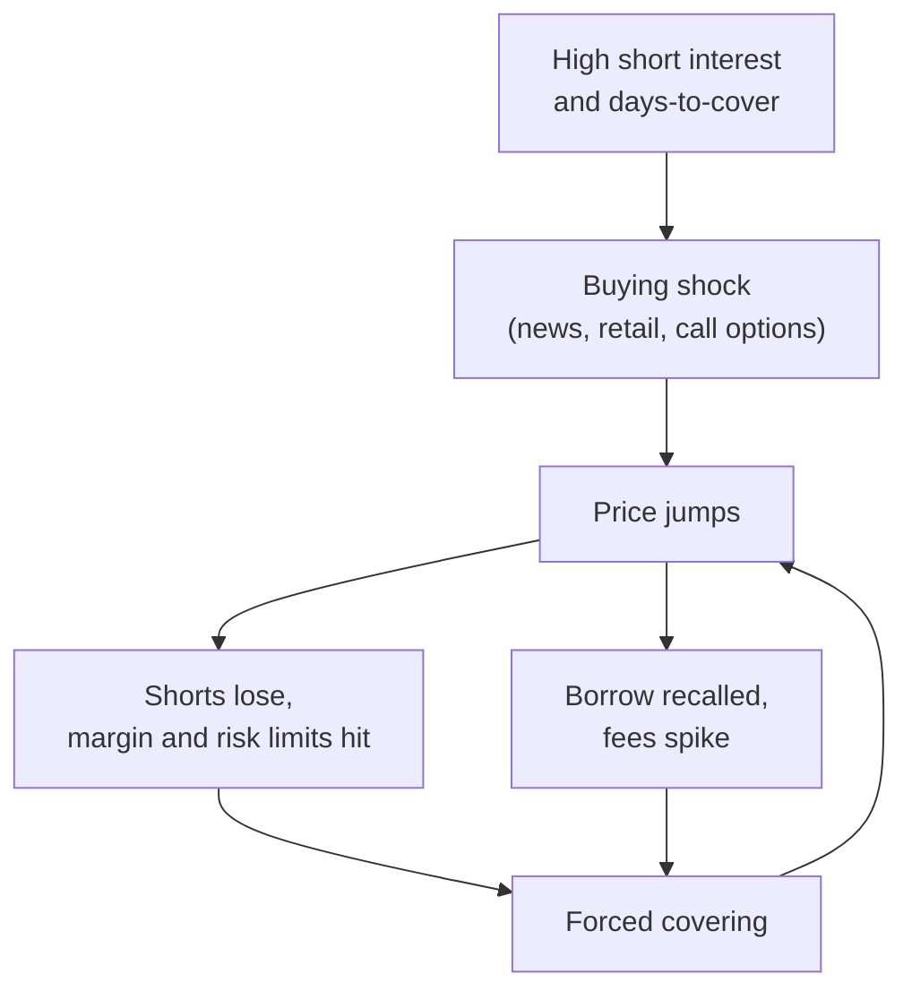

# Analyst revisions and sentiment

> **TL;DR**
>
> - Analysts update slowly and in herds, so consensus estimate revisions are serially correlated and prices drift after them: revision momentum is one of the most durable mid-frequency alphas.
> - Recommendation changes move prices on the day and drift afterwards, especially downgrades, but trading on them is costly.
> - Short interest and days-to-cover read the footprints of informed short sellers; the same crowded shorts are the squeeze candidates.
> - News scores, social-media sentiment and options-implied signals (skew, put-call parity deviations) add fast, crowded information that decays in days.

**Level:** Core · **Read time:** ~9 min · **Last verified:** 2026-11

| Field | Value |
|---|---|
| Family | mid-freq alpha |
| Edge source | informational · behavioral |
| Holding period | Days (news, options) to 1–3 months (revisions, short interest) |
| Counterparty: who pays and why they accept it | Investors anchored on stale estimates; attention-driven buyers of heavily discussed names; stock traders slower than informed option buyers. They are not watching continuously, or trade for other reasons. |
| Universe & instruments | US stocks with at least three estimates; listed options for implied signals; borrowable names for shorts |
| Data required | Point-in-time estimates and recommendations (for example I/B/E/S), short interest, lending utilization and fees, scored news, option implied volatilities |
| Core algorithms used | [D2 Feature engineering](../../03-algorithms/a-data-and-signals/feature-engineering.md) · [D3 Signal transforms](../../03-algorithms/a-data-and-signals/signal-transforms.md) · [D4 Evaluating signals](../../03-algorithms/a-data-and-signals/evaluating-signals.md) · [F5 Alpha combination and ensembling](../../03-algorithms/b-forecasting-models/alpha-combination-and-ensembling.md) · [F4 LLMs and foundation models in quant](../../03-algorithms/b-forecasting-models/llms-and-foundation-models-in-quant.md) |
| Infra intensity | Overnight batch; real-time feeds for news |
| Capacity (rough $ range) | Revisions and short interest: $1B–$5B as a component `[Estimate]`; news and options signals: $100M–$1B `[Estimate]` (decay within days forces high turnover) |
| Typical Sharpe (gross vs net) | Recommendation long-short: >4% a year gross, 1986–1996, not reliably positive after costs `[Reported]`; option-skew long-short: ~10.9% a year risk-adjusted, gross of costs, 1996–2005 `[Reported]`; both academic backtests, decayed since. Inside a composite: +0.2–0.5 net Sharpe contribution `[Lore]` |
| Turnover | Revisions 100–400% a year; news sleeves 20–50% a day `[Lore]` |
| Main risks / failure modes | Short squeezes, vendor-signal crowding, back-filled data, regime shifts in analyst behaviour |
| Crowding risk | High: revisions and short interest are standard in commercial factor libraries; vendor sentiment is sold to many clients |
| Firm types that run it | Quant hedge funds, systematic asset managers, multi-manager quant pods |
| Lab | — |

## Intuition (the story in plain English)

Analysts are slow, careful and social: when news arrives, each moves part of the way and watches peers, so one upward revision predicts more. The market under-reacts too, and price follows the revision trail for weeks.

Other signals read who is already acting on information: short sellers are, on average, informed, as are option traders buying puts before bad news. News and social tone is sometimes information and sometimes noise that reverses.

## Economic rationale: why should this make money at all?

- **Partial adjustment and herding.** Gradual analyst updating makes [earnings revisions](../../09-reference/glossary.md#earnings-revision) autocorrelated, and prices drift after them (Givoly & Lakonishok 1979; Stickel 1991) `[Reported]`.
- **Informed footprints.** Heavily shorted stocks underperform lightly shorted ones by about 1.16% over the next 20 trading days, risk-adjusted (Boehmer, Jones & Zhang 2008) `[Reported]`. Informed traders favour options, so skew leads stock prices (Xing, Zhang & Zhao 2010) `[Reported]`.
- **Noise versus news.** Tetlock (2007) found media pessimism pushes prices down and then reverses (noise); Tetlock, Saar-Tsechansky & Macskassy (2008) found negative words in firm news predict earnings and returns (information) `[Reported]`.

## The trade, step by step

| Signal | Construction | Horizon | Origin |
|---|---|---|---|
| Revision momentum | (up − down revisions) / analysts, 1–3 months; or Δconsensus / price | 1–3 months | Chan, Jegadeesh & Lakonishok (1996) |
| Recommendation changes | Upgrades, downgrades, initiations | Days to months | Womack (1996) |
| [Days-to-cover](../../09-reference/glossary.md#days-to-cover) | Short interest / average daily volume | 1–3 months | Asquith, Pathak & Ritter (2005) |
| News sentiment | Vendor score × relevance × novelty | 1–5 days | Heston & Sinha (2017) |
| Social sentiment | Tone of investor posts and articles | Days to months | Chen, De, Hu & Hwang (2014) |
| Option skew | OTM put IV − ATM call IV | 1–4 weeks | Xing, Zhang & Zhao (2010); Cremers & Weinbaum (2010) |

Then z-score within sector, orthogonalize to surprise and momentum, IC-weight, neutralize and pass to the [optimizer](cross-sectional-alpha-and-neutralization.md).

## Worked example with numbers

**Revisions (illustrative).** Twelve analysts; over 60 days seven raised next-year EPS and one cut. Net revision ratio = (7 − 1) / 12 = 0.50. Consensus moved $4.00 → $4.20 on an $80 stock: revision-to-price = 0.20 / 80 = 0.25%. Within sector these z-score to +1.6 and +1.2; average +1.4.

**The short-side trap (illustrative).** Days-to-cover = 6M shares short / 0.5M ADV = 12 days, top decile; the model wants to short $2M. Expected underperformance 1.0% a month = +$20,000. Borrow fee 25% a year = 2.1% a month = −$41,700. Net ≈ −$21,700 a month before squeeze risk: fee-adjusted alpha is what matters.

## Signals and algorithms under the hood

Feature design: [D2](../../03-algorithms/a-data-and-signals/feature-engineering.md); transforms: [D3](../../03-algorithms/a-data-and-signals/signal-transforms.md); decay and IC by horizon: [D4](../../03-algorithms/a-data-and-signals/evaluating-signals.md); blending with other alphas: [F5](../../03-algorithms/b-forecasting-models/alpha-combination-and-ensembling.md); LLM news scoring: [F4](../../03-algorithms/b-forecasting-models/llms-and-foundation-models-in-quant.md); point-in-time estimates: [D1](../../03-algorithms/a-data-and-signals/point-in-time-data-and-cleaning.md).

```python
import numpy as np
import pandas as pd

def revision_signal(est, asof, window_days=60, min_analysts=3):
    """est: detail estimates (ticker, analyst, eps, announce_date), used only if
    announced by `asof` (point-in-time). Returns net up-minus-down share."""
    e = est[(est.announce_date <= asof) &
            (est.announce_date > asof - pd.Timedelta(days=window_days))]
    e = e.sort_values("announce_date")
    e["chg"] = e.groupby(["ticker", "analyst"]).eps.diff()  # simplified: ignores pre-window
    g = e.dropna(subset=["chg"]).groupby("ticker").chg
    net = g.apply(lambda c: (c > 0).sum() - (c < 0).sum()) / g.count()
    return net[g.count() >= min_analysts]

def sentiment_composite(rev, dtc, news, skew, sector):
    """Inputs: Series by ticker. Signs: revisions +, days-to-cover -, news +, skew -."""
    raw = pd.DataFrame({"rev": rev, "dtc": -np.log1p(dtc), "news": news, "skew": -skew})
    z = raw.groupby(sector).transform(lambda c: ((c - c.mean()) / c.std()).clip(-3, 3))
    return z.mean(axis=1, skipna=True)          # equal weight; F5 would IC-weight
```

## Implementation choices that matter

- **Point-in-time estimates.** Ljungqvist, Malloy & Marston (2009) showed historical I/B/E/S recommendation records were altered after the fact `[Reported]`; use archived snapshots and announcement dates.
- **Hygiene.** Drop estimates older than about 90–120 days and strip the post-earnings revision wave that echoes the surprise ([earnings](earnings-and-event-driven.md)).
- **Short-interest timing.** Exchange short interest is reported twice monthly with a lag; key it to publication date, not settlement date ([shorting](../../01-market-structure/shorting-financing-and-settlement.md)).
- **Borrow.** Score alpha net of lending fees; cap utilization.
- **News.** Deduplicate, require relevance and novelty, trade fast ([NLP and LLM signals](nlp-and-llm-signals.md)).

## P&L decomposition

Illustrative $1B GMV sleeve:

| Line | % of GMV per year |
|---|---|
| Revision momentum | +2.5% |
| Short interest and lending | +1.5% |
| News and options (fast) | +2.0% |
| Trading costs (10% a day at 7 bps) | −1.8% |
| Borrow fees on crowded shorts | −0.5% |
| Financing spread | −0.3% |
| **Net** | **+3.4%** |

At 4% volatility, gross Sharpe ≈ 1.5 and net ≈ 0.85 `[Estimate]`.

## Evidence

- Chan, Jegadeesh & Lakonishok (1996): revisions and earnings surprises predict returns, and price momentum partly reflects earnings momentum `[Reported]`.
- Womack (1996): downgrade drift lasts about six months, upgrade drift about a month `[Reported]`. Barber et al. (2001): consensus-recommendation strategies earned >4% gross, gone after costs `[Reported]`.
- Asquith, Pathak & Ritter (2005): high short interest plus low institutional ownership predicts underperformance `[Reported]`.
- Chen et al. (2014): Seeking Alpha opinions predict returns and earnings surprises `[Reported]`.
- Xing, Zhang & Zhao (2010): steepest-smirk stocks underperform by about 10.9% a year (1996–2005) `[Reported]`.
- McLean & Pontiff (2016): published predictors lose 58% post-publication `[Verified]`.

## Capacity, crowding and decay

Revisions and short interest sit in every commercial factor library, so standalone returns have shrunk and drawdowns are shared. Vendor news scores reach many clients at once and decay within hours to days `[Lore]`; edge has moved to proprietary parsing and LLM scoring.

## How it fails

- **Short squeezes.** In January 2021, heavily shorted stocks such as GameStop rose many-fold within days as retail buying, options activity and short covering fed each other `[Verified]` (SEC staff report, 2021).
- **Rule changes.** Regulation FD (effective October 2000) ended selective disclosure to analysts, changing what revisions contain `[Verified]`.
- **Crowding and back-filled data** inflate backtests ([backtest pitfalls](../../03-algorithms/c-validation-and-backtesting/backtest-pitfalls.md)).

## Textbook vs how it's done today

| Textbook | Practice today |
|---|---|
| Consensus-mean revisions, monthly deciles (Chan et al. 1996) `[Reported]` | Analyst-level revisions weighted by accuracy and recency `[Lore]` |
| Short interest ratio | Daily lending utilization and fees plus short interest `[Lore]` |
| Dictionary word counts (Tetlock 2007) `[Reported]` | Vendor scores and LLM classifiers on news and transcripts `[Lore]` |

## Variants and neighbours

[Earnings and event-driven](earnings-and-event-driven.md), [NLP and LLM signals](nlp-and-llm-signals.md), [alternative data](alternative-data.md) (crowd-sourced estimates, web traffic), [momentum](../e-risk-premia-and-factors/momentum.md) (earnings momentum's price cousin).

## Diagram

The short-squeeze loop that hurts days-to-cover shorts:



## How practitioners talk about it

- "Revisions are still working, but only analyst-level." → Consensus revisions are crowded; individual-analyst detail adds edge.
- "Strip the post-earnings wave." → Remove revisions that merely echo the surprise.
- "Days-to-cover beats the raw short ratio." → Scaling by volume measures how hard covering is.
- "It's a good short, but not at that fee." → Borrow cost exceeds expected alpha.
- "That news score is gone by lunch." → Vendor sentiment decays within hours.
- "Skew is telling us someone knows something." → Steep put skew precedes bad news.

## Myths vs reality

| Myth | Reality |
|---|---|
| Follow the analysts' buy ratings | Consensus levels lose to costs; revisions and changes carry the signal |
| High short interest is a free short | Borrow fees and squeezes often exceed the alpha |
| Sentiment always means irrationality | Some tone is information about earnings, some is noise that reverses |

## Questions you could ask a quant about this

**Basic**

- Do you use consensus or individual-analyst revisions?
- How do you timestamp short-interest data?

**Informed**

- How do you separate revision alpha from earnings-surprise alpha?
- Do you score shorts net of borrow fees?
- How fast does your news signal decay?

**Sharp**

- What did January 2021 cost your short-interest sleeve, and what changed? 🔒
- Which analysts do you up-weight, and how is accuracy measured? 🔒

## Go deeper

<details markdown="1">
<summary>Math: why revisions are autocorrelated, and signal definitions</summary>

Partial adjustment: if each analyst moves a fraction $\kappa \in (0,1)$ toward the full-information forecast $E_t$,

$$
F_t = F_{t-1} + \kappa \left(E_t - F_{t-1}\right) ,
$$

then after a one-time shock to $E$, revisions $F_t - F_{t-1}$ shrink geometrically by $(1-\kappa)$ but keep the same sign: today's revision predicts tomorrow's.

Days-to-cover and option skew:

$$
DTC_i = \frac{\text{shares short}_i}{\text{ADV}_i}, \qquad SKEW_i = IV^{put}_{OTM,i} - IV^{call}_{ATM,i} .
$$

</details>

## Related pages

- [Cross-sectional alpha and neutralization](cross-sectional-alpha-and-neutralization.md)
- [Earnings and event-driven](earnings-and-event-driven.md)
- [NLP and LLM signals](nlp-and-llm-signals.md)
- [Shorting, financing and settlement](../../01-market-structure/shorting-financing-and-settlement.md)
- [Alpha combination and ensembling (F5)](../../03-algorithms/b-forecasting-models/alpha-combination-and-ensembling.md)

## Sources

- [Reported] Givoly, D. & Lakonishok, J. (1979). "The Information Content of Financial Analysts' Forecasts of Earnings." *Journal of Accounting and Economics* 1(3), 165–185. <https://doi.org/10.1016/0165-4101(79)90006-5> (accessed 2026-11)
- [Reported] Stickel, S. E. (1991). "Common Stock Returns Surrounding Earnings Forecast Revisions: More Puzzling Evidence." *The Accounting Review* 66(2), 402–416. <https://www.jstor.org/stable/247975> (accessed 2026-11)
- [Reported] Chan, L. K. C., Jegadeesh, N. & Lakonishok, J. (1996). "Momentum Strategies." *Journal of Finance* 51(5), 1681–1713. <https://doi.org/10.1111/j.1540-6261.1996.tb05222.x> (accessed 2026-11)
- [Reported] Womack, K. L. (1996). "Do Brokerage Analysts' Recommendations Have Investment Value?" *Journal of Finance* 51(1), 137–167. <https://doi.org/10.1111/j.1540-6261.1996.tb05205.x> (accessed 2026-11)
- [Reported] Barber, B., Lehavy, R., McNichols, M. & Trueman, B. (2001). "Can Investors Profit from the Prophets? Security Analyst Recommendations and Stock Returns." *Journal of Finance* 56(2), 531–563. <https://doi.org/10.1111/0022-1082.00336> (accessed 2026-11)
- [Reported] Boehmer, E., Jones, C. M. & Zhang, X. (2008). "Which Shorts Are Informed?" *Journal of Finance* 63(2), 491–527. <https://doi.org/10.1111/j.1540-6261.2008.01324.x> (accessed 2026-11)
- [Reported] Asquith, P., Pathak, P. A. & Ritter, J. R. (2005). "Short Interest, Institutional Ownership, and Stock Returns." *Journal of Financial Economics* 78(2), 243–276. <https://doi.org/10.1016/j.jfineco.2004.06.006> (accessed 2026-11)
- [Reported] Tetlock, P. C. (2007). "Giving Content to Investor Sentiment: The Role of Media in the Stock Market." *Journal of Finance* 62(3), 1139–1168. <https://doi.org/10.1111/j.1540-6261.2007.01232.x> (accessed 2026-11)
- [Reported] Tetlock, P. C., Saar-Tsechansky, M. & Macskassy, S. (2008). "More than Words: Quantifying Language to Measure Firms' Fundamentals." *Journal of Finance* 63(3), 1437–1467. <https://doi.org/10.1111/j.1540-6261.2008.01362.x> (accessed 2026-11)
- [Reported] Chen, H., De, P., Hu, Y. & Hwang, B.-H. (2014). "Wisdom of Crowds: The Value of Stock Opinions Transmitted through Social Media." *Review of Financial Studies* 27(5), 1367–1403. <https://doi.org/10.1093/rfs/hhu001> (accessed 2026-11)
- [Reported] Xing, Y., Zhang, X. & Zhao, R. (2010). "What Does the Individual Option Volatility Smirk Tell Us About Future Equity Returns?" *Journal of Financial and Quantitative Analysis* 45(3), 641–662. <https://doi.org/10.1017/S0022109010000220> (accessed 2026-11)
- [Reported] Ljungqvist, A., Malloy, C. & Marston, F. (2009). "Rewriting History." *Journal of Finance* 64(4), 1935–1960. <https://doi.org/10.1111/j.1540-6261.2009.01484.x> (accessed 2026-11)
- [Verified] U.S. SEC (2000). "Selective Disclosure and Insider Trading" (Regulation FD), Release No. 33-7881. <https://www.sec.gov/rules/final/33-7881.htm> (accessed 2026-11)
- [Verified] U.S. SEC Staff (2021-10-14). "Staff Report on Equity and Options Market Structure Conditions in Early 2021." <https://www.sec.gov/files/staff-report-equity-options-market-struction-conditions-early-2021.pdf> (accessed 2026-11)
