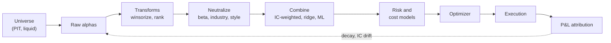
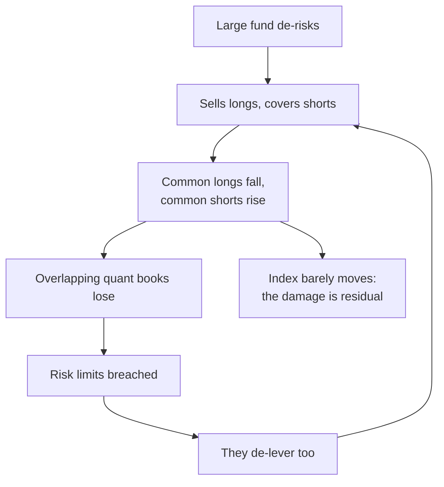

# Cross-sectional alpha and neutralization

> **TL;DR**
>
> - The canonical mid-frequency quant equity book ranks 1,000–3,000 US stocks *against each other* every day on many weak signals ("alphas") and holds the top against the bottom for days to weeks, with near-zero market exposure.
> - The pipeline: raw alphas → transforms (winsorize, rank or z-score) → neutralization (regress out beta, industries, styles) → combination → risk model → optimizer with a cost model → trades.
> - The Fundamental Law (IR ≈ TC · IC · √breadth) explains the design: each alpha is barely better than a coin flip (daily IC roughly 0.005–0.05), so the edge comes from many nearly independent bets.
> - It fails through costs (turnover of 10–40% of the book per day), crowding (August 2007) and decay of known signals.

**Level:** Core · **Read time:** ~11 min · **Last verified:** 2026-11

| Field | Value |
|---|---|
| Family | mid-freq alpha |
| Edge source | behavioral · informational (plus liquidity provision for reversal-type alphas) |
| Holding period | 1–20 trading days |
| Counterparty: who pays and why they accept it | Benchmarked funds rebalancing to an index, institutions paying for immediacy on large orders, investors who under-react to news. They accept a few bps of leakage per trade because their objective (tracking, liquidity, a multi-year thesis) dominates. |
| Universe & instruments | US common stocks above a liquidity floor, long and short in cash or swaps; index futures to hedge residual beta |
| Data required | Point-in-time prices, corporate actions, fundamentals, estimates; industry codes; a factor risk model; spread, ADV and volatility for costs; borrow fees |
| Core algorithms used | [D3 Signal transforms](../../03-algorithms/a-data-and-signals/signal-transforms.md) · [D4 Evaluating signals](../../03-algorithms/a-data-and-signals/evaluating-signals.md) · [F5 Alpha combination and ensembling](../../03-algorithms/b-forecasting-models/alpha-combination-and-ensembling.md) · [P1 Risk models](../../03-algorithms/d-portfolio-construction/risk-models.md) · [P3 Mean-variance optimization](../../03-algorithms/d-portfolio-construction/mean-variance-optimization.md) · [P5 Transaction cost and impact models](../../03-algorithms/d-portfolio-construction/transaction-cost-and-impact-models.md) |
| Infra intensity | Low latency sensitivity; heavy batch research compute; seconds per optimizer solve |
| Capacity (rough $ range) | \$1B–\$10B gross market value (GMV) per book `[Estimate]` (square-root impact: total cost grows like size^1.5, alpha like size) |
| Typical Sharpe (gross vs net) | Diversified multi-alpha book: gross 1.5–3, net 1–2 `[Lore]` (practitioner estimates, 2010s–2020s; no audited disclosure). Single published anomalies are weaker and lose ~58% of in-sample return after publication `[Verified]` (McLean & Pontiff 2016) |
| Turnover | 10–40% of GMV per day `[Lore]` (about 25–100× per year) |
| Main risks / failure modes | Crowded deleveraging, cost-model error, factor leakage, alpha decay, look-ahead, short squeezes |
| Crowding risk | High: shared data (Compustat, I/B/E/S), similar transforms and commercial risk models |
| Firm types that run it | Quant hedge funds, multi-manager quant pods, alpha-research platforms; WorldQuant stated that 80 of the 101 alphas in Kakushadze (2016) were in production when published `[Verified]` |
| Lab | [Lab 11](https://github.com/FrankHuang94/quant_trading_claude/tree/main/labs/11-signal-transforms-ic) |

## Intuition (the story in plain English)

A cross-sectional book never asks "will the market go up?" It asks "which of these 2,000 stocks will beat the others over the next week?" If every stock falls 3% tomorrow, a well-built book should barely notice.

Each [alpha](../../09-reference/glossary.md#alpha) is a weak opinion: "analysts just raised estimates", "fell hard last week", "low accruals". Each is right perhaps 51–52% of the time. Hold hundreds of names per side and the coin flips average out.

[Neutralization](../../09-reference/glossary.md#neutralization) makes sure each flip is about what you think. If your "cheap stocks" list is 60% banks, you are betting on banks, not cheapness. Neutralization removes the bank bet (and the market and small-cap bets), leaving the stock-specific part the alpha was meant to capture.

## Economic rationale: why should this make money at all?

1. **Behavioral under-reaction.** Investors digest earnings news, revisions and accounting quality slowly; prices drift toward the news (see [earnings](earnings-and-event-driven.md) and [revisions](analyst-revisions-and-sentiment.md)).
2. **Liquidity provision.** Reversal alphas are paid for absorbing temporary order imbalances (see [short-term reversal](../c-statistical-arbitrage/short-term-cross-sectional-reversal.md)).
3. **Residual risk premia.** Some signals earn pay for risks your model omits; neutralization deliberately removes most *known* premia.

Arbitrage stays limited because shorting is costly, capital is finite and every dollar of alpha must clear a cost hurdle.

## The trade, step by step

1. **Universe**: point-in-time membership and a liquidity floor ([D1](../../03-algorithms/a-data-and-signals/point-in-time-data-and-cleaning.md)).
2. **Raw alphas**: one number per stock per day ([D2](../../03-algorithms/a-data-and-signals/feature-engineering.md)).
3. **Transform**: [winsorize](../../09-reference/glossary.md#winsorization), then rank or z-score across stocks each date.
4. **Neutralize**: regress on beta, industry dummies and style exposures; keep the residual.
5. **Evaluate and combine**: [information coefficient](../../09-reference/glossary.md#information-coefficient-ic), decay, turnover; blend into one forecast.
6. **Scale**: alpha = IC × residual volatility × score (Grinold).
7. **Optimize** with risk, cost and constraints; trade part of the way to target.
8. **Execute** (VWAP/IS, closing auction) and **attribute** P&L next morning.



## Worked example with numbers

**A. Neutralization (illustrative).** Four stocks, two sectors, one raw z-scored signal:

| Stock | Sector | Beta | Raw z | Sector mean | Sector-neutral |
|---|---|---|---|---|---|
| A | Semis | 1.4 | +1.5 | +1.0 | +0.5 |
| B | Semis | 1.3 | +0.5 | +1.0 | −0.5 |
| C | Banks | 1.1 | −0.3 | −1.0 | +0.7 |
| D | Banks | 0.9 | −1.7 | −1.0 | −0.7 |

The raw signal is mostly "long semis, short banks". Sector-neutral, the book is long A and C, short B and D. At \$100M GMV (\$41.7M per unit of score): A +\$20.8M, C +\$29.2M, B −\$20.8M, D −\$29.2M. Net beta dollars: 20.8×1.4 + 29.2×1.1 − 20.8×1.3 − 29.2×0.9 = +\$7.9M, so a 2% market drop costs ~\$158k. **Sector-neutral is not beta-neutral**: add beta to the regression or hedge with ~\$7.9M of index futures.

**B. Dollar- vs beta-neutral (illustrative).** \$500M long at beta 0.8 against \$500M short at beta 1.2 is dollar-neutral but carries −\$200M of beta: a +1% market day loses ~\$2M.

**C. Fundamental Law (illustrative).** IC 0.03, 2,000 stocks, 5-day horizon (≈ 50 periods a year): nominal breadth 100,000, √ ≈ 316, IR ≈ 9.5; with a transfer coefficient of 0.4, 3.8. If correlated residuals and overlapping holds leave 10% of bets truly independent, √10,000 = 100 and IR ≈ 0.03 × 100 × 0.4 = 1.2, where real books live.

## Signals and algorithms under the hood

Transforms and IC: [D3](../../03-algorithms/a-data-and-signals/signal-transforms.md), [D4](../../03-algorithms/a-data-and-signals/evaluating-signals.md). Combination: [F5](../../03-algorithms/b-forecasting-models/alpha-combination-and-ensembling.md). [Risk model](../../09-reference/glossary.md#risk-model): [P1](../../03-algorithms/d-portfolio-construction/risk-models.md), [P2](../../03-algorithms/d-portfolio-construction/covariance-estimation-and-shrinkage.md). Optimizer and costs: [P3](../../03-algorithms/d-portfolio-construction/mean-variance-optimization.md), [P5](../../03-algorithms/d-portfolio-construction/transaction-cost-and-impact-models.md), [P6](../../03-algorithms/d-portfolio-construction/multi-period-and-trading-toward-aim.md). [Lab 11](https://github.com/FrankHuang94/quant_trading_claude/tree/main/labs/11-signal-transforms-ic) implements the transforms and IC diagnostics on synthetic data.

```python
import numpy as np

def winsorize(x, pct=0.01):
    """Clip raw values at the date's 1st/99th percentiles (bad prints, outliers)."""
    lo, hi = np.nanquantile(x, [pct, 1 - pct])
    return np.clip(x, lo, hi)

def zscore(x, clip=3.0):
    """Cross-sectional z-score on one date, then clipped at +/- clip sd."""
    z = (x - np.nanmean(x)) / np.nanstd(x)
    return np.clip(z, -clip, clip)

def neutralize(signal, exposures):
    """Residual after least-squares regression of the signal on exposures.
    exposures: N x K (beta column, industry dummies, style z-scores)."""
    coef, *_ = np.linalg.lstsq(exposures, signal, rcond=None)
    return signal - exposures @ coef        # orthogonal to every exposure column

def daily_forecast(raw_alphas, exposures, ic, resid_vol, ic_combo=0.04):
    """raw_alphas: {name: N-vector}; ic: {name: trailing rank IC}; returns daily alpha."""
    combo = np.zeros(len(resid_vol))
    for name, x in raw_alphas.items():
        s = neutralize(zscore(winsorize(x)), exposures)
        combo += max(ic[name], 0.0) * s / np.std(s)   # IC-weighted; ignores alpha correlations
    score = neutralize(zscore(combo), exposures)      # re-neutralize after clipping
    return ic_combo * resid_vol * score              # Grinold: alpha = IC * vol * score
# Names follow Lab 11 (winsorize, zscore, neutralize); simplified: no NaN handling, unweighted regression.
```

## Implementation choices that matter

- **Rank vs z-score.** Ranks resist outliers but discard magnitude; z-scores keep it but need winsorizing.
- **What to neutralize.** Beta and industries always; styles (size, value, momentum, volatility) usually. Over-neutralizing deletes alpha correlated with a factor.
- **Signal vs optimizer.** If the alpha has parts the risk model cannot "see", the optimizer over-loads on them (Ceria, Saxena & Stubbs 2012, "factor alignment").
- **Weighted regression** (for example by √market cap) stops tiny names dominating.
- **Trade toward the aim**: move a fraction of the way to target daily (Gârleanu & Pedersen 2013).
- **Execution and borrow**: participation caps of 1–5% of ADV `[Lore]`; hard-to-borrow names penalized ([shorting and financing](../../01-market-structure/shorting-financing-and-settlement.md)).

## P&L decomposition

Illustrative: \$1B GMV, turnover 15% per day (\$37.8B traded per year).

| Line | $M per year | % of GMV |
|---|---|---|
| Residual alpha captured | +80.0 | +8.0% |
| Factor P&L (leakage) | ≈ 0 expected, ±10 realized | ≈ 0 |
| Half-spread (3 bps traded) | −11.3 | −1.1% |
| Market impact (4 bps) | −15.1 | −1.5% |
| Commissions and fees (1 bp) | −3.8 | −0.4% |
| Borrow (0.4% on \$500M short) | −2.0 | −0.2% |
| Financing spread, net | −3.0 | −0.3% |
| **Net** | **+44.8** | **+4.5%** |

At 4% annualized volatility on GMV, gross Sharpe ≈ 2.0 and net ≈ 1.1: costs take 44% of gross alpha `[Estimate]`.

## Evidence

- Kakushadze (2016) published 101 real-life trading alphas with average holding periods of about 0.6–6.4 days and average pairwise correlation of 15.9% `[Verified]`; low correlation is what makes breadth across alphas valuable.
- McLean & Pontiff (2016): across 97 predictors, returns are 26% lower out-of-sample and 58% lower post-publication `[Verified]`.
- Grinold (1989) derived IR ≈ IC·√breadth; Clarke, de Silva & Thorley (2002) added the transfer coefficient and showed constraints shrink realized IR `[Verified]`.
- Daily rank ICs of roughly 0.005–0.03 per alpha are the practitioner norm (0.05 is exceptional); above 0.1 on a large universe usually means a bug `[Lore]`.
- Tulchinsky et al. (*Finding Alphas*) and Isichenko (2021) describe this pipeline at industrial scale `[Reported]`.

## Capacity, crowding and decay

**Capacity.** Under square-root impact, doubling the book raises impact per dollar ~41%. In the table, a \$4B book pays ~8 bps impact and ~12 bps all-in, about 4.5% of GMV a year, unless it slows down and drops its fastest alphas `[Estimate]`.

**Crowding.** Shared vendors, academic signals and risk models make residual books overlap; one forced seller hurts all (see the diagram).

**Decay.** Known alphas lose about half their return (McLean & Pontiff); research must keep replacing them ([L2](../../03-algorithms/g-live-trading/alpha-decay-detection-and-model-retirement.md)).

## How it fails

- **August 2007.** Over 7–9 August many quant equity funds lost heavily at once, then partly rebounded on 10 August; Khandani & Lo (2007, 2011) attribute it to the rapid unwind of large market-neutral portfolios `[Verified]`.
- **Factor leakage.** Imperfect neutralization leaves hidden style bets, exposed in the 2018–2020 value drawdown (see [quant winters](../e-risk-premia-and-factors/factor-timing-crowding-and-quant-winters.md)).
- **Short squeezes.** In January 2021, heavily shorted stocks spiked on retail buying and short covering `[Verified]` (SEC staff report, 2021).
- **Backtest bias** and underestimated impact ([V3](../../03-algorithms/c-validation-and-backtesting/backtest-pitfalls.md)).

## Textbook vs how it's done today

| Textbook | Practice today |
|---|---|
| One alpha into mean-variance | Hundreds to thousands of alphas, combined by regularized regression or ML (Kakushadze 2016; Tulchinsky et al.) `[Reported]` |
| IR = IC·√N, independent bets | Effective breadth far below nominal, backed out from realized IR `[Lore]` |
| One commercial risk model | Proprietary or statistical models to trade, commercial ones for limits `[Lore]` |
| Rebalance fully | Partial, cost-aware trading toward an aim (Gârleanu & Pedersen 2013) `[Verified]` |

## Variants and neighbours

- [Factor-residual mean reversion](../c-statistical-arbitrage/factor-residual-mean-reversion.md): the residual's reversion *is* the alpha.
- [Fundamental quant signals](fundamental-quant-signals.md), [earnings](earnings-and-event-driven.md), [revisions and sentiment](analyst-revisions-and-sentiment.md): alpha families that feed this book.
- [Factor investing](../e-risk-premia-and-factors/factor-investing-fundamentals.md): the long-only, un-neutralized, low-turnover cousin.

## Diagram

The crowding loop behind August 2007:



## How practitioners talk about it

- "Neutralize to industry and the Barra styles before you look at the IC." → Otherwise the IC partly measures factor returns.
- "That alpha is short-vol in disguise." → It loads on low volatility; neutralized, little remains.
- "Our effective breadth is a few hundred bets a year." → Correlated bets shrink the √N.
- "The TC on that book is terrible." → Constraints stop holdings reflecting the forecast.
- "IC is 2%, but it's a 1-day signal and costs eat it." → Real but unusable at that turnover.
- "We trade a third of the way to target each day." → Partial adjustment: the trade rate balances transaction costs against risk aversion, while fast-decaying alphas are discounted inside the aim portfolio (Gârleanu–Pedersen).

## Myths vs reality

| Myth | Reality |
|---|---|
| Market-neutral means riskless | It removes beta, not factor, crowding or squeeze risk |
| Higher IC is always better | IC 0.05 at 80% daily turnover can lose to IC 0.02 at 5% after costs |
| More neutralization is safer | It can delete real alpha and create exposures the model cannot see |

## Questions you could ask a quant about this

**Basic**

- Do you neutralize at the signal level, in the optimizer, or both?
- Dollar-neutral, beta-neutral or both?

**Informed**

- How far is effective breadth from nominal?
- Which constraint costs the most transfer coefficient?
- How do you set the trade-toward-target rate per alpha half-life?

**Sharp**

- How did the book behave on 7–9 August 2007, and what changed afterwards?
- How much residual return does your statistical risk model explain that the commercial one misses? 🔒
- What is the IC half-life of a newly added alpha in production? 🔒

## Go deeper

<details markdown="1">
<summary>Math: residualization, the Fundamental Law and alpha scaling</summary>

**Neutralization as projection.** Signal $s$, exposures $X$ ($N \times K$), weights $W$:

$$
s_\perp = \left(I - X (X^\top W X)^{-1} X^\top W\right) s, \qquad X^\top W s_\perp = 0 .
$$

Sector-demeaning is the case where $X$ holds only industry dummies and $W = I$. Beta-neutral holdings satisfy $\beta^\top h = 0$; dollar-neutral, $\mathbf{1}^\top h = 0$.

**Fundamental Law** (Grinold 1989; Clarke, de Silva & Thorley 2002), with $BR$ the number of *independent* forecasts per year:

$$
IR \approx TC \cdot IC \cdot \sqrt{BR} .
$$

**Alpha scaling** (Grinold and Kahn), score $z_i$, residual volatility $\omega_i$:

$$
\alpha_i = IC \cdot \omega_i \cdot z_i .
$$

With $IC = 0.03$, $\omega = 30\%$ and $z = 2$: 1.8% a year, which is why costs dominate.

</details>

## Related pages

- [Signal transforms (D3)](../../03-algorithms/a-data-and-signals/signal-transforms.md) · [Evaluating signals (D4)](../../03-algorithms/a-data-and-signals/evaluating-signals.md)
- [Alpha combination and ensembling (F5)](../../03-algorithms/b-forecasting-models/alpha-combination-and-ensembling.md)
- [Risk models (P1)](../../03-algorithms/d-portfolio-construction/risk-models.md) · [Mean-variance optimization (P3)](../../03-algorithms/d-portfolio-construction/mean-variance-optimization.md) · [Transaction cost and impact models (P5)](../../03-algorithms/d-portfolio-construction/transaction-cost-and-impact-models.md)
- [Walkthrough: a mid-frequency stat-arb book](../../03-algorithms/h-end-to-end-walkthroughs/walkthrough-mid-frequency-stat-arb.md)
- [Stat arb: overview and history](../c-statistical-arbitrage/stat-arb-overview-and-history.md) · [Strategy failure gallery](../h-cross-cutting/strategy-failure-gallery.md)

## Sources

- [Verified] Kakushadze, Z. (2016). "101 Formulaic Alphas." *Wilmott* 2016(84), 72–81. <https://arxiv.org/abs/1601.00991> (accessed 2026-11)
- [Verified] McLean, R. D. & Pontiff, J. (2016). "Does Academic Research Destroy Stock Return Predictability?" *Journal of Finance* 71(1), 5–32. <https://doi.org/10.1111/jofi.12365> (accessed 2026-11)
- [Verified] Grinold, R. C. (1989). "The Fundamental Law of Active Management." *Journal of Portfolio Management* 15(3), 30–37. <https://doi.org/10.3905/jpm.1989.409211> (accessed 2026-11)
- [Verified] Clarke, R., de Silva, H. & Thorley, S. (2002). "Portfolio Constraints and the Fundamental Law of Active Management." *Financial Analysts Journal* 58(5), 48–66. <https://doi.org/10.2469/faj.v58.n5.2468> (accessed 2026-11)
- [Verified] Khandani, A. E. & Lo, A. W. (2011). "What Happened to the Quants in August 2007? Evidence from Factors and Transactions Data." *Journal of Financial Markets* 14(1), 1–46. <https://doi.org/10.1016/j.finmar.2010.07.005> (accessed 2026-11)
- [Verified] Gârleanu, N. & Pedersen, L. H. (2013). "Dynamic Trading with Predictable Returns and Transaction Costs." *Journal of Finance* 68(6), 2309–2340. <https://doi.org/10.1111/jofi.12080> (accessed 2026-11)
- [Reported] Ceria, S., Saxena, A. & Stubbs, R. A. (2012). "Factor Alignment Problems and Quantitative Portfolio Management." *Journal of Portfolio Management* 38(2), 29–43. <https://doi.org/10.3905/jpm.2012.38.2.029> (accessed 2026-11)
- [Reported] Grinold, R. C. & Kahn, R. N. (2000). *Active Portfolio Management*, 2nd ed. McGraw-Hill. <https://www.mheducation.com/> (accessed 2026-11)
- [Reported] Tulchinsky, I. et al. (2019). *Finding Alphas: A Quantitative Approach to Building Trading Strategies*, 2nd ed. Wiley. <https://www.wiley.com/> (accessed 2026-11)
- [Reported] Isichenko, M. (2021). *Quantitative Portfolio Management: The Art and Science of Statistical Arbitrage*. Wiley. <https://www.wiley.com/> (accessed 2026-11)
- [Verified] U.S. SEC Staff (2021-10-14). "Staff Report on Equity and Options Market Structure Conditions in Early 2021." <https://www.sec.gov/files/staff-report-equity-options-market-struction-conditions-early-2021.pdf> (accessed 2026-11)
