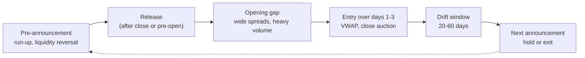

# Earnings and event-driven

> **TL;DR**
>
> - Earnings releases are a stock's biggest scheduled information events; the classic quant trade is post-earnings announcement drift (PEAD): buy positive surprises, short negative ones, hold for weeks.
> - Bernard & Thomas (1989): about 4.2% over 60 trading days for top-minus-bottom surprise deciles (1974–1985). Martineau (2022): gone in non-microcaps since 2006. 2025 papers dispute it; the question is open.
> - Neighbouring event alphas: the earnings-announcement premium, pre-announcement liquidity reversal, guidance changes, and merger arbitrage (a short put on deal completion).
> - Execution is the hard part: gaps and event-day spreads eat much of a thin edge.

**Level:** Core · **Read time:** ~9 min · **Last verified:** 2026-11

| Field | Value |
|---|---|
| Family | mid-freq alpha |
| Edge source | behavioral · liquidity provision (plus a risk premium in merger arbitrage) |
| Holding period | 1–60 trading days after the event; merger arbitrage holds until deal close (months) |
| Counterparty: who pays and why they accept it | Inattentive investors who under-react on busy days and Fridays; impatient traders needing liquidity before announcements; target holders who sell rather than bear deal-break risk |
| Universe & instruments | US stocks with scheduled earnings; merger targets and acquirers; options for event-volatility variants |
| Data required | Point-in-time release timestamps, actuals and consensus (for example I/B/E/S), guidance, intraday prices; deal terms |
| Core algorithms used | [D1 Point-in-time data and cleaning](../../03-algorithms/a-data-and-signals/point-in-time-data-and-cleaning.md) · [D2 Feature engineering](../../03-algorithms/a-data-and-signals/feature-engineering.md) · [D4 Evaluating signals](../../03-algorithms/a-data-and-signals/evaluating-signals.md) · [V3 Backtest pitfalls](../../03-algorithms/c-validation-and-backtesting/backtest-pitfalls.md) · [E5 Auction, close and dark-liquidity algos](../../03-algorithms/e-execution-algorithms/auction-close-and-dark-liquidity-algos.md) |
| Infra intensity | Moderate: minutes matter for the reaction, days for drift |
| Capacity (rough $ range) | $100M–$2B for standalone PEAD `[Estimate]` (drift is concentrated in small, illiquid names and entries cluster on high-cost days) |
| Typical Sharpe (gross vs net) | PEAD: ~4.2% per 60 days top-minus-bottom decile, gross, 1974–1985 academic backtest `[Reported]`; near zero in non-microcaps since 2006 `[Verified]` (Martineau 2022), contested. Merger arbitrage: ~4% a year excess return, 1963–1998 academic study `[Reported]` |
| Turnover | High and lumpy: positions open after each event and roll off within weeks |
| Main risks / failure modes | Overnight gaps, guidance shocks, stale consensus, timestamp errors, deal breaks |
| Crowding risk | High: everyone has the same consensus feed and the same SUE formula |
| Firm types that run it | Quant hedge funds, event-driven pods at multi-manager firms, merger-arbitrage funds |
| Lab | — |

## Intuition (the story in plain English)

Earnings are a quarterly exam. The market grades it within seconds but historically took weeks to finish: beats kept drifting up, misses kept drifting down. A quant needs not *why* a company beat but by how much, relative to how noisy its surprises usually are, and a way to trade after the first reaction without paying it all away in spreads.

## Economic rationale: why should this make money at all?

- **Limited attention.** Responses are weaker and drift stronger for Friday announcements (DellaVigna & Pollet 2009) and on days crowded with other announcements (Hirshleifer, Lim & Teoh 2009) `[Reported]`.
- **Misread persistence.** Bernard & Thomas (1990): prices act as if earnings were a random walk although seasonal changes are autocorrelated, so much of the drift lands at the *next* announcements `[Reported]`.
- **Liquidity provision.** Short-term reversals are much larger just before announcements, when liquidity providers demand more (So & Wang 2014) `[Reported]`.
- **Risk.** Announcement months earn higher returns, read as systematic risk (Savor & Wilson 2016) or attention-driven buying (Frazzini & Lamont 2007) `[Reported]`.

## The trade, step by step

1. Keep a point-in-time calendar of confirmed dates and times.
2. At release, compute [standardized unexpected earnings](../../09-reference/glossary.md#standardized-unexpected-earnings-sue) (SUE): surprise scaled by the stock's usual surprise size; add revenue surprise.
3. Rank against other recent announcers within sector.
4. Enter *after* the gap over one to three sessions (VWAP, closing auction).
5. Hold 20–60 days with decaying weight; neutralize beta and industry.
6. Decide whether to hold through the next announcement.

## Worked example with numbers

**PEAD (illustrative).** EPS $1.20 against consensus $1.05; past surprises have a standard deviation of $0.10, so SUE = 0.15 / 0.10 = 1.5 (top decile). The stock gaps +6% at the open. Buy $5M over two days.

| Line | If drift exists | If it does not |
|---|---|---|
| Drift capture (+2% of $5M) | +$100,000 | $0 |
| Entry: 10 bps spread + 15 bps impact on event days | −$12,500 | −$12,500 |
| Exit: 10 bps | −$5,000 | −$5,000 |
| **Net** | **+$82,500** | **−$17,500** |

The 2% is one leg's half of the historical 4.2% spread; whether it survives in large caps decides the trade.

**Merger arbitrage (illustrative).** Cash offer $50; target trades at $47.50; expected close in six months; estimated break price $38. Spread = 2.50 / 47.50 = 5.3% (≈ 10.8% annualized). Market-implied completion probability, ignoring discounting: (47.50 − 38) / (50 − 38) = 79%. Payoff: +5.3% if it closes, −20% if it breaks, the shape of a short put.

## Signals and algorithms under the hood

Timestamps come from [D1](../../03-algorithms/a-data-and-signals/point-in-time-data-and-cleaning.md); surprise features from [D2](../../03-algorithms/a-data-and-signals/feature-engineering.md); drift curves and IC by horizon from [D4](../../03-algorithms/a-data-and-signals/evaluating-signals.md); timing look-ahead from [V3](../../03-algorithms/c-validation-and-backtesting/backtest-pitfalls.md); event-day execution from [E5](../../03-algorithms/e-execution-algorithms/auction-close-and-dark-liquidity-algos.md).

```python
import numpy as np
import pandas as pd

def sue(actual_eps, consensus_eps, past_surprises, min_hist=4):
    """Standardized unexpected earnings (analyst-consensus version)."""
    if len(past_surprises) < min_hist:
        return np.nan
    scale = max(np.std(past_surprises), 0.01)       # floor avoids dividing by ~0
    return (actual_eps - consensus_eps) / scale

def pead_weights(events, today, hold_days=40, entry_lag=1, half_life=20):
    """events: DataFrame(ticker, ann_ts, sue, sector); ages in calendar days.
    Enter only on the first full session after the release (never the pre-release close)."""
    age = (today - events.ann_ts).dt.days
    live = events[(age >= entry_lag) & (age <= hold_days)].set_index("ticker")
    score = live.groupby("sector").sue.rank(pct=True) - 0.5       # sector-relative
    w = score * 0.5 ** ((today - live.ann_ts).dt.days / half_life)  # decay with age
    return (w - w.mean()) / (w - w.mean()).abs().sum()            # dollar-neutral, gross 1
```

## Implementation choices that matter

- **Timestamps.** An after-close release cannot trade at that day's close.
- **Consensus hygiene.** Stale estimates and GAAP versus "street" EPS change SUE; analyst-based SUE drifts more than time-series SUE (Livnat & Mendenhall 2006) `[Reported]`.
- **More than EPS.** Revenue surprises and guidance add information (Jegadeesh & Livnat 2006) `[Reported]`.
- **Liquidity.** Event-day spreads are wide `[Lore]`; spreading entry over days and using the close cuts costs.
- **Index events** follow the same logic with flows: see [flow-driven strategies](flow-driven-strategies.md).

## P&L decomposition

Illustrative large-cap PEAD book, $500M GMV, ~30-day holds ($8.4B traded per year):

| Line | % of GMV per year |
|---|---|
| Drift capture | +3.0% |
| Announcement-premium tilt | +0.5% |
| Spread and impact at event liquidity (12 bps) | −2.0% |
| Borrow and financing | −0.5% |
| **Net** | **+1.0%** |

At 4% volatility, net Sharpe ≈ 0.25 `[Estimate]`: thin, which is why most firms run SUE as one input to a [multi-alpha book](cross-sectional-alpha-and-neutralization.md) rather than standalone.

## Evidence

- Ball & Brown (1968) first documented drift; Bernard & Thomas (1989): ~4.2% top-minus-bottom over 60 days, positive in 41 of 48 quarters, 1974–1985 `[Reported]`.
- Chordia et al. (2009): drift concentrates in illiquid stocks; costs absorb most paper profits `[Reported]`.
- Martineau (2022): no drift in large stocks since 2006, recently none in microcaps; prices now absorb surprises on the day `[Verified]`.
- Subrahmanyam (2025) notes two 2025 papers reporting strong PEAD (t-statistics above 14) and attributes the disagreement to research design `[Reported]`. Evidence is mixed; no verdict here.
- Mitchell & Pulvino (2001): merger arbitrage earned ~4% a year excess, with returns resembling short index puts in down markets `[Reported]`.

## Capacity, crowding and decay

Drift lives where costs are highest, so capacity is small. Decay is central: the reaction moved into the first minutes, shifting edge to whoever parses releases and calls fastest ([NLP and LLM signals](nlp-and-llm-signals.md)).

## How it fails

- **Gap risk.** On 3 February 2022 Meta fell roughly a quarter in one session after earnings `[Reported]`.
- **Deal breaks.** In October 2014 AbbVie walked away from Shire after US anti-inversion rules changed, inflicting heavy losses on arbitrageurs `[Reported]`.
- **Timing bugs.** Misdated releases create fictitious backtest drift.

## Textbook vs how it's done today

| Textbook | Practice today |
|---|---|
| Time-series SUE, quarterly deciles (Bernard & Thomas 1989) `[Reported]` | Consensus SUE plus revenue, guidance and call text, sector-neutral `[Lore]` |
| Hold 60 days | Hold until the measured drift decays, often shorter in large caps (Martineau 2022) `[Verified]` |
| Trade at the announcement close | Enter after the gap with auction and VWAP algos `[Lore]` |

## Variants and neighbours

Merger arbitrage, [flow-driven](flow-driven-strategies.md) index events, guidance and negative pre-announcements, post-release [analyst revisions](analyst-revisions-and-sentiment.md), options event volatility ([volatility risk premium](../f-volatility-and-derivatives/volatility-risk-premium-and-vol-arb.md)).

## Diagram



## How practitioners talk about it

- "We don't trade the print, we trade the day after." → Enter after the gap to avoid event-day costs.
- "SUE alone is a commodity." → Everyone has it; edge comes from extra features or speed.
- "PEAD's a small-cap story now." → Drift survives, if anywhere, where it is costly to trade.
- "The arb spread is pricing about an 80% close." → Market-implied deal probability.
- "Don't hold through the next print without a view." → Gap risk resets each quarter.
- "Watch the late reporters." → Unexpected delays to a release date often precede bad news.

## Myths vs reality

| Myth | Reality |
|---|---|
| PEAD is a free lunch | Largely gone in large caps since 2006, and costly where it remains |
| Merger arbitrage is low risk | It is a short put: steady small gains, rare large losses |
| Faster is always better | For drift, waiting a day often beats event-day spreads |

## Questions you could ask a quant about this

**Basic**

- Do you use consensus or time-series surprises?
- When do you enter relative to the release?

**Informed**

- How has your measured drift by size bucket changed since 2006?

**Sharp**

- Do you hold through the next announcement, and what does that add? 🔒
- What share of event P&L arrives in the first hour versus the drift window? 🔒
- How do you size merger arbitrage against correlated deal breaks?

## Go deeper

<details markdown="1">
<summary>Math: SUE and implied deal probability</summary>

Standardized unexpected earnings, with consensus $F_{t}$ and the standard deviation of the last $k$ surprises:

$$
SUE_{t} = \frac{EPS_{t} - F_{t}}{\sigma\left(EPS_{t-j} - F_{t-j}\right)_{j=1..k}} .
$$

Implied completion probability with discount rate $r$ and time to close $T$:

$$
P_0 = \frac{p \, O + (1-p) \, B}{(1+r)^{T}} \;\Rightarrow\; p = \frac{P_0 (1+r)^{T} - B}{O - B} .
$$

</details>

## Related pages

- [Cross-sectional alpha and neutralization](cross-sectional-alpha-and-neutralization.md)
- [Analyst revisions and sentiment](analyst-revisions-and-sentiment.md)
- [Flow-driven strategies](flow-driven-strategies.md)
- [Backtest pitfalls (V3)](../../03-algorithms/c-validation-and-backtesting/backtest-pitfalls.md)
- [Auction, close and dark-liquidity algos (E5)](../../03-algorithms/e-execution-algorithms/auction-close-and-dark-liquidity-algos.md)

## Sources

- [Reported] Bernard, V. L. & Thomas, J. K. (1989). "Post-Earnings-Announcement Drift: Delayed Price Response or Risk Premium?" *Journal of Accounting Research* 27 (Supplement), 1–36. <https://doi.org/10.2307/2491062> (accessed 2026-11)
- [Reported] Bernard, V. L. & Thomas, J. K. (1990). "Evidence that Stock Prices Do Not Fully Reflect the Implications of Current Earnings for Future Earnings." *Journal of Accounting and Economics* 13(4), 305–340. <https://doi.org/10.1016/0165-4101(90)90008-R> (accessed 2026-11)
- [Verified] Martineau, C. (2022). "Rest in Peace Post-Earnings Announcement Drift." *Critical Finance Review* 11(3–4), 613–646. <https://doi.org/10.1561/104.00000122> (accessed 2026-11)
- [Reported] Subrahmanyam, A. (2025). "Keeping it Simple: How Can Post-Earnings Return Drift Exist and Not Exist Simultaneously?" SSRN working paper. <https://papers.ssrn.com/sol3/papers.cfm?abstract_id=5930255> (accessed 2026-11)
- [Reported] Chordia, T., Goyal, A., Sadka, G., Sadka, R. & Shivakumar, L. (2009). "Liquidity and the Post-Earnings-Announcement Drift." *Financial Analysts Journal* 65(4), 18–32. <https://doi.org/10.2469/faj.v65.n4.3> (accessed 2026-11)
- [Reported] DellaVigna, S. & Pollet, J. M. (2009). "Investor Inattention and Friday Earnings Announcements." *Journal of Finance* 64(2), 709–749. <https://doi.org/10.1111/j.1540-6261.2009.01447.x> (accessed 2026-11)
- [Reported] Hirshleifer, D., Lim, S. S. & Teoh, S. H. (2009). "Driven to Distraction: Extraneous Events and Underreaction to Earnings News." *Journal of Finance* 64(5), 2289–2325. <https://doi.org/10.1111/j.1540-6261.2009.01501.x> (accessed 2026-11)
- [Reported] So, E. C. & Wang, S. (2014). "News-Driven Return Reversals: Liquidity Provision Ahead of Earnings Announcements." *Journal of Financial Economics* 114(1), 20–35. <https://doi.org/10.1016/j.jfineco.2014.07.003> (accessed 2026-11)
- [Reported] Savor, P. & Wilson, M. (2016). "Earnings Announcements and Systematic Risk." *Journal of Finance* 71(1), 83–138. <https://doi.org/10.1111/jofi.12361> (accessed 2026-11)
- [Reported] Livnat, J. & Mendenhall, R. R. (2006). "Comparing the Post-Earnings Announcement Drift for Surprises Calculated from Analyst and Time Series Forecasts." *Journal of Accounting Research* 44(1), 177–205. <https://doi.org/10.1111/j.1475-679X.2006.00196.x> (accessed 2026-11)
- [Reported] Mitchell, M. & Pulvino, T. (2001). "Characteristics of Risk and Return in Risk Arbitrage." *Journal of Finance* 56(6), 2135–2175. <https://doi.org/10.1111/0022-1082.00401> (accessed 2026-11)
- [Reported] Frazzini, A. & Lamont, O. A. (2007). "The Earnings Announcement Premium and Trading Volume." NBER Working Paper 13090. <https://www.nber.org/papers/w13090> (accessed 2026-11)
