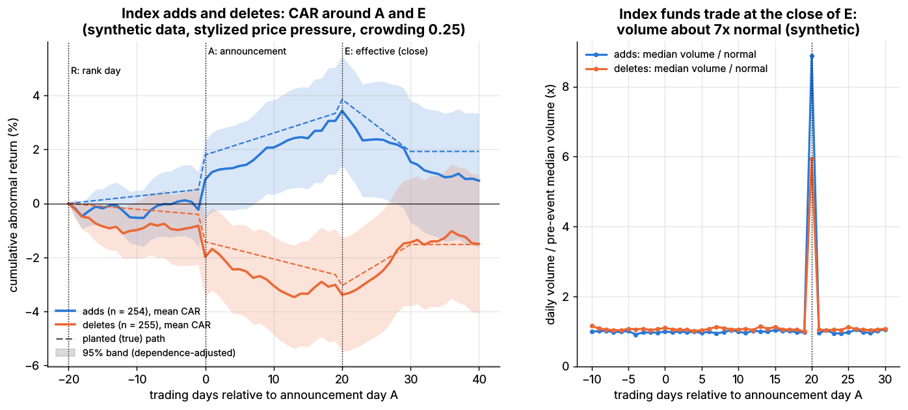
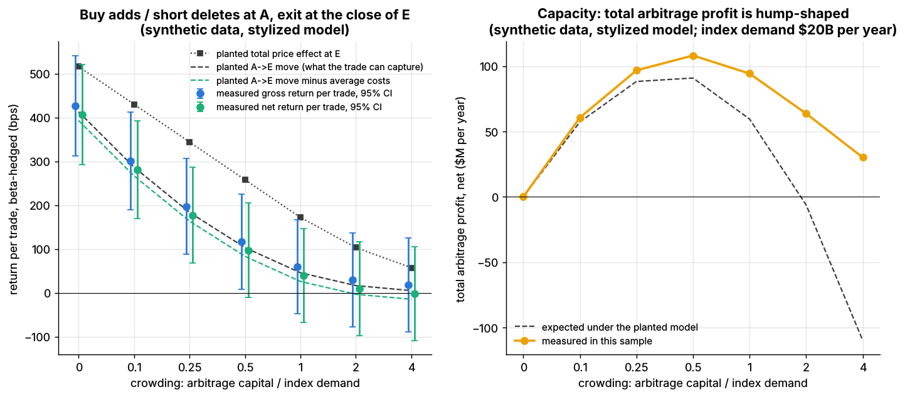
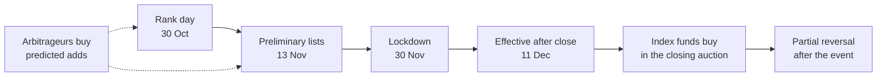
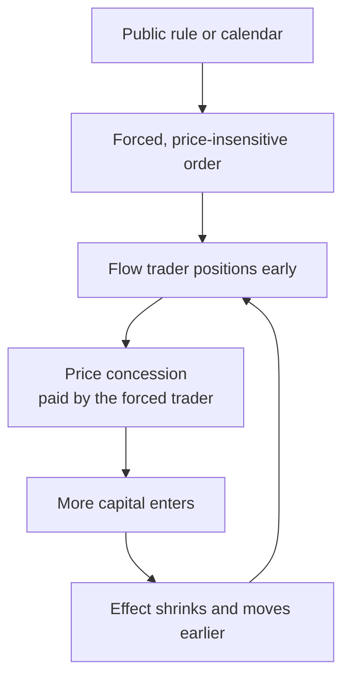

# Flow-driven strategies

> **TL;DR**
>
> - Some investors must trade on a rule or calendar whatever the price: index funds, pensions, funds facing redemptions, hedging dealers. Flow traders position early and take the other side.
> - The classic case: S&P 500 additions averaged +7.4% in the 1990s but under 1% in the 2010s (Greenwood & Sammon 2025) `[Verified]`.
> - Index funds pay at least 21–28 bp a year (S&P 500) and 38–77 bp (Russell 2000), 1990–2005 (Petajisto) `[Verified]`.
> - Rules are public, so [crowding](../../09-reference/glossary.md#crowding) shrinks the effect and pulls it earlier.
> - Russell now reconstitutes twice a year; the December 2026 changes take effect after the close on 11 December `[Verified]`.

**Level:** Core · **Read time:** ~9 min · **Last verified:** 2026-11

| Field | Value |
|---|---|
| Family | mid-frequency alpha (event and flow) |
| Edge source | liquidity provision · structural/regulatory |
| Holding period | days to weeks (index events); hours to days (calendar and hedging flows) |
| Counterparty: who pays and why they accept it | Index funds that must trade at the effective-day close and value tracking error over price; pensions on calendar rules; funds meeting redemptions; dealers hedging mechanically. |
| Universe & instruments | US stocks near index cutoffs (Russell, S&P, MSCI, Nasdaq-100); index futures as hedges |
| Data required | Point-in-time index rules and membership, float, passive ownership, fund flows, auction imbalances |
| Core algorithms used | [D1 Point-in-time data and cleaning](../../03-algorithms/a-data-and-signals/point-in-time-data-and-cleaning.md) · [D4 Evaluating signals](../../03-algorithms/a-data-and-signals/evaluating-signals.md) · [P5 Transaction cost and impact models](../../03-algorithms/d-portfolio-construction/transaction-cost-and-impact-models.md) · [E5 Auction, close and dark-liquidity algos](../../03-algorithms/e-execution-algorithms/auction-close-and-dark-liquidity-algos.md) |
| Infra intensity | Low to moderate: daily batch plus closing-auction execution |
| Capacity (rough $ range) | \$100M–\$1B per firm `[Estimate]` (index demand of tens of billions a year, shared by all arbitrageurs) |
| Typical Sharpe (gross vs net) | No public live figures. Academic event returns, gross: S&P 500 adds +8.8%, 1990–2005 `[Verified]`, under 1% in the 2010s `[Verified]`. Practitioner books 0.5–1.5 net, lumpy `[Lore]` |
| Turnover | High around events, flat between; 20–50× capital a year `[Estimate]` |
| Main risks / failure modes | Wrong lists, crowded exits, post-event reversal, borrow recalls |
| Crowding risk | Very high: everyone reads the same methodology |
| Firm types that run it | Bank facilitation desks, event-driven and stat-arb funds, pods, auction market makers `[Lore]` |
| Lab | [Lab 20](https://github.com/FrankHuang94/quant_trading_claude/tree/main/labs/20-index-reconstitution-event-study) |

## Intuition (the story in plain English)

In an [index reconstitution](../../09-reference/glossary.md#index-reconstitution), index funds announce what they will buy, how much and on which closing print, and promise not to care about price: a tender offer with a deadline. The flow trader buys early, carries the risk for weeks, and sells into the deadline.

## Economic rationale: why should this make money at all?

- **Demand curves slope down.** After 1976, S&P 500 additions earned abnormal returns tied to index-fund buying, lasting beyond ten days (Shleifer 1986) `[Verified]`.
- **Price pressure.** Added stocks rose more than 3% on announcement, nearly all reversed within two weeks (Harris & Gurel 1986) `[Verified]`.
- **Limits to arbitrage.** Capital, borrow and list uncertainty limit who pre-positions, so a concession survives.

## The trade, step by step

1. **Predict the list** from the rules: Russell rank day, S&P committee criteria, MSCI reviews ([D1](../../03-algorithms/a-data-and-signals/point-in-time-data-and-cleaning.md)).
2. **Size the demand**: passive ownership × float, in days of volume.
3. **Enter** before or at the announcement; hedge beta and sector.
4. **Exit** into the effective-day close with [market-on-close](../../09-reference/glossary.md#market-on-close-moc) orders ([E5](../../03-algorithms/e-execution-algorithms/auction-close-and-dark-liquidity-algos.md)).
5. **Repeat** for month-end, pension, option-expiry and leveraged-ETF flows.

## Worked example with numbers

Illustrative: XYZ (cap \$12B, float 90%) joins an index whose passive funds own 20% of every member's float: demand = 0.2 × \$10.8B = **\$2.16B**, 14 days of its \$150M daily volume. It rises 4.0% from the announcement close to the effective close.

| Line | Arbitrageur, \$50M long, beta-hedged |
|---|---|
| Gain to the effective close | 4.0% × \$50M = +\$2,000,000 |
| Entry spread and impact (15 bp) | −\$75,000 |
| Exit in the closing auction (5 bp) | −\$25,000 |
| Futures hedge (1 bp) | −\$5,000 |
| **Net over 20 trading days** | **+\$1,895,000 (3.8%)** |
| If held 10 more days through a 2% reversal | −\$1,000,000 |

Index funds pay about 4% × \$2.16B = \$86M more than at the announcement close: Petajisto's "index turnover cost".

## Signals and algorithms under the hood

Cards: [D1](../../03-algorithms/a-data-and-signals/point-in-time-data-and-cleaning.md) membership history; [D4](../../03-algorithms/a-data-and-signals/evaluating-signals.md) testing; [P5](../../03-algorithms/d-portfolio-construction/transaction-cost-and-impact-models.md) impact; [E5](../../03-algorithms/e-execution-algorithms/auction-close-and-dark-liquidity-algos.md) exit; [M7](../../03-algorithms/f-market-making-and-hft-algorithms/hedging-algorithms.md) beta hedge. The event study, as in Lab 20:

```python
import numpy as np
import pandas as pd

def abnormal_returns(returns, market, events, window=(-20, 40), est_window=(-270, -21), intercept=False):
    """Market-model ARs per event; day 0 = announcement A. Default drops alpha (mostly past luck)."""
    rel, est = np.arange(window[0], window[1] + 1), np.arange(est_window[0], est_window[1] + 1)
    ar, ar_est = [], []
    for stock, d0 in zip(events["stock"], events["day0"]):
        r_e, m_e = returns[d0 + est, stock], market[d0 + est]
        beta = np.cov(r_e, m_e)[0, 1] / np.var(m_e, ddof=1)
        alpha = (r_e.mean() - beta * m_e.mean()) if intercept else 0.0
        ar.append(returns[d0 + rel, stock] - alpha - beta * market[d0 + rel])
        ar_est.append(r_e - alpha - beta * m_e)
    return np.array(ar), np.array(ar_est)

def event_study(ar, ar_est, window=(-20, 40)):
    """Mean CAR and 95% band (lab also returns both standard errors; omitted here)."""
    n = ar.shape[0]
    car_i = np.cumsum(np.c_[np.zeros(n), ar[:, 1:]], axis=1)           # each event's CAR
    se_cross = car_i.std(axis=0, ddof=1) / np.sqrt(n)                   # assumes independent events
    se_dep = ar_est.mean(axis=0).std(ddof=1) * np.sqrt(np.arange(ar.shape[1]))  # Brown-Warner
    se, car = np.maximum(se_cross, se_dep), car_i.mean(axis=0)
    return pd.DataFrame({"car": car, "lo": car - 1.96 * se, "hi": car + 1.96 * se},
                        index=np.arange(window[0], window[1] + 1))
```



*Adds rise into the effective day, then give much back; volume spikes in the effective-day close. Synthetic data.*

Synthetic lab result: long adds and short deletes from the announcement close to the effective close earn 197 bp gross, 177 bp net per trade (63% winners); holding 20 more days gives −50 bp. The planted 5% effect is far above today's real S&P effect (under 1%); read the mechanics, not the level.

## Implementation choices that matter

- **Predict early.** More arbitrage capital moves more of the effect before the announcement (Lab 20).
- **Index family.** S&P: short, committee-chosen lists; Russell: long, rules-based ones.
- **Adds vs deletes.** Adds rise permanently, deletes do not fall permanently (Chen, Noronha & Singal 2004) `[Verified]`; deletes are often [hard to borrow](../../09-reference/glossary.md#hard-to-borrow).
- **Exit.** The effective-day [closing auction](../../09-reference/glossary.md#closing-auction) is where the fund's size meets yours.

## P&L decomposition

Illustrative \$500M flow book, % of capital a year:

| Line | % of capital |
|---|---|
| Index events (Russell, S&P, MSCI) | +4.0 |
| Calendar rebalancing (month-end, pensions) | +1.5 |
| Redemption-driven fund sales | +1.0 |
| Option-hedging and leveraged-ETF close flows | +0.5 |
| Spreads and impact | −2.0 |
| Borrow and hedging | −0.5 |
| Wrong lists and crowded exits | −1.0 |
| **Net (Sharpe ≈ 0.7 at 5% volatility)** | **+3.5** |

## Evidence

- **Index premium, 1990–2005** (announcement to effective day): S&P 500 adds +8.8%, deletes −15.1%; Russell 2000 +4.7%, −4.6% (Petajisto) `[Verified]`. By the 2010s: S&P adds under 1%, deletes 0.1%, other families similar (Greenwood & Sammon) `[Verified]`.
- **Fire sales:** funds with extreme outflows depress shared holdings, and liquidity providers profit (Coval & Stafford 2007) `[Verified]`; predicted flow-induced trading forecasts returns for a year, then reverses (Lou 2012) `[Verified]`.
- **Calendar flows:** month-end cash needs move prices (Etula et al. 2020) `[Verified]`; rebalancing out of overweight equities lowers next-day equity returns 17 bp and costs investors about \$16B a year (Harvey et al., working paper) `[Verified]`.
- **Hedging flows:** dealer rebalancing moves stock volatility (Ni et al. 2021) `[Verified]`; short-gamma hedging drives last-30-minute momentum in 60+ futures (Baltussen et al. 2021) `[Verified]`.

## Capacity, crowding and decay



*More arbitrage capital per dollar of index demand: return per trade falls toward zero; total arbitrage profit is hump-shaped. Synthetic data.*

Synthetic lab result: net return per trade falls from 407 bp with no competitors to 39 bp when arbitrage capital equals index demand. Nasdaq's close printed a record \$334.0B on the June 2026 reconstitution `[Reported]`; December 2026 dates are in the diagram `[Verified]`.

## How it fails

- **Decay.** The effect fades decade by decade (Greenwood & Sammon) `[Verified]`.
- **Tesla, December 2020.** The largest-ever S&P 500 addition, announced 16 November: about +12% after hours; over \$150B traded on 18 December; about −4.5% before the open on its first index day `[Reported]`. Everyone exits in the same auction.
- **Volmageddon, 5 February 2018.** Inverse VIX products had to buy futures at the close; traders bought first, and 115,862 contracts traded in one minute (BIS) `[Verified]` ([failure gallery](../h-cross-cutting/strategy-failure-gallery.md)).

## Textbook vs how it's done today

| Textbook | Practice today |
|---|---|
| Buy at announcement, sell at effective day | Trade predicted lists before the announcement `[Lore]` |
| Pure price pressure | Mixed: reversal (Harris–Gurel) vs persistence (Shleifer) `[Verified]` |
| Only index events | A calendar of forced flows `[Verified]` |

## Variants and neighbours

[Auctions and closing liquidity](../a-liquidity-provision/auctions-and-closing-liquidity.md) (minutes, not weeks), [ETF and index arbitrage](../b-speed-and-structural/etf-and-index-arbitrage.md), [earnings and event-driven](earnings-and-event-driven.md), [momentum](../e-risk-premia-and-factors/momentum.md) (partly flow-driven), [trend following](../g-futures-and-macro-context/trend-following-and-ctas.md).

## Diagram





## How practitioners talk about it

- "Recon is a liquidity event, not an alpha event." → The profit is a fee for absorbing flow.
- "We're positioned off rank day." → Bought predicted adds before the lists.
- "The add is priced; the trade is the close." → Only the auction is left.
- "Watch the month-end pension bid." → Calendar rebalancing.
- "Dealers are short gamma; expect a late push." → Hedging chases the day's move.
- "Deletes are hard to borrow." → The short leg is costly.

## Myths vs reality

| Myth | Reality |
|---|---|
| Index inclusion is a free 5–8% | Under 1% in the 2010s `[Verified]` |
| Passive buying only pushes prices up | Flows reverse; rebalancing sells winners |
| Trading index changes is front-running | Lists are public; front-running misuses a client's confidential order `[Lore]` |

## Questions you could ask a quant about this

**Basic**

- Which index families do you trade?
- Do you exit only in the effective-day close?

**Informed**

- How accurate are your predicted lists at rank day?
- How do you split Russell December and June positioning?

**Sharp**

- How do you estimate arbitrage capital already positioned? 🔒
- How much flow P&L comes from non-index calendars? 🔒

## Go deeper

<details markdown="1">
<summary>Math: abnormal returns, the Brown–Warner band, hump-shaped arbitrage profit</summary>

Market model per event $i$, fitted over trading days −270 to −21 relative to the announcement (as in Lab 20):

$$
AR_{i,t} = r_{i,t} - \hat\beta_i\, r_{m,t}, \qquad CAR(k) = \frac{1}{n}\sum_{i=1}^{n}\sum_{t=\tau_0+1}^{k} AR_{i,t}.
$$

Events share dates, so the Brown–Warner error is $SE(k) = s\sqrt{k - \tau_0}$, with $s$ the daily standard deviation of the average estimation-window AR.

With arbitrage capital $c$ (share of index demand $D$), capturable move $g(c)$ and cost $\kappa$:

$$
\Pi(c) = c\, D\, \big(g(c) - \kappa\big),
$$

zero at $c = 0$, negative once $g(c) < \kappa$, peaking in between.

</details>

## Related pages

- [Auctions and closing liquidity](../a-liquidity-provision/auctions-and-closing-liquidity.md)
- [E5 Auction, close and dark-liquidity algos](../../03-algorithms/e-execution-algorithms/auction-close-and-dark-liquidity-algos.md)
- [D4 Evaluating signals](../../03-algorithms/a-data-and-signals/evaluating-signals.md)
- [Earnings and event-driven](earnings-and-event-driven.md)
- [How quants evaluate a strategy](../how-quants-evaluate-a-strategy.md)

## Sources

- [Verified] Harris, L. & Gurel, E. (1986). "Price and Volume Effects Associated with Changes in the S&P 500 List: New Evidence for the Existence of Price Pressures." *The Journal of Finance* 41(4), 815–829. <https://doi.org/10.1111/j.1540-6261.1986.tb04550.x> (accessed 2026-11)
- [Verified] Shleifer, A. (1986). "Do Demand Curves for Stocks Slope Down?" *The Journal of Finance* 41(3), 579–590. <https://doi.org/10.1111/j.1540-6261.1986.tb04518.x> (accessed 2026-11)
- [Verified] Greenwood, R. & Sammon, M. (2025). "The Disappearing Index Effect." *The Journal of Finance* 80(2), 657–698. <https://doi.org/10.1111/jofi.13410> (accessed 2026-11)
- [Verified] Petajisto, A. (2011). "The index premium and its hidden cost for index funds." *Journal of Empirical Finance* 18(2), 271–288. <https://doi.org/10.1016/j.jempfin.2010.10.002> (accessed 2026-11)
- [Verified] Chen, H., Noronha, G. & Singal, V. (2004). "The Price Response to S&P 500 Index Additions and Deletions: Evidence of Asymmetry and a New Explanation." *The Journal of Finance* 59(4), 1901–1930. <https://doi.org/10.1111/j.1540-6261.2004.00683.x> (accessed 2026-11)
- [Verified] Coval, J. & Stafford, E. (2007). "Asset fire sales (and purchases) in equity markets." *Journal of Financial Economics* 86(2), 479–512. <https://doi.org/10.1016/j.jfineco.2006.09.007> (accessed 2026-11)
- [Verified] Lou, D. (2012). "A Flow-Based Explanation for Return Predictability." *Review of Financial Studies* 25(12), 3457–3489. <https://doi.org/10.1093/rfs/hhs103> (accessed 2026-11)
- [Verified] Etula, E., Rinne, K., Suominen, M. & Vaittinen, L. (2020). "Dash for Cash: Monthly Market Impact of Institutional Liquidity Needs." *Review of Financial Studies* 33(1), 75–111. <https://doi.org/10.1093/rfs/hhz054> (accessed 2026-11)
- [Verified] Harvey, C. R., Mazzoleni, M. & Melone, A. (2025). "The Unintended Consequences of Rebalancing." NBER Working Paper 33554. <https://www.nber.org/papers/w33554> (accessed 2026-11)
- [Verified] Ni, S. X., Pearson, N. D., Poteshman, A. M. & White, J. (2021). "Does Option Trading Have a Pervasive Impact on Underlying Stock Prices?" *Review of Financial Studies* 34(4), 1952–1986. <https://doi.org/10.1093/rfs/hhaa082> (accessed 2026-11)
- [Verified] Baltussen, G., Da, Z., Lammers, S. & Martens, M. (2021). "Hedging demand and market intraday momentum." *Journal of Financial Economics* 142(1), 377–403. <https://doi.org/10.1016/j.jfineco.2021.04.029> (accessed 2026-11)
- [Verified] FTSE Russell (2026-09-01). "FTSE Russell announces December 2026 Russell US Indexes Reconstitution schedule." <https://www.lseg.com/en/media-centre/press-releases/ftse-russell/2026/ftse-russell-announces-december-2026-russell-us-indexes-reconstitution-schedule> (accessed 2026-11)
- [Reported] Nasdaq (2026-06-26). "Record Trading Volume on the Nasdaq Closing Cross During the June 2026 Russell US Indexes Reconstitution" (republished). <https://mondovisione.com/news/record-trading-volume-on-the-nasdaq-closing-cross-during-the-june-2026-russell-u-2026626/> (accessed 2026-11)
- [Reported] Al Jazeera (2020-11-16). "Tesla shares up 12 percent as automaker zooms to join S&P 500." <https://www.aljazeera.com/economy/2020/11/16/tesla-shares-up-12-after-announcement-it-will-zoom-onto-sp-500> (accessed 2026-11)
- [Reported] Fortune (2020-12-21). "Tesla shares fall 4.5% ahead of first day in the S&P 500." <https://fortune.com/2020/12/21/tesla-shares-fall-4-5-ahead-of-first-day-in-the-sp-500/> (accessed 2026-11)
- [Verified] Bank for International Settlements (2018-03-11). "The equity market turbulence of 5 February: the role of exchange-traded volatility products." *BIS Quarterly Review*, March 2018, box. <https://www.bis.org/publ/qtrpdf/r_qt1803t.htm> (accessed 2026-11)
