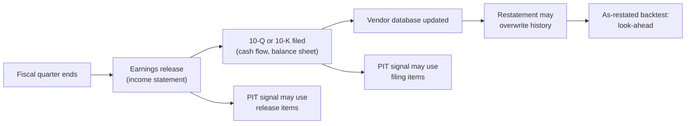

# Fundamental quant signals

> **TL;DR**
>
> - Fundamental quant turns financial-statement judgments (is it cheap? are earnings backed by cash? is management over-investing?) into ratios computed identically for 3,000 stocks and ranked within sector.
> - The core families: value (B/M, E/P, EV/EBITDA), profitability (gross profits / assets), accruals, asset growth, and earnings-quality composites.
> - The hard part is the data, not the ratio: point-in-time availability, reporting lags and restatements decide whether a backtest is honest.
> - Slow, cheap to trade and high capacity, but crowded and decayed: accruals largely faded, and published predictors lose about half their return.

**Level:** Core · **Read time:** ~9 min · **Last verified:** 2026-11

| Field | Value |
|---|---|
| Family | mid-freq alpha |
| Edge source | risk premium · behavioral |
| Holding period | 1–12 months (inputs update quarterly) |
| Counterparty: who pays and why they accept it | Investors who extrapolate growth and fixate on headline earnings rather than their cash content; insofar as value and investment are risk premia, anyone avoiding that risk |
| Universe & instruments | US stocks with statement coverage; financials and utilities often excluded or scored separately |
| Data required | Point-in-time fundamentals with filing dates (vendor PIT archives or SEC XBRL), prices, estimates, industry codes |
| Core algorithms used | [D1 Point-in-time data and cleaning](../../03-algorithms/a-data-and-signals/point-in-time-data-and-cleaning.md) · [D2 Feature engineering](../../03-algorithms/a-data-and-signals/feature-engineering.md) · [D3 Signal transforms](../../03-algorithms/a-data-and-signals/signal-transforms.md) · [D4 Evaluating signals](../../03-algorithms/a-data-and-signals/evaluating-signals.md) · [P1 Risk models](../../03-algorithms/d-portfolio-construction/risk-models.md) |
| Infra intensity | Negligible latency sensitivity; data engineering is the main cost |
| Capacity (rough $ range) | \$1B–\$20B+ per strategy `[Estimate]` (turnover ~1–3× a year versus 25–100× for daily books, so impact per dollar of alpha is an order of magnitude lower) |
| Typical Sharpe (gross vs net) | Single academic long-short factors (value, profitability, investment): gross roughly 0.3–0.5 over 1963–2020s, weaker post-publication `[Estimate]`; diversified sector-neutral composite: net 0.5–1.0 `[Lore]` |
| Turnover | 100–300% of GMV per year `[Lore]` |
| Main risks / failure modes | Long value drawdowns, junk rallies, look-ahead in data, sector concentration |
| Crowding risk | High: same Compustat fields and the same papers everywhere |
| Firm types that run it | Systematic asset managers, quant hedge funds, "quantamental" teams, smart-beta index providers (long-only versions) |
| Lab | — |

## Intuition (the story in plain English)

A fundamental analyst reads one 10-K deeply; a fundamental quant reads 3,000 shallowly but identically. Each diligence judgment (cheap versus peers? earnings converting to cash? balance sheet bloating through acquisitions?) becomes a ratio ranked within its industry daily, and breadth does the rest.

## Economic rationale: why should this make money at all?

Two explanations compete, and both have evidence:

- **Risk.** The clean-surplus valuation identity says that, at a given price-to-book, higher expected profitability implies a higher expected return and higher expected investment a lower one; Fama & French (2015) built their profitability (RMW) and investment (CMA) factors on this logic `[Verified]`.
- **Mispricing.** Sloan (1996) argued investors fixate on reported earnings and miss that accrual-heavy earnings persist less than cash earnings `[Reported]`. Cooper, Gulen & Schill (2008) read the asset-growth effect as over-extrapolation of growth `[Reported]`.

## The trade, step by step

1. Build a [point-in-time](../../09-reference/glossary.md#point-in-time-data) panel: every value stamped with the date it became public.
2. Compute ratios from trailing-twelve-month flows and latest balances.
3. Winsorize and z-score **within industry**; banks' book-to-market is not comparable to software's.
4. Combine into a composite; neutralize to beta, industry and size.
5. Feed it to the [cross-sectional book](cross-sectional-alpha-and-neutralization.md) as a slow alpha, or rebalance standalone monthly.

| Signal | Construction | Sign | Origin |
|---|---|---|---|
| Value | Book equity / market cap; earnings / price; EBITDA / EV | + | Fama & French (1992); Loughran & Wellman (2011) |
| Profitability | (Revenue − COGS) / total assets | + | Novy-Marx (2013) |
| Accruals | (Net income − operating cash flow) / average assets | − | Sloan (1996) |
| Asset growth | Year-over-year change in total assets | − | Cooper, Gulen & Schill (2008) |
| Quality composites | Piotroski F-score, quality-minus-junk | + | Piotroski (2000); Asness, Frazzini & Pedersen (2019) |

## Worked example with numbers

Illustrative: two semiconductor-equipment firms, same price and same trailing earnings of \$100M.

| Item ($M) | Firm X | Firm Y |
|---|---|---|
| Net income | 100 | 100 |
| Operating cash flow | 40 | 130 |
| Average total assets | 1,000 | 1,000 |
| Accruals / assets | (100 − 40)/1,000 = **+6.0%** | (100 − 130)/1,000 = **−3.0%** |
| Revenue − COGS | 320 | 300 |
| Gross profitability | **32%** | **30%** |
| Total assets, now vs a year ago | 1,000 vs 800 | 1,000 vs 950 |
| Asset growth | **+25%** | **+5.3%** |

Same E/P, different quality. Suppose within-sector z-scores are X: value 0, profitability +0.3, accruals −1.2 (sign flipped), asset growth −1.5; Y: 0, +0.1, +0.6, +0.2. Equal-weight composites: X = −0.60, Y = +0.23. With a monthly IC of 0.03, residual volatility of 7% a month and Grinold's alpha = IC × vol × score, the forecast spread is 0.03 × 7% × 0.83 ≈ 17 bps per month: tiny per name, which is why it needs breadth.

## Signals and algorithms under the hood

Point-in-time handling is [D1](../../03-algorithms/a-data-and-signals/point-in-time-data-and-cleaning.md); ratio design [D2](../../03-algorithms/a-data-and-signals/feature-engineering.md); sector-relative transforms [D3](../../03-algorithms/a-data-and-signals/signal-transforms.md); IC and decay [D4](../../03-algorithms/a-data-and-signals/evaluating-signals.md); factor exposures [P1](../../03-algorithms/d-portfolio-construction/risk-models.md).

```python
import pandas as pd

def pit_snapshot(filings, asof, lag_days=1):
    """filings: DataFrame(ticker, item, value, filed_date) with values AS FIRST REPORTED.
    Returns the latest value per (ticker, item) that was public on date `asof`."""
    public = filings[filings.filed_date + pd.Timedelta(days=lag_days) <= asof]
    return (public.sort_values("filed_date")
                  .groupby(["ticker", "item"]).value.last().unstack("item"))

def sector_z(col):
    col = col.clip(col.quantile(0.01), col.quantile(0.99))   # winsorize 1%/99%
    return (col - col.mean()) / col.std()

def fundamental_composite(s, mcap, sector):
    """s: pit_snapshot output (TTM flows, latest balances); higher score = buy."""
    raw = pd.DataFrame({
        "value":   s.book_equity / mcap,                          # B/M
        "gp":      (s.revenue - s.cogs) / s.total_assets,           # Novy-Marx
        "accrual": -(s.net_income - s.cfo) / s.total_assets,        # Sloan, sign flipped
        "invest":  -(s.total_assets / s.total_assets_lag - 1),      # asset growth, flipped
    })
    return raw.groupby(sector).transform(sector_z).mean(axis=1)  # then neutralize (D3)
```

## Implementation choices that matter

- **Reporting lags.** 10-Ks are due 60, 75 or 90 days after fiscal year-end and 10-Qs 40 or 45 days after quarter-end, depending on filer size `[Verified]`. Academic tests often assume a six-month lag; practitioners use the actual filing or announcement timestamp.
- **Announcement vs filing.** The release carries income-statement items; the cash-flow statement needed for accruals often arrives only with the 10-Q `[Lore]`. Timestamp items separately.
- **Restatements.** "As-restated" databases overwrite originals with numbers nobody knew then; use values as first reported.
- **Survivorship.** Keep delisted firms and delisting returns.
- **Sector-relative and sign-safe.** Use E/P, not P/E, so losses rank smoothly; use sector-specific metrics (tangible book for banks).

## P&L decomposition

Illustrative: \$1B GMV sector-neutral composite, turnover 200% a year (\$2B traded).

| Line | $M per year | % of GMV |
|---|---|---|
| Residual alpha captured | +40.0 | +4.0% |
| Factor P&L (value, quality tilt not neutralized) | ±15 realized | ≈ 0 expected |
| Trading costs (15 bps × \$2B) | −3.0 | −0.3% |
| Borrow (0.4% on \$500M short) | −2.0 | −0.2% |
| Financing spread, net | −3.0 | −0.3% |
| **Net** | **+32.0** | **+3.2%** |

At 4% volatility, gross Sharpe ≈ 1.0, net ≈ 0.8; factor drawdowns, not costs, are the big risk `[Estimate]`.

## Evidence

- Novy-Marx (2013): gross profits-to-assets predicts returns about as well as book-to-market and improves value strategies `[Verified]`.
- Sloan (1996): low-minus-high accrual hedge earned 10.4% size-adjusted in the following year, 1962–1991 `[Reported]`; Green, Hand & Soliman (2011): the anomaly decayed until no longer reliably positive, plausibly due to hedge-fund capital `[Verified]`.
- Cooper, Gulen & Schill (2008): low-minus-high asset growth earned about 20% a year in their sample, smaller value-weighted `[Reported]`.
- McLean & Pontiff (2016): 97 predictors lose 26% out-of-sample and 58% post-publication `[Verified]`.
- Hou, Xue & Zhang (2020): most of 452 anomalies fail once microcaps are controlled for `[Reported]`.

## Capacity, crowding and decay

Low turnover gives large capacity, but everyone sees the same Compustat fields, so value, quality and investment are among the most crowded quant trades. Decay is steepest for simple published ratios; composites, sector-specific metrics and XBRL parsed at filing time hold up better `[Lore]`.

## How it fails

- **Value drawdowns.** Value lost badly in 2018–2020 (see [quant winters](../e-risk-premia-and-factors/factor-timing-crowding-and-quant-winters.md)).
- **Junk rallies.** Rebounds in unprofitable growth stocks punish quality and investment shorts.
- **Look-ahead.** As-restated data or period-end dating can manufacture a Sharpe ([V3](../../03-algorithms/c-validation-and-backtesting/backtest-pitfalls.md)).

## Textbook vs how it's done today

| Textbook | Practice today |
|---|---|
| Annual June sorts, six-month lag (Fama & French 1992) `[Reported]` | Daily updates keyed to actual filing timestamps `[Lore]` |
| Decile long-short, one ratio | Sector-relative composites inside a multi-alpha optimizer `[Lore]` |
| Book equity as given | Adjustments for intangibles, buybacks and industry accounting `[Lore]` |

## Variants and neighbours

[Value, quality and low volatility](../e-risk-premia-and-factors/value-quality-low-vol.md) (long-only premia), [earnings and event-driven](earnings-and-event-driven.md) (statements traded around release), [NLP and LLM signals](nlp-and-llm-signals.md) (reading footnotes), F-score and M-score screens.

## Diagram



## How practitioners talk about it

- "Is that point-in-time or as-restated?" → Were values known on the trade date?
- "We score it within GICS industry." → Ratios are compared only to peers.
- "Accruals is dead as a standalone." → Decayed, but still useful inside a composite.
- "Our value leg is really a junk-avoidance leg now." → Returns come more from shorting poor quality than from buying cheap.
- "Profitability rescued our value sleeve." → Pairing cheap with profitable (Novy-Marx 2013).
- "Lag everything to the filing timestamp plus a day." → Conservative timing to avoid look-ahead.

## Myths vs reality

| Myth | Reality |
|---|---|
| Quants ignore fundamentals | Statement data is a core input to most equity quant books |
| A great backtest on value proves it works | Without PIT data and delisting returns, it may be look-ahead |
| Published anomalies stay profitable | They lose roughly half their return (McLean & Pontiff 2016) |

## Questions you could ask a quant about this

**Basic**

- Do you use as-first-reported data, and how do you timestamp items?
- Do you score within sector or neutralize afterwards?

**Informed**

- How did your composite behave in the 2018–2020 value drawdown?
- Do you adjust book equity for intangibles?

**Sharp**

- What share of your fundamental alpha survives full factor neutralization? 🔒
- Which accounting items do you parse from XBRL before vendors update? 🔒

## Go deeper

<details markdown="1">
<summary>Math: the valuation identity behind profitability and investment</summary>

Dividend discount with clean-surplus accounting ($D_t = Y_t - \Delta B_t$, earnings $Y$, book equity $B$):

$$
\frac{M_t}{B_t} = \frac{\sum_{\tau \ge 1} \mathbb{E}\left[Y_{t+\tau} - \Delta B_{t+\tau}\right] / (1+r)^{\tau}}{B_t} .
$$

At fixed $M/B$, higher expected earnings imply higher $r$; higher expected investment $\Delta B$, lower $r$ (Fama & French 2015).

Cash-flow-statement accruals scaled by average total assets $A$:

$$
\text{Accruals}_t = \frac{NI_t - CFO_t}{(A_t + A_{t-1})/2} .
$$

</details>

## Related pages

- [Cross-sectional alpha and neutralization](cross-sectional-alpha-and-neutralization.md)
- [Point-in-time data and cleaning (D1)](../../03-algorithms/a-data-and-signals/point-in-time-data-and-cleaning.md)
- [Factor investing fundamentals](../e-risk-premia-and-factors/factor-investing-fundamentals.md)
- [Backtest pitfalls (V3)](../../03-algorithms/c-validation-and-backtesting/backtest-pitfalls.md)

## Sources

- [Verified] Novy-Marx, R. (2013). "The Other Side of Value: The Gross Profitability Premium." *Journal of Financial Economics* 108(1), 1–28. <https://doi.org/10.1016/j.jfineco.2013.01.003> (accessed 2026-11)
- [Reported] Sloan, R. G. (1996). "Do Stock Prices Fully Reflect Information in Accruals and Cash Flows about Future Earnings?" *The Accounting Review* 71(3), 289–315. <https://www.jstor.org/stable/248290> (accessed 2026-11)
- [Verified] Green, J., Hand, J. R. M. & Soliman, M. T. (2011). "Going, Going, Gone? The Apparent Demise of the Accruals Anomaly." *Management Science* 57(5), 797–816. <https://doi.org/10.1287/mnsc.1110.1338> (accessed 2026-11)
- [Verified] Cooper, M. J., Gulen, H. & Schill, M. J. (2008). "Asset Growth and the Cross-Section of Stock Returns." *Journal of Finance* 63(4), 1609–1651. <https://doi.org/10.1111/j.1540-6261.2008.01370.x> (accessed 2026-11)
- [Verified] Fama, E. F. & French, K. R. (2015). "A Five-Factor Asset Pricing Model." *Journal of Financial Economics* 116(1), 1–22. <https://doi.org/10.1016/j.jfineco.2014.10.010> (accessed 2026-11)
- [Reported] Fama, E. F. & French, K. R. (1992). "The Cross-Section of Expected Stock Returns." *Journal of Finance* 47(2), 427–465. <https://doi.org/10.1111/j.1540-6261.1992.tb04398.x> (accessed 2026-11)
- [Verified] McLean, R. D. & Pontiff, J. (2016). "Does Academic Research Destroy Stock Return Predictability?" *Journal of Finance* 71(1), 5–32. <https://doi.org/10.1111/jofi.12365> (accessed 2026-11)
- [Reported] Hou, K., Xue, C. & Zhang, L. (2020). "Replicating Anomalies." *Review of Financial Studies* 33(5), 2019–2133. <https://doi.org/10.1093/rfs/hhy131> (accessed 2026-11)
- [Reported] Loughran, T. & Wellman, J. W. (2011). "New Evidence on the Relation between the Enterprise Multiple and Average Stock Returns." *Journal of Financial and Quantitative Analysis* 46(6), 1629–1650. <https://doi.org/10.1017/S0022109011000445> (accessed 2026-11)
- [Reported] Piotroski, J. D. (2000). "Value Investing: The Use of Historical Financial Statement Information to Separate Winners from Losers." *Journal of Accounting Research* 38 (Supplement), 1–41. <https://doi.org/10.2307/2672906> (accessed 2026-11)
- [Reported] Asness, C. S., Frazzini, A. & Pedersen, L. H. (2019). "Quality Minus Junk." *Review of Accounting Studies* 24(1), 34–112. <https://doi.org/10.1007/s11142-018-9470-2> (accessed 2026-11)
- [Verified] U.S. SEC. "Form 10-K General Instructions" (filing deadlines by filer status). <https://www.sec.gov/files/form10-k.pdf> (accessed 2026-11)
