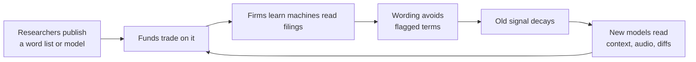
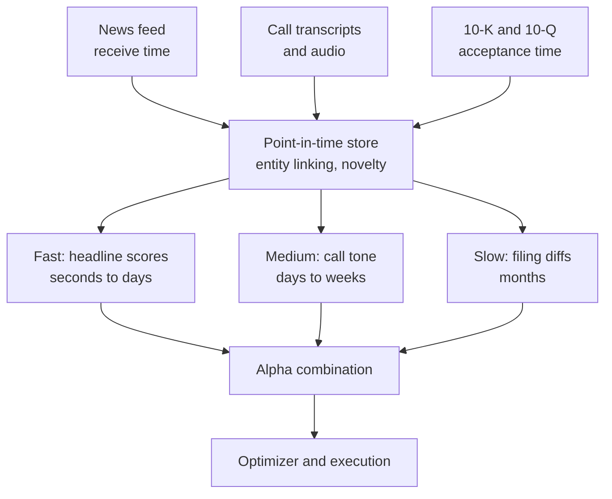

# NLP and LLM signals

> **TL;DR**
>
> - Text becomes numbers via word lists (Loughran & McDonald 2011), supervised word weights, transformer classifiers and LLM prompts or embeddings. Each reads context better; none removes point-in-time discipline.
> - Three clocks: machine-readable news (seconds to days), earnings-call tone (days to weeks), filing changes (months; "Lazy Prices" earned up to 188 bps a month, 1995–2014).
> - LLM headline scores predict next-day returns, and the edge shrinks as adoption rises (Lopez-Lira & Tang, *JFE* 2026).
> - Pretraining look-ahead is the signature backtest trap; time-stamped models suggest it is modest but real.
> - Fast news is a latency race with little capacity; slow text has capacity but is crowded, and firms now write for machine readers.

**Level:** Core · **Read time:** ~8 min · **Last verified:** 2026-11

| Field | Value |
|---|---|
| Family | mid-freq alpha |
| Edge source | informational · behavioral |
| Holding period | Seconds to minutes (machine-readable news); 1–5 days (news, call tone); 1–6 months (filing changes) |
| Counterparty: who pays and why they accept it | Holders who never diff this 10-K against last year's, and traders who react to news late: reading everything costs them more than it would earn |
| Universe & instruments | US stocks with news and EDGAR coverage (~3,000–4,000 names) |
| Data required | Timestamped machine-readable news, EDGAR filings with acceptance times, call transcripts and audio, point-in-time entity mapping |
| Core algorithms used | [F4 LLMs and foundation models in quant](../../03-algorithms/b-forecasting-models/llms-and-foundation-models-in-quant.md) · [D2 Feature engineering](../../03-algorithms/a-data-and-signals/feature-engineering.md) · [D3 Signal transforms](../../03-algorithms/a-data-and-signals/signal-transforms.md) · [D4 Evaluating signals](../../03-algorithms/a-data-and-signals/evaluating-signals.md) |
| Infra intensity | News: millisecond feed handling and fast execution. Filings and calls: overnight batch, GPU inference |
| Capacity (rough $ range) | News sleeves $50M–$500M `[Estimate]` (30–100% daily turnover); filing and call signals $1B–$5B as composite components `[Estimate]` (monthly rebalancing, large caps) |
| Typical Sharpe (gross vs net) | Lazy Prices: up to 188 bps a month alpha, gross, 1995–2014 academic backtest `[Verified]`. Look-ahead-free LLM headline signal: Sharpe 3.20 gross, pre-cost, 2026 academic test on 2013–2024-era headlines `[Verified]`. In a composite: +0.2–0.5 net `[Lore]` |
| Turnover | News 30–100% of GMV a day; filing signals 100–300% a year `[Estimate]` |
| Main risks / failure modes | Pretraining look-ahead, bad timestamps, silent model updates, fake news, boilerplate drift |
| Crowding risk | High for vendor scores and public-LLM headline scoring; moderate for proprietary document models |
| Firm types that run it | Quant hedge funds, multi-manager pods; HFT firms for machine-readable news |
| Lab | — |

## Intuition (the story in plain English)

Information appears in words before numbers. Humans read selectively; machines read everything. The job: a per-stock score at the moment you could have acted. A headline is priced in seconds, a call's tone over days, a quietly rewritten risk-factor section over months.

## Economic rationale: why should this make money at all?

- **Limited attention.** Lazy Prices found no announcement effect when 10-K language changed; returns came only when the news surfaced later `[Verified]`.
- **Processing cost.** LLMs cut the cost of reading, and LLM strategy returns decline as adoption rises (Lopez-Lira & Tang) `[Verified]`.
- **Speed.** News analytics speed price responses, and high-frequency traders trade on them (von Beschwitz, Keim & Massa 2020) `[Verified]`.
- **Noise.** Some tone is sentiment that reverses (Tetlock; see [analyst revisions](analyst-revisions-and-sentiment.md)).

## The trade, step by step

| Family | Signal | Horizon | Origin |
|---|---|---|---|
| Filing changes | Similarity to the same filing a year earlier; low → short | 1–6 months | Cohen, Malloy & Nguyen (2020) |
| Filing tone | Share of finance-specific negative or uncertain words | Weeks | Loughran & McDonald (2011) |
| Call tone | Tone of remarks and Q&A; vocal cues | Days to weeks | Price et al. (2012); Mayew & Venkatachalam (2012) |
| News sentiment | Score × relevance × novelty, mapped to the next session | Hours to days | Ke, Kelly & Xiu (2019) |
| LLM scores or embeddings | Prompted score, or embedding → ridge | 1–5 days | Lopez-Lira & Tang (2026) |

Then standardize daily, test incremental IC over earnings surprise, and blend ([F5](../../03-algorithms/b-forecasting-models/alpha-combination-and-ensembling.md)).

## Worked example with numbers

**Filing similarity (illustrative).** Last year's risk section counts "risk" 10, "supplier" 4, "litigation" 1; this year 11, 4, 6.

$$
\cos = \frac{10\cdot 11 + 4\cdot 4 + 1\cdot 6}{\sqrt{117}\,\sqrt{173}} = \frac{132}{10.82 \times 13.15} = 0.928 .
$$

Against a universe median of 0.97, this is a bottom-decile "changer": a short candidate.

**Latency ladder (illustrative).** After a correctly read positive headline, abnormal return reaches +0.3% at 1 second, +0.8% at 1 minute, +1.0% at 1 hour and +1.2% by the next close.

| Act at | Captured to next close | Round-trip cost | Net |
|---|---|---|---|
| 1 second | 0.9% | 0.15% | 0.75% |
| 1 minute | 0.4% | 0.10% | 0.30% |
| 1 hour | 0.2% | 0.08% | 0.12% |

The same reading is worth six times more in the first second than at one hour. Slow traders need slow information.

## Signals and algorithms under the hood

Prompts versus embeddings and compute costs: [F4](../../03-algorithms/b-forecasting-models/llms-and-foundation-models-in-quant.md). Features: [D2](../../03-algorithms/a-data-and-signals/feature-engineering.md); decay weighting: [D3](../../03-algorithms/a-data-and-signals/signal-transforms.md); IC by hour since publication: [D4](../../03-algorithms/a-data-and-signals/evaluating-signals.md); embedding models: [ridge](../../03-algorithms/b-forecasting-models/linear-models-and-regularization.md), [neural nets](../../03-algorithms/b-forecasting-models/neural-nets-and-sequence-models.md); timestamps: [D1](../../03-algorithms/a-data-and-signals/point-in-time-data-and-cleaning.md).

```python
import numpy as np
import pandas as pd

LM_NEG = {"loss", "impairment", "litigation", "restated", "adverse", "decline"}  # excerpt only

def tone(text):
    words = text.lower().split()
    return -sum(w in LM_NEG for w in words) / max(len(words), 1)   # minus negative-word share

def cosine(a, b):
    va = pd.Series(a.lower().split()).value_counts()
    vb = pd.Series(b.lower().split()).value_counts()
    va, vb = va.align(vb, fill_value=0)
    return float(va @ vb / np.sqrt((va @ va) * (vb @ vb)))

def lazy_prices_signal(filings, asof):
    """filings: [ticker, period, accepted_at, text], 10-Ks and 10-Qs in period order.
    Compare each with the filing four periods back (same quarter, prior year)."""
    f = filings[filings.accepted_at <= asof].sort_values("period")   # EDGAR acceptance time
    f["prev"] = f.groupby("ticker").text.shift(4)
    f = f.dropna(subset=["prev"]).groupby("ticker").tail(1)          # latest filing per firm
    sim = pd.Series([cosine(a, b) for a, b in zip(f.text, f.prev)], index=f.ticker)
    return sim.rank(pct=True) - 0.5          # long non-changers, short changers
```

## Implementation choices that matter

- **Timestamps:** vendor receive time and EDGAR acceptance time; after-close text maps to the next open.
- **Relevance and novelty:** link entities; drop reprints. Parse risk factors (Item 1A) and MD&A separately.
- **Governance:** pin model versions, store outputs, anonymize pre-cutoff text ([F4](../../03-algorithms/b-forecasting-models/llms-and-foundation-models-in-quant.md)).
- **Incrementality:** text often re-encodes the earnings surprise; orthogonalize first.

## P&L decomposition

Illustrative $500M GMV text composite, % of GMV a year:

| Line | % |
|---|---|
| Filing-change sleeve | +1.5 |
| Call-tone sleeve | +0.8 |
| News sentiment (1–5 days) | +3.0 |
| Trading costs (mostly the news sleeve) | −2.2 |
| News and transcript licenses | −0.3 |
| Borrow and financing | −0.3 |
| GPU and LLM inference | −0.05 |
| **Net** | **+2.45** |

At 4% volatility, net Sharpe ≈ 0.6 `[Estimate]`.

## Evidence

- **Dictionaries:** about three-quarters of Harvard-dictionary "negative" words are not negative in 10-Ks (1994–2008) (Loughran & McDonald 2011) `[Verified]`.
- **Filing changes:** up to 188 bps a month, 1995–2014; executive, litigation and risk-factor changes matter most (Cohen, Malloy & Nguyen 2020) `[Verified]`.
- **Calls:** tone adds to the earnings surprise in explaining reaction and drift (Price et al. 2012); vocal affect predicts performance (Mayew & Venkatachalam 2012) `[Reported]`.
- **News:** return-trained sentiment on Dow Jones Newswires beats generic scores (Ke, Kelly & Xiu 2019); LLM news embeddings in 16 markets beat older text methods (Chen, Kelly & Xiu, working paper) `[Reported]`.
- **LLMs:** GPT-4 calls ~90% of the direction of the non-tradable initial reaction and predicts drift, mostly in small stocks and bad news (Lopez-Lira & Tang 2026) `[Verified]`. Models trained only on past text do nearly as well (He et al. 2025); one 2026 study puts the look-ahead premium at 26.4 bps per standard deviation of signal `[Verified]`.

## Capacity, crowding and decay

Fast news is capped by depth in the first seconds and contested by HFT firms. Slow text has capacity but is public; published predictors lose about 58% after publication (McLean & Pontiff 2016) `[Verified]`. After Loughran & McDonald, firms with heavy machine readership avoided its negative words (Cao et al. 2023) `[Verified]`. The signal changed its own input.



## How it fails

- **Fake news (April 23, 2013).** A hacked AP account tweeted explosions at the White House; the Dow fell about 143 points and the S&P 500 briefly lost ~$136B of value, recovering within minutes `[Reported]`. Speed amplifies misreads.
- **Look-ahead.** A model that has read the future flatters every pre-cutoff backtest ([backtest pitfalls](../../03-algorithms/c-validation-and-backtesting/backtest-pitfalls.md)).
- **Silent drift.** Boilerplate, vendor re-scoring or hosted-model updates change the series without notice `[Lore]`.

## Textbook vs how it's done today

| Textbook | Practice today |
|---|---|
| Negative-word counts in 10-Ks `[Verified]` | Sentence-level transformer scores and embeddings feeding ridge or GBDT `[Lore]` |
| "ChatGPT predicts stocks" | Modest post-cutoff predictability that shrinks with adoption `[Verified]`; mostly features and research tooling `[Lore]` |
| Vendor sentiment scores | In-house parsing with novelty and relevance filters `[Lore]` |
| Backtest from 2000 with today's model | Time-stamped models or anonymization `[Verified]` |

## Variants and neighbours

[Analyst revisions and sentiment](analyst-revisions-and-sentiment.md) (vendor scores, social media), [earnings and event-driven](earnings-and-event-driven.md), [alternative data](alternative-data.md), [fundamental quant signals](fundamental-quant-signals.md) (footnotes), text-based peer groups.

## Diagram



## How practitioners talk about it

- "What's the knowledge cutoff versus the backtest?" → Is any of it out of sample?
- "Text is just re-reading the earnings number." → No incremental IC.
- "Same-day is priced; show me tomorrow." → Only later drift is tradable at normal speed.
- "They've learned to talk to the parser." → Firms write for machines.
- "The 10-K diff is our slow money." → Filing-change signals hold for months and carry size.
- "Pin the model; the vendor changed our history." → Version control for scores.

## Myths vs reality

| Myth | Reality |
|---|---|
| LLMs give standalone alpha | Mostly better features; incremental IC is modest `[Lore]` |
| Sentiment is one signal | News, calls and filings differ in clock and capacity |

## Questions you could ask a quant about this

**Basic**

- Which text matters most for you: news, calls or filings?

**Informed**

- How do you handle look-ahead in pre-cutoff backtests?
- Scores or embeddings, and why?
- How much incremental IC does text add over earnings surprise?

**Sharp**

- How did your news alpha change once LLM scoring spread? 🔒
- What did fake-headline days cost, and which filter followed? 🔒

## Go deeper

<details markdown="1">
<summary>Math: tone, similarity and decay weighting</summary>

Tone and similarity (term-count vectors $v$; filing four periods back):

$$
\text{tone}_d = -\frac{\#\{w \in d : w \in \text{NEG}\}}{|d|}, \qquad \text{sim}_{i,t} = \frac{v_{i,t}\cdot v_{i,t-4}}{\lVert v_{i,t}\rVert\,\lVert v_{i,t-4}\rVert} .
$$

Decay-weighted news signal with half-life $h$:

$$
s_{i,t} = \sum_{d:\ t_d \le t} \text{score}_d \, 2^{-(t - t_d)/h} .
$$

</details>

## Related pages

- [LLMs and foundation models in quant (F4)](../../03-algorithms/b-forecasting-models/llms-and-foundation-models-in-quant.md)
- [Analyst revisions and sentiment](analyst-revisions-and-sentiment.md)
- [Earnings and event-driven](earnings-and-event-driven.md)
- [Alternative data](alternative-data.md)
- [Point-in-time data and cleaning (D1)](../../03-algorithms/a-data-and-signals/point-in-time-data-and-cleaning.md)

## Sources

- [Verified] Loughran, T. & McDonald, B. (2011). "When Is a Liability Not a Liability? Textual Analysis, Dictionaries, and 10-Ks." *Journal of Finance* 66(1), 35–65. <https://doi.org/10.1111/j.1540-6261.2010.01625.x> (accessed 2026-11)
- [Verified] Cohen, L., Malloy, C. & Nguyen, Q. (2020). "Lazy Prices." *Journal of Finance* 75(3), 1371–1415. <https://doi.org/10.1111/jofi.12885> (accessed 2026-11)
- [Verified] Lopez-Lira, A. & Tang, Y. (2026). "Can ChatGPT Forecast Stock Price Movements? Return Predictability and Large Language Models." *Journal of Financial Economics* 184, 104335. <https://doi.org/10.1016/j.jfineco.2026.104335> (accessed 2026-11)
- [Verified] von Beschwitz, B., Keim, D. B. & Massa, M. (2020). "First to 'Read' the News: News Analytics and Algorithmic Trading." *Review of Asset Pricing Studies* 10(1), 122–178. <https://doi.org/10.1093/rapstu/raz007> (accessed 2026-11)
- [Reported] Price, S. M., Doran, J. S., Peterson, D. R. & Bliss, B. A. (2012). "Earnings conference calls and stock returns: The incremental informativeness of textual tone." *Journal of Banking & Finance* 36(4), 992–1011. <https://doi.org/10.1016/j.jbankfin.2011.10.013> (accessed 2026-11)
- [Reported] Mayew, W. J. & Venkatachalam, M. (2012). "The Power of Voice: Managerial Affective States and Future Firm Performance." *Journal of Finance* 67(1), 1–43. <https://doi.org/10.1111/j.1540-6261.2011.01705.x> (accessed 2026-11)
- [Reported] Ke, Z. T., Kelly, B. & Xiu, D. (2019). "Predicting Returns with Text Data." NBER Working Paper 26186. <https://doi.org/10.3386/w26186> (accessed 2026-11)
- [Reported] Li, S. Z. (2024). Discussion of Chen, Kelly & Xiu, "Expected Returns and Large Language Models." Jacobs Levy Center conference. <https://jacobslevycenter.wharton.upenn.edu/wp-content/uploads/2024/09/ExpectedReturnAndLLM_Discussion_SophiaZhengziLi_NoPause.pdf> (accessed 2026-11)
- [Verified] He, S., Lv, L., Manela, A. & Wu, J. (2025). "Chronologically Consistent Large Language Models." arXiv:2502.21206. <https://arxiv.org/abs/2502.21206> (accessed 2026-11)
- [Verified] Yan, Y., Tang, R., Gao, Z., Jiang, W. & Lu, Y. (2026). "DatedGPT: Preventing Lookahead Bias in Large Language Models with Time-Aware Pretraining." arXiv:2603.11838. <https://arxiv.org/abs/2603.11838> (accessed 2026-11)
- [Verified] Cao, S., Jiang, W., Yang, B. & Zhang, A. L. (2023). "How to Talk When a Machine Is Listening: Corporate Disclosure in the Age of AI." *Review of Financial Studies* 36(9), 3603–3642. <https://doi.org/10.1093/rfs/hhad021> (accessed 2026-11)
- [Verified] McLean, R. D. & Pontiff, J. (2016). "Does Academic Research Destroy Stock Return Predictability?" *Journal of Finance* 71(1), 5–32. <https://doi.org/10.1111/jofi.12365> (accessed 2026-11)
- [Reported] Reuters via Business Standard (2013-04-23). "Wall St cuts gains, then bounces back after bogus tweet." <https://www.business-standard.com/amp/article/reuters/wall-st-cuts-gains-then-bounces-back-after-bogus-tweet-113042300926_1.html> (accessed 2026-11)
