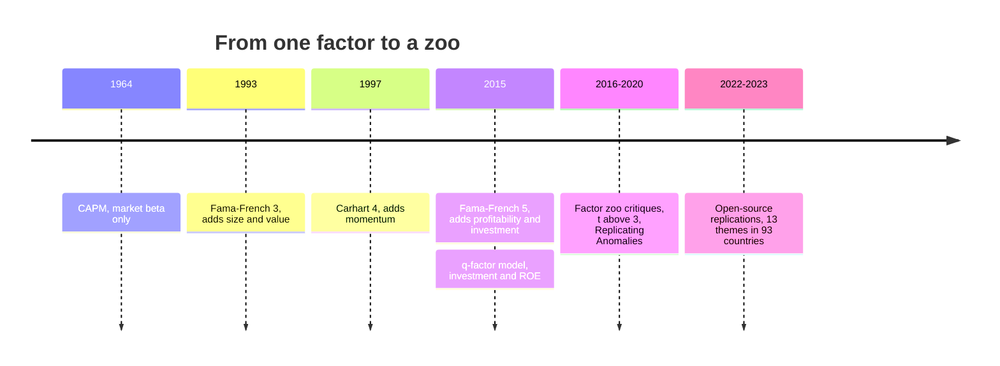
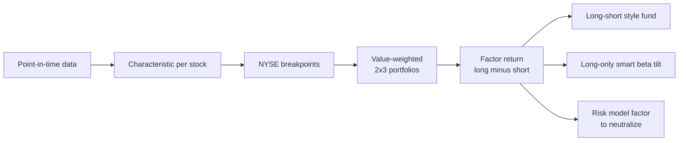

# Factor investing fundamentals

> **TL;DR**
>
> - A factor is a long-short rule (cheap minus expensive, winners minus losers) whose return many stocks share. It pays as a risk premium, a persistent mispricing, or a structural constraint on others.
> - Lineage: CAPM → Fama–French 3 (1993) → Carhart 4 (1997) → Fama–French 5 and the q-factor model (2015). Each step re-labels yesterday's "alpha" as beta.
> - Construction choices (breakpoints, weighting, price lag) move results almost as much as the signal.
> - The "factor zoo": one camp says most of 400+ anomalies fail honest tests, another that most replicate. Both find published returns shrink by about half.
> - Single US factors earned gross Sharpe 0.2–0.5 over 1963–2026, far less since 2007; diversification across factors is where the Sharpe comes from.

**Level:** Core · **Read time:** ~9 min · **Last verified:** 2026-11

| Field | Value |
|---|---|
| Family | risk premia / factors |
| Edge source | risk premium · behavioral (structural for low-risk factors) |
| Holding period | months (monthly to annual rebalance) |
| Counterparty: who pays and why they accept it | Investors unwilling to hold the factor's bad-times risk, extrapolators who overpay for glamour, and leverage- or benchmark-constrained managers who overpay for high beta |
| Universe & instruments | Top 1,000–3,000 US (or global) stocks; long-short via prime broker or swaps, or long-only tilts |
| Data required | Point-in-time fundamentals, prices with delisting returns, industry codes; public factor libraries as benchmarks |
| Core algorithms used | [D3 Signal transforms](../../03-algorithms/a-data-and-signals/signal-transforms.md) · [P1 Risk models](../../03-algorithms/d-portfolio-construction/risk-models.md) · [P3 Mean-variance optimization](../../03-algorithms/d-portfolio-construction/mean-variance-optimization.md) · [P4 Alternatives to MVO](../../03-algorithms/d-portfolio-construction/alternatives-to-mvo.md) · [P7 Position sizing and risk budgeting](../../03-algorithms/d-portfolio-construction/position-sizing-and-risk-budgeting.md) |
| Infra intensity | No latency sensitivity; monthly batch |
| Capacity (rough $ range) | \$5B–\$50B gross per long-short manager, far more as long-only tilts `[Estimate]` (low turnover in large caps; Novy-Marx & Velikov 2016) |
| Typical Sharpe (gross vs net) | Gross academic long-short, 1963-07 to 2026-09 (our computation, French library): HML 0.34, momentum 0.50, RMW 0.37; equal-risk mix 0.71, only 0.23 over 2007–2026 `[Verified]`. Live style fund: net 0.54 since 2013 (fund disclosure) `[Verified]`. Post-publication decay ~58% `[Verified]` |
| Turnover | 20–100% a year for value and quality; several times that for momentum `[Estimate]` |
| Main risks / failure modes | Multi-year drawdowns, momentum crashes, crowded deleveraging |
| Crowding risk | High: same papers, data and breakpoints |
| Firm types that run it | Systematic asset managers, style-premia funds, smart-beta index providers; pods treat factors as risk to neutralize |
| Lab | — |

## Intuition (the story in plain English)

Sort 3,000 stocks on one characteristic, buy the top slice, short the bottom: that spread portfolio is a [factor](../../09-reference/glossary.md#factor), a common driver of returns like an industry. In M&A terms, CAPM alpha is adjusted EBITDA; a factor model is the reconciliation showing how much is cheap, recurring exposure rather than skill.

## Economic rationale: why should this make money at all?

| Story | Logic | Examples | Predicts |
|---|---|---|---|
| [Risk premium](../../09-reference/glossary.md#risk-premium) | Loses in bad times, so holders demand pay | value, carry | persists |
| Mispricing | Extrapolation or under-reaction plus limits to arbitrage | momentum, value | decays as capital arrives |
| Structural | Leverage limits or benchmarks force overpaying | low beta | lasts while the constraint binds |

For most factors the evidence is mixed; see [value, quality and low-vol](value-quality-low-vol.md).

## The trade, step by step

1. **Characteristic**, point-in-time ([D1](../../03-algorithms/a-data-and-signals/point-in-time-data-and-cleaning.md)): Fama–French use fiscal-year t−1 book equity over December t−1 market equity.
2. **Breakpoints**: NYSE median for size; NYSE 30th and 70th percentiles for the characteristic.
3. **Portfolios**: six value-weighted; HML = ½(small value + big value) − ½(small growth + big growth) `[Verified]` (French library).
4. **Rebalance**: each June for value, profitability and investment; monthly for momentum.
5. **Implement**: long-short, or a long-only [smart beta](../../09-reference/glossary.md#smart-beta) tilt with a 2–4% [tracking error](../../09-reference/glossary.md#tracking-error) budget `[Estimate]`.
6. **Attribute**: regress returns on the factors; the residual mean is [alpha](../../09-reference/glossary.md#alpha).

## Worked example with numbers

Illustrative: a manager earns 9.0% a year over cash with market [beta](../../09-reference/glossary.md#beta) 0.9. Our computed 1963–2026 premia: market 7.2%, HML 3.5%, RMW 3.0%, momentum 7.3%.

| Step | Calculation | Result |
|---|---|---|
| CAPM alpha | 9.0 − 0.9 × 7.2 | **+2.5%** |
| Value exposure | loading 0.3 × 3.5 | 1.05% |
| Profitability exposure | 0.4 × 3.0 | 1.20% |
| Momentum exposure | 0.2 × 7.3 | 1.46% |
| Multi-factor alpha | 2.5 − 1.05 − 1.20 − 1.46 | **−1.2%** |

The "alpha" was factor beta, available from a style-premia fund for a fraction of the fee; allocators run exactly this regression.

## Signals and algorithms under the hood

Ranks and z-scores come from [D3](../../03-algorithms/a-data-and-signals/signal-transforms.md); factor covariances from [P1](../../03-algorithms/d-portfolio-construction/risk-models.md); combining factors uses [P3](../../03-algorithms/d-portfolio-construction/mean-variance-optimization.md) or risk parity ([P4](../../03-algorithms/d-portfolio-construction/alternatives-to-mvo.md)); volatility targeting is [P7](../../03-algorithms/d-portfolio-construction/position-sizing-and-risk-budgeting.md).

```python
import numpy as np
import pandas as pd

def ff_factor(df):
    """Fama-French-style 2x3 factor for one formation date (end of June).
    df: one row per stock with me (market equity), char (e.g. book-to-market,
    point-in-time), is_nyse (bool), ret_next (returns for the next 12 months)."""
    nyse = df[df.is_nyse]
    size_bp = nyse.me.median()                          # NYSE size breakpoint
    lo, hi = nyse.char.quantile([0.3, 0.7])             # NYSE 30th / 70th percentiles
    df = df.assign(size=np.where(df.me <= size_bp, "S", "B"),
                   style=np.select([df.char <= lo, df.char >= hi], ["L", "H"], "M"))

    def vw(g):                                          # value-weighted portfolio return
        return (g.ret_next * g.me).sum() / g.me.sum()
    port = df.groupby(["size", "style"]).apply(vw)
    # HML = 1/2 (small high + big high) - 1/2 (small low + big low)
    return 0.5 * (port["S", "H"] + port["B", "H"]) - 0.5 * (port["S", "L"] + port["B", "L"])
```

## Implementation choices that matter

- **Breakpoints and weights.** All-stock breakpoints with equal weights let microcaps dominate; NYSE breakpoints and value weights are what make most anomalies insignificant in Hou, Xue & Zhang (2020) `[Verified]`.
- **Price lag.** Fama–French hold December prices up to 18 months; using the current price improves value, especially alongside momentum (Asness & Frazzini 2013, AQR's "HML Devil") `[Reported]`.
- **Long-only.** Smart beta drops the short leg: cheaper, more capacity, but mostly market risk `[Lore]`.
- **Costs.** Anomalies with under 50% monthly turnover mostly survive costs with a buy/hold buffer; few faster ones do (Novy-Marx & Velikov 2016) `[Verified]`.

## P&L decomposition

Illustrative: \$1B NAV, \$1B long and \$1B short, equal-risk value + profitability + momentum, 8% volatility target.

| Line | % of NAV a year |
|---|---|
| Factor premia, gross (Sharpe 0.5 × 8%) | +4.0 |
| Trading costs (150% turnover × \$2B × 10 bps) | −0.3 |
| Borrow on \$1B short (0.3%) | −0.3 |
| Financing spread, net | −0.2 |
| Management fee | −1.0 |
| **Net to investor** | **+2.2 (Sharpe ≈ 0.28)** |

Fees, not trading costs, are the biggest leak.

## Evidence

Our computation of gross Sharpe ratios from the French library (monthly, no costs) `[Verified]`:

| Factor | 1963–1991 | 1992–2026 | 2007–2026 |
|---|---|---|---|
| Market | 0.31 | 0.60 | 0.65 |
| HML (value) | 0.52 | 0.23 | −0.12 |
| Momentum (UMD) | 0.84 | 0.30 | 0.10 |
| RMW (profitability) | 0.46 | 0.35 | 0.38 |
| CMA (investment) | 0.52 | 0.33 | 0.01 |
| Equal-risk HML + UMD + RMW | 1.30 | 0.49 | 0.23 |

- Fama & French (2015): with profitability and investment added, HML is redundant in their sample `[Verified]`. Hou, Xue & Zhang (2015): about half of ~80 anomalies are insignificant; the q-factor model matches or beats Fama–French and Carhart on the rest `[Verified]`.
- **Skeptics.** Harvey, Liu & Zhu (2016): after hundreds of tests a new factor needs t > 3.0 `[Verified]`. Hou, Xue & Zhang (2020): 65% of 452 anomalies fail |t| ≥ 1.96; 82% fail 2.78 `[Verified]`.
- **Defenders.** Chen & Zimmermann (2022): of 161 clearly significant originals, 98% still show t > 1.96 `[Verified]`. Jensen, Kelly & Pedersen (2023): 153 factors form 13 themes, and most replicate across 93 countries `[Verified]`.
- **Decay.** McLean & Pontiff (2016): 97 predictors lose 26% out of sample and 58% after publication `[Verified]`.

Both camps agree magnitudes shrink; they disagree on whether the [factor zoo](../../09-reference/glossary.md#factor-zoo) is mostly false or mostly redundant.

## Capacity, crowding and decay

Low turnover in large caps gives the most capacity of any equity quant style; the price is crowding and correlated exits (see [factor timing and crowding](factor-timing-crowding-and-quant-winters.md)).

## How it fails

- **August 2007**: crowded books unwound together (Khandani & Lo 2011) `[Verified]`.
- **Spring 2009**: momentum lost about 49% over March–May (our computation) `[Verified]`; see [momentum](momentum.md).
- **Value winter**: HML fell 58% from December 2006 to September 2020 `[Verified]`.

## Textbook vs how it's done today

| Textbook | Practice today |
|---|---|
| One characteristic, 2×3 sorts, annual rebalance (Fama & French 1993) `[Verified]` | Multi-measure composites per theme, rebalanced monthly or daily with buffers `[Lore]` |
| Factors as the expected-return model | Risk to hedge in pods; cheap beta in style funds `[Lore]` |
| Static weights | Risk budgets ([P7](../../03-algorithms/d-portfolio-construction/position-sizing-and-risk-budgeting.md)), sometimes timed ([F6](../../03-algorithms/b-forecasting-models/regime-detection.md)) `[Lore]` |

## Variants and neighbours

[Value, quality and low volatility](value-quality-low-vol.md), [momentum](momentum.md), [carry](../g-futures-and-macro-context/carry-and-cross-asset-risk-premia.md), [fundamental quant signals](../d-mid-frequency-alpha/fundamental-quant-signals.md) and [cross-sectional alpha](../d-mid-frequency-alpha/cross-sectional-alpha-and-neutralization.md), which neutralizes these factors.

## Diagram





## How practitioners talk about it

- "Strip out the FF5 betas and the alpha is negative." → Returns were factor exposure.
- "Are those NYSE breakpoints?" → Is it driven by microcaps?
- "That's already in the zoo." → A relabeled known factor.
- "We run HML Devil, not HML." → Value with current prices.
- "Haircut it by half for publication." → McLean–Pontiff decay as a prior.
- "Smart beta is a factor with the short leg cut off." → Long-only tilts.

## Myths vs reality

| Myth | Reality |
|---|---|
| Factors are free money | Sharpe 0.2–0.5 each, with decade-long drawdowns |
| Most anomalies are fake | Contested: HXZ (2020) vs JKP (2023) |
| Smart beta is the academic factor | No short leg; mostly market beta |

## Questions you could ask a quant about this

**Basic**

- Which factor model do you use for attribution?
- Long-short, or long-only with a tracking-error budget?

**Informed**

- How do your definitions differ from Fama–French (breakpoints, price lag, neutralization)?
- What haircut do you apply to published Sharpe ratios?

**Sharp**

- Which factors did you drop as redundant, and on what test? 🔒
- Live Sharpe per factor versus backtest since launch? 🔒

## Go deeper

<details markdown="1">
<summary>Math: factor regressions, t-statistics and the t > 3 hurdle</summary>

Time-series regression of an excess return on $K$ factors:

$$
r_t - r_f = \alpha + \sum_{k=1}^{K} \beta_k f_{k,t} + \varepsilon_t .
$$

With annualized Sharpe $SR$ over $T$ years, the t-statistic of the mean is

$$
t \approx SR \sqrt{T} .
$$

Over 50 years, $t > 3$ needs $SR > 3/\sqrt{50} \approx 0.42$; $t > 2$ needs only $0.28$.

Combining $N$ equal-risk factors with Sharpe $\overline{SR}$ and average correlation $\bar\rho$:

$$
SR_{\text{combo}} = \overline{SR} \sqrt{\frac{N}{1 + (N-1)\bar\rho}} .
$$

With $N = 3$, $\overline{SR} = 0.40$, $\bar\rho \approx 0$: $0.40\sqrt{3} \approx 0.69$, near the 0.71 computed above.

</details>

## Related pages

- [Value, quality and low volatility](value-quality-low-vol.md)
- [Factor timing, crowding and quant winters](factor-timing-crowding-and-quant-winters.md)
- [Overfitting and multiple testing (V4)](../../03-algorithms/c-validation-and-backtesting/overfitting-and-multiple-testing.md)
- [Risk models (P1)](../../03-algorithms/d-portfolio-construction/risk-models.md)
- [Alpha decay detection (L2)](../../03-algorithms/g-live-trading/alpha-decay-detection-and-model-retirement.md)

## Sources

- [Verified] Sharpe, W. F. (1964). "Capital Asset Prices: A Theory of Market Equilibrium under Conditions of Risk." *Journal of Finance* 19(3), 425–442. <https://doi.org/10.1111/j.1540-6261.1964.tb02865.x> (accessed 2026-11)
- [Verified] Fama, E. F. & French, K. R. (1993). "Common Risk Factors in the Returns on Stocks and Bonds." *Journal of Financial Economics* 33(1), 3–56. <https://doi.org/10.1016/0304-405X(93)90023-5> (accessed 2026-11)
- [Verified] Carhart, M. M. (1997). "On Persistence in Mutual Fund Performance." *Journal of Finance* 52(1), 57–82. <https://doi.org/10.1111/j.1540-6261.1997.tb03808.x> (accessed 2026-11)
- [Verified] Fama, E. F. & French, K. R. (2015). "A Five-Factor Asset Pricing Model." *Journal of Financial Economics* 116(1), 1–22. <https://doi.org/10.1016/j.jfineco.2014.10.010> (accessed 2026-11)
- [Verified] Hou, K., Xue, C. & Zhang, L. (2015). "Digesting Anomalies: An Investment Approach." *Review of Financial Studies* 28(3), 650–705. <https://doi.org/10.1093/rfs/hhu068> (accessed 2026-11)
- [Verified] Harvey, C. R., Liu, Y. & Zhu, H. (2016). "… and the Cross-Section of Expected Returns." *Review of Financial Studies* 29(1), 5–68. <https://doi.org/10.1093/rfs/hhv059> (accessed 2026-11)
- [Verified] Hou, K., Xue, C. & Zhang, L. (2020). "Replicating Anomalies." *Review of Financial Studies* 33(5), 2019–2133. <https://doi.org/10.1093/rfs/hhy131> (accessed 2026-11)
- [Verified] Jensen, T. I., Kelly, B. & Pedersen, L. H. (2023). "Is There a Replication Crisis in Finance?" *Journal of Finance* 78(5), 2465–2518. <https://doi.org/10.1111/jofi.13249> (accessed 2026-11)
- [Verified] Chen, A. Y. & Zimmermann, T. (2022). "Open Source Cross-Sectional Asset Pricing." *Critical Finance Review* 11(2), 207–264. <https://doi.org/10.1561/104.00000112> (accessed 2026-11)
- [Verified] McLean, R. D. & Pontiff, J. (2016). "Does Academic Research Destroy Stock Return Predictability?" *Journal of Finance* 71(1), 5–32. <https://doi.org/10.1111/jofi.12365> (accessed 2026-11)
- [Verified] Novy-Marx, R. & Velikov, M. (2016). "A Taxonomy of Anomalies and Their Trading Costs." *Review of Financial Studies* 29(1), 104–147. <https://doi.org/10.1093/rfs/hhv063> (accessed 2026-11)
- [Reported] Asness, C. & Frazzini, A. (2013). "The Devil in HML's Details." *Journal of Portfolio Management* 39(4), 49–68. <https://doi.org/10.3905/jpm.2013.39.4.049> (accessed 2026-11)
- [Verified] Khandani, A. E. & Lo, A. W. (2011). "What Happened to the Quants in August 2007? Evidence from Factors and Transactions Data." *Journal of Financial Markets* 14(1), 1–46. <https://doi.org/10.1016/j.finmar.2010.07.005> (accessed 2026-11)
- [Verified] French, K. R. "Data Library: Fama/French factors, 5 factors (2x3) and momentum factor," monthly data through 2026-09 (Sharpe ratios and drawdowns on this page are our computations). <https://mba.tuck.dartmouth.edu/pages/faculty/ken.french/data_library.html> (accessed 2026-11)
- [Verified] AQR Funds. "AQR Style Premia Alternative Fund (QSPIX): portfolio statistics as of 2026-09-30." <https://funds.aqr.com/funds/alternatives/aqr-style-premia-alternative-fund/qspix> (accessed 2026-11)
