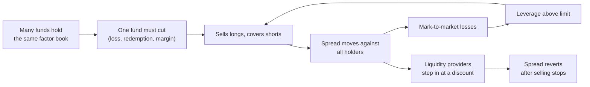
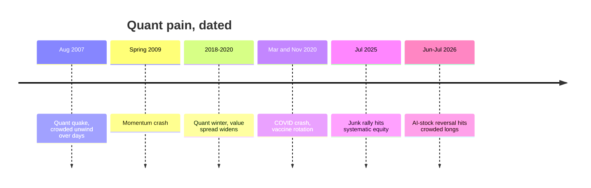

# Factor timing, crowding and quant winters

> **TL;DR**
>
> - Factor books suffer two kinds of pain: fast crowded unwinds (August 2007, days) and slow premium droughts (the 2018–2020 "quant winter", years). They need different defenses.
> - Timing factors with value spreads or factor momentum works in some academic tests and disappoints in others; value-spread timing is largely more value.
> - Crowding is measured indirectly: short interest, comomentum, valuation spreads, prime-broker positioning data.
> - Leverage turns a crowded trade into a spiral, and selling at the bottom locks in losses the unlevered trade later recovers.
> - The usual response is diversification, volatility targeting, bounded tilts and less-crowded signal variants, not heroic timing.

**Level:** Deep dive · **Read time:** ~9 min · **Last verified:** 2026-11

| Field | Value |
|---|---|
| Family | risk premia / factors (overlay and risk management) |
| Edge source | risk premium; timing tries to add a behavioral edge |
| Holding period | timing tilts: months to years; crowding responses: days to weeks |
| Counterparty: who pays and why they accept it | If timing works, investors who chase factor returns or capitulate at the bottom; in an unwind, forced sellers pay whoever has balance sheet |
| Universe & instruments | The factor book itself: equity long-short factors, cross-asset styles |
| Data required | Daily factor returns, leg valuations, short interest, holdings, prime-broker crowding reports, residual returns |
| Core algorithms used | [F6 Regime detection](../../03-algorithms/b-forecasting-models/regime-detection.md) · [L2 Alpha decay detection](../../03-algorithms/g-live-trading/alpha-decay-detection-and-model-retirement.md) · [P7 Position sizing and risk budgeting](../../03-algorithms/d-portfolio-construction/position-sizing-and-risk-budgeting.md) · [P1 Risk models](../../03-algorithms/d-portfolio-construction/risk-models.md) |
| Infra intensity | Low; daily risk batch, intraday monitoring in stress |
| Capacity (rough $ range) | An overlay on the factor book, so capacity is the book's; providing liquidity in unwinds is limited by balance sheet `[Estimate]` |
| Typical Sharpe (gross vs net) | Not standalone; bounded timing overlays plausibly add 0–0.2 gross `[Estimate]`. Academic results range from little gain (Asness et al. 2017) to substantial (Haddad, Kozak & Santosh 2020) `[Verified]` |
| Turnover | Low for spread timing; monthly for factor momentum |
| Main risks / failure modes | Cheap factors getting cheaper; de-grossing at the bottom; noisy crowding gauges |
| Crowding risk | The subject of this page |
| Firm types that run it | Every factor and quant equity manager; prime brokers publish crowding analytics `[Reported]` |
| Lab | — |

## Intuition (the story in plain English)

A premium drought is a long recession in one industry: nothing is forced, the business just earns too little for years. A crowded unwind is a bank run: leveraged funds share positions, one is forced to sell, prices move against all, and the next must sell. Timing tries to dodge droughts; crowding monitors try to dodge runs.

## Economic rationale: why should this make money at all?

**Why timing could work.** Expected factor returns should rise when the long leg is cheap relative to the short leg (a wide [value spread](../../09-reference/glossary.md#value-spread)). Factors are also autocorrelated: the average factor earned 6 bps a month after a losing year and 51 bps after a winning one (Ehsani & Linnainmaa 2022) `[Verified]`.

**Why it is hard.** Few independent episodes, and value-spread timing is mostly more value exposure (Asness, Chandra, Ilmanen & Israel 2017) `[Verified]`.

**Why crowding matters.** Capital in value and momentum grew from the late 1980s and lowered their returns (Hanson & Sunderam 2014) `[Verified]`; crowded momentum trading can push prices past fundamentals (Lou & Polk 2022) `[Verified]`.

## The trade, step by step

1. **Value spread** per factor: log book-to-market of the long leg minus the short leg, z-scored against history.
2. **Factor momentum**: sign of the factor's trailing 12-month return.
3. **[Crowding](../../09-reference/glossary.md#crowding)**: excess residual correlation inside each leg, short interest in the short leg, overlap with peers' holdings.
4. **Tilt**: bounded multipliers, for example 0.5× to 1.5× of the strategic weight, changed slowly.
5. **Risk overlay**: volatility targeting ([P7](../../03-algorithms/d-portfolio-construction/position-sizing-and-risk-budgeting.md)), factor covariances ([P1](../../03-algorithms/d-portfolio-construction/risk-models.md)), stress regimes ([F6](../../03-algorithms/b-forecasting-models/regime-detection.md)).
6. **Decay review** ([L2](../../03-algorithms/g-live-trading/alpha-decay-detection-and-model-retirement.md)): separate a drought from a dead signal.

## Worked example with numbers

Illustrative [deleveraging](../../09-reference/glossary.md#deleveraging) spiral: $1,000M NAV, gross 8× ($4,000M long, $4,000M short), prime-broker cap 8×.

| Day | Spread move | P&L ($M) | NAV ($M) | Gross allowed ($M) | Forced trading ($M) |
|---|---|---|---|---|---|
| 1 | −3% | −4,000 × 3% = −120 | 880 | 7,040 | 960 |
| 2 | −2% | −3,520 × 2% = −70 | 810 | 6,477 | 563 |
| 3 | +5% (reversal) | +3,238 × 5% = +162 | 972 | — | — |
| Costs | 30 bps on 1,523 traded | −5 | **967** | | |

An investor who held without trading would be flat (−120 − 80 + 200 = 0); the de-levered fund is down 3.3%. Khandani & Lo (2011) estimate an 8:1 levered book-to-market portfolio lost 24% from 1 August to the close of 7 August 2007, before prices reverted on 10 August `[Verified]`.

## Signals and algorithms under the hood

```python
import numpy as np

def value_spread_z(bm_long, bm_short, hist):
    """Log book-to-market of the long leg minus the short leg, z-scored vs its history."""
    spread = np.log(np.median(bm_long)) - np.log(np.median(bm_short))
    return (spread - np.mean(hist)) / np.std(hist)

def comomentum(resid_long):
    """Lou-Polk-style gauge (simplified): mean pairwise correlation of weekly
    factor-model residuals among long-leg stocks over the past 52 weeks."""
    c = np.corrcoef(resid_long.T)
    n = c.shape[0]
    return (c.sum() - n) / (n * (n - 1))

def factor_weight(base_w, spread_z, ret_12m, crowd_z, vol, target_vol=0.05,
                  k=0.15, lo=0.5, hi=1.5):
    tilt = 1 + k * spread_z + k * np.sign(ret_12m) - k * crowd_z  # cheap, trending, uncrowded
    tilt = np.clip(tilt, lo, hi)              # bounded: timing never dominates the book
    return base_w * tilt * target_vol / vol   # P7 volatility targeting
```

## Implementation choices that matter

- **Bounded and slow.** Tilts of ±50%, changed monthly, keep timing errors survivable `[Lore]`.
- **Spread definition.** Industry-neutral spreads avoid reading a sector bubble as factor cheapness `[Lore]`.
- **Crowding data.** Short interest is twice-monthly, holdings quarterly and stale; prime-broker reports are timelier but cover only that broker's clients `[Reported]`.
- **Pre-agreed de-grossing.** Rules set in calm markets beat judgment in a run, at the cost shown above `[Lore]`.
- **De-crowding.** Proprietary variants, other universes and faster signals reduce overlap `[Lore]`.

## P&L decomposition

Illustrative: $1B style book, 8% volatility, one year.

| Line | % of NAV |
|---|---|
| Strategic factor premia | +4.0 |
| Timing tilts (expected; ±1.0 realized) | +0.2 |
| Crowded-unwind losses, amortized | −0.5 |
| Trading costs, including timing turnover | −0.4 |
| Financing and borrow | −0.5 |
| **Net before fees** | **+2.8** |

## Evidence

- **Timing works.** Haddad, Kozak & Santosh (2020): market-neutral equity factors are strongly predictable, and exploiting this substantially improves on static factor investing `[Verified]`.
- **Timing disappoints.** Asness et al. (2017): value-spread timing inside a portfolio that already holds value adds little over a strategic value allocation `[Verified]`.
- **Spreads can widen for years.** Our computation from French data: value-over-growth book-to-market at June formation ranked at the 10th percentile of 1951–2026 in 2007, the 86th in 2017, the 99th in 2022 and the widest on record in June 2026 `[Verified]`; intangibles may inflate book-based spreads. Value lost 51% from January 2017 to September 2020.
- **Quant winter, firm level.** AQR's Style Premia Alternative Fund fell 19.2% in 2020 (Institutional Investor, citing a private database) `[Reported]`. AQR's regulated assets fell from $248.9B in 2019 to $164.4B in 2020 `[Reported]`. AQR argues the losses came from value spreads widening, not crowded unwinds `[Verified]` (firm white paper, 2026).

## Capacity, crowding and decay

Crowding depends on capital, leverage and overlap, not the idea. A crowded factor earns less and has fatter left tails; the same gauges feed [L2](../../03-algorithms/g-live-trading/alpha-decay-detection-and-model-retirement.md) decay reviews.

## How it fails

- **August 2007.** The sustained unwind started at the open on 6 August; market makers withdrew from 8 August (Khandani & Lo 2011) `[Verified]`. Goldman and outside investors put $3B into its Global Equity Opportunities fund on 13 August `[Verified]`.
- **2020.** HML lost 13.8% in March; momentum lost 12.6% in November's vaccine rotation (our computation) `[Verified]`.
- **2025–2026.** Systematic equity funds, on pace for a record monthly loss in a junk rally, finished July 2025 down about 2%; a June–July 2026 AI-stock reversal cut their year-to-date return from 14.4% to 10.8% (Goldman prime-brokerage data via press) `[Reported]`.

## Textbook vs how it's done today

| Textbook | Practice today |
|---|---|
| Hold static factor weights (strategic view) | Bounded tilts on spreads and momentum `[Lore]` |
| Crowding is unobservable | Prime-broker crowding scores and peer-overlap estimates `[Reported]` |
| Risk equals volatility | Leverage, liquidity and overlap limits too ([risk management](../../06-risk-and-regulation/risk-management-at-quant-firms.md)) `[Lore]` |

## Variants and neighbours

Factor momentum, trend overlays on factors ([trend following](../g-futures-and-macro-context/trend-following-and-ctas.md)), regime switching ([F6](../../03-algorithms/b-forecasting-models/regime-detection.md)), the [strategy failure gallery](../h-cross-cutting/strategy-failure-gallery.md), and [how firms combine strategies](../h-cross-cutting/how-firms-combine-strategies.md).

## Diagram





## How practitioners talk about it

- "Value spreads are 99th percentile." → The long leg is historically cheap.
- "Drought or crowding event?" → Slow premium loss or forced-selling spiral?
- "PB says our shorts are crowded." → Prime-broker data shows peers share them.
- "We degrossed into the low." → Cut leverage at the worst prices.
- "[Comomentum](../../09-reference/glossary.md#comomentum) is spiking." → Momentum stocks move together beyond their factor exposure.
- "Don't time it, size it." → Use volatility targeting rather than return forecasts.

## Myths vs reality

| Myth | Reality |
|---|---|
| Cheap factors are about to rebound | Value's spread was 86th percentile in 2017 before a 51% loss |
| 2018–2020 was a crowding crash | AQR says spread widening; contested |
| Selling fast protects you in an unwind | It can lock in recoverable losses |

## Questions you could ask a quant about this

**Basic**

- Do you time factors at all, and within what bounds?
- What triggers de-grossing?

**Informed**

- How do you separate a premium drought from crowding in your attribution?
- Which crowding measure has actually led your losses?

**Sharp**

- How much did your book overlap with peers in July 2025? 🔒
- What did your timing tilts add, net of turnover, since 2017? 🔒

## Go deeper

<details markdown="1">
<summary>Math: why leverage squares forced selling</summary>

Equity $E$, leverage cap $\lambda$, gross $G = \lambda E$ split equally long and short. A spread move $s$ against the book loses

$$
\Delta E = -\frac{G}{2} s = -\frac{\lambda E s}{2} .
$$

Restoring $G = \lambda (E + \Delta E)$ forces trades of

$$
\Delta G = \lambda \Delta E = -\frac{\lambda^2 E s}{2} .
$$

Forced selling scales with $\lambda^2$: doubling leverage quadruples it. Comomentum for long-leg stocks $i, j$ with residuals $\varepsilon$:

$$
\text{CoMom}_t = \frac{1}{N(N-1)} \sum_{i \neq j} \text{corr}(\varepsilon_{i}, \varepsilon_{j}) .
$$

</details>

## Related pages

- [Factor investing fundamentals](factor-investing-fundamentals.md)
- [Value, quality and low volatility](value-quality-low-vol.md)
- [Momentum](momentum.md)
- [Regime detection (F6)](../../03-algorithms/b-forecasting-models/regime-detection.md)
- [Strategy failure gallery](../h-cross-cutting/strategy-failure-gallery.md)

## Sources

- [Verified] Haddad, V., Kozak, S. & Santosh, S. (2020). "Factor Timing." *Review of Financial Studies* 33(5), 1980–2018. <https://doi.org/10.1093/rfs/hhaa017> (accessed 2026-11)
- [Verified] Asness, C., Chandra, S., Ilmanen, A. & Israel, R. (2017). "Contrarian Factor Timing is Deceptively Difficult." *Journal of Portfolio Management* 43(5), 72–87. <https://doi.org/10.3905/jpm.2017.43.5.072> (accessed 2026-11)
- [Reported] Asness, C. S. (2016). "The Siren Song of Factor Timing." *Journal of Portfolio Management* 42(5), 1–6. <https://doi.org/10.3905/jpm.2016.42.5.001> (accessed 2026-11)
- [Verified] Ehsani, S. & Linnainmaa, J. T. (2022). "Factor Momentum and the Momentum Factor." *Journal of Finance* 77(3), 1877–1919. <https://doi.org/10.1111/jofi.13131> (accessed 2026-11)
- [Verified] Lou, D. & Polk, C. (2022). "Comomentum: Inferring Arbitrage Activity from Return Correlations." *Review of Financial Studies* 35(7), 3272–3302. <https://doi.org/10.1093/rfs/hhab117> (accessed 2026-11)
- [Verified] Hanson, S. G. & Sunderam, A. (2014). "The Growth and Limits of Arbitrage: Evidence from Short Interest." *Review of Financial Studies* 27(4), 1238–1286. <https://doi.org/10.1093/rfs/hht066> (accessed 2026-11)
- [Verified] Khandani, A. E. & Lo, A. W. (2011). "What Happened to the Quants in August 2007? Evidence from Factors and Transactions Data." *Journal of Financial Markets* 14(1), 1–46. <https://doi.org/10.1016/j.finmar.2010.07.005> (accessed 2026-11)
- [Reported] Khandani, A. E. & Lo, A. W. (2007). "What Happened to the Quants in August 2007?" *Journal of Investment Management* 5(4). <https://www.joim.com/what-happened-to-the-quants-in-august-2007/> (accessed 2026-11)
- [Verified] Goldman Sachs (2007-08-13). "Goldman Sachs and Various Investors Including C.V. Starr & Co., Inc., Perry Capital LLC and Eli Broad Invest $3 Billion in Global Equity Opportunities Fund." <https://www.goldmansachs.com/pressroom/press-releases/2007/2007-08-13> (accessed 2026-11)
- [Reported] Institutional Investor (2021-04-28). "After Its 'Toughest Period' Ever, AQR Is Making a Big Comeback." <https://www.institutionalinvestor.com/article/b1rlvd4dqdwzm4/After-Its-Toughest-Period-Ever-AQR-Is-Making-a-Big-Comeback> (accessed 2026-11)
- [Verified] Maloney, T. & Moskowitz, T. (2026-08). "Academic Alpha: A (Re)Introduction to Style Premia Investing." AQR white paper. <https://www.aqr.com/-/media/AQR/Documents/White-Papers/Academic-Alpha-A-Re-Introduction-to-Style-Premia-Investing.pdf> (accessed 2026-11)
- [Reported] Hedgeweek (2025-08-08). "Quant hedge funds pare back July losses after challenging summer." <https://www.hedgeweek.com/quant-hedge-funds-pare-back-july-losses-after-challenging-summer/> (accessed 2026-11)
- [Reported] Hedgeweek (2026-07-10). "AI-led market reversal hits quant hedge funds as crowded trades unravel." <https://www.hedgeweek.com/ai-led-market-reversal-hits-quant-hedge-funds-as-crowded-trades-unravel/> (accessed 2026-11)
- [Verified] French, K. R. "Data Library: 6 portfolios formed on size and book-to-market (BE/ME averages); Fama/French factors; momentum," through 2026-09 (spread percentiles and returns are our computations). <https://mba.tuck.dartmouth.edu/pages/faculty/ken.french/data_library.html> (accessed 2026-11)
