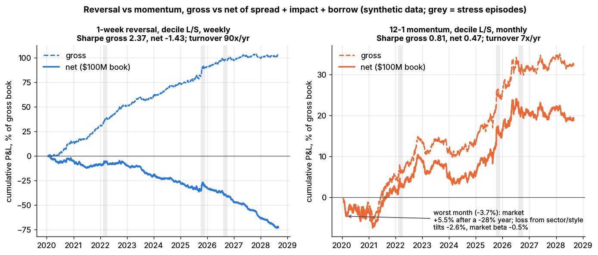
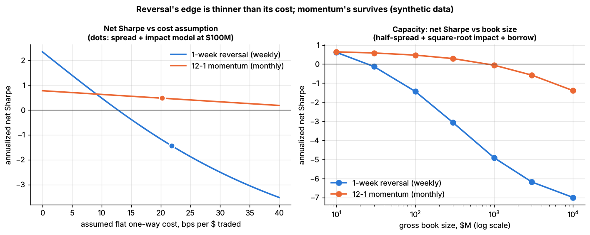
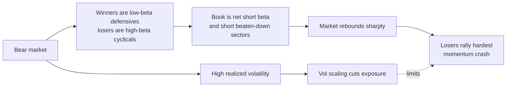
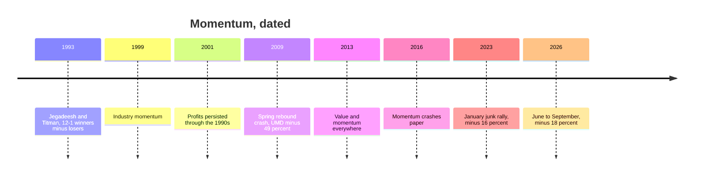

# Momentum

> **TL;DR**
>
> - Buy the past year's winners, short its losers, skip the latest month ("12-1"). About 1% a month over 1965–1989 (Jegadeesh & Titman 1993), and it outlived publication.
> - It appears across industries, countries and asset classes, negatively correlated with value, its natural partner (Asness, Moskowitz & Pedersen 2013).
> - US long-run gross Sharpe is about 0.5 but only 0.14 since 2000, with the worst crashes of any major factor (−74% in July–August 1932, −49% in March–May 2009) when high-beta losers rebound.
> - Crashes are partly predictable: volatility scaling roughly doubles the Sharpe (0.45 → 0.87 on the same 1927–2026 months, our replication).
> - Low [turnover](../../09-reference/glossary.md#turnover) (Lab 10: 6.5× a year against reversal's 90×) gives large capacity, with break-even estimates of \$52B in the US. [Crowding](../../09-reference/glossary.md#crowding) is the price.

**Level:** Core · **Read time:** ~11 min · **Last verified:** 2026-11

| Field | Value |
|---|---|
| Family | risk premia / factors |
| Edge source | behavioral · risk premium (contested) |
| Holding period | Monthly rebalance; positions last about 4 months `[Estimate]` (Lab 10 turnover) |
| Counterparty: who pays and why they accept it | Under-reacting investors who anchor on old prices, sell winners early, cling to losers and update slowly; if the risk story is right, also investors unwilling to carry momentum's crash exposure |
| Universe & instruments | Top 1,000–3,000 US stocks (also global stocks, industries, futures); long-short, or long-only indexes |
| Data required | Point-in-time total returns including delisted stocks; market caps; industry codes; factor residuals; daily returns; borrow |
| Core algorithms used | [D3 Signal transforms](../../03-algorithms/a-data-and-signals/signal-transforms.md) · [P1 Risk models](../../03-algorithms/d-portfolio-construction/risk-models.md) · [P7 Position sizing and risk budgeting](../../03-algorithms/d-portfolio-construction/position-sizing-and-risk-budgeting.md) · [P5 Transaction cost and impact models](../../03-algorithms/d-portfolio-construction/transaction-cost-and-impact-models.md) |
| Infra intensity | Low: monthly batch; trades worked over days |
| Capacity (rough $ range) | Break-even \$52B US, \$89B global, \$122B global optimized (Frazzini, Israel & Moskowitz 2012; AQR-affiliated, 1998–2011 costs) `[Verified]`; \$5B+ liquidity-weighted at 1999 caps (Korajczyk & Sadka 2004) `[Verified]`. Per manager \$1B–\$20B `[Estimate]` (profit peaks near 4/9 of break-even; many managers share it) |
| Typical Sharpe (gross vs net) | Fama-French momentum factor (UMD), gross: 0.46 (1927–2026), 0.84 (1963–1991), 0.30 (1992–2026), 0.14 (2000–2026); volatility-scaled 0.87 and 0.41 (1927– and 2000–2026) `[Verified]` (our computation, French library). Net: subtract 0.05–0.15 for costs at moderate size `[Estimate]` |
| Turnover | 5–8× the gross book a year for a monthly decile book (Lab 10: 6.5×) `[Estimate]` |
| Main risks / failure modes | Crashes in rebounds after bear markets; junk rallies; abrupt leadership rotations; crowding |
| Crowding risk | High: standard in risk models, smart beta and quant books `[Lore]`; see comomentum |
| Firm types that run it | Systematic asset managers, style-premia funds, smart-beta providers, quant hedge funds; pods hedge it as risk |
| Lab | [Lab 10](https://github.com/FrankHuang94/quant_trading_claude/tree/main/labs/10-reversal-momentum-costs) |

## Intuition (the story in plain English)

News reaches prices in steps: an earnings beat, a guidance raise, analysts lifting estimates for months. A stock that has beaten the market for a year tends to keep beating it for a few months. [Momentum](../../09-reference/glossary.md#momentum) buys that persistence across thousands of stocks and shorts its mirror image, skipping the latest month because one-month moves reverse ([short-term reversal](../c-statistical-arbitrage/short-term-cross-sectional-reversal.md)). The market prices a turnaround the way a board backs one: partially, then fully once several quarters confirm it.

## Economic rationale: why should this make money at all?

| Story | Mechanism | Supporting evidence |
|---|---|---|
| Under-reaction | Information diffuses gradually; trend-chasers overshoot (Hong & Stein 1999) `[Verified]` | Part of the first-year profit later reverses (Jegadeesh & Titman 1993, 2001) `[Verified]` |
| Overconfidence | Biased self-attribution creates short-lag momentum and long-lag reversal (Daniel, Hirshleifer & Subrahmanyam 1998) `[Verified]` | The same later reversal |
| Rational risk | Time-varying expected growth rates produce momentum (Johnson 2002) `[Verified]` | A common factor across eight markets and asset classes, partly funding liquidity risk (Asness et al. 2013) `[Verified]` |
| Crash premium | In panics, losers' option-like payoffs carry a high premium (Daniel & Moskowitz 2016) `[Verified]` | UMD skewness −3.0 since 1927 (our computation) `[Verified]` |

The later reversal is what behavioral models predict, though Jegadeesh and Titman temper their support with caution `[Verified]`. Yet momentum co-moves across asset classes with very different investors, which one bias explains poorly. The evidence is mixed.

## The trade, step by step

1. **Universe:** point-in-time at month-end, including later-delisted names ([D1](../../03-algorithms/a-data-and-signals/point-in-time-data-and-cleaning.md)).
2. **Score:** return from 12 months ago to 1 month ago ("12-1").
3. **Clean** ([D3](../../03-algorithms/a-data-and-signals/signal-transforms.md)): winsorize; optionally rank within industry or on factor-model residuals ([P1](../../03-algorithms/d-portfolio-construction/risk-models.md)).
4. **Portfolio:** long the top decile or 30%, short the bottom; hedge beta and industries.
5. **Size** ([P7](../../03-algorithms/d-portfolio-construction/position-sizing-and-risk-budgeting.md)): scale to a volatility target; cut further after bear markets ([F6](../../03-algorithms/b-forecasting-models/regime-detection.md)).
6. **Rebalance** monthly with buffers ([P6](../../03-algorithms/d-portfolio-construction/multi-period-and-trading-toward-aim.md)); trade over days ([E2](../../03-algorithms/e-execution-algorithms/vwap-twap-pov.md)), netting against value.

## Worked example with numbers

Illustrative crash mechanics: \$1B long winners, \$1B short losers, entering a rebound after a 30% market fall.

| Step | Calculation | Result |
|---|---|---|
| Long winners, beta 0.6 | \$1B × 0.6 | +\$0.6B market exposure |
| Short losers, beta 1.8 | −\$1B × 1.8 | −\$1.8B |
| Net market exposure | 0.6 − 1.8 | **−\$1.2B** |
| Market rebounds 15% in a month | −\$1.2B × 15% | **−\$180M** |
| A normal month's expected premium | \$1B × 0.6% | +\$6M |
| Months of premium lost | 180 / 6 | **30** |
| Beta hedge: buy \$1.2B of index futures | market term → 0 | industry and style tilts remain |

These betas are mild: after major declines Daniel and Moskowitz find loser betas above 3 and winner betas below 0.5 `[Verified]`. The 0.6% monthly premium matches UMD's long-run 7.3% a year.

## Signals and algorithms under the hood

Residual momentum and the beta hedge need [P1](../../03-algorithms/d-portfolio-construction/risk-models.md); [volatility targeting](../../09-reference/glossary.md#volatility-targeting) is [P7](../../03-algorithms/d-portfolio-construction/position-sizing-and-risk-budgeting.md); costs come from [P5](../../03-algorithms/d-portfolio-construction/transaction-cost-and-impact-models.md).

```python
# Mirrors Lab 10 (labs/10-reversal-momentum-costs/lab.py); vol scaling is an addition.
def momentum_signal(returns, lookback=252, skip=21):
    """12-1 momentum (Jegadeesh-Titman 1993): log return over days t-251 .. t-21."""
    log_ret = np.log1p(returns)
    return log_ret.rolling(lookback - skip).sum().shift(skip)   # skip the reversal month

def decile_weights(signal, q=0.1):
    """Long top decile, short bottom decile, equal weight, +0.5 / -0.5 (gross 1)."""
    rank = signal.rank(axis=1, pct=True)
    top, bottom = rank > 1 - q, rank <= q
    return top.div(top.sum(axis=1), axis=0) * 0.5 - bottom.div(bottom.sum(axis=1), axis=0) * 0.5

def beta_hedge(weights, beta):
    """Add an equal-weighted universe basket so the book's beta sum(w * beta) is zero."""
    hedge = -weights.mul(beta, axis=1).sum(axis=1) / beta.mean()
    return weights + np.outer(hedge, np.full(len(beta), 1.0 / len(beta)))

def vol_scale(book_daily_returns, target_vol=0.12, window=126):
    """Not in the lab: Barroso & Santa-Clara (2015) leverage, known before each month."""
    realized = book_daily_returns.rolling(window).std() * np.sqrt(252)
    return (target_vol / realized).shift(1)
# The lab rebalances the decile book every 21 trading days and charges apply_costs().
```



*Right panel: momentum's net P&L (solid) stays close to gross (dashed); the arrow marks its worst month. Synthetic data.*



*Momentum (orange) stays positive up to 52.5 bps per dollar traded and to just under a \$1B book. Synthetic data.*

Synthetic lab result: at \$100M the decile book's Sharpe is 0.81 gross and 0.47 net, with 6.5× turnover and costs of 1.3% of the book a year (reversal: 19.5%). Its worst month lost 3.7% as the market rose 5.5% after a −28% year; 2.6 points came from sector and style tilts, so the beta-hedged book still lost 3.2%. The constant planted IC and gentle simulated rebounds flatter the toy: real UMD has a Sharpe of 0.14 since 2000 and a −34% month.

## Implementation choices that matter

- **Lookback.** 12-1 is standard. Novy-Marx (2012) finds returns from 12 to 7 months ago do most of the work `[Reported]`.
- **Residual momentum.** Ranking on factor-model [residuals](../../09-reference/glossary.md#residual-return) about doubles the risk-adjusted profit (Blitz, Huij & Martens 2011) `[Verified]`: Sharpe 0.90 against 0.45, 1926–2009 `[Reported]`.
- **Industry.** Industry momentum accounts for much of stock momentum (Moskowitz & Grinblatt 1999) `[Verified]`; industry-neutral books give it up to avoid sector concentration.
- **Crash management.** Scaling to constant risk virtually eliminates crashes and nearly doubles the Sharpe (Barroso & Santa-Clara 2015) `[Verified]`, as do Daniel and Moskowitz's dynamic weights `[Verified]`.
- **Buffers and netting.** Buy at the top decile but sell only below the top 20–30% `[Lore]`. Netting momentum's trades against value's raises the pair's US break-even to \$100B (Frazzini et al. 2012) `[Verified]`.
- **Shorts.** Losers are more often [hard to borrow](../../09-reference/glossary.md#hard-to-borrow); long-only indexes avoid this but are mostly market beta `[Lore]`.

## P&L decomposition

Illustrative: \$1B long, \$1B short, volatility-scaled, one year.

| Line | \$M | % of long side |
|---|---|---|
| Momentum premium, gross | +50 | +5.0 |
| Trading costs (6.5 × \$2B traded × 10 bps) | −13 | −1.3 |
| Borrow (50 bps on \$1B short) | −5 | −0.5 |
| Financing spread | −3 | −0.3 |
| **Net, before fees** | **+29** | **+2.9** |

With 15% volatility on the long side (\$150M), the net Sharpe is about 0.19, comparable to UMD's 0.14 gross since 2000.

## Evidence

Our computation from the French library (monthly, gross, no costs; volatility-scaled to 12% using the prior 126 days) `[Verified]`:

| Period | UMD Sharpe | Volatility-scaled | Worst month |
|---|---|---|---|
| 1927–1962 | 0.41 | 0.82 | −52.6% (August 1932) |
| 1963-07 to 1991 | 0.84 | 1.12 | −13.8% (January 1975) |
| 1992 to 2026-09 | 0.30 | 0.66 | −34.4% (April 2009) |
| 2010 to 2026-09 | 0.26 | 0.46 | −16.2% (January 2023) |

- **Original result.** Over 1965–1989, 6-month formation earned about 1% a month and 12-month/3-month 1.31%, despite losing about 7% each January (Jegadeesh & Titman 1993) `[Verified]`.
- **After publication.** Profits continued in the 1990s (Jegadeesh & Titman 2001) `[Verified]`; UMD's 1990–1999 Sharpe was 1.21.
- **Everywhere.** Value and momentum premia in eight markets and asset classes, negatively correlated (Asness et al. 2013) `[Verified]`. UMD–HML correlation is −0.41 since 1927 (−0.19 since 1963); a 50/50 risk mix has a Sharpe of 0.73 against 0.46 and 0.34 alone `[Verified]`.
- **Bear-market state.** In the 235 months after the market's monthly excess returns summed to a negative number over the prior 24 months, UMD averaged −0.27% a month, against +0.83% otherwise `[Verified]`.
- **Costs.** Lesmond, Schill & Zhou (2004) call the profits illusory `[Reported]`; live execution data put costs below a tenth of earlier estimates (Frazzini et al. 2012) `[Verified]`.
- **Recent years** (monthly returns compounded). UMD: +20.2% (2022), −20.5% (2023, −16.2% in January), +18.5% (2024), −2.2% (2025), +11.0% (2026 to September) `[Verified]`.

## Capacity, crowding and decay

Momentum's break-even (\$52B US) is almost six times reversal's (\$9B) because it trades far less (a fourteenth as much in Lab 10). Decay is real: the Sharpe fell from 0.84 before 1992 to 0.30 after, about the average post-publication loss across anomalies ([factor fundamentals](factor-investing-fundamentals.md)). Crowded momentum trading can push prices past fundamentals, and [comomentum](../../09-reference/glossary.md#comomentum) detects it (Lou & Polk 2022) `[Verified]`. See [factor timing and crowding](factor-timing-crowding-and-quant-winters.md).

## How it fails

- **Rebound [crashes](../../09-reference/glossary.md#momentum-crash).** In July–August 1932 past losers returned 232% against winners' 32%; in March–May 2009, 163% against 8% (Daniel & Moskowitz, 1927–2013 sample) `[Verified]`. UMD lost 74% and 49% in those windows `[Verified]`.
- **Rotations and junk rallies.** January 2001 −25.4%; 9 November 2020 −14.4% in one day on vaccine news; January 2023 −16.2% `[Verified]`.
- **Leadership reversal, 2026.** UMD lost 17.9% from 22 June to 3 September 2026 (July −12.2%) `[Verified]` as crowded AI winners reversed `[Reported]`.

## Textbook vs how it's done today

| Textbook | Practice today |
|---|---|
| Equal-weighted 12-1 deciles, monthly (Jegadeesh & Titman 1993) `[Verified]` | Risk-weighted, residual or industry-adjusted, buffered, optimized `[Lore]` |
| Static exposure | Volatility-scaled or crash-managed (Barroso & Santa-Clara 2015; Daniel & Moskowitz 2016) `[Verified]`; how widely firms do this is `[Lore]` |
| A standalone factor | Paired with value (Asness et al. 2013) `[Verified]`; pods neutralize it as risk `[Lore]` |

## Variants and neighbours

- **[Time-series momentum](../../09-reference/glossary.md#time-series-momentum)** ([trend following](../g-futures-and-macro-context/trend-following-and-ctas.md)) uses each asset's own past return. For stocks, the difference from cross-sectional momentum is mostly its time-varying net long position (Goyal & Jegadeesh 2018) `[Verified]`.
- **Related signals:** industry and residual momentum; factor momentum ([factor timing](factor-timing-crowding-and-quant-winters.md)); [earnings drift](../d-mid-frequency-alpha/earnings-and-event-driven.md); [analyst revisions](../d-mid-frequency-alpha/analyst-revisions-and-sentiment.md); short-term momentum in high-turnover stocks (Medhat & Schmeling 2022) `[Verified]`.
- **Hedge:** [value](value-quality-low-vol.md).

## Diagram





## How practitioners talk about it

- "12-1 with the skip." → Formation excludes the latest month.
- "Momentum is short beta after a bear market." → The crash setup.
- "We vol-scale the momentum sleeve." → Barroso–Santa-Clara.
- "Value and momentum pay for each other's bad years." → Negative correlation.
- "That was a junk rally." → Low-quality losers squeezed higher.
- "Comomentum is spiking." → Momentum names move together; crowded.
- "Raw momentum is an AI-beta book." → Sector concentration.

## Myths vs reality

| Myth | Reality |
|---|---|
| Momentum is trend following | Cross-sectional is relative and dollar-neutral; trend is net long or short |
| It was arbitraged away after 1993 | Sharpe 1.21 in the 1990s; weaker since 2000 |
| Crashes are random | Partly predictable: after bear markets, in high volatility |
| Too costly to trade | Contested: Lesmond et al. versus Frazzini et al. |

## Questions you could ask a quant about this

**Basic**

- Which lookback and skip do you use?
- Is the book industry-neutral?

**Informed**

- How do you size momentum after a bear market?
- Do you combine with value in the signal or the portfolio?
- How much turnover do your buffers save?

**Sharp**

- Your momentum sleeve's loss in July 2026 versus UMD? 🔒
- How do you measure crowding in your names? 🔒
- Realized versus modeled cost per dollar? 🔒

## Go deeper

<details markdown="1">
<summary>Math: the 12-1 score, crash beta and volatility scaling</summary>

12-1 score for holding month $t$ (French: months $t-12$ to $t-2$; Lab 10: days $t-251$ to $t-21$):

$$
\text{MOM}_{i,t} = \sum_{k=2}^{12} \ln\left(1 + r_{i,t-k}\right).
$$

The book's beta is the difference of its legs' betas:

$$
\beta_{WML,t} = \beta_{W,t} - \beta_{L,t} .
$$

After a decline, $\beta_{L,t}$ can exceed 3 and $\beta_{W,t}$ fall below 0.5, so a rebound $R_m$ costs about $|\beta_{WML,t}| R_m$ with $|\beta_{WML,t}| > 2$.

Volatility scaling with target $\sigma^{*}$ and 126 prior daily returns:

$$
w_t = \frac{\sigma^{*}}{\hat\sigma_t}, \qquad \hat\sigma_t^2 = \frac{252}{126} \sum_{j=1}^{126} r_{t-j}^2 .
$$

Volatility spikes before crashes, so $w_t$ falls first: in our replication leverage was 0.3× in spring 2009, and the loss was 16% instead of 49%.

</details>

## Related pages

- [Short-term cross-sectional reversal](../c-statistical-arbitrage/short-term-cross-sectional-reversal.md)
- [Factor investing fundamentals](factor-investing-fundamentals.md)
- [Value, quality and low volatility](value-quality-low-vol.md)
- [Trend following and CTAs](../g-futures-and-macro-context/trend-following-and-ctas.md)
- [Position sizing and risk budgeting (P7)](../../03-algorithms/d-portfolio-construction/position-sizing-and-risk-budgeting.md)
- [Strategy failure gallery](../h-cross-cutting/strategy-failure-gallery.md)

## Sources

- [Verified] Jegadeesh, N. & Titman, S. (1993). "Returns to Buying Winners and Selling Losers: Implications for Stock Market Efficiency." *Journal of Finance* 48(1), 65–91. <https://doi.org/10.1111/j.1540-6261.1993.tb04702.x> (accessed 2026-11)
- [Verified] Jegadeesh, N. & Titman, S. (2001). "Profitability of Momentum Strategies: An Evaluation of Alternative Explanations." *Journal of Finance* 56(2), 699–720. <https://doi.org/10.1111/0022-1082.00342> (accessed 2026-11)
- [Verified] Asness, C. S., Moskowitz, T. J. & Pedersen, L. H. (2013). "Value and Momentum Everywhere." *Journal of Finance* 68(3), 929–985. <https://doi.org/10.1111/jofi.12021> (accessed 2026-11)
- [Verified] Daniel, K. & Moskowitz, T. J. (2016). "Momentum Crashes." *Journal of Financial Economics* 122(2), 221–247. <https://doi.org/10.1016/j.jfineco.2015.12.002> (accessed 2026-11)
- [Verified] Daniel, K. & Moskowitz, T. J. (2014). "Momentum Crashes." NBER Working Paper 20439 (crash magnitudes and betas quoted from this version). <https://www.nber.org/papers/w20439> (accessed 2026-11)
- [Verified] Moskowitz, T. J. & Grinblatt, M. (1999). "Do Industries Explain Momentum?" *Journal of Finance* 54(4), 1249–1290. <https://doi.org/10.1111/0022-1082.00146> (accessed 2026-11)
- [Verified] Barroso, P. & Santa-Clara, P. (2015). "Momentum has its moments." *Journal of Financial Economics* 116(1), 111–120. <https://doi.org/10.1016/j.jfineco.2014.11.010> (accessed 2026-11)
- [Verified] Blitz, D., Huij, J. & Martens, M. (2011). "Residual momentum." *Journal of Empirical Finance* 18(3), 506–521. <https://doi.org/10.1016/j.jempfin.2011.01.003> (accessed 2026-11)
- [Reported] Novy-Marx, R. (2012). "Is momentum really momentum?" *Journal of Financial Economics* 103(3), 429–453. <https://doi.org/10.1016/j.jfineco.2011.05.003> (accessed 2026-11)
- [Verified] Hong, H. & Stein, J. C. (1999). "A Unified Theory of Underreaction, Momentum Trading, and Overreaction in Asset Markets." *Journal of Finance* 54(6), 2143–2184. <https://doi.org/10.1111/0022-1082.00184> (accessed 2026-11)
- [Verified] Daniel, K., Hirshleifer, D. & Subrahmanyam, A. (1998). "Investor Psychology and Security Market Under- and Overreactions." *Journal of Finance* 53(6), 1839–1885. <https://doi.org/10.1111/0022-1082.00077> (accessed 2026-11)
- [Verified] Johnson, T. C. (2002). "Rational Momentum Effects." *Journal of Finance* 57(2), 585–608. <https://doi.org/10.1111/1540-6261.00435> (accessed 2026-11)
- [Verified] Goyal, A. & Jegadeesh, N. (2018). "Cross-Sectional and Time-Series Tests of Return Predictability: What Is the Difference?" *Review of Financial Studies* 31(5), 1784–1824. <https://doi.org/10.1093/rfs/hhx131> (accessed 2026-11)
- [Verified] Korajczyk, R. A. & Sadka, R. (2004). "Are Momentum Profits Robust to Trading Costs?" *Journal of Finance* 59(3), 1039–1082. <https://doi.org/10.1111/j.1540-6261.2004.00656.x> (accessed 2026-11)
- [Reported] Lesmond, D. A., Schill, M. J. & Zhou, C. (2004). "The illusory nature of momentum profits." *Journal of Financial Economics* 71(2), 349–380. <https://doi.org/10.1016/S0304-405X(03)00206-X> (accessed 2026-11)
- [Verified] Frazzini, A., Israel, R. & Moskowitz, T. J. (2012). "Trading Costs of Asset Pricing Anomalies." Working paper, draft of 2012-12-05 (authors affiliated with AQR). <https://conference.nber.org/conf_papers/f68262/f68262.pdf> (accessed 2026-11)
- [Verified] Lou, D. & Polk, C. (2022). "Comomentum: Inferring Arbitrage Activity from Return Correlations." *Review of Financial Studies* 35(7), 3272–3302. <https://doi.org/10.1093/rfs/hhab117> (accessed 2026-11)
- [Verified] Medhat, M. & Schmeling, M. (2022). "Short-term Momentum." *Review of Financial Studies* 35(3), 1480–1526. <https://doi.org/10.1093/rfs/hhab055> (accessed 2026-11)
- [Reported] Hedgeweek (2026-07-10). "AI-led market reversal hits quant hedge funds as crowded trades unravel." <https://www.hedgeweek.com/ai-led-market-reversal-hits-quant-hedge-funds-as-crowded-trades-unravel/> (accessed 2026-11)
- [Verified] French, K. R. "Data Library: Momentum Factor (monthly and daily) and Fama/French 3 Factors," through 2026-09 (Sharpe ratios, volatility scaling, correlations, drawdowns and episode returns are our computations). <https://mba.tuck.dartmouth.edu/pages/faculty/ken.french/data_library.html> (accessed 2026-11)
