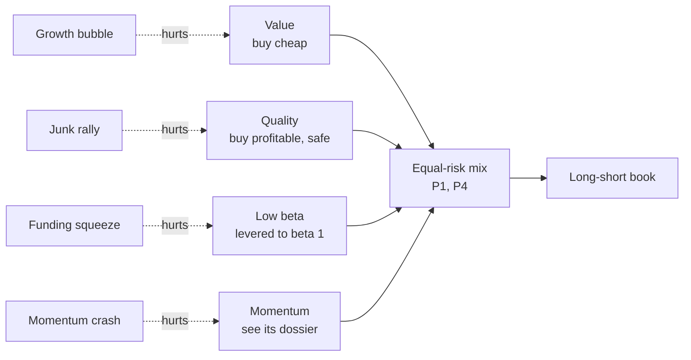
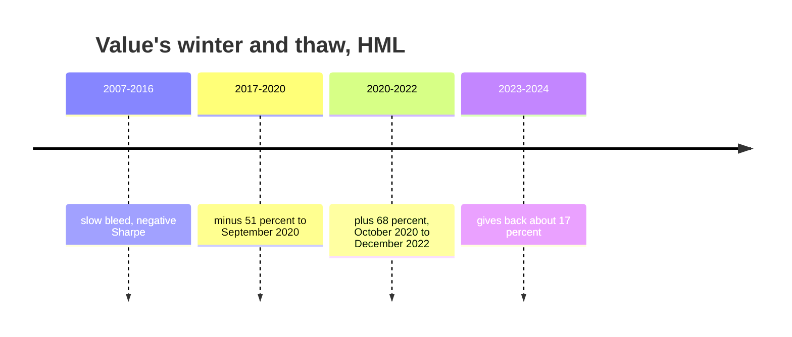

# Value, quality and low volatility

> **TL;DR**
>
> - Three questions per stock: is it cheap (value), a good business (quality), boring (low beta or volatility)? Buy the yeses, short the noes.
> - They pay for different reasons (distress and extrapolation; underpriced profitability; leverage constraints) and are weakly correlated with each other and with momentum, so the combination carries the Sharpe.
> - Value's worst run on record: HML −58% from December 2006 to September 2020, then +68% to December 2022. Whether intangibles broke book value is still debated.
> - Long-run gross Sharpe: value 0.34, profitability 0.37, quality-minus-junk 0.48, betting-against-beta 0.70. Capacity is large; crowding and long drawdowns are the risks.

**Level:** Core · **Read time:** ~9 min · **Last verified:** 2026-11

| Field | Value |
|---|---|
| Family | risk premia / factors |
| Edge source | risk premium · behavioral (structural for low beta) |
| Holding period | 3–12 months |
| Counterparty: who pays and why they accept it | Extrapolators overpaying for glamour; investors shunning distress; lottery-seekers buying unprofitable "junk"; leverage-constrained or benchmarked managers buying high beta instead of borrowing |
| Universe & instruments | US and global large and mid caps; long-short, or long-only value, quality and minimum-volatility products |
| Data required | Point-in-time book, gross profit, earnings, leverage, accruals; 1–5 years of daily returns for betas and volatility |
| Core algorithms used | [D3 Signal transforms](../../03-algorithms/a-data-and-signals/signal-transforms.md) · [P1 Risk models](../../03-algorithms/d-portfolio-construction/risk-models.md) · [P3 Mean-variance optimization](../../03-algorithms/d-portfolio-construction/mean-variance-optimization.md) · [P4 Alternatives to MVO](../../03-algorithms/d-portfolio-construction/alternatives-to-mvo.md) |
| Infra intensity | No latency sensitivity; monthly batch |
| Capacity (rough $ range) | \$10B+ per long-short manager; long-only far larger `[Estimate]` (slow large-cap rebalancing; high capacity per Novy-Marx & Velikov 2016) |
| Typical Sharpe (gross vs net) | Gross academic long-short (our computation from French and AQR data): HML 0.34 and RMW 0.37 (1963–2026), QMJ 0.48 (1957–2026), BAB 0.70 (1930–2026); since 2010: HML −0.06, RMW 0.22, QMJ 0.25, BAB 0.76 `[Verified]`. Net of costs and fees, subtract roughly 0.1–0.3 `[Estimate]` |
| Turnover | 30–80% a year for value and quality; more for beta sorts `[Estimate]` |
| Main risks / failure modes | Growth bubbles, junk rallies, rate shocks for low-vol, funding squeezes for levered low beta |
| Crowding risk | High, especially in long-only quality and minimum-volatility products |
| Firm types that run it | Systematic asset managers, style-premia funds, smart-beta index providers |
| Lab | — |

## Intuition (the story in plain English)

A disciplined fundamental investor buys cheap, good, unexciting companies. These three styles do the same mechanically across 3,000 stocks. Each alone has decade-long losing streaks; together they hedge one another, because cheap stocks are often low quality and quality stocks are rarely cheap.

## Economic rationale: why should this make money at all?

| Style | Risk story | Behavioral or structural story |
|---|---|---|
| [Value](../../09-reference/glossary.md#value-factor) | Cheap firms are distressed and do worst in bad times | Investors extrapolate growth and overpay for glamour |
| [Quality](../../09-reference/glossary.md#quality-factor) / profitability | Weak: profitable firms are less distressed (Novy-Marx 2013) `[Verified]` | Quality is only modestly priced, and analysts err systematically on it (Asness, Frazzini & Pedersen 2019) `[Verified]` |
| [Low beta](../../09-reference/glossary.md#betting-against-beta-bab) and low volatility | High-beta stocks pay off in good times | Leverage-constrained investors buy high beta instead of borrowing (Frazzini & Pedersen 2014) `[Verified]`; benchmarked managers avoid low-beta stocks (Baker, Bradley & Wurgler 2011) `[Verified]` |

## The trade, step by step

1. **Value**: book-to-market at the current price, plus earnings and cash-flow yields.
2. **Quality**: gross profits to assets, ROE, low accruals, low leverage, stable earnings.
3. **Low beta**: betas from daily returns, shrunk toward 1.
4. Rank within sector ([D3](../../03-algorithms/a-data-and-signals/signal-transforms.md)); combine scores or run sleeves.
5. Size sleeves to equal risk with a factor covariance ([P1](../../03-algorithms/d-portfolio-construction/risk-models.md), [P4](../../03-algorithms/d-portfolio-construction/alternatives-to-mvo.md)), or optimize ([P3](../../03-algorithms/d-portfolio-construction/mean-variance-optimization.md)).
6. For betting against beta, scale each leg to beta 1.

## Worked example with numbers

Illustrative betting-against-beta (BAB) leg sizing. Low-beta portfolio β = 0.7, high-beta β = 1.4, market premium 6%.

| Step | Calculation | Result |
|---|---|---|
| Long low-beta, scaled to β = 1 | \$1 / 0.7 | \$1.43 |
| Short high-beta, scaled to β = 1 | \$1 / 1.4 | \$0.71 |
| CAPM excess returns | 0.7 × 6% and 1.4 × 6% | 4.2% and 8.4% |
| BAB return if CAPM holds | 1.43 × 4.2 − 0.71 × 8.4 | **≈ 0%** |
| "Flat" market line: low-beta earns 6%, high-beta 7% | 1.43 × 6 − 0.71 × 7 | **+3.6%** |
| Funding spread on \$0.71 net long at 0.5% | 0.71 × 0.5 | −0.36% |

The trade earns exactly the flatness of the security market line, which Frazzini & Pedersen attribute to leverage-constrained buyers of high beta.

## Signals and algorithms under the hood

```python
import numpy as np
import pandas as pd

def defensive_value_scores(f, sector):
    """f: point-in-time DataFrame per stock. Returns sector-relative ranks in [-0.5, 0.5]."""
    raw = pd.DataFrame({
        "value":   f.book_equity / f.mcap_today,             # current price, not lagged
        "quality": f.gross_profit / f.total_assets,          # Novy-Marx (2013)
        "lowbeta": -(0.6 * f.beta_ts + 0.4 * 1.0),           # shrunk beta, sign flipped
    })
    return raw.groupby(sector).rank(pct=True) - 0.5          # D3: within-sector ranks

def bab_weights(beta, n_tail=0.3):
    """Long low-beta, short high-beta; each leg scaled to beta 1 (Frazzini-Pedersen)."""
    z = beta.rank(pct=True)
    lo, hi = z <= n_tail, z >= 1 - n_tail
    w_lo = pd.Series(np.where(lo, 1.0, 0.0), beta.index); w_lo /= w_lo.sum()
    w_hi = pd.Series(np.where(hi, 1.0, 0.0), beta.index); w_hi /= w_hi.sum()
    beta_lo, beta_hi = (w_lo * beta).sum(), (w_hi * beta).sum()
    return w_lo / beta_lo - w_hi / beta_hi                   # net long when beta_lo < beta_hi
```

Simplified: Frazzini & Pedersen rank-weight within legs; this sketch equal-weights the tails.

## Implementation choices that matter

- **Which value.** Plain B/M penalizes firms whose assets are expensed R&D and brands; capitalizing intangibles changes what looks cheap (Eisfeldt, Kim & Papanikolaou 2022) `[Reported]`.
- **Which quality.** One ratio (gross profitability) or a composite of profitability, growth and safety (QMJ); composites are steadier `[Lore]`.
- **Sector control.** Unconstrained low-vol loads on utilities and staples, a bond-rate bet `[Lore]`.
- **BAB construction.** Its results rest on choices that effectively equal-weight, putting \$1.05 per \$1 into the smallest 1% of stocks (Novy-Marx & Velikov 2022) `[Verified]`.
- **Integrate or stack.** One composite avoids buying a stock in one sleeve while selling it in another `[Lore]`.

## P&L decomposition

Illustrative: \$1B NAV, \$1B long and \$1B short, equal-risk value, quality and low-beta sleeves, 6% volatility.

| Line | % of NAV a year |
|---|---|
| Value premium | +1.0 |
| Quality premium | +1.2 |
| Low-beta premium (after leverage) | +1.6 |
| Trading costs (60% turnover × \$2B × 10 bps) | −0.12 |
| Borrow and financing | −0.5 |
| **Net before fees** | **+3.2 (Sharpe ≈ 0.53)** |

## Evidence

Our computation, gross annualized Sharpe ratios (HML, RMW from French; QMJ, BAB from AQR) `[Verified]`:

| Factor | Full history | 1963–1991 | 1992–2026 | 2010–2026 |
|---|---|---|---|---|
| HML value | 0.34 (1926–) | 0.52 | 0.23 | −0.06 |
| RMW profitability | 0.37 (1963–) | 0.46 | 0.35 | 0.22 |
| QMJ quality | 0.48 (1957–) | 0.68 | 0.40 | 0.25 |
| BAB low beta | 0.70 (1930–) | 1.06 | 0.67 | 0.76 |

Correlations of monthly returns, 1963–2026: HML with momentum −0.19, HML with RMW 0.10, HML with BAB 0.31, RMW with QMJ 0.70 `[Verified]`. Asness, Moskowitz & Pedersen (2013) find value and momentum negatively correlated across asset classes `[Reported]`.

**The value debate.** Arnott, Harvey, Kalesnik & Linnainmaa (2021) measure a 55% HML drawdown to mid-2020, attribute all of it to value getting cheaper relative to growth rather than to failing fundamentals, and find intangibles-adjusted value did far better `[Verified]`. Lev & Srivastava (2022) argue book value mis-measures intangible-heavy firms `[Reported]`; Israel, Laursen & Richardson (2021) argue systematic value is not dead `[Reported]`. The other side: a dying premium would also show widening spreads and a negative Sharpe since 2007.

## Capacity, crowding and decay

Slow large-cap trading makes these the highest-capacity equity factors. Decay is uneven: value faded after 2007, profitability less, BAB held up in AQR's data. Crowding shows in valuation spreads (see [factor timing and crowding](factor-timing-crowding-and-quant-winters.md)).

## How it fails

- **Growth bubbles.** HML fell 51% from January 2017 to September 2020, including −13.8% in March 2020 alone (our computation) `[Verified]`.
- **Junk rallies.** QMJ lost 36% from October 2023 to June 2026, including −11% in 2025, as unprofitable and speculative stocks surged `[Verified]` (AQR data, our computation).
- **Beta manias and funding squeezes.** BAB fell 55% from May 1998 to February 2000, the tech bubble `[Verified]`; Frazzini & Pedersen predict BAB does badly when funding tightens `[Verified]`.

## Textbook vs how it's done today

| Textbook | Practice today |
|---|---|
| HML on December prices (Fama & French 1993) `[Verified]` | Current prices, several value measures, intangibles adjustments `[Lore]` |
| One profitability ratio (Novy-Marx 2013) `[Verified]` | Multi-metric quality composites `[Lore]` |
| Rank-weighted BAB with small caps (Frazzini & Pedersen 2014) `[Verified]` | Sector-constrained low-beta inside an optimizer `[Lore]` |

## Variants and neighbours

[Momentum](momentum.md) (the natural hedge for value), [fundamental quant signals](../d-mid-frequency-alpha/fundamental-quant-signals.md) (the same ratios as alpha), minimum-variance portfolios ([P4](../../03-algorithms/d-portfolio-construction/alternatives-to-mvo.md)), and cross-asset value and [carry](../g-futures-and-macro-context/carry-and-cross-asset-risk-premia.md).

## Diagram





## How practitioners talk about it

- "Value is a trade on growth's multiple." → Returns depend on the valuation spread.
- "Our value is intangibles-adjusted." → Book equity includes capitalized R&D and SG&A.
- "That's a junk rally." → Low-quality, high-beta stocks are outperforming.
- "Low-vol is a bond proxy." → Defensive stocks trade on interest rates.
- "BAB is mostly a small-cap trade." → The Novy-Marx & Velikov critique.
- "Quality pays for value's tail." → Quality hedges value's distress risk.

## Myths vs reality

| Myth | Reality |
|---|---|
| Value is dead | Down 58% (Dec 2006–Sep 2020), then up 68% to 2022; contested, not settled |
| Low risk means low return | Low-beta stocks have had similar returns to high-beta ones, hence BAB |
| Quality is always defensive | QMJ fell 36% in 2023–2026 |

## Questions you could ask a quant about this

**Basic**

- Do you adjust book value for intangibles?
- Is your low-vol sleeve sector-constrained?

**Informed**

- How do you weight value against momentum, and was that changed after 2020?
- How much of your BAB return survives value weighting?

**Sharp**

- What was your quality sleeve's drawdown in 2025 versus QMJ? 🔒
- Do you integrate scores or stack sleeves, and what turnover does that save? 🔒

## Go deeper

<details markdown="1">
<summary>Math: the betting-against-beta factor</summary>

Frazzini & Pedersen shrink time-series betas toward 1 `[Reported]`:

$$
\hat\beta_i = 0.6\, \hat\beta_i^{TS} + 0.4 \times 1 .
$$

With low- and high-beta portfolio returns $r_L, r_H$ and betas $\beta_L, \beta_H$:

$$
r_{BAB} = \frac{r_L - r_f}{\beta_L} - \frac{r_H - r_f}{\beta_H} .
$$

The factor has beta zero by construction. If the security market line has intercept $\gamma_0$ above $r_f$ and slope $\gamma_1$, then

$$
\mathbb{E}[r_{BAB}] = \gamma_0 \left(\frac{1}{\beta_L} - \frac{1}{\beta_H}\right) > 0 ,
$$

which is zero under the CAPM ($\gamma_0 = 0$).

</details>

## Related pages

- [Factor investing fundamentals](factor-investing-fundamentals.md)
- [Momentum](momentum.md)
- [Factor timing, crowding and quant winters](factor-timing-crowding-and-quant-winters.md)
- [Alternatives to MVO (P4)](../../03-algorithms/d-portfolio-construction/alternatives-to-mvo.md)
- [Fundamental quant signals](../d-mid-frequency-alpha/fundamental-quant-signals.md)

## Sources

- [Reported] Fama, E. F. & French, K. R. (1992). "The Cross-Section of Expected Stock Returns." *Journal of Finance* 47(2), 427–465. <https://doi.org/10.1111/j.1540-6261.1992.tb04398.x> (accessed 2026-11)
- [Verified] Novy-Marx, R. (2013). "The Other Side of Value: The Gross Profitability Premium." *Journal of Financial Economics* 108(1), 1–28. <https://doi.org/10.1016/j.jfineco.2013.01.003> (accessed 2026-11)
- [Verified] Asness, C. S., Frazzini, A. & Pedersen, L. H. (2019). "Quality Minus Junk." *Review of Accounting Studies* 24(1), 34–112. <https://doi.org/10.1007/s11142-018-9470-2> (accessed 2026-11)
- [Verified] Frazzini, A. & Pedersen, L. H. (2014). "Betting Against Beta." *Journal of Financial Economics* 111(1), 1–25. <https://doi.org/10.1016/j.jfineco.2013.10.005> (accessed 2026-11)
- [Verified] Novy-Marx, R. & Velikov, M. (2022). "Betting Against Betting Against Beta." *Journal of Financial Economics* 143(1), 80–106. <https://doi.org/10.1016/j.jfineco.2021.05.023> (accessed 2026-11)
- [Verified] Baker, M., Bradley, B. & Wurgler, J. (2011). "Benchmarks as Limits to Arbitrage: Understanding the Low-Volatility Anomaly." *Financial Analysts Journal* 67(1), 40–54. <https://doi.org/10.2469/faj.v67.n1.4> (accessed 2026-11)
- [Verified] Ang, A., Hodrick, R. J., Xing, Y. & Zhang, X. (2006). "The Cross-Section of Volatility and Expected Returns." *Journal of Finance* 61(1), 259–299. <https://doi.org/10.1111/j.1540-6261.2006.00836.x> (accessed 2026-11)
- [Reported] Asness, C. S., Moskowitz, T. J. & Pedersen, L. H. (2013). "Value and Momentum Everywhere." *Journal of Finance* 68(3), 929–985. <https://doi.org/10.1111/jofi.12021> (accessed 2026-11)
- [Verified] Arnott, R. D., Harvey, C. R., Kalesnik, V. & Linnainmaa, J. T. (2021). "Reports of Value's Death May Be Greatly Exaggerated." *Financial Analysts Journal* 77(1), 44–67. <https://doi.org/10.1080/0015198X.2020.1842704> (accessed 2026-11)
- [Reported] Eisfeldt, A. L., Kim, E. T. & Papanikolaou, D. (2022). "Intangible Value." *Critical Finance Review* 11(2), 299–332. <https://doi.org/10.1561/104.00000113> (accessed 2026-11)
- [Reported] Lev, B. & Srivastava, A. (2022). "Explaining the Recent Failure of Value Investing." *Critical Finance Review* 11(2), 333–360. <https://doi.org/10.1561/104.00000115> (accessed 2026-11)
- [Reported] Israel, R., Laursen, K. & Richardson, S. (2021). "Is (Systematic) Value Investing Dead?" *Journal of Portfolio Management* 47(2), 38–62. <https://doi.org/10.3905/jpm.2020.1.194> (accessed 2026-11)
- [Verified] Novy-Marx, R. & Velikov, M. (2016). "A Taxonomy of Anomalies and Their Trading Costs." *Review of Financial Studies* 29(1), 104–147. <https://doi.org/10.1093/rfs/hhv063> (accessed 2026-11)
- [Verified] French, K. R. "Data Library: Fama/French 3 and 5 factors, momentum," monthly through 2026-09 (statistics on this page are our computations). <https://mba.tuck.dartmouth.edu/pages/faculty/ken.french/data_library.html> (accessed 2026-11)
- [Verified] AQR Capital Management. "Datasets: Betting Against Beta: Equity Factors, Monthly" and "Quality Minus Junk: Factors, Monthly," US series through 2026-08 (statistics are our computations). <https://www.aqr.com/Insights/Datasets> (accessed 2026-11)
