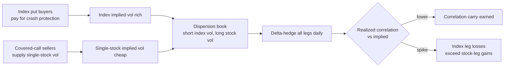
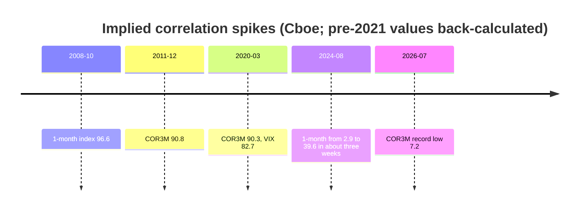

# Dispersion and correlation trading

> **TL;DR**
>
> - Index variance is roughly average stock variance times average correlation. Selling index volatility and buying constituent volatility is therefore a bet that stocks will move together less than options imply: short [implied correlation](../../09-reference/glossary.md#implied-correlation).
> - Implied correlation has on average exceeded realized: 39.5% versus 32.5% for the S&P 500 in 1996–2012, with the gap shrinking after 2001 `[Verified]`. Driessen, Maenhout & Vilkov (2009) show the risk is priced but hard to harvest after frictions `[Verified]`.
> - It is short a crisis: Cboe's 3-month implied correlation index (COR3M) read 90 on 2020-03-16 and hit a record low of 7.2 on 2026-07-10 `[Verified]`.
> - In 2024–2026 the trade was crowded and very profitable; some funds have flipped to "reverse dispersion" `[Reported]`.

**Level:** Deep dive · **Read time:** ~7 min · **Last verified:** 2026-11

| Field | Value |
|---|---|
| Family | vol & derivatives |
| Edge source | risk premium · structural |
| Holding period | weeks to months (1- to 3-month options or variance swaps) |
| Counterparty: who pays and why they accept it | Buyers of index puts (pensions, insurers, hedgers) pay up because index protection pays exactly when diversification fails; covered-call sellers supply single-stock vol cheaply for income. |
| Universe & instruments | S&P 500 or Nasdaq-100 options and variance swaps versus options on the top 30–50 constituents; OTC correlation swaps |
| Data required | index and single-stock vol surfaces, index weights, realized correlations, earnings dates, dividends |
| Core algorithms used | [M8 Options pricing and vol surfaces](../../03-algorithms/f-market-making-and-hft-algorithms/options-pricing-and-vol-surfaces-for-mm.md) · [M7 Hedging algorithms](../../03-algorithms/f-market-making-and-hft-algorithms/hedging-algorithms.md) · [P2 Covariance estimation and shrinkage](../../03-algorithms/d-portfolio-construction/covariance-estimation-and-shrinkage.md) · [M9 Algorithmic risk controls](../../03-algorithms/f-market-making-and-hft-algorithms/algorithmic-risk-controls.md) |
| Infra intensity | moderate: daily surface fits for 50+ names, daily delta hedges; not latency-sensitive |
| Capacity (rough $ range) | a few $M of index vega per firm `[Estimate]` (single-stock option bid-ask on 30–50 legs per roll caps size) |
| Typical Sharpe (gross vs net) | academic: high pre-friction alpha, not exploitable after realistic frictions (DMV 2009) `[Verified]`; practitioner: net 0.3–0.8 over a cycle, crisis losses included `[Lore]` |
| Turnover | rolled monthly or quarterly; legs delta-hedged daily |
| Main risks / failure modes | correlation spikes, index gaps, single-name illiquidity, residual vega, earnings |
| Crowding risk | high in 2024–2026 `[Reported]` |
| Firm types that run it | bank exotics desks, volatility hedge funds, options market makers |
| Lab | [Lab 06](https://github.com/FrankHuang94/quant_trading_claude/tree/main/labs/06-options-mm-delta-hedging) |

## Intuition (the story in plain English)

If 50 stocks each have 30% implied volatility and moved in lockstep, their index would also have 30% volatility. The index option market says 16%, because stocks diversify each other. That 16% implies how much they will co-move: an implied correlation of about 0.27. If you think realized co-movement will be lower, or that implied correlation is systematically too high, sell the index's volatility and buy the members'.

## Economic rationale: why should this make money at all?

Investors fear correlation spikes because diversification fails exactly when it is needed, so they overpay for index protection, the asset that hedges it. Driessen, Maenhout & Vilkov (2009) find correlation risk carries a large negative price and explains the cross-section of index and single-stock option returns `[Verified]`. Their later work finds single-stock variance risk premia mostly insignificant in 1996–2001 while index premia were large `[Verified]`. Covered-call writing adds single-stock vol supply `[Lore]`.

Outside the US, supply runs the other way: retail autocallables in Korea, Japan and Europe leave dealers long index vega, concentrated in long-dated Nikkei, HSCEI and Euro Stoxx vol `[Reported]`. Dealers selling that vol back cheapens index vol there `[Lore]`. Korean worst-of notes also leave dealers with correlation exposure `[Reported]`.

## The trade, step by step

1. Pick the index and the 30–50 names covering most of its variance.
2. Compute implied correlation; compare with a realized-correlation forecast ([P2](../../03-algorithms/d-portfolio-construction/covariance-estimation-and-shrinkage.md)).
3. Size legs (vega-neutral, theta-neutral or correlation-weighted).
4. Sell index straddles or variance; buy single-stock straddles or variance.
5. [Delta-hedge](../../09-reference/glossary.md#delta-hedging) every leg daily ([M7](../../03-algorithms/f-market-making-and-hft-algorithms/hedging-algorithms.md)).
6. Cap correlation vega and buy tail protection ([M9](../../03-algorithms/f-market-making-and-hft-algorithms/algorithmic-risk-controls.md)); roll or close at expiry.

## Worked example with numbers

Illustrative: 50 equal-weight stocks (2% each), each at 30% implied; index at 16%. Implied correlation = (0.0256 − 0.0018) / 0.0882 = 0.27. Short an index variance swap with $1M vega (variance notional $1M / (2 × 16) = $31,250 per vol² point); long 50 stock variance swaps with $20,000 vega each, or $333 per vol² point.

| Realized outcome | Index vol | Index leg | Stock legs | Net |
|---|---|---|---|---|
| Calm: stocks 30%, correlation 0.20 | 13.9% | +$1.93M | $0 | **+$1.93M** |
| Vol up: stocks 35%, correlation 0.27 | 18.7% | −$2.89M | +$5.42M | **+$2.52M** |
| Crash: stocks 45%, correlation 0.70 | 37.8% | −$36.7M | +$18.75M | **−$17.9M** |

Calm row: 31,250 × (16² − 13.9²) = $1.93M. Equal vega leaves the book net long volatility (row 2) yet still loses heavily when correlation jumps (row 3). Variance-swap caps, often 2.5× strike `[Lore]`, limit the crash row.

## Signals and algorithms under the hood

Surfaces and Greeks come from [M8](../../03-algorithms/f-market-making-and-hft-algorithms/options-pricing-and-vol-surfaces-for-mm.md); [Lab 06](https://github.com/FrankHuang94/quant_trading_claude/tree/main/labs/06-options-mm-delta-hedging) shows delta-hedging P&L for one leg; this book runs 51 legs.

```python
# Dispersion signal and leg sizing (simplified). Vols are annualized decimals.
def implied_correlation(sig_idx, w, sig):
    own = np.sum(w**2 * sig**2)                         # diagonal part of index variance
    cross = np.sum(w * sig) ** 2 - own                  # sum over i != j of w_i w_j s_i s_j
    return (sig_idx**2 - own) / cross

def dispersion_trade(sig_idx, w, sig, cov_fcst, index_vega=1_000_000, weighting="corr"):
    rho_imp = implied_correlation(sig_idx, w, sig)
    vol_f = np.sqrt(np.diag(cov_fcst))                  # P2: shrunk covariance forecast
    rho_fcst = implied_correlation(np.sqrt(w @ cov_fcst @ w), w, vol_f)
    if rho_imp - rho_fcst < 0.05:                       # demand a 5-point correlation cushion
        return None
    # 'vega': equal vega, net long vol. 'corr': scale by sqrt(rho_imp) so a parallel
    # vol move nets out and the book is closer to pure correlation.
    scale = 1.0 if weighting == "vega" else np.sqrt(rho_imp)
    stock_vega = scale * index_vega * (w * sig) / np.sum(w * sig)
    return {"index": -index_vega, "stocks": stock_vega}  # delta-hedge every leg daily (M7)
```

## Implementation choices that matter

- **Instrument:** options need delta hedging and their P&L depends on the path; variance swaps are cleaner but capped; correlation swaps are OTC.
- **Weighting:** equal vega is net long vol; correlation weighting (stock vega ≈ √ρ × index vega) isolates correlation.
- **Tenor:** the implied-realized gap grows with maturity `[Verified]`.
- **Timing:** earnings seasons raise single-stock dispersion; tail hedges cost carry.

## P&L decomposition

Illustrative: $1M index vega, rolled quarterly, $M per year.

| Line | $M/yr |
|---|---|
| Correlation carry (about 5 points implied over realized) | +5.5 |
| Single-stock variance premium paid on long legs | −1.5 |
| Bid-ask on 51 legs, four rolls | −1.6 |
| Tail hedges | −0.8 |
| Correlation-spike losses, capped and amortized | −1.0 |
| **Net** | **+0.6** |

## Evidence

- **DMV (2009, *JF*):** S&P 100 index options versus options on all members; correlation risk is priced, but the premium "cannot be exploited with realistic trading frictions" `[Verified]`.
- **DMV (2013 working paper):** S&P 500, 30-day implied minus realized correlation was 12.5 points in 1996–2001, 3.2 in 2002–2007 and 4.5 in 2008–2012 `[Verified]`.
- **Public gauges:** COR3M (launched July 2021; top 50 S&P 500 stocks) `[Verified]` closed at 11.8 on 2026-11-11, against a 2006–2026 median of 41 `[Verified]`. The Cboe S&P 500 Dispersion Index (DSPX, launched September 2023) read 38.1 `[Verified]`.
- **2026:** a bank trader called dispersion returns "phenomenal" `[Reported]`.

## Capacity, crowding and decay

The shrinking gap after 2001 fits more arbitrage capital. Crowding showed in 2024: COR3M fell to its lowest since at least 2006, then jumped nearly nine points in the week of August 5 `[Reported]`. In 2026 it set new lows, and some managers called the trade crowded and bought reverse dispersion `[Reported]`.

## How it fails

- **Mechanism:** in a selloff stocks move together, index gamma losses explode, single-name options gap and widen, and margin calls force exits.
- **Episodes (Cboe data; values before the 2021 launch are back-calculated):** 1-month implied correlation 96.6 on 2008-10-24; COR3M 90.8 on 2011-12-08 and 90.3 on 2020-03-16, when VIX closed at 82.7; 1-month correlation from 2.9 (2024-07-12) to 39.6 (2024-08-05) `[Verified]`.

## Textbook vs how it's done today

- **Textbook:** trade correlation directly with correlation swaps. **Practice:** most books use options or variance swaps and carry residual vol exposure `[Lore]`.
- **Textbook:** a correlation premium is free alpha. **Practice:** frictions absorb much of it and losses cluster in crises (DMV 2009) `[Verified]`.

## Variants and neighbours

Reverse dispersion; sector dispersion (sector ETF versus members); worst-of exotics; the single-asset [volatility risk premium](volatility-risk-premium-and-vol-arb.md); the [options market making](../a-liquidity-provision/options-market-making.md) books that warehouse both legs.

## Diagram





## How practitioners talk about it

- "Implied corr is 12; we're barely paid to be short it." → The premium is thin.
- "We run it correlation-weighted, not vega-flat." → Pure correlation, not long vol.
- "Earnings season is when dispersion pays." → Single-name moves diverge.
- "The index leg is our tail." → Losses come from short index gamma.
- "Reverse dispersion is cheap convexity here." → Buying correlation near record lows.

## Myths vs reality

- **Myth:** dispersion is market-neutral. **Reality:** short correlation is short crashes.
- **Myth:** low implied correlation means the trade is over. **Reality:** realized can be lower still, as in 2026.

## Questions you could ask a quant about this

- *Basic:* Do you trade dispersion with options or variance swaps?
- *Informed:* Vega-neutral or correlation-weighted, and why?
- *Informed:* How do you forecast realized correlation?
- *Sharp:* What did your book lose in the week of 2024-08-05?
- *Sharp:* 🔒 Your correlation vega limit and tail-hedge budget?

## Go deeper

<details markdown="1">
<summary>Math: implied correlation and dispersion P&L</summary>

Index variance with weights $w_i$, vols $\sigma_i$ and average correlation $\rho$:

$$
\sigma_I^2 = \sum_i w_i^2\sigma_i^2 + \rho \sum_{i \ne j} w_i w_j \sigma_i \sigma_j
\quad\Rightarrow\quad
\rho_{\text{imp}} = \frac{\sigma_I^2 - \sum_i w_i^2\sigma_i^2}{\sum_{i\ne j} w_i w_j \sigma_i\sigma_j}.
$$

If stocks realize their implied vols, short index variance with notional $N$ earns

$$
N\,(\rho_{\text{imp}} - \rho_{\text{real}}) \sum_{i\ne j} w_i w_j \sigma_i\sigma_j .
$$

For many names $\sigma_I \approx \bar\sigma\sqrt{\rho}$, so $\partial\sigma_I/\partial\bar\sigma \approx \sqrt{\rho}$: stock vega of $\sqrt{\rho}$ times index vega neutralizes parallel vol moves.

</details>

## Related pages

- [Volatility risk premium and vol arb](volatility-risk-premium-and-vol-arb.md)
- [Options market making](../a-liquidity-provision/options-market-making.md)
- [M8 Options pricing and vol surfaces for market making](../../03-algorithms/f-market-making-and-hft-algorithms/options-pricing-and-vol-surfaces-for-mm.md)
- [Walkthrough: an options market maker](../../03-algorithms/h-end-to-end-walkthroughs/walkthrough-options-market-maker.md)
- [ETF, futures and options linkages](../../01-market-structure/etf-futures-options-linkages.md)

## Sources

- [Verified] Driessen, J., Maenhout, P. J. & Vilkov, G. (2009). "The Price of Correlation Risk: Evidence from Equity Options." *Journal of Finance* 64(3), 1377–1406. <https://doi.org/10.1111/j.1540-6261.2009.01467.x> (accessed 2026-11)
- [Verified] Driessen, J., Maenhout, P. J. & Vilkov, G. (2013). "Option-Implied Correlations and the Price of Correlation Risk." Netspar Discussion Paper 07/2013-061. <https://www.netspar.nl/wp-content/uploads/061_Driessen.pdf> (accessed 2026-11)
- [Verified] Cboe Global Markets (2026). COR3M, COR1M, DSPX and VIX daily history files. <https://cdn.cboe.com/api/global/us_indices/daily_prices/COR3M_History.csv> (accessed 2026-11)
- [Verified] Cboe Global Markets (2021-07-01). "Cboe Announces Launch of New Cboe 3-Month Implied Correlation Index." <https://ir.cboe.com/news/news-details/2021/Cboe-Announces-Launch-of-New-Cboe-3-Month-Implied-Correlation-Index-07-01-2021/default.aspx> (accessed 2026-11)
- [Verified] S&P Dow Jones Indices (2023-09-25). "S&P Dow Jones Indices and Cboe Global Markets to Launch the Cboe S&P 500 Dispersion Index." <https://press.spglobal.com/2023-09-25-S-P-Dow-Jones-Indices-and-Cboe-Global-Markets-to-Launch-the-Cboe-S-P-500-Dispersion-Index> (accessed 2026-11)
- [Verified] Cboe Global Markets (2026). "Index Insights: September 2026." <https://www.cboe.com/insights/posts/index-insights-september-2026> (accessed 2026-11)
- [Reported] BNN Bloomberg (2024-08-13). "Wall Street's crowded options trade survives recent stock turmoil." <https://www.bnnbloomberg.ca/business/company-news/2024/08/13/wall-streets-crowded-options-trade-survives-recent-stock-turmoil/> (accessed 2026-11)
- [Reported] IFR (2026-06). "Please disperse! Traders drop lucrative derivatives bets amid record market churn." <https://www.ifre.com/topic-codes/2447772/please-disperse-traders-drop-lucrative-derivatives-bets-amid-record-market-churn> (accessed 2026-11)
- [Reported] Hedgeweek (2026-07-20). "Extreme market dispersion prompts hedge funds to position for volatility reversal." <https://www.hedgeweek.com/extreme-market-dispersion-prompts-hedge-funds-to-position-for-volatility-reversal/> (accessed 2026-11)
- [Reported] Risk.net. "Autocalls hit peak vega, where hedging costs mount." <https://risk.net/node/7505201> (accessed 2026-11)
- [Reported] Risk.net. "Korea's 'worst-of' times are here to stay." <https://www.risk.net/ja/node/7958011> (accessed 2026-11)
