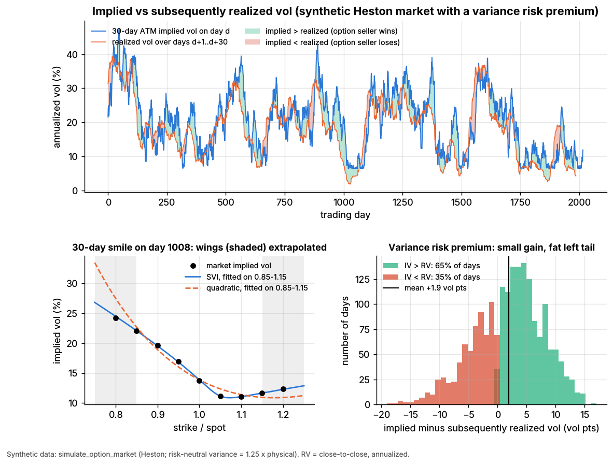
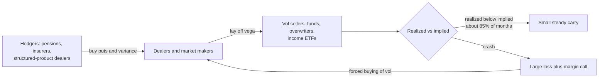
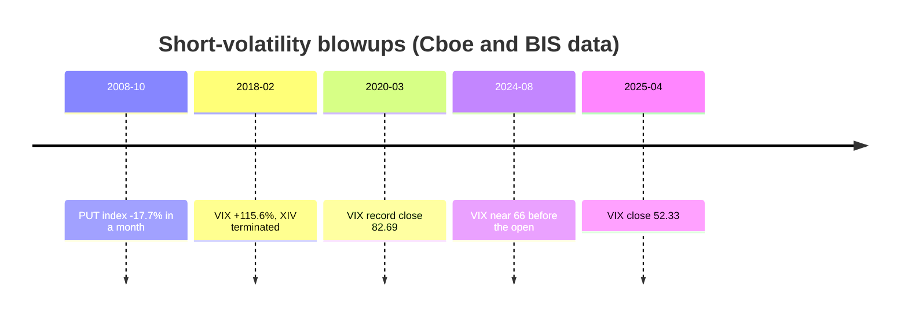

# Volatility risk premium and vol arb

> **TL;DR**
>
> - Index options usually price more volatility than arrives: in 1990–2026 the VIX averaged 19.4 against 15.3 realized over the next 21 trading days, and exceeded it on 86% of days `[Verified]` (our computation from Cboe data).
> - Sellers harvest it via short variance swaps, hedged straddles, put writing or short VIX futures: many small gains, rare huge losses (monthly skewness near −6 `[Verified]`, our computation).
> - It is crash insurance and pays like it: 2008, February 2018, March 2020, April 2025.
> - It persists because hedgers must buy protection and sellers face margin limits, but its CAPM alpha has shrunk toward zero since about 2010 `[Verified]`.

**Level:** Core · **Read time:** ~7 min · **Last verified:** 2026-11

| Field | Value |
|---|---|
| Family | vol & derivatives |
| Edge source | risk premium · structural |
| Holding period | one week to three months; delta hedged daily |
| Counterparty: who pays and why they accept it | Pensions, insurers, structured-product dealers and risk-targeting funds buy index puts and variance: protection pays when their losses and margin calls peak. Retail buys short-dated options as lottery tickets. |
| Universe & instruments | SPX, SPY, QQQ options; OTC variance swaps; VIX futures and options; single stocks (smaller premium) |
| Data required | vol surfaces, intraday realized vol, VIX futures curve, event calendar |
| Core algorithms used | [M8 Options pricing and vol surfaces](../../03-algorithms/f-market-making-and-hft-algorithms/options-pricing-and-vol-surfaces-for-mm.md) · [M7 Hedging algorithms](../../03-algorithms/f-market-making-and-hft-algorithms/hedging-algorithms.md) · [P7 Position sizing and risk budgeting](../../03-algorithms/d-portfolio-construction/position-sizing-and-risk-budgeting.md) |
| Infra intensity | low latency sensitivity; daily surface fits and hedges |
| Capacity (rough $ range) | large: option-overlay and defined-outcome ETFs exceed \$300B (mid-2026) `[Reported]`; \$0.1B–\$5B notional per manager before bid-ask and crowding bite `[Estimate]` |
| Typical Sharpe (gross vs net) | short one-month S&P 500 variance at the VIX, gross, 1990–2026: ~1.2 (1.35 with a 2.5× cap); capped, 1.6 before 2010 and 1.1 after `[Estimate]` (our computation); net of costs and tail hedges 0.3–0.8 `[Lore]` |
| Turnover | monthly roll; daily delta hedges |
| Main risks / failure modes | crashes, volatility spikes, margin calls, vanishing liquidity |
| Crowding risk | high: income ETFs, overwriters and VIX products sell the same risk |
| Firm types that run it | vol hedge funds and pods, bank volatility-premia indices, option-income ETFs; [options market makers](../a-liquidity-provision/options-market-making.md) warehouse the other side |
| Lab | [Lab 06](https://github.com/FrankHuang94/quant_trading_claude/tree/main/labs/06-options-mm-delta-hedging) |

## Intuition (the story in plain English)

Selling index options is selling insurance on the stock market. Most months premiums exceed claims; occasionally every claim arrives at once, in a crash. The [variance risk premium](../../09-reference/glossary.md#variance-risk-premium) is the loading for that catastrophe exposure.

## Economic rationale: why should this make money at all?

1. **Insurance demand.** End users are net long index options, especially puts; dealers absorbing that demand charge for it, lifting prices and skew (Gârleanu, Pedersen & Poteshman 2009) `[Verified]`.
2. **Variance hedges the market.** It spikes when stocks fall, so buyers accept a negative return; market beta explains only a small part (Carr & Wu 2009) `[Verified]`.
3. **Limits to arbitrage.** Selling needs margin that rises in crises. Dew-Becker & Giglio (2025) argue the premium mainly reflected intermediary frictions: options synthesized from stock show no negative alpha in a century of data `[Verified]`.

## The trade, step by step

1. Measure implied variance: the [variance swap](../../09-reference/glossary.md#variance-swap) rate from the whole strip, as the VIX does ([M8](../../03-algorithms/f-market-making-and-hft-algorithms/options-pricing-and-vol-surfaces-for-mm.md)).
2. Forecast realized volatility to expiry (for example a HAR model).
3. Trade when implied² exceeds forecast² by a margin; stand aside when the VIX curve is inverted.
4. Size to a stress loss such as a VIX doubling ([P7](../../03-algorithms/d-portfolio-construction/position-sizing-and-risk-budgeting.md)).
5. Sell variance, straddles or puts and [delta-hedge](../../09-reference/glossary.md#delta-hedging) ([M7](../../03-algorithms/f-market-making-and-hft-algorithms/hedging-algorithms.md)); buy far tail protection; roll monthly.

## Worked example with numbers

*Illustrative.* Short a one-month S&P 500 variance swap: \$100,000 vega notional, strike 18. Variance notional = 100,000 / (2 × 18) = \$2,778 per variance point; P&L = 2,778 × (18² − realized²).

| Realized vol | Calculation | P&L |
|---|---|---|
| 14 (calm) | 2,778 × (324 − 196) | +\$356K |
| 30 (spike) | 2,778 × (324 − 900) | −\$1.60M |
| 45 (crash; a 2.5× cap, common in practice `[Lore]`, binds) | 2,778 × (324 − 2,025) | −\$4.73M |
| 80 (uncapped) | 2,778 × (324 − 6,400) | −\$16.9M |

One capped crash month erases 13 calm months.

## Signals and algorithms under the hood

Surfaces: [M8](../../03-algorithms/f-market-making-and-hft-algorithms/options-pricing-and-vol-surfaces-for-mm.md); hedging: [M7](../../03-algorithms/f-market-making-and-hft-algorithms/hedging-algorithms.md); sizing: [P7](../../03-algorithms/d-portfolio-construction/position-sizing-and-risk-budgeting.md); vol regimes: [F6](../../03-algorithms/b-forecasting-models/regime-detection.md).

```python
# Harvest the VRP with a delta-hedged short straddle (simplified; names follow Lab 06).
iv_atm = fit_smile(np.log(K / F), iv_mid, T, method="svi")(0.0)   # M8: fitted ATM vol (Lab 06 atm_quote_vols)
rv_fcst = har_forecast(rv_daily, rv_weekly, rv_monthly)          # realized-vol forecast to expiry
vrp = iv_atm**2 - rv_fcst**2                                     # signal in variance units
if vrp > min_vrp and vix < vix3m:                                # skip when the VIX curve is inverted
    n = stress_budget / stress_loss(vix_shock=2.0)               # P7: size to the crash, not to vol
    premium = straddle_price(F, K=F, T=T, vol=iv_atm + EDGE_VOL) # Lab 06 sells at fitted vol + 0.5 pts
    h = delta_hedge_pnl(spot_path, -straddle_delta_path, band=0.10)   # M7; per straddle share, x n x 100
# Before costs, P&L ~ dollar-gamma-weighted implied minus realized variance (Lab 06's "classic" check);
# gamma_sale = straddle gamma at the sale vol iv0 along the path, dt = years per hedge step.
ret2 = (np.diff(S) / S[:-1]) ** 2
classic = (0.5 * gamma_sale[:-1] * S[:-1]**2 * (iv0**2 * dt - ret2)).sum() * n * 100
```



*Lab 06, synthetic data with a planted premium. Notice that implied usually sits above realized, but the red overshoots are large: the histogram has a fat left tail.*

Synthetic lab results: mean 30-day ATM implied vol 20.3% against 18.4% subsequently realized (+1.9 vol points), implied above realized on 65% of days; the variance-swap rate was 1.26× realized variance (1.25 planted).

## Implementation choices that matter

- **Instrument.** Variance swaps are clean but OTC and capped; straddle P&L is path-dependent (Lab 06). Unhedged put writing is mostly equity beta: the Cboe PUT index's daily beta to the S&P 500 was 0.63 in 2007–2026 `[Verified]` (our computation).
- **VIX futures.** The VIX sat below the 3-month VIX on 92% of days in 2009–2026 `[Verified]` (our computation), so shorts usually earn roll; the basis predicts futures returns, not spot VIX (Simon & Campasano 2014) `[Verified]`.
- **Tenor.** Investors pay mostly to hedge near-term realized variance; forward variance earns little (Dew-Becker et al. 2017) `[Verified]`.

## P&L decomposition

*Per year, \$100,000 monthly vega notional, VIX as strike, 2.5× cap; gross lines from 1990–2026 data (our computation), costs illustrative* `[Estimate]`.

| Line | \$M per year |
|---|---|
| Carry in months where implied beat realized (85%) | +4.84 |
| Losses in months where realized beat implied | −1.51 |
| Bid-ask, 12 rolls at 0.5 vol points | −0.60 |
| Tail hedges | −0.73 |
| Margin financing | −0.10 |
| **Net** | **+1.90** |

The worst month, struck 2008-09-04, lost \$5.2M: more than two years of net carry.

## Evidence

- **Carr & Wu (2009):** 1996–2003; strongly negative for the S&P 500, S&P 100 and Dow, smaller for single stocks; unexplained by CAPM or Fama-French factors `[Verified]`.
- **Bollerslev, Tauchen & Zhou (2009):** the premium predicts quarterly stock returns after 1990 `[Verified]`.
- **Coval & Shumway (2001):** zero-beta ATM straddles lost ~3% a week `[Verified]`; **Bakshi & Kapadia (2003):** delta-hedged gains negative `[Verified]`.
- **Our computation:** VIX minus realized averaged 5.4, 3.4, 3.7 and 3.8 vol points in the 1990s, 2000s, 2010s and 2020–2026 `[Verified]`.
- **PUT index, 2010–2026:** 8.2% a year at 12.0% volatility against 12.0% at 17.2% for S&P 500 price returns (dividends excluded): return per unit of risk 0.69 vs 0.70 `[Verified]` (our computation).

## Capacity, crowding and decay

Dew-Becker & Giglio (2025) find a break around 2010: traded-option CAPM alphas converge to zero and dealers' net SPX gamma moves from negative to zero or positive `[Verified]`. In 2018 about \$4B of inverse and leveraged VIX products had to buy into a spike `[Verified]` (BIS). Whether systematic selling suppresses realized volatility is contested ([linkages](../../01-market-structure/etf-futures-options-linkages.md)).

## How it fails

Losses, wider quotes and margin calls coincide.

- **2008-10:** the PUT index fell 17.7% in a month `[Verified]` (our computation).
- **2018-02-05:** VIX +115.6% to 37.32; XIV fell 96% and was terminated `[Verified]` ([failure gallery](../h-cross-cutting/strategy-failure-gallery.md)).
- **2020-03-16:** record VIX close 82.69; a swap struck 2020-02-10 at 15.0 realized 50.9 `[Verified]` (our computation).
- **2024-08-05:** VIX near 66 before the open `[Verified]` (BIS). **2025-04-08:** close of 52.33 `[Verified]` (Cboe).

## Textbook vs how it's done today

- **Textbook:** a free insurance premium. **Practice:** implied still beats realized (85% of days in 2020–2026), but the remainder is largely pay for crash beta (Dew-Becker & Giglio 2025) `[Verified]`.
- **Textbook:** a delta-hedged straddle isolates volatility. **Practice:** P&L is path-dependent (Lab 06).

## Variants and neighbours

[Volatility arbitrage](../../09-reference/glossary.md#volatility-arbitrage) is the relative-value cousin: sell rich implied against a realized forecast, steep skew against ATM, or a rich expiry against a cheap one, each delta-hedged. Also: the mirror image, long-vol [gamma scalping](../../09-reference/glossary.md#gamma-scalping) and tail hedging; [dispersion](dispersion-and-correlation-trading.md); [carry](../g-futures-and-macro-context/carry-and-cross-asset-risk-premia.md).

## Diagram





## How practitioners talk about it

- "We're short the wings." → Sold out-of-the-money options.
- "Curve's inverted, we're flat." → Backwardation signals stress.
- "Size it to the gap, not the vol." → Assume a VIX doubling.
- "The carry pays for the tail." → Part of the premium funds hedges.
- "Realized is running hot." → The hedged short is losing on gamma.
- "Vol of vol is bid." → VIX options are expensive; a spike is feared.

## Myths vs reality

- **Myth:** option selling is income. **Reality:** it is insurance with fat-tailed claims.
- **Myth:** put writing beats the market risk-adjusted. **Reality:** not since 2010 (PUT index above).
- **Myth:** delta hedging removes crash risk. **Reality:** it removes direction, not gaps.

## Questions you could ask a quant about this

- *Basic:* Variance swaps, straddles or puts, and why?
- *Basic:* How do you forecast realized volatility?
- *Informed:* What stress do you size to, and how much carry goes to tail hedges?
- *Informed:* What did February 2018 and April 2025 cost you?
- *Sharp:* How do you separate premium from equity beta after 2010?
- *Sharp:* 🔒 Your vega limits and timing filters?

## Go deeper

<details markdown="1">
<summary>Math: variance swap replication and the premium</summary>

With $r = 0$, the fair variance strike is a static strip of out-of-the-money options (Demeterfi et al. 1999):

$$
K_{\text{var}} = \frac{2}{T}\left(\int_0^{F} \frac{P(K)}{K^2}\,dK + \int_{F}^{\infty} \frac{C(K)}{K^2}\,dK\right),
\qquad
\text{VRP}_t = \mathbb{E}^{\mathbb{Q}}_t[\sigma_R^2] - \mathbb{E}^{\mathbb{P}}_t[\sigma_R^2] > 0 .
$$

The $1/K^2$ weights favor low strikes, so negative skew lifts $K_{\text{var}}$ above ATM variance (Lab 06: 1.26 vs 1.19).

</details>

## Related pages

- [Options market making](../a-liquidity-provision/options-market-making.md)
- [Dispersion and correlation trading](dispersion-and-correlation-trading.md)
- [Strategy failure gallery](../h-cross-cutting/strategy-failure-gallery.md)
- [M8 Options pricing and vol surfaces](../../03-algorithms/f-market-making-and-hft-algorithms/options-pricing-and-vol-surfaces-for-mm.md)
- [P7 Position sizing and risk budgeting](../../03-algorithms/d-portfolio-construction/position-sizing-and-risk-budgeting.md)
- [ETF, futures and options linkages](../../01-market-structure/etf-futures-options-linkages.md)

## Sources

- [Verified] Carr, P. & Wu, L. (2009). "Variance Risk Premiums." *Review of Financial Studies* 22(3), 1311–1341. <https://doi.org/10.1093/rfs/hhn038> (accessed 2026-11)
- [Verified] Bollerslev, T., Tauchen, G. & Zhou, H. (2009). "Expected Stock Returns and Variance Risk Premia." *Review of Financial Studies* 22(11), 4463–4492. <https://doi.org/10.1093/rfs/hhp008> (accessed 2026-11)
- [Verified] Bakshi, G. & Kapadia, N. (2003). "Delta-Hedged Gains and the Negative Market Volatility Risk Premium." *Review of Financial Studies* 16(2), 527–566. <https://doi.org/10.1093/rfs/hhg002> (accessed 2026-11)
- [Verified] Coval, J. D. & Shumway, T. (2001). "Expected Option Returns." *Journal of Finance* 56(3), 983–1009. <https://doi.org/10.1111/0022-1082.00352> (accessed 2026-11)
- [Verified] Gârleanu, N., Pedersen, L. H. & Poteshman, A. M. (2009). "Demand-Based Option Pricing." *Review of Financial Studies* 22(10), 4259–4299. <https://doi.org/10.1093/rfs/hhp005> (accessed 2026-11)
- [Verified] Dew-Becker, I. & Giglio, S. (2025). "The Decline of the Variance Risk Premium: Evidence from Traded and Synthetic Options." Federal Reserve Bank of Chicago WP 2025-17. <https://doi.org/10.21033/wp-2025-17> (accessed 2026-11)
- [Verified] Dew-Becker, I., Giglio, S., Le, A. & Rodriguez, M. (2017). "The price of variance risk." *Journal of Financial Economics* 123(2), 225–250. <https://doi.org/10.1016/j.jfineco.2016.04.003> (accessed 2026-11)
- [Verified] Demeterfi, K., Derman, E., Kamal, M. & Zou, J. (1999). "A Guide to Volatility and Variance Swaps." *Journal of Derivatives* 6(4), 9–32. <https://doi.org/10.3905/jod.1999.319129> (accessed 2026-11)
- [Verified] Simon, D. P. & Campasano, J. (2014). "The VIX Futures Basis: Evidence and Trading Strategies." *Journal of Derivatives* 21(3), 54–69. <https://doi.org/10.3905/jod.2014.21.3.054> (accessed 2026-11)
- [Verified] Ungar, J. & Moran, M. T. (2009). "The Cash-secured PutWrite Strategy and Performance of Related Benchmark Indexes." *Journal of Alternative Investments* 11(4), 43–56. <https://doi.org/10.3905/jai.2009.11.4.043> (accessed 2026-11)
- [Verified] Cboe Global Markets. VIX, VIX3M, SPX and PUT daily history files (all statistics marked "our computation" are derived from these). <https://cdn.cboe.com/api/global/us_indices/daily_prices/VIX_History.csv> (accessed 2026-11)
- [Verified] Bank for International Settlements (2018-03-11). "The equity market turbulence of 5 February: the role of exchange-traded volatility products." *BIS Quarterly Review*, March 2018. <https://www.bis.org/publ/qtrpdf/r_qt1803t.htm> (accessed 2026-11)
- [Verified] Todorov, K. & Vilkov, G. (2024-10-29). "Anatomy of the VIX spike in August 2024." *BIS Bulletin* 95. <https://www.bis.org/publ/bisbull95.htm> (accessed 2026-11)
- [Reported] ETF Trends (2026). Options-overlay and structured-outcome ETF assets above \$300B in the first half of 2026. <https://www.etftrends.com/?p=650467> (accessed 2026-11)
