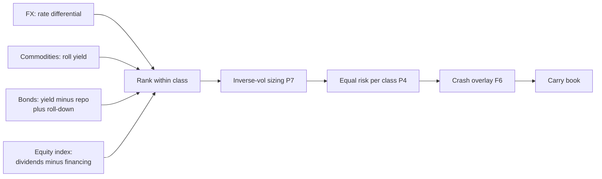
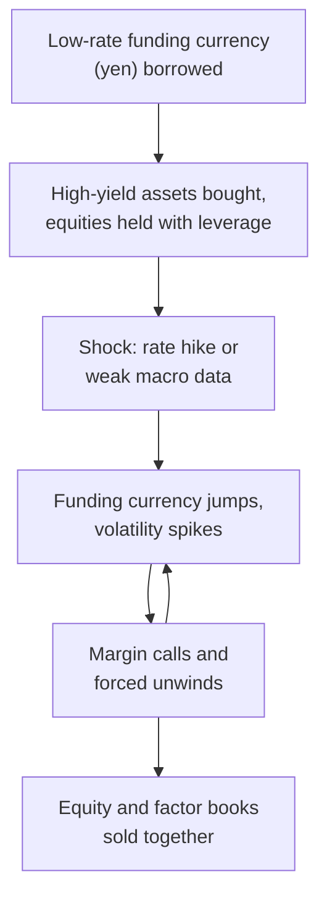

# Carry and cross-asset risk premia

> **TL;DR**
>
> - Carry is what a position earns if prices and curves do not move: rate differentials in FX, roll yield in commodities, yield plus roll-down in bonds, dividends minus financing in equity futures. One formula covers all: (spot − futures) / futures.
> - Long high-carry, short low-carry works in every asset class studied: gross Sharpe about 0.7 per class and 1.1 diversified, 1972–2012 (Koijen, Moskowitz, Pedersen & Vrugt).
> - It pays largely for crash risk: carry loses in every class at once in global recessions; AUD/JPY fell 46% in three months of 2008.
> - For a US equity quant, carry is a cross-asset hedge, a risk-on/risk-off regime input and a hidden correlation in multi-strategy books (the August 2024 yen unwind hit equities too).

**Level:** Core · **Read time:** ~9 min · **Last verified:** 2026-11

| Field | Value |
|---|---|
| Family | futures and macro / risk premia |
| Edge source | risk premium · structural |
| Holding period | 1–3 months (monthly rebalance) |
| Counterparty: who pays and why they accept it | Hedgers paying to offload price risk (producers selling futures, exporters hedging currency) and investors unwilling to hold crash risk; the carry trader sells insurance |
| Universe & instruments | 20–30 currency forwards, 20–30 commodity futures, 10–20 government bond futures, 10–20 equity index futures |
| Data required | Spot, forward and futures curves; deposit and OIS rates; yield curves; expected dividends; roll calendars |
| Core algorithms used | [P7 Position sizing and risk budgeting](../../03-algorithms/d-portfolio-construction/position-sizing-and-risk-budgeting.md) · [P4 Alternatives to MVO](../../03-algorithms/d-portfolio-construction/alternatives-to-mvo.md) · [P1 Risk models](../../03-algorithms/d-portfolio-construction/risk-models.md) · [F6 Regime detection](../../03-algorithms/b-forecasting-models/regime-detection.md) |
| Infra intensity | Low; daily batch plus futures-roll management |
| Capacity (rough $ range) | Tens of billions per diversified program `[Estimate]` (monthly trading in deep futures and FX markets; commodities and EM currencies bind first) |
| Typical Sharpe (gross vs net) | Academic backtest, gross, 1972–2012: within-class average 0.74, global carry factor 1.10 `[Verified]` (Koijen et al., working paper). Live multi-style fund holding carry: net 0.54 since 2013 (AQR Style Premia Alternative) `[Verified]` |
| Turnover | Monthly rebalancing plus futures rolls; a few times notional a year `[Estimate]` |
| Main risks / failure modes | Crashes in high-yielders, synchronized losses in recessions, funding squeezes, central-bank surprises |
| Crowding risk | High in FX carry: BIS estimates about ¥40 trillion ($250B) of yen-funded carry before August 2024 `[Verified]` |
| Firm types that run it | Macro funds, CTAs, style-premia managers, bank index desks, risk-parity managers |
| Lab | — |

## Intuition (the story in plain English)

A bond bought at par pays its coupon unless the price falls: that is [carry](../../09-reference/glossary.md#carry). Every futures contract embeds a similar "coupon" in its gap to spot. Carry strategies collect the fattest coupons, funded by shorting the thinnest, until the rare day when high-coupon assets all fall at once.

## Economic rationale: why should this make money at all?

- **Crash compensation.** High-yield currencies lose when global FX volatility jumps; a volatility factor explains over 90% of carry portfolios' cross-sectional returns (Menkhoff, Sarno, Schmeling & Schrimpf 2012) `[Verified]`. Brunnermeier, Nagel & Pedersen (2008) tie currency crashes to funding-liquidity unwinds `[Reported]`.
- **Hedging pressure.** Producers short futures and pay speculators to take the other side `[Lore]`; roll returns drive commodity futures returns (Erb & Harvey 2006; Gorton & Rouwenhorst 2006) `[Reported]`.
- **Recession risk.** The three worst global carry drawdowns (1972–75, 1980–82, 2008–09) coincide with global recessions (Koijen et al.) `[Verified]`.
- **Leverage aversion.** Investors under-own low-risk assets that need leverage (Asness, Frazzini & Pedersen 2012) `[Verified]`, the logic of [risk parity](../../09-reference/glossary.md#risk-parity).

## The trade, step by step

1. **Measure carry** per instrument as (spot − futures) / futures, annualized.
2. **Rank within each asset class**: long high carry, short low carry, weights proportional to rank.
3. **Scale** by inverse volatility ([P7](../../03-algorithms/d-portfolio-construction/position-sizing-and-risk-budgeting.md)).
4. **Combine** classes at equal risk ([P4](../../03-algorithms/d-portfolio-construction/alternatives-to-mvo.md)) with a cross-asset covariance ([P1](../../03-algorithms/d-portfolio-construction/risk-models.md)).
5. **Crash control**: cut gross when volatility regimes shift ([F6](../../03-algorithms/b-forecasting-models/regime-detection.md)).
6. **Execute** with forwards and futures; roll before expiry.

## Worked example with numbers

Illustrative inputs, annualized:

| Asset | Inputs | Carry |
|---|---|---|
| Long AUD vs JPY | AUD rate 4.35%, JPY rate 0.25% | 4.35 − 0.25 = **+4.1%** |
| Long crude, [backwardated](../../09-reference/glossary.md#backwardation) | front $80.00, next month $78.50 | (80.00 − 78.50) / 78.50 × 12 = **+22.9%** |
| Long 10-year bond future ([roll-down](../../09-reference/glossary.md#roll-down)) | yield 4.20%, repo 4.00%, 9-year yield 4.10%, duration 8 | (4.20 − 4.00) + 8 × 0.10 = **+1.0%** |
| Long S&P 500 future | dividend yield 1.3%, financing 4.0% | 1.3 − 4.0 = **−2.7%** |

The price of the AUD/JPY coupon: from 21 July to 27 October 2008 AUD/JPY fell 46% (our computation from Federal Reserve rates) `[Verified]`, about 11 years of carry in three months.

## Signals and algorithms under the hood

```python
import numpy as np
import pandas as pd

def carry(a):
    """Annualized carry: return if spot and curve stay unchanged, (S - F) / F style."""
    if a.cls == "fx":           # forward discount = interest differential (covered parity)
        return (a.spot - a.fwd_1m) / a.fwd_1m * 12
    if a.cls == "commodity":    # roll yield between the first two contracts
        return (a.f1 - a.f2) / a.f2 * 12 / a.months_between
    if a.cls == "bond":         # yield over financing plus roll-down along the curve
        return (a.y - a.repo) + a.dur * (a.y - a.y_shorter)
    if a.cls == "equity":       # expected dividend yield minus financing
        return (a.spot - a.fut) / a.fut * 12 / a.months_to_expiry

def carry_portfolio(assets, vol, target_vol=0.10):
    c = pd.Series({a.name: carry(a) for a in assets})
    cls = pd.Series({a.name: a.cls for a in assets})
    rank = c.groupby(cls).rank(pct=True)                    # rank within asset class only
    w = (rank - rank.groupby(cls).transform("mean")) / vol  # P7: demeaned, inverse-vol
    sleeve_vol = (w * vol).pow(2).groupby(cls).sum().pow(0.5)  # ignores correlations
    w = w / cls.map(sleeve_vol)                              # P4: equal risk per class
    return w * target_vol / np.sqrt(cls.nunique())           # if sleeves are uncorrelated
```

## Implementation choices that matter

- **Seasonality.** Compare natural gas and grain contracts a year apart so seasonality is not read as carry `[Lore]`.
- **G10 vs EM.** Emerging-market forwards add carry plus convertibility and jump risk `[Lore]`.
- **Slope vs level.** 10-year minus 2-year carry is a separate, duration-light strategy (Koijen et al.) `[Verified]`.
- **Other styles.** Carry aligns with value in equities and momentum in bonds and commodities (Koijen et al.) `[Verified]`, so combine with a covariance.
- **Crash hedges.** Out-of-the-money options on high-yielders cut the tail but eat much of the carry `[Lore]`.

## P&L decomposition

Illustrative: $1B NAV, four equal-risk sleeves, 10% volatility target.

| Line | % of NAV a year |
|---|---|
| FX carry | +1.6 |
| Commodity roll yield | +1.4 |
| Bond carry and roll-down | +1.6 |
| Equity index carry | +1.4 |
| Execution, rolls, forward spreads | −0.5 |
| Management fee | −1.0 |
| **Net (Sharpe ≈ 0.45)** | **+4.5** |

The average hides crash years of −15% or worse `[Estimate]`.

## Evidence

Koijen et al. (NBER working paper 19325, 2013), gross Sharpe by class `[Verified]`:

| Class | Carry Sharpe | Skewness |
|---|---|---|
| Global equity indices | 0.88 | 0.22 |
| 10-year government bonds | 0.52 | −0.43 |
| Commodities | 0.60 | −0.40 |
| Currencies | 0.68 | −0.68 |
| Global carry factor (all classes) | 1.10 | −0.02 |

The diversified factor's near-zero skew is a puzzle for pure crash-risk stories, as the authors note `[Verified]`. Lustig, Roussanov & Verdelhan (2011) find a common risk factor in currency carry `[Reported]`.

## Capacity, crowding and decay

FX carry crowds into one funding currency: in 2024 the yen, about ¥40 trillion by BIS estimate `[Verified]`. G10 carry earned little in the zero-rate decade after 2008 `[Lore]`.

## How it fails

- **2008.** AUD/JPY −46% from July to October `[Verified]`; Koijen et al. date the global carry drawdown to August 2008 – February 2009 `[Verified]`.
- **August 2024.** USD/JPY fell from 161.7 (10 July) to 144.0 (5 August); that day the Nikkei 225 fell 12.4% and the VIX closed at 38.6 (our computation, FRED) `[Verified]`. The BIS says leveraged unwinds in equities and currencies amplified the move `[Verified]`.

## Textbook vs how it's done today

| Textbook | Practice today |
|---|---|
| Currency carry only (Lustig et al. 2011) `[Reported]` | All classes, ranked within class, risk-balanced (Koijen et al.) `[Verified]` |
| Static risk parity (Asness et al. 2012) `[Verified]` | Volatility-targeted with regime overlays `[Lore]` |
| Standalone carry fund | One of four styles (value, momentum, carry, defensive) in multi-asset premia funds such as QSPIX `[Reported]` (prospectus) |

## Variants and neighbours

[Trend following](trend-following-and-ctas.md) (often paired with carry), the [volatility risk premium](../f-volatility-and-derivatives/volatility-risk-premium-and-vol-arb.md) (option carry), cross-asset [value](../e-risk-premia-and-factors/value-quality-low-vol.md), and risk parity (Bridgewater's All Weather, launched 1996) `[Verified]`.

**For an equity quant.** Index carry tracks dividend yield, so it overlaps value. FX carry and credit spreads feed [regime detection](../../03-algorithms/b-forecasting-models/regime-detection.md). Long yen or Treasuries can hedge equity crash risk. In multi-strategy platforms, carry, short-volatility and equity beta lose together in crises.

## Diagram





## How practitioners talk about it

- "Carry is short vol in disguise." → Steady income, crash exposure.
- "We're funded in yen." → Short a low-rate currency to finance longs.
- "Backwardated, so roll is fat." → Futures below spot pay the holder.
- "Roll-down on the 7–10 is the trade." → Buy the steepest part of the curve.
- "Equity carry is just value." → Index carry tracks dividend yield.
- "Carry and trend hedge each other." → Trend often profits in carry crashes `[Lore]`.

## Myths vs reality

| Myth | Reality |
|---|---|
| Carry is free yield | It is paid for crash risk: 46% in AUD/JPY in 2008 |
| Carry means currencies | It works in at least seven asset classes |
| Risk parity avoids leverage risk | It requires leverage on low-risk assets |

## Questions you could ask a quant about this

**Basic**

- How do you define carry in each asset class?
- Do you rank within class or across classes?

**Informed**

- How did your FX carry sleeve do on 5 August 2024?
- How correlated is carry with your short-vol and equity-beta books in a crisis?

**Sharp**

- What crash overlay do you run, and what does it cost in carry? 🔒
- How do you size carry against trend when they disagree? 🔒

## Go deeper

<details markdown="1">
<summary>Math: carry as (S − F)/F, and its four special cases</summary>

A collateralized futures position returns $(F_{t+1} - F_t)/F_t$; if spot stays at $S_t$ the futures converges to it, so

$$
C_t = \frac{S_t - F_t}{F_t}, \qquad \mathbb{E}_t[r_{t+1}] = C_t + \mathbb{E}_t\!\left[\frac{S_{t+1} - S_t}{F_t}\right].
$$

FX, covered parity $F_t = S_t (1 + r_t)/(1 + r_t^*)$, foreign rate $r^*$:

$$
C_t = \frac{r_t^* - r_t}{1 + r_t} \approx r_t^* - r_t .
$$

Equity index, dividend yield $\delta$: $C_t \approx \delta - r_t$. Bond, maturity $\tau$, duration $D$:

$$
C_t \approx (y_t^{\tau} - r_t) + D\left(y_t^{\tau} - y_t^{\tau - 1}\right).
$$

</details>

## Related pages

- [Trend following and CTAs](trend-following-and-ctas.md)
- [Factor investing fundamentals](../e-risk-premia-and-factors/factor-investing-fundamentals.md)
- [Position sizing and risk budgeting (P7)](../../03-algorithms/d-portfolio-construction/position-sizing-and-risk-budgeting.md)
- [ETF, futures and options linkages](../../01-market-structure/etf-futures-options-linkages.md)
- [How firms combine strategies](../h-cross-cutting/how-firms-combine-strategies.md)

## Sources

- [Verified] Koijen, R. S. J., Moskowitz, T. J., Pedersen, L. H. & Vrugt, E. B. (2018). "Carry." *Journal of Financial Economics* 127(2), 197–225. <https://doi.org/10.1016/j.jfineco.2017.11.002> (accessed 2026-11)
- [Verified] Koijen, R. S. J., Moskowitz, T. J., Pedersen, L. H. & Vrugt, E. B. (2013). "Carry." NBER Working Paper 19325 (Table II statistics). <https://www.nber.org/papers/w19325> (accessed 2026-11)
- [Reported] Brunnermeier, M. K., Nagel, S. & Pedersen, L. H. (2008). "Carry Trades and Currency Crashes." *NBER Macroeconomics Annual* 23, 313–347. <https://doi.org/10.1086/593088> (accessed 2026-11)
- [Reported] Lustig, H., Roussanov, N. & Verdelhan, A. (2011). "Common Risk Factors in Currency Markets." *Review of Financial Studies* 24(11), 3731–3777. <https://doi.org/10.1093/rfs/hhr068> (accessed 2026-11)
- [Verified] Menkhoff, L., Sarno, L., Schmeling, M. & Schrimpf, A. (2012). "Carry Trades and Global Foreign Exchange Volatility." *Journal of Finance* 67(2), 681–718. <https://doi.org/10.1111/j.1540-6261.2012.01728.x> (accessed 2026-11)
- [Reported] Erb, C. B. & Harvey, C. R. (2006). "The Strategic and Tactical Value of Commodity Futures." *Financial Analysts Journal* 62(2), 69–97. <https://doi.org/10.2469/faj.v62.n2.4084> (accessed 2026-11)
- [Reported] Gorton, G. & Rouwenhorst, K. G. (2006). "Facts and Fantasies about Commodity Futures." *Financial Analysts Journal* 62(2), 47–68. <https://doi.org/10.2469/faj.v62.n2.4083> (accessed 2026-11)
- [Verified] Asness, C. S., Frazzini, A. & Pedersen, L. H. (2012). "Leverage Aversion and Risk Parity." *Financial Analysts Journal* 68(1), 47–59. <https://doi.org/10.2469/faj.v68.n1.1> (accessed 2026-11)
- [Verified] Aquilina, M., Lombardi, M. J., Schrimpf, A. & Sushko, V. (2024-08-27). "The market turbulence and carry trade unwind of August 2024." BIS Bulletin No. 90. <https://www.bis.org/publ/bisbull90.htm> (accessed 2026-11)
- [Verified] Federal Reserve Bank of St. Louis, FRED: series DEXJPUS, DEXUSAL, NIKKEI225, VIXCLS (daily; AUD/JPY and move sizes are our computations). <https://fred.stlouisfed.org/> (accessed 2026-11)
- [Verified] Bridgewater Associates. "The All Weather Story." <https://www.bridgewater.com/research-and-insights/the-all-weather-story> (accessed 2026-11)
- [Verified] AQR Funds. "AQR Style Premia Alternative Fund (QSPIX): portfolio statistics and exposures as of 2026-09-30." <https://funds.aqr.com/funds/alternatives/aqr-style-premia-alternative-fund/qspix> (accessed 2026-11)
- [Reported] AQR Funds (2022). Form 497 prospectus supplement describing the Style Premia Alternative Fund's value, momentum, carry and defensive styles. <https://www.sec.gov/Archives/edgar/data/1444822/000119312522134569/d262285d497.htm> (accessed 2026-11)
