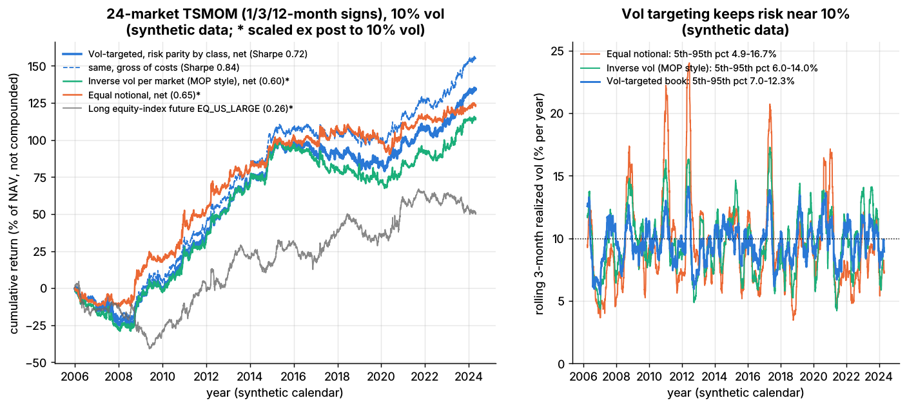
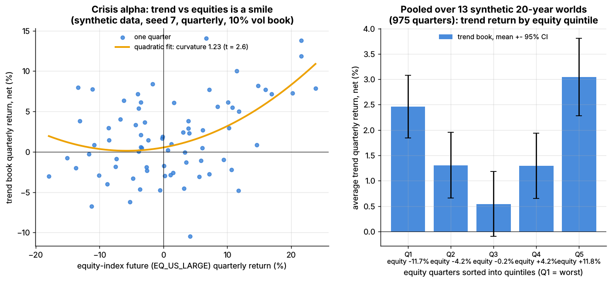
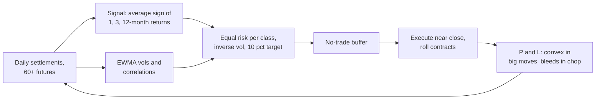
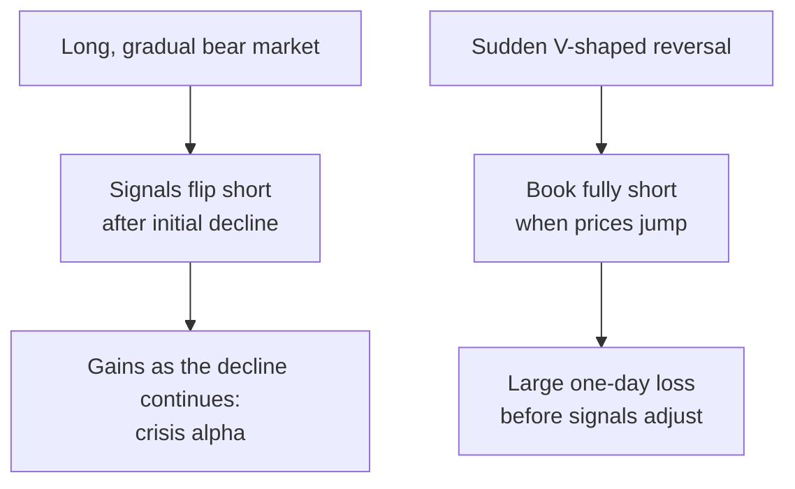

# Trend following and CTAs

> **TL;DR**
>
> - [Time-series momentum](../../09-reference/glossary.md#time-series-momentum): long futures that have risen, short those that have fallen, across 50–150 markets at equal risk.
> - Long evidence: persistence in all 58 futures Moskowitz, Ooi and Pedersen tested, and positive returns in every decade since 1880 `[Verified]`.
> - Convex payoff: bleeds in chop, earns in long moves ("crisis alpha"), loses on V-shaped reversals.
> - Live returns trail backtests: the SG Trend Index made +27.4% in 2022, −4.2% in 2023, +2.4% in 2024 and 2025, +15.8% in 2026 to September `[Reported]`.
> - For an equity quant: a diversifier, a source of index-futures flow, and the textbook case of volatility targeting.

**Level:** Core · **Read time:** ~9 min · **Last verified:** 2026-11

| Field | Value |
|---|---|
| Family | futures and macro context |
| Edge source | behavioral · risk premium (hedging pressure) |
| Holding period | weeks to months (1–12-month lookbacks) |
| Counterparty: who pays and why they accept it | Hedgers laying off price risk, who lose to trend-following speculators (Moskowitz et al.) `[Verified]`; central banks; investors who under-react, then chase. None trade on the trend itself. |
| Universe & instruments | Equity-index, bond, short-rate, currency and commodity futures; FX forwards |
| Data required | Daily settlements, roll calendars, margin rates |
| Core algorithms used | [P7 Position sizing and risk budgeting](../../03-algorithms/d-portfolio-construction/position-sizing-and-risk-budgeting.md) · [D3 Signal transforms](../../03-algorithms/a-data-and-signals/signal-transforms.md) · [P1 Risk models](../../03-algorithms/d-portfolio-construction/risk-models.md) · [P6 Multi-period optimization and trading toward the aim](../../03-algorithms/d-portfolio-construction/multi-period-and-trading-toward-aim.md) |
| Infra intensity | Low latency sensitivity; daily batch; roll and execution algorithms at size |
| Capacity (rough $ range) | Tens of billions per manager `[Estimate]`; industry \$354B (Q2 2026, BarclayHedge) `[Reported]`; at \$280B in 2014, trend followers held about 0.2% of equity and 6% of commodity market size `[Verified]` |
| Typical Sharpe (gross vs net) | Backtests: above 1.0 gross, 1985–2009 `[Verified]`; 0.77 net of costs and fees, 1880–2013, 0.62 in 2000–2013 `[Verified]`. Live SG Trend Index since 2000: 5.75% a year, maximum drawdown 20.6% `[Reported]`. Realistic net 0.3–0.6 `[Estimate]` |
| Turnover | Notional 50–150× NAV a year in rate-heavy books `[Estimate]` (Lab 19: 141×) |
| Main risks / failure modes | Whipsaw, V-shaped reversals, hidden correlation, roll costs |
| Crowding risk | Moderate: large managers run similar models (correlation 0.95 with a ~50-program peer index) `[Reported]` |
| Firm types that run it | CTAs, multi-asset quant managers, multi-strategy platforms; SG Trend Index constituents in 2025–2026 have included Winton, Systematica and PIMCO `[Reported]` |
| Lab | [Lab 19](https://github.com/FrankHuang94/quant_trading_claude/tree/main/labs/19-trend-following-vol-targeting) |

## Intuition (the story in plain English)

A [CTA](../../09-reference/glossary.md#commodity-trading-advisor-cta) running [trend following](../../09-reference/glossary.md#trend-following) never asks why oil is rising. It assumes that what has moved for months keeps moving, because the people moving it adjust slowly. Each market is a slightly biased coin; sixty of them, sized so none dominates, behave like cheap options on big moves.

## Economic rationale: why should this make money at all?

- **Under-reaction, then over-reaction.** Returns persist for 1–12 months and partially reverse later (Moskowitz et al.) `[Verified]`.
- **Hedging pressure.** In CFTC data, speculators ride time-series momentum and hedgers take the other side `[Verified]`; Hurst et al. add central banks and other non-profit-seeking traders `[Verified]`.
- **Not a crash premium.** Returns peak when equity markets are most extreme, either way, like a lookback straddle (Fung & Hsieh 2001) `[Verified]`; a strategy that pays in crises is hard to call risk compensation.

## The trade, step by step

1. **Data**: back-adjusted contracts.
2. **Signal** ([D3](../../03-algorithms/a-data-and-signals/signal-transforms.md)): average sign of each market's own 1-, 3- and 12-month return.
3. **Risk** ([P1](../../03-algorithms/d-portfolio-construction/risk-models.md)): exponentially weighted volatilities and correlations.
4. **Size** ([P7](../../03-algorithms/d-portfolio-construction/position-sizing-and-risk-budgeting.md)): equal risk per asset class, inverse volatility within it, a 10% [volatility target](../../09-reference/glossary.md#volatility-targeting) for the book.
5. **Trade** ([P6](../../03-algorithms/d-portfolio-construction/multi-period-and-trading-toward-aim.md)) only outside a no-trade buffer; roll before expiry; keep collateral in Treasury bills.

## Worked example with numbers

Illustrative: \$1B book, each market sized to about 2.5% of NAV standalone volatility.

| Market | Ex-ante vol | Signal | Position (notional / NAV) | Notional |
|---|---|---|---|---|
| 2-year Treasury future | 2% | −1 | −2.5 / 2 = −125% | −\$1.25B |
| 10-year Treasury future | 6% | −1 | −2.5 / 6 = −42% | −\$417M |
| S&P 500 future | 16% | +1/3 | +1/3 × 2.5 / 16 = +5.2% | +\$52M |

**A trending quarter.** Bond prices fall 1.5% (2-year) and 4% (10-year); equities fall 10%. P&L: 1.25 × 1.5% + 0.417 × 4% − 0.052 × 10% = **+3.0% of NAV (+\$30M)**; the weak equity signal cost little.

**A reversal day.** Bonds rally 1.0% and 1.5%: 1.25 × 1.0% + 0.417 × 1.5% = **−1.9% of NAV in a day**. Low-volatility rate futures carry the most notional.

## Signals and algorithms under the hood

Cards: [D3](../../03-algorithms/a-data-and-signals/signal-transforms.md) signal; [P1](../../03-algorithms/d-portfolio-construction/risk-models.md) and [P2](../../03-algorithms/d-portfolio-construction/covariance-estimation-and-shrinkage.md) risk; [P7](../../03-algorithms/d-portfolio-construction/position-sizing-and-risk-budgeting.md) and [P4](../../03-algorithms/d-portfolio-construction/alternatives-to-mvo.md) sizing; [P6](../../03-algorithms/d-portfolio-construction/multi-period-and-trading-toward-aim.md) buffer; [P5](../../03-algorithms/d-portfolio-construction/transaction-cost-and-impact-models.md) costs. Code as in Lab 19:

```python
import numpy as np

def tsmom_signal(returns, lookbacks=(21, 63, 252)):
    """Average sign of each market's OWN past 1-, 3-, 12-month return: -1, -1/3, +1/3 or +1."""
    votes = [np.sign(returns.rolling(L).sum()) for L in lookbacks]
    return sum(votes) / len(lookbacks)                 # known at the close of day t

def vol_target_positions(signal, ann_vol, corr, asset_class, target_vol=0.10, asset_cap=0.40):
    """Notional / NAV per market: equal risk per class, inverse vol inside it, book at target vol."""
    classes, counts = np.unique(asset_class, return_counts=True)
    n_in_class = dict(zip(classes, counts))
    budget = np.array([1.0 / (len(classes) * n_in_class[c]) for c in asset_class])
    w = signal * budget / ann_vol                      # a 2%-vol bond gets 20x a 40%-vol gas future
    port_vol = np.sqrt(w @ (corr * np.outer(ann_vol, ann_vol)) @ w)
    if port_vol > 0:
        w = w * target_vol / port_vol                  # scale the whole book to 10% ex-ante vol
    cap = asset_cap * target_vol / ann_vol             # no market above 4% of NAV standalone vol
    return np.clip(w, -cap, cap)

def trade_with_buffer(target, current, band):
    gap = target - current                             # trade only if the target leaves the band,
    return np.where(np.abs(gap) > band, target - np.sign(gap) * band, current)  # to its edge
```



*Same forecast, three sizing schemes, 24 synthetic futures: the vol-targeted book holds risk near 10%; equal notional swings from 5% to 17%. Synthetic data.*

Synthetic lab result: net Sharpe 0.72 (0.84 gross) at 9.8% realized volatility; the buffer cuts turnover from 252× to 141× NAV and lifts net Sharpe from 0.59. That sits near academic backtests and above the realistic 0.3–0.6 net: the toy has no fees, crises or capacity limits.

## Implementation choices that matter

- **Speed.** Fast signals lose more to costs: synthetic lab result 0.52 gross to 0.36 net at 1 month, 0.88 to 0.82 at 12. Managers blend speeds because trend lengths are unknown.
- **Risk budgets.** Under equal notional, commodities and equities carry 92% of risk (synthetic lab result).
- **Contracts.** Short-rate futures need huge notional; position limits bind in small commodities `[Lore]`.

## P&L decomposition

Illustrative, \$1B, 10% volatility, % of NAV a year:

| Line | % of NAV |
|---|---|
| Trend P&L: rates | +1.8 |
| Trend P&L: equity indices | +1.6 |
| Trend P&L: currencies | +1.0 |
| Trend P&L: commodities | +1.6 |
| Slippage and rolls | −1.1 |
| Management fee | −1.0 |
| Performance fee (20%) | −0.8 |
| **Net excess return (Sharpe ≈ 0.3)** | **+3.1** |
| Treasury-bill interest on collateral (not alpha) | +4.0 |

## Evidence

- **Moskowitz, Ooi and Pedersen (2012):** time-series momentum in all 58 futures; diversified Sharpe above 1, about 2.5× the equity market's, before costs `[Verified]`.
- **Hurst, Ooi and Pedersen:** 1880–2013, 14.9% a year gross, 11.2% after 2-and-20 fees, 9.7% volatility, correlation to US equities 0.00; positive in 8 of the 10 worst 60/40 drawdowns `[Verified]`.
- **Live:** the SG Trend Index tracks the ten largest trend CTAs, net of fees (figures in the TL;DR) `[Reported]`.



*Quarterly trend returns against equity returns form a smile: gains in both tails. Synthetic data.*

Synthetic lab result: curvature +1.23 (t = 2.6); in the worst 10% of equity quarters (mean −13.4%) the book made +0.8%.

## Capacity, crowding and decay

Futures markets are deep, so capacity rarely binds; decay does. The backtest earned 11% net a year; the live index compounds at about 6% including cash interest. From 2008 to 2014, "risk-on/risk-off" correlation left fewer independent trends `[Verified]`.

## How it fails

- **Choppy years.** 2016: −6.19%, the index's first losing year since 2012 `[Reported]`.
- **V-shaped reversals.** March 2023: −7.69%; 10 and 13 March, when the regional-bank crisis squeezed short bond positions, were two of the index's worst days ever (AlphaSimplex) `[Verified]`. April 2025: −4.89%, −9.33% year to date `[Reported]`.
- **Fast crashes.** A 1987-style crash arrives before signals flip (Hurst et al.) `[Verified]`.

## Textbook vs how it's done today

| Textbook | Practice today |
|---|---|
| 12-month sign, monthly, 40% volatility per market `[Verified]` | Blended speeds, daily rebalancing with buffers `[Lore]` |
| Equal risk per market | Class budgets, correlation-aware scaling `[Lore]` |
| ~60 markets | 100–300+, including "alternative" markets `[Lore]` |
| Pure trend, 2-and-20 | Trend plus carry, lower fees `[Lore]` |

## Variants and neighbours

Cross-sectional [momentum](../e-risk-premia-and-factors/momentum.md) ranks assets against each other; [carry](carry-and-cross-asset-risk-premia.md) is the usual partner; short-term CTAs hold for days.

**Why an equity quant should care.** Trend diversifies equity books; vol-targeted trend books sell index futures into falling, volatile markets, a flow sell-side desks estimate daily `[Lore]`; and the sizing machinery is reused in equity factor books.

## Diagram





## How practitioners talk about it

- "We're long convexity." → Trend pays in big moves either way.
- "Trend got chopped up." → Whipsaw losses.
- "SVB weekend took out the bond short." → The March 2023 reversal.
- "Ten vol, risk-balanced across sectors." → 10% target, class budgets.
- "Our speed blend is 1-3-12." → Lookbacks in months.
- "CTAs are max short; watch the triggers." → Price levels where trend models flip.

## Myths vs reality

| Myth | Reality |
|---|---|
| Trend always wins in crises | Only gradual ones; fast crashes and V-reversals hurt |
| 4× notional is reckless | Notional is large; risk is about 10% volatility |
| "Trend is dead" | Said after 2016 and 2023; 2022 was the best year |

## Questions you could ask a quant about this

**Basic**

- Which speeds do you blend, and why?
- Which markets bind on capacity?

**Informed**

- How did your bond book handle 10–13 March 2023?
- Standalone volatility or risk contribution for sizing?

**Sharp**

- How much of your Sharpe is trend versus carry? 🔒
- How do you cap notional in short-rate futures? 🔒

## Go deeper

<details markdown="1">
<summary>Math: time-series momentum return, diversification and the smile</summary>

For market $i$ with signal $s_{i,t} \in [-1, 1]$, ex-ante volatility $\sigma_{i,t}$ and target $\sigma^*$:

$$
r^{\text{TSMOM}}_{i,t+1} = s_{i,t}\,\frac{\sigma^*}{\sigma_{i,t}}\, r_{i,t+1}.
$$

With $N$ markets at equal risk, single-market Sharpe $S$ and average correlation $\rho$:

$$
S_{\text{book}} = S\sqrt{\frac{N}{1 + (N-1)\rho}}, \qquad S = 0.2,\; N = 60,\; \rho = 0.1 \;\Rightarrow\; S_{\text{book}} \approx 0.59 .
$$

The smile: regress quarterly trend returns on equity returns and their square; the square's coefficient $c$ is positive.

</details>

## Related pages

- [Carry and cross-asset risk premia](carry-and-cross-asset-risk-premia.md)
- [Momentum](../e-risk-premia-and-factors/momentum.md)
- [P7 Position sizing and risk budgeting](../../03-algorithms/d-portfolio-construction/position-sizing-and-risk-budgeting.md)
- [How firms combine strategies](../h-cross-cutting/how-firms-combine-strategies.md)
- [ETF, futures and options linkages](../../01-market-structure/etf-futures-options-linkages.md)
- [Strategy failure gallery](../h-cross-cutting/strategy-failure-gallery.md)

## Sources

- [Verified] Moskowitz, T. J., Ooi, Y. H. & Pedersen, L. H. (2012). "Time series momentum." *Journal of Financial Economics* 104(2), 228–250. <https://doi.org/10.1016/j.jfineco.2011.11.003> (accessed 2026-11)
- [Verified] Hurst, B., Ooi, Y. H. & Pedersen, L. H. (2017). "A Century of Evidence on Trend-Following Investing." *The Journal of Portfolio Management* 44(1), 15–29. <https://doi.org/10.3905/jpm.2017.44.1.015> (accessed 2026-11)
- [Verified] Hurst, B., Ooi, Y. H. & Pedersen, L. H. (2014). "A Century of Evidence on Trend-Following Investing." AQR Capital Management white paper, 1880–2013 statistics (Exhibit 1) and capacity estimates. <https://www.trendfollowing.com/whitepaper/Century_Evidence_Trend_Following.pdf> (accessed 2026-11)
- [Verified] Fung, W. & Hsieh, D. A. (2001). "The Risk in Hedge Fund Strategies: Theory and Evidence from Trend Followers." *Review of Financial Studies* 14(2), 313–341. <https://doi.org/10.1093/rfs/14.2.313> (accessed 2026-11)
- [Verified] Kaminski, K. M. & Sun, J. (2024-01). "Themes of 2023." AlphaSimplex Group research note. <https://www.alphasimplex.com/assets/files/2024.01---themes-of-2023---kaminski-and-sun.pdf> (accessed 2026-11)
- [Reported] Hedgeweek (2023-01-10). "Flat December sees CTAs complete record year in 2022" (Societe Generale index data). <https://www.hedgeweek.com/flat-december-sees-ctas-complete-record-year-2022/> (accessed 2026-11)
- [Reported] Institutional Investor (2017-01-12). "CTAs Suffer Another Quarterly Setback" (SG Trend Index 2016). <https://institutionalinvestor.com/article/b18bk2lsz07myp/ctas-suffer-another-quarterly-setback> (accessed 2026-11)
- [Reported] Top Traders Unplugged (2024-01-20). "Trend Following Performance Report – December 2023." <https://www.toptradersunplugged.com/trend-following-performance-report-december-2023/> (accessed 2026-11)
- [Reported] Top Traders Unplugged (2025-01-22). "Trend Following Performance Report – December 2024." <https://www.toptradersunplugged.com/trend-following-performance-report-december-2024/> (accessed 2026-11)
- [Reported] Top Traders Unplugged (2025-05-20). "Trend Following Performance Report – April 2025." <https://www.toptradersunplugged.com/trend-following-performance-report-april-2025/> (accessed 2026-11)
- [Reported] Top Traders Unplugged (2026-01-23). "Trend Following Performance Report – December 2025" (SG Trend Index 2025 return and constituents). <https://www.toptradersunplugged.com/?p=20381> (accessed 2026-11)
- [Reported] Top Traders Unplugged (2026-10-26). "Trend Following Performance Report – September 2026" (year-to-date, since-2000 CAGR and drawdown, 2026 constituents). <https://www.toptradersunplugged.com/trend-following-performance-report-september-2026/> (accessed 2026-11)
- [Reported] BarclayHedge (ION Analytics). "CTA Industry Assets Under Management" (Q2 2026). <https://ionanalytics.com/barclayhedge/solutions/assets-under-management/cta-industry-assets-under-management/> (accessed 2026-11)
