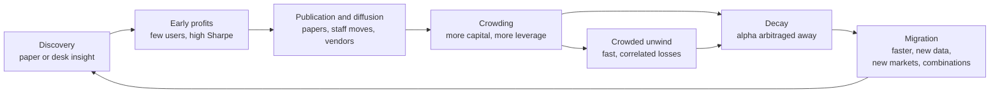
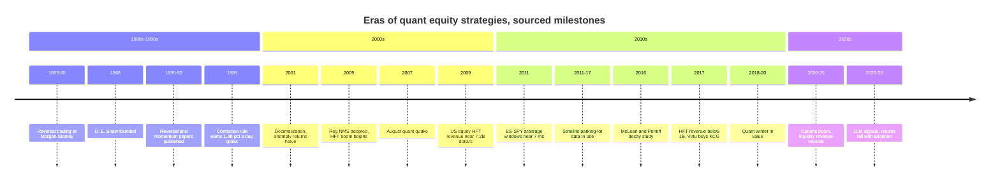

# Evolution of quant strategies

> **TL;DR**
>
> - Most quant edges follow one life cycle: discovery → early profits → publication and diffusion → crowding → decay (or a crowded crash) → migration to a faster horizon, new data, new markets or a more complex combination.
> - Decay is measured, not folklore: 97 published predictors lost 26% out of sample and 58% after publication; anomaly returns roughly halved after decimalization; a simple daily reversal rule fell from 1.38% a day (1995) to 0.13% (2007) `[Verified]`.
> - Crowded edges do not just fade. Funds lever up to keep their returns, which turns a slow decline into a fast unwind (August 2007).
> - Speed edges did not shrink per opportunity; the window did (97 ms to 7 ms), and the profit pool concentrated in the fastest few firms.
> - Treat a signal as an amortizing intangible: research is maintenance capex, and a book that stops replacing alpha shrinks every year.

**Level:** Deep dive · **Read time:** ~11 min · **Last verified:** 2026-11

A strategy is an intangible asset with a finite and uncertain useful life. Nobody can patent a trading rule, so every profitable idea leaks: through papers, through staff who change firms, through vendors selling the same data to everyone, and through prices themselves, which reveal the trade to anyone who looks.

## The life cycle in one picture

## Stage by stage

**Discovery.** Ideas come from two places, and practitioners usually get there first. Gerry Bamberger was trading industry-group reversal at Morgan Stanley around 1983 `[Reported]`, seven years before Lehmann (1990) published weekly reversals (see the [stat arb history](../c-statistical-arbitrage/stat-arb-overview-and-history.md)). Academic papers then turn a desk secret into a public recipe.

**Early profits.** With few users, the edge is limited only by costs and the strategy's natural [capacity](../../09-reference/glossary.md#capacity). Backtests from this phase look like free money. Khandani and Lo's contrarian rule earned a gross, frictionless 1.38% a day in 1995 `[Verified]`. Nobody could have captured that with eighth-dollar ticks, but it is a fair picture of how much price pressure went unabsorbed.

**Publication and diffusion.** McLean and Pontiff (2016) studied 97 published return predictors. Returns were 26% lower out of sample but before publication (an upper bound on data mining) and 58% lower after publication, so about 32 points of the decline is investors trading on the paper `[Verified]`. Two details matter for practitioners: the best in-sample predictors lost the most, and after publication each predictor's returns became more correlated with other published predictors `[Verified]`. Publication does not just shrink an edge; it pulls the edge into the common, crowded book. Falck, Rej and Thesmar (2022) find out-of-sample performance around half of in-sample, with publication date the main predictor of [alpha decay](../../09-reference/glossary.md#alpha-decay) `[Verified]`.

**Crowding.** Capital follows returns. Hanson and Sunderam (2014) infer from short interest that money devoted to value and momentum grew substantially from the late 1980s and lowered their returns `[Verified]`. Chordia, Subrahmanyam and Tong (2014) find most prominent anomalies attenuated, and a portfolio of them earned roughly half as much after decimalization in 2001; hedge fund assets, short interest and share turnover explain the decline `[Verified]`. Cheaper trading lets more [statistical arbitrage](../../09-reference/glossary.md#statistical-arbitrage) capital reach each mispricing.

**Decay, or a crowded crash.** A [crowded](../../09-reference/glossary.md#crowding) edge dies in one of two ways. The slow way is a drought: the premium is competed down and returns fall below the cost of capital. The fast way is an unwind. As returns compress, funds add leverage to hit their targets: Khandani and Lo estimate the contrarian rule needed about 2:1 leverage in 1998 and nearly 9:1 in 2007 to deliver the same expected return, while long/short equity and market-neutral hedge fund assets in their database topped \$160B at the start of 2007 `[Verified]`. One forced seller then hurts everyone holding the same positions: the [quant quake](../../09-reference/glossary.md#quant-quake) of August 2007 (details in [quant winters](../e-risk-premia-and-factors/factor-timing-crowding-and-quant-winters.md) and the [failure gallery](strategy-failure-gallery.md)).

A subtle trap sits inside the decay phase. When an anomaly becomes widely known, buying pressure reprices it, and that repricing shows up as positive realized return. Pénasse (2022) estimates this biases measured alpha by about 1.4% a year for commonly studied anomalies `[Verified]`. A strategy can look healthiest in the very years its future alpha is being competed away.

**Migration.** Surviving teams move in one of four directions: **faster** (the same liquidity-provision edge on a shorter clock), **new data** (information not yet in prices), **new markets** (less competed asset classes and regions) or **more complex combinations** (many weak signals, nonlinear models, better execution). Each direction restarts the cycle.

## Three migrations in detail

### Stat arb: from daily reversal to intraday and machine learning

Khandani and Lo's contrarian rule fell from 1.38% a day in 1995 to 0.44% in 2000 and 0.13% in the first eight months of 2007, all gross and frictionless `[Verified]`; they cite competition, decimalization, lower volatility and more assets. Avellaneda and Lee's PCA-residual strategy earned an after-cost Sharpe of 1.44 over 1997–2007, much stronger before 2003 and only 0.9 in 2003–2007 (academic backtest) `[Verified]`. Their fix is a textbook migration: measuring signals in volume-based "trading time" lifted the ETF-residual variant to a Sharpe of 1.51 in 2003–2007 `[Verified]`. Do and Faff (2010) confirm a continuing decline in simple [pairs trading](../../09-reference/glossary.md#pairs-trading) profits, with strong performance only in prolonged turbulence `[Verified]`.

Industry moved toward intraday horizons, hundreds of combined signals and ML forecasts `[Lore]` (see [ML-driven short-horizon alpha](../c-statistical-arbitrage/ml-driven-short-horizon-alpha.md)). The edge source did not change: it is still mostly payment for absorbing other traders' price pressure. What changed is that the payment is now collected faster, in smaller pieces, by teams with better cost models.

### HFT: boom, arms race, compression, consolidation

[High-frequency trading](../../09-reference/glossary.md#high-frequency-trading-hft) boomed after Reg NMS (adopted 2005) fragmented US equities `[Reported]`. Tabb Group estimated US-equity HFT revenue at \$7.2B in 2009 and expected it to fall below \$1B in 2017, as reported by the Financial Times `[Reported]`. The causes were ordinary economics: low volatility and volumes, rising market-data and connectivity costs, and speed parity among competitors `[Reported]`.

The [latency arbitrage](../../09-reference/glossary.md#latency-arbitrage) data show what competition does at the top speed tier. Budish, Cramton and Shim found the median ES–SPY arbitrage window shrank from 97 ms in 2005 to 7 ms in 2011 while profit per opportunity stayed roughly flat `[Verified]`: competition raised the speed required, not the price paid. Baron, Brogaard, Hagströmer and Kirilenko (2019) show that relative latency rank drives HFT trading performance `[Verified]`, a recipe for winner-take-most. Consolidation followed: Virtu bought KCG for \$1.4B, DRW bought Chopper Trading and RGM Advisors, and Teza sold its HFT business to Quantlab `[Reported]`.

The pool then migrated rather than died. For 2025 the largest liquidity providers were reported to earn record revenues, global and multi-asset: Jane Street about \$39.6B of net trading revenue (helped by gains on private stakes), Hudson River Trading about \$12.3B and Citadel Securities about \$12.2B `[Reported]`. Listed options volume set a sixth straight record in 2025 at 15.26B contracts `[Verified]`. The rent moved to options, ETFs, bonds and other markets, and onto the balance sheets of a handful of firms (see [equity market making](../a-liquidity-provision/equity-market-making.md) and [options market making](../a-liquidity-provision/options-market-making.md)).

### Data edges: alternative data, then LLMs

[Alternative data](../../09-reference/glossary.md#alternative-data) restarted the cycle for informational edges. Katona, Painter, Patatoukas and Zeng find that once satellite coverage of retailers' parking lots appeared (sample 2011–2017), investors with access traded profitably, especially ahead of bad-news quarters, and liquidity around reports fell `[Verified]`. Managers spent roughly \$2.8B on alternative data in 2025 `[Reported]`, so most datasets now have many buyers; as vendors add clients, the edge folds into consensus ([alternative data](../d-mid-frequency-alpha/alternative-data.md)).

Text shows the cycle compressing. After Loughran and McDonald published finance-specific word lists (2011), firms whose filings were heavily machine-read avoided the flagged words (Cao et al. 2023) `[Verified]`: the signal changed its own input. Lopez-Lira and Tang find GPT-4 headline scores predict the subsequent drift, especially in small stocks and on bad news, and that strategy returns decline as LLM adoption rises `[Verified]`. Our view `[Estimate]`: LLMs shorten the time from "new data type" to "commodity", because the scarce input used to be the ability to process text, and that is now cheap (see [NLP and LLM signals](../d-mid-frequency-alpha/nlp-and-llm-signals.md) and [F4](../../03-algorithms/b-forecasting-models/llms-and-foundation-models-in-quant.md)).

## Eras at a glance

| Strategy | Peak profitability | What killed or changed it | Where it migrated |
|---|---|---|---|
| Daily [short-term reversal](../../09-reference/glossary.md#short-term-reversal) | 1980s–1990s (1.38% a day gross in 1995) `[Verified]` | Competition, decimalization, lower volatility, more assets | Intraday horizons, residual models, ML |
| Distance-based pairs | Desk era of the 1980s `[Reported]`; up to 11% a year in 1962–2002 backtests `[Verified]` | Declining trend, more pairs that never converge (Do & Faff) | One special case of multi-name residual models |
| PCA-residual stat arb | 1997–2002 (above the 1.44 period average) `[Verified]` | Crowding; Sharpe 0.9 in 2003–2007 | Volume-time signals, many signals, ML |
| Published equity anomalies | Before publication | −58% after publication; halved after decimalization | Composite signals, less liquid names, other markets |
| Value | Before arbitrage capital grew (from the late 1980s) `[Verified]` | Arbitrage capital; the 2018–2020 drought | Multi-factor composites, quality-adjusted value |
| [Momentum](../../09-reference/glossary.md#momentum) | Persisted after publication through the 1990s `[Verified]` | Crashes in sharp rebounds ([momentum](../e-risk-premia-and-factors/momentum.md)); crowding | A risk factor that pods hedge |
| Latency arbitrage | Mid-2000s | Arms race: window 97 ms → 7 ms | Microwave, FPGAs; ~\$5B a year in global equities `[Reported]` |
| US equity HFT market making | 2008–2009 (\$7.2B) `[Reported]` | Low volatility, data costs, speed parity | Consolidation, options, ETFs, bonds, other regions |
| Alternative data | Early 2010s, for early buyers `[Verified]` | Vendors sell to everyone | Proprietary and self-scraped data, faster processing |
| Dictionary text signals | Around 2011 publication | Firms changed their wording `[Verified]` | LLMs, audio, document diffs |

## What survives

Not everything decays at the same rate. Momentum kept working through the 1990s after its 1993 publication (Jegadeesh and Titman 2001) `[Verified]`, and liquidity provision re-expanded after 2017 instead of vanishing. The pattern matches the edge-source taxonomy in [how quants evaluate a strategy](../how-quants-evaluate-a-strategy.md). Our view `[Estimate]`: edges that pay for a service or a risk (immediacy, inventory, crash exposure) compress toward a fair price but persist, because someone keeps needing the service. Edges that pay for knowing something first (informational and many behavioral signals) decay toward zero, because knowledge spreads. Speed edges persist as a pool but concentrate in the fastest few.

## Planning for decay

Firms treat decay as a cost line, not a surprise.

- **Haircut every backtest.** 30–60% of gross alpha is a common planning range ([L2](../../03-algorithms/g-live-trading/alpha-decay-detection-and-model-retirement.md)).
- **Budget research as maintenance capex.** Illustrative: if a signal's alpha halves every three years, it loses 1 − 0.5^(1/3) ≈ 21% a year. A book needs that much new alpha every year just to stand still; with a two-year half-life, 29%.
- **Monitor crowding, not just P&L:** rising correlation with peers and published factors, falling alpha per unit of [turnover](../../09-reference/glossary.md#turnover), violent reversals on de-risking days.
- **Refuse to lever a decaying edge** to defend a return target. That choice turned 2007 from a drought into a crash.
- **Diversify across life-cycle stages** so that not every signal is crowded at once ([how firms combine strategies](how-firms-combine-strategies.md)).

## Questions you could ask a quant about this

- **Basic:** Where did this signal come from: a paper, a vendor or your own research? When was it published?
- **Informed:** How has live Sharpe compared with the backtest, year by year? Has its correlation with published factors risen?
- **Sharp:** What share of this year's research output replaced decayed alpha, and what share was net new? 🔒 Where did your last retired strategy's capital and people go?

## Related pages

- [How quants evaluate a strategy](../how-quants-evaluate-a-strategy.md)
- [Stat arb: overview and history](../c-statistical-arbitrage/stat-arb-overview-and-history.md)
- [Factor timing, crowding and quant winters](../e-risk-premia-and-factors/factor-timing-crowding-and-quant-winters.md)
- [Latency arbitrage](../b-speed-and-structural/latency-arbitrage.md)
- [Alternative data](../d-mid-frequency-alpha/alternative-data.md)
- [Alpha decay detection and model retirement](../../03-algorithms/g-live-trading/alpha-decay-detection-and-model-retirement.md)
- [How firms combine strategies](how-firms-combine-strategies.md)
- [Strategy failure gallery](strategy-failure-gallery.md)

## Sources

- [Verified] McLean, R. D. & Pontiff, J. (2016). "Does Academic Research Destroy Stock Return Predictability?" *Journal of Finance* 71(1), 5–32. <https://doi.org/10.1111/jofi.12365> (accessed 2026-11)
- [Verified] Chordia, T., Subrahmanyam, A. & Tong, Q. (2014). "Have capital market anomalies attenuated in the recent era of high liquidity and trading activity?" *Journal of Accounting and Economics* 58(1), 41–58. <https://doi.org/10.1016/j.jacceco.2014.06.001> (accessed 2026-11)
- [Verified] Khandani, A. E. & Lo, A. W. (2007). "What Happened to the Quants in August 2007?" *Journal of Investment Management* 5(4) (working-paper version, Tables 2 and 6). <https://web.mit.edu/Alo/www/Papers/august07.pdf> (accessed 2026-11)
- [Verified] Khandani, A. E. & Lo, A. W. (2011). "What happened to the quants in August 2007? Evidence from factors and transactions data." *Journal of Financial Markets* 14(1), 1–46. <https://doi.org/10.1016/j.finmar.2010.07.005> (accessed 2026-11)
- [Verified] Hanson, S. G. & Sunderam, A. (2014). "The Growth and Limits of Arbitrage: Evidence from Short Interest." *Review of Financial Studies* 27(4), 1238–1286. <https://doi.org/10.1093/rfs/hht066> (accessed 2026-11)
- [Verified] Pénasse, J. (2022). "Understanding Alpha Decay." *Management Science* 68(5), 3966–3973. <https://doi.org/10.1287/mnsc.2022.4353> (accessed 2026-11)
- [Verified] Falck, A., Rej, A. & Thesmar, D. (2022). "When do systematic strategies decay?" *Quantitative Finance* 22(11), 1955–1969. <https://doi.org/10.1080/14697688.2022.2098810> (accessed 2026-11)
- [Verified] Avellaneda, M. & Lee, J.-H. (2010). "Statistical arbitrage in the US equities market." *Quantitative Finance* 10(7), 761–782. <https://doi.org/10.1080/14697680903124632> (accessed 2026-11)
- [Verified] Gatev, E., Goetzmann, W. N. & Rouwenhorst, K. G. (2006). "Pairs Trading: Performance of a Relative-Value Arbitrage Rule." *Review of Financial Studies* 19(3), 797–827. <https://doi.org/10.1093/rfs/hhj020> (accessed 2026-11)
- [Verified] Do, B. & Faff, R. (2010). "Does Simple Pairs Trading Still Work?" *Financial Analysts Journal* 66(4), 83–95. <https://doi.org/10.2469/faj.v66.n4.1> (accessed 2026-11)
- [Verified] Jegadeesh, N. & Titman, S. (2001). "Profitability of Momentum Strategies: An Evaluation of Alternative Explanations." *Journal of Finance* 56(2), 699–720. <https://doi.org/10.1111/0022-1082.00342> (accessed 2026-11)
- [Verified] Budish, E., Cramton, P. & Shim, J. (2015). "The High-Frequency Trading Arms Race: Frequent Batch Auctions as a Market Design Response." *Quarterly Journal of Economics* 130(4), 1547–1621. <https://doi.org/10.1093/qje/qjv027> (accessed 2026-11)
- [Verified] Baron, M., Brogaard, J., Hagströmer, B. & Kirilenko, A. (2019). "Risk and Return in High-Frequency Trading." *Journal of Financial and Quantitative Analysis* 54(3), 993–1024. <https://doi.org/10.1017/S0022109018001096> (accessed 2026-11)
- [Verified] Aquilina, M., Budish, E. & O'Neill, P. (2022). "Quantifying the High-Frequency Trading 'Arms Race'." *Quarterly Journal of Economics* 137(1), 493–564. <https://doi.org/10.1093/qje/qjab032> (accessed 2026-11)
- [Reported] Financial Times, repost by Rosenblatt Securities (2018-01-02). "How high-frequency trading hit a speed bump" (Tabb Group revenue estimates; Reg NMS; Virtu-KCG, DRW and Teza deals). <https://rblt.com/news/how-high-frequency-trading-hit-a-speed-bump> (accessed 2026-11)
- [Reported] Reuters via MarketScreener (2026-04-24). "Jane Street's \$40 billion trading haul tops rivals, sources say." <https://www.marketscreener.com/news/jane-street-s-40-billion-trading-haul-tops-rivals-sources-say-ce7f59dfdf8ff52d> (accessed 2026-11)
- [Reported] Bloomberg (2026-03-24). "Citadel Securities Nets Record \$12 Billion Trading Haul in 2025." <https://www.bloomberg.com/news/articles/2026-03-24/citadel-securities-nets-record-12-billion-trading-haul-in-2025> (accessed 2026-11)
- [Verified] OCC (2026-01-05). "OCC Annual 2025 and December 2025 Volume." <https://www.theocc.com/newsroom/views/2026/01-05-occ-annual-2025-and-december-2025-volume> (accessed 2026-11)
- [Verified] Katona, Z., Painter, M., Patatoukas, P. N. & Zeng, J. (2025). "On the Capital Market Consequences of Big Data: Evidence from Outer Space." *Journal of Financial and Quantitative Analysis* 60(2), 551–579. <https://doi.org/10.1017/S0022109023001448> (accessed 2026-11)
- [Reported] Neudata (2026). "The state of the alternative data market in 2026." <https://www.neudata.co/intelligence/the-state-of-the-alternative-data-market-in-2026> (accessed 2026-11)
- [Verified] Cao, S., Jiang, W., Yang, B. & Zhang, A. L. (2023). "How to Talk When a Machine Is Listening: Corporate Disclosure in the Age of AI." *Review of Financial Studies* 36(9), 3603–3642. <https://doi.org/10.1093/rfs/hhad021> (accessed 2026-11)
- [Verified] Lopez-Lira, A. & Tang, Y. (2026). "Can ChatGPT Forecast Stock Price Movements? Return Predictability and Large Language Models." *Journal of Financial Economics* 184, 104335. <https://doi.org/10.1016/j.jfineco.2026.104335> (accessed 2026-11)
