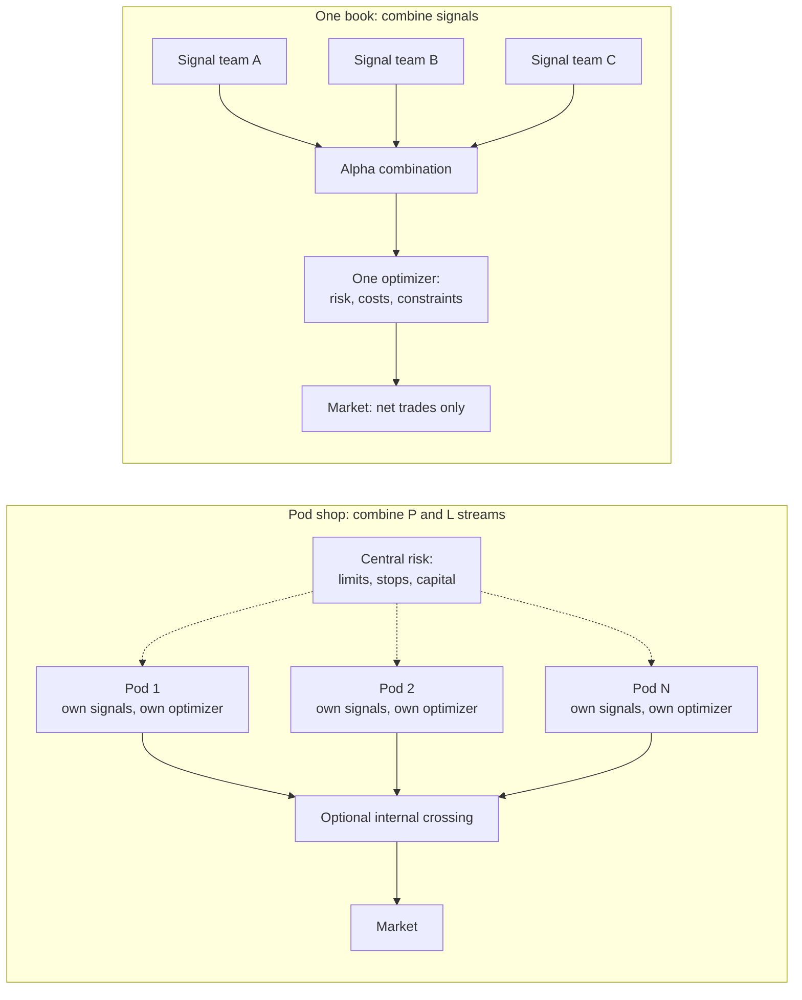
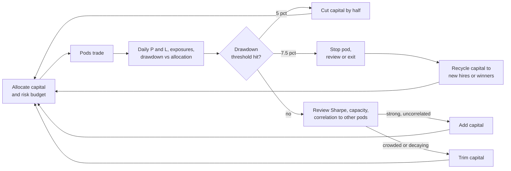

# How firms combine strategies

> **TL;DR**
>
> - A multi-strategy book earns its Sharpe mostly from low correlation, not from precise weights. Three strategies at Sharpe 1.0, 1.5 and 0.8 combine to about 1.57 at equal risk and 1.64 at optimal weights (illustrative).
> - Two architectures: **pod shops** combine P&L streams from independent teams under central risk limits; **centralized quant funds** combine signals into one forecast and one optimizer ("one book"). One book nets trades and constraints before they cost money; pods buy talent, accountability and fast failure detection.
> - Correlation sets a ceiling: pods with Sharpe $S$ and average pairwise correlation $\rho$ can never combine to more than $S/\sqrt{\rho}$. Crowding across pods raises $\rho$.
> - Capital moves with drawdowns: Millennium reportedly halves a PM's capital at a 5% loss and is likely to part ways near 7.5% `[Reported]`. Such stops cap damage but detect skill poorly.
> - Multi-manager pass-through expenses typically run 3–10% of net assets `[Reported]`, and the platform pays winning pods even in a flat year.

**Level:** Core · **Read time:** ~12 min · **Last verified:** 2026-11

A firm with several strategies faces a corporate-finance problem: allocate scarce capital and risk to business units with different returns, capacities and correlations, then decide how much to centralize. A pod shop is a conglomerate with divisional P&Ls, a central treasury and a tough capital-allocation committee. A centralized quant fund is one integrated factory: research teams supply signals (inputs) to one production line.

## Two architectures



| | Pod shop | One book |
|---|---|---|
| Unit combined | P&L streams | Forecasts ([alpha combination](../../03-algorithms/b-forecasting-models/alpha-combination-and-ensembling.md)) |
| Who sets positions | Each PM | One [optimizer](../../03-algorithms/d-portfolio-construction/mean-variance-optimization.md) |
| Constraints | Each pod neutral to market and factors | Applied once, to the total |
| Opposing trades | Both executed unless crossed | Netted before trading |
| Accountability | Clear: each PM owns a P&L | Diffuse: credit split by attribution |
| Examples | Citadel, Millennium, Point72, Balyasny, ExodusPoint run multi-strategy funds with pass-through fees `[Reported]` | Renaissance's Medallion was built as one unified trading model `[Reported]` |

Most quant firms sit in between: a few books, each combining signals internally, with capital allocated across books `[Lore]`.

## The portfolio math

Measure each strategy's allocation $x_i$ in dollars of annual P&L volatility. With Sharpe ratios $S_i$ and correlation matrix $R$, expected P&L is $\sum_i x_i S_i$ and risk is $\sqrt{x^\top R x}$, so the book's [Sharpe ratio](../../09-reference/glossary.md#sharpe-ratio) is their ratio. The max-Sharpe weights are proportional to $R^{-1}S$.

**Worked example (illustrative).** A firm targets \$20M of annual P&L volatility across three strategies: A, residual stat arb (Sharpe 1.0); B, intraday ML alpha (1.5); C, slower fundamental signals (0.8). Correlations: A–B 0.4, A–C 0.1, B–C 0.2.

| Allocation | Risk to A / B / C ($M vol) | Expected P&L | Book Sharpe |
|---|---|---|---|
| Best single strategy (B only) | 0 / 20 / 0 | \$30.0M | 1.50 |
| Equal risk | 9.5 / 9.5 / 9.5 | 9.53 × 3.3 = \$31.5M | 31.5 / 20 = 1.57 |
| Max-Sharpe | 5.7 / 14.8 / 6.2 | \$32.8M | 1.64 |
| Max-Sharpe, but B degrades to Sharpe 1.0 at that size | 5.7 / 14.8 / 6.2 | \$25.4M | 1.27 |
| B capped at its capacity of \$8M vol | 9.9 / 8.0 / 10.9 | \$30.6M | 1.53 |

Equal risk: each strategy runs at \$9.53M because $9.53 \times \sqrt{3 + 2(0.4+0.1+0.2)} = 9.53 \times 2.10 = 20$. Three lessons:

1. **Diversification does most of the work.** Equal risk already beats the best single strategy, while depending less on any one edge.
2. **Optimizing weights adds little and is fragile.** The optimizer gains 0.07 of Sharpe, less than the error in any Sharpe estimate; DeMiguel, Garlappi and Uppal (2009) find naive 1/N weights hard to beat out of sample `[Verified]`. Firms start near equal risk ([risk parity](../../09-reference/glossary.md#risk-parity) across strategies) and tilt.
3. **Allocate by marginal net Sharpe after impact, not standalone Sharpe.** The optimizer piles into B, but B's [capacity](../../09-reference/glossary.md#capacity) is limited; if its Sharpe falls to 1.0 at \$14.8M of risk, the "optimal" book earns 1.27. Capping B and refilling A and C gives 1.53. **Capacity-weighted allocation** means each strategy gets risk until its marginal contribution, net of [market impact](../../09-reference/glossary.md#market-impact), equals everyone else's.

Correlations are not constant. Crowded quant books lost together in August 2007 `[Verified]`. If all three correlations jump to 0.8 (illustrative), the equal-risk book's volatility becomes $9.53 \times \sqrt{3 + 6 \times 0.8} = \$26.6M$, 33% over budget before returns change.

## Correlation sets the ceiling

For $N$ pods with equal risk, Sharpe $S$ each and average pairwise correlation $\rho$:

$$ S_{book} = S\sqrt{\frac{N}{1+(N-1)\rho}} \;\xrightarrow{N\to\infty}\; \frac{S}{\sqrt{\rho}} $$

| Pods ($S$ = 0.8 each, gross, illustrative) | ρ = 0.02 | ρ = 0.05 | ρ = 0.10 | ρ = 0.20 |
|---|---|---|---|---|
| 10 | 2.33 | 2.10 | 1.84 | 1.51 |
| 50 | 4.02 | 3.05 | 2.33 | 1.72 |
| 300 | 5.24 | 3.47 | 2.49 | 1.78 |
| Ceiling, $S/\sqrt{\rho}$ | 5.66 | 3.58 | 2.53 | 1.79 |

Hiring more pods helps only while their average correlation stays low. That makes [crowding](../../09-reference/glossary.md#crowding) the platform's central risk: pods hire from the same talent pool, buy the same data and hedge the same factors. Citadel's Ken Griffin has said he worries about "the correlation of holdings between the firms" `[Reported]`, and an investor-marketing executive warned that such strategies could suffer much bigger drawdowns than their track records suggest `[Reported]`. Central risk teams watch holdings overlap across pods, residual-return correlations, aggregate position size as a share of daily volume, and prime brokers' crowding reports `[Lore]` ([quant winters](../e-risk-premia-and-factors/factor-timing-crowding-and-quant-winters.md)).

## Risk budgeting and drawdown cuts

Each pod gets capital and a [risk budget](../../03-algorithms/d-portfolio-construction/position-sizing-and-risk-budgeting.md): a volatility target, gross and net limits, and tight limits on market, sector and style exposure, so that the platform's return is mostly idiosyncratic ([pod](../../09-reference/glossary.md#pod)). The stop rules are reported, not published: a Millennium PM who loses 5% of allocated capital typically has it halved, and at a 7.5% total loss is likely fired, with occasional exceptions (Business Insider, citing the Wall Street Journal) `[Reported]`. Other accounts put the exit near 10% `[Lore]`.



How good a filter is a 5% stop? In a simulation (normal daily P&L, one year, no cut after the first threshold) at 4% annual volatility, the chance of a 5% drawdown within a year is about 37% for a zero-skill pod, 13% at Sharpe 1 and 3% at Sharpe 2 `[Estimate]`. At 6% volatility the zero-skill figure rises to 72% and Sharpe 1 to 43% `[Estimate]`. Two consequences: stops cull bad pods faster than good ones but still fire on many skilled ones, and they push PMs to run low volatility on allocated capital, with the platform adding leverage on top. Grossman and Zhou (1993) show that under a drawdown floor the optimal risky position is proportional to the cushion above the floor `[Verified]`; the 5%/7.5% ladder is a crude, discrete version of that rule.

```python
import numpy as np

def allocate_risk(sharpe_hat, haircut, corr, capacity_vol, budget_vol, dd, prev_vol,
                  cut_dd=0.05, stop_dd=0.075):
    """Split a firm-wide risk budget ($ of annual P&L vol) across strategies or pods.
    haircut is per strategy: e.g. 0.5 if backtest-only, 0.2 with years of live history."""
    s = (1 - np.asarray(haircut)) * np.asarray(sharpe_hat, float)   # plan on decayed, net Sharpe
    w = np.clip(np.linalg.solve(corr, s), 0, None)           # max-Sharpe risk weights; no negative pods
    # Drawdown ladder (reported pod practice; thresholds differ by firm):
    cap = np.where(dd >= cut_dd, 0.5 * prev_vol, capacity_vol)   # >= 5%: half the old allocation
    cap = np.where(dd >= stop_dd, 0.0, cap)                       # >= 7.5%: switched off
    w = np.where(cap > 0, w, 0.0)
    x = np.minimum(w * budget_vol / max(np.sqrt(w @ corr @ w), 1e-12), cap)  # to $ units, then cap
    for _ in range(100):                                     # rescale to the budget without breaching caps
        vol = np.sqrt(x @ corr @ x)
        if vol == 0:
            break
        scale = budget_vol / vol
        grow = (x < cap) & (x > 0)
        if abs(scale - 1) < 1e-9 or (scale > 1 and not grow.any()):
            break                                            # on budget, or every pod capped: keep dry powder
        x = x * scale if scale < 1 else np.where(grow, np.minimum(x * scale, cap), x)
    return x                                                 # capital_i = x_i / vol_i (vol as a fraction)
```

With the example's inputs, no haircut and B capped at \$8M, this returns \$9.9M / \$8.0M / \$10.9M (the last table row). If C then sits in a 5.5% drawdown, C is cut to \$5.4M and A grows to \$13.7M; book Sharpe falls from 1.53 to 1.50 `[Estimate]`.

## Signals first or P&L first?

**The case for one book.** The [transfer coefficient](../../09-reference/glossary.md#transfer-coefficient) measures how much of a forecast survives into positions; Clarke, de Silva and Thorley (2002) report realized performance at about 0.3–0.8 of the unconstrained prediction `[Verified]`. Forcing every pod to be separately market-, sector- and factor-neutral spends that budget N times; one optimizer spends it once. Opposite views also cancel: if signal A says +1 and signal B says −1 on a stock, two pods hold +X and −X, paying spread, borrow and margin for a net position of zero; one book holds nothing. Sharpe (1981) framed the cost of splitting a portfolio among independent managers; van Binsbergen, Brandt and Koijen (2008) show it loses diversification and misaligns risk appetite, costs a CIO can only partly fix with benchmarks `[Verified]`. Zuckerman reports that Medallion was built as one model absorbing several, which made new signals easier to add `[Reported]`.

**The case for pods.** Independent people with independent methods produce less correlated returns, which the ceiling table rewards. Each P&L is observable, so failure is detected and cut quickly, and the structure scales by hiring.

**The evidence is mixed.** For long-only factor portfolios, Ghayur, Heaney and Platt (2018) find blending portfolios gives higher information ratios at low-to-moderate tracking error and blending signals wins at high tracking error `[Verified]`; AQR researchers argue that for long-only style portfolios, integrating signals beats mixing portfolios `[Reported]`. No study settles pods versus one book for market-neutral platforms.

## Internal netting: a worked example

Illustrative: a momentum pod wants to buy 200,000 shares of XYZ at \$50, or \$10M, while a reversal pod sells 150,000 shares, or \$7.5M. Cost model: 2 bp half-spread plus impact of 6 bp at \$10M, scaling with the square root of size.

| | Trades | Cost |
|---|---|---|
| Separately | Buy \$10M at 2 + 6 = 8 bp; sell \$7.5M at 2 + 6 × √0.75 = 7.2 bp | \$8,000 + \$5,400 = \$13,400 |
| Netted | Cross \$7.5M internally at the midpoint; buy the net \$2.5M at 2 + 6 × √0.25 = 5 bp | \$1,250 |

Saving: \$12,150, or 91%. Firm level `[Estimate]`: a \$5B book turning over 50× a year trades \$250B; if 15% crosses internally at an average 7 bp avoided, that is about \$26M a year, roughly 0.5% of gross capital. Practice points `[Lore]`: cross at the midpoint or arrival price so neither pod is favored; hold orders briefly in a crossing engine because opposite orders rarely arrive together; keep information barriers so pods cannot read each other's flow. Crossing between two separate funds is a regulated cross trade, not bookkeeping; for registered funds the rule is Investment Company Act rule 17a-7, which the SEC proposed to modernize (published October 2026) `[Verified]`.

## The economics

Multi-managers typically pass operating costs, mostly PM pay, through to investors: [pass-through fees](../../09-reference/glossary.md#pass-through-fees) typically run 3–10% of net assets `[Reported]`, against a typical hedge fund management fee of about 1.35% `[Reported]`. Balyasny's flagship fund reportedly earned 15.2% gross in 2023 but 2.8% net, with \$768M of pass-through expenses, 87% of it compensation `[Reported]`. Man Group added pass-through fees for its multi-strategy fund in 2024 `[Reported]`. Investor appetite cooled: Goldman Sachs data showed the sector's first net outflows in seven years, more than \$30B in the 12 months to June 2024 `[Reported]`.

The hidden cost is **netting risk**. Illustrative: PMs keep 20% of their own positive P&L `[Lore]`. Winning pods make \$300M and losing pods lose \$200M; the fund nets \$100M but pays 20% × \$300M = \$60M, 60% of net P&L. Each payout is a call option on one pod's P&L, and a sum of calls is worth more than a call on the sum. That is why platforms cut losers fast and fight correlation: losses are borne in full, gains are shared.

<details markdown="1">
<summary>Math: combined Sharpe and optimal risk weights</summary>

With risk allocations $x$ (dollars of volatility), Sharpe vector $S$ and correlation matrix $R$:

$$ S_{book}(x) = \frac{x^\top S}{\sqrt{x^\top R x}}, \qquad x^{*} \propto R^{-1} S, \qquad S_{book}(x^{*}) = \sqrt{S^\top R^{-1} S} $$

For the example, $S^\top R^{-1} S = 2.69$, so the maximum is $\sqrt{2.69} = 1.64$. Adding a strategy at a small weight helps only if its Sharpe exceeds $\rho \times S_{book}$ ([derivation](../how-quants-evaluate-a-strategy.md)). The $N$-pod formula follows from setting all $S_i = S$ and all off-diagonal correlations to $\rho$.

</details>

## Questions you could ask a quant about this

- **Basic:** Do you combine signals or P&L streams? How is risk budgeted across books?
- **Informed:** What share of your gross trading is netted internally? What average pairwise correlation do your pods run at?
- **Sharp:** How much of the platform's Sharpe comes from diversification versus pod skill? 🔒 What are your drawdown thresholds, and how often do they fire on PMs who later prove skilled?

## Related pages

- [How quants evaluate a strategy](../how-quants-evaluate-a-strategy.md)
- [Alpha combination and ensembling](../../03-algorithms/b-forecasting-models/alpha-combination-and-ensembling.md)
- [Position sizing and risk budgeting](../../03-algorithms/d-portfolio-construction/position-sizing-and-risk-budgeting.md)
- [Mean-variance optimization](../../03-algorithms/d-portfolio-construction/mean-variance-optimization.md)
- [Evolution of quant strategies](evolution-of-quant-strategies.md)
- [Taxonomy of quant firms](../../04-industry-and-firms/taxonomy-of-quant-firms.md)
- [Millennium (quant pods)](../../04-industry-and-firms/firm-profiles/millennium.md)

## Sources

- [Verified] Clarke, R., de Silva, H. & Thorley, S. (2002). "Portfolio Constraints and the Fundamental Law of Active Management." *Financial Analysts Journal* 58(5), 48–66. <https://doi.org/10.2469/faj.v58.n5.2468> (accessed 2026-11)
- [Verified] DeMiguel, V., Garlappi, L. & Uppal, R. (2009). "Optimal Versus Naive Diversification: How Inefficient is the 1/N Portfolio Strategy?" *Review of Financial Studies* 22(5), 1915–1953. <https://doi.org/10.1093/rfs/hhm075> (accessed 2026-11)
- [Verified] Sharpe, W. F. (1981). "Decentralized Investment Management." *Journal of Finance* 36(2), 217–234. <https://doi.org/10.1111/j.1540-6261.1981.tb00436.x> (accessed 2026-11)
- [Verified] van Binsbergen, J. H., Brandt, M. W. & Koijen, R. S. J. (2008). "Optimal Decentralized Investment Management." *Journal of Finance* 63(4), 1849–1895. <https://doi.org/10.1111/j.1540-6261.2008.01376.x> (accessed 2026-11)
- [Verified] Ghayur, K., Heaney, R. & Platt, S. (2018). "Constructing Long-Only Multifactor Strategies: Portfolio Blending vs. Signal Blending." *Financial Analysts Journal* 74(3), 70–85. <https://doi.org/10.2469/faj.v74.n3.5> (accessed 2026-11)
- [Reported] Fitzgibbons, S., Friedman, J., Pomorski, L. & Serban, L. (2017). "Long-Only Style Investing: Don't Just Mix, Integrate." *Journal of Investing* 26(4), 153–164. <https://doi.org/10.3905/joi.2017.26.4.153> (accessed 2026-11)
- [Verified] Grossman, S. J. & Zhou, Z. (1993). "Optimal Investment Strategies for Controlling Drawdowns." *Mathematical Finance* 3(3), 241–276. <https://doi.org/10.1111/j.1467-9965.1993.tb00044.x> (accessed 2026-11)
- [Verified] Khandani, A. E. & Lo, A. W. (2011). "What happened to the quants in August 2007? Evidence from factors and transactions data." *Journal of Financial Markets* 14(1), 1–46. <https://doi.org/10.1016/j.finmar.2010.07.005> (accessed 2026-11)
- [Verified] SEC (2026-10-15). "Investment Company Cross Trading" (proposed amendments to rule 17a-7). *Federal Register*. <https://www.federalregister.gov/documents/2026/10/15/2026-21037/investment-company-cross-trading> (accessed 2026-11)
- [Reported] Business Insider via AOL (2024-10-02). "The strategy a \$69 billion hedge fund uses to make sure it never loses money in the stock market" (citing the Wall Street Journal). <https://www.aol.com/strategy-69-billion-hedge-fund-193733084.html> (accessed 2026-11)
- [Reported] Hedgeweek (2025-02-12). "Hedge funds charging billions in 'no limit' passthrough fees" (citing Bloomberg). <https://www.hedgeweek.com/hedge-funds-charging-billions-in-no-limit-passthrough-fees/> (accessed 2026-11)
- [Reported] Hedgeweek (2024-09-23). "Man Group introduces pass-through fees for multi-strat hedge fund" (citing Bloomberg). <https://hedgeweek.com/news/man-group-introduces-pass-through-fees-for-multi-strat-hedge-fund> (accessed 2026-11)
- [Reported] Hedgeweek (2024-09-10). "Multi-manager hedge funds see outflows as investor interest wanes, says Goldman" (citing the Financial Times). <https://hedgeweek.com/news/multi-manager-hedge-funds-see-outflows-as-investor-interest-wanes-says-goldman> (accessed 2026-11)
- [Reported] Institutional Investor (2024-08-26). "Multistrats Are No Longer the Hottest Thing in Hedge Funds." <https://www.institutionalinvestor.com/article/2doixx00a4crrqa811kow/corner-office/multistrats-are-no-longer-the-hottest-thing-in-hedge-funds> (accessed 2026-11)
- [Reported] Zuckerman, G. (2019). *The Man Who Solved the Market: How Jim Simons Launched the Quant Revolution*. Portfolio/Penguin. <https://www.randomhousebooks.com/books/557104> (accessed 2026-11)
