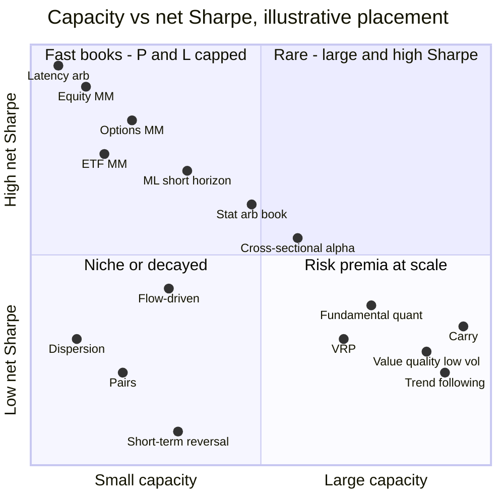
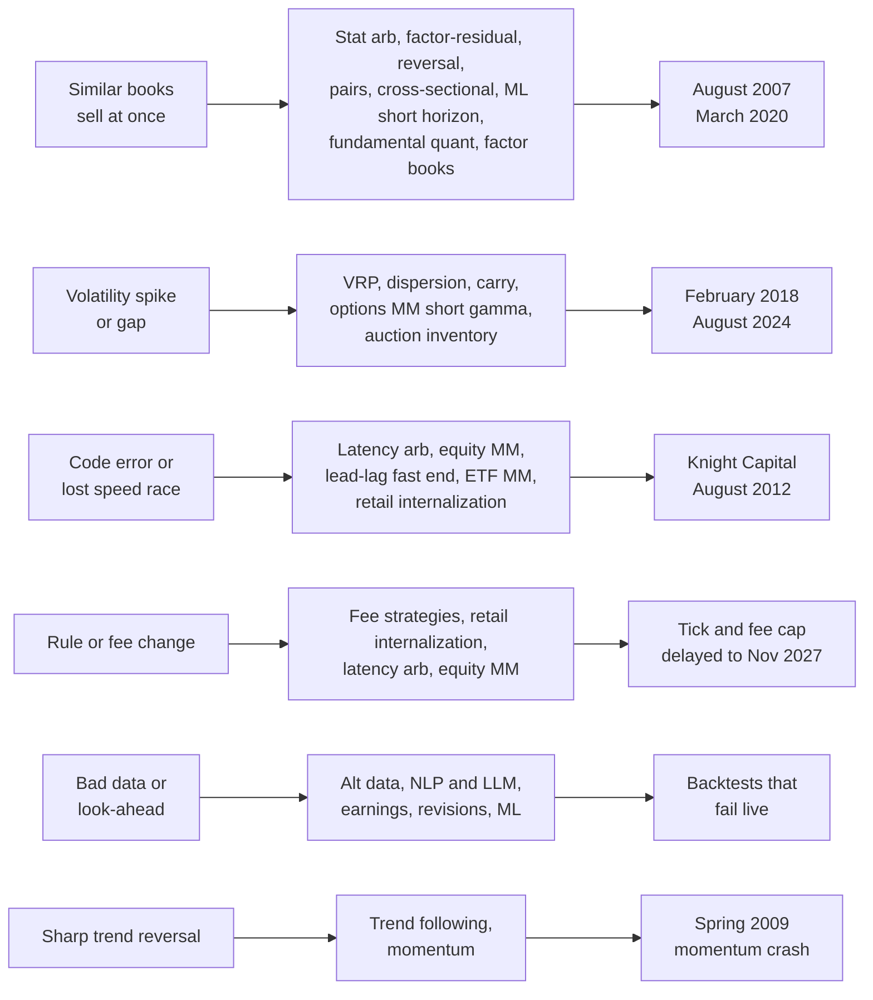
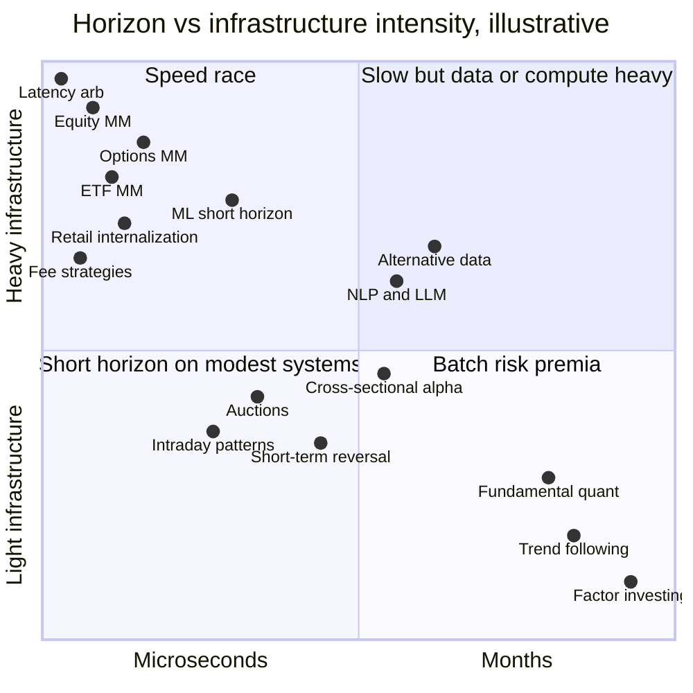

# Strategy comparison matrix

> **TL;DR**
>
> - One row per dossier, condensed from its header table, with the confidence tags carried over. Treat every number as an order of magnitude and click through for the reasoning.
> - Capacity and Sharpe trade off. Market-making and speed books show Sharpe ratios above 3 where the number means anything, on profit pools of a few \$B a year for the whole industry; risk-premia books run tens of billions at net Sharpe 0.3–0.7.
> - Evidence quality runs the other way: slow strategies' Sharpe ratios are `[Verified]` from decades of public data, fast strategies' are mostly `[Lore]`.
> - Strategies cluster by failure mode: crowded deleveraging (stat arb, mid-frequency alpha, factors), short convexity (volatility selling, dispersion, carry, options market making), and technology or rule changes (speed and market making). Diversify across clusters, not across rows.

**Level:** Core · **Read time:** ~11 min · **Last verified:** 2026-11

Every [dossier](../index.md) opens with the same header table, so the 30 strategies compare directly. This page lines them up. Cells are compressed to a few words; the dossier holds the period, source type and reasoning behind each figure.

## The matrix

*Abbreviations: LP = liquidity provision · info = informational · GMV = gross market value (longs plus shorts) · MM = market making · n/m = not meaningful · ms / µs = milliseconds / microseconds. "→" separates gross from net Sharpe.*

| Strategy | Family | Edge source | Holding period | Capacity (rough, tagged) | Typical Sharpe, gross → net (tagged) | Turnover | Infra intensity | Crowding risk | Main failure mode |
|---|---|---|---|---|---|---|---|---|---|
| [Equity market making](../a-liquidity-provision/equity-market-making.md) | A · Liquidity | LP · speed | seconds to minutes | P&L-capped: \$1–3B/yr US industry `[Estimate]` | n/m on capital; one case 9.35 gross `[Verified]` | extreme: ~1,400 trades per stock a day `[Verified]` | extreme: colocation, FPGAs, microwave | high: few firms race for queues | adverse-selection spikes, technology failure |
| [ETF market making](../a-liquidity-provision/etf-market-making.md) | A · Liquidity | LP · structural | seconds to hours | P&L-capped: up to ~\$2B/yr, top book `[Estimate]` | no disclosure; gross >3, diversified books `[Lore]` | very high: many turns a day | high: thousands of tickers, RFQ systems | high in big funds; lower niche | unpriceable baskets, hedge basis breaks |
| [Options market making](../a-liquidity-provision/options-market-making.md) | A · Liquidity | LP · speed | hedges ms; options hours to weeks | flow-capped: \$3–9B/yr industry gross `[Estimate]` | net 3–10 flow books, 1–3 vega books `[Lore]` | options days; hedges hundreds a day `[Lore]` | very high: µs requotes, surface refits | moderate: few dealers, positioned alike | short-gamma gaps, vol and skew spikes |
| [Retail flow internalization](../a-liquidity-provision/retail-flow-internalization.md) | A · Liquidity | LP · structural | seconds to minutes | retail-volume-capped: several \$B/yr industry `[Estimate]` | n/m on capital; few losing days `[Lore]` | shares held seconds to minutes `[Lore]` | high: µs pricing, no queue race | moderate: competition for broker routing | correlated retail surges, PFOF bans |
| [Auctions and closing liquidity](../a-liquidity-provision/auctions-and-closing-liquidity.md) | A · Liquidity | LP · structural | overnight to a few days | \$50M–\$500M overnight inventory a day `[Estimate]` | no public figures; fat left tail `[Lore]` | ~100% of inventory a day | moderate: one-second imbalance feeds, cutoffs | high on known index events | overnight gaps, informed imbalances |
| [Latency arbitrage](../b-speed-and-structural/latency-arbitrage.md) | B · Speed | speed · structural | microseconds to seconds | P&L-capped: US pool \$1–3B/yr `[Estimate]` | n/m; fastest ≫5 gross, runner-up ~0 `[Lore]` | extreme: ~1 race per minute per stock `[Verified]` | extreme: FPGAs, microwave, colocation | extreme: winner-take-most | losing latency rank, false triggers |
| [Lead-lag and cross-asset arbitrage](../b-speed-and-structural/lead-lag-and-cross-asset-arbitrage.md) | B · Speed | speed · info | ms to minutes; hours for ADRs | fast end: tens of \$M/yr P&L `[Estimate]` | statistical end: 2–4 → 1–2 `[Estimate]` | very high; flat intraday | extreme at fast end; low for ADRs | high fast; moderate statistical | beta breaks on stock news |
| [ETF and index arbitrage](../b-speed-and-structural/etf-and-index-arbitrage.md) | B · Speed | structural · speed | ms to a day; basis to expiry | \$0.3–2B/yr US industry P&L `[Estimate]` | none disclosed; premium trades ~7% gross `[Verified]` | very high | extreme vs futures; otherwise moderate | extreme in SPY and ES | leg risk, halts, illiquid baskets |
| [Fee- and microstructure-driven strategies](../b-speed-and-structural/fee-and-microstructure-driven-strategies.md) | B · Speed | structural · LP | ms to minutes | \$10–100M/yr net, large MM `[Estimate]` | rarely standalone; ~0 net sub-scale `[Estimate]` | very high; flat by the close | medium-high: colocation, direct feeds | high: rebates competed away | fee, tier and rule changes |
| [Stat arb: overview and history](../c-statistical-arbitrage/stat-arb-overview-and-history.md) | C · Stat arb | LP · behavioral | hours to ~10 days | \$0.5–5B GMV per book `[Estimate]` | diversified books net 1–3 `[Lore]` | 20–60% of GMV a day `[Lore]` | moderate: daily to intraday rebalances | high: shared signals, risk models | crowded deleveraging, factor leakage |
| [Pairs trading and cointegration](../c-statistical-arbitrage/pairs-trading-and-cointegration.md) | C · Stat arb | LP · behavioral | days to weeks | \$50M–\$500M gross per firm `[Estimate]` | ≈2.0 (1962–2002) `[Estimate]` → 0–1 `[Lore]` | ~7× committed capital a year (Lab 08) | low: overnight batch | medium to high: same public screens | relationship breaks, false discoveries |
| [Factor-residual mean reversion](../c-statistical-arbitrage/factor-residual-mean-reversion.md) | C · Stat arb | LP · behavioral | 1–15 days | \$100M–\$1B GMV, plain signal `[Estimate]` | 1.44 net, 1997–2007 `[Verified]`; 1–2 in book `[Lore]` | 40–60× gross a year `[Estimate]` | moderate: daily or intraday batch | high: published recipe, shared data | crowded unwinds, residuals drift on news |
| [Short-term cross-sectional reversal](../c-statistical-arbitrage/short-term-cross-sectional-reversal.md) | C · Stat arb | LP · behavioral | 1 day to 1 month | \$100M–\$1B standalone `[Estimate]` | gross 0.15 since 1992 `[Verified]`; net ≤0 `[Estimate]` | 50–100× gross book a year `[Estimate]` | moderate: execution matters more than latency | high: in nearly every stat-arb book | cost-model error, informed moves persist |
| [Intraday patterns and seasonality](../c-statistical-arbitrage/intraday-patterns-and-seasonality.md) | C · Stat arb | structural · behavioral | minutes to hours; calendar trades longer | \$50M–\$1B, by sleeve `[Estimate]` | standalone net 0.3–0.8 `[Lore]` | one round trip a day; calendar monthly | moderate: minute data, imbalance feed | high at the close | hedging-regime flips, calendar data snooping |
| [ML-driven short-horizon alpha](../c-statistical-arbitrage/ml-driven-short-horizon-alpha.md) | C · Stat arb | info · LP | minutes to 1–2 days | \$200M–\$2B GMV per book `[Estimate]` | net 2–6 small, 1–2 at scale `[Lore]` | 50–200% of GMV a day `[Estimate]` | high: GPU research, fast execution | high: similar features, same data | overfitting, leakage, regime breaks |
| [Cross-sectional alpha and neutralization](../d-mid-frequency-alpha/cross-sectional-alpha-and-neutralization.md) | D · Mid-freq | behavioral · info | 1–20 trading days | \$1–10B GMV per book `[Estimate]` | 1.5–3 → 1–2 `[Lore]` | 10–40% of GMV a day `[Lore]` | low latency; heavy batch research | high: shared data, risk models | crowded deleveraging, cost-model error |
| [Fundamental quant signals](../d-mid-frequency-alpha/fundamental-quant-signals.md) | D · Mid-freq | risk premium · behavioral | 1–12 months | \$1–20B+ per strategy `[Estimate]` | factors 0.3–0.5 gross `[Estimate]`; composite net 0.5–1.0 `[Lore]` | 100–300% of GMV a year `[Lore]` | negligible latency; data engineering | high: same Compustat fields, papers | long value drawdowns, junk rallies |
| [Earnings and event-driven](../d-mid-frequency-alpha/earnings-and-event-driven.md) | D · Mid-freq | behavioral · LP | 1–60 days; merger arb to close | \$100M–\$2B, standalone PEAD `[Estimate]` | PEAD gross ≈0 ex-microcaps since 2006, contested `[Verified]` | high, lumpy around events | moderate: minutes for reaction, days for drift | high: same consensus, same formula | overnight gaps, stale consensus, deal breaks |
| [Analyst revisions and sentiment](../d-mid-frequency-alpha/analyst-revisions-and-sentiment.md) | D · Mid-freq | info · behavioral | days to 1–3 months | \$1–5B as a component `[Estimate]` | adds 0.2–0.5 net in composite `[Lore]` | revisions 1–4×/yr; news 20–50%/day `[Lore]` | overnight batch; real-time news feeds | high: standard in factor libraries | short squeezes, vendor-signal crowding |
| [Flow-driven strategies](../d-mid-frequency-alpha/flow-driven-strategies.md) | D · Mid-freq | LP · structural | days to weeks | \$100M–\$1B per firm `[Estimate]` | net 0.5–1.5, lumpy `[Lore]` | 20–50× capital a year `[Estimate]` | low to moderate: closing-auction execution | very high: everyone reads the methodology | wrong lists, crowded exits |
| [Alternative data](../d-mid-frequency-alpha/alternative-data.md) | D · Mid-freq | info | days to weeks, before earnings | \$50M–\$500M GMV per sleeve `[Estimate]` | single dataset: net 0.3–1.0 `[Lore]` | 2–6× a year, lumpy `[Estimate]` | low latency; heavy data engineering | high for card panels; low exclusive | panel drift, backfill, MNPI exposure |
| [NLP and LLM signals](../d-mid-frequency-alpha/nlp-and-llm-signals.md) | D · Mid-freq | info · behavioral | seconds (news) to months (filings) | news \$50–500M; filings \$1–5B `[Estimate]` | adds 0.2–0.5 net in composite `[Lore]` | news 30–100%/day; filings 1–3×/yr `[Estimate]` | ms news feeds; GPU batch inference | high for vendor and LLM scores | pretraining look-ahead, bad timestamps |
| [Factor investing fundamentals](../e-risk-premia-and-factors/factor-investing-fundamentals.md) | E · Factors | risk premium · behavioral | months | \$5–50B per long-short manager `[Estimate]` | equal-risk mix 0.71 gross; live 0.54 net `[Verified]` | 20–100% a year; momentum more `[Estimate]` | no latency; monthly batch | high: same papers, data, breakpoints | multi-year drawdowns, momentum crashes |
| [Momentum](../e-risk-premia-and-factors/momentum.md) | E · Factors | behavioral · risk premium (contested) | monthly rebalance; held ~4 months `[Estimate]` | \$1–20B per manager `[Estimate]` | UMD gross 0.46 `[Verified]`; net 0.05–0.15 lower `[Estimate]` | 5–8× gross book a year `[Estimate]` | low: monthly batch | high: standard in risk models `[Lore]` | crashes in rebounds after bear markets |
| [Value, quality and low volatility](../e-risk-premia-and-factors/value-quality-low-vol.md) | E · Factors | risk premium · behavioral | 3–12 months | \$10B+ per long-short manager `[Estimate]` | gross 0.34–0.70 `[Verified]`; net 0.1–0.3 lower `[Estimate]` | 30–80% a year `[Estimate]` | no latency; monthly batch | high: quality and min-vol products | growth bubbles, junk rallies, rate shocks |
| [Factor timing, crowding and quant winters](../e-risk-premia-and-factors/factor-timing-crowding-and-quant-winters.md) | E · Factors | risk premium; timing adds behavioral | months to years | the factor book's (an overlay) `[Estimate]` | overlay adds 0–0.2 gross `[Estimate]` | low; monthly for factor momentum | low: daily risk batch | the subject of the page | cheap factors get cheaper; de-grossing lows |
| [Volatility risk premium and vol arb](../f-volatility-and-derivatives/volatility-risk-premium-and-vol-arb.md) | F · Vol | risk premium · structural | 1 week to 3 months | \$0.1–5B notional per manager `[Estimate]` | ~1.2 `[Estimate]` → 0.3–0.8 `[Lore]` | monthly roll; daily delta hedges | low latency; daily surface fits | high: income ETFs sell same risk | crashes, vol spikes, margin calls |
| [Dispersion and correlation trading](../f-volatility-and-derivatives/dispersion-and-correlation-trading.md) | F · Vol | risk premium · structural | weeks to months | a few \$M index vega per firm `[Estimate]` | net 0.3–0.8 over a cycle `[Lore]` | monthly or quarterly rolls; daily hedges | moderate: daily surfaces, 50+ names | high in 2024–2026 `[Reported]` | correlation spikes, index gaps |
| [Trend following and CTAs](../g-futures-and-macro-context/trend-following-and-ctas.md) | G · Futures | behavioral · risk premium | weeks to months | tens of \$B per manager `[Estimate]` | >1.0 backtest `[Verified]` → 0.3–0.6 `[Estimate]` | notional 50–150× NAV a year `[Estimate]` | low latency; daily batch, roll algos | moderate: 0.95 correlation to peers `[Reported]` | whipsaw, V-shaped reversals |
| [Carry and cross-asset risk premia](../g-futures-and-macro-context/carry-and-cross-asset-risk-premia.md) | G · Futures | risk premium · structural | 1–3 months | tens of \$B per program `[Estimate]` | global factor 1.10 gross, 1972–2012 `[Verified]` | a few times notional a year `[Estimate]` | low: daily batch, roll management | high in FX: ~\$250B yen carry `[Verified]` | high-yielder crashes, funding squeezes |

## How to read this table

**Capacity comes in three units, and they do not compare.** For portfolio strategies (families C–G) it is the gross market value or notional one firm can run before costs eat the edge. For market making and speed (A–B) capital is not what binds; the flow available to intermediate is, so the dossiers quote an annual profit pool, usually for the whole industry. Dispersion quotes vega. "\$1–3B a year of P&L" and "\$1–10B of GMV" describe different things.

**The Sharpe column mixes sources on purpose.** An arrow separates gross from net when the dossier gives both; otherwise the cell says which. Academic gross backtests are upper bounds, measured over different decades, and published anomalies lose about 58% of their in-sample return after publication (McLean and Pontiff 2016) `[Verified]`. For a market maker, [Sharpe ratio](../../09-reference/glossary.md#sharpe-ratio) on capital is "n/m": the capital at risk is small, and technology, data and staff costs, not volatility, decide whether the business pays.

**[Turnover](../../09-reference/glossary.md#turnover) times cost is the drag.** A book trading 50× its GMV a year at 5 bps per dollar traded pays 2.5% of GMV a year before any alpha (illustrative). That is why the short-horizon rows live or die by their [transaction cost models](../../03-algorithms/d-portfolio-construction/transaction-cost-and-impact-models.md).

**Tags rank trust:** `[Verified]` primary source > `[Reported]` credible secondary > `[Estimate]` our derivation > `[Lore]` unverified practitioner talk.

## Patterns worth noticing

### 1. Capacity and Sharpe trade off

*Positions are approximate and illustrative, read off the table above. Market-making Sharpe is measured on the small capital those books use.*

The upper-right quadrant is nearly empty. The reason is [market impact](../../09-reference/glossary.md#market-impact): under the [square-root law](../../09-reference/glossary.md#square-root-law), cost per dollar traded rises with the square root of trade size, so total cost grows like size^1.5 while gross alpha grows like size. Profit peaks at 4/9 of the break-even size (derivation in the [reversal dossier](../c-statistical-arbitrage/short-term-cross-sectional-reversal.md)). Fast strategies hit that wall early because they trade their book 50–250 times a year; factor and trend books trade it a few times a year and run tens of billions.

### 2. Short horizons show higher Sharpe

The [fundamental law of active management](../../09-reference/glossary.md#fundamental-law-of-active-management) says the information ratio is roughly skill per bet times the square root of independent bets per year, the [breadth](../../09-reference/glossary.md#breadth) (Grinold 1989) `[Verified]`. Illustrative: a daily residual book with an [IC](../../09-reference/glossary.md#information-coefficient-ic) of 0.01 and ~200 independent bets a day has breadth of about 50,000, so IR ≈ 0.01 × 224 ≈ 2.2. A monthly factor book with IC 0.05 but only ~20 independent bets a month has breadth 240 and IR ≈ 0.8. A market maker's day is thousands of nearly independent small bets, which is how Virtu's IPO filing could show one losing day in 1,238 `[Reported]`. The catch is the previous section: breadth bought with turnover runs into capacity.

### 3. The best numbers have the weakest evidence

The `[Verified]` Sharpe ratios cluster in families E–G, computed from public data spanning four decades or more. Nearly every market-making and speed figure is `[Lore]` or a single academic case study, because those firms do not publish strategy returns. The most reliable numbers in the table are the lowest ones.

### 4. Failure modes and crowding cluster

*Trigger → strategies that lose together → dated episode. Grouping drawn from each dossier's failure-mode field.*

"High" [crowding](../../09-reference/glossary.md#crowding) appears in most rows; what matters is who is crowded with whom. In August 2007 stat-arb and factor books lost together, consistent with a rapid unwind of overlapping positions (Khandani and Lo 2011) `[Verified]`. The short-convexity rows lose in the same volatility spike. The speed rows fail one firm at a time, through code or lost latency rank, or all at once through rule changes such as the half-penny tick and 10-mil access-fee cap, now delayed to November 2027 `[Verified]`. Episodes are in the [failure gallery](strategy-failure-gallery.md).

### 5. Complements for a multi-strategy book

Rows from different clusters diversify each other; rows from the same cluster do not. Trend following had about zero correlation to US equities over 1880–2013 and made money in 8 of the 10 worst 60/40 drawdowns (Hurst, Ooi and Pedersen) `[Verified]`, the opposite profile to volatility selling and carry. Value and momentum correlated −0.19 month to month over 1963–2026 `[Verified]` (our computation, French data). Short-term reversal's expected return rises with the VIX (Nagel 2012) `[Verified]`, but only after the drawdown: in March 2020 the daily factor lost 18.4% before gaining 31.7% `[Verified]`. Capacity complements too: small, high-Sharpe books add return per unit of risk, while large, low-Sharpe books absorb capital. [How firms combine strategies](how-firms-combine-strategies.md) gives the arithmetic, including the $S/\sqrt{\rho}$ ceiling that crowding imposes.

### 6. Horizon and infrastructure

*Heavy means latency-critical hardware, large data engineering or GPU research compute. Positions are illustrative.*

Infrastructure falls with horizon, with two exceptions: alternative data and NLP are slow but data- and GPU-heavy, and ML short-horizon books need both research compute and fast execution. [How infrastructure constrains algorithms](../../05-infrastructure/how-infrastructure-constrains-algorithms.md) maps latency budgets to hardware.

## Related pages

- [Strategies: the map](../index.md)
- [How quants evaluate a strategy](../how-quants-evaluate-a-strategy.md)
- [How firms combine strategies](how-firms-combine-strategies.md)
- [Strategy × algorithm matrix](strategy-x-algorithm-matrix.md)
- [Strategy failure gallery](strategy-failure-gallery.md)
- [Evolution of quant strategies](evolution-of-quant-strategies.md)
- [Transaction cost and impact models](../../03-algorithms/d-portfolio-construction/transaction-cost-and-impact-models.md)

## Sources

- [Verified] Grinold, R. C. (1989). "The fundamental law of active management." *Journal of Portfolio Management* 15(3), 30–37. <https://doi.org/10.3905/jpm.1989.409211> (accessed 2026-11)
- [Verified] McLean, R. D. & Pontiff, J. (2016). "Does Academic Research Destroy Stock Return Predictability?" *Journal of Finance* 71(1), 5–32. <https://doi.org/10.1111/jofi.12365> (accessed 2026-11)
- [Verified] Menkveld, A. J. (2013). "High frequency trading and the new market makers." *Journal of Financial Markets* 16(4), 712–740. <https://doi.org/10.1016/j.finmar.2013.06.006> (accessed 2026-11)
- [Verified] Aquilina, M., Budish, E. & O'Neill, P. (2022). "Quantifying the High-Frequency Trading 'Arms Race'." *Quarterly Journal of Economics* 137(1), 493–564. <https://doi.org/10.1093/qje/qjab032> (accessed 2026-11)
- [Verified] Avellaneda, M. & Lee, J.-H. (2010). "Statistical arbitrage in the US equities market." *Quantitative Finance* 10(7), 761–782. <https://doi.org/10.1080/14697680903124632> (accessed 2026-11)
- [Verified] Gatev, E., Goetzmann, W. N. & Rouwenhorst, K. G. (2006). "Pairs Trading: Performance of a Relative-Value Arbitrage Rule." *Review of Financial Studies* 19(3), 797–827. <https://doi.org/10.1093/rfs/hhj020> (accessed 2026-11)
- [Verified] Khandani, A. E. & Lo, A. W. (2011). "What happened to the quants in August 2007? Evidence from factors and transactions data." *Journal of Financial Markets* 14(1), 1–46. <https://doi.org/10.1016/j.finmar.2010.07.005> (accessed 2026-11)
- [Verified] Nagel, S. (2012). "Evaporating Liquidity." *Review of Financial Studies* 25(7), 2005–2039. <https://doi.org/10.1093/rfs/hhs066> (accessed 2026-11)
- [Verified] Novy-Marx, R. & Velikov, M. (2016). "A Taxonomy of Anomalies and Their Trading Costs." *Review of Financial Studies* 29(1), 104–147. <https://doi.org/10.1093/rfs/hhv063> (accessed 2026-11)
- [Verified] Hurst, B., Ooi, Y. H. & Pedersen, L. H. (2017). "A Century of Evidence on Trend-Following Investing." *The Journal of Portfolio Management* 44(1), 15–29. <https://doi.org/10.3905/jpm.2017.44.1.015> (accessed 2026-11)
- [Verified] Koijen, R. S. J., Moskowitz, T. J., Pedersen, L. H. & Vrugt, E. B. (2018). "Carry." *Journal of Financial Economics* 127(2), 197–225. <https://doi.org/10.1016/j.jfineco.2017.11.002> (accessed 2026-11)
- [Verified] French, K. R. "Data Library: Fama/French factors, momentum and short-term reversal factors," monthly through 2026-09 (Sharpe ratios and correlations quoted here are the dossiers' computations). <https://mba.tuck.dartmouth.edu/pages/faculty/ken.french/data_library.html> (accessed 2026-11)
