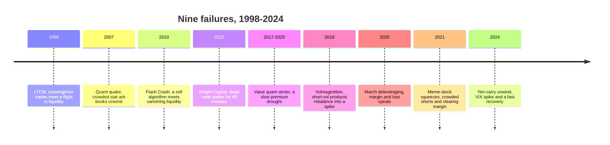
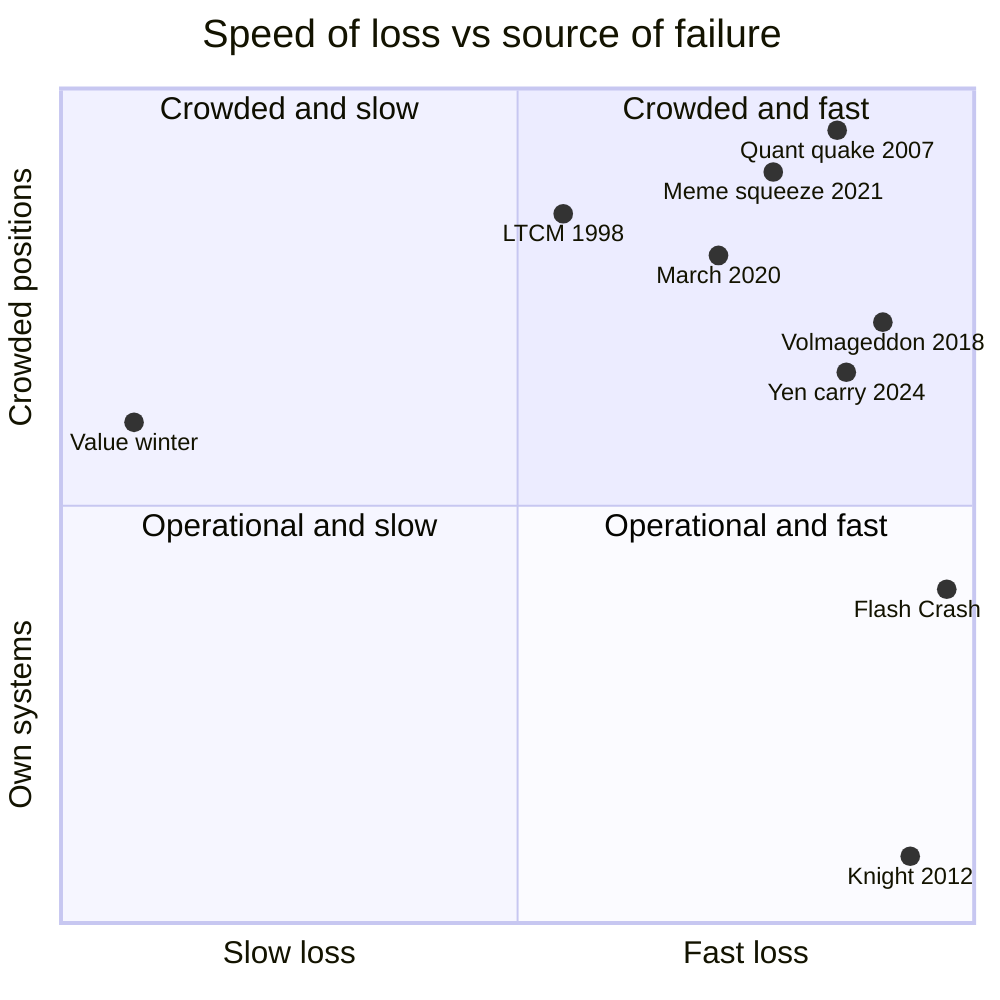
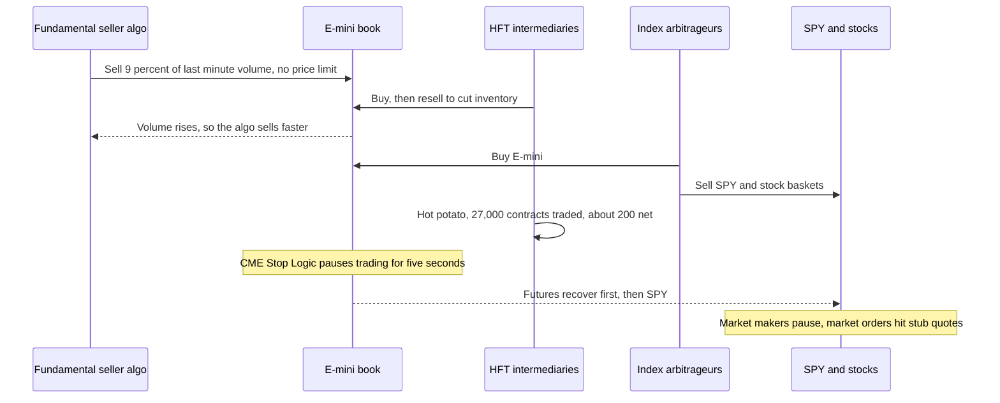
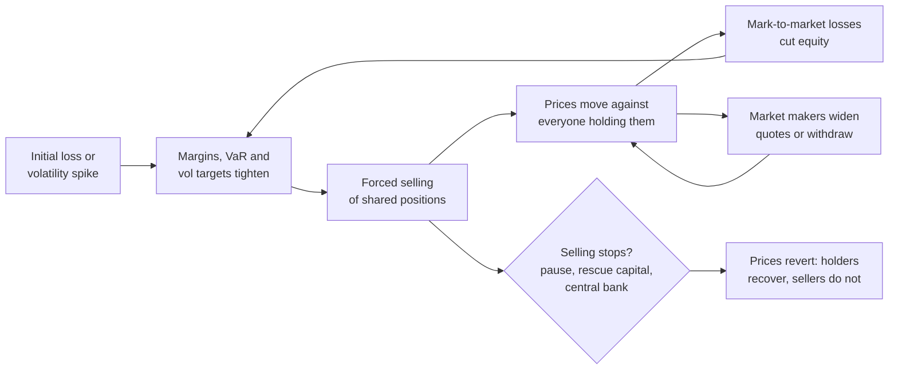

# Strategy failure gallery

> **TL;DR**
>
> - Nine documented episodes, three kinds of failure. Most were crowded, levered positions unwinding into thin liquidity (1998, 2007, 2018, 2020, 2021, 2024). Two were machines doing exactly what they were told (2010, 2012). One was a slow drought rather than a crash (value, 2017–2020).
> - The common engine is a feedback loop. Losses force selling, the selling moves prices, and the new prices force more selling. Leverage sets how fast the loop runs; liquidity sets how far prices go.
> - Many of these losses reversed for anyone who could keep holding. Khandani and Lo's model stat-arb strategy lost 6.85% over 7–9 August 2007 and made back 5.92% on 10 August `[Verified]`. Survival depended on leverage and on rules agreed in advance, not on the signal.
> - Much of today's US equity rulebook was written after these days: LULD bands and new circuit breakers (after 2010), the first big market access rule case (Knight, 2013), T+1 settlement (after 2021).
> - The practical lessons repeat. Size positions by stress loss, not volatility. Measure crowding. Keep risk checks independent of strategy code. Never let a calm-period hedge ratio or a pre-market quote-based index drive automatic de-risking.

**Level:** Core · **Read time:** ~22 min · **Last verified:** 2026-11

Every strategy has a way it dies, and that is part of its specification. The cases below follow one format: the strategy involved, the loss mechanism step by step with the numbers, who was on the other side, what changed afterwards, and lessons for quants. Each links to the dossiers and algorithm cards that cover the machinery. Fund-level loss figures come from press reports and are tagged `[Reported]`. Mechanism figures come from regulators' reports, papers or our own computations on public data.

| Episode | Date | Strategy family | Mechanism | Loss magnitude | What changed |
|---|---|---|---|---|---|
| LTCM | Aug–Sep 1998 | Convergence / relative-value arbitrage | About 30:1 balance-sheet leverage meets a flight to liquidity | Fund down 52% for the year by 31 Aug `[Verified]` | Fed-brokered \$3.6B private rescue; official focus on leverage and counterparty risk |
| Quant quake | 6–10 Aug 2007 | Equity market-neutral stat arb and factors | Forced liquidation of crowded books; market makers step back | Model book about −25% in 3 days at 8:1 `[Verified]`; one large fund over −30% in a week `[Reported]` | Crowding treated as a risk factor; less leverage `[Lore]` |
| Flash Crash | 6 May 2010 | Execution algorithm, HFT market making, index arbitrage | Sell algorithm with no price limit; liquidity withdraws; stub quotes fill | E-mini −5%+ and SPY −6%+ in 4.5 minutes; 20,000+ trades broken `[Verified]` | Single-stock circuit breakers, stub-quote ban, market access rule, then LULD and new market-wide breakers |
| Knight Capital | 1 Aug 2012 | Retail market making (order router) | Dead code woken by a botched deployment; no check of orders against fills | Over \$460M in about 45 minutes `[Verified]` | First big market access rule case (\$12M); Knight rescued, then merged |
| Value "quant winter" | Dec 2016–Sep 2020 | Value and multi-factor quant equity | Premium drought; cheap stocks got cheaper | HML −51% `[Verified]`; one flagship style fund −19.2% in 2020 `[Reported]` | Value redefined and diluted; sharp but partial rebound in 2021–2022 |
| "Volmageddon" | 5 Feb 2018 | Short volatility via inverse VIX products | Mechanical end-of-day rebalancing into a volatility spike | VIX +115.6% in a day `[Verified]`; XIV −96% `[Reported]` | XIV terminated; surviving products cut their multiples |
| March 2020 | late Feb–Mar 2020 | Quant equity, volatility targeting, relative value | Margin and loss spirals in a "dash for cash" | HML −13.8% in March `[Verified]`; a flagship quant fund −19% in 2020 `[Reported]` | Official work on margin procyclicality; crisis-beta hedging |
| Meme-stock squeezes | Jan 2021 | Short selling; retail internalization | Retail and call buying against crowded shorts; clearing margin calls | One large short fund −53% in January `[Reported]` | SEC staff report; T+1 (2024); short-sale reporting (deferred); payment-for-order-flow scrutiny |
| Yen-carry unwind | 2–5 Aug 2024 | FX carry, short volatility, dispersion, trend | Deleveraging, margin hikes, quote-driven VIX spike | TOPIX −12% in a day; VIX near 66 pre-market `[Verified]` | No new rules; debate over VIX construction and margin procyclicality |



The quadrant chart places each episode by how fast the loss arrived and by whether the cause was the firm's own systems or positions it shared with others. Placements are our judgment `[Estimate]`.



## 1. LTCM and the convergence trade (August–September 1998)

*Strategy:* convergence arbitrage, a close neighbour of [statistical arbitrage](../../09-reference/glossary.md#statistical-arbitrage). Buy the cheaper of two near-identical claims, short the dearer one, and lever the small spread. About 80% of LTCM's securities were G-7 government bonds `[Verified]` (CRS 1999).

**Loss mechanism, step by step**

1. **Scale.** In spring 1998 LTCM had about \$3.5B of investor equity. It held about \$100B of securities through repo and short sales, about \$500B of futures and about \$750B of OTC derivatives notional. On securities alone that is roughly 30:1 leverage `[Verified]` (CRS). At the end of 1997 it had returned \$2.75B of capital to investors without cutting its positions, which raised leverage `[Verified]` (Greenspan; McDonough).
2. **Fragility.** Illustrative: at 30:1, a spread worth 0.2% of the gross book earns 6% on equity when it converges, and a 0.2% move against the book costs 6% of equity. A 1.7% adverse move halves equity (0.5 ÷ 30) `[Estimate]`. The edge belongs only to a holder who can sit through the marks.
3. **Shock.** After Russia's August default, investors fled to the most liquid Treasuries. The spreads LTCM was paid to own widened instead of narrowing `[Verified]` (CRS).
4. **Correlation.** Positions chosen to be independent moved together, because the same flight to liquidity drove all of them `[Verified]` (CRS).
5. **Loss.** On 2 September LTCM told investors it was down 52% for the year through 31 August `[Verified]` (McDonough). The VIX had closed at 44.3 on 31 August `[Verified]` (FRED).

**Who was on the other side.** Investors paying up for liquidity and safety, and dealers who knew LTCM's positions and could trade ahead of a forced seller `[Lore]`. LTCM had more than 75 counterparties. A disorderly close-out of hundreds of billions of dollars of positions could have cost some of them several billion dollars `[Verified]` (McDonough).

**What changed.** On 23 September, 14 banks and securities firms, convened by the New York Fed, injected about \$3.6B for roughly 90% of the fund, heavily diluting the original investors `[Verified]` (McDonough; CRS; Greenspan). The President's Working Group report of April 1999 named excessive leverage as the core policy problem and called for better counterparty risk management and more disclosure `[Verified]` (CRS). Greenspan said creditors had not stress-tested their exposures `[Verified]`.

**Lessons for quants**

- A convergence trade is short liquidity. It loses at exactly the moment liquidity is scarce.
- Correlations estimated in calm markets understate correlations in a crisis ([P2](../../03-algorithms/d-portfolio-construction/covariance-estimation-and-shrinkage.md)).
- If competitors know your positions, they become part of your risk model.
- Convergence is certain only at maturity, if at all. The marks before then decide whether you are still there to collect it.

*Go deeper:* [stat arb overview](../c-statistical-arbitrage/stat-arb-overview-and-history.md) · [pairs trading](../c-statistical-arbitrage/pairs-trading-and-cointegration.md) · [P1 risk models](../../03-algorithms/d-portfolio-construction/risk-models.md) · [P7 position sizing](../../03-algorithms/d-portfolio-construction/position-sizing-and-risk-budgeting.md).

## 2. The August 2007 quant quake

*Strategy:* equity market-neutral stat arb and multi-factor long-short books, run at high leverage by many firms with overlapping signals. This is the canonical [quant quake](../../09-reference/glossary.md#quant-quake).

**Loss mechanism, step by step** (Khandani & Lo 2007, 2011)

1. **Alpha decay, then leverage.** A simple daily contrarian strategy ([short-term reversal](../../09-reference/glossary.md#short-term-reversal)) earned a mean of 1.38% a day in 1995, falling to 0.13% in 2007 to August. Matching 1998's expected return would have needed almost 9:1 leverage in 2007 `[Verified]`.
2. **Trigger (hypothesis).** In July, losses elsewhere led at least one large multi-strategy fund or bank desk to liquidate a quant equity book quickly. The authors call this a speculative hypothesis built on indirect evidence `[Verified]`. Using transactions data, their 2011 paper dates the sustained unwind to the open on 6 August, after deleveraging through July `[Verified]`.
3. **Unwind.** On 7, 8 and 9 August the base strategy (2:1 gross-to-capital, the Reg T convention the authors use) lost 1.16%, 2.83% and 2.86%. The total, −6.85%, was 12 daily standard deviations at its 2006 volatility `[Verified]`.
4. **Leverage.** At 8:1, four times the base, the same days read −4.64%, −11.33% and −11.43%, a quarter of capital in three days `[Verified]`. Market makers pulled back from 8 August, and other funds' stop-losses and de-grossing added to the selling on 8–9 August `[Verified]`.
5. **Reversal.** On 10 August the strategy made 5.92% (11.4 standard deviations). Its return for the whole week was −0.43% `[Verified]`.

Reported fund results: one Renaissance fund −8.7% so far in August (WSJ, 10 August); Highbridge Statistical Opportunities −18% to 8 August; Goldman's Global Equity Opportunities fund down more than 30% in a week (WSJ, cited by Khandani & Lo) `[Reported]`. Goldman's CFO described "25-standard deviation moves, several days in a row" `[Reported]`.

**Who was on the other side.** Whoever had balance sheet and nerve. On 13 August Goldman and outside investors put \$3B into the Global Equity Opportunities fund, in effect buying the unwind `[Verified]`. Market makers who stayed in charged wide spreads; those who withdrew on 8 August made every forced sale move prices further. Funds that de-grossed at the bottom handed the 10 August rebound to whoever bought from them.

**What changed.** Crowding became a risk factor that firms measure: peer overlap, prime-broker crowding reports, residual co-movement ([comomentum](../../09-reference/glossary.md#comomentum)) `[Reported]`. Leverage on these books came down, and de-grossing rules began to be written in advance `[Lore]`.

**Lessons for quants**

- Your risk model sees your factors, not your neighbours' portfolios. [Crowding](../../09-reference/glossary.md#crowding) is a hidden common factor.
- A 12-sigma day means the return distribution was wrong, not that you were unlucky.
- Selling into an unwind turns a temporary mark-to-market loss into a realized one. The worked [deleveraging](../../09-reference/glossary.md#deleveraging) example in the factor-timing dossier shows the arithmetic.

*Go deeper:* [factor timing, crowding and quant winters](../e-risk-premia-and-factors/factor-timing-crowding-and-quant-winters.md) · [short-term reversal](../c-statistical-arbitrage/short-term-cross-sectional-reversal.md) · [factor-residual mean reversion](../c-statistical-arbitrage/factor-residual-mean-reversion.md) · [F6 regime detection](../../03-algorithms/b-forecasting-models/regime-detection.md) · [P7 position sizing](../../03-algorithms/d-portfolio-construction/position-sizing-and-risk-budgeting.md).

## 3. The Flash Crash (6 May 2010)

*Strategies:* an execution algorithm hedging a \$4.1B equity position; [HFT](../../09-reference/glossary.md#high-frequency-trading-hft) intermediaries in the E-mini; cross-market [index arbitrage](../../09-reference/glossary.md#index-arbitrage); equity market makers and retail internalizers.

**Loss mechanism, step by step** (CFTC-SEC staff report, 2010-09-30)

1. **Fragile start.** Markets were already down over 4% on European debt news. E-mini buy-side depth had fallen 55%, from nearly \$6B to \$2.65B `[Verified]`.
2. **The sell program.** At 2:32 p.m. a mutual fund complex began selling 75,000 E-minis (about \$4.1B) to hedge an equity position. Its algorithm targeted 9% of the previous minute's volume, "without regard to price or time". A similar program had earlier taken more than five hours `[Verified]`.
3. **Volume is not liquidity.** HFTs bought, then resold to cut inventory. The extra volume made the algorithm sell faster. From 2:41 to 2:44 the E-mini fell about 3%, and arbitrageurs who bought it sold SPY and stock baskets `[Verified]`.
4. **Hot potato.** Between 2:45:13 and 2:45:27, HFTs traded over 27,000 contracts, 49% of volume, but added only about 200 contracts net. Buy-side depth fell to about \$58M, under 1% of the morning level. In 4.5 minutes the E-mini fell more than 5% and SPY more than 6% `[Verified]`.
5. **Pause.** CME's Stop Logic halted the E-mini for five seconds at 2:45:28, and prices recovered `[Verified]`.
6. **Stocks.** Liquidity providers' automatic pauses fired together. Internalizers routed retail orders, including stop-losses, to exchanges. Over 20,000 trades in more than 300 securities executed 60% or more away from 2:40 prices, some at stub quotes of a penny or \$100,000, and were broken `[Verified]`.



**Who was on the other side.** In the 13 minutes from 2:32, fundamental buyers absorbed about 50,000 contracts against 80,000 sold `[Verified]`. Kirilenko et al. (2017) find the most active HFTs did not change their trading pattern as prices fell `[Verified]`. They kept intermediating but did not absorb the imbalance.

**What changed.** A single-stock circuit breaker pilot started in June 2010 (a 5-minute pause after a 10% move in 5 minutes) `[Verified]`. Stub quotes were banned from 6 December 2010: market makers' quotes must sit within 8% of the NBBO for large stocks `[Verified]`. The [market access rule](../../09-reference/glossary.md#market-access-rule) followed in November 2010, then large-trader reporting (2011) and the consolidated audit trail (2012) `[Verified]`. [LULD](../../09-reference/glossary.md#limit-up-limit-down-luld) and [market-wide circuit breakers](../../09-reference/glossary.md#market-wide-circuit-breaker) at 7/13/20% of the S&P 500 were approved on 2012-05-31 and phased in from 2013 `[Reported]`. LULD's big test came on 24 August 2015: 1,278 halts, 1,058 of them in 327 ETPs `[Verified]`.

**Lessons for quants**

- A [participation-rate](../../09-reference/glossary.md#participation-rate) algorithm needs a price limit ([E2](../../03-algorithms/e-execution-algorithms/vwap-twap-pov.md)).
- Market makers' [kill switches](../../09-reference/glossary.md#kill-switch) are correlated. Everyone's fires at the same time ([M9](../../03-algorithms/f-market-making-and-hft-algorithms/algorithmic-risk-controls.md)).
- Arbitrage links between futures, ETFs and stocks carry a shock from one market to the next.

*Go deeper:* [equity market making](../a-liquidity-provision/equity-market-making.md) · [latency arbitrage](../b-speed-and-structural/latency-arbitrage.md) · [ETF and index arbitrage](../b-speed-and-structural/etf-and-index-arbitrage.md) · [E1 execution algorithms](../../03-algorithms/e-execution-algorithms/execution-algorithms-overview.md).

## 4. Knight Capital (1 August 2012)

*Strategy:* retail market making. Knight was a leading [wholesaler](../../09-reference/glossary.md#wholesaler), and its router was being updated for NYSE's new Retail Liquidity Program.

**Loss mechanism, step by step** (SEC order, 2013-10-16)

1. **Deployment.** New code was installed on eight servers but missed one. A repurposed flag woke long-dead order logic on that server `[Verified]`.
2. **Runaway loop.** The dead code sent child orders without counting fills. In about 45 minutes, 212 small retail parent orders produced over 4 million executions in 154 stocks, about 397 million shares `[Verified]`.
3. **Position.** Knight ended with about \$3.5B of unintended longs and \$3.15B of shorts `[Verified]`. That is \$6.65B gross in 2,700 seconds, about \$2.5M a second. A \$50M firm-wide gross cap would have tripped after about 20 seconds `[Estimate]` (worked in the [M9 card](../../03-algorithms/f-market-making-and-hft-algorithms/algorithmic-risk-controls.md)).
4. **Missed warnings.** Before the open, 97 automated emails flagged an error. They were not designed as alerts and nobody acted on them `[Verified]`.
5. **Missing controls.** No check compared orders leaving the router with orders entering it, and no automated firm-wide limit was linked to the account `[Verified]`.
6. **Loss.** Over \$460M `[Verified]`, about \$1.16 per share traded `[Estimate]`.

**Who was on the other side.** Everyone who traded with the algorithm. It repeatedly bought at the offer and sold at the bid, paying the spread on hundreds of millions of shares to market makers and other traders. Its own buying and selling also moved prices against it `[Estimate]`.

**What changed.** On 6 August a Jefferies-led group bought \$400M of convertible preferred, leaving investors with roughly 73% of Knight `[Reported]`. In December 2012 Knight agreed to merge with GETCO; the merged firm, KCG Holdings, formed in 2013 `[Reported]`. The SEC's first market access rule case followed, with a \$12M penalty `[Verified]`. The rule requires pre-trade credit and capital limits, checks for erroneous orders, the broker's direct and exclusive control of those checks, and an annual CEO certification `[Verified]` (M9 card). Firms also moved toward staged deployments, automatic post-release reconciliation and risk gateways separate from the strategy `[Lore]`. Regulation SCI (adopted 2014) set systems-integrity requirements for exchanges and other key market systems, though not for broker-dealers like Knight `[Verified]`.

**Lessons for quants**

- Risk checks must sit outside the strategy code and compare intent with outcome: orders with fills, position with limit ([M9](../../03-algorithms/f-market-making-and-hft-algorithms/algorithmic-risk-controls.md)).
- An alert nobody reads is just a log ([L1](../../03-algorithms/g-live-trading/live-monitoring-and-pnl-attribution.md)).
- Detection time has a price. At \$2.5M of new gross exposure a second, a kill switch that needs a human to notice is far too slow.
- Retire dead code the way you retire dead models ([L2](../../03-algorithms/g-live-trading/alpha-decay-detection-and-model-retirement.md)).

*Go deeper:* [retail flow internalization](../a-liquidity-provision/retail-flow-internalization.md) · [equity market making](../a-liquidity-provision/equity-market-making.md) · [M1 anatomy of an HFT loop](../../03-algorithms/f-market-making-and-hft-algorithms/anatomy-of-an-hft-trading-loop.md).

## 5. The value "quant winter" (December 2016 – September 2020)

*Strategy:* value tilts inside multi-factor quant equity books and style-premia funds, long and long-short.

**Loss mechanism, step by step**

1. **No single shock.** The Fama-French value factor (HML) peaked in December 2016, then lost 51% to September 2020, compounding monthly returns. From its December 2006 high the drawdown reached 58% `[Verified]` (our computation, French data).
2. **Cheap got cheaper.** The [value spread](../../09-reference/glossary.md#value-spread), the valuation gap between cheap and expensive stocks, was at the 86th percentile of its 1951–2026 history in 2017 and kept widening `[Verified]` (factor-timing dossier). Prices of expensive stocks rose faster than their fundamentals, so the gap widened even as value lost. A long-short value book earns roughly its carry plus the change in the spread. A widening spread is a mark-to-market loss today that raises expected returns tomorrow, which is why managers called the factor cheap while clients called it broken.
3. **Leverage and clients.** Style funds run at several times gross leverage felt the drought fully. AQR's Style Premia Alternative Fund lost 19.2% in 2020, and AQR's regulatory assets fell from \$248.9B (2019) to \$164.4B (2020) `[Reported]`.
4. **Final leg.** HML lost 13.8% in March 2020 alone `[Verified]` (our computation).
5. **Rebound.** On 9 November 2020, vaccine news lifted HML 6.7% while momentum lost 14.4% in one day. From October 2020 to December 2022, HML gained 68% `[Verified]` (our computation). The same AQR fund returned about 25% in 2021 and 31% in 2022 `[Reported]`. HML was still 18% below its December 2016 level at the end of 2022 and fell again in 2023–2024 `[Verified]` (our computation).

**Who was on the other side.** No forced buyer: holders of expensive growth stocks, chiefly large-cap technology, earned what value lost `[Estimate]`. Clients who redeemed near the bottom left the rebound to those who stayed.

**What changed.** Managers diluted pure book-to-market, using several value measures, intangible-adjusted book and more residual and alternative signals `[Lore]`. The causes are still debated. AQR attributes the losses to spreads widening, not crowded unwinds `[Verified]` (AQR, 2026). Arnott, Harvey, Kalesnik and Linnainmaa (2021) find the change in the valuation spread explains the entire drawdown. They also argue that book-to-price misses intangible assets, and that capitalizing R&D and part of SG&A gives a better value measure `[Reported]`. Factor timing remains contested ([dossier](../e-risk-premia-and-factors/factor-timing-crowding-and-quant-winters.md)).

**Lessons for quants**

- How long a drawdown lasts can kill a fund faster than how deep it goes, because clients redeem.
- Separate "the signal died" from "the premium got wider": a decay test ([L2](../../03-algorithms/g-live-trading/alpha-decay-detection-and-model-retirement.md)) plus the value spread.
- One factor's drought is survivable only inside a diversified book ([how firms combine strategies](how-firms-combine-strategies.md)).

*Go deeper:* [value, quality and low volatility](../e-risk-premia-and-factors/value-quality-low-vol.md) · [factor investing fundamentals](../e-risk-premia-and-factors/factor-investing-fundamentals.md) · [F6 regime detection](../../03-algorithms/b-forecasting-models/regime-detection.md) · [AQR profile](../../04-industry-and-firms/firm-profiles/aqr.md).

## 6. "Volmageddon": the short-volatility unwind (5 February 2018)

*Strategy:* harvesting the [variance risk premium](../../09-reference/glossary.md#variance-risk-premium) by being short VIX futures, packaged as daily-reset inverse exchange-traded products (XIV, SVXY) and held by investors betting that volatility stays low.

**Loss mechanism, step by step**

1. **Growth.** VIX futures open interest rose from about 180,000 contracts a day on average in 2011 to 590,000 in 2017. Leveraged and inverse volatility ETPs reached about \$4B of assets `[Verified]` (BIS).
2. **Daily reset.** A product with multiple $L$ must trade $L(L-1) \times \text{NAV} \times r$ of futures at the close after an index return $r$. For a 2× long fund and a −1× inverse fund alike, that means buying after volatility rises. Both rebalance just before 4:15 p.m. `[Verified]` (BIS).
3. **Shock.** The S&P 500 fell about 4%. The VIX closed at 37.32 against 17.31, up 115.6%, the largest one-day percentage rise in the 1990–2026 daily series `[Verified]` (FRED, our computation).
4. **Front-running.** Traders bid up VIX futures from about 3:30 p.m. In the single minute at 4:08 p.m., 115,862 contracts traded, roughly a quarter of the market `[Verified]` (BIS).
5. **Wipe-out.** XIV's closing indicative value fell from \$108.37 to about \$4.22, −96% `[Reported]`; the BIS gives −84%. An intraday value at or below 20% of the prior close was an acceleration event, so Credit Suisse terminated the note, with final valuation on 15 February `[Verified]`.

Illustrative sizing: an inverse product with \$2B of NAV facing a +96% index day must buy \$3.84B of VIX futures. At a futures price near 30 (\$30,000 a contract), that is about 128,000 contracts, the same order as the 4:08 p.m. print `[Estimate]`.

```python
def etp_rebalance(nav, lev, r):
    """Futures notional a daily-reset ETP must buy (+) or sell (-) at the close.
    nav: assets before the move ($); lev: +2 (2x long), -1 (inverse); r: index return."""
    exposure_after_move = lev * nav * (1 + r)   # futures position, marked to market
    nav_after = nav * (1 + lev * r)             # fund NAV after the day
    target = lev * nav_after                    # restore the target multiple
    return target - exposure_after_move         # = lev * (lev - 1) * nav * r

# 5 Feb 2018, illustrative sizes; index +96% close to close (implied by XIV's -96%)
etp_rebalance(2.0e9, -1.0, 0.96)   # inverse: buy ~$3.84B of VIX futures
etp_rebalance(1.5e9,  2.0, 0.96)   # 2x long: buy ~$2.88B
etp_rebalance(2.0e9, -0.5, 0.96)   # after the -0.5x redesign: buy ~$1.44B
```

**Who was on the other side.** Long-volatility holders, traders who anticipated the rebalance, and VIX futures dealers. The dealers hedged their sales to the ETPs by shorting E-minis, pushing equities lower `[Verified]` (BIS).

**What changed.** XIV was terminated. ProShares cut SVXY from −1× to −0.5× and UVXY from 2× to 1.5× from the close of 2018-02-27 `[Verified]`. For the inverse product, that cuts the rebalancing factor $L(L-1)$ from 2 to 0.75 `[Estimate]`. In 2020 the SEC's fund derivatives rule (Rule 18f-4) set value-at-risk limits on fund leverage `[Verified]`.

**Lessons for quants**

- Mechanical rebalancers are predictable, and others will trade ahead of them.
- A short-volatility book should be sized for a VIX that doubles in a day, which is now in the data ([P7](../../03-algorithms/d-portfolio-construction/position-sizing-and-risk-budgeting.md)).
- Losses on short volatility are convex. XIV could lose at most 100%, but anything levered on it could lose more.

*Go deeper:* [volatility risk premium and vol arb](../f-volatility-and-derivatives/volatility-risk-premium-and-vol-arb.md) · [options market making](../a-liquidity-provision/options-market-making.md) · [M7 hedging algorithms](../../03-algorithms/f-market-making-and-hft-algorithms/hedging-algorithms.md).

<details markdown="1">
<summary>Math: why leveraged and inverse ETPs both trade with the market</summary>

A fund with NAV $A$ and target multiple $L$ holds exposure $LA$. After an index return $r$, exposure is $LA(1+r)$ and NAV is $A(1+Lr)$. Restoring the multiple needs a trade

$$
\Delta = L A (1 + L r) - L A (1 + r) = L (L - 1)\, A\, r .
$$

$L(L-1) > 0$ whenever $L > 1$ or $L < 0$. Leveraged long and inverse funds therefore both buy after the index rises and sell after it falls: they are momentum traders by construction. Only a multiple between 0 and 1 trades against the move. Cutting an inverse fund from $L = -1$ to $L = -0.5$ cuts $L(L-1)$ from 2 to 0.75.

</details>

## 7. March 2020: deleveraging and liquidity spirals

*Strategies:* quant equity market-neutral, [volatility targeting](../../09-reference/glossary.md#volatility-targeting) and [risk parity](../../09-reference/glossary.md#risk-parity), and fixed-income relative value. All shared one constraint: margin.

**Loss mechanism, step by step**

1. **Volatility shock.** The VIX went from 14.38 on 19 February to a record close of 82.69 on 16 March `[Verified]` (FRED). Market-wide circuit breakers fired four times in March `[Verified]`.
2. **Mechanical selling.** Volatility targeting sets exposure to target volatility divided by realized volatility. Illustrative: a fund targeting 10% volatility holds 1.0× exposure while realized volatility is 10%. At 40% realized volatility the rule says 0.25×, so the fund sells three-quarters of its book after the fall that raised volatility `[Estimate]` ([P7](../../03-algorithms/d-portfolio-construction/position-sizing-and-risk-budgeting.md)). Every fund with the same rule sells in the same week.
3. **Margin and broken hedges.** Most of the rise in initial margin on cleared derivatives came between 6 and 13 March. In the "dash for cash", investors sold even Treasuries, so stocks and government bonds fell together instead of offsetting. US equity and Treasury market depth fell to levels last seen in the worst of 2008 `[Verified]` (FSB).
4. **Spirals.** Brunnermeier and Pedersen (2009) describe two loops. In the *loss spiral*, losses force sales that depress prices. In the *margin spiral*, higher volatility raises margins, which force more sales `[Verified]`.
5. **Factors.** HML lost 4.75% on 9 March and 4.74% on 18 March, and 13.8% for the month `[Verified]` (our computation).
6. **Hedges misfire.** Renaissance's RIEF fell about 14% in the first quarter and 19% in 2020. RIDA lost 32% and RIDGE 31%, while the insiders' Medallion fund gained 76% `[Reported]`. Investor letters reportedly blamed under-hedging in March and over-hedging from April to June `[Reported]`.



**Who was on the other side.** Liquidity providers who charged wide spreads (the FSB documents wider bid-ask spreads in US equities), unlevered investors with cash and, in the end, central banks. The FSB notes that the dash for cash lasted until central banks intervened `[Verified]`. Funds that had to sell supplied the discount; whoever could buy and hold collected it.

**What changed.** The FSB's November 2020 review launched work on margin practices and on non-bank leverage and liquidity `[Verified]`. Inside firms, the lesson was about estimation windows. Betas and hedge ratios fitted to calm data were wrong in stress, and slow, capped volatility targeting replaced fast rules at some firms `[Lore]`.

**Lessons for quants**

- Market-neutral is not liquidity-neutral.
- Your sizing rule is someone else's order flow. Volatility targeters sell together.
- Estimate hedge ratios under stress as well as in calm markets, and watch them during regime breaks ([F6](../../03-algorithms/b-forecasting-models/regime-detection.md)).

*Go deeper:* [factor timing and crowding](../e-risk-premia-and-factors/factor-timing-crowding-and-quant-winters.md) · [trend following and CTAs](../g-futures-and-macro-context/trend-following-and-ctas.md) · [P1 risk models](../../03-algorithms/d-portfolio-construction/risk-models.md) · [Renaissance profile](../../04-industry-and-firms/firm-profiles/renaissance-technologies.md).

## 8. The meme-stock squeezes (January 2021)

*Strategies:* fundamental short selling, quant books holding the same crowded shorts, retail-flow internalization, and options market making.

**Loss mechanism, step by step**

1. **Crowded short.** GameStop was the only stock SEC staff observed with short interest above its shares outstanding in January 2021 `[Reported]` (summaries of the SEC staff report).
2. **Buying wave.** Retail investors coordinating on social media bought shares and call options. GameStop rose from about \$18 in early January to a record close of \$347.51 on 27 January and an intraday peak of \$483 `[Reported]` (prices before the 2022 split).
3. **Convex short loss.** Illustrative: a 1M-share short opened at \$20 loses \$327.5M at \$347.51, 16 times the position's starting value. A broker's margin demand on a short rises with the price, and borrow can be recalled `[Estimate]`.
4. **Not mainly a squeeze.** Staff found that buying to cover was a small fraction of buy volume and that the price stayed high after covering ended. They found no evidence of a "gamma squeeze" driven by option dealers' hedging `[Reported]` (SEC staff report, as summarized).
5. **Plumbing.** On 27 January NSCC called \$6.9B of intraday margin from 36 members, and some brokers restricted buying. Wholesalers routed the stock out: its off-exchange share fell from 62.6% to 32.8% within a week `[Verified]` (retail-flow dossier). The VIX rose 62% that day, from 23.02 to 37.21 `[Verified]` (FRED).
6. **Fund loss.** Melvin Capital lost 53% in January and took \$2.75B from Citadel (\$2B) and Point72 (\$750M). It announced its wind-down in May 2022 `[Reported]`.

**Who was on the other side.** Retail buyers of shares and calls, the option market makers who delta-hedged those calls, and early sellers who took profits from late buyers. Quant books with [crowding](../../09-reference/glossary.md#crowding) or short-interest signals held the same shorts, so de-grossing spread across the market `[Lore]`.

**What changed.** SEC staff published a report in October 2021. T+1 settlement was adopted in 2023 and has been live since 2024-05-28 `[Verified]`. New short-position reporting (Form SHO) and securities-lending reporting were adopted but have been deferred to 2028 `[Reported]`. Payment for order flow drew scrutiny. The SEC's 2022 order-competition and best-execution proposals were withdrawn on 2025-06-12, while amended Rule 605 execution-quality disclosures became mandatory on 2026-08-01 `[Reported]`.

**Lessons for quants**

- Losses on a short are unbounded. Cap short size by a stress price several times today's, not by volatility.
- Short crowding is visible: short interest, borrow fees, days-to-cover. Treat it as a risk factor.
- Clearing-margin plumbing can cut off your counterparties' order flow in the middle of an event.

*Go deeper:* [retail flow internalization](../a-liquidity-provision/retail-flow-internalization.md) · [shorting, financing and settlement](../../01-market-structure/shorting-financing-and-settlement.md) · [options market making](../a-liquidity-provision/options-market-making.md) · [M9 risk controls](../../03-algorithms/f-market-making-and-hft-algorithms/algorithmic-risk-controls.md).

## 9. The yen-carry unwind and VIX spike (2–5 August 2024)

*Strategies:* yen-funded FX [carry](../../09-reference/glossary.md#carry), short volatility and [dispersion](../../09-reference/glossary.md#dispersion-trading), trend following, and volatility-targeted equity.

**Loss mechanism, step by step** (BIS Bulletins 90 and 95)

1. **Fragility.** From early July the yen's depreciation reversed. On 24 July AI and technology stocks with strong momentum lost about \$1 trillion of value. The Bank of Japan's rate rise was seen as hawkish `[Verified]`.
2. **Trigger.** A disappointing US jobs report on 2 August took the S&P 500 down 1.8% `[Verified]`.
3. **Unwind.** On 5 August the TOPIX lost 12% in a day and the S&P 500 a further 3.0% `[Verified]`. The BIS puts yen loans to non-banks outside Japan at about ¥40 trillion (\$250B). Speculators' short yen futures of about ¥2 trillion were unwound, and trend followers that had flipped long yen in July amplified the move `[Verified]`.
4. **Margin.** Japan's clearing house raised initial margin on long equity-index positions by 60–80% `[Verified]`.
5. **Quote-driven VIX.** Before the US open the VIX rose 180% to almost 66, its biggest one-day spike. Bid-ask spreads on deep out-of-the-money puts exceeded 80% of the mid-price, and those puts drove about 86% of the rise. The VIX is computed from quote midpoints, not trades `[Verified]` (BIS 95). It closed at 38.57, up from 23.39 `[Verified]` (FRED). Illustrative: a rule that halves gross exposure when the VIX passes 40 would have fired before the open and sold near the low `[Estimate]`.
6. **Correlation.** One-month implied correlation went from 2.9 on 12 July to 39.6 on 5 August, hurting dispersion books `[Verified]` (dispersion dossier).
7. **Fast reversal.** By Friday 9 August the S&P 500 had recovered all its losses since Monday `[Verified]`, and the VIX closed at 20.37 `[Verified]` (FRED).

**Who was on the other side.** Option market makers, who widened quotes to avoid lopsided books, and buyers who stepped in on 5 August `[Verified]` (BIS 95). The BIS finds that VIX products and dispersion unwinds were unlikely to be the main driver `[Verified]`.

**What changed.** No new rules. The BIS and Cboe argued publicly over VIX construction `[Reported]`, and the BIS flagged margin procyclicality for policymakers `[Verified]`. Later shocks hit systematic equity in July 2025 and June–July 2026 ([factor-timing dossier](../e-risk-premia-and-factors/factor-timing-crowding-and-quant-winters.md)) `[Reported]`.

**Lessons for quants**

- Never trigger de-risking from a quote-based index outside regular hours ([M9](../../03-algorithms/f-market-making-and-hft-algorithms/algorithmic-risk-controls.md)).
- Crowding crosses asset classes. A Tokyo FX trade can de-gross a US equity book.
- A spike that reverses within a week punishes fast de-risking rules. Slower, capped rules ride through it, at the cost of more loss if the spike persists.

*Go deeper:* [carry and cross-asset risk premia](../g-futures-and-macro-context/carry-and-cross-asset-risk-premia.md) · [dispersion and correlation trading](../f-volatility-and-derivatives/dispersion-and-correlation-trading.md) · [volatility risk premium](../f-volatility-and-derivatives/volatility-risk-premium-and-vol-arb.md) · [F6 regime detection](../../03-algorithms/b-forecasting-models/regime-detection.md).

## Related pages

- [Factor timing, crowding and quant winters](../e-risk-premia-and-factors/factor-timing-crowding-and-quant-winters.md)
- [Stat arb: overview and history](../c-statistical-arbitrage/stat-arb-overview-and-history.md)
- [Volatility risk premium and vol arb](../f-volatility-and-derivatives/volatility-risk-premium-and-vol-arb.md)
- [Retail flow internalization](../a-liquidity-provision/retail-flow-internalization.md) · [Equity market making](../a-liquidity-provision/equity-market-making.md) · [Latency arbitrage](../b-speed-and-structural/latency-arbitrage.md)
- Cards: [M9 Algorithmic risk controls](../../03-algorithms/f-market-making-and-hft-algorithms/algorithmic-risk-controls.md) · [F6 Regime detection](../../03-algorithms/b-forecasting-models/regime-detection.md) · [P7 Position sizing and risk budgeting](../../03-algorithms/d-portfolio-construction/position-sizing-and-risk-budgeting.md) · [L2 Alpha decay detection](../../03-algorithms/g-live-trading/alpha-decay-detection-and-model-retirement.md)
- [Risk management at quant firms](../../06-risk-and-regulation/risk-management-at-quant-firms.md) · [Evolution of quant strategies](evolution-of-quant-strategies.md) · [How firms combine strategies](how-firms-combine-strategies.md)

## Sources

- [Verified] Jickling, M. (1999-06-10). "Systemic Risk and the Long-Term Capital Management Rescue." Congressional Research Service Report RL30232. <https://stuff.mit.edu/afs/sipb.mit.edu/contrib/wikileaks-crs/wikileaks-crs-reports/RL30232.pdf> (accessed 2026-11)
- [Verified] McDonough, W. J. (1998-10-01). Statement before the House Committee on Banking and Financial Services on Long-Term Capital Management. Federal Reserve Bank of New York. <https://www.newyorkfed.org/newsevents/speeches/1998/mcd981001> (accessed 2026-11)
- [Verified] Greenspan, A. (1998-10-01). "Private-sector refinancing of the large hedge fund, Long-Term Capital Management." Testimony, Federal Reserve Board. <https://www.federalreserve.gov/boarddocs/testimony/1998/19981001.htm> (accessed 2026-11)
- [Verified] Khandani, A. E. & Lo, A. W. (2007). "What Happened to the Quants in August 2007?" *Journal of Investment Management* 5(4). <https://web.mit.edu/Alo/www/Papers/august07.pdf> (accessed 2026-11)
- [Verified] Khandani, A. E. & Lo, A. W. (2011). "What Happened to the Quants in August 2007? Evidence from Factors and Transactions Data." *Journal of Financial Markets* 14(1), 1–46. <https://doi.org/10.1016/j.finmar.2010.07.005> (accessed 2026-11)
- [Verified] Goldman Sachs (2007-08-13). "Goldman Sachs and Various Investors Including C.V. Starr & Co., Inc., Perry Capital LLC and Eli Broad Invest \$3 Billion in Global Equity Opportunities Fund." <https://www.goldmansachs.com/pressroom/press-releases/2007/2007-08-13> (accessed 2026-11)
- [Verified] Staffs of the CFTC and SEC (2010-09-30). "Findings Regarding the Market Events of May 6, 2010." Report to the Joint Advisory Committee on Emerging Regulatory Issues. <https://www.sec.gov/news/studies/2010/marketevents-report.pdf> (accessed 2026-11)
- [Verified] Kirilenko, A., Kyle, A. S., Samadi, M. & Tuzun, T. (2017). "The Flash Crash: High-Frequency Trading in an Electronic Market." *Journal of Finance* 72(3), 967–998. <https://doi.org/10.1111/jofi.12498> (accessed 2026-11)
- [Reported] InvestmentNews (2010-11). "SEC bans stub quotes blamed for flash-crash losses." <https://www.investmentnews.com/ria-news/sec-bans-stub-quotes-blamed-for-flash-crash-losses/32603> (accessed 2026-11)
- [Verified] U.S. SEC (2010-11-12). Order approving exchange and FINRA rule changes "To Enhance the Quotation Standards for Market Makers" (stub-quote ban). *Federal Register* 75 FR 69484. <https://www.federalregister.gov/documents/2010/11/12/2010-28443/self-regulatory-organizations-bats-exchange-inc-nasdaq-omx-bx-inc-chicago-board-options-exchange> (accessed 2026-11)
- [Verified] U.S. SEC (2010-11-15). "Risk Management Controls for Brokers or Dealers With Market Access." *Federal Register* 75 FR 69792. <https://www.federalregister.gov/documents/2010/11/15/2010-28303/risk-management-controls-for-brokers-or-dealers-with-market-access> (accessed 2026-11)
- [Verified] U.S. SEC (2011-08-03). "Large Trader Reporting." *Federal Register* 76 FR 46960. <https://www.federalregister.gov/documents/2011/08/03/2011-19419/large-trader-reporting> (accessed 2026-11)
- [Verified] U.S. SEC (2012-08-01). "Consolidated Audit Trail." *Federal Register* 77 FR 45722. <https://www.federalregister.gov/documents/2012/08/01/2012-17918/consolidated-audit-trail> (accessed 2026-11)
- [Reported] Nazareth, A. L. et al., Davis Polk (2012-06-13). "'Limit Up-Limit Down' Plan and Circuit Breakers Approved." Harvard Law School Forum on Corporate Governance. <https://corpgov.law.harvard.edu/2012/06/13/limit-up-limit-down-plan-and-circuit-breakers-approved/> (accessed 2026-11)
- [Verified] U.S. SEC Staff (2015-12). "Research Note: Equity Market Volatility on August 24, 2015." <https://www.sec.gov/marketstructure/research/equity_market_volatility.pdf> (accessed 2026-11)
- [Verified] U.S. SEC (2013-10-16). *In the Matter of Knight Capital Americas LLC*, Release No. 34-70694. <https://www.sec.gov/litigation/admin/2013/34-70694.pdf> (accessed 2026-11)
- [Reported] RTÉ News (2012-08-06). "Knight Capital to get \$400m rescue." <https://www.rte.ie/news/business/2012/0806/332267-knight-capital-to-get-400m-rescue> (accessed 2026-11)
- [Reported] Fox Business (2012-12). "Getco to buy Knight Capital in \$1.4 billion deal." <https://www.foxbusiness.com/markets/getco-to-buy-knight-capital-in-1-4-billion-deal> (accessed 2026-11)
- [Verified] U.S. SEC (2014-12-05). "Regulation Systems Compliance and Integrity." *Federal Register* 79 FR 72252. <https://www.federalregister.gov/documents/2014/12/05/2014-27767/regulation-systems-compliance-and-integrity> (accessed 2026-11)
- [Verified] French, K. R. "Data Library: Fama/French 3 factors (monthly and daily) and momentum factor (daily)," through 2026-09 (HML and momentum figures are our computations). <https://mba.tuck.dartmouth.edu/pages/faculty/ken.french/data_library.html> (accessed 2026-11)
- [Reported] Institutional Investor (2021-04-28). "After Its 'Toughest Period' Ever, AQR Is Making a Big Comeback." <https://www.institutionalinvestor.com/article/b1rlvd4dqdwzm4/After-Its-Toughest-Period-Ever-AQR-Is-Making-a-Big-Comeback> (accessed 2026-11)
- [Reported] Hedgeweek (2022-02-14). "AQR sees strong start to 2022." <https://www.hedgeweek.com/aqr-sees-strong-start-2022/> (accessed 2026-11)
- [Reported] Bloomberg (2023-01-06). "AQR's Longest-Running Fund Has a Record Year With 43.5% Gain." <https://www.bloomberg.com/news/articles/2023-01-06/aqr-s-longest-running-fund-has-a-record-year-posting-43-5-gain> (accessed 2026-11)
- [Verified] Arnott, R. D., Harvey, C. R., Kalesnik, V. & Linnainmaa, J. T. (2021). "Reports of Value's Death May Be Greatly Exaggerated." *Financial Analysts Journal* 77(1), 44–67. <https://doi.org/10.1080/0015198X.2020.1842704> (accessed 2026-11)
- [Verified] Maloney, T. & Moskowitz, T. (2026-08). "Academic Alpha: A (Re)Introduction to Style Premia Investing." AQR white paper. <https://www.aqr.com/-/media/AQR/Documents/White-Papers/Academic-Alpha-A-Re-Introduction-to-Style-Premia-Investing.pdf> (accessed 2026-11)
- [Verified] Bank for International Settlements (2018-03-11). "The equity market turbulence of 5 February: the role of exchange-traded volatility products." *BIS Quarterly Review*, March 2018, box. <https://www.bis.org/publ/qtrpdf/r_qt1803t.htm> (accessed 2026-11)
- [Verified] Credit Suisse AG (2018-02-06). "Credit Suisse AG Announces Event Acceleration of Its Daily Inverse VIX Short Term ETNs." Via Mondo Visione. <https://mondovisione.com/news/credit-suisse-ag-announces-event-acceleration-of-its-daily-inverse-vix-short-ter-201826> (accessed 2026-11)
- [Reported] Securities Litigation and Consulting Group (2018). "Material Misrepresentations in XIV Prospectus Led to \$700 Million in Losses." Working paper (litigation consultancy; flagged). <https://www.slcg.com/pdf/workingpapers/Material%20Misrepresentations%20in%20XIV%20Prospectus%20Led%20to%20%24700%20Million%20in%20Losses.pdf> (accessed 2026-11)
- [Verified] ProShares. "SVXY: ProShares Short VIX Short-Term Futures ETF" (fund page: objective changed from −1x to −0.5x as of the close on 2018-02-27). <https://www.proshares.com/our-etfs/strategic/svxy> (accessed 2026-11)
- [Verified] Augustin, P., Cheng, I.-H. & Van den Bergen, L. (2021). "Volmageddon and the Failure of Short Volatility Products." *Financial Analysts Journal* 77(3), 35–51. <https://doi.org/10.1080/0015198X.2021.1913040> (accessed 2026-11)
- [Verified] U.S. SEC (2020-12-21). "Use of Derivatives by Registered Investment Companies and Business Development Companies" (Rule 18f-4). *Federal Register* 85 FR 83162. <https://www.federalregister.gov/documents/2020/12/21/2020-24781/use-of-derivatives-by-registered-investment-companies-and-business-development-companies> (accessed 2026-11)
- [Verified] Federal Reserve Bank of St. Louis. "CBOE Volatility Index: VIX (VIXCLS)," daily closes 1990–2026 (percentage moves are our computations). <https://fred.stlouisfed.org/series/VIXCLS> (accessed 2026-11)
- [Verified] Brunnermeier, M. K. & Pedersen, L. H. (2009). "Market Liquidity and Funding Liquidity." *Review of Financial Studies* 22(6), 2201–2238. <https://doi.org/10.1093/rfs/hhn098> (accessed 2026-11)
- [Verified] Financial Stability Board (2020-11-17). "Holistic Review of the March Market Turmoil." <https://www.fsb.org/wp-content/uploads/P171120-2.pdf> (accessed 2026-11)
- [Reported] Bloomberg via BNN Bloomberg (2021). "Renaissance Clients Pull Out After Firm's Rotten Run of Results." <https://www.bnnbloomberg.ca/renaissance-clients-pull-out-after-firm-s-rotten-run-of-results-1.1560482> (accessed 2026-11)
- [Reported] Bloomberg via BloombergQuint (2020). "Renaissance Says Quant Models Misfired During March Mayhem." <https://www.bloombergquint.com/markets/renaissance-says-quant-models-misfired-during-march-mayhem> (accessed 2026-11)
- [Verified] U.S. SEC Staff (2021-10-14). "Staff Report on Equity and Options Market Structure Conditions in Early 2021." <https://www.sec.gov/files/staff-report-equity-options-market-struction-conditions-early-2021.pdf> (accessed 2026-11)
- [Reported] KJK (2021-11-12). "SEC staff issues report on GameStop and other meme stocks." <https://kjk.com/2021/11/12/sec-staff-issues-report-on-gamestop-and-other-meme-stocks/> (accessed 2026-11)
- [Reported] The TRADE (2021-10). "Trading in meme stocks tested the resiliency and capacity of markets, SEC report concludes." <https://www.thetradenews.com/trading-in-meme-stocks-tested-the-resiliency-and-capacity-of-markets-sec-report-concludes/> (accessed 2026-11)
- [Reported] Associated Press (2021-01-27). "In duel with small investors over GameStop, big funds blink." <https://www.dakotanewsnow.com/2021/01/27/in-battle-over-gamestop-stocks-two-big-players-flinch/> (accessed 2026-11)
- [Reported] investingLive (2021-03-10). "GameStop moves above record close of 347.51." <https://investinglive.com/news/!/gamestop-moves-above-record-close-of-34751-20210310/> (accessed 2026-11)
- [Reported] Bloomberg via BloombergQuint (2021-02). "Melvin Lost 53% in January, Hurt by GameStop, Other Bets." <https://www.bloombergquint.com/markets/melvin-lost-53-in-january-hurt-by-gamestop-other-bets-dj> (accessed 2026-11)
- [Reported] Fortune (2022-05-19). "Citadel's Ken Griffin doesn't foresee more Melvin Capital-style meltdowns in the hedge fund world." <https://fortune.com/2022/05/19/citadels-ken-griffin-doesnt-forsee-more-melvin-capital-style-meltdowns-in-the-hedge-fund-world> (accessed 2026-11)
- [Verified] U.S. SEC (2023-03-06). "Shortening the Securities Transaction Settlement Cycle." *Federal Register* 88 FR 13872. <https://www.federalregister.gov/documents/2023/03/06/2023-03566/shortening-the-securities-transaction-settlement-cycle> (accessed 2026-11)
- [Verified] Aquilina, M., Lombardi, M. J., Schrimpf, A. & Sushko, V. (2024-08-27). "The market turbulence and carry trade unwind of August 2024." *BIS Bulletin* 90. <https://www.bis.org/publ/bisbull90.htm> (accessed 2026-11)
- [Verified] Todorov, K. & Vilkov, G. (2024-10-29). "Anatomy of the VIX spike in August 2024." *BIS Bulletin* 95. <https://www.bis.org/publ/bisbull95.htm> (accessed 2026-11)
- [Reported] BNN Bloomberg (2024-08-12). "Wall Street's fear gauge spike isn't that surprising in panicked market, Cboe says." <https://bnnbloomberg.ca/investing/2024/08/12/wall-streets-fear-gauge-spike-isnt-that-surprising-in-panicked-market-cboe-says> (accessed 2026-11)
