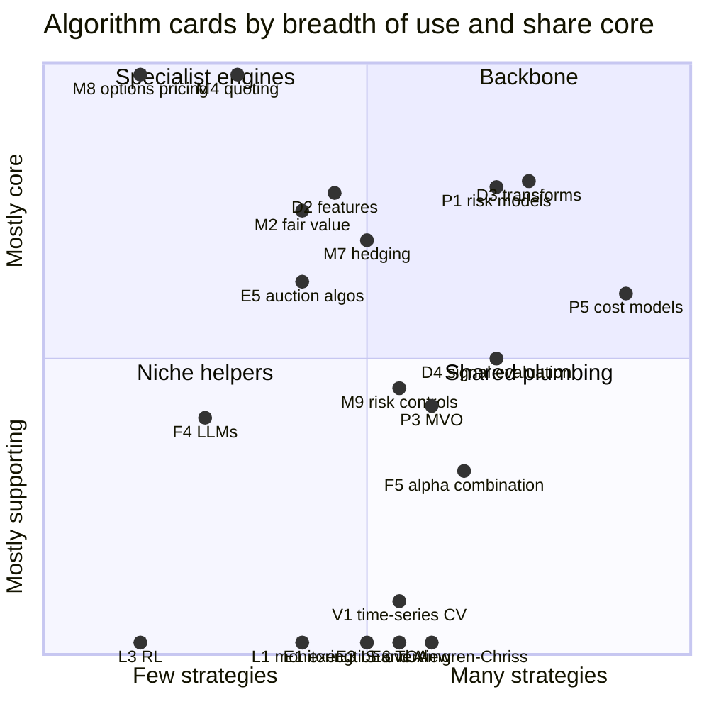
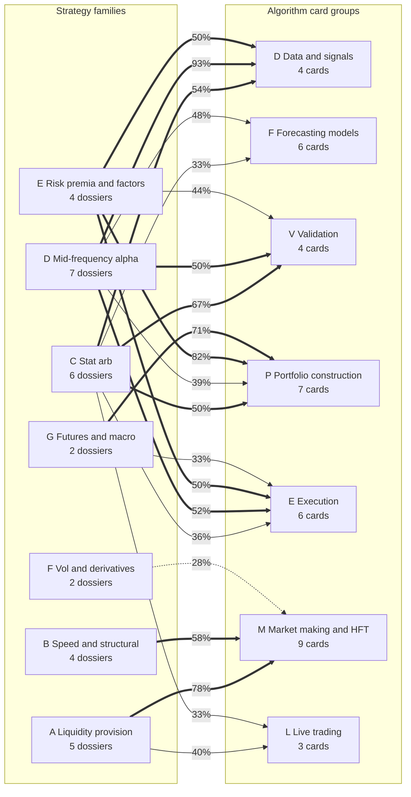

# Strategy × algorithm matrix

> **TL;DR**
>
> - Rows are the 30 strategy dossiers; columns are the 39 algorithm cards. ● = core, ○ = supporting, · = not used. A script builds the table from the dossier and card headers, so it cannot drift from them.
> - 357 of 1,170 cells are filled (131 core, 226 supporting). The workhorses are the cost model (P5, 18 strategies), signal transforms (D3, 15), risk models (P1, 14) and signal evaluation (D4, 14).
> - Two clusters barely overlap. Market-making and speed strategies fill 69% of the market-making columns and 8% of the rest; stat-arb, mid-frequency and factor strategies fill 48% of the other columns and 4% of the market-making ones.
> - Execution and validation cards are rarely core but support almost every portfolio strategy: no strategy is "about" VWAP or purged cross-validation, yet a bad one sinks many.
> - Specialists: options pricing (M8) appears in 3 rows, all core; LLM methods (F4) appear only in mid-frequency alpha.

**Level:** Core · **Read time:** ~9 min · **Last verified:** 2026-11

A trading strategy is not one algorithm but a pipeline of them ([there is no single algorithm](../../03-algorithms/there-is-no-single-algorithm.md)). This page shows which pipeline components each strategy depends on. Read a row to see which cards to study for a strategy. Read a column to see which strategies suffer when one component is wrong: a mis-specified cost model touches 18 of the 30.

## How to read the matrix

- **Rows** are the dossiers, grouped by family folder (A liquidity provision through G futures and macro) and sorted alphabetically within each.
- **Columns** are card IDs. The letter is the card group: D data and signals, F forecasting models, V validation and backtesting, P portfolio construction, E execution, M market making and HFT, L live trading. The [legend](#card-legend) maps each ID to its card.
- **● core**: the dossier links the card in its "Core algorithms used" field, one of the 3–6 components without which the strategy would not exist.
- **○ supporting**: the card lists the dossier in its "Used by strategies" field, but the dossier does not call it core. The strategy uses the method materially; the edge does not live there.
- **· not used**: neither page links the other. That does not mean a firm running the strategy never touches the method, only that it is not material to the strategy as this knowledge base describes it.

The table is generated by `python scripts/check_matrix.py --write` and checked by `python scripts/check_matrix.py`; it is never edited by hand. Counts on this page were computed from the table as generated in November 2026; if they disagree with the table, the table wins.

## The matrix

*Wide table: scroll sideways on small screens. Strategy names link to dossiers; column IDs are decoded in the legend below.*

<!-- MATRIX:START -->
| Strategy | D1 | D2 | D3 | D4 | F1 | F2 | F3 | F4 | F5 | F6 | V1 | V2 | V3 | V4 | P1 | P2 | P3 | P4 | P5 | P6 | P7 | E1 | E2 | E3 | E4 | E5 | E6 | M1 | M2 | M3 | M4 | M5 | M6 | M7 | M8 | M9 | L1 | L2 | L3 |
|---|:-:|:-:|:-:|:-:|:-:|:-:|:-:|:-:|:-:|:-:|:-:|:-:|:-:|:-:|:-:|:-:|:-:|:-:|:-:|:-:|:-:|:-:|:-:|:-:|:-:|:-:|:-:|:-:|:-:|:-:|:-:|:-:|:-:|:-:|:-:|:-:|:-:|:-:|:-:|
| [Auctions and closing liquidity](../a-liquidity-provision/auctions-and-closing-liquidity.md) | · | · | · | · | · | · | · | · | · | · | · | · | · | · | · | · | · | · | ● | · | · | · | · | · | · | ● | · | · | · | · | ● | ● | · | ○ | · | ○ | · | · | · |
| [Equity market making](../a-liquidity-provision/equity-market-making.md) | · | · | · | · | ○ | · | ○ | · | · | · | · | ○ | · | · | · | · | · | · | · | · | · | · | · | · | ○ | · | · | ○ | ● | ○ | ● | ● | ● | ● | · | ● | ○ | · | ○ |
| [ETF market making](../a-liquidity-provision/etf-market-making.md) | · | · | · | · | · | · | · | · | · | · | · | · | · | · | · | · | · | · | ● | · | · | · | · | · | ○ | · | · | ○ | ● | ○ | ● | ○ | ○ | ● | · | ○ | ○ | · | · |
| [Options market making](../a-liquidity-provision/options-market-making.md) | · | · | · | · | · | · | · | · | · | · | · | · | · | · | · | · | · | · | · | · | · | · | · | · | · | · | · | ○ | ○ | · | ● | ○ | ○ | ● | ● | ● | ○ | · | ○ |
| [Retail flow internalization](../a-liquidity-provision/retail-flow-internalization.md) | · | · | · | · | · | · | · | · | · | · | · | · | · | · | · | · | · | · | · | · | · | · | · | · | ○ | · | · | ○ | ● | ○ | ● | ● | · | ○ | · | ● | ○ | · | · |
| [ETF and index arbitrage](../b-speed-and-structural/etf-and-index-arbitrage.md) | · | · | · | · | · | · | · | · | · | · | · | · | · | · | · | · | · | · | ● | · | · | · | · | · | ○ | ● | · | ○ | ● | · | · | · | · | ● | · | ○ | · | · | · |
| [Fee- and microstructure-driven strategies](../b-speed-and-structural/fee-and-microstructure-driven-strategies.md) | · | · | · | · | · | · | · | · | · | · | · | · | · | · | · | · | · | · | · | · | · | · | · | · | ● | · | · | ○ | ○ | ○ | ● | ● | ● | · | · | ○ | · | · | · |
| [Latency arbitrage](../b-speed-and-structural/latency-arbitrage.md) | · | · | · | · | · | · | · | · | · | · | · | · | · | · | · | · | · | · | · | · | · | · | · | · | ○ | · | · | ● | ● | ● | · | ○ | · | · | · | ● | · | · | · |
| [Lead-lag and cross-asset arbitrage](../b-speed-and-structural/lead-lag-and-cross-asset-arbitrage.md) | · | · | · | · | ● | · | · | · | · | · | · | · | · | · | · | · | · | · | · | · | · | · | · | · | · | · | · | ○ | ● | ● | · | · | · | ● | · | ○ | · | · | · |
| [Factor-residual mean reversion](../c-statistical-arbitrage/factor-residual-mean-reversion.md) | · | ○ | ● | ○ | ○ | · | · | · | ○ | ○ | ○ | ○ | · | · | ● | ● | ● | · | ● | ○ | · | ○ | · | ○ | · | · | ○ | · | · | · | · | · | · | · | · | · | ○ | · | · |
| [Intraday patterns and seasonality](../c-statistical-arbitrage/intraday-patterns-and-seasonality.md) | · | ● | · | · | · | ○ | · | · | · | · | ○ | ○ | ● | · | · | · | · | · | ○ | · | · | · | ○ | · | · | ● | · | · | · | ● | · | · | · | · | · | · | · | · | · |
| [ML-driven short-horizon alpha](../c-statistical-arbitrage/ml-driven-short-horizon-alpha.md) | · | ● | ○ | ○ | ○ | ● | ● | · | ● | · | ● | ○ | ○ | ○ | ○ | · | ○ | · | ● | ○ | · | · | · | · | ○ | · | ○ | · | · | ○ | · | · | ○ | · | · | ○ | ○ | ○ | ○ |
| [Pairs trading and cointegration](../c-statistical-arbitrage/pairs-trading-and-cointegration.md) | · | · | ● | · | · | · | · | · | · | ● | ○ | ○ | · | ● | · | · | · | · | ● | · | · | · | · | ○ | · | · | · | · | · | · | · | · | · | ○ | · | · | · | · | · |
| [Short-term cross-sectional reversal](../c-statistical-arbitrage/short-term-cross-sectional-reversal.md) | ○ | · | ● | ○ | ○ | · | · | · | ○ | · | ○ | ○ | ○ | · | ● | · | ○ | · | ● | ● | · | · | · | · | ○ | · | ○ | · | · | · | · | · | ○ | · | · | · | · | ○ | · |
| [Stat arb: overview and history](../c-statistical-arbitrage/stat-arb-overview-and-history.md) | · | · | ● | ○ | · | · | · | · | ● | · | ○ | · | · | · | ● | ○ | ● | · | ● | ○ | ○ | ○ | · | ○ | · | · | ○ | · | · | · | · | · | · | · | · | · | ○ | · | · |
| [Alternative data](../d-mid-frequency-alpha/alternative-data.md) | ● | ● | ○ | ● | · | ● | ○ | ○ | ○ | · | ○ | · | ○ | ○ | ○ | · | ○ | · | · | · | · | · | · | · | · | · | · | · | · | · | · | · | · | · | · | · | · | ○ | · |
| [Analyst revisions and sentiment](../d-mid-frequency-alpha/analyst-revisions-and-sentiment.md) | ○ | ● | ● | ● | ○ | · | · | ● | ● | · | · | · | · | · | ○ | · | ○ | · | ○ | ○ | · | · | ○ | ○ | · | · | · | · | · | · | · | · | · | · | · | · | · | ○ | · |
| [Cross-sectional alpha and neutralization](../d-mid-frequency-alpha/cross-sectional-alpha-and-neutralization.md) | ○ | ○ | ● | ● | ○ | ○ | ○ | · | ● | · | ○ | ○ | ○ | ○ | ● | ○ | ● | ○ | ● | ○ | ○ | ○ | ○ | ○ | ○ | ○ | ○ | · | · | · | · | · | · | · | · | · | ○ | ○ | · |
| [Earnings and event-driven](../d-mid-frequency-alpha/earnings-and-event-driven.md) | ● | ● | ○ | ● | · | ○ | · | ○ | · | · | ○ | · | ● | · | · | · | · | · | ○ | · | · | ○ | · | ○ | · | ● | ○ | · | · | · | · | · | · | · | · | · | · | · | · |
| [Flow-driven strategies](../d-mid-frequency-alpha/flow-driven-strategies.md) | ● | · | · | ● | · | · | · | · | · | · | · | · | · | · | · | · | · | · | ● | · | · | ○ | ○ | ○ | · | ● | ○ | · | · | · | · | · | · | · | · | · | · | · | · |
| [Fundamental quant signals](../d-mid-frequency-alpha/fundamental-quant-signals.md) | ● | ● | ● | ● | ○ | ○ | · | ○ | ○ | · | ○ | · | ○ | ○ | ● | · | ○ | · | ○ | ○ | · | ○ | ○ | ○ | · | ○ | ○ | · | · | · | · | · | · | · | · | · | · | ○ | · |
| [NLP and LLM signals](../d-mid-frequency-alpha/nlp-and-llm-signals.md) | ○ | ● | ● | ● | · | · | ○ | ● | ○ | · | ○ | · | · | ○ | · | · | · | · | · | · | · | · | · | · | · | · | · | · | · | · | · | · | · | · | · | · | · | ○ | · |
| [Factor investing fundamentals](../e-risk-premia-and-factors/factor-investing-fundamentals.md) | · | · | ● | ○ | ○ | · | · | · | ○ | · | · | · | ○ | ○ | ● | ○ | ● | ● | ○ | ○ | ● | ○ | ○ | ○ | · | ○ | ○ | · | · | · | · | · | · | · | · | · | · | · | · |
| [Factor timing, crowding and quant winters](../e-risk-premia-and-factors/factor-timing-crowding-and-quant-winters.md) | · | · | · | · | · | · | · | · | · | ● | · | · | ○ | · | ● | · | ○ | ○ | · | · | ● | · | · | · | · | · | · | · | · | · | · | · | · | · | · | · | · | ● | · |
| [Momentum](../e-risk-premia-and-factors/momentum.md) | ○ | · | ● | ○ | · | · | · | · | ○ | ○ | · | · | ○ | ○ | ● | · | ○ | ○ | ● | ○ | ● | ○ | ○ | ○ | · | · | ○ | · | · | · | · | · | · | · | · | · | · | ○ | · |
| [Value, quality and low volatility](../e-risk-premia-and-factors/value-quality-low-vol.md) | ○ | · | ● | ○ | · | · | · | · | ○ | · | · | · | ○ | ○ | ● | ○ | ● | ● | ○ | · | ○ | ○ | ○ | ○ | · | · | · | · | · | · | · | · | · | · | · | · | · | · | · |
| [Dispersion and correlation trading](../f-volatility-and-derivatives/dispersion-and-correlation-trading.md) | · | · | · | · | · | · | · | · | · | · | · | · | · | · | · | ● | · | · | · | · | · | · | · | · | · | · | · | · | · | · | · | · | · | ● | ● | ● | · | · | · |
| [Volatility risk premium and vol arb](../f-volatility-and-derivatives/volatility-risk-premium-and-vol-arb.md) | · | · | · | · | · | · | · | · | · | ○ | · | · | · | · | · | · | · | · | · | · | ● | · | · | · | · | · | · | · | · | · | · | · | · | ● | ● | · | · | · | · |
| [Carry and cross-asset risk premia](../g-futures-and-macro-context/carry-and-cross-asset-risk-premia.md) | · | · | · | · | · | · | · | · | · | ● | · | · | · | · | ● | ○ | · | ● | · | · | ● | · | · | · | · | · | · | · | · | · | · | · | · | · | · | · | · | · | · |
| [Trend following and CTAs](../g-futures-and-macro-context/trend-following-and-ctas.md) | · | · | ● | · | · | · | · | · | ○ | ○ | · | ○ | · | ○ | ● | ○ | · | ○ | ○ | ● | ● | ○ | ○ | ○ | · | · | ○ | · | · | · | · | · | · | · | · | · | · | · | · |
<!-- MATRIX:END -->

## Card legend

Counts are the number of dossiers marking the card ● or ○ in the table above.

| ID | Card | Pipeline stage | ● core in | ○ supporting in |
|---|---|---|:-:|:-:|
| D1 | [Point-in-time data and cleaning](../../03-algorithms/a-data-and-signals/point-in-time-data-and-cleaning.md) | data | 4 | 6 |
| D2 | [Feature engineering](../../03-algorithms/a-data-and-signals/feature-engineering.md) | signal | 7 | 2 |
| D3 | [Signal transforms](../../03-algorithms/a-data-and-signals/signal-transforms.md) | signal | 12 | 3 |
| D4 | [Evaluating signals](../../03-algorithms/a-data-and-signals/evaluating-signals.md) | signal | 7 | 7 |
| F1 | [Linear models and regularization](../../03-algorithms/b-forecasting-models/linear-models-and-regularization.md) | forecast | 1 | 8 |
| F2 | [Tree ensembles](../../03-algorithms/b-forecasting-models/tree-ensembles.md) | forecast | 2 | 4 |
| F3 | [Neural nets and sequence models](../../03-algorithms/b-forecasting-models/neural-nets-and-sequence-models.md) | forecast | 1 | 4 |
| F4 | [LLMs and foundation models in quant](../../03-algorithms/b-forecasting-models/llms-and-foundation-models-in-quant.md) | forecast | 2 | 3 |
| F5 | [Alpha combination and ensembling](../../03-algorithms/b-forecasting-models/alpha-combination-and-ensembling.md) | forecast | 4 | 9 |
| F6 | [Regime detection](../../03-algorithms/b-forecasting-models/regime-detection.md) | forecast | 3 | 4 |
| V1 | [Time-series cross-validation](../../03-algorithms/c-validation-and-backtesting/time-series-cross-validation.md) | validation | 1 | 10 |
| V2 | [Backtesting engines](../../03-algorithms/c-validation-and-backtesting/backtesting-engines.md) | validation | 0 | 8 |
| V3 | [Backtest pitfalls](../../03-algorithms/c-validation-and-backtesting/backtest-pitfalls.md) | validation | 2 | 9 |
| V4 | [Overfitting and multiple testing](../../03-algorithms/c-validation-and-backtesting/overfitting-and-multiple-testing.md) | validation | 1 | 9 |
| P1 | [Risk models](../../03-algorithms/d-portfolio-construction/risk-models.md) | portfolio | 11 | 3 |
| P2 | [Covariance estimation and shrinkage](../../03-algorithms/d-portfolio-construction/covariance-estimation-and-shrinkage.md) | portfolio | 2 | 6 |
| P3 | [Mean-variance optimization](../../03-algorithms/d-portfolio-construction/mean-variance-optimization.md) | portfolio | 5 | 7 |
| P4 | [Alternatives to MVO](../../03-algorithms/d-portfolio-construction/alternatives-to-mvo.md) | portfolio | 3 | 4 |
| P5 | [Transaction cost and impact models](../../03-algorithms/d-portfolio-construction/transaction-cost-and-impact-models.md) | portfolio | 11 | 7 |
| P6 | [Multi-period optimization and trading toward the aim](../../03-algorithms/d-portfolio-construction/multi-period-and-trading-toward-aim.md) | portfolio | 2 | 8 |
| P7 | [Position sizing and risk budgeting](../../03-algorithms/d-portfolio-construction/position-sizing-and-risk-budgeting.md) | portfolio | 6 | 3 |
| E1 | [Execution algorithms: overview](../../03-algorithms/e-execution-algorithms/execution-algorithms-overview.md) | execution | 0 | 10 |
| E2 | [VWAP, TWAP and POV](../../03-algorithms/e-execution-algorithms/vwap-twap-pov.md) | execution | 0 | 9 |
| E3 | [Implementation shortfall and Almgren-Chriss](../../03-algorithms/e-execution-algorithms/implementation-shortfall-and-almgren-chriss.md) | execution | 0 | 12 |
| E4 | [Smart order routing](../../03-algorithms/e-execution-algorithms/smart-order-routing.md) | execution | 1 | 8 |
| E5 | [Auction, close and dark-liquidity algos](../../03-algorithms/e-execution-algorithms/auction-close-and-dark-liquidity-algos.md) | execution | 5 | 3 |
| E6 | [Transaction cost analysis](../../03-algorithms/e-execution-algorithms/transaction-cost-analysis.md) | execution | 0 | 11 |
| M1 | [Anatomy of an HFT trading loop](../../03-algorithms/f-market-making-and-hft-algorithms/anatomy-of-an-hft-trading-loop.md) | market making | 1 | 7 |
| M2 | [Fair value and microprice](../../03-algorithms/f-market-making-and-hft-algorithms/fair-value-and-microprice.md) | market making | 6 | 2 |
| M3 | [Order-book and trade-flow signals](../../03-algorithms/f-market-making-and-hft-algorithms/order-book-and-trade-flow-signals.md) | market making | 3 | 5 |
| M4 | [Quoting and inventory control](../../03-algorithms/f-market-making-and-hft-algorithms/quoting-and-inventory-control.md) | market making | 6 | 0 |
| M5 | [Adverse selection and markouts](../../03-algorithms/f-market-making-and-hft-algorithms/adverse-selection-and-markouts.md) | market making | 4 | 3 |
| M6 | [Queue position and order placement](../../03-algorithms/f-market-making-and-hft-algorithms/queue-position-and-order-placement.md) | market making | 2 | 4 |
| M7 | [Hedging algorithms](../../03-algorithms/f-market-making-and-hft-algorithms/hedging-algorithms.md) | market making | 7 | 3 |
| M8 | [Options pricing and vol surfaces for market making](../../03-algorithms/f-market-making-and-hft-algorithms/options-pricing-and-vol-surfaces-for-mm.md) | market making | 3 | 0 |
| M9 | [Algorithmic risk controls](../../03-algorithms/f-market-making-and-hft-algorithms/algorithmic-risk-controls.md) | market making | 5 | 6 |
| L1 | [Live monitoring and P&L attribution](../../03-algorithms/g-live-trading/live-monitoring-and-pnl-attribution.md) | live | 0 | 8 |
| L2 | [Alpha decay detection and model retirement](../../03-algorithms/g-live-trading/alpha-decay-detection-and-model-retirement.md) | live | 1 | 8 |
| L3 | [Reinforcement learning in trading](../../03-algorithms/g-live-trading/reinforcement-learning-in-trading.md) | live | 0 | 3 |

## What the matrix shows

### Backbone, plumbing and specialists

*x = number of dossiers using the card (● or ○), scaled so 20 dossiers is the right edge; y = share of those uses that are core. Selected cards; positions computed from the table.*

**Backbone (many rows, mostly core).** Three cards carry the portfolio strategies: [P5 cost and impact models](../../03-algorithms/d-portfolio-construction/transaction-cost-and-impact-models.md) (18 dossiers, 11 core), [D3 signal transforms](../../03-algorithms/a-data-and-signals/signal-transforms.md) (15, 12 core) and [P1 risk models](../../03-algorithms/d-portfolio-construction/risk-models.md) (14, 11 core). P5 is the only card that reaches six of the seven families; only the two volatility dossiers do without it. Anything that trades enough to move prices needs a cost forecast, from an ETF market maker's hedge to a factor book's rebalance. The textbook decomposition of a quant system into alpha, risk and transaction-cost models feeding portfolio construction and execution (Narang 2024) `[Verified]` shows up in exactly these columns.

**Shared plumbing (many rows, rarely core).** Ten cards (E1, E2, E3 and E6 for execution and cost measurement; V1–V4 for validation; L1 and L2 for live monitoring and decay) fill 99 cells between them, only 5 of them core. They are where a strategy leaks money rather than where it earns it: a mid-frequency book's edge lives in its signals, but slippage and overfitting decide how much survives. That is why [backtest pitfalls](../../03-algorithms/c-validation-and-backtesting/backtest-pitfalls.md) and [implementation shortfall](../../03-algorithms/e-execution-algorithms/implementation-shortfall-and-almgren-chriss.md) matter to strategies that never mention them in their headline.

**Specialist engines (few rows, mostly core).** [M4 quoting and inventory control](../../03-algorithms/f-market-making-and-hft-algorithms/quoting-and-inventory-control.md) is core in all 6 rows that use it; it defines market making. [M8 options pricing](../../03-algorithms/f-market-making-and-hft-algorithms/options-pricing-and-vol-surfaces-for-mm.md) appears in only 3 rows (options market making, dispersion, volatility risk premium), all core. [F4 LLM methods](../../03-algorithms/b-forecasting-models/llms-and-foundation-models-in-quant.md) appear in 5 rows, all in mid-frequency alpha. [L3 reinforcement learning](../../03-algorithms/g-live-trading/reinforcement-learning-in-trading.md) is never core, consistent with its card's finding that reported production use is mainly bank execution.

### Two clusters and a bridge

*Edge label: share of cells filled (● or ○) between a strategy family and a card group. Thick ≥ 50%, solid 30–49%; the dotted edge is family F's strongest link (28%). Weaker links are omitted.*

The HFT and market-making cluster (families A–B, 9 dossiers) fills 56 of 81 cells (69%) in the M columns and 21 of 270 (8%) elsewhere. Its pipeline is the [HFT trading loop](../../03-algorithms/f-market-making-and-hft-algorithms/anatomy-of-an-hft-trading-loop.md): fair value (M2), order-flow signals (M3), quoting and inventory (M4), markouts (M5), queue placement (M6), hedging (M7) and risk controls (M9). In these books the "forecast" is a fair value seconds ahead, "portfolio construction" is inventory skew plus hedging, and "validation" is [markout](../../09-reference/glossary.md#markout) analysis of live fills more than a cross-validated backtest.

The mid-frequency cluster (families C–E, 17 dossiers) is the mirror image: 246 of 510 cells (48%) outside the M columns and 6 of 153 (4%) inside them. Its rows walk the pipeline left to right (data, signal, forecast, validation, portfolio, execution), as in the [mid-frequency stat-arb walkthrough](../../03-algorithms/h-end-to-end-walkthroughs/walkthrough-mid-frequency-stat-arb.md).

[Statistical arbitrage](../../09-reference/glossary.md#statistical-arbitrage) (family C) is the bridge: the only family that touches all seven card groups. Intraday patterns and ML short-horizon alpha borrow order-book signals (M3) and queue placement (M6) from market making while using the full forecasting and validation stack. Bridge cards run the other way too: P5 cost models, E4 smart order routing (families A–D), E5 auction and close algos (A–E), M7 hedging and M9 risk controls (both A–C and F).

### Thin rows

Families F and G fill 28 of 156 cells (18%). Dispersion and the volatility risk premium use 4 cards each, carry 5: the card set is built around US equities, and these strategies run on derivatives pricing, hedging and risk budgeting more than on signal research. Trend following (15 cells) is the exception because it reuses the factor book's machinery: transforms, risk models, sizing and execution. At the other end, cross-sectional alpha (27 cells), ML short-horizon alpha (23) and fundamental quant signals (21) use most of the mid-frequency stack.

## Related pages

- [Strategy comparison matrix](strategy-comparison-matrix.md)
- [Algorithms: overview](../../03-algorithms/index.md)
- [Algorithm map](../../03-algorithms/algorithm-map.md)
- [There is no single algorithm](../../03-algorithms/there-is-no-single-algorithm.md)
- [Strategies: the map](../index.md)
- [How firms combine strategies](how-firms-combine-strategies.md)

## Sources

- [Verified] Narang, R. K. (2024). *Inside the Black Box: A Simple Guide to Systematic Investing*, 3rd ed. Wiley. <https://www.harvard.com/book/9781119931898> (accessed 2026-11)
- [Verified] Grinold, R. C. & Kahn, R. N. (2000). *Active Portfolio Management*, 2nd ed. McGraw-Hill. <https://www.econbiz.de/Record/active-portfolio-management-a-quantitative-approach-for-producing-superior-returns-and-controlling-risk/10004551679> (accessed 2026-11)
- [Verified] Isichenko, M. (2021). *Quantitative Portfolio Management: The Art and Science of Statistical Arbitrage*. Wiley. <https://www.oreilly.com/library/view/-/9781119821328/> (accessed 2026-11)
- [Verified] López de Prado, M. (2018). *Advances in Financial Machine Learning*. Wiley. <https://www.wiley.com/en-us/Advances+in+Financial+Machine+Learning-p-9781119482086> (accessed 2026-11)
- [Verified] Cartea, Á., Jaimungal, S. & Penalva, J. (2015). *Algorithmic and High-Frequency Trading*. Cambridge University Press. <https://www.cambridge.org/9781107091146> (accessed 2026-11)
- [Verified] Kissell, R. (2014). *The Science of Algorithmic Trading and Portfolio Management*. Academic Press. <https://doi.org/10.1016/B978-0-12-401689-7.00001-5> (accessed 2026-11)
- [Verified] Avellaneda, M. & Stoikov, S. (2008). "High-frequency trading in a limit order book." *Quantitative Finance* 8(3), 217–224. <https://doi.org/10.1080/14697680701381228> (accessed 2026-11)
- [Verified] Almgren, R. & Chriss, N. (2000). "Optimal execution of portfolio transactions." *Journal of Risk* 3(2), 5–39. <https://doi.org/10.21314/JOR.2001.041> (accessed 2026-11)
