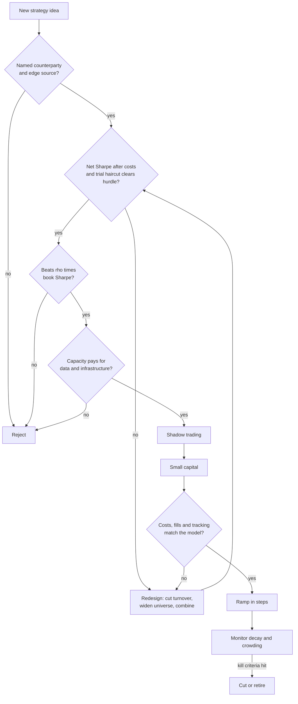

# How quants evaluate a strategy

> **TL;DR**
>
> - Every strategy is a claim that **someone will keep paying you**. The first test is naming that payer and one of six edge sources: risk premium, behavioral, structural/regulatory, informational, liquidity provision, speed.
> - Judge the **net** Sharpe, not the gross. Breakeven cost is gross alpha ÷ turnover; at high turnover, a haircut to gross alpha becomes a much larger haircut to net alpha.
> - A new strategy improves a book only if its Sharpe exceeds **ρ × the book's Sharpe**. A mediocre, uncorrelated strategy often beats a brilliant clone.
> - Backtests shrink live: published anomalies lost 26% out-of-sample and 58% after publication in one large study `[Verified]`. Plan on a haircut.
> - Funding is staged (shadow, small capital, ramp) with kill criteria written down **before** the first trade. Months of live P&L cannot prove alpha; they can prove the implementation.

**Level:** Core · **Read time:** ~12 min · **Last verified:** 2026-11

A strategy pitch is a business plan: a revenue source (the edge), a customer (the counterparty), a cost base, a market size ([capacity](../09-reference/glossary.md#capacity)) and a risk of sudden death. A PM or CIO interrogates it like an acquisition: is the revenue real, will it last, what does it cost, and what does it do to the rest of the portfolio?

## The six edge sources

Each edge source has its own reason to persist and its own way to die.

| Edge source | You are paid for | Why it persists | How it dies | Examples |
|---|---|---|---|---|
| **Risk premium** | Holding a risk others want to shed (crashes, distress, illiquidity) | The risk is real: it periodically hurts, so the premium is a fair price | Rarely dies; compresses when capital floods in | [Factors](e-risk-premia-and-factors/factor-investing-fundamentals.md), [VRP](f-volatility-and-derivatives/volatility-risk-premium-and-vol-arb.md), [carry](g-futures-and-macro-context/carry-and-cross-asset-risk-premia.md) |
| **Behavioral** | Other investors' systematic errors: under-reaction, extrapolation, anchoring | Biases are human; arbitrage is limited by risk and career risk | Publication and crowding arbitrage it down | [Momentum](e-risk-premia-and-factors/momentum.md), [earnings drift](d-mid-frequency-alpha/earnings-and-event-driven.md), [revisions](d-mid-frequency-alpha/analyst-revisions-and-sentiment.md) |
| **Structural / regulatory** | Someone forced by a rule or mandate to trade at a bad price | Lasts as long as the rule or the mandate | Rule changes, or competitors bid the edge to zero | [Flow-driven](d-mid-frequency-alpha/flow-driven-strategies.md), [auctions](a-liquidity-provision/auctions-and-closing-liquidity.md), [fee-driven](b-speed-and-structural/fee-and-microstructure-driven-strategies.md) |
| **Informational** | Knowing or processing something sooner or better | Data is scarce or hard to process | The data commoditizes: vendors sell it to everyone | [Alt data](d-mid-frequency-alpha/alternative-data.md), [NLP](d-mid-frequency-alpha/nlp-and-llm-signals.md) |
| **Liquidity provision** | Immediacy for impatient traders, plus bearing inventory risk and [adverse selection](../09-reference/glossary.md#adverse-selection) | Demand for immediacy never goes away | Margins are competed down; only scale survives | [Market making](a-liquidity-provision/equity-market-making.md), [reversal](c-statistical-arbitrage/short-term-cross-sectional-reversal.md) |
| **Speed** | Reacting first to public information | Latency differences always exist somewhere | Winner-take-most arms race; everyone but the fastest is priced out | [Latency arbitrage](b-speed-and-structural/latency-arbitrage.md), [lead-lag](b-speed-and-structural/lead-lag-and-cross-asset-arbitrage.md) |

Our view `[Estimate]` (reasoning: the persistence column): edges where the counterparty has a lasting reason to pay (risk premia, liquidity provision, rules) are the most durable. Informational and behavioral signals at days-to-weeks horizons are the least durable, because they are the easiest to copy.

## The evaluation checklist

| # | Question | Red flag |
|---|---|---|
| 1 | Economic rationale: why should this make money? | "The model found it" |
| 2 | Counterparty: who pays, and why do they accept it? | No identifiable payer |
| 3 | Sharpe or IR, gross and net, with significance | Only gross shown; short sample; hundreds of variants tried |
| 4 | Capacity: dollars before costs eat the edge | Capacity quoted without an impact model |
| 5 | Turnover and cost sensitivity | Breakeven cost within 2× of the modeled cost |
| 6 | Correlation to the existing book | Fails the ρ × Sharpe hurdle |
| 7 | Tail risk | Smooth returns from selling insurance |
| 8 | Decay | No out-of-sample or post-publication period |
| 9 | Crowding | Same positions as published factors or peers |
| 10 | Data and infrastructure cost | Fixed costs larger than expected net alpha at realistic size |

### Sharpe and IR: gross vs net, and why short horizons win

The [Sharpe ratio](../09-reference/glossary.md#sharpe-ratio) is excess return over volatility; the [information ratio](../09-reference/glossary.md#information-ratio) applies it to active return. Only the net figure pays anyone.

Short-horizon strategies post higher Sharpe ratios because they make many small, nearly independent bets; annualized Sharpe scales with the square root of independent bets per year. A daily Sharpe of 0.2 annualizes to 0.2 × √252 ≈ 3.2. Virtu's 2014 IPO filing showed one losing day in 1,238 (2009–2013) `[Reported]`. If daily P&L were normal, that would imply a daily Sharpe near 3.2 and an annualized figure around 50 `[Estimate]` (illustrative; P&L has fat tails). The price of that Sharpe is capacity: such books cannot absorb billions.

Confidence grows slowly: the t-statistic is roughly Sharpe × √years, so a true Sharpe of 0.75 needs about seven years to reach t = 2. Lo (2002) shows serial correlation can distort annualized Sharpe ratios `[Verified]`. Harvey, Liu and Zhu argue a new factor needs t > 3, not 2, given how many have been tried `[Verified]`. The [deflated Sharpe ratio](../09-reference/glossary.md#deflated-sharpe-ratio) of Bailey and López de Prado corrects for the number of trials and for non-normality `[Verified]` (see [overfitting and multiple testing](../03-algorithms/c-validation-and-backtesting/overfitting-and-multiple-testing.md)).

### Turnover, costs and breakeven

Let gross alpha be $\alpha$ (per year, as a fraction of [gross market value](../09-reference/glossary.md#gross-market-value-gmv)), turnover $T$ (dollars traded per year ÷ GMV, both sides counted) and all-in cost $c$ per dollar traded (spread, fees, [market impact](../09-reference/glossary.md#market-impact)). Then:

$$ \alpha_{net} = \alpha - T\,c, \qquad c^{*} = \frac{\alpha}{T} $$

The sensitivity of net alpha to cost is $-T$: every extra basis point of cost subtracts $T$ basis points of return.

| Illustrative strategy | Gross α | Turnover T | Breakeven c* | Modeled cost | Net α | +1 bp of cost costs you |
|---|---|---|---|---|---|---|
| Monthly factor book | 3% | 6× | 50 bp | 10 bp | 2.4% | 0.06% a year |
| Daily residual reversal | 12% | 60× | 20 bp | 8 bp | 7.2% | 0.6% a year |
| Intraday stat arb | 25% | 500× | 5 bp | 3 bp | 10% | 5% a year |

Novy-Marx and Velikov agree: most anomalies with under 50% monthly one-sided turnover survive costs; few higher-turnover ones do `[Verified]`. Cost models are covered in [P5](../03-algorithms/d-portfolio-construction/transaction-cost-and-impact-models.md); measuring realized cost in [E6](../03-algorithms/e-execution-algorithms/transaction-cost-analysis.md).

### Capacity

Capacity is the size at which marginal net alpha reaches zero, or net Sharpe hits the hurdle; impact rises roughly with the square root of participation. An AQR study using live execution data estimated break-even fund sizes for US long-short size, value and momentum factors of \$103B, \$83B and \$52B `[Verified]` (2012 working paper; one manager's 1998–2011 costs; an upper bound, since rivals share the capacity). For latency-sensitive strategies, capacity is better counted in P&L than in capital: the edge per trade is a fraction of a tick, and the whole global latency-arbitrage pool in equities has been estimated at about \$5B a year (Aquilina, Budish and O'Neill) `[Verified]`.

### Correlation to the book: the marginal Sharpe test

Adding a small allocation to a new strategy raises the book's Sharpe only if

$$ SR_{new} > \rho \cdot SR_{book} $$

where $\rho$ is the correlation between the new strategy and the existing book (derivation below; see also Benhamou and Guez). With an existing book at Sharpe 2.0:

| Candidate | Standalone Sharpe | ρ to book | Hurdle ρ × 2.0 | Book Sharpe after optimal mix |
|---|---|---|---|---|
| A: decent, mildly correlated | 0.8 | 0.3 | 0.6 | 2.01 |
| B: same, uncorrelated | 0.8 | 0.0 | 0.0 | 2.15 |
| C: weak, negatively correlated | 0.6 | −0.3 | −0.6 | 2.36 |
| D: strong clone | 1.5 | 0.8 | 1.6 | 2.00 (optimal weight is zero) |

Candidate C, the weakest standalone, adds the most; D, the best on paper, adds nothing. Caveats: correlations jump toward one in a crisis (in August 2007 many quant equity books unwound the same positions at once, per Khandani and Lo `[Verified]`); and a strategy that barely moves the book's Sharpe can still be worth funding if the book is at capacity.

### Tail risk, decay, crowding and cost of doing business

- **Tail risk.** Sharpe treats upside and downside alike. Insurance-selling strategies (short volatility, carry, much liquidity provision) show smooth returns and negative skew. Ask for the worst day, week and month; Khandani and Lo's simulated market maker lost heavily in the week of August 6, 2007 `[Verified]`. See the [failure gallery](h-cross-cutting/strategy-failure-gallery.md).
- **Decay.** Across 97 published predictors, returns were 26% lower out-of-sample and 58% lower after publication (McLean and Pontiff) `[Verified]`. Falck, Rej and Thesmar find out-of-sample performance around half of in-sample, with publication date the main predictor of [alpha decay](../09-reference/glossary.md#alpha-decay) `[Verified]`. Monitor live decay with [L2](../03-algorithms/g-live-trading/alpha-decay-detection-and-model-retirement.md).
- **Crowding.** Warning signs: P&L correlated with published factors or peers, falling alpha per unit of turnover, violent reversals on de-risking days ([crowding](e-risk-premia-and-factors/factor-timing-crowding-and-quant-winters.md)).
- **Data and infrastructure.** Investment managers spent roughly \$2.8B on alternative data in 2025, up 17% `[Reported]`. Fixed costs set a minimum size: a \$1M-a-year dataset needs \$25M of GMV at 4% net alpha to pay for itself `[Estimate]`. For HFT, colocation, feeds and hardware make breakeven a dollar figure, not a basis-point one.

## How a PM or CIO decides to fund a strategy

Funding is staged so that each dollar buys information: **research review** (the checklist) → **shadow trading** (live signals, no capital) → **small capital** (enough to measure real costs and fills) → **ramp in steps**, re-estimating impact at each size → **steady state and retirement**, with kill criteria set in advance.

Pods use hard drawdown limits. Widely reported Millennium practice: a PM's capital is roughly halved at a 5% drawdown and the PM is usually out near 7.5% (some accounts say 10%) `[Reported]`; firms do not publish these rules.

### Worked example (illustrative numbers)

A researcher proposes a 1–3 day residual-reversal strategy on ~1,000 liquid US stocks. Backtest 2014–2025 (12 years); 200 parameter variants tried. Gross alpha 12% of GMV a year at 4% volatility (gross Sharpe 3.0); turnover 60×; modeled cost 8 bp per dollar traded, so net alpha 7.2% (net Sharpe 1.8). Correlation to the existing book is 0.3; the book runs at Sharpe 2.0.

1. **Is it noise?** Over 12 years the standard error of an annual Sharpe is about 1/√12 ≈ 0.29, so the best of 200 independent zero-alpha variants would show about 2.75 × 0.29 ≈ 0.8 by luck. Net 1.8 clears that bar.
2. **Haircut gross, not net.** Apply a 30–50% decay haircut (the range from the studies above) to gross alpha: 6.0–8.4%. Costs stay at 4.8% (60 × 8 bp), so net becomes 1.2–3.6%, Sharpe 0.3–0.9. A 50% haircut to gross is an 83% haircut to net.
3. **Marginal test.** The hurdle is 0.3 × 2.0 = 0.6. The planning range of 0.3–0.9 straddles it. Not fundable as designed.
4. **Redesign.** A no-trade band and [trading toward the aim](../03-algorithms/d-portfolio-construction/multi-period-and-trading-toward-aim.md) cut turnover to 35× while keeping, say, 80% of gross alpha (9.6%). Costs drop to 2.8%. After the same haircut: net 2.0–3.9%, Sharpe 0.5–1.0. The midpoint (0.75) clears 0.6; the low end does not, which is why it gets small capital rather than a full allocation.
5. **Funding plan.** Shadow-trade for 2–3 months. Then \$50M GMV at 4% volatility: about \$2M of annual risk, about \$126k daily. Ramp to \$150M, then \$300M, if realized costs stay within 25% of the model, re-fitting impact at each step.
6. **Kill criteria, written first.** Hard stop at a drawdown of 1.5× the annual volatility budget (\$3M at stage one); review if realized cost runs 50% above model for a month or live P&L stops tracking the backtest replayed on live dates.

Why judge implementation, not P&L, early? At a true Sharpe of 0.75, the chance of losing money over six months is about 30%, over a year about 23% `[Estimate]` (normal approximation). In simulation, the 1.5× stop trips within a year about 8% of the time at Sharpe 0.75 but only 23% of the time when alpha is zero `[Estimate]`. Stops limit damage; they are weak detectors of dead strategies. Cost, fill and tracking diagnostics carry the early decision ([L1](../03-algorithms/g-live-trading/live-monitoring-and-pnl-attribution.md)).

Math: the Fundamental Law of Active Management

Grinold's law: information ratio ≈ skill × √(independent bets per year):

$$ IR \approx IC \times \sqrt{BR} $$

where IC (the [information coefficient](../09-reference/glossary.md#information-coefficient-ic)) is the correlation between forecasts and realized returns and BR ([breadth](../09-reference/glossary.md#breadth)) is the number of independent forecasts per year. Clarke, de Silva and Thorley add the [transfer coefficient](../09-reference/glossary.md#transfer-coefficient) TC, roughly the correlation between the risk-adjusted weights an unconstrained optimizer would hold and those actually held:

$$ IR \approx TC \times IC \times \sqrt{BR} $$

Long-only limits, turnover caps and neutrality constraints push TC below 1; their paper reports realized performance at about 0.3–0.8 of the unconstrained law's prediction `[Verified]`.

Illustration: IC = 0.03 on 500 stocks rebalanced monthly gives BR = 6,000 if bets were independent, so IR ≈ 0.03 × 77 ≈ 2.3; with TC = 0.5, 1.2; if correlation also cuts effective breadth to 1,500, 0.58. Breadth counts independent bets, not trades.

Math: why the hurdle is ρ × SR_book

Scale both return streams to unit volatility. The maximum Sharpe of an optimal mix of a book with Sharpe $S_b$ and a candidate with Sharpe $S_n$ and correlation $\rho$ is

$$ S^{*2} = \frac{S_b^2 + S_n^2 - 2\rho S_b S_n}{1-\rho^2} $$

and the optimal risk weight on the candidate is proportional to $S_n - \rho S_b$. It is positive (the candidate belongs in the book) only when $S_n > \rho S_b$.

## Questions to ask

- **Basic:** What is the edge source, and who is on the other side? Is that Sharpe gross or net, and over what period?
- **Informed:** What is the breakeven cost versus realized cost? How correlated is this with the book and with published factors? How many variants did you try?
- **Sharp:** What did it do in August 2007, March 2020 or your worst week? At what size does net Sharpe hit your hurdle? 🔒 (exact capacity is usually proprietary) Were the kill criteria written before launch?

## Related pages

- [Strategies: the map](index.md)
- [The big picture](../00-start-here/the-big-picture.md)
- [Overfitting and multiple testing](../03-algorithms/c-validation-and-backtesting/overfitting-and-multiple-testing.md)
- [Transaction cost and impact models](../03-algorithms/d-portfolio-construction/transaction-cost-and-impact-models.md)
- [How firms combine strategies](h-cross-cutting/how-firms-combine-strategies.md)
- [Evolution of quant strategies](h-cross-cutting/evolution-of-quant-strategies.md)
- [Position sizing and risk budgeting](../03-algorithms/d-portfolio-construction/position-sizing-and-risk-budgeting.md)

## Sources

- [Verified] Grinold, R. C. (1989). "The fundamental law of active management." *Journal of Portfolio Management* 15(3), 30–37. <https://doi.org/10.3905/jpm.1989.409211> (accessed 2026-11)
- [Verified] Clarke, R., de Silva, H. & Thorley, S. (2002). "Portfolio Constraints and the Fundamental Law of Active Management." *Financial Analysts Journal* 58(5), 48–66. <https://doi.org/10.2469/faj.v58.n5.2468> (accessed 2026-11)
- [Verified] McLean, R. D. & Pontiff, J. (2016). "Does Academic Research Destroy Stock Return Predictability?" *Journal of Finance* 71(1), 5–32. <https://doi.org/10.1111/jofi.12365> (accessed 2026-11)
- [Verified] Falck, A., Rej, A. & Thesmar, D. (2022). "When do systematic strategies decay?" *Quantitative Finance* 22(11), 1955–1969. <https://doi.org/10.1080/14697688.2022.2098810> (accessed 2026-11)
- [Verified] Harvey, C. R., Liu, Y. & Zhu, H. (2016). "… and the Cross-Section of Expected Returns." *Review of Financial Studies* 29(1), 5–68. <https://doi.org/10.1093/rfs/hhv059> (accessed 2026-11)
- [Verified] Bailey, D. H. & López de Prado, M. (2014). "The Deflated Sharpe Ratio: Correcting for Selection Bias, Backtest Overfitting, and Non-Normality." *Journal of Portfolio Management* 40(5), 94–107. <https://doi.org/10.3905/jpm.2014.40.5.094> (accessed 2026-11)
- [Verified] Lo, A. W. (2002). "The Statistics of Sharpe Ratios." *Financial Analysts Journal* 58(4), 36–52. <https://doi.org/10.2469/faj.v58.n4.2453> (accessed 2026-11)
- [Verified] Novy-Marx, R. & Velikov, M. (2016). "A Taxonomy of Anomalies and Their Trading Costs." *Review of Financial Studies* 29(1), 104–147. <https://doi.org/10.1093/rfs/hhv063> (accessed 2026-11)
- [Verified] Khandani, A. E. & Lo, A. W. (2011). "What happened to the quants in August 2007? Evidence from factors and transactions data." *Journal of Financial Markets* 14(1), 1–46. <https://doi.org/10.1016/j.finmar.2010.07.005> (accessed 2026-11)
- [Verified] Aquilina, M., Budish, E. & O'Neill, P. (2022). "Quantifying the High-Frequency Trading 'Arms Race'." *Quarterly Journal of Economics* 137(1), 493–564. <https://doi.org/10.1093/qje/qjab032> (accessed 2026-11)
- [Reported] Benhamou, E. & Guez, B. (2018). "Incremental Sharpe and other performance ratios." arXiv:1807.09864. <https://arxiv.org/abs/1807.09864> (accessed 2026-11)
- [Verified] Frazzini, A., Israel, R. & Moskowitz, T. J. (2012). "Trading Costs of Asset Pricing Anomalies." AQR working paper (break-even fund sizes; later revised as "Trading Costs," SSRN 3229719). <https://www.aqr.com/Insights/Research/Working-Paper/Trading-Costs-of-Asset-Pricing-Anomalies> (accessed 2026-11)
- [Reported] Bloomberg (2014-06-04). "Virtu Touting Near-Perfect Record of Profits Backfired, CEO Says." <https://www.bloomberg.com/news/articles/2014-06-04/virtu-touting-near-perfect-record-of-profits-backfired-ceo-says> (accessed 2026-11)
- [Reported] Neudata (2026). "The state of the alternative data market in 2026." <https://www.neudata.co/intelligence/the-state-of-the-alternative-data-market-in-2026> (accessed 2026-11)
- [Reported] eFinancialCareers (n.d.). Article on Millennium jobs and stop-loss practice, citing the Wall Street Journal. <https://www.efinancialcareers.com/news/millennium-hedge-fund-jobs> (accessed 2026-11)
