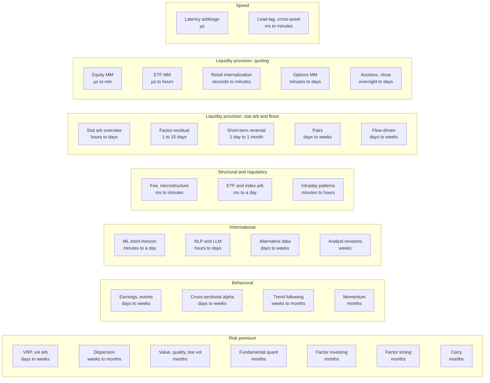

# Strategies: the map

> **TL;DR**
>
> - This module has 30 strategy dossiers in seven families (A–G), plus five cross-cutting pages (H). Every dossier follows one template, so any two compare directly.
> - Every strategy sits at a point on two axes: **holding horizon** (microseconds to months) and **edge source** (speed · liquidity provision · structural/regulatory · informational · behavioral · risk premium).
> - Short horizons are dominated by liquidity provision, speed and structure; long horizons by risk premia and behavioral effects. Informational edges sit in the middle.
> - Most "stat arb" is liquidity provision on a slower clock: you are paid for absorbing other people's price pressure.
> - Read every dossier's header table first. If you only remember one row, make it **"Counterparty: who pays and why they accept it."**

**Level:** Core · **Read time:** ~9 min · **Last verified:** 2026-11

## The master strategy map

The first map places all 30 dossiers by **typical holding period** (columns, left to right) and colors them by **primary edge source**; the label also names the secondary edge. Placement is by the typical book, not the extremes: an options market maker hedges delta in microseconds but carries volatility risk for days.

*Colors: red = speed · blue = liquidity provision (LP) · orange = structural/regulatory · purple = informational · green = behavioral · gray = risk premium.*

The second map turns the axes around: one row per primary edge source, ordered by horizon; top rows are short-horizon, bottom rows long.

Three lessons. First, **horizon and edge are correlated, not identical**: liquidity provision runs from microseconds (quoting) to weeks (pairs), because absorbing price pressure is paid at every horizon (Grossman and Miller; Nagel) `[Verified]`. Second, **capacity rises with horizon while Sharpe falls**; the [comparison matrix](h-cross-cutting/strategy-comparison-matrix.md) puts numbers on it. Third, **the middle is the most crowded**: days-to-weeks informational and behavioral signals are where most quant funds and pods compete, and where published signals decay fastest ([evaluation](how-quants-evaluate-a-strategy.md)).

## All 30 dossiers

| Family | Dossier | Horizon | Edge source | Who pays you, in one line |
|---|---|---|---|---|
| A · Liquidity | [Equity market making](a-liquidity-provision/equity-market-making.md) | µs to minutes | LP · speed | Traders who want to deal now pay the half-spread; waiting costs them more |
| A · Liquidity | [ETF market making](a-liquidity-provision/etf-market-making.md) | µs to hours | LP · structural | ETF buyers and sellers pay a spread over basket value rather than create or redeem themselves |
| A · Liquidity | [Options market making](a-liquidity-provision/options-market-making.md) | minutes to days | LP · speed | Hedgers, income sellers and retail pay edge over theoretical value for convexity or leverage |
| A · Liquidity | [Retail flow internalization](a-liquidity-provision/retail-flow-internalization.md) | seconds to minutes | LP · structural | Retail orders pay part of the spread: filled inside the NBBO but away from mid; the flow is valuable because it is uninformed |
| A · Liquidity | [Auctions and closing liquidity](a-liquidity-provision/auctions-and-closing-liquidity.md) | overnight to a few days | LP · structural | Index funds and benchmarked managers who must trade at the close concede price to imbalance absorbers |
| B · Speed | [Latency arbitrage](b-speed-and-structural/latency-arbitrage.md) | µs to seconds | speed · structural | Slower liquidity providers whose stale quotes get picked off |
| B · Speed | [Lead-lag and cross-asset arbitrage](b-speed-and-structural/lead-lag-and-cross-asset-arbitrage.md) | ms to minutes | speed · info | Quoters in the lagging instrument (stocks after futures move) |
| B · Speed | [ETF and index arbitrage](b-speed-and-structural/etf-and-index-arbitrage.md) | ms to a day | structural · speed | Whoever pushes an ETF or future away from its basket value |
| B · Speed | [Fee- and microstructure-driven](b-speed-and-structural/fee-and-microstructure-driven-strategies.md) | ms to minutes | structural · LP | Takers paying access fees; traders disadvantaged by tick and fee rules |
| C · Stat arb | [Stat arb: overview and history](c-statistical-arbitrage/stat-arb-overview-and-history.md) | hours to days | LP · behavioral | Liquidity demanders whose trades push prices temporarily away from relative value |
| C · Stat arb | [Pairs trading and cointegration](c-statistical-arbitrage/pairs-trading-and-cointegration.md) | days to weeks | LP · behavioral | Traders who push one leg away from its twin; you are paid for patience and idiosyncratic risk |
| C · Stat arb | [Factor-residual mean reversion](c-statistical-arbitrage/factor-residual-mean-reversion.md) | 1 to 15 days | LP · behavioral | The same price pressure, harvested across hundreds of names after removing factor moves |
| C · Stat arb | [Short-term cross-sectional reversal](c-statistical-arbitrage/short-term-cross-sectional-reversal.md) | 1 day to 1 month (classically 1 week) | LP · behavioral | Impatient sellers and buyers; profits rise when market makers' capital is scarce |
| C · Stat arb | [Intraday patterns and seasonality](c-statistical-arbitrage/intraday-patterns-and-seasonality.md) | minutes to hours | structural · behavioral | Traders with schedule-driven flows (open, close, periodic rebalancing) |
| C · Stat arb | [ML-driven short-horizon alpha](c-statistical-arbitrage/ml-driven-short-horizon-alpha.md) | minutes to a day | info · LP | Slower traders whose order flow and reactions are predictable from features |
| D · Mid-freq | [Cross-sectional alpha and neutralization](d-mid-frequency-alpha/cross-sectional-alpha-and-neutralization.md) | days to weeks | behavioral · info | Investors who process information slowly or are constrained from acting on it |
| D · Mid-freq | [Fundamental quant signals](d-mid-frequency-alpha/fundamental-quant-signals.md) | weeks to months | risk premium · behavioral | Investors who misread accounting quality, or who demand a premium to hold unloved stocks |
| D · Mid-freq | [Earnings and event-driven](d-mid-frequency-alpha/earnings-and-event-driven.md) | days to weeks | behavioral · LP | Investors who under-react to earnings news (post-earnings drift) |
| D · Mid-freq | [Analyst revisions and sentiment](d-mid-frequency-alpha/analyst-revisions-and-sentiment.md) | weeks | info · behavioral | Investors anchored on stale consensus while estimates drift |
| D · Mid-freq | [Flow-driven strategies](d-mid-frequency-alpha/flow-driven-strategies.md) | days to weeks | LP · structural | Index funds and other mechanical traders who must trade on known dates regardless of price |
| D · Mid-freq | [Alternative data](d-mid-frequency-alpha/alternative-data.md) | days to weeks | info | Investors without the data, who learn sales or traffic only at the official print |
| D · Mid-freq | [NLP and LLM signals](d-mid-frequency-alpha/nlp-and-llm-signals.md) | hours to days | info · behavioral | Slower readers of filings, calls and news |
| E · Factors | [Factor investing fundamentals](e-risk-premia-and-factors/factor-investing-fundamentals.md) | months | risk premium · behavioral | Investors averse to factor risk, or biased against it, who pay a premium to avoid it |
| E · Factors | [Momentum](e-risk-premia-and-factors/momentum.md) | months | behavioral · risk premium | Investors who under-react to news, then chase; holders forced to dump losers |
| E · Factors | [Value, quality and low volatility](e-risk-premia-and-factors/value-quality-low-vol.md) | months | risk premium · behavioral | Extrapolators and distress-averse holders (value); leverage-constrained buyers of high beta (low vol) |
| E · Factors | [Factor timing, crowding and quant winters](e-risk-premia-and-factors/factor-timing-crowding-and-quant-winters.md) | months | risk premium | Nobody reliably; this dossier is about when the premia stop paying and crowded exits hurt |
| F · Vol | [Volatility risk premium and vol arb](f-volatility-and-derivatives/volatility-risk-premium-and-vol-arb.md) | days to weeks | risk premium · structural | Option buyers paying above expected realized volatility for crash protection |
| F · Vol | [Dispersion and correlation trading](f-volatility-and-derivatives/dispersion-and-correlation-trading.md) | weeks to months | risk premium · structural | Index-protection buyers and single-stock overwriters, who leave implied correlation rich |
| G · Futures | [Trend following and CTAs](g-futures-and-macro-context/trend-following-and-ctas.md) | weeks to months | behavioral · risk premium | Under-reacting then herding traders, and hedgers; paid in bursts during persistent moves |
| G · Futures | [Carry and cross-asset risk premia](g-futures-and-macro-context/carry-and-cross-asset-risk-premia.md) | months | risk premium · structural | Hedgers and investors paying to offload risk; you hold crash risk in return |

The "who pays" lines are hypotheses each dossier tests against evidence. Anchor papers (reversal as liquidity payment, pairs, post-earnings drift, momentum, betting against beta, variance risk premia, latency races) are under Sources `[Verified]`.

## How to read a dossier

Every dossier opens with this header table:

| Field | What it tells you | How to read it |
|---|---|---|
| Family | Which of the seven groups (A–G) | Families share data, infrastructure and failure modes |
| Edge source | Primary edge first, then secondary | The six-way taxonomy is defined in [How quants evaluate a strategy](how-quants-evaluate-a-strategy.md) |
| Holding period | Typical life of a position | Sets infrastructure, turnover and how fast you learn the strategy is broken |
| Counterparty: who pays and why they accept it | The economic victim or customer | If nobody identifiable pays, assume the backtest is lying |
| Universe & instruments | What gets traded and hedged | Wider universes add breadth; illiquid names add cost |
| Data required | Inputs, from direct feeds to filings to alt data | Drives cost and [point-in-time](../09-reference/glossary.md#point-in-time-data) risk |
| Core algorithms used | The 2–6 central [module 03](../03-algorithms/index.md) cards | Feeds the [strategy × algorithm matrix](h-cross-cutting/strategy-x-algorithm-matrix.md) |
| Infra intensity | Latency sensitivity and compute | Says whether a microsecond, or a GPU cluster, matters |
| Capacity (rough $ range) | Money one firm can run before costs eat the edge | Always tagged, with reasoning; treat as an order of magnitude |
| Typical Sharpe (gross vs net) | Risk-adjusted return before and after costs | Look for period, source type and decay; an academic backtest is an upper bound |
| Turnover | How often the book trades | Turnover × cost per dollar traded = cost drag |
| Main risks / failure modes | How it loses money | Mechanisms plus dated episodes |
| Crowding risk | How many others hold the same positions | Crowded trades fail together, fast |
| Firm types that run it | Types from [the big picture](../00-start-here/the-big-picture.md) | Named firms only when sourced |
| Lab | A runnable synthetic-data lab, if any | Toy markets; each lab lists what it misses |

**Confidence tags.** `[Verified]` means a primary source (filing, regulator, paper, exchange document). `[Reported]` means credible press, survey or practitioner book. `[Estimate]` means our derivation, with the reasoning shown. `[Lore]` means widely repeated but unverified. Every [Sharpe ratio](../09-reference/glossary.md#sharpe-ratio), [capacity](../09-reference/glossary.md#capacity) or return figure states gross or net, the period, the source type (academic backtest, fund disclosure, practitioner estimate) and known post-publication [decay](../09-reference/glossary.md#alpha-decay).

The body always runs: intuition → economic rationale → the trade → worked example → algorithms and pseudocode → implementation → P&L decomposition → evidence → capacity and decay → failures → textbook vs practice → variants → diagram → practitioner talk → myths → questions to ask (🔒 = proprietary territory) → collapsible math.

## Cross-cutting pages

- [Strategy comparison matrix](h-cross-cutting/strategy-comparison-matrix.md): all 30 dossiers in one table (horizon, capacity, Sharpe, turnover, crowding).
- [Strategy × algorithm matrix](h-cross-cutting/strategy-x-algorithm-matrix.md): which algorithm cards each strategy depends on.
- [Strategy failure gallery](h-cross-cutting/strategy-failure-gallery.md): the 2007 quant quake, Knight Capital, the value winter and other autopsies.
- [Evolution of quant strategies](h-cross-cutting/evolution-of-quant-strategies.md): how edges are born, crowded and arbitraged away.
- [How firms combine strategies](h-cross-cutting/how-firms-combine-strategies.md): multi-strategy books, capital allocation, internal netting.

**Short on time?** Read [equity market making](a-liquidity-provision/equity-market-making.md), [stat arb overview](c-statistical-arbitrage/stat-arb-overview-and-history.md), [cross-sectional alpha](d-mid-frequency-alpha/cross-sectional-alpha-and-neutralization.md), [momentum](e-risk-premia-and-factors/momentum.md) and [trend following](g-futures-and-macro-context/trend-following-and-ctas.md): five dossiers spanning microseconds to months.

## Related pages

- [The big picture](../00-start-here/the-big-picture.md)
- [How quants evaluate a strategy](how-quants-evaluate-a-strategy.md)
- [Algorithms: overview](../03-algorithms/index.md)
- [There is no single algorithm](../03-algorithms/there-is-no-single-algorithm.md)
- [Strategy comparison matrix](h-cross-cutting/strategy-comparison-matrix.md)

## Sources

- [Verified] Grossman, S. J. & Miller, M. H. (1988). "Liquidity and Market Structure." *Journal of Finance* 43(3), 617–633. <https://doi.org/10.1111/j.1540-6261.1988.tb04594.x> (accessed 2026-11)
- [Verified] Nagel, S. (2012). "Evaporating Liquidity." *Review of Financial Studies* 25(7), 2005–2039. <https://doi.org/10.1093/rfs/hhs066> (accessed 2026-11)
- [Verified] Gatev, E., Goetzmann, W. N. & Rouwenhorst, K. G. (2006). "Pairs Trading: Performance of a Relative-Value Arbitrage Rule." *Review of Financial Studies* 19(3), 797–827. <https://doi.org/10.1093/rfs/hhj020> (accessed 2026-11)
- [Verified] Avellaneda, M. & Lee, J.-H. (2010). "Statistical arbitrage in the US equities market." *Quantitative Finance* 10(7), 761–782. <https://doi.org/10.1080/14697680903124632> (accessed 2026-11)
- [Verified] Bernard, V. L. & Thomas, J. K. (1989). "Post-Earnings-Announcement Drift: Delayed Price Response or Risk Premium?" *Journal of Accounting Research* 27, 1–36. <https://doi.org/10.2307/2491062> (accessed 2026-11)
- [Verified] Jegadeesh, N. & Titman, S. (1993). "Returns to Buying Winners and Selling Losers: Implications for Stock Market Efficiency." *Journal of Finance* 48(1), 65–91. <https://doi.org/10.1111/j.1540-6261.1993.tb04702.x> (accessed 2026-11)
- [Verified] Frazzini, A. & Pedersen, L. H. (2014). "Betting against beta." *Journal of Financial Economics* 111(1), 1–25. <https://doi.org/10.1016/j.jfineco.2013.10.005> (accessed 2026-11)
- [Verified] Carr, P. & Wu, L. (2009). "Variance Risk Premiums." *Review of Financial Studies* 22(3), 1311–1341. <https://doi.org/10.1093/rfs/hhn038> (accessed 2026-11)
- [Verified] Budish, E., Cramton, P. & Shim, J. (2015). "The High-Frequency Trading Arms Race: Frequent Batch Auctions as a Market Design Response." *Quarterly Journal of Economics* 130(4), 1547–1621. <https://doi.org/10.1093/qje/qjv027> (accessed 2026-11)
- [Verified] Moskowitz, T. J., Ooi, Y. H. & Pedersen, L. H. (2012). "Time series momentum." *Journal of Financial Economics* 104(2), 228–250. <https://doi.org/10.1016/j.jfineco.2011.11.003> (accessed 2026-11)
- [Verified] Koijen, R. S. J., Moskowitz, T. J., Pedersen, L. H. & Vrugt, E. B. (2018). "Carry." *Journal of Financial Economics* 127(2), 197–225. <https://doi.org/10.1016/j.jfineco.2017.11.002> (accessed 2026-11)
- [Verified] McLean, R. D. & Pontiff, J. (2016). "Does Academic Research Destroy Stock Return Predictability?" *Journal of Finance* 71(1), 5–32. <https://doi.org/10.1111/jofi.12365> (accessed 2026-11)
