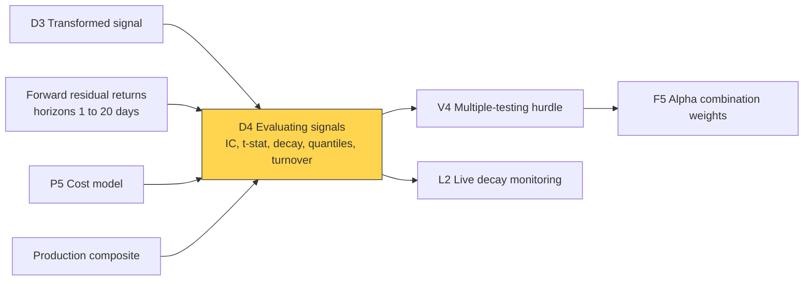
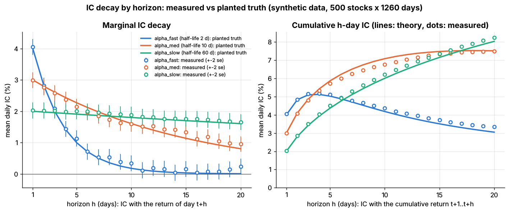

# Evaluating signals

> **TL;DR**
>
> - The core metric is the information coefficient (IC): each day's cross-sectional correlation of the signal with subsequent residual returns.
> - Real single signals have daily ICs of about 0.005–0.03; stability, decay, turnover and cost separate them.
> - Mean IC ÷ its sd, annualized, approximates the pre-cost Sharpe: the Fundamental Law in disguise.
> - Overlapping returns inflate t-stats (Lab 11: naive 45 vs Newey–West 25, synthetic lab result).
> - A new signal earns a positive weight only if its IR exceeds its correlation with the book times the book's IR.

**Level:** Core · **Pipeline stage:** signal · **Last verified:** 2026-11

| Field | Value |
|---|---|
| Purpose (the question it answers) | Does the signal predict residual returns, at what horizon, how reliably, net of costs and of the existing book? |
| Inputs → Outputs | Signal, forward residual returns, costs, production composite → IC, t-stat, decay, quantile spreads, turnover, net spread, marginal value |
| Used by strategies | [Cross-sectional alpha](../../02-strategies/d-mid-frequency-alpha/cross-sectional-alpha-and-neutralization.md) · [Fundamental signals](../../02-strategies/d-mid-frequency-alpha/fundamental-quant-signals.md) · [Revisions](../../02-strategies/d-mid-frequency-alpha/analyst-revisions-and-sentiment.md) · [Earnings](../../02-strategies/d-mid-frequency-alpha/earnings-and-event-driven.md) · [Alt data](../../02-strategies/d-mid-frequency-alpha/alternative-data.md) · [NLP](../../02-strategies/d-mid-frequency-alpha/nlp-and-llm-signals.md) · [ML short-horizon](../../02-strategies/c-statistical-arbitrage/ml-driven-short-horizon-alpha.md) · [Reversal](../../02-strategies/c-statistical-arbitrage/short-term-cross-sectional-reversal.md) · [Factor-residual](../../02-strategies/c-statistical-arbitrage/factor-residual-mean-reversion.md) · [Stat arb](../../02-strategies/c-statistical-arbitrage/stat-arb-overview-and-history.md) · [Factor investing](../../02-strategies/e-risk-premia-and-factors/factor-investing-fundamentals.md) · [Value and quality](../../02-strategies/e-risk-premia-and-factors/value-quality-low-vol.md) · [Momentum](../../02-strategies/e-risk-premia-and-factors/momentum.md) |
| Latency / compute regime | Research batch: seconds for 3,000 stocks × 20 years × 20 horizons `[Estimate]` |
| Key parameters | Horizons 1–20 days; Newey–West lags h − 1; 5–10 quantiles; t-hurdle 3.0; 3–5+ years |
| Main failure modes | Factor bets in total-return IC; overlap-inflated t-stats; look-ahead; microcap IC; multiple testing |
| Lab | [Lab 11](https://github.com/FrankHuang94/quant_trading_claude/tree/main/labs/11-signal-transforms-ic) |

## Intuition

Like a credit-scoring model, a signal is judged across thousands of names, not one trade. The [IC](../../09-reference/glossary.md#information-coefficient-ic) scores each day: the cross-sectional correlation between today's signal and the returns that follow. With 500 stocks a day's IC carries noise of about 0.045, so the signal lives in the multi-year average.

## Where it sits in the pipeline



## The algorithm

1. **Align** the signal at the close of t with [residual returns](../../09-reference/glossary.md#residual-return) over t+1…t+h.
2. **IC series:** Pearson IC and [rank IC](../../09-reference/glossary.md#rank-ic) per date.
3. **t-stat** = mean IC ÷ (sd ÷ √T); Newey–West with h − 1 lags for overlapping windows.
4. **Decay:** IC against day t+k's return, k = 1…20; fit a·d^k; [half-life](../../09-reference/glossary.md#half-life) = ln 0.5 ÷ ln d.
5. **Quantiles:** monotonic returns and the top-minus-bottom spread.
6. **Turnover and cost:** autocorrelation ρ; [turnover](../../09-reference/glossary.md#turnover) grows with √(1 − ρ); net = gross − cost.
7. **Marginal value and trial count** ([V4](../c-validation-and-backtesting/overfitting-and-multiple-testing.md)).

```python
import numpy as np
import pandas as pd

# ic_series and ic_tstat follow Lab 11's lab.py. signal, resid_ret: T x N DataFrames (dates x
# stocks); the signal is known at the close of t. Simplified: no universe filters or weights.

def ic_series(signal, fwd_ret, method="pearson"):
    s, r = signal.align(fwd_ret, join="inner")
    s, r = s.where(r.notna()), r.where(s.notna())             # same names on both sides
    if method == "spearman":                                  # rank IC
        s, r = s.rank(axis=1), r.rank(axis=1)
    s, r = s.sub(s.mean(axis=1), axis=0), r.sub(r.mean(axis=1), axis=0)
    return (s * r).sum(axis=1) / np.sqrt((s * s).sum(axis=1) * (r * r).sum(axis=1))

def ic_tstat(ic, lags=0):
    """t-stat of the mean IC; Newey-West with lags = h - 1 when h-day windows overlap."""
    x = ic.dropna().to_numpy()
    n, e = x.size, x - x.mean()
    var = e @ e / n
    for k in range(1, lags + 1):
        var += 2 * (1 - k / (lags + 1)) * (e[k:] @ e[:-k]) / n    # Bartlett weights
    return x.mean() / np.sqrt(var / n)

def evaluate(signal, resid_ret, cost_bps=8.0, max_h=20):
    fwd1 = resid_ret.shift(-1)                                 # day t+1 return, aligned at t
    ic1 = ic_series(signal, fwd1)
    decay = np.array([ic_series(signal, resid_ret.shift(-(1 + k))).mean() for k in range(max_h)])
    k, ok = np.arange(max_h), decay > 0.25 * decay[0]          # fit only lags clear of noise
    d = np.exp(np.polyfit(k[ok], np.log(decay[ok]), 1)[0])     # IC_k = a * d**k (lab: curve_fit)
    rho = ic_series(signal, signal.shift(1)).mean()            # day-over-day autocorrelation
    q = np.ceil(signal.rank(axis=1, pct=True) * 5)             # quintile labels 1..5
    q_ret = [1e4 * fwd1.where(q == j).stack().mean() for j in range(1, 6)]   # bps per day
    spread = q_ret[4] - q_ret[0]                               # $1 long Q5, $1 short Q1
    turnover = 1.1 * np.sqrt(2 * (1 - rho))                    # sd of daily score change; 1.1 fits Lab 11
    return dict(ic=ic1.mean(), rank_ic=ic_series(signal, fwd1, "spearman").mean(),
                t_stat=ic_tstat(ic1), ic_ratio_annual=ic1.mean() / ic1.std() * np.sqrt(252),
                half_life=np.log(0.5) / np.log(d), autocorr=rho, quintile_bps=q_ret,
                monotone=bool(np.all(np.diff(q_ret) > 0)), spread_gross=spread,
                spread_net=spread - 2 * turnover * cost_bps)   # cost_bps: per $ traded, one way
```

## Worked example with numbers

**A. One date's IC (illustrative).** Scores −1.5, −0.5, 0, +0.5, +1.5 for stocks A–E; next-day residual returns −20, +30, −10, 0, +50 bps.

- **Pearson:** deviations from the +10 mean return are −30, +20, −20, −10, +40. Σ score × deviation = 90, Σ score² = 5, Σ deviation² = 3,400, so IC = 90 ÷ √17,000 = 0.69.
- **Rank:** return ranks 1, 4, 2, 3, 5; squared rank gaps sum to 6; 1 − 36 ÷ 120 = 0.70.
- **One takeover:** A (score −1.5) jumps +500 bps: Pearson IC −0.71, rank IC −0.30. Five names are noise anyway (sd ≈ 0.45).

**B. From a series to a verdict.** Lab 11's `alpha_med`: daily IC 0.030, sd 0.0443 (near 1/√500 = 0.0447), 1,259 days (synthetic lab result). Standard error 0.0443 ÷ √1,259 = 0.00125, t ≈ 24. Annualized IC ratio 0.030 ÷ 0.0443 × √252 ≈ 10.7, the [Fundamental Law](../../09-reference/glossary.md#fundamental-law-of-active-management)'s 0.03 × √(500 × 252) = 10.6. Realistic (illustrative): IC 0.01, sd 0.10 gives 1.6 a year; t reaches 3.0 after 3.6 years.

**C. Overlap.** `alpha_med`'s 5-day IC is 0.057. Sampled daily, adjacent windows share four days: naive t 45.1, Newey–West (4 lags) 25.2 (synthetic lab result).

**D. Quintiles.** `alpha_med`'s quintile returns rise monotonically from −6.6 to +6.4 bps/day; Q5 − Q1 is 13.1 gross and 6.3 net at 41% daily turnover (synthetic lab result).

## Key parameters and how practitioners tune them

- **Pearson vs rank:** report both; rank IC shrugs off takeovers and bad prints `[Lore]`.
- **Quantiles:** 5 for 500 names, 10 for 3,000 `[Lore]`.
- **Hurdle:** t > 3.0 for a new factor (Harvey, Liu & Zhu 2016) `[Verified]`.

## Textbook version vs what firms actually do

- **Fundamental Law:** IR ≈ IC × √breadth (Grinold 1989), times a transfer coefficient (Clarke, de Silva & Thorley 2002) `[Verified]`.
- **IC volatility:** Qian & Hua (2004) estimate IR as mean IC ÷ sd of IC, since IC varies over time `[Reported]`. Daily IC 0.01 at Sharpe 1.5 implies IC sd ≈ 0.11, five times the sampling noise of 2,000 names `[Estimate]`.
- **Real alphas:** of 4,000 WorldQuant US-equity alphas (holding 0.7–19 days), the positive-Sharpe ones had a median Sharpe of 1.49 before costs; cents per share scaled as 1/turnover (Kakushadze & Tulchinsky 2016) `[Verified]`.
- **Costs:** anomalies with monthly turnover under 50% mostly survive costs; faster ones mostly do not (Novy-Marx & Velikov 2016) `[Verified]`.
- **Tooling:** Alphalens reports rank IC, quantile returns, turnover and rank autocorrelation `[Verified]`. Patton & Timmermann (2010) test monotonicity formally `[Verified]`.

## How to tell if it's working

- **Recover a planted truth:** Lab 11 measures ICs 0.041/0.030/0.020 vs planted 0.04/0.03/0.02, and half-lives 2.2/11.5/60.0 vs 2/10/60 days (synthetic lab result).
- **Noise looks like noise:** one of 20 noise signals has |t| > 2 (synthetic lab result); within-date shuffled returns should give IC ≈ 0.
- **Calibrate the Sharpe.** Lab 11's quintile books show gross Sharpe 6.3–12.6, net 2.6–4.4 (synthetic lab result): stylized, since clean ICs of 0.02–0.04 across 500 stocks give about 10 before costs. Real single signals net roughly 0.3–1.5 `[Estimate]` (the WorldQuant gross median, less costs and decay). Trust the ordering: `alpha_fast` loses 80% of its spread to costs, `alpha_slow` 30%.



*Lab 11, synthetic data. Left: IC with day t+h's return, measured (±2 se) vs planted. Right: IC with the cumulative t+1…t+h return; the fast alpha peaks near 4 days, the slow one still rises at 20.*

## Failure modes and pitfalls

- **Total-return IC:** factor noise; Lab 11's dirty signal had IC sd 0.075, 0.040 neutralized ([D3](signal-transforms.md)).
- **Overlap** without Newey–West; **look-ahead** in return windows.
- **Microcap IC:** check by size bucket.
- **[Multiple testing](../../09-reference/glossary.md#multiple-testing)** and **[decay](../../09-reference/glossary.md#alpha-decay):** published predictors lose ~58% of their return (McLean & Pontiff 2016) `[Verified]`.

## How practitioners talk about it

- "What's the rank IC on residuals?" → Skill net of factor moves.
- "Great IC, brutal decay." → It works for a day; costs eat it.
- "Newey–West that t-stat." → Your windows overlap.
- "It's 0.7 correlated with our reversal composite." → Little marginal value.
- "What's the ICIR?" → Mean IC over its volatility: consistency, not size.

## Questions you could ask a quant about this

1. Rank or Pearson IC, on residual returns, at what horizon? (basic)
2. How fast does your IC decay? (basic)
3. How do you handle overlapping horizons? (informed)
4. How do you measure marginal contribution to the book? (informed)
5. How many variants did you try, and what hurdle applies? (sharp)
6. How much backtest IC survives live? 🔒 (sharp)

## Go deeper

<details markdown="1">
<summary>Math: IC as a slope, breadth, Newey–West, marginal value</summary>

**IC as a [Fama–MacBeth](../../09-reference/glossary.md#fama-macbeth-regression) slope:** on a z-scored signal, slope $= IC_t \cdot \mathrm{sd}(r_t)$.

**Breadth:** with no skill, $\mathrm{sd}(IC) \approx 1/\sqrt{N}$, so $t \approx IC\sqrt{NT}$ and the annualized IC ratio is $IC\sqrt{252N}$: Grinold's law with breadth $252N$.

**Newey–West** with $L = h-1$ lags and IC autocovariances $\hat\gamma_j$:

$$
\hat\sigma^2_{NW} = \hat\gamma_0 + 2\sum_{j=1}^{L}\Big(1 - \frac{j}{L+1}\Big)\hat\gamma_j .
$$

**Marginal value** of two optimally weighted streams with correlation $\rho$:

$$
IR_{12}^2 = \frac{IR_1^2 + IR_2^2 - 2\rho\, IR_1 IR_2}{1-\rho^2},
$$

which gives stream 2 a positive weight only if $IR_2 > \rho\, IR_1$ (below that, only as a short hedge). Illustrative: 1.5 and 1.0 give 1.505 at $\rho = 0.6$, 1.80 at $\rho = 0$.

</details>

## Related pages

- [Signal transforms](signal-transforms.md) · [Feature engineering](feature-engineering.md)
- [Overfitting and multiple testing](../c-validation-and-backtesting/overfitting-and-multiple-testing.md) · [Backtest pitfalls](../c-validation-and-backtesting/backtest-pitfalls.md)
- [Alpha combination](../b-forecasting-models/alpha-combination-and-ensembling.md) · [Alpha decay detection](../g-live-trading/alpha-decay-detection-and-model-retirement.md)
- [Cross-sectional alpha and neutralization](../../02-strategies/d-mid-frequency-alpha/cross-sectional-alpha-and-neutralization.md)

## Sources

- [Verified] Grinold, R. C. (1989). "The Fundamental Law of Active Management." *Journal of Portfolio Management* 15(3), 30–37. <https://doi.org/10.3905/jpm.1989.409211> (accessed 2026-11)
- [Verified] Clarke, R., de Silva, H. & Thorley, S. (2002). "Portfolio Constraints and the Fundamental Law of Active Management." *Financial Analysts Journal* 58(5), 48–66. <https://doi.org/10.2469/faj.v58.n5.2468> (accessed 2026-11)
- [Reported] Qian, E. & Hua, R. (2004). "Active Risk and Information Ratio." *Journal of Investment Management* 2(3), 1–15. <https://joim.com/active-risk-and-information-ratio/> (accessed 2026-11)
- [Verified] Kakushadze, Z. & Tulchinsky, I. (2016). "Performance v. Turnover: A Story by 4,000 Alphas." *Journal of Investment Strategies* 5(2), 75–89. <https://arxiv.org/abs/1509.08110> (accessed 2026-11)
- [Verified] Novy-Marx, R. & Velikov, M. (2016). "A Taxonomy of Anomalies and Their Trading Costs." *Review of Financial Studies* 29(1), 104–147. <https://doi.org/10.1093/rfs/hhv063> (accessed 2026-11)
- [Verified] Newey, W. K. & West, K. D. (1987). "A Simple, Positive Semi-Definite, Heteroskedasticity and Autocorrelation Consistent Covariance Matrix." *Econometrica* 55(3), 703–708. <https://doi.org/10.2307/1913610> (accessed 2026-11)
- [Verified] Harvey, C. R., Liu, Y. & Zhu, H. (2016). "… and the Cross-Section of Expected Returns." *Review of Financial Studies* 29(1), 5–68. <https://doi.org/10.1093/rfs/hhv059> (accessed 2026-11)
- [Verified] McLean, R. D. & Pontiff, J. (2016). "Does Academic Research Destroy Stock Return Predictability?" *Journal of Finance* 71(1), 5–32. <https://doi.org/10.1111/jofi.12365> (accessed 2026-11)
- [Verified] Patton, A. J. & Timmermann, A. (2010). "Monotonicity in Asset Returns: New Tests with Applications to the Term Structure, the CAPM, and Portfolio Sorts." *Journal of Financial Economics* 98(3), 605–625. <https://doi.org/10.1016/j.jfineco.2010.06.006> (accessed 2026-11)
- [Verified] Fama, E. F. & MacBeth, J. D. (1973). "Risk, Return, and Equilibrium: Empirical Tests." *Journal of Political Economy* 81(3), 607–636. <https://doi.org/10.1086/260061> (accessed 2026-11)
- [Verified] Quantopian. Alphalens (performance analysis of predictive alpha factors). GitHub. <https://github.com/quantopian/alphalens> (accessed 2026-11)
